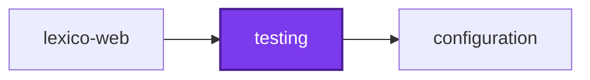
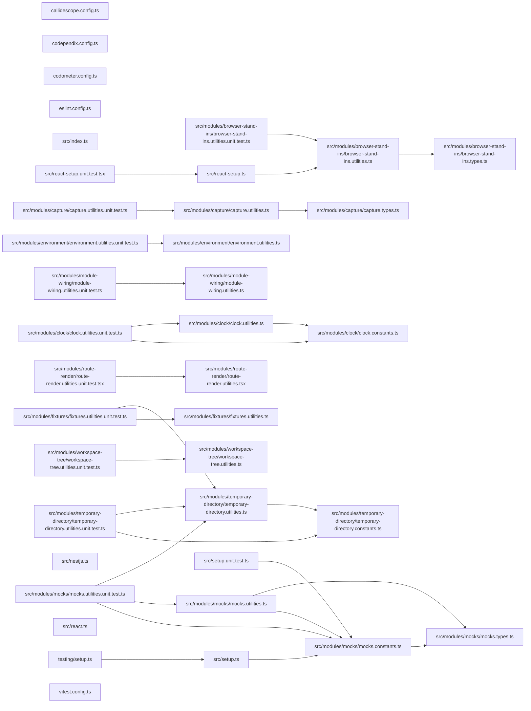

# 🧪 Testing

The shared test code every project's tests can import.

## Purpose

Tests across the workspace repeated the same boilerplate: a Vitest setup file
copied into every project, hand-rolled temporary directories, output capture,
and environment edits. This package holds that code once, laid out as
subpath exports.

| Entry                           | Holds                                                                                                        | Depends on                |
| ------------------------------- | ------------------------------------------------------------------------------------------------------------ | ------------------------- |
| `@codebase/testing`             | Temporary directories, output and exit-code capture, environment overrides, the fixed clock, fixtures, mocks | nothing in the workspace  |
| `@codebase/testing/setup`       | The shared Vitest setup file                                                                                 | nothing in the workspace  |
| `@codebase/testing/nestjs`      | Module-wiring assertions and the Nx workspace tree                                                           | nothing in the workspace  |
| `@codebase/testing/react`       | The route-render helper and the `createServerFn` and `matchMedia` stand-ins                                  | TanStack Router           |
| `@codebase/testing/react/setup` | The shared jsdom setup                                                                                       | Testing Library           |

## Usage

Add the package as a development dependency:

```jsonc
// package.json
"devDependencies": { "@codebase/testing": "workspace:*" }
```

A project whose shipped `testing/` files import it lists it under
`dependencies` instead.

### Core

```ts
import {
  captureExitCode,
  captureOutput,
  createTemporaryDirectory,
  mockDates,
  overrideEnvironment,
} from "@codebase/testing";

describe("the command line", () => {
  mockDates();

  it("writes its report", async () => {
    const directory = createTemporaryDirectory("report");
    const output = captureOutput();
    const exitCode = captureExitCode();
    overrideEnvironment({ LOG_LEVEL: "silent" });

    await run(["report", directory]);

    expect(output.stdout()).toContain("written");
    expect(exitCode()).toBeUndefined();
  });
});
```

Every helper that changes global state undoes it once the test finishes, so a
test cannot leak a directory, a stream spy, an exit code, or a variable into
the next. `useTemporaryDirectory` is the suite-level variant: one directory
from the suite's first test to its last.

`loadFixture(import.meta.url, "fixtures/page.html")` reads a fixture relative
to the test file. `mockChildProcess` and `mockPartially` build `vi.mock`
factories, `stubFetch` queues responses for `fetch`, and `answerPrompts`
queues answers for the `promptsMock` stand-in of the `prompts` package.

### Nest

`@codebase/testing/nestjs` exports `expectModuleProvides`,
`expectModuleExports`, and `expectModuleImports` to assert a module's
`@Module` metadata without reading it by hand. The LoggerService-aware
testing-module builder lives in
[`@codebase/observability/testing`](../observability/README.md#testing-helpers).

### Postgres

`startDatabaseTestingModule` starts a migrated throwaway Postgres and compiles
a Nest testing module connected to it; `startPostgresContainer` starts the
container alone. Both are exported by `@codebase/persistence/testing`. See
the [persistence README](../persistence/README.md#integration-tests) for the
options. Docker must be running.

### React

```ts
import { renderRoute } from "@codebase/testing/react";

await renderRoute(getRouter(), "/search");
```

`renderRoute` swaps the root route's document shell for one that renders the
page alone, so no test has to mock `__root`. A web application points
`createServerFn` at `createServerFunctionStandIn` from its setup file.

## Dependency rules

- This package imports nothing from the workspace, so any project can use
  it without inheriting a dependency edge.
- Adapters that need `interface`, `persistence`, or `observability` live with
  those packages and are exported from their `/testing` entries.
- A project tagged `framework:react` may import this package from its tests
  and `testing/` harnesses only.

## Test

```bash
nx run testing:vitest
```

## 👔 Conformetry

This project was generated from the [nestjs-service-project](../../../configuration/conformetry-templates/nestjs-service-project) conformetry template.

## 🕸️ Codependix

Dependency graphs exported by [codependix](https://github.com/Organizzolini/codebase/tree/main/projects/ic-suite/codependix/codependix-cli), regenerated by `nx run configuration:codependix:write`.

### Nx Neighborhood

<!-- codependix:start name="codependix-nx-projects" -->

<!-- codependix:end name="codependix-nx-projects" -->

### File Imports

<!-- codependix:start name="codependix-file-imports" -->

<!-- codependix:end name="codependix-file-imports" -->
