## 🕸️ Codependix

Dependency graphs exported by [codependix](https://github.com/Organizzolini/codebase/tree/main/projects/ic-suite/codependix/codependix-cli), regenerated by `nx run configuration:codependix:write`.

### Nx Neighborhood

```mermaid
graph LR
  caelundas_api["caelundas-api"]
  caelundas_cli["caelundas-cli"]
  caelundas_db["caelundas-db"]
  caelundas_web["caelundas-web"]
  callidescope_agents["callidescope-agents"]
  callidescope_cli["callidescope-cli"]
  callidescope_configuration["callidescope-configuration"]
  callidescope_core["callidescope-core"]
  callidescope_examples["callidescope-examples"]
  callidescope_graph["callidescope-graph"]
  callidescope_nx["callidescope-nx"]
  callidescope_output["callidescope-output"]
  codependix_agents["codependix-agents"]
  codependix_boundaries["codependix-boundaries"]
  codependix_cli["codependix-cli"]
  codependix_configuration["codependix-configuration"]
  codependix_core["codependix-core"]
  codependix_examples["codependix-examples"]
  codependix_file_imports["codependix-file-imports"]
  codependix_nestjs_modules["codependix-nestjs-modules"]
  codependix_nx["codependix-nx"]
  codependix_nx_projects["codependix-nx-projects"]
  codependix_output["codependix-output"]
  codometer_agents["codometer-agents"]
  codometer_cli["codometer-cli"]
  codometer_configuration["codometer-configuration"]
  codometer_core["codometer-core"]
  codometer_examples["codometer-examples"]
  codometer_languages["codometer-languages"]
  codometer_measurement["codometer-measurement"]
  codometer_output["codometer-output"]
  coinagerie_cli["coinagerie-cli"]
  coinagerie_configuration["coinagerie-configuration"]
  coinagerie_core["coinagerie-core"]
  coinagerie_examples["coinagerie-examples"]
  coinagerie_languages["coinagerie-languages"]
  coinagerie_nx["coinagerie-nx"]
  coinagerie_output["coinagerie-output"]
  coinagerie_vocabulary["coinagerie-vocabulary"]
  compliance["compliance"]
  configuration["configuration"]
  conformetry_agents["conformetry-agents"]
  conformetry_cli["conformetry-cli"]
  conformetry_configuration["conformetry-configuration"]
  conformetry_core["conformetry-core"]
  conformetry_examples["conformetry-examples"]
  conformetry_generation["conformetry-generation"]
  conformetry_languages["conformetry-languages"]
  conformetry_nx["conformetry-nx"]
  conformetry_output["conformetry-output"]
  conformetry_validation["conformetry-validation"]
  deployment["deployment"]
  documentation["documentation"]
  installation["installation"]
  integration["integration"]
  interface["interface"]
  lexico_api["lexico-api"]
  lexico_cli["lexico-cli"]
  lexico_db["lexico-db"]
  lexico_web["lexico-web"]
  meanderaw_cli["meanderaw-cli"]
  meanderaw_web["meanderaw-web"]
  observability["observability"]
  persistence["persistence"]
  synchronization["synchronization"]
  testing["testing"]
  validation["validation"]
  caelundas_api --> testing
  caelundas_cli --> testing
  caelundas_db --> testing
  caelundas_web --> testing
  callidescope_agents --> testing
  callidescope_cli --> testing
  callidescope_configuration --> testing
  callidescope_core --> testing
  callidescope_examples --> testing
  callidescope_graph --> testing
  callidescope_nx --> testing
  callidescope_output --> testing
  codependix_agents --> testing
  codependix_boundaries --> testing
  codependix_cli --> testing
  codependix_configuration --> testing
  codependix_core --> testing
  codependix_examples --> testing
  codependix_file_imports --> testing
  codependix_nestjs_modules --> testing
  codependix_nx --> testing
  codependix_nx_projects --> testing
  codependix_output --> testing
  codometer_agents --> testing
  codometer_cli --> testing
  codometer_configuration --> testing
  codometer_core --> testing
  codometer_examples --> testing
  codometer_languages --> testing
  codometer_measurement --> testing
  codometer_output --> testing
  coinagerie_cli --> testing
  coinagerie_configuration --> testing
  coinagerie_core --> testing
  coinagerie_examples --> testing
  coinagerie_languages --> testing
  coinagerie_nx --> testing
  coinagerie_output --> testing
  coinagerie_vocabulary --> testing
  compliance --> testing
  conformetry_agents --> testing
  conformetry_cli --> testing
  conformetry_configuration --> testing
  conformetry_core --> testing
  conformetry_examples --> testing
  conformetry_generation --> testing
  conformetry_languages --> testing
  conformetry_nx --> testing
  conformetry_output --> testing
  conformetry_validation --> testing
  deployment --> testing
  documentation --> testing
  installation --> testing
  integration --> testing
  interface --> testing
  lexico_api --> testing
  lexico_cli --> testing
  lexico_db --> testing
  lexico_web --> testing
  meanderaw_cli --> testing
  meanderaw_web --> testing
  persistence --> testing
  synchronization --> testing
  testing --> configuration
  testing --> observability
  validation --> testing
  classDef subject fill:#7c3aed,color:#fff,stroke:#4c1d95,stroke-width:2px
  class testing subject
```

<!-- codependix:start name="codependix-nx-projects" -->

<!-- codependix:end name="codependix-nx-projects" -->

### File Imports

<!-- codependix:start name="codependix-file-imports" -->
```mermaid
graph LR
  file_configuration_callidescope_config_ts["configuration/callidescope.config.ts"]
  file_configuration_codependix_config_ts["configuration/codependix.config.ts"]
  file_configuration_codometer_config_ts["configuration/codometer.config.ts"]
  file_configuration_coinagerie_config_ts["configuration/coinagerie.config.ts"]
  file_configuration_eslint_config_ts["configuration/eslint.config.ts"]
  file_configuration_vitest_config_ts["configuration/vitest.config.ts"]
  file_src_end_to_end_ts["src/end-to-end.ts"]
  file_src_entries_unit_test_ts["src/entries.unit.test.ts"]
  file_src_file_system_ts["src/file-system.ts"]
  file_src_index_ts["src/index.ts"]
  file_src_modules_browser_stand_ins_browser_stand_ins_types_ts["src/modules/browser-stand-ins/browser-stand-ins.types.ts"]
  file_src_modules_browser_stand_ins_browser_stand_ins_utilities_ts["src/modules/browser-stand-ins/browser-stand-ins.utilities.ts"]
  file_src_modules_browser_stand_ins_browser_stand_ins_utilities_unit_test_ts["src/modules/browser-stand-ins/browser-stand-ins.utilities.unit.test.ts"]
  file_src_modules_browser_stand_ins_modules_route_render_route_render_utilities_tsx["src/modules/browser-stand-ins/modules/route-render/route-render.utilities.tsx"]
  file_src_modules_browser_stand_ins_modules_route_render_route_render_utilities_unit_test_tsx["src/modules/browser-stand-ins/modules/route-render/route-render.utilities.unit.test.tsx"]
  file_src_modules_capture_capture_types_ts["src/modules/capture/capture.types.ts"]
  file_src_modules_capture_capture_utilities_ts["src/modules/capture/capture.utilities.ts"]
  file_src_modules_capture_capture_utilities_unit_test_ts["src/modules/capture/capture.utilities.unit.test.ts"]
  file_src_modules_clock_clock_constants_ts["src/modules/clock/clock.constants.ts"]
  file_src_modules_clock_clock_utilities_ts["src/modules/clock/clock.utilities.ts"]
  file_src_modules_clock_clock_utilities_unit_test_ts["src/modules/clock/clock.utilities.unit.test.ts"]
  file_src_modules_command_command_constants_ts["src/modules/command/command.constants.ts"]
  file_src_modules_command_command_types_ts["src/modules/command/command.types.ts"]
  file_src_modules_command_command_utilities_ts["src/modules/command/command.utilities.ts"]
  file_src_modules_command_command_utilities_unit_test_ts["src/modules/command/command.utilities.unit.test.ts"]
  file_src_modules_command_modules_example_run_example_run_types_ts["src/modules/command/modules/example-run/example-run.types.ts"]
  file_src_modules_command_modules_example_run_example_run_utilities_ts["src/modules/command/modules/example-run/example-run.utilities.ts"]
  file_src_modules_command_modules_example_run_example_run_utilities_unit_test_ts["src/modules/command/modules/example-run/example-run.utilities.unit.test.ts"]
  file_src_modules_command_modules_source_command_source_command_types_ts["src/modules/command/modules/source-command/source-command.types.ts"]
  file_src_modules_command_modules_source_command_source_command_utilities_ts["src/modules/command/modules/source-command/source-command.utilities.ts"]
  file_src_modules_command_modules_source_command_source_command_utilities_unit_test_ts["src/modules/command/modules/source-command/source-command.utilities.unit.test.ts"]
  file_src_modules_environment_environment_utilities_ts["src/modules/environment/environment.utilities.ts"]
  file_src_modules_environment_environment_utilities_unit_test_ts["src/modules/environment/environment.utilities.unit.test.ts"]
  file_src_modules_file_system_mock_file_system_mock_constants_ts["src/modules/file-system-mock/file-system-mock.constants.ts"]
  file_src_modules_file_system_mock_file_system_mock_types_ts["src/modules/file-system-mock/file-system-mock.types.ts"]
  file_src_modules_file_system_mock_file_system_mock_utilities_ts["src/modules/file-system-mock/file-system-mock.utilities.ts"]
  file_src_modules_file_system_mock_file_system_mock_utilities_unit_test_ts["src/modules/file-system-mock/file-system-mock.utilities.unit.test.ts"]
  file_src_modules_file_tree_file_tree_types_ts["src/modules/file-tree/file-tree.types.ts"]
  file_src_modules_file_tree_file_tree_utilities_ts["src/modules/file-tree/file-tree.utilities.ts"]
  file_src_modules_file_tree_file_tree_utilities_unit_test_ts["src/modules/file-tree/file-tree.utilities.unit.test.ts"]
  file_src_modules_file_tree_modules_fixtures_fixtures_utilities_ts["src/modules/file-tree/modules/fixtures/fixtures.utilities.ts"]
  file_src_modules_file_tree_modules_fixtures_fixtures_utilities_unit_test_ts["src/modules/file-tree/modules/fixtures/fixtures.utilities.unit.test.ts"]
  file_src_modules_file_tree_modules_workspace_tree_workspace_tree_utilities_ts["src/modules/file-tree/modules/workspace-tree/workspace-tree.utilities.ts"]
  file_src_modules_file_tree_modules_workspace_tree_workspace_tree_utilities_unit_test_ts["src/modules/file-tree/modules/workspace-tree/workspace-tree.utilities.unit.test.ts"]
  file_src_modules_mocks_mocks_constants_ts["src/modules/mocks/mocks.constants.ts"]
  file_src_modules_mocks_mocks_types_ts["src/modules/mocks/mocks.types.ts"]
  file_src_modules_mocks_mocks_utilities_ts["src/modules/mocks/mocks.utilities.ts"]
  file_src_modules_mocks_mocks_utilities_unit_test_ts["src/modules/mocks/mocks.utilities.unit.test.ts"]
  file_src_modules_nx_plugin_sandbox_modules_packed_sandbox_packed_sandbox_types_ts["src/modules/nx-plugin-sandbox/modules/packed-sandbox/packed-sandbox.types.ts"]
  file_src_modules_nx_plugin_sandbox_modules_packed_sandbox_packed_sandbox_utilities_ts["src/modules/nx-plugin-sandbox/modules/packed-sandbox/packed-sandbox.utilities.ts"]
  file_src_modules_nx_plugin_sandbox_modules_packed_sandbox_packed_sandbox_utilities_unit_test_ts["src/modules/nx-plugin-sandbox/modules/packed-sandbox/packed-sandbox.utilities.unit.test.ts"]
  file_src_modules_nx_plugin_sandbox_modules_tarball_sandbox_tarball_sandbox_constants_ts["src/modules/nx-plugin-sandbox/modules/tarball-sandbox/tarball-sandbox.constants.ts"]
  file_src_modules_nx_plugin_sandbox_modules_tarball_sandbox_tarball_sandbox_types_ts["src/modules/nx-plugin-sandbox/modules/tarball-sandbox/tarball-sandbox.types.ts"]
  file_src_modules_nx_plugin_sandbox_modules_tarball_sandbox_tarball_sandbox_utilities_ts["src/modules/nx-plugin-sandbox/modules/tarball-sandbox/tarball-sandbox.utilities.ts"]
  file_src_modules_nx_plugin_sandbox_modules_tarball_sandbox_tarball_sandbox_utilities_unit_test_ts["src/modules/nx-plugin-sandbox/modules/tarball-sandbox/tarball-sandbox.utilities.unit.test.ts"]
  file_src_modules_nx_plugin_sandbox_nx_plugin_sandbox_constants_ts["src/modules/nx-plugin-sandbox/nx-plugin-sandbox.constants.ts"]
  file_src_modules_nx_plugin_sandbox_nx_plugin_sandbox_functions_ts["src/modules/nx-plugin-sandbox/nx-plugin-sandbox.functions.ts"]
  file_src_modules_nx_plugin_sandbox_nx_plugin_sandbox_types_ts["src/modules/nx-plugin-sandbox/nx-plugin-sandbox.types.ts"]
  file_src_modules_nx_plugin_sandbox_nx_plugin_sandbox_utilities_ts["src/modules/nx-plugin-sandbox/nx-plugin-sandbox.utilities.ts"]
  file_src_modules_nx_plugin_sandbox_nx_plugin_sandbox_utilities_unit_test_ts["src/modules/nx-plugin-sandbox/nx-plugin-sandbox.utilities.unit.test.ts"]
  file_src_modules_temporary_directory_modules_working_directory_working_directory_utilities_ts["src/modules/temporary-directory/modules/working-directory/working-directory.utilities.ts"]
  file_src_modules_temporary_directory_modules_working_directory_working_directory_utilities_unit_test_ts["src/modules/temporary-directory/modules/working-directory/working-directory.utilities.unit.test.ts"]
  file_src_modules_temporary_directory_temporary_directory_constants_ts["src/modules/temporary-directory/temporary-directory.constants.ts"]
  file_src_modules_temporary_directory_temporary_directory_utilities_ts["src/modules/temporary-directory/temporary-directory.utilities.ts"]
  file_src_modules_temporary_directory_temporary_directory_utilities_unit_test_ts["src/modules/temporary-directory/temporary-directory.utilities.unit.test.ts"]
  file_src_modules_testing_module_modules_boot_module_boot_module_utilities_ts["src/modules/testing-module/modules/boot-module/boot-module.utilities.ts"]
  file_src_modules_testing_module_modules_boot_module_boot_module_utilities_unit_test_ts["src/modules/testing-module/modules/boot-module/boot-module.utilities.unit.test.ts"]
  file_src_modules_testing_module_modules_module_wiring_module_wiring_utilities_ts["src/modules/testing-module/modules/module-wiring/module-wiring.utilities.ts"]
  file_src_modules_testing_module_modules_module_wiring_module_wiring_utilities_unit_test_ts["src/modules/testing-module/modules/module-wiring/module-wiring.utilities.unit.test.ts"]
  file_src_modules_testing_module_testing_module_types_ts["src/modules/testing-module/testing-module.types.ts"]
  file_src_modules_testing_module_testing_module_utilities_ts["src/modules/testing-module/testing-module.utilities.ts"]
  file_src_modules_testing_module_testing_module_utilities_unit_test_ts["src/modules/testing-module/testing-module.utilities.unit.test.ts"]
  file_src_nestjs_ts["src/nestjs.ts"]
  file_src_react_setup_ts["src/react-setup.ts"]
  file_src_react_setup_unit_test_tsx["src/react-setup.unit.test.tsx"]
  file_src_react_ts["src/react.ts"]
  file_src_setup_ts["src/setup.ts"]
  file_src_setup_unit_test_ts["src/setup.unit.test.ts"]
  file_testing_fixtures_report_process_main_ts["testing/fixtures/report-process.main.ts"]
  file_testing_fixtures_sample_clock_module_ts["testing/fixtures/sample-clock.module.ts"]
  file_testing_fixtures_sample_clock_service_ts["testing/fixtures/sample-clock.service.ts"]
  file_testing_fixtures_sample_file_reader_ts["testing/fixtures/sample-file-reader.ts"]
  file_testing_fixtures_sample_greeter_service_ts["testing/fixtures/sample-greeter.service.ts"]
  file_testing_fixtures_sample_lifecycle_module_ts["testing/fixtures/sample-lifecycle.module.ts"]
  file_testing_fixtures_sample_lifecycle_service_ts["testing/fixtures/sample-lifecycle.service.ts"]
  file_testing_tarball_fixture_ts["testing/tarball-fixture.ts"]
  file_src_modules_browser_stand_ins_browser_stand_ins_utilities_ts --> file_src_modules_browser_stand_ins_browser_stand_ins_types_ts
  file_src_modules_browser_stand_ins_browser_stand_ins_utilities_unit_test_ts --> file_src_modules_browser_stand_ins_browser_stand_ins_utilities_ts
  file_src_modules_browser_stand_ins_modules_route_render_route_render_utilities_unit_test_tsx --> file_src_modules_browser_stand_ins_modules_route_render_route_render_utilities_tsx
  file_src_modules_capture_capture_utilities_ts --> file_src_modules_capture_capture_types_ts
  file_src_modules_capture_capture_utilities_unit_test_ts --> file_src_modules_capture_capture_utilities_ts
  file_src_modules_clock_clock_utilities_ts --> file_src_modules_clock_clock_constants_ts
  file_src_modules_clock_clock_utilities_unit_test_ts --> file_src_modules_clock_clock_constants_ts
  file_src_modules_clock_clock_utilities_unit_test_ts --> file_src_modules_clock_clock_utilities_ts
  file_src_modules_command_command_utilities_ts --> file_src_modules_command_command_constants_ts
  file_src_modules_command_command_utilities_ts --> file_src_modules_command_command_types_ts
  file_src_modules_command_command_utilities_unit_test_ts --> file_src_modules_command_command_constants_ts
  file_src_modules_command_command_utilities_unit_test_ts --> file_src_modules_command_command_utilities_ts
  file_src_modules_command_modules_example_run_example_run_utilities_ts --> file_src_modules_command_modules_example_run_example_run_types_ts
  file_src_modules_command_modules_example_run_example_run_utilities_ts --> file_src_modules_file_tree_file_tree_utilities_ts
  file_src_modules_command_modules_example_run_example_run_utilities_ts --> file_src_modules_temporary_directory_temporary_directory_utilities_ts
  file_src_modules_command_modules_example_run_example_run_utilities_unit_test_ts --> file_src_modules_command_modules_example_run_example_run_utilities_ts
  file_src_modules_command_modules_example_run_example_run_utilities_unit_test_ts --> file_src_modules_file_tree_file_tree_utilities_ts
  file_src_modules_command_modules_source_command_source_command_utilities_ts --> file_src_modules_command_command_utilities_ts
  file_src_modules_command_modules_source_command_source_command_utilities_ts --> file_src_modules_command_modules_source_command_source_command_types_ts
  file_src_modules_command_modules_source_command_source_command_utilities_unit_test_ts --> file_src_modules_command_modules_source_command_source_command_utilities_ts
  file_src_modules_command_modules_source_command_source_command_utilities_unit_test_ts --> file_testing_fixtures_report_process_main_ts
  file_src_modules_environment_environment_utilities_unit_test_ts --> file_src_modules_environment_environment_utilities_ts
  file_src_modules_file_system_mock_file_system_mock_utilities_ts --> file_src_modules_file_system_mock_file_system_mock_constants_ts
  file_src_modules_file_system_mock_file_system_mock_utilities_ts --> file_src_modules_file_system_mock_file_system_mock_types_ts
  file_src_modules_file_system_mock_file_system_mock_utilities_unit_test_ts --> file_src_file_system_ts
  file_src_modules_file_system_mock_file_system_mock_utilities_unit_test_ts --> file_testing_fixtures_sample_file_reader_ts
  file_src_modules_file_tree_file_tree_utilities_ts --> file_src_modules_file_tree_file_tree_types_ts
  file_src_modules_file_tree_file_tree_utilities_ts --> file_src_modules_temporary_directory_temporary_directory_utilities_ts
  file_src_modules_file_tree_file_tree_utilities_unit_test_ts --> file_src_modules_file_tree_file_tree_utilities_ts
  file_src_modules_file_tree_modules_fixtures_fixtures_utilities_unit_test_ts --> file_src_modules_file_tree_modules_fixtures_fixtures_utilities_ts
  file_src_modules_file_tree_modules_fixtures_fixtures_utilities_unit_test_ts --> file_src_modules_temporary_directory_temporary_directory_utilities_ts
  file_src_modules_file_tree_modules_workspace_tree_workspace_tree_utilities_unit_test_ts --> file_src_modules_file_tree_modules_workspace_tree_workspace_tree_utilities_ts
  file_src_modules_mocks_mocks_constants_ts --> file_src_modules_mocks_mocks_types_ts
  file_src_modules_mocks_mocks_utilities_ts --> file_src_modules_mocks_mocks_constants_ts
  file_src_modules_mocks_mocks_utilities_ts --> file_src_modules_mocks_mocks_types_ts
  file_src_modules_mocks_mocks_utilities_unit_test_ts --> file_src_modules_mocks_mocks_constants_ts
  file_src_modules_mocks_mocks_utilities_unit_test_ts --> file_src_modules_mocks_mocks_types_ts
  file_src_modules_mocks_mocks_utilities_unit_test_ts --> file_src_modules_mocks_mocks_utilities_ts
  file_src_modules_mocks_mocks_utilities_unit_test_ts --> file_src_modules_temporary_directory_temporary_directory_utilities_ts
  file_src_modules_nx_plugin_sandbox_modules_packed_sandbox_packed_sandbox_types_ts --> file_src_modules_command_command_types_ts
  file_src_modules_nx_plugin_sandbox_modules_packed_sandbox_packed_sandbox_types_ts --> file_src_modules_nx_plugin_sandbox_modules_tarball_sandbox_tarball_sandbox_types_ts
  file_src_modules_nx_plugin_sandbox_modules_packed_sandbox_packed_sandbox_types_ts --> file_src_modules_nx_plugin_sandbox_nx_plugin_sandbox_types_ts
  file_src_modules_nx_plugin_sandbox_modules_packed_sandbox_packed_sandbox_utilities_ts --> file_src_modules_nx_plugin_sandbox_modules_packed_sandbox_packed_sandbox_types_ts
  file_src_modules_nx_plugin_sandbox_modules_packed_sandbox_packed_sandbox_utilities_ts --> file_src_modules_nx_plugin_sandbox_modules_tarball_sandbox_tarball_sandbox_types_ts
  file_src_modules_nx_plugin_sandbox_modules_packed_sandbox_packed_sandbox_utilities_ts --> file_src_modules_nx_plugin_sandbox_modules_tarball_sandbox_tarball_sandbox_utilities_ts
  file_src_modules_nx_plugin_sandbox_modules_packed_sandbox_packed_sandbox_utilities_ts --> file_src_modules_nx_plugin_sandbox_nx_plugin_sandbox_types_ts
  file_src_modules_nx_plugin_sandbox_modules_packed_sandbox_packed_sandbox_utilities_ts --> file_src_modules_nx_plugin_sandbox_nx_plugin_sandbox_utilities_ts
  file_src_modules_nx_plugin_sandbox_modules_packed_sandbox_packed_sandbox_utilities_unit_test_ts --> file_src_modules_command_command_types_ts
  file_src_modules_nx_plugin_sandbox_modules_packed_sandbox_packed_sandbox_utilities_unit_test_ts --> file_src_modules_nx_plugin_sandbox_modules_packed_sandbox_packed_sandbox_utilities_ts
  file_src_modules_nx_plugin_sandbox_modules_packed_sandbox_packed_sandbox_utilities_unit_test_ts --> file_src_modules_nx_plugin_sandbox_modules_tarball_sandbox_tarball_sandbox_utilities_ts
  file_src_modules_nx_plugin_sandbox_modules_packed_sandbox_packed_sandbox_utilities_unit_test_ts --> file_src_modules_nx_plugin_sandbox_nx_plugin_sandbox_types_ts
  file_src_modules_nx_plugin_sandbox_modules_packed_sandbox_packed_sandbox_utilities_unit_test_ts --> file_src_modules_nx_plugin_sandbox_nx_plugin_sandbox_utilities_ts
  file_src_modules_nx_plugin_sandbox_modules_tarball_sandbox_tarball_sandbox_types_ts --> file_src_modules_command_command_types_ts
  file_src_modules_nx_plugin_sandbox_modules_tarball_sandbox_tarball_sandbox_utilities_ts --> file_src_modules_command_command_utilities_ts
  file_src_modules_nx_plugin_sandbox_modules_tarball_sandbox_tarball_sandbox_utilities_ts --> file_src_modules_nx_plugin_sandbox_modules_tarball_sandbox_tarball_sandbox_constants_ts
  file_src_modules_nx_plugin_sandbox_modules_tarball_sandbox_tarball_sandbox_utilities_ts --> file_src_modules_nx_plugin_sandbox_modules_tarball_sandbox_tarball_sandbox_types_ts
  file_src_modules_nx_plugin_sandbox_modules_tarball_sandbox_tarball_sandbox_utilities_ts --> file_src_modules_temporary_directory_temporary_directory_utilities_ts
  file_src_modules_nx_plugin_sandbox_modules_tarball_sandbox_tarball_sandbox_utilities_unit_test_ts --> file_src_modules_nx_plugin_sandbox_modules_tarball_sandbox_tarball_sandbox_types_ts
  file_src_modules_nx_plugin_sandbox_modules_tarball_sandbox_tarball_sandbox_utilities_unit_test_ts --> file_src_modules_nx_plugin_sandbox_modules_tarball_sandbox_tarball_sandbox_utilities_ts
  file_src_modules_nx_plugin_sandbox_modules_tarball_sandbox_tarball_sandbox_utilities_unit_test_ts --> file_src_modules_temporary_directory_temporary_directory_utilities_ts
  file_src_modules_nx_plugin_sandbox_modules_tarball_sandbox_tarball_sandbox_utilities_unit_test_ts --> file_testing_tarball_fixture_ts
  file_src_modules_nx_plugin_sandbox_nx_plugin_sandbox_functions_ts --> file_src_modules_command_command_types_ts
  file_src_modules_nx_plugin_sandbox_nx_plugin_sandbox_functions_ts --> file_src_modules_command_command_utilities_ts
  file_src_modules_nx_plugin_sandbox_nx_plugin_sandbox_functions_ts --> file_src_modules_nx_plugin_sandbox_nx_plugin_sandbox_constants_ts
  file_src_modules_nx_plugin_sandbox_nx_plugin_sandbox_functions_ts --> file_src_modules_nx_plugin_sandbox_nx_plugin_sandbox_types_ts
  file_src_modules_nx_plugin_sandbox_nx_plugin_sandbox_types_ts --> file_src_modules_command_command_types_ts
  file_src_modules_nx_plugin_sandbox_nx_plugin_sandbox_types_ts --> file_src_modules_nx_plugin_sandbox_modules_tarball_sandbox_tarball_sandbox_types_ts
  file_src_modules_nx_plugin_sandbox_nx_plugin_sandbox_utilities_ts --> file_src_modules_command_command_utilities_ts
  file_src_modules_nx_plugin_sandbox_nx_plugin_sandbox_utilities_ts --> file_src_modules_nx_plugin_sandbox_modules_tarball_sandbox_tarball_sandbox_constants_ts
  file_src_modules_nx_plugin_sandbox_nx_plugin_sandbox_utilities_ts --> file_src_modules_nx_plugin_sandbox_modules_tarball_sandbox_tarball_sandbox_utilities_ts
  file_src_modules_nx_plugin_sandbox_nx_plugin_sandbox_utilities_ts --> file_src_modules_nx_plugin_sandbox_nx_plugin_sandbox_constants_ts
  file_src_modules_nx_plugin_sandbox_nx_plugin_sandbox_utilities_ts --> file_src_modules_nx_plugin_sandbox_nx_plugin_sandbox_functions_ts
  file_src_modules_nx_plugin_sandbox_nx_plugin_sandbox_utilities_ts --> file_src_modules_nx_plugin_sandbox_nx_plugin_sandbox_types_ts
  file_src_modules_nx_plugin_sandbox_nx_plugin_sandbox_utilities_ts --> file_src_modules_temporary_directory_temporary_directory_utilities_ts
  file_src_modules_nx_plugin_sandbox_nx_plugin_sandbox_utilities_unit_test_ts --> file_src_modules_nx_plugin_sandbox_nx_plugin_sandbox_types_ts
  file_src_modules_nx_plugin_sandbox_nx_plugin_sandbox_utilities_unit_test_ts --> file_src_modules_nx_plugin_sandbox_nx_plugin_sandbox_utilities_ts
  file_src_modules_nx_plugin_sandbox_nx_plugin_sandbox_utilities_unit_test_ts --> file_src_modules_temporary_directory_temporary_directory_utilities_ts
  file_src_modules_nx_plugin_sandbox_nx_plugin_sandbox_utilities_unit_test_ts --> file_testing_tarball_fixture_ts
  file_src_modules_temporary_directory_modules_working_directory_working_directory_utilities_unit_test_ts --> file_src_modules_temporary_directory_modules_working_directory_working_directory_utilities_ts
  file_src_modules_temporary_directory_temporary_directory_utilities_ts --> file_src_modules_temporary_directory_temporary_directory_constants_ts
  file_src_modules_temporary_directory_temporary_directory_utilities_unit_test_ts --> file_src_modules_temporary_directory_temporary_directory_constants_ts
  file_src_modules_temporary_directory_temporary_directory_utilities_unit_test_ts --> file_src_modules_temporary_directory_temporary_directory_utilities_ts
  file_src_modules_testing_module_modules_boot_module_boot_module_utilities_unit_test_ts --> file_src_modules_testing_module_modules_boot_module_boot_module_utilities_ts
  file_src_modules_testing_module_modules_boot_module_boot_module_utilities_unit_test_ts --> file_testing_fixtures_sample_greeter_service_ts
  file_src_modules_testing_module_modules_boot_module_boot_module_utilities_unit_test_ts --> file_testing_fixtures_sample_lifecycle_module_ts
  file_src_modules_testing_module_modules_boot_module_boot_module_utilities_unit_test_ts --> file_testing_fixtures_sample_lifecycle_service_ts
  file_src_modules_testing_module_modules_module_wiring_module_wiring_utilities_unit_test_ts --> file_src_modules_testing_module_modules_module_wiring_module_wiring_utilities_ts
  file_src_modules_testing_module_testing_module_utilities_ts --> file_src_modules_testing_module_testing_module_types_ts
  file_src_modules_testing_module_testing_module_utilities_unit_test_ts --> file_src_modules_testing_module_testing_module_utilities_ts
  file_src_modules_testing_module_testing_module_utilities_unit_test_ts --> file_testing_fixtures_sample_clock_module_ts
  file_src_modules_testing_module_testing_module_utilities_unit_test_ts --> file_testing_fixtures_sample_clock_service_ts
  file_src_modules_testing_module_testing_module_utilities_unit_test_ts --> file_testing_fixtures_sample_greeter_service_ts
  file_src_react_setup_ts --> file_src_modules_browser_stand_ins_browser_stand_ins_utilities_ts
  file_src_react_setup_unit_test_tsx --> file_src_react_setup_ts
  file_src_setup_ts --> file_src_modules_mocks_mocks_constants_ts
  file_src_setup_unit_test_ts --> file_src_modules_mocks_mocks_constants_ts
  file_testing_fixtures_sample_clock_module_ts --> file_testing_fixtures_sample_clock_service_ts
  file_testing_fixtures_sample_greeter_service_ts --> file_testing_fixtures_sample_clock_service_ts
  file_testing_fixtures_sample_lifecycle_module_ts --> file_testing_fixtures_sample_lifecycle_service_ts
```
<!-- codependix:end name="codependix-file-imports" -->
