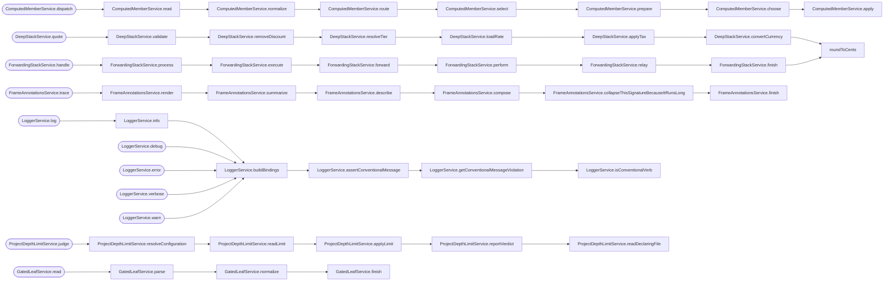

<!-- callidescope:start -->

# 🔭 Callidescope

| Measure | Value |
| --- | --- |
| Callables | 431 |
| Files | 238 |
| Calls traced | 365 |
| Call stacks | 144 |
| Deepest stack | 9 |
| Stacks through recursion | 1 |
| Unfollowable calls | 30 |

## Projects

| Project | Deepest | Limit | Headroom | Widest |
| --- | --- | --- | --- | --- |
| `projects/ic-suite/callidescope/callidescope-examples` | 8 | 5 | -3 | 2 |
| `projects/common/observability` | 6 | 4 | -2 | 2 |
| `projects/ic-suite/callidescope/callidescope-examples/examples/gated-leaf` | 4 | 3 | -1 | 3 |
| `projects/ic-suite/codependix/codependix-configuration` | 7 | 7 | 0 | 4 |
| `projects/ic-suite/codometer/codometer-configuration` | 9 | 9 | 0 | 4 |
| `projects/ic-suite/coinagerie/coinagerie-configuration` | 3 | 3 | 0 | 3 |
| `projects/ic-suite/callidescope/callidescope-configuration` | 7 | 8 | 1 | 7 |
| `projects/ic-suite/codependix/codependix-core` | 0 | 1 | 1 | 0 |
| `projects/ic-suite/codometer/codometer-core` | 0 | 1 | 1 | 0 |
| `projects/ic-suite/coinagerie/coinagerie-core` | 0 | 1 | 1 | 0 |
| `projects/ic-suite/coinagerie/coinagerie-languages` | 4 | 6 | 2 | 3 |
| `projects/ic-suite/callidescope/callidescope-core` | 0 | 17 | 17 | 0 |

## Depth headroom

| Headroom | Projects |
| --- | --- |
| over limit | 3 |
| 0 — at limit | 3 |
| 1 | 1 |
| 2–3 | 1 |
| 4+ | 0 |
| no stacks | 4 |

## Call stacks over the depth limit (11)

## Callables over the breadth limit (1)

| Callable | Breadth | Calls directly | Location |
| --- | --- | --- | --- |
| `GatedLeafService.read` | 3 | `GatedLeafService.parse`, `GatedLeafService.normalize`, `GatedLeafService.finish` | `projects/ic-suite/callidescope/callidescope-examples/examples/gated-leaf/gated-leaf.ts:33` |

<!-- callidescope:end -->
