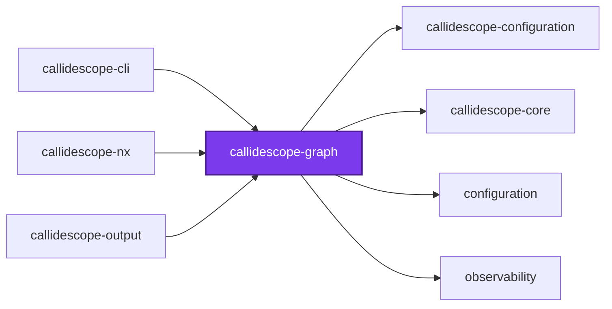
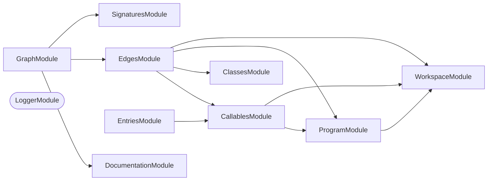

## 🕸️ Codependix

Dependency graphs exported by [codependix](https://github.com/Organizzolini/codebase/tree/main/projects/ic-suite/codependix/codependix-cli), regenerated by `nx run configuration:codependix:write`.

### Nx Neighborhood

<!-- codependix:start name="codependix-nx-projects" -->

<!-- codependix:end name="codependix-nx-projects" -->

### NestJS Module Graph

<!-- codependix:start name="codependix-nestjs-modules" -->


_Rounded modules are global: every module can inject them, so their edges are left out._
<!-- codependix:end name="codependix-nestjs-modules" -->

### File Imports

<!-- codependix:start name="codependix-file-imports" -->
```mermaid
graph LR
  file_callidescope_config_ts["callidescope.config.ts"]
  file_codependix_config_ts["codependix.config.ts"]
  file_codometer_config_ts["codometer.config.ts"]
  file_coinagerie_config_ts["coinagerie.config.ts"]
  file_eslint_config_ts["eslint.config.ts"]
  file_src_index_ts["src/index.ts"]
  file_src_modules_callables_address_constants_ts["src/modules/callables/address.constants.ts"]
  file_src_modules_callables_address_service_ts["src/modules/callables/address.service.ts"]
  file_src_modules_callables_address_service_unit_test_ts["src/modules/callables/address.service.unit.test.ts"]
  file_src_modules_callables_address_types_ts["src/modules/callables/address.types.ts"]
  file_src_modules_callables_callable_identity_service_ts["src/modules/callables/callable-identity.service.ts"]
  file_src_modules_callables_callable_identity_service_unit_test_ts["src/modules/callables/callable-identity.service.unit.test.ts"]
  file_src_modules_callables_callables_constants_ts["src/modules/callables/callables.constants.ts"]
  file_src_modules_callables_callables_module_ts["src/modules/callables/callables.module.ts"]
  file_src_modules_callables_callables_service_ts["src/modules/callables/callables.service.ts"]
  file_src_modules_callables_callables_service_unit_test_ts["src/modules/callables/callables.service.unit.test.ts"]
  file_src_modules_callables_callables_types_ts["src/modules/callables/callables.types.ts"]
  file_src_modules_classes_classes_constants_ts["src/modules/classes/classes.constants.ts"]
  file_src_modules_classes_classes_module_ts["src/modules/classes/classes.module.ts"]
  file_src_modules_classes_classes_service_ts["src/modules/classes/classes.service.ts"]
  file_src_modules_classes_classes_service_unit_test_ts["src/modules/classes/classes.service.unit.test.ts"]
  file_src_modules_classes_classes_types_ts["src/modules/classes/classes.types.ts"]
  file_src_modules_classes_external_service_ts["src/modules/classes/external.service.ts"]
  file_src_modules_classes_external_service_unit_test_ts["src/modules/classes/external.service.unit.test.ts"]
  file_src_modules_documentation_documentation_constants_ts["src/modules/documentation/documentation.constants.ts"]
  file_src_modules_documentation_documentation_module_ts["src/modules/documentation/documentation.module.ts"]
  file_src_modules_documentation_documentation_service_ts["src/modules/documentation/documentation.service.ts"]
  file_src_modules_documentation_documentation_service_unit_test_ts["src/modules/documentation/documentation.service.unit.test.ts"]
  file_src_modules_documentation_documentation_types_ts["src/modules/documentation/documentation.types.ts"]
  file_src_modules_edges_call_sites_service_ts["src/modules/edges/call-sites.service.ts"]
  file_src_modules_edges_call_sites_service_unit_test_ts["src/modules/edges/call-sites.service.unit.test.ts"]
  file_src_modules_edges_edges_constants_ts["src/modules/edges/edges.constants.ts"]
  file_src_modules_edges_edges_module_ts["src/modules/edges/edges.module.ts"]
  file_src_modules_edges_edges_service_ts["src/modules/edges/edges.service.ts"]
  file_src_modules_edges_edges_service_unit_test_ts["src/modules/edges/edges.service.unit.test.ts"]
  file_src_modules_edges_edges_types_ts["src/modules/edges/edges.types.ts"]
  file_src_modules_edges_symbol_resolution_service_ts["src/modules/edges/symbol-resolution.service.ts"]
  file_src_modules_edges_symbol_resolution_service_unit_test_ts["src/modules/edges/symbol-resolution.service.unit.test.ts"]
  file_src_modules_entries_entries_constants_ts["src/modules/entries/entries.constants.ts"]
  file_src_modules_entries_entries_module_ts["src/modules/entries/entries.module.ts"]
  file_src_modules_entries_entries_service_ts["src/modules/entries/entries.service.ts"]
  file_src_modules_entries_entries_service_unit_test_ts["src/modules/entries/entries.service.unit.test.ts"]
  file_src_modules_entries_entries_types_ts["src/modules/entries/entries.types.ts"]
  file_src_modules_graph_address_depth_constants_ts["src/modules/graph/address-depth.constants.ts"]
  file_src_modules_graph_address_depth_service_ts["src/modules/graph/address-depth.service.ts"]
  file_src_modules_graph_address_depth_service_unit_test_ts["src/modules/graph/address-depth.service.unit.test.ts"]
  file_src_modules_graph_address_depth_types_ts["src/modules/graph/address-depth.types.ts"]
  file_src_modules_graph_breadth_service_ts["src/modules/graph/breadth.service.ts"]
  file_src_modules_graph_breadth_service_unit_test_ts["src/modules/graph/breadth.service.unit.test.ts"]
  file_src_modules_graph_components_constants_ts["src/modules/graph/components.constants.ts"]
  file_src_modules_graph_components_service_ts["src/modules/graph/components.service.ts"]
  file_src_modules_graph_components_service_unit_test_ts["src/modules/graph/components.service.unit.test.ts"]
  file_src_modules_graph_components_types_ts["src/modules/graph/components.types.ts"]
  file_src_modules_graph_graph_assembly_service_ts["src/modules/graph/graph-assembly.service.ts"]
  file_src_modules_graph_graph_assembly_service_unit_test_ts["src/modules/graph/graph-assembly.service.unit.test.ts"]
  file_src_modules_graph_graph_assembly_types_ts["src/modules/graph/graph-assembly.types.ts"]
  file_src_modules_graph_graph_depth_service_ts["src/modules/graph/graph-depth.service.ts"]
  file_src_modules_graph_graph_depth_service_unit_test_ts["src/modules/graph/graph-depth.service.unit.test.ts"]
  file_src_modules_graph_graph_constants_ts["src/modules/graph/graph.constants.ts"]
  file_src_modules_graph_graph_module_ts["src/modules/graph/graph.module.ts"]
  file_src_modules_graph_graph_service_ts["src/modules/graph/graph.service.ts"]
  file_src_modules_graph_graph_service_unit_test_ts["src/modules/graph/graph.service.unit.test.ts"]
  file_src_modules_graph_graph_types_ts["src/modules/graph/graph.types.ts"]
  file_src_modules_graph_paths_service_ts["src/modules/graph/paths.service.ts"]
  file_src_modules_graph_paths_service_unit_test_ts["src/modules/graph/paths.service.unit.test.ts"]
  file_src_modules_program_compiler_host_service_ts["src/modules/program/compiler-host.service.ts"]
  file_src_modules_program_compiler_host_service_unit_test_ts["src/modules/program/compiler-host.service.unit.test.ts"]
  file_src_modules_program_program_constants_ts["src/modules/program/program.constants.ts"]
  file_src_modules_program_program_module_ts["src/modules/program/program.module.ts"]
  file_src_modules_program_program_service_ts["src/modules/program/program.service.ts"]
  file_src_modules_program_program_service_unit_test_ts["src/modules/program/program.service.unit.test.ts"]
  file_src_modules_program_program_types_ts["src/modules/program/program.types.ts"]
  file_src_modules_signatures_signatures_constants_ts["src/modules/signatures/signatures.constants.ts"]
  file_src_modules_signatures_signatures_module_ts["src/modules/signatures/signatures.module.ts"]
  file_src_modules_signatures_signatures_service_ts["src/modules/signatures/signatures.service.ts"]
  file_src_modules_signatures_signatures_service_unit_test_ts["src/modules/signatures/signatures.service.unit.test.ts"]
  file_src_modules_signatures_signatures_types_ts["src/modules/signatures/signatures.types.ts"]
  file_src_modules_workspace_file_filter_service_ts["src/modules/workspace/file-filter.service.ts"]
  file_src_modules_workspace_file_filter_service_unit_test_ts["src/modules/workspace/file-filter.service.unit.test.ts"]
  file_src_modules_workspace_workspace_constants_ts["src/modules/workspace/workspace.constants.ts"]
  file_src_modules_workspace_workspace_module_ts["src/modules/workspace/workspace.module.ts"]
  file_src_modules_workspace_workspace_service_ts["src/modules/workspace/workspace.service.ts"]
  file_src_modules_workspace_workspace_service_unit_test_ts["src/modules/workspace/workspace.service.unit.test.ts"]
  file_src_modules_workspace_workspace_types_ts["src/modules/workspace/workspace.types.ts"]
  file_testing_mocks_ts["testing/mocks.ts"]
  file_testing_modules_ts["testing/modules.ts"]
  file_testing_programs_ts["testing/programs.ts"]
  file_testing_setup_ts["testing/setup.ts"]
  file_vite_config_ts["vite.config.ts"]
  file_vitest_config_ts["vitest.config.ts"]
  file_src_modules_callables_address_service_ts --> file_src_modules_callables_address_constants_ts
  file_src_modules_callables_address_service_ts --> file_src_modules_callables_address_types_ts
  file_src_modules_callables_address_service_ts --> file_src_modules_callables_callables_types_ts
  file_src_modules_callables_address_service_unit_test_ts --> file_src_modules_callables_address_service_ts
  file_src_modules_callables_address_service_unit_test_ts --> file_src_modules_callables_callables_types_ts
  file_src_modules_callables_address_service_unit_test_ts --> file_testing_mocks_ts
  file_src_modules_callables_address_service_unit_test_ts --> file_testing_modules_ts
  file_src_modules_callables_address_types_ts --> file_src_modules_callables_callables_types_ts
  file_src_modules_callables_callable_identity_service_ts --> file_src_modules_callables_callables_constants_ts
  file_src_modules_callables_callable_identity_service_ts --> file_src_modules_callables_callables_types_ts
  file_src_modules_callables_callable_identity_service_unit_test_ts --> file_src_modules_callables_callable_identity_service_ts
  file_src_modules_callables_callable_identity_service_unit_test_ts --> file_testing_modules_ts
  file_src_modules_callables_callable_identity_service_unit_test_ts --> file_testing_programs_ts
  file_src_modules_callables_callables_module_ts --> file_src_modules_callables_address_service_ts
  file_src_modules_callables_callables_module_ts --> file_src_modules_callables_callable_identity_service_ts
  file_src_modules_callables_callables_module_ts --> file_src_modules_callables_callables_service_ts
  file_src_modules_callables_callables_module_ts --> file_src_modules_program_program_module_ts
  file_src_modules_callables_callables_module_ts --> file_src_modules_workspace_workspace_module_ts
  file_src_modules_callables_callables_service_ts --> file_src_modules_callables_callable_identity_service_ts
  file_src_modules_callables_callables_service_ts --> file_src_modules_callables_callables_types_ts
  file_src_modules_callables_callables_service_ts --> file_src_modules_program_program_service_ts
  file_src_modules_callables_callables_service_ts --> file_src_modules_program_program_types_ts
  file_src_modules_callables_callables_service_ts --> file_src_modules_workspace_workspace_service_ts
  file_src_modules_callables_callables_service_unit_test_ts --> file_src_modules_callables_callables_service_ts
  file_src_modules_callables_callables_service_unit_test_ts --> file_src_modules_callables_callables_types_ts
  file_src_modules_callables_callables_service_unit_test_ts --> file_testing_modules_ts
  file_src_modules_callables_callables_service_unit_test_ts --> file_testing_programs_ts
  file_src_modules_callables_callables_types_ts --> file_src_modules_program_program_types_ts
  file_src_modules_callables_callables_types_ts --> file_src_modules_workspace_workspace_types_ts
  file_src_modules_classes_classes_module_ts --> file_src_modules_classes_classes_service_ts
  file_src_modules_classes_classes_module_ts --> file_src_modules_classes_external_service_ts
  file_src_modules_classes_classes_service_ts --> file_src_modules_classes_classes_constants_ts
  file_src_modules_classes_classes_service_ts --> file_src_modules_classes_classes_types_ts
  file_src_modules_classes_classes_service_ts --> file_src_modules_classes_external_service_ts
  file_src_modules_classes_classes_service_ts --> file_src_modules_program_program_types_ts
  file_src_modules_classes_classes_service_unit_test_ts --> file_src_modules_classes_classes_constants_ts
  file_src_modules_classes_classes_service_unit_test_ts --> file_src_modules_classes_classes_service_ts
  file_src_modules_classes_classes_service_unit_test_ts --> file_src_modules_classes_classes_types_ts
  file_src_modules_classes_classes_service_unit_test_ts --> file_src_modules_classes_external_service_ts
  file_src_modules_classes_classes_service_unit_test_ts --> file_testing_modules_ts
  file_src_modules_classes_classes_service_unit_test_ts --> file_testing_programs_ts
  file_src_modules_classes_classes_types_ts --> file_src_modules_program_program_types_ts
  file_src_modules_classes_external_service_unit_test_ts --> file_src_modules_classes_external_service_ts
  file_src_modules_classes_external_service_unit_test_ts --> file_testing_modules_ts
  file_src_modules_documentation_documentation_module_ts --> file_src_modules_documentation_documentation_service_ts
  file_src_modules_documentation_documentation_service_ts --> file_src_modules_documentation_documentation_constants_ts
  file_src_modules_documentation_documentation_service_ts --> file_src_modules_documentation_documentation_types_ts
  file_src_modules_documentation_documentation_service_unit_test_ts --> file_src_modules_documentation_documentation_service_ts
  file_src_modules_documentation_documentation_service_unit_test_ts --> file_src_modules_documentation_documentation_types_ts
  file_src_modules_documentation_documentation_service_unit_test_ts --> file_testing_modules_ts
  file_src_modules_documentation_documentation_service_unit_test_ts --> file_testing_programs_ts
  file_src_modules_documentation_documentation_types_ts --> file_src_modules_callables_callables_types_ts
  file_src_modules_edges_call_sites_service_ts --> file_src_modules_callables_callables_types_ts
  file_src_modules_edges_call_sites_service_ts --> file_src_modules_edges_edges_types_ts
  file_src_modules_edges_call_sites_service_unit_test_ts --> file_src_modules_edges_call_sites_service_ts
  file_src_modules_edges_call_sites_service_unit_test_ts --> file_testing_modules_ts
  file_src_modules_edges_call_sites_service_unit_test_ts --> file_testing_programs_ts
  file_src_modules_edges_edges_constants_ts --> file_src_modules_edges_edges_types_ts
  file_src_modules_edges_edges_module_ts --> file_src_modules_callables_callables_module_ts
  file_src_modules_edges_edges_module_ts --> file_src_modules_classes_classes_module_ts
  file_src_modules_edges_edges_module_ts --> file_src_modules_edges_call_sites_service_ts
  file_src_modules_edges_edges_module_ts --> file_src_modules_edges_edges_service_ts
  file_src_modules_edges_edges_module_ts --> file_src_modules_edges_symbol_resolution_service_ts
  file_src_modules_edges_edges_module_ts --> file_src_modules_program_program_module_ts
  file_src_modules_edges_edges_module_ts --> file_src_modules_workspace_workspace_module_ts
  file_src_modules_edges_edges_service_ts --> file_src_modules_callables_callables_types_ts
  file_src_modules_edges_edges_service_ts --> file_src_modules_classes_external_service_ts
  file_src_modules_edges_edges_service_ts --> file_src_modules_edges_call_sites_service_ts
  file_src_modules_edges_edges_service_ts --> file_src_modules_edges_edges_types_ts
  file_src_modules_edges_edges_service_ts --> file_src_modules_edges_symbol_resolution_service_ts
  file_src_modules_edges_edges_service_ts --> file_src_modules_program_program_service_ts
  file_src_modules_edges_edges_service_ts --> file_src_modules_workspace_workspace_service_ts
  file_src_modules_edges_edges_service_unit_test_ts --> file_src_modules_classes_classes_constants_ts
  file_src_modules_edges_edges_service_unit_test_ts --> file_src_modules_edges_call_sites_service_ts
  file_src_modules_edges_edges_service_unit_test_ts --> file_src_modules_edges_edges_service_ts
  file_src_modules_edges_edges_service_unit_test_ts --> file_src_modules_edges_symbol_resolution_service_ts
  file_src_modules_edges_edges_service_unit_test_ts --> file_testing_modules_ts
  file_src_modules_edges_edges_service_unit_test_ts --> file_testing_programs_ts
  file_src_modules_edges_edges_types_ts --> file_src_modules_callables_callables_types_ts
  file_src_modules_edges_symbol_resolution_service_ts --> file_src_modules_classes_classes_service_ts
  file_src_modules_edges_symbol_resolution_service_ts --> file_src_modules_classes_external_service_ts
  file_src_modules_edges_symbol_resolution_service_ts --> file_src_modules_edges_edges_constants_ts
  file_src_modules_edges_symbol_resolution_service_ts --> file_src_modules_edges_edges_types_ts
  file_src_modules_edges_symbol_resolution_service_unit_test_ts --> file_src_modules_classes_classes_service_ts
  file_src_modules_edges_symbol_resolution_service_unit_test_ts --> file_src_modules_classes_external_service_ts
  file_src_modules_edges_symbol_resolution_service_unit_test_ts --> file_src_modules_edges_edges_constants_ts
  file_src_modules_edges_symbol_resolution_service_unit_test_ts --> file_src_modules_edges_edges_types_ts
  file_src_modules_edges_symbol_resolution_service_unit_test_ts --> file_src_modules_edges_symbol_resolution_service_ts
  file_src_modules_edges_symbol_resolution_service_unit_test_ts --> file_testing_modules_ts
  file_src_modules_edges_symbol_resolution_service_unit_test_ts --> file_testing_programs_ts
  file_src_modules_entries_entries_module_ts --> file_src_modules_callables_callables_module_ts
  file_src_modules_entries_entries_module_ts --> file_src_modules_entries_entries_service_ts
  file_src_modules_entries_entries_service_ts --> file_src_modules_callables_address_service_ts
  file_src_modules_entries_entries_service_ts --> file_src_modules_callables_callables_types_ts
  file_src_modules_entries_entries_service_ts --> file_src_modules_entries_entries_constants_ts
  file_src_modules_entries_entries_service_ts --> file_src_modules_entries_entries_types_ts
  file_src_modules_entries_entries_service_unit_test_ts --> file_src_modules_callables_address_service_ts
  file_src_modules_entries_entries_service_unit_test_ts --> file_src_modules_callables_callables_types_ts
  file_src_modules_entries_entries_service_unit_test_ts --> file_src_modules_entries_entries_service_ts
  file_src_modules_entries_entries_service_unit_test_ts --> file_src_modules_entries_entries_types_ts
  file_src_modules_entries_entries_service_unit_test_ts --> file_src_modules_graph_graph_service_ts
  file_src_modules_entries_entries_service_unit_test_ts --> file_src_modules_graph_graph_types_ts
  file_src_modules_entries_entries_service_unit_test_ts --> file_testing_mocks_ts
  file_src_modules_entries_entries_service_unit_test_ts --> file_testing_modules_ts
  file_src_modules_entries_entries_service_unit_test_ts --> file_testing_programs_ts
  file_src_modules_entries_entries_types_ts --> file_src_modules_callables_address_types_ts
  file_src_modules_entries_entries_types_ts --> file_src_modules_callables_callables_types_ts
  file_src_modules_entries_entries_types_ts --> file_src_modules_graph_graph_types_ts
  file_src_modules_graph_address_depth_service_ts --> file_src_modules_callables_callables_types_ts
  file_src_modules_graph_address_depth_service_ts --> file_src_modules_graph_address_depth_constants_ts
  file_src_modules_graph_address_depth_service_ts --> file_src_modules_graph_address_depth_types_ts
  file_src_modules_graph_address_depth_service_ts --> file_src_modules_graph_paths_service_ts
  file_src_modules_graph_address_depth_service_unit_test_ts --> file_src_modules_callables_callables_types_ts
  file_src_modules_graph_address_depth_service_unit_test_ts --> file_src_modules_documentation_documentation_service_ts
  file_src_modules_graph_address_depth_service_unit_test_ts --> file_src_modules_graph_address_depth_service_ts
  file_src_modules_graph_address_depth_service_unit_test_ts --> file_src_modules_graph_graph_service_ts
  file_src_modules_graph_address_depth_service_unit_test_ts --> file_src_modules_graph_paths_service_ts
  file_src_modules_graph_address_depth_service_unit_test_ts --> file_src_modules_signatures_signatures_service_ts
  file_src_modules_graph_address_depth_service_unit_test_ts --> file_testing_mocks_ts
  file_src_modules_graph_address_depth_service_unit_test_ts --> file_testing_modules_ts
  file_src_modules_graph_address_depth_types_ts --> file_src_modules_callables_callables_types_ts
  file_src_modules_graph_address_depth_types_ts --> file_src_modules_graph_graph_types_ts
  file_src_modules_graph_breadth_service_ts --> file_src_modules_callables_callables_types_ts
  file_src_modules_graph_breadth_service_ts --> file_src_modules_graph_graph_types_ts
  file_src_modules_graph_breadth_service_unit_test_ts --> file_src_modules_graph_breadth_service_ts
  file_src_modules_graph_breadth_service_unit_test_ts --> file_src_modules_graph_graph_service_ts
  file_src_modules_graph_breadth_service_unit_test_ts --> file_src_modules_graph_graph_types_ts
  file_src_modules_graph_breadth_service_unit_test_ts --> file_testing_mocks_ts
  file_src_modules_graph_breadth_service_unit_test_ts --> file_testing_modules_ts
  file_src_modules_graph_components_service_ts --> file_src_modules_graph_components_constants_ts
  file_src_modules_graph_components_service_ts --> file_src_modules_graph_components_types_ts
  file_src_modules_graph_components_service_ts --> file_src_modules_graph_graph_types_ts
  file_src_modules_graph_components_service_unit_test_ts --> file_src_modules_graph_components_service_ts
  file_src_modules_graph_components_service_unit_test_ts --> file_src_modules_graph_graph_service_ts
  file_src_modules_graph_components_service_unit_test_ts --> file_src_modules_graph_graph_types_ts
  file_src_modules_graph_components_service_unit_test_ts --> file_testing_modules_ts
  file_src_modules_graph_graph_assembly_service_ts --> file_src_modules_edges_edges_service_ts
  file_src_modules_graph_graph_assembly_service_ts --> file_src_modules_graph_breadth_service_ts
  file_src_modules_graph_graph_assembly_service_ts --> file_src_modules_graph_components_service_ts
  file_src_modules_graph_graph_assembly_service_ts --> file_src_modules_graph_graph_assembly_types_ts
  file_src_modules_graph_graph_assembly_service_ts --> file_src_modules_graph_graph_depth_service_ts
  file_src_modules_graph_graph_assembly_service_ts --> file_src_modules_graph_graph_service_ts
  file_src_modules_graph_graph_assembly_service_unit_test_ts --> file_src_modules_graph_breadth_service_ts
  file_src_modules_graph_graph_assembly_service_unit_test_ts --> file_src_modules_graph_components_service_ts
  file_src_modules_graph_graph_assembly_service_unit_test_ts --> file_src_modules_graph_graph_assembly_service_ts
  file_src_modules_graph_graph_assembly_service_unit_test_ts --> file_src_modules_graph_graph_assembly_types_ts
  file_src_modules_graph_graph_assembly_service_unit_test_ts --> file_src_modules_graph_graph_depth_service_ts
  file_src_modules_graph_graph_assembly_service_unit_test_ts --> file_src_modules_graph_graph_service_ts
  file_src_modules_graph_graph_assembly_service_unit_test_ts --> file_testing_modules_ts
  file_src_modules_graph_graph_assembly_service_unit_test_ts --> file_testing_programs_ts
  file_src_modules_graph_graph_assembly_types_ts --> file_src_modules_callables_callables_types_ts
  file_src_modules_graph_graph_assembly_types_ts --> file_src_modules_graph_graph_types_ts
  file_src_modules_graph_graph_depth_service_ts --> file_src_modules_graph_graph_types_ts
  file_src_modules_graph_graph_depth_service_unit_test_ts --> file_src_modules_graph_components_service_ts
  file_src_modules_graph_graph_depth_service_unit_test_ts --> file_src_modules_graph_graph_depth_service_ts
  file_src_modules_graph_graph_depth_service_unit_test_ts --> file_src_modules_graph_graph_service_ts
  file_src_modules_graph_graph_depth_service_unit_test_ts --> file_src_modules_graph_graph_types_ts
  file_src_modules_graph_graph_depth_service_unit_test_ts --> file_testing_modules_ts
  file_src_modules_graph_graph_module_ts --> file_src_modules_documentation_documentation_module_ts
  file_src_modules_graph_graph_module_ts --> file_src_modules_edges_edges_module_ts
  file_src_modules_graph_graph_module_ts --> file_src_modules_graph_address_depth_service_ts
  file_src_modules_graph_graph_module_ts --> file_src_modules_graph_breadth_service_ts
  file_src_modules_graph_graph_module_ts --> file_src_modules_graph_components_service_ts
  file_src_modules_graph_graph_module_ts --> file_src_modules_graph_graph_assembly_service_ts
  file_src_modules_graph_graph_module_ts --> file_src_modules_graph_graph_depth_service_ts
  file_src_modules_graph_graph_module_ts --> file_src_modules_graph_graph_service_ts
  file_src_modules_graph_graph_module_ts --> file_src_modules_graph_paths_service_ts
  file_src_modules_graph_graph_module_ts --> file_src_modules_signatures_signatures_module_ts
  file_src_modules_graph_graph_service_ts --> file_src_modules_edges_edges_types_ts
  file_src_modules_graph_graph_service_ts --> file_src_modules_graph_graph_types_ts
  file_src_modules_graph_graph_service_unit_test_ts --> file_src_modules_graph_graph_service_ts
  file_src_modules_graph_graph_service_unit_test_ts --> file_testing_modules_ts
  file_src_modules_graph_paths_service_ts --> file_src_modules_callables_callables_types_ts
  file_src_modules_graph_paths_service_ts --> file_src_modules_documentation_documentation_service_ts
  file_src_modules_graph_paths_service_ts --> file_src_modules_graph_graph_types_ts
  file_src_modules_graph_paths_service_ts --> file_src_modules_signatures_signatures_service_ts
  file_src_modules_graph_paths_service_unit_test_ts --> file_src_modules_callables_callables_types_ts
  file_src_modules_graph_paths_service_unit_test_ts --> file_src_modules_documentation_documentation_service_ts
  file_src_modules_graph_paths_service_unit_test_ts --> file_src_modules_graph_components_service_ts
  file_src_modules_graph_paths_service_unit_test_ts --> file_src_modules_graph_graph_depth_service_ts
  file_src_modules_graph_paths_service_unit_test_ts --> file_src_modules_graph_graph_service_ts
  file_src_modules_graph_paths_service_unit_test_ts --> file_src_modules_graph_paths_service_ts
  file_src_modules_graph_paths_service_unit_test_ts --> file_src_modules_signatures_signatures_service_ts
  file_src_modules_graph_paths_service_unit_test_ts --> file_testing_mocks_ts
  file_src_modules_graph_paths_service_unit_test_ts --> file_testing_modules_ts
  file_src_modules_program_compiler_host_service_unit_test_ts --> file_src_modules_program_compiler_host_service_ts
  file_src_modules_program_compiler_host_service_unit_test_ts --> file_testing_modules_ts
  file_src_modules_program_program_module_ts --> file_src_modules_program_compiler_host_service_ts
  file_src_modules_program_program_module_ts --> file_src_modules_program_program_service_ts
  file_src_modules_program_program_module_ts --> file_src_modules_workspace_workspace_module_ts
  file_src_modules_program_program_service_ts --> file_src_modules_program_compiler_host_service_ts
  file_src_modules_program_program_service_ts --> file_src_modules_program_program_constants_ts
  file_src_modules_program_program_service_ts --> file_src_modules_program_program_types_ts
  file_src_modules_program_program_service_ts --> file_src_modules_workspace_workspace_service_ts
  file_src_modules_program_program_service_ts --> file_src_modules_workspace_workspace_types_ts
  file_src_modules_program_program_service_unit_test_ts --> file_src_modules_program_compiler_host_service_ts
  file_src_modules_program_program_service_unit_test_ts --> file_src_modules_program_program_constants_ts
  file_src_modules_program_program_service_unit_test_ts --> file_src_modules_program_program_service_ts
  file_src_modules_program_program_service_unit_test_ts --> file_src_modules_workspace_workspace_service_ts
  file_src_modules_program_program_service_unit_test_ts --> file_src_modules_workspace_workspace_types_ts
  file_src_modules_program_program_service_unit_test_ts --> file_testing_modules_ts
  file_src_modules_program_program_types_ts --> file_src_modules_workspace_workspace_types_ts
  file_src_modules_signatures_signatures_module_ts --> file_src_modules_signatures_signatures_service_ts
  file_src_modules_signatures_signatures_service_ts --> file_src_modules_callables_callables_types_ts
  file_src_modules_signatures_signatures_service_ts --> file_src_modules_signatures_signatures_constants_ts
  file_src_modules_signatures_signatures_service_ts --> file_src_modules_signatures_signatures_types_ts
  file_src_modules_signatures_signatures_service_unit_test_ts --> file_src_modules_signatures_signatures_service_ts
  file_src_modules_signatures_signatures_service_unit_test_ts --> file_src_modules_signatures_signatures_types_ts
  file_src_modules_signatures_signatures_service_unit_test_ts --> file_testing_modules_ts
  file_src_modules_signatures_signatures_service_unit_test_ts --> file_testing_programs_ts
  file_src_modules_signatures_signatures_types_ts --> file_src_modules_callables_callables_types_ts
  file_src_modules_workspace_file_filter_service_ts --> file_src_modules_workspace_workspace_service_ts
  file_src_modules_workspace_file_filter_service_ts --> file_src_modules_workspace_workspace_types_ts
  file_src_modules_workspace_file_filter_service_unit_test_ts --> file_src_modules_workspace_file_filter_service_ts
  file_src_modules_workspace_file_filter_service_unit_test_ts --> file_src_modules_workspace_workspace_service_ts
  file_src_modules_workspace_file_filter_service_unit_test_ts --> file_src_modules_workspace_workspace_types_ts
  file_src_modules_workspace_file_filter_service_unit_test_ts --> file_testing_modules_ts
  file_src_modules_workspace_workspace_module_ts --> file_src_modules_workspace_file_filter_service_ts
  file_src_modules_workspace_workspace_module_ts --> file_src_modules_workspace_workspace_service_ts
  file_src_modules_workspace_workspace_service_ts --> file_src_modules_program_program_constants_ts
  file_src_modules_workspace_workspace_service_ts --> file_src_modules_workspace_workspace_constants_ts
  file_src_modules_workspace_workspace_service_ts --> file_src_modules_workspace_workspace_types_ts
  file_src_modules_workspace_workspace_service_unit_test_ts --> file_src_modules_program_program_constants_ts
  file_src_modules_workspace_workspace_service_unit_test_ts --> file_src_modules_workspace_workspace_service_ts
  file_src_modules_workspace_workspace_service_unit_test_ts --> file_src_modules_workspace_workspace_types_ts
  file_src_modules_workspace_workspace_service_unit_test_ts --> file_testing_modules_ts
  file_testing_mocks_ts --> file_src_modules_callables_callables_types_ts
  file_testing_modules_ts --> file_src_modules_callables_callables_module_ts
  file_testing_modules_ts --> file_src_modules_classes_classes_module_ts
  file_testing_modules_ts --> file_src_modules_documentation_documentation_module_ts
  file_testing_modules_ts --> file_src_modules_edges_edges_module_ts
  file_testing_modules_ts --> file_src_modules_entries_entries_module_ts
  file_testing_modules_ts --> file_src_modules_graph_graph_module_ts
  file_testing_modules_ts --> file_src_modules_program_program_module_ts
  file_testing_modules_ts --> file_src_modules_signatures_signatures_module_ts
  file_testing_modules_ts --> file_src_modules_workspace_workspace_module_ts
  file_testing_programs_ts --> file_src_modules_callables_callable_identity_service_ts
  file_testing_programs_ts --> file_src_modules_callables_callables_service_ts
  file_testing_programs_ts --> file_src_modules_classes_classes_service_ts
  file_testing_programs_ts --> file_src_modules_classes_external_service_ts
  file_testing_programs_ts --> file_src_modules_edges_call_sites_service_ts
  file_testing_programs_ts --> file_src_modules_edges_edges_service_ts
  file_testing_programs_ts --> file_src_modules_edges_symbol_resolution_service_ts
  file_testing_programs_ts --> file_src_modules_program_compiler_host_service_ts
  file_testing_programs_ts --> file_src_modules_program_program_service_ts
  file_testing_programs_ts --> file_src_modules_program_program_types_ts
  file_testing_programs_ts --> file_src_modules_workspace_workspace_service_ts
```
<!-- codependix:end name="codependix-file-imports" -->
