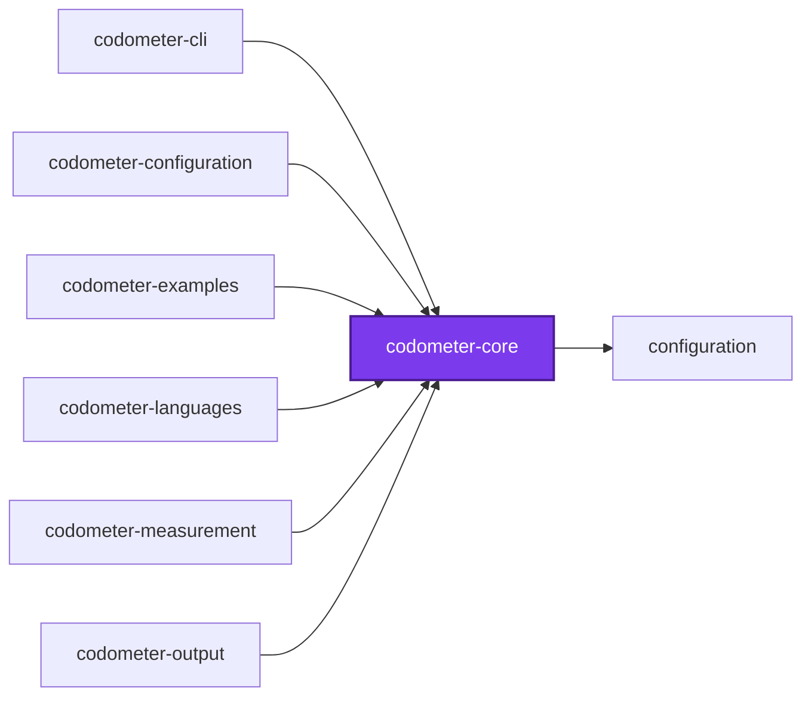
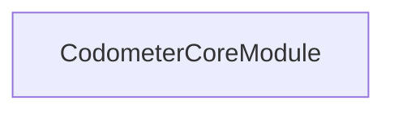
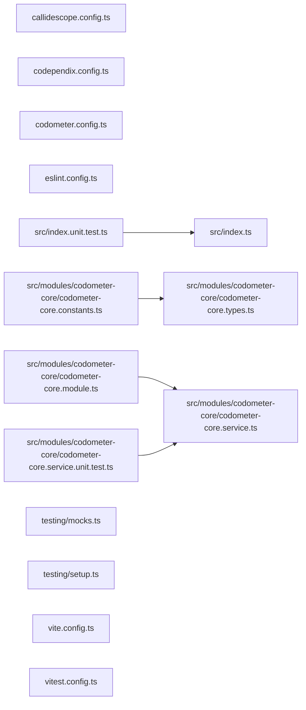

# @codometer/core

[](https://www.npmjs.com/package/@codometer/core)

The contracts leaf of the codometer toolchain. It holds what a measurement
**produces** — the per-language statistics groups, the report vocabulary a
consumer joins across runs, and the errors a configuration is refused with —
and nothing that runs.

No service and no NestJS module lives here, which is what makes it a leaf every
other codometer package may reach without dragging a container behind it. The
test that decides whether a declaration belongs here is sharp: a type the tool
produces is core, and a value somebody writes in `codometer.config.ts` is
configuration.

## Test

```bash
nx run codometer-core:vitest
```

## 👔 Conformetry

This project was generated from the [nestjs-service-project](../../../configuration/conformetry-templates/nestjs-service-project) conformetry template.

## 🕸️ Codependix

Dependency graphs exported by [codependix](https://github.com/Organizzolini/codebase/tree/main/projects/ic-suite/codependix/codependix-cli), regenerated by `nx run configuration:codependix:write`.

### Nx Neighborhood

<!-- codependix:start name="codependix-nx-projects" -->

<!-- codependix:end name="codependix-nx-projects" -->

### NestJS Module Graph

<!-- codependix:start name="codependix-nestjs-modules" -->

<!-- codependix:end name="codependix-nestjs-modules" -->

### File Imports

<!-- codependix:start name="codependix-file-imports" -->

<!-- codependix:end name="codependix-file-imports" -->

<!-- callidescope:start -->

## 🔭 Callidescope

Call stacks traced through `projects/ic-suite/codometer/codometer-core`, deepest first. Each frame shows what it takes, what it returns, and what its documentation says.

| Measure | Value |
| --- | --- |
| Callables | 5 |
| Files | 11 |
| Calls traced | 0 |
| Call stacks | 0 |
| Deepest stack | 0 |
| Stacks through recursion | 0 |
| Unfollowable calls | 4 |

### Limits

What this project is judged against, as declared in its own `callidescope.config.ts`.

| Limit | Value |
| --- | --- |
| `maximumDepth` | 1 |
| `maximumBreadth` | 1 |

### Call stacks (depth)

None.

### Breadth

None.
<!-- callidescope:end -->

<!-- coinagerie:start -->

## 🪙 Coinagerie

The words this project uses that the root glossary does not define, regenerated with `nx run codometer-core:coinagerie-check:write`.

- **anchor**: A named README marker pair that codometer's output writers splice generated content between, as the configuration package describes.
- **breach**: What a limit reports when a measured metric crosses it, with a CodometerSeverity of fail or warn deciding the consequence.
- **breadth**: The callidescope report section that counts direct calls per callable, listed as the Breadth table of this package.
- **conditional**: A branching construct in Shell code, such as an if statement, tallied as conditionals in the shell statistics.
- **doc**: A JSDoc-style block above a declaration, tallied as docComments in the TypeScript statistics that core defines.
- **docstring**: A Python triple-quoted string that documents a module, class, or function, tallied as docstrings and docstringLines in Python statistics.
- **generic**: A type parameter declaration, such as the T in a generic function, tallied as genericDeclarations in the TypeScript statistics.
- **hcl**: The HashiCorp Configuration Language statistics, which core models with its attributes, blocks, comments, and interpolations.
- **interpolation**: An HCL expression embedded in a value, counted as interpolations in the HCL statistics that core models.
- **javascript**: The statistics group for TypeScript and JavaScript files, keyed alongside the other language groups in the result.
- **jupyter**: The notebook statistics group in the code statistics result, covering cells, executions, and outputs of Jupyter notebooks.
- **level1**: The markdown statistic headingLevel1 that counts level-one headings, one of six per-level fields core defines.
- **level2**: The markdown statistic headingLevel2 that counts level-two headings, one of six per-level fields core defines.
- **level3**: The markdown statistic headingLevel3 that counts level-three headings, one of six per-level fields core defines.
- **level4**: The markdown statistic headingLevel4 that counts level-four headings, one of six per-level fields core defines.
- **level5**: The markdown statistic headingLevel5 that counts level-five headings, one of six per-level fields core defines.
- **level6**: The markdown statistic headingLevel6 that counts level-six headings, one of six per-level fields core defines.
- **measure**: The label of the first column of the callidescope summary table in this README, listing callables and files.
- **paragraph**: A block of Markdown prose, tallied as paragraphs in the markdown statistics that core defines.
- **pipeline**: The sequence of analyzers whose output is the aggregated CodeStatisticsResult that core's types describe.
- **scalar**: A non-container JSON or YAML value, tallied as scalars in the statistics that core defines for those formats.
- **selector**: A custom statistic's matcher, whose instances field records each occurrence it found, such as a comment selector's blocks.
- **severity**: Either fail, which gates a change, or warn, which only reports a breach, as the core type declares.
- **shebang**: The leading hash-bang line a script carries, counted as shebangs in the shell statistics that core defines.
- **statistic**: A counted value in the code statistics result, whether a built-in language field or a custom counter under custom.
- **thematic**: A horizontal rule in Markdown, tallied as thematicBreaks in the markdown statistics that core defines.
- **todo**: A comment flagged for later work, tallied as todos in the code statistics that core defines.
- **toml**: The configuration-file statistics group for tables, array tables, keys, and arrays, one of the formats core models.

<!-- coinagerie:end -->
