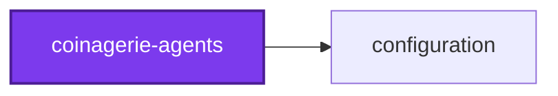

# @coinagerie/agents

Agent skills for the [coinagerie](../coinagerie-cli) toolchain.

Coinagerie lists the words a codebase uses and keeps a glossary of them in step
with the code. This package documents it for coding agents: how to configure a
run, run it and read what it printed, act on a failed check without loosening
the configuration, and write a definition worth keeping.

## Installing

The skills describe the toolchain rather than any one workspace, so they work
in any repository that uses coinagerie. Install them with the
[skills](https://github.com/vercel-labs/skills) CLI, naming the skills
directory explicitly:

```bash
npx skills add Organizzolini/codebase/projects/ic-suite/coinagerie/coinagerie-agents/skills --skill '*'
```

Naming the directory matters. A bare repository reference searches this
repository's own agent skills directory first and would offer every skill it
holds, most of which are specific to this workspace.

## The skills

| Skill                                                        | Reach for it when                                                                                                   |
| ------------------------------------------------------------ | ------------------------------------------------------------------------------------------------------------------- |
| [coinagerie-configure](skills/coinagerie-configure/SKILL.md) | Writing a `coinagerie.config.ts`: scanned files, excluded paths and words, `fold`, glossary destinations            |
| [coinagerie-collect](skills/coinagerie-collect/SKILL.md)     | Running `coinagerie`, choosing `--check` or `--write`, reading the glossary it printed                              |
| [coinagerie-triage](skills/coinagerie-triage/SKILL.md)       | A check failed, a glossary is refused, or a word looks wrong                                                        |
| [coinagerie-define](skills/coinagerie-define/SKILL.md)       | Writing a definition: its meaning in this codebase, how it differs from everyday English, where the code defines it |

The split mirrors four distinct moments: telling the tool what to count,
running it, acting on what it said, and writing the part only a reader can.

## Why there are no bundled scripts

An installed skill is a copied directory with no manifest and no dependencies
beside it, so a script shipped inside one can import nothing but Node
built-ins. Capability an agent needs lives in `@coinagerie/cli` instead, where
it is versioned and tested, and the skills name the command.

## Editing

The skills here are the source of truth. This repository consumes them the
same way it consumes any installed skill, through `skills-lock.json`, so a copy
also appears under the repository's agent skills directory — edit the copy in
this package, never that one.

## Validating

```bash
pnpm exec nx run coinagerie-agents:lint-code --configuration=write
pnpm exec nx run coinagerie-agents:lint-code --configuration=check
pnpm exec nx run coinagerie-agents:test-code
```

Coverage is empty by nature here — there is no source to instrument — so the
corpus test in `testing/skills.unit.test.ts` and the portability test in
`testing/portability.unit.test.ts` are what protect the shipped output.

## License

MIT — see [LICENSE](../../../../LICENSE).

<!-- coinagerie:start -->

## 🪙 Coinagerie

The words this project uses that the root glossary does not define, regenerated with `nx run coinagerie-agents:coinagerie-check:write`.

- **specific**: Describing content tied to one workspace rather than the toolchain, which the shipped skills must never contain.
- **triage**: Skill for acting on a failed check, a refused glossary, or a word that looks wrong, which the other skills hand off to.
- **under**: Placement marker in the skill text saying where a coinagerie block sits, such as beneath the Coinagerie heading in a README.

<!-- coinagerie:end -->

## 🕸️ Codependix

Dependency graphs exported by [codependix](https://github.com/Organizzolini/codebase/tree/main/projects/ic-suite/codependix/codependix-cli), regenerated by `nx run configuration:codependix:write`.

### Nx Neighborhood

<!-- codependix:start name="codependix-nx-projects" -->

<!-- codependix:end name="codependix-nx-projects" -->

### File Imports

<!-- codependix:start name="codependix-file-imports" -->
_This project has no internal file imports._
<!-- codependix:end name="codependix-file-imports" -->
