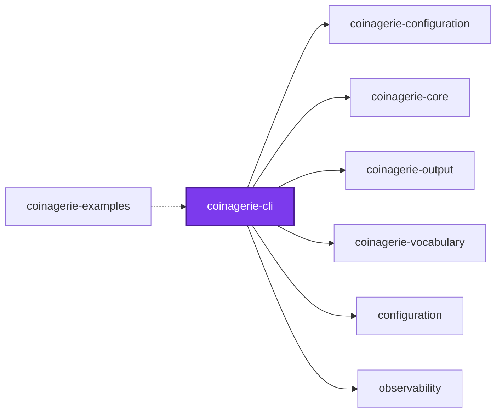
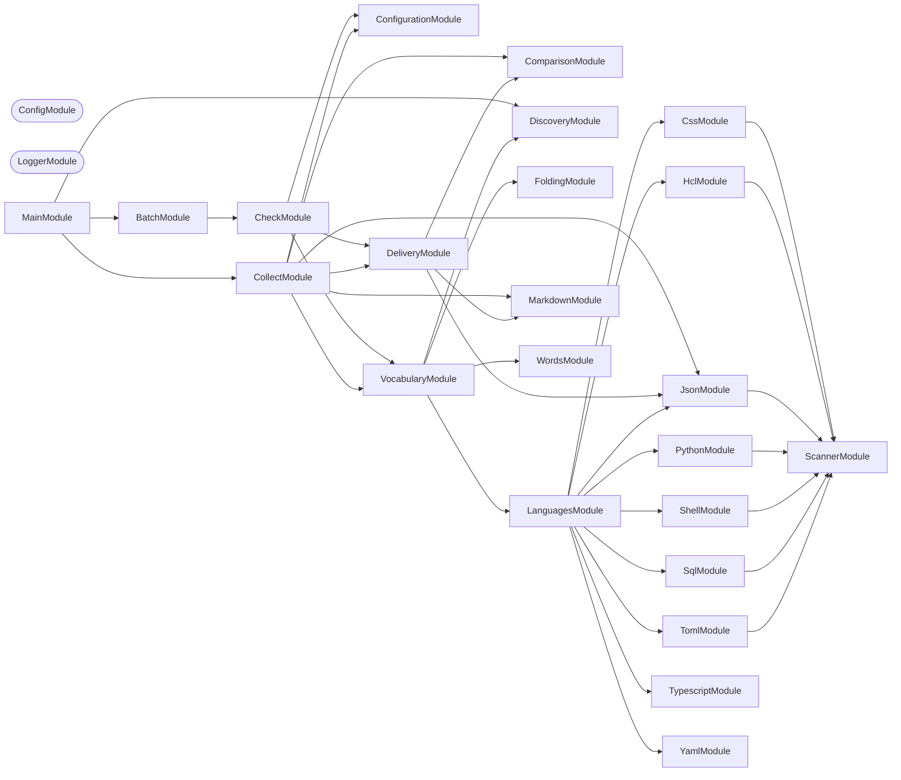

# @coinagerie/cli

[](https://www.npmjs.com/package/@coinagerie/cli)

**Keep a glossary of the words your codebase uses.**

```bash
npm install --save-dev @coinagerie/cli
```

```bash
npx @coinagerie/cli
```

## Usage

`coinagerie` lists the words a codebase uses — every identifier, object key,
enum member, folder name, and file name, split into lowercase words — and keeps
a markdown glossary of them in step with the code.

```bash
coinagerie                       # print the glossary block, write nothing
coinagerie --check               # exit 1 naming missing and stale words
coinagerie --write               # rewrite every glossary, keeping definitions
coinagerie --config path/to/coinagerie.config.ts --check
```

Without `--config`, a `coinagerie.config.ts` in the working directory is used
when there is one, and defaults apply when there is not. The folder the
configuration file sits in is the root the run scans:

```ts
export default {
  exclude: { paths: ["**/*.test.ts"] },
  include: ["src/**"],
  outputs: [
    { description: "Words this project uses.", path: "README.md", type: "markdown" },
  ],
};
```

Every `.gitignore` git would honor is honored, and the files a run writes are
never scanned. A glossary block that cannot be fully parsed is never written.

## Start

```bash
nx run coinagerie-cli:start
```

## Test

```bash
nx run coinagerie-cli:vitest
```

## 👔 Conformetry

This project was generated from the [nestjs-command-project](../../configuration/conformetry-templates/nestjs-command-project) conformetry template.

<!-- coinagerie:start -->

## 🪙 Coinagerie

The words this project uses that the root glossary does not define, regenerated with `nx run coinagerie-cli:coinagerie-check:write`.

- **anchor**: Start and end marker comments bracketing the coinagerie block in a markdown glossary, so a write replaces only that span.
- **angle**: Sample glossary word the end-to-end tests define as the gap between two bodies, used to exercise a failing check.
- **aspect**: Sample glossary word in the collect command's JSON and check-failure fixtures, standing for an identifier that must be defined.
- **batch**: The command that checks or writes the glossaries of many project directories in one process, printing a JSON verdict for each.
- **breadth**: Second limit in callidescope's gate, the count of distinct callees one callable may reach, here capped at five in this package.
- **bullet**: Glossary entry line in the form dash, bold word, colon, which carries the definition beneath it and is what the parser reads.
- **disagree**: Of a glossary whose words differ from the code's, missing some or listing stale ones, so a check fails on it.
- **glossary**: The markdown or JSON file of word-to-definition entries that a run checks against the code and rewrites when asked.
- **lunar**: Sample glossary word in the check-failure fixtures, given an empty definition, which a check still passes though it stays undefined.
- **phase**: Sample glossary word in the check-failure fixtures, given a short definition that the markdown and JSON tests assert on.
- **reconcile**: Method of the comparison service that merges collected words with existing glossary entries, keeping definitions for words still in use.
- **rewrite**: Action of the write mode that rewrites every glossary to hold exactly the code's words, keeping definitions for words still present.
- **vocabulary**: Workspace package that collects the words a codebase uses, depended on by coinagerie-cli to gather its vocabulary.

<!-- coinagerie:end -->

## 🕸️ Codependix

Dependency graphs exported by [codependix](https://github.com/Organizzolini/codebase/tree/main/projects/ic-suite/codependix/codependix-cli), regenerated by `nx run configuration:codependix:write`.

### Nx Neighborhood

<!-- codependix:start name="codependix-nx-projects" -->


_Dashed edges are dependencies Nx inferred from configuration rather than from code._
<!-- codependix:end name="codependix-nx-projects" -->

### NestJS Module Graph

<!-- codependix:start name="codependix-nestjs-modules" -->


_Rounded modules are global: every module can inject them, so their edges are left out._
<!-- codependix:end name="codependix-nestjs-modules" -->

### File Imports

```mermaid
graph LR
  file_callidescope_config_ts["callidescope.config.ts"]
  file_codependix_config_ts["codependix.config.ts"]
  file_codometer_config_ts["codometer.config.ts"]
  file_coinagerie_config_ts["coinagerie.config.ts"]
  file_eslint_config_ts["eslint.config.ts"]
  file_src_coinagerie_cli_constants_ts["src/coinagerie-cli.constants.ts"]
  file_src_coinagerie_cli_main_end_to_end_test_ts["src/coinagerie-cli.main.end-to-end.test.ts"]
  file_src_coinagerie_cli_main_ts["src/coinagerie-cli.main.ts"]
  file_src_coinagerie_cli_module_ts["src/coinagerie-cli.module.ts"]
  file_src_coinagerie_cli_module_unit_test_ts["src/coinagerie-cli.module.unit.test.ts"]
  file_src_coinagerie_cli_repl_ts["src/coinagerie-cli.repl.ts"]
  file_src_coinagerie_cli_repl_unit_test_ts["src/coinagerie-cli.repl.unit.test.ts"]
  file_src_index_ts["src/index.ts"]
  file_src_modules_batch_batch_command_ts["src/modules/batch/batch.command.ts"]
  file_src_modules_batch_batch_command_unit_test_ts["src/modules/batch/batch.command.unit.test.ts"]
  file_src_modules_batch_batch_constants_ts["src/modules/batch/batch.constants.ts"]
  file_src_modules_batch_batch_module_ts["src/modules/batch/batch.module.ts"]
  file_src_modules_batch_batch_types_ts["src/modules/batch/batch.types.ts"]
  file_src_modules_check_check_constants_ts["src/modules/check/check.constants.ts"]
  file_src_modules_check_check_module_ts["src/modules/check/check.module.ts"]
  file_src_modules_check_check_service_ts["src/modules/check/check.service.ts"]
  file_src_modules_check_check_service_unit_test_ts["src/modules/check/check.service.unit.test.ts"]
  file_src_modules_check_check_types_ts["src/modules/check/check.types.ts"]
  file_src_modules_check_check_utilities_ts["src/modules/check/check.utilities.ts"]
  file_src_modules_collect_collect_command_end_to_end_test_ts["src/modules/collect/collect.command.end-to-end.test.ts"]
  file_src_modules_collect_collect_command_ts["src/modules/collect/collect.command.ts"]
  file_src_modules_collect_collect_command_unit_test_ts["src/modules/collect/collect.command.unit.test.ts"]
  file_src_modules_collect_collect_constants_ts["src/modules/collect/collect.constants.ts"]
  file_src_modules_collect_collect_module_ts["src/modules/collect/collect.module.ts"]
  file_src_modules_collect_collect_types_ts["src/modules/collect/collect.types.ts"]
  file_testing_examples_ts["testing/examples.ts"]
  file_testing_fixture_tree_ts["testing/fixture-tree.ts"]
  file_testing_mocks_ts["testing/mocks.ts"]
  file_testing_run_command_ts["testing/run-command.ts"]
  file_testing_setup_ts["testing/setup.ts"]
  file_vite_config_ts["vite.config.ts"]
  file_vitest_config_ts["vitest.config.ts"]
  file_src_coinagerie_cli_main_end_to_end_test_ts --> file_src_coinagerie_cli_constants_ts
  file_src_coinagerie_cli_main_end_to_end_test_ts --> file_testing_examples_ts
  file_src_coinagerie_cli_main_end_to_end_test_ts --> file_testing_fixture_tree_ts
  file_src_coinagerie_cli_main_end_to_end_test_ts --> file_testing_run_command_ts
  file_src_coinagerie_cli_main_ts --> file_src_coinagerie_cli_module_ts
  file_src_coinagerie_cli_module_ts --> file_src_coinagerie_cli_constants_ts
  file_src_coinagerie_cli_module_ts --> file_src_modules_batch_batch_module_ts
  file_src_coinagerie_cli_module_ts --> file_src_modules_collect_collect_module_ts
  file_src_coinagerie_cli_module_unit_test_ts --> file_src_coinagerie_cli_module_ts
  file_src_coinagerie_cli_repl_ts --> file_src_coinagerie_cli_module_ts
  file_src_modules_batch_batch_command_ts --> file_src_modules_batch_batch_constants_ts
  file_src_modules_batch_batch_command_ts --> file_src_modules_batch_batch_types_ts
  file_src_modules_batch_batch_command_ts --> file_src_modules_check_check_service_ts
  file_src_modules_batch_batch_command_unit_test_ts --> file_src_modules_batch_batch_command_ts
  file_src_modules_batch_batch_command_unit_test_ts --> file_src_modules_check_check_service_ts
  file_src_modules_batch_batch_command_unit_test_ts --> file_src_modules_check_check_types_ts
  file_src_modules_batch_batch_module_ts --> file_src_modules_batch_batch_command_ts
  file_src_modules_batch_batch_module_ts --> file_src_modules_check_check_module_ts
  file_src_modules_batch_batch_types_ts --> file_src_modules_check_check_types_ts
  file_src_modules_check_check_module_ts --> file_src_modules_check_check_service_ts
  file_src_modules_check_check_service_ts --> file_src_modules_check_check_constants_ts
  file_src_modules_check_check_service_ts --> file_src_modules_check_check_types_ts
  file_src_modules_check_check_service_ts --> file_src_modules_check_check_utilities_ts
  file_src_modules_check_check_service_unit_test_ts --> file_src_modules_check_check_service_ts
  file_src_modules_check_check_utilities_ts --> file_src_modules_check_check_constants_ts
  file_src_modules_check_check_utilities_ts --> file_src_modules_check_check_types_ts
  file_src_modules_collect_collect_command_end_to_end_test_ts --> file_testing_examples_ts
  file_src_modules_collect_collect_command_end_to_end_test_ts --> file_testing_fixture_tree_ts
  file_src_modules_collect_collect_command_end_to_end_test_ts --> file_testing_run_command_ts
  file_src_modules_collect_collect_command_ts --> file_src_modules_collect_collect_constants_ts
  file_src_modules_collect_collect_command_ts --> file_src_modules_collect_collect_types_ts
  file_src_modules_collect_collect_command_unit_test_ts --> file_src_modules_collect_collect_command_ts
  file_src_modules_collect_collect_command_unit_test_ts --> file_src_modules_collect_collect_types_ts
  file_src_modules_collect_collect_command_unit_test_ts --> file_testing_fixture_tree_ts
  file_src_modules_collect_collect_module_ts --> file_src_modules_collect_collect_command_ts
```

<!-- codependix:start name="codependix-file-imports" -->

<!-- codependix:end name="codependix-file-imports" -->

<!-- callidescope:start -->

## 🔭 Callidescope

Call stacks traced through `projects/ic-suite/coinagerie/coinagerie-cli`, deepest first. Each frame shows what it takes, what it returns, and what its documentation says.

| Measure | Value |
| --- | --- |
| Callables | 40 |
| Files | 25 |
| Calls traced | 37 |
| Call stacks | 2 |
| Deepest stack | 13 |
| Stacks through recursion | 0 |
| Unfollowable calls | 2 |

### Limits

What this project is judged against, as declared in its own `callidescope.config.ts`.

| Limit | Value |
| --- | --- |
| `maximumDepth` | 13 |
| `maximumBreadth` | 5 |

### Call stacks (depth)

**1. `BatchCommand.run`** — depth ≥ 13 · decorated-method

```text
🚀 BatchCommand.run(directories: string[], options?: BatchCommandOptions): Promise<void> [projects/ic-suite/coinagerie/coinagerie-cli/src/modules/batch/batch.command.ts:61]
   ↳ Judges or rewrites each named project, then prints every verdict.
  └─> CheckService.run(args: RunCheckArguments): Promise<CheckVerdict> [projects/ic-suite/coinagerie/coinagerie-cli/src/modules/check/check.service.ts:70]
     ↳ Runs one project's check or write, failing with the reason on any fault.
    └─> CheckService.deliver(…): CheckVerdict [projects/ic-suite/coinagerie/coinagerie-cli/src/modules/check/check.service.ts:40]
       ↳ Checks or writes every destination against the collected words.
      └─> DeliveryService.write(args: DeliverArguments): DeliveryResult[] [projects/ic-suite/coinagerie/coinagerie-output/src/modules/delivery/delivery.service.ts:113]
         ↳ Rewrites every destination to hold exactly the vocabulary, keeping every definition still in use.
        └─> DeliveryService.readAll(destinations: ResolvedCoinagerieOutput[]): ReadDestination[] [projects/ic-suite/coinagerie/coinagerie-output/src/modules/delivery/delivery.service.ts:83]
           ↳ Reads and parses every destination, throwing before anything is written.
          └─> DeliveryService.map(…)(…): { content: string | undefined; destination: ResolvedCoinagerieOutput; glossary: Glossary; } [projects/ic-suite/coinagerie/coinagerie-output/src/modules/delivery/delivery.service.ts:84]
            └─> MarkdownService.read(content: string | undefined, filePath: string): Glossary | undefined [projects/ic-suite/coinagerie/coinagerie-output/src/modules/markdown/markdown.service.ts:237]
               ↳ Reads a destination's glossary; a missing file holds none.
              └─> MarkdownService.parse(content: string, filePath: string): Glossary | undefined [projects/ic-suite/coinagerie/coinagerie-output/src/modules/markdown/markdown.service.ts:212]
                 ↳ The glossary in a file's block, or `undefined` when it has no anchors.
                └─> MarkdownService.forEach(…)(text: string, index: number): void [projects/ic-suite/coinagerie/coinagerie-output/src/modules/markdown/markdown.service.ts:228]
                  └─> MarkdownService.readLine(state: BlockParserState, text: string, line: number): void [projects/ic-suite/coinagerie/coinagerie-output/src/modules/markdown/markdown.service.ts:173]
                     ↳ Reads one line of the block, or refuses it.
                    └─> MarkdownService.readBullet(…): void [projects/ic-suite/coinagerie/coinagerie-output/src/modules/markdown/markdown.service.ts:110]
                       ↳ Reads one bullet, starting a new word.
                      └─> MarkdownService.fail(state: Pick<BlockParserState, "filePath">, line: number, reason: string): never [projects/ic-suite/coinagerie/coinagerie-output/src/modules/markdown/markdown.service.ts:50]
                         ↳ Fails a parse, naming the file and the one-indexed line.
                        └─> MalformedGlossaryError.constructor(location: MalformedGlossaryLocation): MalformedGlossaryError [projects/ic-suite/coinagerie/coinagerie-core/src/modules/coinagerie-core/coinagerie-core.constants.ts:47]
```

**2. `CollectCommand.run`** — depth ≥ 13 · decorated-method

```text
🚀 CollectCommand.run(_passedParameters: string[], options?: CollectCommandOptions): Promise<void> [projects/ic-suite/coinagerie/coinagerie-cli/src/modules/collect/collect.command.ts:335]
   ↳ Collects the vocabulary and prints, checks, or writes it.
  └─> CollectCommand.deliver(…): void [projects/ic-suite/coinagerie/coinagerie-cli/src/modules/collect/collect.command.ts:113]
     ↳ Checks or writes, refusing a glossary that cannot be parsed.
    └─> CollectCommand.check(configuration: ResolvedCoinagerieConfiguration, words: string[]): void [projects/ic-suite/coinagerie/coinagerie-cli/src/modules/collect/collect.command.ts:67]
       ↳ Checks every destination, failing the run when any disagrees.
      └─> DeliveryService.check(args: DeliverArguments): GlossaryDifference[] [projects/ic-suite/coinagerie/coinagerie-output/src/modules/delivery/delivery.service.ts:102]
         ↳ How each destination differs from the vocabulary, writing nothing.
        └─> DeliveryService.readAll(destinations: ResolvedCoinagerieOutput[]): ReadDestination[] [projects/ic-suite/coinagerie/coinagerie-output/src/modules/delivery/delivery.service.ts:83]
           ↳ Reads and parses every destination, throwing before anything is written.
          └─> DeliveryService.map(…)(…): { content: string | undefined; destination: ResolvedCoinagerieOutput; glossary: Glossary; } [projects/ic-suite/coinagerie/coinagerie-output/src/modules/delivery/delivery.service.ts:84]
            └─> MarkdownService.read(content: string | undefined, filePath: string): Glossary | undefined [projects/ic-suite/coinagerie/coinagerie-output/src/modules/markdown/markdown.service.ts:237]
               ↳ Reads a destination's glossary; a missing file holds none.
              └─> MarkdownService.parse(content: string, filePath: string): Glossary | undefined [projects/ic-suite/coinagerie/coinagerie-output/src/modules/markdown/markdown.service.ts:212]
                 ↳ The glossary in a file's block, or `undefined` when it has no anchors.
                └─> MarkdownService.forEach(…)(text: string, index: number): void [projects/ic-suite/coinagerie/coinagerie-output/src/modules/markdown/markdown.service.ts:228]
                  └─> MarkdownService.readLine(state: BlockParserState, text: string, line: number): void [projects/ic-suite/coinagerie/coinagerie-output/src/modules/markdown/markdown.service.ts:173]
                     ↳ Reads one line of the block, or refuses it.
                    └─> MarkdownService.readBullet(…): void [projects/ic-suite/coinagerie/coinagerie-output/src/modules/markdown/markdown.service.ts:110]
                       ↳ Reads one bullet, starting a new word.
                      └─> MarkdownService.fail(state: Pick<BlockParserState, "filePath">, line: number, reason: string): never [projects/ic-suite/coinagerie/coinagerie-output/src/modules/markdown/markdown.service.ts:50]
                         ↳ Fails a parse, naming the file and the one-indexed line.
                        └─> MalformedGlossaryError.constructor(location: MalformedGlossaryLocation): MalformedGlossaryError [projects/ic-suite/coinagerie/coinagerie-core/src/modules/coinagerie-core/coinagerie-core.constants.ts:47]
```

### Breadth

| Callable | Breadth | Calls directly | Location |
| --- | --- | --- | --- |
| `CollectCommand.run` | 5 | `CollectCommand.selectMode`, `CollectCommand.loadConfiguration`, `CollectCommand.collectWords`, `CollectCommand.print`, `CollectCommand.deliver` | `projects/ic-suite/coinagerie/coinagerie-cli/src/modules/collect/collect.command.ts:335` |
| `CheckService.deliver` | 4 | `reportWritten`, `DeliveryService.write`, `judgeDifferences`, `DeliveryService.check` | `projects/ic-suite/coinagerie/coinagerie-cli/src/modules/check/check.service.ts:40` |
| `CheckService.run` | 3 | `ConfigurationService.loadConfiguration`, `VocabularyService.collect`, `CheckService.deliver` | `projects/ic-suite/coinagerie/coinagerie-cli/src/modules/check/check.service.ts:70` |

<details>
<summary>10 more callables</summary>

| Callable | Breadth | Calls directly | Location |
| --- | --- | --- | --- |
| `CollectCommand.check` | 3 | `CollectCommand.filter(…)`, `DeliveryService.check`, `CollectCommand.fail` | `projects/ic-suite/coinagerie/coinagerie-cli/src/modules/collect/collect.command.ts:67` |
| `CollectCommand.deliver` | 3 | `CollectCommand.fail`, `CollectCommand.check`, `CollectCommand.write` | `projects/ic-suite/coinagerie/coinagerie-cli/src/modules/collect/collect.command.ts:113` |
| `CollectCommand.loadConfiguration` | 3 | `ConfigurationService.loadConfiguration`, `CollectCommand.overridesFrom`, `CollectCommand.fail` | `projects/ic-suite/coinagerie/coinagerie-cli/src/modules/collect/collect.command.ts:149` |
| `CollectCommand.print` | 3 | `ComparisonService.reconcile`, `JsonService.render`, `MarkdownService.render` | `projects/ic-suite/coinagerie/coinagerie-cli/src/modules/collect/collect.command.ts:181` |
| `judgeDifferences` | 2 | `filter(…)`, `map(…)` | `projects/ic-suite/coinagerie/coinagerie-cli/src/modules/check/check.utilities.ts:13` |
| `reportWritten` | 2 | `map(…)`, `filter(…)` | `projects/ic-suite/coinagerie/coinagerie-cli/src/modules/check/check.utilities.ts:33` |
| `BatchCommand.run` | 2 | `CheckService.run`, `BatchCommand.every(…)` | `projects/ic-suite/coinagerie/coinagerie-cli/src/modules/batch/batch.command.ts:61` |
| `CollectCommand.collectWords` | 2 | `VocabularyService.collect`, `CollectCommand.fail` | `projects/ic-suite/coinagerie/coinagerie-cli/src/modules/collect/collect.command.ts:97` |
| `CollectCommand.selectMode` | 2 | `CollectCommand.rejectionOf`, `CollectCommand.fail` | `projects/ic-suite/coinagerie/coinagerie-cli/src/modules/collect/collect.command.ts:208` |
| `CollectCommand.write` | 2 | `DeliveryService.write`, `CollectCommand.filter(…)` | `projects/ic-suite/coinagerie/coinagerie-cli/src/modules/collect/collect.command.ts:224` |

</details>
<!-- callidescope:end -->
