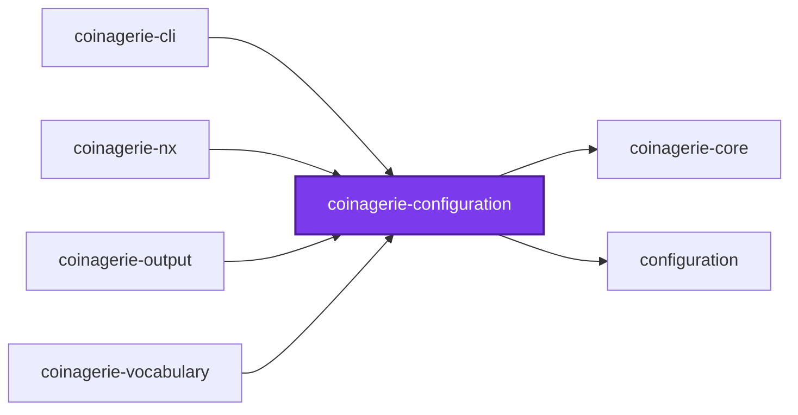
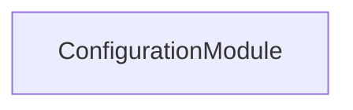
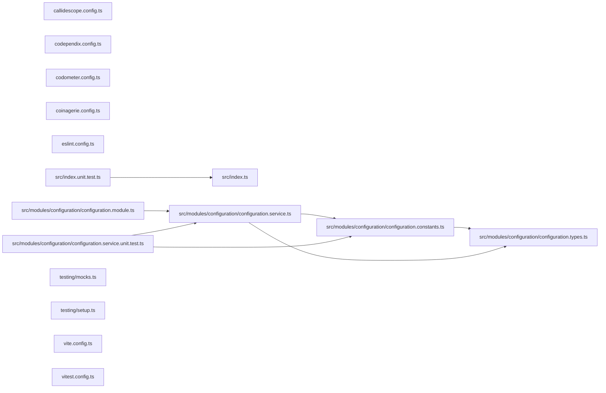

# @coinagerie/configuration

[](https://www.npmjs.com/package/@coinagerie/configuration)

The configuration schema, loader, and command-line flag resolution for coinagerie. It reads a `coinagerie.config.ts` and resolves the folder a run scans, what it includes and excludes, and where its glossaries are written.

```bash
npm install @coinagerie/configuration
```

## Test

```bash
nx run coinagerie-configuration:vitest
```

## 👔 Conformetry

This project was generated from the [nestjs-service-project](../../configuration/conformetry-templates/nestjs-service-project) conformetry template.
<<<<<<< HEAD

<!-- coinagerie:start -->

## 🪙 Coinagerie

The words this package uses that the root glossary does not define, regenerated with `nx run coinagerie-configuration:coinagerie-check:write`.

- **breadth**: Second callidescope limit, the count of distinct callees one callable may reach, set per project in its callidescope config.
- **forbid**: Pattern in the configuration constants that rejects a description holding a list item or HTML comment, since those would read back as glossary text.

<!-- coinagerie:end -->

## 🕸️ Codependix

Dependency graphs exported by [codependix](https://github.com/Organizzolini/codebase/tree/main/projects/ic-suite/codependix/codependix-cli), regenerated by `nx run configuration:codependix:write`.

### Nx Neighborhood

<!-- codependix:start name="codependix-nx-projects" -->

<!-- codependix:end name="codependix-nx-projects" -->

### NestJS Module Graph

<!-- codependix:start name="codependix-nestjs-modules" -->

<!-- codependix:end name="codependix-nestjs-modules" -->

### File Imports

<!-- codependix:start name="codependix-file-imports" -->

<!-- codependix:end name="codependix-file-imports" -->

<!-- callidescope:start -->

## 🔭 Callidescope

Call stacks traced through `projects/ic-suite/coinagerie/coinagerie-configuration`, deepest first. Each frame shows what it takes, what it returns, and what its documentation says.

| Measure | Value |
| --- | --- |
| Callables | 14 |
| Files | 12 |
| Calls traced | 20 |
| Call stacks | 1 |
| Deepest stack | 2 |
| Stacks through recursion | 0 |
| Unfollowable calls | 2 |

### Limits

What this project is judged against, as declared in its own `callidescope.config.ts`.

| Limit | Value |
| --- | --- |
| `maximumDepth` | 3 |
| `maximumBreadth` | 3 |

### Call stacks (depth)

**1. `ConfigurationService.anonymous`** — depth ≥ 2 · orphan-root

```text
🚀 ConfigurationService.anonymous(word: string): string [projects/ic-suite/coinagerie/coinagerie-configuration/src/modules/configuration/configuration.service.ts:67]
  └─> InvalidConfigurationError.constructor(filePath: string, reason: string): InvalidConfigurationError [projects/ic-suite/coinagerie/coinagerie-core/src/modules/coinagerie-core/coinagerie-core.constants.ts:32]
```

### Breadth

| Callable | Breadth | Calls directly | Location |
| --- | --- | --- | --- |
| `ConfigurationService.locate` | 3 | `ConfigurationFileNotFoundError.constructor`, `ConfigurationService.find(…)`, `ConfigurationService.map(…)` | `projects/ic-suite/coinagerie/coinagerie-configuration/src/modules/configuration/configuration.service.ts:99` |
| `ConfigurationService.read` | 3 | `InvalidConfigurationError.constructor`, `ConfigurationService.describe`, `ConfigurationService.resolveWords` | `projects/ic-suite/coinagerie/coinagerie-configuration/src/modules/configuration/configuration.service.ts:169` |
| `ConfigurationService.resolve` | 3 | `InvalidConfigurationError.constructor`, `ConfigurationService.override`, `ConfigurationService.guardFold` | `projects/ic-suite/coinagerie/coinagerie-configuration/src/modules/configuration/configuration.service.ts:205` |

<details>
<summary>2 more callables</summary>

| Callable | Breadth | Calls directly | Location |
| --- | --- | --- | --- |
| `ConfigurationService.loadConfiguration` | 3 | `ConfigurationService.locate`, `ConfigurationService.resolve`, `ConfigurationService.read` | `projects/ic-suite/coinagerie/coinagerie-configuration/src/modules/configuration/configuration.service.ts:320` |
| `ConfigurationService.anonymous` | 2 | `InvalidConfigurationError.constructor`, `ConfigurationService.describe` | `projects/ic-suite/coinagerie/coinagerie-configuration/src/modules/configuration/configuration.service.ts:67` |

</details>
<!-- callidescope:end -->
=======
>>>>>>> 96490981a3429a535ed79e290e5a4ba1ca225dc6
