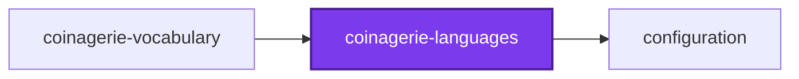
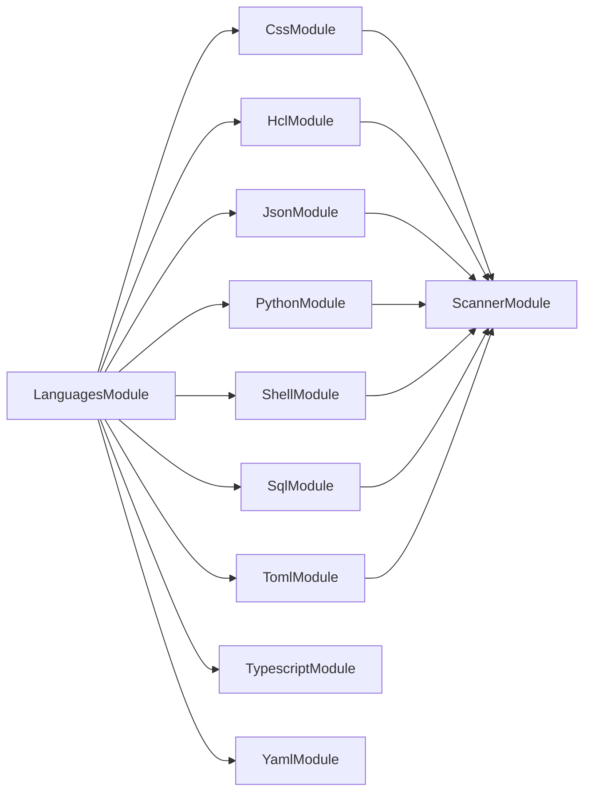

# @coinagerie/languages

[](https://www.npmjs.com/package/@coinagerie/languages)

Per-language identifier tokenizers and keyword lists that coinagerie uses to turn source files into words.

```bash
npm install @coinagerie/languages
```

## Languages

One tokenizer per language behind `(content, path) => string[]`, chosen by
file extension. Every language also exports its keywords as a plain array,
such as `pythonKeywords`, for a configuration to spread into `exclude.words`.

| Language   | Extensions                               | Reads                                      |
| ---------- | ---------------------------------------- | ------------------------------------------ |
| TypeScript | `.ts .tsx .mts .cts .js .jsx .mjs .cjs`  | Names in the compiler's syntax tree        |
| Python     | `.py .pyi`                               | Names, and quoted dictionary keys          |
| SQL        | `.sql`                                   | Names, and quoted identifiers              |
| Shell      | `.sh .bash .zsh .ksh`                    | Names, and quoted array keys               |
| CSS        | `.css`                                   | Selectors, properties, and at-rule names   |
| HCL        | `.tf .tfvars .hcl`                       | Names, quoted keys, and block labels       |
| TOML       | `.toml`                                  | Keys and table names, quoted or bare       |
| JSON       | `.json .jsonc`                           | Keys only                                  |
| YAML       | `.yaml .yml`                             | Keys only                                  |

## Test

```bash
nx run coinagerie-languages:vitest
```

## 👔 Conformetry

This project was generated from the [nestjs-service-project](../../configuration/conformetry-templates/nestjs-service-project) conformetry template.

<!-- coinagerie:start -->

## 🪙 Coinagerie

The words this package uses that the root glossary does not define, regenerated with `nx run coinagerie-languages:coinagerie-check:write`.

- **breadth**: The maximumBreadth limit in this package's callidescope configuration, capping how many callees one callable may make.
- **grammar**: The LexicalGrammar object a language constant supplies to the shared scanner, holding its rules and key patterns.
- **splice**: Array method call in TYPESCRIPT_KEYWORDS that inserts each keyword in sorted position, avoiding toSorted for older libraries.

<!-- coinagerie:end -->

## 🕸️ Codependix

Dependency graphs exported by [codependix](https://github.com/Organizzolini/codebase/tree/main/projects/ic-suite/codependix/codependix-cli), regenerated by `nx run configuration:codependix:write`.

### Nx Neighborhood

<!-- codependix:start name="codependix-nx-projects" -->

<!-- codependix:end name="codependix-nx-projects" -->

### NestJS Module Graph

<!-- codependix:start name="codependix-nestjs-modules" -->

<!-- codependix:end name="codependix-nestjs-modules" -->

### File Imports

```mermaid
graph LR
  file_callidescope_config_ts["callidescope.config.ts"]
  file_codependix_config_ts["codependix.config.ts"]
  file_codometer_config_ts["codometer.config.ts"]
  file_coinagerie_config_ts["coinagerie.config.ts"]
  file_eslint_config_ts["eslint.config.ts"]
  file_src_index_ts["src/index.ts"]
  file_src_index_unit_test_ts["src/index.unit.test.ts"]
  file_src_modules_css_css_constants_ts["src/modules/css/css.constants.ts"]
  file_src_modules_css_css_module_ts["src/modules/css/css.module.ts"]
  file_src_modules_css_css_service_ts["src/modules/css/css.service.ts"]
  file_src_modules_css_css_service_unit_test_ts["src/modules/css/css.service.unit.test.ts"]
  file_src_modules_css_css_types_ts["src/modules/css/css.types.ts"]
  file_src_modules_hcl_hcl_constants_ts["src/modules/hcl/hcl.constants.ts"]
  file_src_modules_hcl_hcl_module_ts["src/modules/hcl/hcl.module.ts"]
  file_src_modules_hcl_hcl_service_ts["src/modules/hcl/hcl.service.ts"]
  file_src_modules_hcl_hcl_service_unit_test_ts["src/modules/hcl/hcl.service.unit.test.ts"]
  file_src_modules_hcl_hcl_types_ts["src/modules/hcl/hcl.types.ts"]
  file_src_modules_json_json_constants_ts["src/modules/json/json.constants.ts"]
  file_src_modules_json_json_module_ts["src/modules/json/json.module.ts"]
  file_src_modules_json_json_service_ts["src/modules/json/json.service.ts"]
  file_src_modules_json_json_service_unit_test_ts["src/modules/json/json.service.unit.test.ts"]
  file_src_modules_json_json_types_ts["src/modules/json/json.types.ts"]
  file_src_modules_languages_languages_constants_ts["src/modules/languages/languages.constants.ts"]
  file_src_modules_languages_languages_module_ts["src/modules/languages/languages.module.ts"]
  file_src_modules_languages_languages_service_ts["src/modules/languages/languages.service.ts"]
  file_src_modules_languages_languages_service_unit_test_ts["src/modules/languages/languages.service.unit.test.ts"]
  file_src_modules_languages_languages_types_ts["src/modules/languages/languages.types.ts"]
  file_src_modules_python_python_constants_ts["src/modules/python/python.constants.ts"]
  file_src_modules_python_python_module_ts["src/modules/python/python.module.ts"]
  file_src_modules_python_python_service_ts["src/modules/python/python.service.ts"]
  file_src_modules_python_python_service_unit_test_ts["src/modules/python/python.service.unit.test.ts"]
  file_src_modules_python_python_types_ts["src/modules/python/python.types.ts"]
  file_src_modules_scanner_scanner_constants_ts["src/modules/scanner/scanner.constants.ts"]
  file_src_modules_scanner_scanner_module_ts["src/modules/scanner/scanner.module.ts"]
  file_src_modules_scanner_scanner_service_ts["src/modules/scanner/scanner.service.ts"]
  file_src_modules_scanner_scanner_service_unit_test_ts["src/modules/scanner/scanner.service.unit.test.ts"]
  file_src_modules_scanner_scanner_types_ts["src/modules/scanner/scanner.types.ts"]
  file_src_modules_shell_shell_constants_ts["src/modules/shell/shell.constants.ts"]
  file_src_modules_shell_shell_module_ts["src/modules/shell/shell.module.ts"]
  file_src_modules_shell_shell_service_ts["src/modules/shell/shell.service.ts"]
  file_src_modules_shell_shell_service_unit_test_ts["src/modules/shell/shell.service.unit.test.ts"]
  file_src_modules_shell_shell_types_ts["src/modules/shell/shell.types.ts"]
  file_src_modules_sql_sql_constants_ts["src/modules/sql/sql.constants.ts"]
  file_src_modules_sql_sql_module_ts["src/modules/sql/sql.module.ts"]
  file_src_modules_sql_sql_service_ts["src/modules/sql/sql.service.ts"]
  file_src_modules_sql_sql_service_unit_test_ts["src/modules/sql/sql.service.unit.test.ts"]
  file_src_modules_sql_sql_types_ts["src/modules/sql/sql.types.ts"]
  file_src_modules_toml_toml_constants_ts["src/modules/toml/toml.constants.ts"]
  file_src_modules_toml_toml_module_ts["src/modules/toml/toml.module.ts"]
  file_src_modules_toml_toml_service_ts["src/modules/toml/toml.service.ts"]
  file_src_modules_toml_toml_service_unit_test_ts["src/modules/toml/toml.service.unit.test.ts"]
  file_src_modules_toml_toml_types_ts["src/modules/toml/toml.types.ts"]
  file_src_modules_typescript_typescript_constants_ts["src/modules/typescript/typescript.constants.ts"]
  file_src_modules_typescript_typescript_constants_unit_test_ts["src/modules/typescript/typescript.constants.unit.test.ts"]
  file_src_modules_typescript_typescript_module_ts["src/modules/typescript/typescript.module.ts"]
  file_src_modules_typescript_typescript_service_ts["src/modules/typescript/typescript.service.ts"]
  file_src_modules_typescript_typescript_service_unit_test_ts["src/modules/typescript/typescript.service.unit.test.ts"]
  file_src_modules_typescript_typescript_types_ts["src/modules/typescript/typescript.types.ts"]
  file_src_modules_yaml_yaml_constants_ts["src/modules/yaml/yaml.constants.ts"]
  file_src_modules_yaml_yaml_module_ts["src/modules/yaml/yaml.module.ts"]
  file_src_modules_yaml_yaml_service_ts["src/modules/yaml/yaml.service.ts"]
  file_src_modules_yaml_yaml_service_unit_test_ts["src/modules/yaml/yaml.service.unit.test.ts"]
  file_src_modules_yaml_yaml_types_ts["src/modules/yaml/yaml.types.ts"]
  file_testing_mocks_ts["testing/mocks.ts"]
  file_testing_setup_ts["testing/setup.ts"]
  file_vite_config_ts["vite.config.ts"]
  file_vitest_config_ts["vitest.config.ts"]
  file_src_index_unit_test_ts --> file_src_index_ts
  file_src_modules_css_css_constants_ts --> file_src_modules_scanner_scanner_constants_ts
  file_src_modules_css_css_constants_ts --> file_src_modules_scanner_scanner_types_ts
  file_src_modules_css_css_module_ts --> file_src_modules_css_css_service_ts
  file_src_modules_css_css_module_ts --> file_src_modules_scanner_scanner_module_ts
  file_src_modules_css_css_service_ts --> file_src_modules_css_css_constants_ts
  file_src_modules_css_css_service_ts --> file_src_modules_languages_languages_types_ts
  file_src_modules_css_css_service_ts --> file_src_modules_scanner_scanner_service_ts
  file_src_modules_css_css_service_unit_test_ts --> file_src_modules_css_css_service_ts
  file_src_modules_css_css_service_unit_test_ts --> file_src_modules_scanner_scanner_module_ts
  file_src_modules_hcl_hcl_constants_ts --> file_src_modules_scanner_scanner_constants_ts
  file_src_modules_hcl_hcl_constants_ts --> file_src_modules_scanner_scanner_types_ts
  file_src_modules_hcl_hcl_module_ts --> file_src_modules_hcl_hcl_service_ts
  file_src_modules_hcl_hcl_module_ts --> file_src_modules_scanner_scanner_module_ts
  file_src_modules_hcl_hcl_service_ts --> file_src_modules_hcl_hcl_constants_ts
  file_src_modules_hcl_hcl_service_ts --> file_src_modules_languages_languages_types_ts
  file_src_modules_hcl_hcl_service_ts --> file_src_modules_scanner_scanner_service_ts
  file_src_modules_hcl_hcl_service_unit_test_ts --> file_src_modules_hcl_hcl_service_ts
  file_src_modules_hcl_hcl_service_unit_test_ts --> file_src_modules_scanner_scanner_module_ts
  file_src_modules_json_json_constants_ts --> file_src_modules_scanner_scanner_types_ts
  file_src_modules_json_json_module_ts --> file_src_modules_json_json_service_ts
  file_src_modules_json_json_module_ts --> file_src_modules_scanner_scanner_module_ts
  file_src_modules_json_json_service_ts --> file_src_modules_json_json_constants_ts
  file_src_modules_json_json_service_ts --> file_src_modules_languages_languages_types_ts
  file_src_modules_json_json_service_ts --> file_src_modules_scanner_scanner_service_ts
  file_src_modules_json_json_service_unit_test_ts --> file_src_modules_json_json_service_ts
  file_src_modules_json_json_service_unit_test_ts --> file_src_modules_scanner_scanner_module_ts
  file_src_modules_languages_languages_module_ts --> file_src_modules_css_css_module_ts
  file_src_modules_languages_languages_module_ts --> file_src_modules_hcl_hcl_module_ts
  file_src_modules_languages_languages_module_ts --> file_src_modules_json_json_module_ts
  file_src_modules_languages_languages_module_ts --> file_src_modules_languages_languages_service_ts
  file_src_modules_languages_languages_module_ts --> file_src_modules_python_python_module_ts
  file_src_modules_languages_languages_module_ts --> file_src_modules_shell_shell_module_ts
  file_src_modules_languages_languages_module_ts --> file_src_modules_sql_sql_module_ts
  file_src_modules_languages_languages_module_ts --> file_src_modules_toml_toml_module_ts
  file_src_modules_languages_languages_module_ts --> file_src_modules_typescript_typescript_module_ts
  file_src_modules_languages_languages_module_ts --> file_src_modules_yaml_yaml_module_ts
  file_src_modules_languages_languages_service_ts --> file_src_modules_css_css_service_ts
  file_src_modules_languages_languages_service_ts --> file_src_modules_hcl_hcl_service_ts
  file_src_modules_languages_languages_service_ts --> file_src_modules_json_json_service_ts
  file_src_modules_languages_languages_service_ts --> file_src_modules_languages_languages_types_ts
  file_src_modules_languages_languages_service_ts --> file_src_modules_python_python_service_ts
  file_src_modules_languages_languages_service_ts --> file_src_modules_shell_shell_service_ts
  file_src_modules_languages_languages_service_ts --> file_src_modules_sql_sql_service_ts
  file_src_modules_languages_languages_service_ts --> file_src_modules_toml_toml_service_ts
  file_src_modules_languages_languages_service_ts --> file_src_modules_typescript_typescript_service_ts
  file_src_modules_languages_languages_service_ts --> file_src_modules_yaml_yaml_service_ts
  file_src_modules_languages_languages_service_unit_test_ts --> file_src_modules_css_css_module_ts
  file_src_modules_languages_languages_service_unit_test_ts --> file_src_modules_hcl_hcl_module_ts
  file_src_modules_languages_languages_service_unit_test_ts --> file_src_modules_json_json_module_ts
  file_src_modules_languages_languages_service_unit_test_ts --> file_src_modules_languages_languages_service_ts
  file_src_modules_languages_languages_service_unit_test_ts --> file_src_modules_python_python_module_ts
  file_src_modules_languages_languages_service_unit_test_ts --> file_src_modules_shell_shell_module_ts
  file_src_modules_languages_languages_service_unit_test_ts --> file_src_modules_sql_sql_module_ts
  file_src_modules_languages_languages_service_unit_test_ts --> file_src_modules_toml_toml_module_ts
  file_src_modules_languages_languages_service_unit_test_ts --> file_src_modules_typescript_typescript_module_ts
  file_src_modules_languages_languages_service_unit_test_ts --> file_src_modules_yaml_yaml_module_ts
  file_src_modules_python_python_constants_ts --> file_src_modules_scanner_scanner_constants_ts
  file_src_modules_python_python_constants_ts --> file_src_modules_scanner_scanner_types_ts
  file_src_modules_python_python_module_ts --> file_src_modules_python_python_service_ts
  file_src_modules_python_python_module_ts --> file_src_modules_scanner_scanner_module_ts
  file_src_modules_python_python_service_ts --> file_src_modules_languages_languages_types_ts
  file_src_modules_python_python_service_ts --> file_src_modules_python_python_constants_ts
  file_src_modules_python_python_service_ts --> file_src_modules_scanner_scanner_service_ts
  file_src_modules_python_python_service_unit_test_ts --> file_src_modules_python_python_service_ts
  file_src_modules_python_python_service_unit_test_ts --> file_src_modules_scanner_scanner_module_ts
  file_src_modules_scanner_scanner_constants_ts --> file_src_modules_scanner_scanner_types_ts
  file_src_modules_scanner_scanner_module_ts --> file_src_modules_scanner_scanner_service_ts
  file_src_modules_scanner_scanner_service_ts --> file_src_modules_scanner_scanner_types_ts
  file_src_modules_scanner_scanner_service_unit_test_ts --> file_src_modules_scanner_scanner_constants_ts
  file_src_modules_scanner_scanner_service_unit_test_ts --> file_src_modules_scanner_scanner_service_ts
  file_src_modules_scanner_scanner_service_unit_test_ts --> file_src_modules_scanner_scanner_types_ts
  file_src_modules_shell_shell_constants_ts --> file_src_modules_scanner_scanner_constants_ts
  file_src_modules_shell_shell_constants_ts --> file_src_modules_scanner_scanner_types_ts
  file_src_modules_shell_shell_module_ts --> file_src_modules_scanner_scanner_module_ts
  file_src_modules_shell_shell_module_ts --> file_src_modules_shell_shell_service_ts
  file_src_modules_shell_shell_service_ts --> file_src_modules_languages_languages_types_ts
  file_src_modules_shell_shell_service_ts --> file_src_modules_scanner_scanner_service_ts
  file_src_modules_shell_shell_service_ts --> file_src_modules_shell_shell_constants_ts
  file_src_modules_shell_shell_service_unit_test_ts --> file_src_modules_scanner_scanner_module_ts
  file_src_modules_shell_shell_service_unit_test_ts --> file_src_modules_shell_shell_service_ts
  file_src_modules_sql_sql_constants_ts --> file_src_modules_scanner_scanner_constants_ts
  file_src_modules_sql_sql_constants_ts --> file_src_modules_scanner_scanner_types_ts
  file_src_modules_sql_sql_module_ts --> file_src_modules_scanner_scanner_module_ts
  file_src_modules_sql_sql_module_ts --> file_src_modules_sql_sql_service_ts
  file_src_modules_sql_sql_service_ts --> file_src_modules_languages_languages_types_ts
  file_src_modules_sql_sql_service_ts --> file_src_modules_scanner_scanner_service_ts
  file_src_modules_sql_sql_service_ts --> file_src_modules_sql_sql_constants_ts
  file_src_modules_sql_sql_service_unit_test_ts --> file_src_modules_scanner_scanner_module_ts
  file_src_modules_sql_sql_service_unit_test_ts --> file_src_modules_sql_sql_service_ts
  file_src_modules_toml_toml_constants_ts --> file_src_modules_scanner_scanner_constants_ts
  file_src_modules_toml_toml_constants_ts --> file_src_modules_scanner_scanner_types_ts
  file_src_modules_toml_toml_module_ts --> file_src_modules_scanner_scanner_module_ts
  file_src_modules_toml_toml_module_ts --> file_src_modules_toml_toml_service_ts
  file_src_modules_toml_toml_service_ts --> file_src_modules_languages_languages_types_ts
  file_src_modules_toml_toml_service_ts --> file_src_modules_scanner_scanner_service_ts
  file_src_modules_toml_toml_service_ts --> file_src_modules_toml_toml_constants_ts
  file_src_modules_toml_toml_service_unit_test_ts --> file_src_modules_scanner_scanner_module_ts
  file_src_modules_toml_toml_service_unit_test_ts --> file_src_modules_toml_toml_service_ts
  file_src_modules_typescript_typescript_constants_unit_test_ts --> file_src_modules_typescript_typescript_constants_ts
  file_src_modules_typescript_typescript_module_ts --> file_src_modules_typescript_typescript_service_ts
  file_src_modules_typescript_typescript_service_ts --> file_src_modules_languages_languages_types_ts
  file_src_modules_typescript_typescript_service_ts --> file_src_modules_typescript_typescript_constants_ts
  file_src_modules_typescript_typescript_service_unit_test_ts --> file_src_modules_typescript_typescript_service_ts
  file_src_modules_yaml_yaml_constants_ts --> file_src_modules_yaml_yaml_types_ts
  file_src_modules_yaml_yaml_module_ts --> file_src_modules_yaml_yaml_service_ts
  file_src_modules_yaml_yaml_service_ts --> file_src_modules_languages_languages_types_ts
  file_src_modules_yaml_yaml_service_ts --> file_src_modules_yaml_yaml_constants_ts
  file_src_modules_yaml_yaml_service_ts --> file_src_modules_yaml_yaml_types_ts
  file_src_modules_yaml_yaml_service_unit_test_ts --> file_src_modules_yaml_yaml_service_ts
```

<!-- codependix:start name="codependix-file-imports" -->

<!-- codependix:end name="codependix-file-imports" -->

<!-- callidescope:start -->

## 🔭 Callidescope

Call stacks traced through `projects/ic-suite/coinagerie/coinagerie-languages`, deepest first. Each frame shows what it takes, what it returns, and what its documentation says.

| Measure | Value |
| --- | --- |
| Callables | 38 |
| Files | 52 |
| Calls traced | 22 |
| Call stacks | 11 |
| Deepest stack | 4 |
| Stacks through recursion | 0 |
| Unfollowable calls | 1 |

### Limits

What this project is judged against, as declared in its own `callidescope.config.ts`.

| Limit | Value |
| --- | --- |
| `maximumDepth` | 6 |
| `maximumBreadth` | 9 |

### Call stacks (depth)

**1. `CssService.tokenize`** — depth 4 · orphan-root

```text
🚀 CssService.tokenize(content: string): string[] [projects/ic-suite/coinagerie/coinagerie-languages/src/modules/css/css.service.ts:34]
   ↳ Every identifier in a CSS stylesheet, repeats kept.
  └─> ScannerService.scan(content: string, grammar: LexicalGrammar): string[] [projects/ic-suite/coinagerie/coinagerie-languages/src/modules/scanner/scanner.service.ts:111]
     ↳ Every identifier in a file written in the grammar's language, in the order written, repeats kept.
    └─> ScannerService.readToken(…): LexicalToken | undefined [projects/ic-suite/coinagerie/coinagerie-languages/src/modules/scanner/scanner.service.ts:73]
       ↳ The token at `index`, or `undefined` when only punctuation is there.
      └─> ScannerService.matchAt(pattern: RegExp, content: string, index: number): null | RegExpExecArray [projects/ic-suite/coinagerie/coinagerie-languages/src/modules/scanner/scanner.service.ts:62]
         ↳ Whether the text at `index` matches a sticky pattern.
```

**2. `HclService.tokenize`** — depth 4 · orphan-root

```text
🚀 HclService.tokenize(content: string): string[] [projects/ic-suite/coinagerie/coinagerie-languages/src/modules/hcl/hcl.service.ts:34]
   ↳ Every identifier in an HCL file, repeats kept.
  └─> ScannerService.scan(content: string, grammar: LexicalGrammar): string[] [projects/ic-suite/coinagerie/coinagerie-languages/src/modules/scanner/scanner.service.ts:111]
     ↳ Every identifier in a file written in the grammar's language, in the order written, repeats kept.
    └─> ScannerService.readToken(…): LexicalToken | undefined [projects/ic-suite/coinagerie/coinagerie-languages/src/modules/scanner/scanner.service.ts:73]
       ↳ The token at `index`, or `undefined` when only punctuation is there.
      └─> ScannerService.matchAt(pattern: RegExp, content: string, index: number): null | RegExpExecArray [projects/ic-suite/coinagerie/coinagerie-languages/src/modules/scanner/scanner.service.ts:62]
         ↳ Whether the text at `index` matches a sticky pattern.
```

**3. `JsonService.tokenize`** — depth 4 · orphan-root

```text
🚀 JsonService.tokenize(content: string): string[] [projects/ic-suite/coinagerie/coinagerie-languages/src/modules/json/json.service.ts:34]
   ↳ Every key in a JSON document, in the order written, repeats kept.
  └─> ScannerService.scan(content: string, grammar: LexicalGrammar): string[] [projects/ic-suite/coinagerie/coinagerie-languages/src/modules/scanner/scanner.service.ts:111]
     ↳ Every identifier in a file written in the grammar's language, in the order written, repeats kept.
    └─> ScannerService.readToken(…): LexicalToken | undefined [projects/ic-suite/coinagerie/coinagerie-languages/src/modules/scanner/scanner.service.ts:73]
       ↳ The token at `index`, or `undefined` when only punctuation is there.
      └─> ScannerService.matchAt(pattern: RegExp, content: string, index: number): null | RegExpExecArray [projects/ic-suite/coinagerie/coinagerie-languages/src/modules/scanner/scanner.service.ts:62]
         ↳ Whether the text at `index` matches a sticky pattern.
```

<details>
<summary>8 more call stacks</summary>

**4. `PythonService.tokenize`** — depth 4 · orphan-root

```text
🚀 PythonService.tokenize(content: string): string[] [projects/ic-suite/coinagerie/coinagerie-languages/src/modules/python/python.service.ts:33]
   ↳ Every identifier in a Python file, repeats kept.
  └─> ScannerService.scan(content: string, grammar: LexicalGrammar): string[] [projects/ic-suite/coinagerie/coinagerie-languages/src/modules/scanner/scanner.service.ts:111]
     ↳ Every identifier in a file written in the grammar's language, in the order written, repeats kept.
    └─> ScannerService.readToken(…): LexicalToken | undefined [projects/ic-suite/coinagerie/coinagerie-languages/src/modules/scanner/scanner.service.ts:73]
       ↳ The token at `index`, or `undefined` when only punctuation is there.
      └─> ScannerService.matchAt(pattern: RegExp, content: string, index: number): null | RegExpExecArray [projects/ic-suite/coinagerie/coinagerie-languages/src/modules/scanner/scanner.service.ts:62]
         ↳ Whether the text at `index` matches a sticky pattern.
```

**5. `ShellService.tokenize`** — depth 4 · orphan-root

```text
🚀 ShellService.tokenize(content: string): string[] [projects/ic-suite/coinagerie/coinagerie-languages/src/modules/shell/shell.service.ts:33]
   ↳ Every identifier in a shell script, repeats kept.
  └─> ScannerService.scan(content: string, grammar: LexicalGrammar): string[] [projects/ic-suite/coinagerie/coinagerie-languages/src/modules/scanner/scanner.service.ts:111]
     ↳ Every identifier in a file written in the grammar's language, in the order written, repeats kept.
    └─> ScannerService.readToken(…): LexicalToken | undefined [projects/ic-suite/coinagerie/coinagerie-languages/src/modules/scanner/scanner.service.ts:73]
       ↳ The token at `index`, or `undefined` when only punctuation is there.
      └─> ScannerService.matchAt(pattern: RegExp, content: string, index: number): null | RegExpExecArray [projects/ic-suite/coinagerie/coinagerie-languages/src/modules/scanner/scanner.service.ts:62]
         ↳ Whether the text at `index` matches a sticky pattern.
```

**6. `SqlService.tokenize`** — depth 4 · orphan-root

```text
🚀 SqlService.tokenize(content: string): string[] [projects/ic-suite/coinagerie/coinagerie-languages/src/modules/sql/sql.service.ts:33]
   ↳ Every identifier in a SQL script, repeats kept.
  └─> ScannerService.scan(content: string, grammar: LexicalGrammar): string[] [projects/ic-suite/coinagerie/coinagerie-languages/src/modules/scanner/scanner.service.ts:111]
     ↳ Every identifier in a file written in the grammar's language, in the order written, repeats kept.
    └─> ScannerService.readToken(…): LexicalToken | undefined [projects/ic-suite/coinagerie/coinagerie-languages/src/modules/scanner/scanner.service.ts:73]
       ↳ The token at `index`, or `undefined` when only punctuation is there.
      └─> ScannerService.matchAt(pattern: RegExp, content: string, index: number): null | RegExpExecArray [projects/ic-suite/coinagerie/coinagerie-languages/src/modules/scanner/scanner.service.ts:62]
         ↳ Whether the text at `index` matches a sticky pattern.
```

**7. `TomlService.tokenize`** — depth 4 · orphan-root

```text
🚀 TomlService.tokenize(content: string): string[] [projects/ic-suite/coinagerie/coinagerie-languages/src/modules/toml/toml.service.ts:33]
   ↳ Every identifier in a TOML document, repeats kept.
  └─> ScannerService.scan(content: string, grammar: LexicalGrammar): string[] [projects/ic-suite/coinagerie/coinagerie-languages/src/modules/scanner/scanner.service.ts:111]
     ↳ Every identifier in a file written in the grammar's language, in the order written, repeats kept.
    └─> ScannerService.readToken(…): LexicalToken | undefined [projects/ic-suite/coinagerie/coinagerie-languages/src/modules/scanner/scanner.service.ts:73]
       ↳ The token at `index`, or `undefined` when only punctuation is there.
      └─> ScannerService.matchAt(pattern: RegExp, content: string, index: number): null | RegExpExecArray [projects/ic-suite/coinagerie/coinagerie-languages/src/modules/scanner/scanner.service.ts:62]
         ↳ Whether the text at `index` matches a sticky pattern.
```

**8. `TypescriptService.tokenize`** — depth 4 · orphan-root

```text
🚀 TypescriptService.tokenize(content: string, filePath: string): string[] [projects/ic-suite/coinagerie/coinagerie-languages/src/modules/typescript/typescript.service.ts:70]
   ↳ Every identifier in a source file, in the order written, repeats kept.
  └─> TypescriptService.visit(node: ts.Node): void [projects/ic-suite/coinagerie/coinagerie-languages/src/modules/typescript/typescript.service.ts:80]
    └─> TypescriptService.readIdentifier(node: ts.Node): string | undefined [projects/ic-suite/coinagerie/coinagerie-languages/src/modules/typescript/typescript.service.ts:50]
       ↳ The identifier a node spells, or `undefined` when it spells none.
      └─> TypescriptService.isQuotedName(node: ts.Node): node is ts.StringLiteral [projects/ic-suite/coinagerie/coinagerie-languages/src/modules/typescript/typescript.service.ts:38]
         ↳ Whether a node is a string literal naming a key, such as `"quoted-key"`.
```

**9. `YamlService.tokenize`** — depth 3 · orphan-root

```text
🚀 YamlService.tokenize(content: string): string[] [projects/ic-suite/coinagerie/coinagerie-languages/src/modules/yaml/yaml.service.ts:94]
   ↳ Every key in a YAML document, in the order written, repeats kept.
  └─> YamlService.isInsideBlock(line: string, owner: number): boolean [projects/ic-suite/coinagerie/coinagerie-languages/src/modules/yaml/yaml.service.ts:38]
     ↳ Whether a line is text inside the block scalar owned at `owner`.
    └─> YamlService.indentOf(line: string): number [projects/ic-suite/coinagerie/coinagerie-languages/src/modules/yaml/yaml.service.ts:33]
       ↳ How many columns a line is indented.
```

**10. `reduce(…)`** — depth 2 · orphan-root

```text
🚀 reduce(…)(sorted: string[], keyword: string): string[] [projects/ic-suite/coinagerie/coinagerie-languages/src/modules/typescript/typescript.constants.ts:56]
  └─> findIndex(…)(existing: string): boolean [projects/ic-suite/coinagerie/coinagerie-languages/src/modules/typescript/typescript.constants.ts:59]
```

**11. `LanguagesService.constructor`** — depth ≥ 2 · orphan-root

```text
🚀 LanguagesService.constructor(…): LanguagesService [projects/ic-suite/coinagerie/coinagerie-languages/src/modules/languages/languages.service.ts:28]
  └─> LanguagesService.set(…)(content: string, filePath: string): string[] [projects/ic-suite/coinagerie/coinagerie-languages/src/modules/languages/languages.service.ts:53]
```

</details>

### Breadth

| Callable | Breadth | Calls directly | Location |
| --- | --- | --- | --- |
| `YamlService.tokenize` | 3 | `YamlService.isInsideBlock`, `YamlService.readLine`, `YamlService.filter(…)` | `projects/ic-suite/coinagerie/coinagerie-languages/src/modules/yaml/yaml.service.ts:94` |
| `ScannerService.readToken` | 2 | `ScannerService.matchAt`, `ScannerService.isKey` | `projects/ic-suite/coinagerie/coinagerie-languages/src/modules/scanner/scanner.service.ts:73` |
| `YamlService.readLine` | 2 | `YamlService.indentOf`, `YamlService.matchRule` | `projects/ic-suite/coinagerie/coinagerie-languages/src/modules/yaml/yaml.service.ts:69` |

<details>
<summary>14 more callables</summary>

| Callable | Breadth | Calls directly | Location |
| --- | --- | --- | --- |
| `ScannerService.scan` | 1 | `ScannerService.readToken` | `projects/ic-suite/coinagerie/coinagerie-languages/src/modules/scanner/scanner.service.ts:111` |
| `CssService.tokenize` | 1 | `ScannerService.scan` | `projects/ic-suite/coinagerie/coinagerie-languages/src/modules/css/css.service.ts:34` |
| `HclService.tokenize` | 1 | `ScannerService.scan` | `projects/ic-suite/coinagerie/coinagerie-languages/src/modules/hcl/hcl.service.ts:34` |
| `JsonService.tokenize` | 1 | `ScannerService.scan` | `projects/ic-suite/coinagerie/coinagerie-languages/src/modules/json/json.service.ts:34` |
| `PythonService.tokenize` | 1 | `ScannerService.scan` | `projects/ic-suite/coinagerie/coinagerie-languages/src/modules/python/python.service.ts:33` |
| `ShellService.tokenize` | 1 | `ScannerService.scan` | `projects/ic-suite/coinagerie/coinagerie-languages/src/modules/shell/shell.service.ts:33` |
| `SqlService.tokenize` | 1 | `ScannerService.scan` | `projects/ic-suite/coinagerie/coinagerie-languages/src/modules/sql/sql.service.ts:33` |
| `TomlService.tokenize` | 1 | `ScannerService.scan` | `projects/ic-suite/coinagerie/coinagerie-languages/src/modules/toml/toml.service.ts:33` |
| `reduce(…)` | 1 | `findIndex(…)` | `projects/ic-suite/coinagerie/coinagerie-languages/src/modules/typescript/typescript.constants.ts:56` |
| `TypescriptService.readIdentifier` | 1 | `TypescriptService.isQuotedName` | `projects/ic-suite/coinagerie/coinagerie-languages/src/modules/typescript/typescript.service.ts:50` |
| `TypescriptService.tokenize` | 1 | `TypescriptService.visit` | `projects/ic-suite/coinagerie/coinagerie-languages/src/modules/typescript/typescript.service.ts:70` |
| `TypescriptService.visit` | 1 | `TypescriptService.readIdentifier` | `projects/ic-suite/coinagerie/coinagerie-languages/src/modules/typescript/typescript.service.ts:80` |
| `YamlService.isInsideBlock` | 1 | `YamlService.indentOf` | `projects/ic-suite/coinagerie/coinagerie-languages/src/modules/yaml/yaml.service.ts:38` |
| `LanguagesService.constructor` | 1 | `LanguagesService.set(…)` | `projects/ic-suite/coinagerie/coinagerie-languages/src/modules/languages/languages.service.ts:28` |

</details>
<!-- callidescope:end -->
