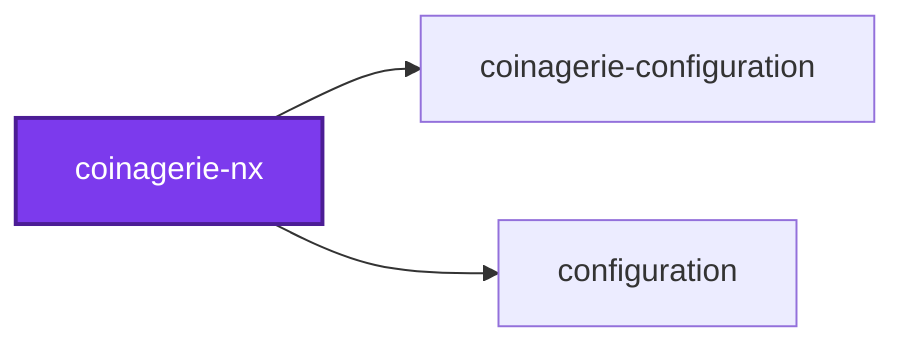

# @coinagerie/nx

[](https://www.npmjs.com/package/@coinagerie/nx)

An Nx plugin that infers a coinagerie check target for every project that holds a `coinagerie.config.ts`.

```bash
npm install --save-dev @coinagerie/nx @coinagerie/cli
```

## Usage

An Nx plugin that gives every project holding a coinagerie configuration its
own check target, so `nx affected` runs the check only where something it reads
has changed. The `coinagerie` command works without it.

Register it in `nx.json`:

```json
{
  "plugins": [
    {
      "plugin": "@coinagerie/nx",
      "options": {
        "inputs": ["{workspaceRoot}/GLOSSARY.md"]
      }
    }
  ]
}
```

A project gets the target when its folder holds a `coinagerie.config.ts` (or
any other file name the loader reads) beside a `project.json` or `package.json`.
The target runs `coinagerie --check` from the project folder and is cached.

| Option            | Default            | Meaning                                                     |
| ----------------- | ------------------ | ----------------------------------------------------------- |
| `checkTargetName` | `coinagerie-check` | Name of the inferred target                                 |
| `command`         | `coinagerie`       | What runs; `--check` is appended                            |
| `inputs`          | none               | Extra cache inputs added to every inferred target (below)   |

The configuration file and every file in the project are cache inputs. A file
the project does not hold but its configuration reads, such as a parent
glossary behind `exclude.words`, goes in `inputs`: editing it re-runs the check,
and a path under `{workspaceRoot}` also makes `nx affected` select every project
that declares it. One project can add its own in `project.json` with the
spread entry, `"inputs": ["...", "{workspaceRoot}/other.json"]`.

The target runs the installed `coinagerie` binary, so `@coinagerie/cli` must be
installed, or `command` must name another way to run it. Its verdict also
depends on the tool itself: to re-run every check when the tool changes,
declare it as an input, for example `{ "externalDependencies": ["@coinagerie/cli"] }`.
An input may be a string or any other Nx input object.

## Test

```bash
nx run coinagerie-nx:vitest
```

## 👔 Conformetry

This project was generated from the [nestjs-service-project](../../configuration/conformetry-templates/nestjs-service-project) conformetry template.

<!-- coinagerie:start -->

## 🪙 Coinagerie

The words this package uses that the root glossary does not define, regenerated with `nx run coinagerie-nx:coinagerie-check:write`.

- **batch**: Group of coinagerie-check tasks Nx hands to one executor call, which starts the command line once and names every project to it.
- **breadth**: The maximumBreadth limit in this package's callidescope.config.ts, set to four callees per callable.
- **gamma**: A fixture package name in the plugin's unit tests, standing for a project with a project.json but no configuration.

<!-- coinagerie:end -->

## 🕸️ Codependix

Dependency graphs exported by [codependix](https://github.com/Organizzolini/codebase/tree/main/projects/ic-suite/codependix/codependix-cli), regenerated by `nx run configuration:codependix:write`.

### Nx Neighborhood

<!-- codependix:start name="codependix-nx-projects" -->

<!-- codependix:end name="codependix-nx-projects" -->

### NestJS Module Graph

<!-- codependix:start name="codependix-nestjs-modules" -->

<!-- codependix:end name="codependix-nestjs-modules" -->

### File Imports

```mermaid
graph LR
  file_callidescope_config_ts["callidescope.config.ts"]
  file_codependix_config_ts["codependix.config.ts"]
  file_codometer_config_ts["codometer.config.ts"]
  file_coinagerie_config_ts["coinagerie.config.ts"]
  file_eslint_config_ts["eslint.config.ts"]
  file_src_coinagerie_nx_module_ts["src/coinagerie-nx.module.ts"]
  file_src_coinagerie_nx_module_unit_test_ts["src/coinagerie-nx.module.unit.test.ts"]
  file_src_executors_check_batch_executor_ts["src/executors/check/batch-executor.ts"]
  file_src_executors_check_batch_executor_unit_test_ts["src/executors/check/batch-executor.unit.test.ts"]
  file_src_executors_check_executor_ts["src/executors/check/executor.ts"]
  file_src_executors_check_executor_types_ts["src/executors/check/executor.types.ts"]
  file_src_executors_check_executor_unit_test_ts["src/executors/check/executor.unit.test.ts"]
  file_src_executors_check_executor_utilities_ts["src/executors/check/executor.utilities.ts"]
  file_src_index_ts["src/index.ts"]
  file_src_index_unit_test_ts["src/index.unit.test.ts"]
  file_src_modules_options_options_constants_ts["src/modules/options/options.constants.ts"]
  file_src_modules_options_options_module_ts["src/modules/options/options.module.ts"]
  file_src_modules_options_options_service_ts["src/modules/options/options.service.ts"]
  file_src_modules_options_options_service_unit_test_ts["src/modules/options/options.service.unit.test.ts"]
  file_src_modules_options_options_types_ts["src/modules/options/options.types.ts"]
  file_src_modules_plugin_plugin_context_utilities_ts["src/modules/plugin/plugin-context.utilities.ts"]
  file_src_modules_plugin_plugin_context_utilities_unit_test_ts["src/modules/plugin/plugin-context.utilities.unit.test.ts"]
  file_src_modules_plugin_plugin_constants_ts["src/modules/plugin/plugin.constants.ts"]
  file_src_modules_plugin_plugin_module_ts["src/modules/plugin/plugin.module.ts"]
  file_src_modules_plugin_plugin_service_ts["src/modules/plugin/plugin.service.ts"]
  file_src_modules_plugin_plugin_service_unit_test_ts["src/modules/plugin/plugin.service.unit.test.ts"]
  file_src_modules_plugin_plugin_types_ts["src/modules/plugin/plugin.types.ts"]
  file_testing_fake_command_line_ts["testing/fake-command-line.ts"]
  file_testing_fake_workspace_ts["testing/fake-workspace.ts"]
  file_testing_mocks_ts["testing/mocks.ts"]
  file_testing_setup_ts["testing/setup.ts"]
  file_vite_config_ts["vite.config.ts"]
  file_vitest_config_ts["vitest.config.ts"]
  file_src_coinagerie_nx_module_ts --> file_src_modules_plugin_plugin_module_ts
  file_src_coinagerie_nx_module_unit_test_ts --> file_src_coinagerie_nx_module_ts
  file_src_executors_check_batch_executor_ts --> file_src_executors_check_executor_types_ts
  file_src_executors_check_batch_executor_ts --> file_src_executors_check_executor_utilities_ts
  file_src_executors_check_batch_executor_unit_test_ts --> file_src_executors_check_batch_executor_ts
  file_src_executors_check_batch_executor_unit_test_ts --> file_src_executors_check_executor_types_ts
  file_src_executors_check_batch_executor_unit_test_ts --> file_testing_fake_command_line_ts
  file_src_executors_check_executor_ts --> file_src_executors_check_executor_types_ts
  file_src_executors_check_executor_ts --> file_src_executors_check_executor_utilities_ts
  file_src_executors_check_executor_unit_test_ts --> file_src_executors_check_executor_ts
  file_src_executors_check_executor_unit_test_ts --> file_src_executors_check_executor_types_ts
  file_src_executors_check_executor_unit_test_ts --> file_testing_fake_command_line_ts
  file_src_executors_check_executor_utilities_ts --> file_src_executors_check_executor_types_ts
  file_src_index_ts --> file_src_modules_options_options_constants_ts
  file_src_index_ts --> file_src_modules_plugin_plugin_context_utilities_ts
  file_src_index_ts --> file_src_modules_plugin_plugin_constants_ts
  file_src_index_unit_test_ts --> file_src_index_ts
  file_src_index_unit_test_ts --> file_testing_fake_workspace_ts
  file_src_modules_options_options_module_ts --> file_src_modules_options_options_service_ts
  file_src_modules_options_options_service_ts --> file_src_modules_options_options_constants_ts
  file_src_modules_options_options_service_ts --> file_src_modules_options_options_types_ts
  file_src_modules_options_options_service_unit_test_ts --> file_src_modules_options_options_service_ts
  file_src_modules_plugin_plugin_context_utilities_ts --> file_src_coinagerie_nx_module_ts
  file_src_modules_plugin_plugin_context_utilities_ts --> file_src_modules_plugin_plugin_constants_ts
  file_src_modules_plugin_plugin_context_utilities_ts --> file_src_modules_plugin_plugin_service_ts
  file_src_modules_plugin_plugin_context_utilities_ts --> file_src_modules_plugin_plugin_types_ts
  file_src_modules_plugin_plugin_context_utilities_unit_test_ts --> file_src_modules_plugin_plugin_context_utilities_ts
  file_src_modules_plugin_plugin_context_utilities_unit_test_ts --> file_src_modules_plugin_plugin_service_ts
  file_src_modules_plugin_plugin_module_ts --> file_src_modules_options_options_module_ts
  file_src_modules_plugin_plugin_module_ts --> file_src_modules_plugin_plugin_service_ts
  file_src_modules_plugin_plugin_service_ts --> file_src_modules_options_options_service_ts
  file_src_modules_plugin_plugin_service_ts --> file_src_modules_options_options_types_ts
  file_src_modules_plugin_plugin_service_ts --> file_src_modules_plugin_plugin_constants_ts
  file_src_modules_plugin_plugin_service_ts --> file_src_modules_plugin_plugin_types_ts
  file_src_modules_plugin_plugin_service_unit_test_ts --> file_src_modules_options_options_service_ts
  file_src_modules_plugin_plugin_service_unit_test_ts --> file_src_modules_plugin_plugin_service_ts
  file_src_modules_plugin_plugin_service_unit_test_ts --> file_testing_fake_workspace_ts
  file_src_modules_plugin_plugin_types_ts --> file_src_modules_options_options_types_ts
  file_src_modules_plugin_plugin_types_ts --> file_src_modules_plugin_plugin_constants_ts
```

<!-- codependix:start name="codependix-file-imports" -->

<!-- codependix:end name="codependix-file-imports" -->

<!-- callidescope:start -->

## 🔭 Callidescope

Call stacks traced through `projects/ic-suite/coinagerie/coinagerie-nx`, deepest first. Each frame shows what it takes, what it returns, and what its documentation says.

| Measure | Value |
| --- | --- |
| Callables | 35 |
| Files | 22 |
| Calls traced | 32 |
| Call stacks | 3 |
| Deepest stack | 6 |
| Stacks through recursion | 0 |
| Unfollowable calls | 0 |

### Limits

What this project is judged against, as declared in its own `callidescope.config.ts`.

| Limit | Value |
| --- | --- |
| `maximumDepth` | 6 |
| `maximumBreadth` | 4 |

### Call stacks (depth)

**1. `anonymous`** — depth 6 · orphan-root

```text
🚀 anonymous(…): Promise<CreateNodesResultArray> [projects/ic-suite/coinagerie/coinagerie-nx/src/index.ts:40]
  └─> PluginService.inferTargets(args: InferTargetsArguments): Map<string, InferredTargets> [projects/ic-suite/coinagerie/coinagerie-nx/src/modules/plugin/plugin.service.ts:112]
     ↳ Infers a check target onto every project that holds a configuration.
    └─> OptionsService.resolvePluginOptions(options: unknown): CoinageriePluginOptions [projects/ic-suite/coinagerie/coinagerie-nx/src/modules/options/options.service.ts:82]
       ↳ Resolves the effective plugin options from an untrusted value.
      └─> OptionsService.readInputs(options: Record<string, unknown>): PluginInput[] [projects/ic-suite/coinagerie/coinagerie-nx/src/modules/options/options.service.ts:49]
         ↳ Reads the declared inputs from an untrusted record.
        └─> OptionsService.flatMap(…)(this: undefined, entry: unknown): PluginInput[] [projects/ic-suite/coinagerie/coinagerie-nx/src/modules/options/options.service.ts:56]
          └─> OptionsService.isInputObject(value: unknown): value is Exclude<PluginInput, string> [projects/ic-suite/coinagerie/coinagerie-nx/src/modules/options/options.service.ts:31]
             ↳ Narrows an untrusted value to an Nx input object, such as `{ env }`.
```

**2. `checkBatchExecutor`** — depth 6 · orphan-root

```text
🚀 checkBatchExecutor(…): Promise<Record<string, CheckBatchTaskResult>> [projects/ic-suite/coinagerie/coinagerie-nx/src/executors/check/batch-executor.ts:19]
   ↳ Judges every task Nx batched for this executor from one command-line process.
  └─> runBatch(…): Promise<Record<string, CheckBatchTaskResult>> [projects/ic-suite/coinagerie/coinagerie-nx/src/executors/check/executor.utilities.ts:58]
     ↳ Judges every task of a batch, one process per group, each task by its own verdict.
    └─> runGroup(…): Promise<Record<string, CheckBatchTaskResult>> [projects/ic-suite/coinagerie/coinagerie-nx/src/executors/check/executor.utilities.ts:78]
       ↳ Judges every task of a group from one process, giving each its own verdict.
      └─> parseVerdicts(output: ProcessOutput): CheckVerdictRecord[] [projects/ic-suite/coinagerie/coinagerie-nx/src/executors/check/executor.utilities.ts:154]
         ↳ Reads the verdicts a process printed.
        └─> isVerdictList(value: unknown): value is CheckVerdictRecord[] [projects/ic-suite/coinagerie/coinagerie-nx/src/executors/check/executor.utilities.ts:120]
           ↳ Whether a parsed value is a list of verdicts, as the `batch` command prints them.
          └─> isVerdictRecord(value: unknown): value is CheckVerdictRecord [projects/ic-suite/coinagerie/coinagerie-nx/src/executors/check/executor.utilities.ts:135]
             ↳ Whether a parsed value is one verdict as the `batch` command prints it.
```

**3. `checkExecutor`** — depth 5 · orphan-root

```text
🚀 checkExecutor(…): Promise<{ success: boolean; }> [projects/ic-suite/coinagerie/coinagerie-nx/src/executors/check/executor.ts:18]
   ↳ Judges one project's glossaries against the words its code uses.
  └─> runGroup(…): Promise<Record<string, CheckBatchTaskResult>> [projects/ic-suite/coinagerie/coinagerie-nx/src/executors/check/executor.utilities.ts:78]
     ↳ Judges every task of a group from one process, giving each its own verdict.
    └─> parseVerdicts(output: ProcessOutput): CheckVerdictRecord[] [projects/ic-suite/coinagerie/coinagerie-nx/src/executors/check/executor.utilities.ts:154]
       ↳ Reads the verdicts a process printed.
      └─> isVerdictList(value: unknown): value is CheckVerdictRecord[] [projects/ic-suite/coinagerie/coinagerie-nx/src/executors/check/executor.utilities.ts:120]
         ↳ Whether a parsed value is a list of verdicts, as the `batch` command prints them.
        └─> isVerdictRecord(value: unknown): value is CheckVerdictRecord [projects/ic-suite/coinagerie/coinagerie-nx/src/executors/check/executor.utilities.ts:135]
           ↳ Whether a parsed value is one verdict as the `batch` command prints it.
```

### Breadth

| Callable | Breadth | Calls directly | Location |
| --- | --- | --- | --- |
| `runProcess` | 4 | `buildCommand`, `on(…)`, `on(…)`, `anonymous` | `projects/ic-suite/coinagerie/coinagerie-nx/src/executors/check/executor.utilities.ts:182` |
| `PluginService.inferTargets` | 3 | `OptionsService.resolvePluginOptions`, `PluginService.isProject`, `PluginService.buildCheckTarget` | `projects/ic-suite/coinagerie/coinagerie-nx/src/modules/plugin/plugin.service.ts:112` |
| `anonymous` | 3 | `resolvePluginService`, `PluginService.inferTargets`, `flatMap(…)` | `projects/ic-suite/coinagerie/coinagerie-nx/src/index.ts:40` |

<details>
<summary>13 more callables</summary>

| Callable | Breadth | Calls directly | Location |
| --- | --- | --- | --- |
| `runGroup` | 3 | `parseVerdicts`, `runProcess`, `find(…)` | `projects/ic-suite/coinagerie/coinagerie-nx/src/executors/check/executor.utilities.ts:78` |
| `checkExecutor` | 3 | `runGroup`, `map(…)`, `every(…)` | `projects/ic-suite/coinagerie/coinagerie-nx/src/executors/check/executor.ts:18` |
| `OptionsService.readInputs` | 2 | `OptionsService.isUnknownArray`, `OptionsService.flatMap(…)` | `projects/ic-suite/coinagerie/coinagerie-nx/src/modules/options/options.service.ts:49` |
| `OptionsService.resolvePluginOptions` | 2 | `OptionsService.readString`, `OptionsService.readInputs` | `projects/ic-suite/coinagerie/coinagerie-nx/src/modules/options/options.service.ts:82` |
| `runBatch` | 2 | `groupTasks`, `runGroup` | `projects/ic-suite/coinagerie/coinagerie-nx/src/executors/check/executor.utilities.ts:58` |
| `checkBatchExecutor` | 2 | `runBatch`, `printFailures` | `projects/ic-suite/coinagerie/coinagerie-nx/src/executors/check/batch-executor.ts:19` |
| `OptionsService.flatMap(…)` | 1 | `OptionsService.isInputObject` | `projects/ic-suite/coinagerie/coinagerie-nx/src/modules/options/options.service.ts:56` |
| `PluginService.buildCheckTarget` | 1 | `PluginService.map(…)` | `projects/ic-suite/coinagerie/coinagerie-nx/src/modules/plugin/plugin.service.ts:49` |
| `PluginService.isProject` | 1 | `PluginService.isNamedPackage` | `projects/ic-suite/coinagerie/coinagerie-nx/src/modules/plugin/plugin.service.ts:90` |
| `resolvePluginService` | 1 | `resolvePluginContext` | `projects/ic-suite/coinagerie/coinagerie-nx/src/modules/plugin/plugin-context.utilities.ts:15` |
| `buildCommand` | 1 | `quote` | `projects/ic-suite/coinagerie/coinagerie-nx/src/executors/check/executor.utilities.ts:108` |
| `isVerdictList` | 1 | `isVerdictRecord` | `projects/ic-suite/coinagerie/coinagerie-nx/src/executors/check/executor.utilities.ts:120` |
| `parseVerdicts` | 1 | `isVerdictList` | `projects/ic-suite/coinagerie/coinagerie-nx/src/executors/check/executor.utilities.ts:154` |

</details>
<!-- callidescope:end -->
