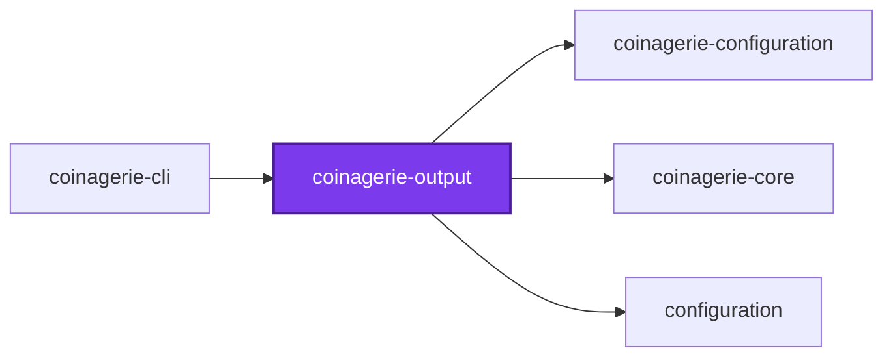
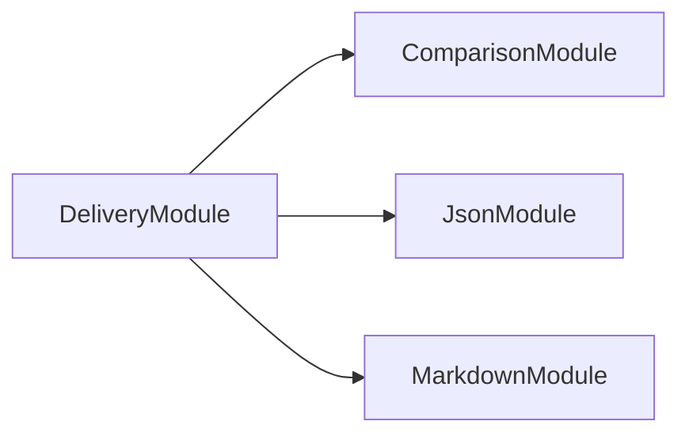
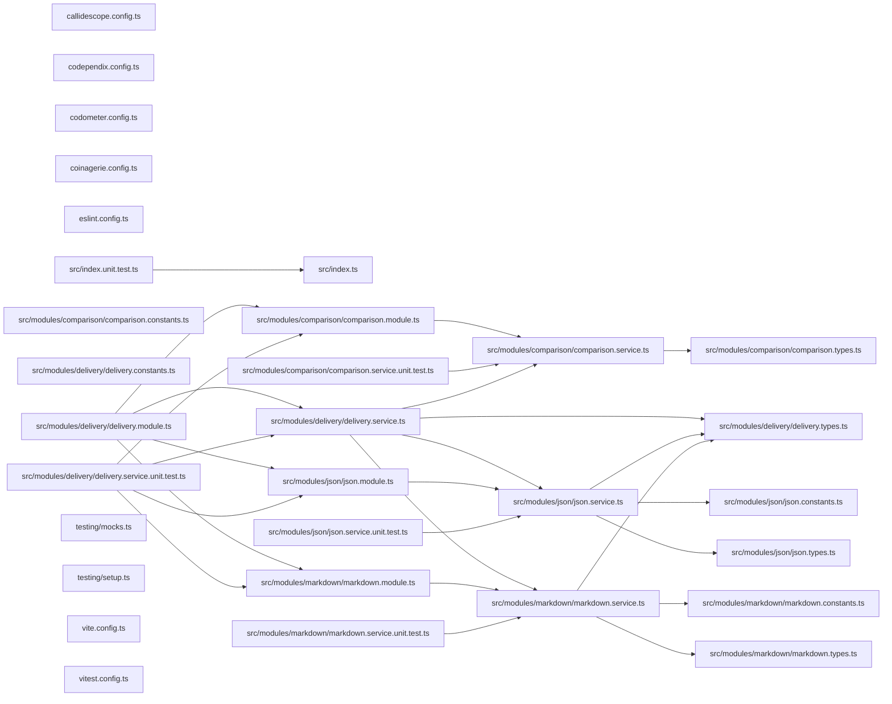

# @coinagerie/output

[](https://www.npmjs.com/package/@coinagerie/output)

Renders and parses the markdown and JSON glossaries coinagerie writes, and compares them with the vocabulary of the codebase to name the words that are missing or stale.

```bash
npm install @coinagerie/output
```

## Test

```bash
nx run coinagerie-output:vitest
```

## 👔 Conformetry

This project was generated from the [nestjs-service-project](../../configuration/conformetry-templates/nestjs-service-project) conformetry template.

<!-- coinagerie:start -->

## 🪙 Coinagerie

The words this package uses that the root glossary does not define, regenerated with `nx run coinagerie-output:coinagerie-check:write`.

- **anchor**: The HTML comment markers coinagerie:start and coinagerie:end that bracket the managed block in a markdown file.
- **boundary**: Edge where glossary text enters the package, where it is parsed and validated before any comparison or write happens.
- **breadth**: The maximumBreadth limit, set to four in this project's callidescope configuration, bounding callees per function.
- **bullet**: One word's entry in a glossary block, written as a dash, bolded word, and colon, read by the markdown parser.
- **glossary**: The map from each word to its definition, which the parsers fill and comparison checks against the codebase.
- **hand**: Manually written or manually scanned: tests use hand-written blocks, and tokenizing scans JSON by hand rather than regex.
- **preamble**: Free text opening a generated block, made of the start anchor, heading, and description before the bullets.
- **reconcile**: Rewrites a glossary to exactly the codebase vocabulary, sorted, keeping existing definitions and dropping stale words.
- **splice**: Inserts or replaces the anchored block inside a file's content, preserving that file's own CRLF or LF line endings.
- **vocabulary**: The set of words the codebase uses, which comparison checks each glossary against to find missing or stale words.

<!-- coinagerie:end -->

## 🕸️ Codependix

Dependency graphs exported by [codependix](https://github.com/Organizzolini/codebase/tree/main/projects/ic-suite/codependix/codependix-cli), regenerated by `nx run configuration:codependix:write`.

### Nx Neighborhood

<!-- codependix:start name="codependix-nx-projects" -->

<!-- codependix:end name="codependix-nx-projects" -->

### NestJS Module Graph

<!-- codependix:start name="codependix-nestjs-modules" -->

<!-- codependix:end name="codependix-nestjs-modules" -->

### File Imports

<!-- codependix:start name="codependix-file-imports" -->

<!-- codependix:end name="codependix-file-imports" -->

<!-- callidescope:start -->

## 🔭 Callidescope

Call stacks traced through `projects/ic-suite/coinagerie/coinagerie-output`, deepest first. Each frame shows what it takes, what it returns, and what its documentation says.

| Measure | Value |
| --- | --- |
| Callables | 53 |
| Files | 24 |
| Calls traced | 69 |
| Call stacks | 0 |
| Deepest stack | 0 |
| Stacks through recursion | 0 |
| Unfollowable calls | 0 |

### Limits

What this project is judged against, as declared in its own `callidescope.config.ts`.

| Limit | Value |
| --- | --- |
| `maximumDepth` | 10 |
| `maximumBreadth` | 4 |

### Call stacks (depth)

None.

### Breadth

| Callable | Breadth | Calls directly | Location |
| --- | --- | --- | --- |
| `JsonService.parse` | 4 | `JsonService.parseJson`, `JsonService.isObject`, `JsonService.fail`, `JsonService.refuseDuplicates` | `projects/ic-suite/coinagerie/coinagerie-output/src/modules/json/json.service.ts:176` |
| `DeliveryService.contentFor` | 4 | `JsonService.write`, `MarkdownService.write`, `DeliveryService.handlerFor`, `ComparisonService.reconcile` | `projects/ic-suite/coinagerie/coinagerie-output/src/modules/delivery/delivery.service.ts:55` |
| `MarkdownService.readDescription` | 3 | `MarkdownService.findAnchors`, `MarkdownService.findIndex(…)`, `MarkdownService.filter(…)` | `projects/ic-suite/coinagerie/coinagerie-output/src/modules/markdown/markdown.service.ts:156` |

<details>
<summary>30 more callables</summary>

| Callable | Breadth | Calls directly | Location |
| --- | --- | --- | --- |
| `MarkdownService.parse` | 3 | `MarkdownService.findAnchors`, `MarkdownService.forEach(…)`, `MarkdownService.flush` | `projects/ic-suite/coinagerie/coinagerie-output/src/modules/markdown/markdown.service.ts:212` |
| `MarkdownService.write` | 3 | `MarkdownService.splice`, `MarkdownService.render`, `MarkdownService.readDescription` | `projects/ic-suite/coinagerie/coinagerie-output/src/modules/markdown/markdown.service.ts:300` |
| `DeliveryService.map(…)` | 3 | `JsonService.read`, `MarkdownService.read`, `DeliveryService.handlerFor` | `projects/ic-suite/coinagerie/coinagerie-output/src/modules/delivery/delivery.service.ts:84` |
| `ComparisonService.compare` | 2 | `ComparisonService.filter(…)`, `ComparisonService.filter(…)` | `projects/ic-suite/coinagerie/coinagerie-output/src/modules/comparison/comparison.service.ts:26` |
| `JsonService.endOfToken` | 2 | `JsonService.endOfString`, `JsonService.isBoundary` | `projects/ic-suite/coinagerie/coinagerie-output/src/modules/json/json.service.ts:46` |
| `JsonService.refuseDuplicates` | 2 | `JsonService.tokenize`, `JsonService.fail` | `projects/ic-suite/coinagerie/coinagerie-output/src/modules/json/json.service.ts:108` |
| `JsonService.render` | 2 | `JsonService.map(…)`, `JsonService.toSorted(…)` | `projects/ic-suite/coinagerie/coinagerie-output/src/modules/json/json.service.ts:215` |
| `MarkdownService.findAnchors` | 2 | `MarkdownService.indexesOf`, `MarkdownService.fail` | `projects/ic-suite/coinagerie/coinagerie-output/src/modules/markdown/markdown.service.ts:64` |
| `MarkdownService.readBullet` | 2 | `MarkdownService.fail`, `MarkdownService.flush` | `projects/ic-suite/coinagerie/coinagerie-output/src/modules/markdown/markdown.service.ts:110` |
| `MarkdownService.readContinuation` | 2 | `MarkdownService.fail`, `MarkdownService.from(…)` | `projects/ic-suite/coinagerie/coinagerie-output/src/modules/markdown/markdown.service.ts:136` |
| `MarkdownService.readLine` | 2 | `MarkdownService.readBullet`, `MarkdownService.readContinuation` | `projects/ic-suite/coinagerie/coinagerie-output/src/modules/markdown/markdown.service.ts:173` |
| `MarkdownService.render` | 2 | `MarkdownService.map(…)`, `MarkdownService.toSorted(…)` | `projects/ic-suite/coinagerie/coinagerie-output/src/modules/markdown/markdown.service.ts:245` |
| `DeliveryService.check` | 2 | `DeliveryService.map(…)`, `DeliveryService.readAll` | `projects/ic-suite/coinagerie/coinagerie-output/src/modules/delivery/delivery.service.ts:102` |
| `DeliveryService.write` | 2 | `DeliveryService.map(…)`, `DeliveryService.readAll` | `projects/ic-suite/coinagerie/coinagerie-output/src/modules/delivery/delivery.service.ts:113` |
| `DeliveryService.map(…)` | 2 | `DeliveryService.contentFor`, `DeliveryService.differenceOf` | `projects/ic-suite/coinagerie/coinagerie-output/src/modules/delivery/delivery.service.ts:114` |
| `ComparisonService.reconcile` | 1 | `ComparisonService.map(…)` | `projects/ic-suite/coinagerie/coinagerie-output/src/modules/comparison/comparison.service.ts:42` |
| `JsonService.fail` | 1 | `MalformedGlossaryError.constructor` | `projects/ic-suite/coinagerie/coinagerie-output/src/modules/json/json.service.ts:67` |
| `JsonService.parseJson` | 1 | `JsonService.fail` | `projects/ic-suite/coinagerie/coinagerie-output/src/modules/json/json.service.ts:90` |
| `JsonService.tokenize` | 1 | `JsonService.endOfToken` | `projects/ic-suite/coinagerie/coinagerie-output/src/modules/json/json.service.ts:150` |
| `JsonService.read` | 1 | `JsonService.parse` | `projects/ic-suite/coinagerie/coinagerie-output/src/modules/json/json.service.ts:202` |
| `JsonService.write` | 1 | `JsonService.render` | `projects/ic-suite/coinagerie/coinagerie-output/src/modules/json/json.service.ts:227` |
| `MarkdownService.fail` | 1 | `MalformedGlossaryError.constructor` | `projects/ic-suite/coinagerie/coinagerie-output/src/modules/markdown/markdown.service.ts:50` |
| `MarkdownService.indexesOf` | 1 | `MarkdownService.flatMap(…)` | `projects/ic-suite/coinagerie/coinagerie-output/src/modules/markdown/markdown.service.ts:68` |
| `MarkdownService.forEach(…)` | 1 | `MarkdownService.readLine` | `projects/ic-suite/coinagerie/coinagerie-output/src/modules/markdown/markdown.service.ts:228` |
| `MarkdownService.read` | 1 | `MarkdownService.parse` | `projects/ic-suite/coinagerie/coinagerie-output/src/modules/markdown/markdown.service.ts:237` |
| `MarkdownService.map(…)` | 1 | `MarkdownService.renderBullet` | `projects/ic-suite/coinagerie/coinagerie-output/src/modules/markdown/markdown.service.ts:253` |
| `MarkdownService.splice` | 1 | `MarkdownService.findAnchors` | `projects/ic-suite/coinagerie/coinagerie-output/src/modules/markdown/markdown.service.ts:269` |
| `DeliveryService.differenceOf` | 1 | `ComparisonService.compare` | `projects/ic-suite/coinagerie/coinagerie-output/src/modules/delivery/delivery.service.ts:64` |
| `DeliveryService.readAll` | 1 | `DeliveryService.map(…)` | `projects/ic-suite/coinagerie/coinagerie-output/src/modules/delivery/delivery.service.ts:83` |
| `DeliveryService.map(…)` | 1 | `DeliveryService.differenceOf` | `projects/ic-suite/coinagerie/coinagerie-output/src/modules/delivery/delivery.service.ts:103` |

</details>
<!-- callidescope:end -->
