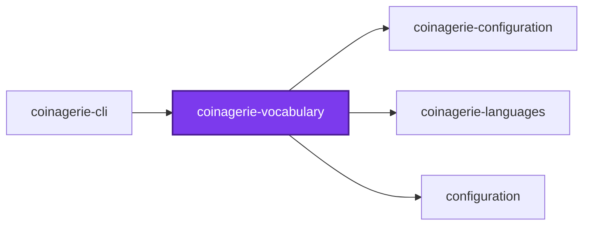
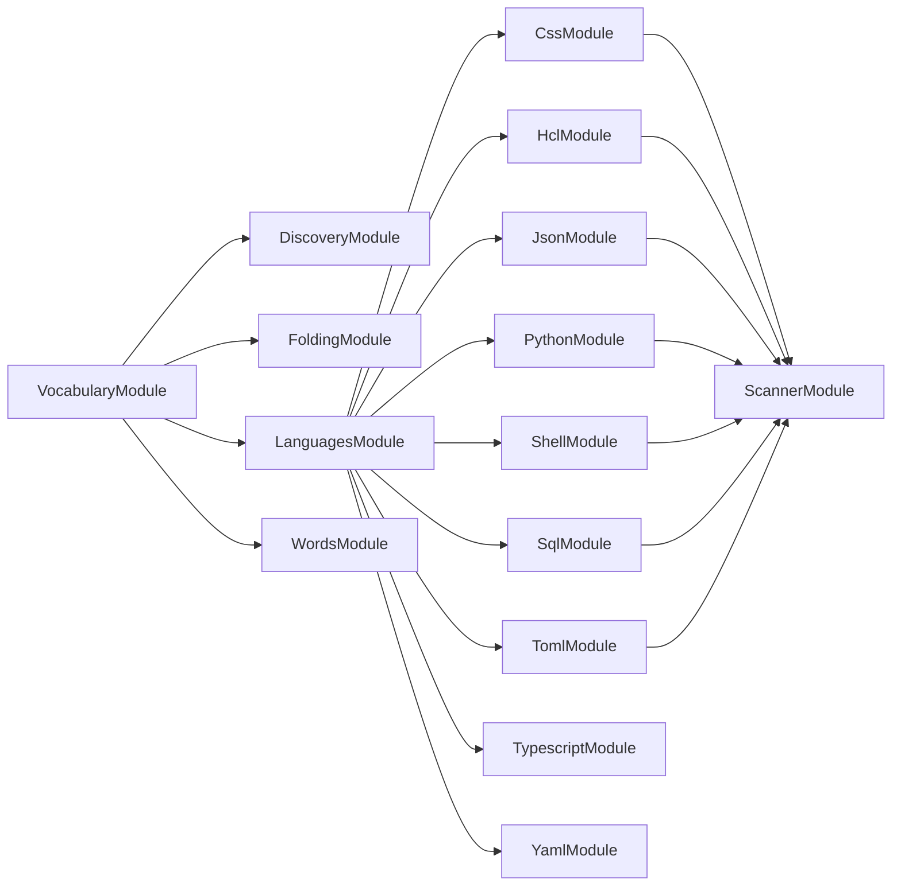
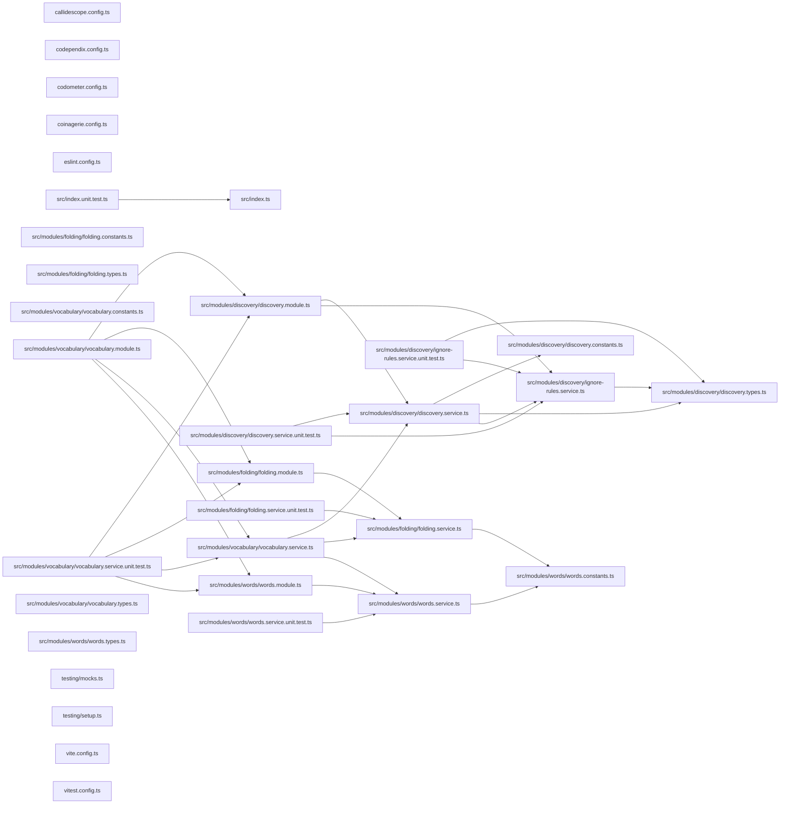

# @coinagerie/vocabulary

[](https://www.npmjs.com/package/@coinagerie/vocabulary)

File discovery, word splitting, folding, and exclusion: the part of coinagerie that turns a codebase into a sorted list of headwords.

```bash
npm install @coinagerie/vocabulary
```

## Test

```bash
nx run coinagerie-vocabulary:vitest
```

## 👔 Conformetry

This project was generated from the [nestjs-service-project](../../configuration/conformetry-templates/nestjs-service-project) conformetry template.

<!-- coinagerie:start -->

## 🪙 Coinagerie

The words this package uses that the root glossary does not define, regenerated with `nx run coinagerie-vocabulary:coinagerie-check:write`.

- **aspect**: Example word in folding tests, where aspects folds into the singular aspect; also a fixture file name.
- **breadth**: The maximumBreadth limit, set to seven in this project's callidescope configuration, bounding callees per function.
- **bundle**: Fixture path dist/bundle.js that discovery tests use to check an exclude list drops the dist folder.
- **glossary**: The GLOSSARY.md file discovery skips so a glossary's own headwords never count as codebase vocabulary.
- **headword**: The single form a word folds into, which the glossary lists once and exclusion compares against.
- **phase**: A word split from the fixture file aspect-phase-emoji.service.ts, testing that hyphenated names split into words.
- **term**: A word of at least two code points that counts toward the vocabulary, as defined by TERM_LENGTH_PATTERN.
- **verb**: Lemmatizer step from wink-lemmatizer reducing an inflected verb form to its base, as configuring to configure.
- **vocabulary**: The sorted list of every word the codebase uses, produced by VocabularyService.collect after folding and exclusion.

<!-- coinagerie:end -->

## 🕸️ Codependix

Dependency graphs exported by [codependix](https://github.com/Organizzolini/codebase/tree/main/projects/ic-suite/codependix/codependix-cli), regenerated by `nx run configuration:codependix:write`.

### Nx Neighborhood

<!-- codependix:start name="codependix-nx-projects" -->

<!-- codependix:end name="codependix-nx-projects" -->

### NestJS Module Graph

<!-- codependix:start name="codependix-nestjs-modules" -->

<!-- codependix:end name="codependix-nestjs-modules" -->

### File Imports

<!-- codependix:start name="codependix-file-imports" -->

<!-- codependix:end name="codependix-file-imports" -->

<!-- callidescope:start -->

## 🔭 Callidescope

Call stacks traced through `projects/ic-suite/coinagerie/coinagerie-vocabulary`, deepest first. Each frame shows what it takes, what it returns, and what its documentation says.

| Measure | Value |
| --- | --- |
| Callables | 42 |
| Files | 25 |
| Calls traced | 44 |
| Call stacks | 0 |
| Deepest stack | 0 |
| Stacks through recursion | 0 |
| Unfollowable calls | 1 |

### Limits

What this project is judged against, as declared in its own `callidescope.config.ts`.

| Limit | Value |
| --- | --- |
| `maximumDepth` | 7 |
| `maximumBreadth` | 7 |

### Call stacks (depth)

None.

### Breadth

| Callable | Breadth | Calls directly | Location |
| --- | --- | --- | --- |
| `DiscoveryService.discover` | 7 | `DiscoveryService.findRepositoryRoot`, `DiscoveryService.map(…)`, `DiscoveryService.filter(…)`, `DiscoveryService.map(…)`, `DiscoveryService.filter(…)`, `DiscoveryService.walk`, `DiscoveryService.readAncestorScopes` | `projects/ic-suite/coinagerie/coinagerie-vocabulary/src/modules/discovery/discovery.service.ts:152` |
| `VocabularyService.collect` | 7 | `DiscoveryService.discover`, `VocabularyService.map(…)`, `VocabularyService.excludedHeadwords`, `VocabularyService.collectFile`, `FoldingService.headword`, `VocabularyService.matchesPattern`, `VocabularyService.filter(…)` | `projects/ic-suite/coinagerie/coinagerie-vocabulary/src/modules/vocabulary/vocabulary.service.ts:108` |
| `DiscoveryService.walk` | 4 | `DiscoveryService.toPosix`, `IgnoreRulesService.readScope`, `DiscoveryService.flatMap(…)`, `DiscoveryService.filter(…)` | `projects/ic-suite/coinagerie/coinagerie-vocabulary/src/modules/discovery/discovery.service.ts:107` |

<details>
<summary>16 more callables</summary>

| Callable | Breadth | Calls directly | Location |
| --- | --- | --- | --- |
| `DiscoveryService.readAncestorScopes` | 3 | `DiscoveryService.filter(…)`, `DiscoveryService.toPosix`, `DiscoveryService.flatMap(…)` | `projects/ic-suite/coinagerie/coinagerie-vocabulary/src/modules/discovery/discovery.service.ts:78` |
| `DiscoveryService.flatMap(…)` | 3 | `IgnoreRulesService.isIgnored`, `DiscoveryService.isExcludedFolder`, `DiscoveryService.walk` | `projects/ic-suite/coinagerie/coinagerie-vocabulary/src/modules/discovery/discovery.service.ts:122` |
| `WordsService.splitIdentifier` | 3 | `WordsService.filter(…)`, `WordsService.map(…)`, `WordsService.flatMap(…)` | `projects/ic-suite/coinagerie/coinagerie-vocabulary/src/modules/words/words.service.ts:43` |
| `VocabularyService.collectFile` | 3 | `WordsService.splitPath`, `LanguagesService.tokenizerFor`, `VocabularyService.flatMap(…)` | `projects/ic-suite/coinagerie/coinagerie-vocabulary/src/modules/vocabulary/vocabulary.service.ts:42` |
| `DiscoveryService.isExcludedFolder` | 2 | `DiscoveryService.toPosix`, `DiscoveryService.some(…)` | `projects/ic-suite/coinagerie/coinagerie-vocabulary/src/modules/discovery/discovery.service.ts:56` |
| `DiscoveryService.isSelected` | 2 | `DiscoveryService.some(…)`, `DiscoveryService.some(…)` | `projects/ic-suite/coinagerie/coinagerie-vocabulary/src/modules/discovery/discovery.service.ts:67` |
| `IgnoreRulesService.isIgnored` | 1 | `IgnoreRulesService.toScopedPath` | `projects/ic-suite/coinagerie/coinagerie-vocabulary/src/modules/discovery/ignore-rules.service.ts:49` |
| `DiscoveryService.flatMap(…)` | 1 | `IgnoreRulesService.readScope` | `projects/ic-suite/coinagerie/coinagerie-vocabulary/src/modules/discovery/discovery.service.ts:86` |
| `DiscoveryService.map(…)` | 1 | `DiscoveryService.toPosix` | `projects/ic-suite/coinagerie/coinagerie-vocabulary/src/modules/discovery/discovery.service.ts:163` |
| `DiscoveryService.filter(…)` | 1 | `DiscoveryService.isSelected` | `projects/ic-suite/coinagerie/coinagerie-vocabulary/src/modules/discovery/discovery.service.ts:166` |
| `FoldingService.headword` | 1 | `FoldingService.fold` | `projects/ic-suite/coinagerie/coinagerie-vocabulary/src/modules/folding/folding.service.ts:49` |
| `WordsService.filter(…)` | 1 | `WordsService.isTerm` | `projects/ic-suite/coinagerie/coinagerie-vocabulary/src/modules/words/words.service.ts:48` |
| `WordsService.splitPath` | 1 | `WordsService.splitIdentifier` | `projects/ic-suite/coinagerie/coinagerie-vocabulary/src/modules/words/words.service.ts:56` |
| `VocabularyService.flatMap(…)` | 1 | `WordsService.splitIdentifier` | `projects/ic-suite/coinagerie/coinagerie-vocabulary/src/modules/vocabulary/vocabulary.service.ts:57` |
| `VocabularyService.excludedHeadwords` | 1 | `FoldingService.headword` | `projects/ic-suite/coinagerie/coinagerie-vocabulary/src/modules/vocabulary/vocabulary.service.ts:70` |
| `VocabularyService.matchesPattern` | 1 | `VocabularyService.some(…)` | `projects/ic-suite/coinagerie/coinagerie-vocabulary/src/modules/vocabulary/vocabulary.service.ts:88` |

</details>
<!-- callidescope:end -->
