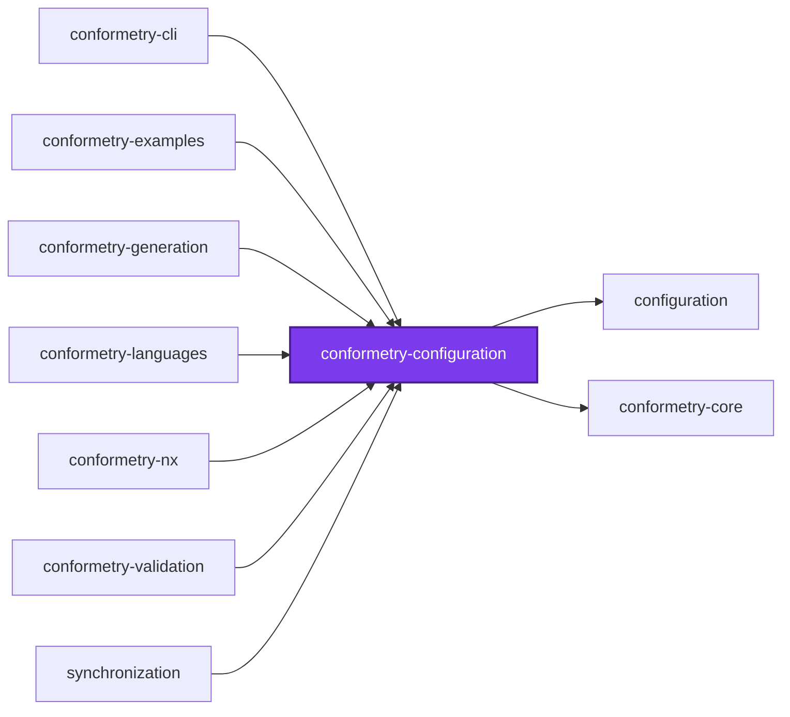
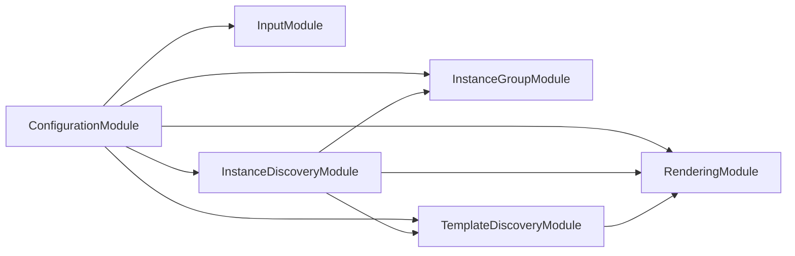

## 🕸️ Codependix

Dependency graphs exported by [codependix](https://github.com/Organizzolini/codebase/tree/main/projects/ic-suite/codependix/codependix-cli), regenerated by `nx run configuration:codependix:write`.

### Nx Neighborhood

<!-- codependix:start name="codependix-nx-projects" -->

<!-- codependix:end name="codependix-nx-projects" -->

### NestJS Module Graph

<!-- codependix:start name="codependix-nestjs-modules" -->

<!-- codependix:end name="codependix-nestjs-modules" -->

### File Imports

<!-- codependix:start name="codependix-file-imports" -->
```mermaid
graph LR
  file_callidescope_config_ts["callidescope.config.ts"]
  file_codependix_config_ts["codependix.config.ts"]
  file_codometer_config_ts["codometer.config.ts"]
  file_coinagerie_config_ts["coinagerie.config.ts"]
  file_eslint_config_ts["eslint.config.ts"]
  file_src_index_ts["src/index.ts"]
  file_src_index_unit_test_ts["src/index.unit.test.ts"]
  file_src_modules_configuration_configuration_constants_ts["src/modules/configuration/configuration.constants.ts"]
  file_src_modules_configuration_configuration_module_ts["src/modules/configuration/configuration.module.ts"]
  file_src_modules_configuration_configuration_module_unit_test_ts["src/modules/configuration/configuration.module.unit.test.ts"]
  file_src_modules_configuration_configuration_service_ts["src/modules/configuration/configuration.service.ts"]
  file_src_modules_configuration_configuration_service_unit_test_ts["src/modules/configuration/configuration.service.unit.test.ts"]
  file_src_modules_configuration_configuration_types_ts["src/modules/configuration/configuration.types.ts"]
  file_src_modules_configuration_configuration_utilities_ts["src/modules/configuration/configuration.utilities.ts"]
  file_src_modules_input_input_options_service_ts["src/modules/input/input-options.service.ts"]
  file_src_modules_input_input_options_service_unit_test_ts["src/modules/input/input-options.service.unit.test.ts"]
  file_src_modules_input_input_prompting_service_ts["src/modules/input/input-prompting.service.ts"]
  file_src_modules_input_input_prompting_service_unit_test_ts["src/modules/input/input-prompting.service.unit.test.ts"]
  file_src_modules_input_input_schema_service_ts["src/modules/input/input-schema.service.ts"]
  file_src_modules_input_input_schema_service_unit_test_ts["src/modules/input/input-schema.service.unit.test.ts"]
  file_src_modules_input_input_constants_ts["src/modules/input/input.constants.ts"]
  file_src_modules_input_input_constants_unit_test_ts["src/modules/input/input.constants.unit.test.ts"]
  file_src_modules_input_input_module_ts["src/modules/input/input.module.ts"]
  file_src_modules_input_input_service_ts["src/modules/input/input.service.ts"]
  file_src_modules_input_input_service_unit_test_ts["src/modules/input/input.service.unit.test.ts"]
  file_src_modules_input_input_types_ts["src/modules/input/input.types.ts"]
  file_src_modules_instance_discovery_instance_discovery_locating_service_ts["src/modules/instance-discovery/instance-discovery-locating.service.ts"]
  file_src_modules_instance_discovery_instance_discovery_locating_service_unit_test_ts["src/modules/instance-discovery/instance-discovery-locating.service.unit.test.ts"]
  file_src_modules_instance_discovery_instance_discovery_matching_service_ts["src/modules/instance-discovery/instance-discovery-matching.service.ts"]
  file_src_modules_instance_discovery_instance_discovery_matching_service_unit_test_ts["src/modules/instance-discovery/instance-discovery-matching.service.unit.test.ts"]
  file_src_modules_instance_discovery_instance_discovery_constants_ts["src/modules/instance-discovery/instance-discovery.constants.ts"]
  file_src_modules_instance_discovery_instance_discovery_module_ts["src/modules/instance-discovery/instance-discovery.module.ts"]
  file_src_modules_instance_discovery_instance_discovery_service_ts["src/modules/instance-discovery/instance-discovery.service.ts"]
  file_src_modules_instance_discovery_instance_discovery_service_unit_test_ts["src/modules/instance-discovery/instance-discovery.service.unit.test.ts"]
  file_src_modules_instance_discovery_instance_discovery_types_ts["src/modules/instance-discovery/instance-discovery.types.ts"]
  file_src_modules_instance_group_instance_group_constants_ts["src/modules/instance-group/instance-group.constants.ts"]
  file_src_modules_instance_group_instance_group_module_ts["src/modules/instance-group/instance-group.module.ts"]
  file_src_modules_instance_group_instance_group_service_ts["src/modules/instance-group/instance-group.service.ts"]
  file_src_modules_instance_group_instance_group_service_unit_test_ts["src/modules/instance-group/instance-group.service.unit.test.ts"]
  file_src_modules_instance_group_instance_group_types_ts["src/modules/instance-group/instance-group.types.ts"]
  file_src_modules_rendering_rendering_constants_ts["src/modules/rendering/rendering.constants.ts"]
  file_src_modules_rendering_rendering_module_ts["src/modules/rendering/rendering.module.ts"]
  file_src_modules_rendering_rendering_service_ts["src/modules/rendering/rendering.service.ts"]
  file_src_modules_rendering_rendering_service_unit_test_ts["src/modules/rendering/rendering.service.unit.test.ts"]
  file_src_modules_rendering_rendering_types_ts["src/modules/rendering/rendering.types.ts"]
  file_src_modules_rendering_rendering_utilities_ts["src/modules/rendering/rendering.utilities.ts"]
  file_src_modules_rendering_rendering_utilities_unit_test_ts["src/modules/rendering/rendering.utilities.unit.test.ts"]
  file_src_modules_template_discovery_template_discovery_constants_ts["src/modules/template-discovery/template-discovery.constants.ts"]
  file_src_modules_template_discovery_template_discovery_module_ts["src/modules/template-discovery/template-discovery.module.ts"]
  file_src_modules_template_discovery_template_discovery_service_ts["src/modules/template-discovery/template-discovery.service.ts"]
  file_src_modules_template_discovery_template_discovery_service_unit_test_ts["src/modules/template-discovery/template-discovery.service.unit.test.ts"]
  file_src_modules_template_discovery_template_discovery_types_ts["src/modules/template-discovery/template-discovery.types.ts"]
  file_testing_mocks_ts["testing/mocks.ts"]
  file_testing_setup_ts["testing/setup.ts"]
  file_vite_config_ts["vite.config.ts"]
  file_vitest_config_ts["vitest.config.ts"]
  file_src_index_unit_test_ts --> file_src_index_ts
  file_src_modules_configuration_configuration_constants_ts --> file_src_modules_configuration_configuration_utilities_ts
  file_src_modules_configuration_configuration_module_ts --> file_src_modules_configuration_configuration_service_ts
  file_src_modules_configuration_configuration_module_ts --> file_src_modules_input_input_module_ts
  file_src_modules_configuration_configuration_module_ts --> file_src_modules_instance_discovery_instance_discovery_module_ts
  file_src_modules_configuration_configuration_module_ts --> file_src_modules_instance_group_instance_group_module_ts
  file_src_modules_configuration_configuration_module_ts --> file_src_modules_rendering_rendering_module_ts
  file_src_modules_configuration_configuration_module_ts --> file_src_modules_template_discovery_template_discovery_module_ts
  file_src_modules_configuration_configuration_module_unit_test_ts --> file_src_modules_configuration_configuration_module_ts
  file_src_modules_configuration_configuration_service_ts --> file_src_modules_configuration_configuration_constants_ts
  file_src_modules_configuration_configuration_service_ts --> file_src_modules_configuration_configuration_types_ts
  file_src_modules_configuration_configuration_service_ts --> file_src_modules_input_input_prompting_service_ts
  file_src_modules_configuration_configuration_service_ts --> file_src_modules_input_input_service_ts
  file_src_modules_configuration_configuration_service_ts --> file_src_modules_input_input_types_ts
  file_src_modules_configuration_configuration_service_ts --> file_src_modules_instance_discovery_instance_discovery_service_ts
  file_src_modules_configuration_configuration_service_ts --> file_src_modules_instance_discovery_instance_discovery_types_ts
  file_src_modules_configuration_configuration_service_ts --> file_src_modules_instance_group_instance_group_service_ts
  file_src_modules_configuration_configuration_service_ts --> file_src_modules_instance_group_instance_group_types_ts
  file_src_modules_configuration_configuration_service_ts --> file_src_modules_rendering_rendering_service_ts
  file_src_modules_configuration_configuration_service_ts --> file_src_modules_rendering_rendering_types_ts
  file_src_modules_configuration_configuration_service_ts --> file_src_modules_template_discovery_template_discovery_service_ts
  file_src_modules_configuration_configuration_service_ts --> file_src_modules_template_discovery_template_discovery_types_ts
  file_src_modules_configuration_configuration_service_unit_test_ts --> file_src_modules_configuration_configuration_constants_ts
  file_src_modules_configuration_configuration_service_unit_test_ts --> file_src_modules_configuration_configuration_service_ts
  file_src_modules_configuration_configuration_service_unit_test_ts --> file_src_modules_configuration_configuration_types_ts
  file_src_modules_configuration_configuration_service_unit_test_ts --> file_src_modules_input_input_prompting_service_ts
  file_src_modules_configuration_configuration_service_unit_test_ts --> file_src_modules_input_input_service_ts
  file_src_modules_configuration_configuration_service_unit_test_ts --> file_src_modules_instance_discovery_instance_discovery_service_ts
  file_src_modules_configuration_configuration_service_unit_test_ts --> file_src_modules_instance_group_instance_group_service_ts
  file_src_modules_configuration_configuration_service_unit_test_ts --> file_src_modules_rendering_rendering_service_ts
  file_src_modules_configuration_configuration_service_unit_test_ts --> file_src_modules_template_discovery_template_discovery_service_ts
  file_src_modules_configuration_configuration_types_ts --> file_src_modules_configuration_configuration_constants_ts
  file_src_modules_configuration_configuration_types_ts --> file_src_modules_instance_group_instance_group_types_ts
  file_src_modules_configuration_configuration_utilities_ts --> file_src_modules_input_input_constants_ts
  file_src_modules_input_input_options_service_ts --> file_src_modules_configuration_configuration_types_ts
  file_src_modules_input_input_options_service_ts --> file_src_modules_input_input_constants_ts
  file_src_modules_input_input_options_service_unit_test_ts --> file_src_modules_input_input_options_service_ts
  file_src_modules_input_input_prompting_service_ts --> file_src_modules_input_input_schema_service_ts
  file_src_modules_input_input_prompting_service_ts --> file_src_modules_input_input_constants_ts
  file_src_modules_input_input_prompting_service_ts --> file_src_modules_input_input_types_ts
  file_src_modules_input_input_prompting_service_unit_test_ts --> file_src_modules_input_input_prompting_service_ts
  file_src_modules_input_input_prompting_service_unit_test_ts --> file_src_modules_input_input_schema_service_ts
  file_src_modules_input_input_schema_service_ts --> file_src_modules_configuration_configuration_types_ts
  file_src_modules_input_input_schema_service_ts --> file_src_modules_input_input_types_ts
  file_src_modules_input_input_schema_service_unit_test_ts --> file_src_modules_input_input_schema_service_ts
  file_src_modules_input_input_constants_unit_test_ts --> file_src_modules_input_input_constants_ts
  file_src_modules_input_input_module_ts --> file_src_modules_input_input_options_service_ts
  file_src_modules_input_input_module_ts --> file_src_modules_input_input_prompting_service_ts
  file_src_modules_input_input_module_ts --> file_src_modules_input_input_schema_service_ts
  file_src_modules_input_input_module_ts --> file_src_modules_input_input_service_ts
  file_src_modules_input_input_service_ts --> file_src_modules_input_input_options_service_ts
  file_src_modules_input_input_service_ts --> file_src_modules_input_input_prompting_service_ts
  file_src_modules_input_input_service_ts --> file_src_modules_input_input_schema_service_ts
  file_src_modules_input_input_service_ts --> file_src_modules_input_input_constants_ts
  file_src_modules_input_input_service_ts --> file_src_modules_input_input_types_ts
  file_src_modules_input_input_service_unit_test_ts --> file_src_modules_input_input_options_service_ts
  file_src_modules_input_input_service_unit_test_ts --> file_src_modules_input_input_prompting_service_ts
  file_src_modules_input_input_service_unit_test_ts --> file_src_modules_input_input_schema_service_ts
  file_src_modules_input_input_service_unit_test_ts --> file_src_modules_input_input_service_ts
  file_src_modules_input_input_types_ts --> file_src_modules_configuration_configuration_types_ts
  file_src_modules_instance_discovery_instance_discovery_locating_service_ts --> file_src_modules_instance_discovery_instance_discovery_constants_ts
  file_src_modules_instance_discovery_instance_discovery_locating_service_ts --> file_src_modules_instance_discovery_instance_discovery_types_ts
  file_src_modules_instance_discovery_instance_discovery_locating_service_unit_test_ts --> file_src_modules_instance_discovery_instance_discovery_locating_service_ts
  file_src_modules_instance_discovery_instance_discovery_matching_service_ts --> file_src_modules_instance_discovery_instance_discovery_constants_ts
  file_src_modules_instance_discovery_instance_discovery_matching_service_ts --> file_src_modules_instance_discovery_instance_discovery_types_ts
  file_src_modules_instance_discovery_instance_discovery_matching_service_ts --> file_src_modules_rendering_rendering_service_ts
  file_src_modules_instance_discovery_instance_discovery_matching_service_ts --> file_src_modules_rendering_rendering_types_ts
  file_src_modules_instance_discovery_instance_discovery_matching_service_ts --> file_src_modules_rendering_rendering_utilities_ts
  file_src_modules_instance_discovery_instance_discovery_matching_service_ts --> file_src_modules_template_discovery_template_discovery_service_ts
  file_src_modules_instance_discovery_instance_discovery_matching_service_ts --> file_src_modules_template_discovery_template_discovery_types_ts
  file_src_modules_instance_discovery_instance_discovery_matching_service_unit_test_ts --> file_src_modules_instance_discovery_instance_discovery_matching_service_ts
  file_src_modules_instance_discovery_instance_discovery_matching_service_unit_test_ts --> file_src_modules_rendering_rendering_service_ts
  file_src_modules_instance_discovery_instance_discovery_matching_service_unit_test_ts --> file_src_modules_template_discovery_template_discovery_service_ts
  file_src_modules_instance_discovery_instance_discovery_matching_service_unit_test_ts --> file_src_modules_template_discovery_template_discovery_types_ts
  file_src_modules_instance_discovery_instance_discovery_module_ts --> file_src_modules_instance_discovery_instance_discovery_locating_service_ts
  file_src_modules_instance_discovery_instance_discovery_module_ts --> file_src_modules_instance_discovery_instance_discovery_matching_service_ts
  file_src_modules_instance_discovery_instance_discovery_module_ts --> file_src_modules_instance_discovery_instance_discovery_service_ts
  file_src_modules_instance_discovery_instance_discovery_module_ts --> file_src_modules_instance_group_instance_group_module_ts
  file_src_modules_instance_discovery_instance_discovery_module_ts --> file_src_modules_rendering_rendering_module_ts
  file_src_modules_instance_discovery_instance_discovery_module_ts --> file_src_modules_template_discovery_template_discovery_module_ts
  file_src_modules_instance_discovery_instance_discovery_service_ts --> file_src_modules_instance_discovery_instance_discovery_locating_service_ts
  file_src_modules_instance_discovery_instance_discovery_service_ts --> file_src_modules_instance_discovery_instance_discovery_matching_service_ts
  file_src_modules_instance_discovery_instance_discovery_service_ts --> file_src_modules_instance_discovery_instance_discovery_types_ts
  file_src_modules_instance_discovery_instance_discovery_service_ts --> file_src_modules_instance_group_instance_group_service_ts
  file_src_modules_instance_discovery_instance_discovery_service_ts --> file_src_modules_instance_group_instance_group_types_ts
  file_src_modules_instance_discovery_instance_discovery_service_ts --> file_src_modules_template_discovery_template_discovery_service_ts
  file_src_modules_instance_discovery_instance_discovery_service_ts --> file_src_modules_template_discovery_template_discovery_types_ts
  file_src_modules_instance_discovery_instance_discovery_service_unit_test_ts --> file_src_modules_configuration_configuration_types_ts
  file_src_modules_instance_discovery_instance_discovery_service_unit_test_ts --> file_src_modules_instance_discovery_instance_discovery_module_ts
  file_src_modules_instance_discovery_instance_discovery_service_unit_test_ts --> file_src_modules_instance_discovery_instance_discovery_service_ts
  file_src_modules_instance_discovery_instance_discovery_service_unit_test_ts --> file_src_modules_instance_group_instance_group_service_ts
  file_src_modules_instance_discovery_instance_discovery_types_ts --> file_src_modules_configuration_configuration_types_ts
  file_src_modules_instance_discovery_instance_discovery_types_ts --> file_src_modules_rendering_rendering_types_ts
  file_src_modules_instance_discovery_instance_discovery_types_ts --> file_src_modules_template_discovery_template_discovery_types_ts
  file_src_modules_instance_group_instance_group_module_ts --> file_src_modules_instance_group_instance_group_service_ts
  file_src_modules_instance_group_instance_group_service_ts --> file_src_modules_instance_group_instance_group_types_ts
  file_src_modules_instance_group_instance_group_service_unit_test_ts --> file_src_modules_instance_group_instance_group_service_ts
  file_src_modules_rendering_rendering_module_ts --> file_src_modules_rendering_rendering_service_ts
  file_src_modules_rendering_rendering_service_ts --> file_src_modules_rendering_rendering_constants_ts
  file_src_modules_rendering_rendering_service_ts --> file_src_modules_rendering_rendering_types_ts
  file_src_modules_rendering_rendering_service_unit_test_ts --> file_src_modules_rendering_rendering_constants_ts
  file_src_modules_rendering_rendering_service_unit_test_ts --> file_src_modules_rendering_rendering_service_ts
  file_src_modules_rendering_rendering_utilities_ts --> file_src_modules_rendering_rendering_constants_ts
  file_src_modules_rendering_rendering_utilities_unit_test_ts --> file_src_modules_rendering_rendering_utilities_ts
  file_src_modules_template_discovery_template_discovery_module_ts --> file_src_modules_rendering_rendering_module_ts
  file_src_modules_template_discovery_template_discovery_module_ts --> file_src_modules_template_discovery_template_discovery_service_ts
  file_src_modules_template_discovery_template_discovery_service_ts --> file_src_modules_configuration_configuration_types_ts
  file_src_modules_template_discovery_template_discovery_service_ts --> file_src_modules_rendering_rendering_service_ts
  file_src_modules_template_discovery_template_discovery_service_ts --> file_src_modules_rendering_rendering_types_ts
  file_src_modules_template_discovery_template_discovery_service_ts --> file_src_modules_template_discovery_template_discovery_types_ts
  file_src_modules_template_discovery_template_discovery_service_unit_test_ts --> file_src_modules_rendering_rendering_service_ts
  file_src_modules_template_discovery_template_discovery_service_unit_test_ts --> file_src_modules_template_discovery_template_discovery_service_ts
  file_src_modules_template_discovery_template_discovery_service_unit_test_ts --> file_src_modules_template_discovery_template_discovery_types_ts
```
<!-- codependix:end name="codependix-file-imports" -->
