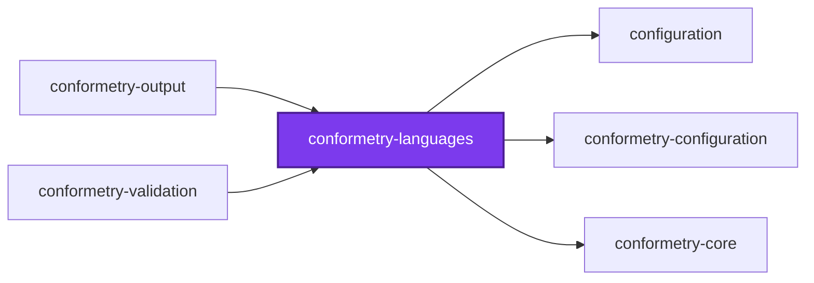
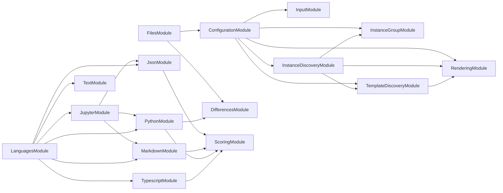

## 🕸️ Codependix

Dependency graphs exported by [codependix](https://github.com/Organizzolini/codebase/tree/main/projects/ic-suite/codependix/codependix-cli), regenerated by `nx run configuration:codependix:write`.

### Nx Neighborhood

<!-- codependix:start name="codependix-nx-projects" -->

<!-- codependix:end name="codependix-nx-projects" -->

### NestJS Module Graph

<!-- codependix:start name="codependix-nestjs-modules" -->

<!-- codependix:end name="codependix-nestjs-modules" -->

### File Imports

<!-- codependix:start name="codependix-file-imports" -->
```mermaid
graph LR
  file_callidescope_config_ts["callidescope.config.ts"]
  file_codependix_config_ts["codependix.config.ts"]
  file_codometer_config_ts["codometer.config.ts"]
  file_coinagerie_config_ts["coinagerie.config.ts"]
  file_eslint_config_ts["eslint.config.ts"]
  file_src_index_ts["src/index.ts"]
  file_src_modules_differences_differences_constants_ts["src/modules/differences/differences.constants.ts"]
  file_src_modules_differences_differences_module_ts["src/modules/differences/differences.module.ts"]
  file_src_modules_differences_differences_module_unit_test_ts["src/modules/differences/differences.module.unit.test.ts"]
  file_src_modules_differences_differences_service_ts["src/modules/differences/differences.service.ts"]
  file_src_modules_differences_differences_service_unit_test_ts["src/modules/differences/differences.service.unit.test.ts"]
  file_src_modules_differences_differences_types_ts["src/modules/differences/differences.types.ts"]
  file_src_modules_files_files_constants_ts["src/modules/files/files.constants.ts"]
  file_src_modules_files_files_module_ts["src/modules/files/files.module.ts"]
  file_src_modules_files_files_module_unit_test_ts["src/modules/files/files.module.unit.test.ts"]
  file_src_modules_files_files_service_ts["src/modules/files/files.service.ts"]
  file_src_modules_files_files_service_unit_test_ts["src/modules/files/files.service.unit.test.ts"]
  file_src_modules_files_files_types_ts["src/modules/files/files.types.ts"]
  file_src_modules_json_json_comparison_service_ts["src/modules/json/json-comparison.service.ts"]
  file_src_modules_json_json_comparison_service_unit_test_ts["src/modules/json/json-comparison.service.unit.test.ts"]
  file_src_modules_json_json_constants_ts["src/modules/json/json.constants.ts"]
  file_src_modules_json_json_module_ts["src/modules/json/json.module.ts"]
  file_src_modules_json_json_module_unit_test_ts["src/modules/json/json.module.unit.test.ts"]
  file_src_modules_json_json_service_ts["src/modules/json/json.service.ts"]
  file_src_modules_json_json_service_unit_test_ts["src/modules/json/json.service.unit.test.ts"]
  file_src_modules_json_json_types_ts["src/modules/json/json.types.ts"]
  file_src_modules_jupyter_jupyter_notebook_service_ts["src/modules/jupyter/jupyter-notebook.service.ts"]
  file_src_modules_jupyter_jupyter_notebook_service_unit_test_ts["src/modules/jupyter/jupyter-notebook.service.unit.test.ts"]
  file_src_modules_jupyter_jupyter_constants_ts["src/modules/jupyter/jupyter.constants.ts"]
  file_src_modules_jupyter_jupyter_module_ts["src/modules/jupyter/jupyter.module.ts"]
  file_src_modules_jupyter_jupyter_module_unit_test_ts["src/modules/jupyter/jupyter.module.unit.test.ts"]
  file_src_modules_jupyter_jupyter_service_ts["src/modules/jupyter/jupyter.service.ts"]
  file_src_modules_jupyter_jupyter_service_unit_test_ts["src/modules/jupyter/jupyter.service.unit.test.ts"]
  file_src_modules_jupyter_jupyter_types_ts["src/modules/jupyter/jupyter.types.ts"]
  file_src_modules_languages_languages_constants_ts["src/modules/languages/languages.constants.ts"]
  file_src_modules_languages_languages_module_ts["src/modules/languages/languages.module.ts"]
  file_src_modules_languages_languages_module_unit_test_ts["src/modules/languages/languages.module.unit.test.ts"]
  file_src_modules_languages_languages_service_ts["src/modules/languages/languages.service.ts"]
  file_src_modules_languages_languages_service_unit_test_ts["src/modules/languages/languages.service.unit.test.ts"]
  file_src_modules_languages_languages_types_ts["src/modules/languages/languages.types.ts"]
  file_src_modules_markdown_markdown_nodes_service_ts["src/modules/markdown/markdown-nodes.service.ts"]
  file_src_modules_markdown_markdown_nodes_service_unit_test_ts["src/modules/markdown/markdown-nodes.service.unit.test.ts"]
  file_src_modules_markdown_markdown_tree_service_ts["src/modules/markdown/markdown-tree.service.ts"]
  file_src_modules_markdown_markdown_tree_service_unit_test_ts["src/modules/markdown/markdown-tree.service.unit.test.ts"]
  file_src_modules_markdown_markdown_constants_ts["src/modules/markdown/markdown.constants.ts"]
  file_src_modules_markdown_markdown_module_ts["src/modules/markdown/markdown.module.ts"]
  file_src_modules_markdown_markdown_module_unit_test_ts["src/modules/markdown/markdown.module.unit.test.ts"]
  file_src_modules_markdown_markdown_service_ts["src/modules/markdown/markdown.service.ts"]
  file_src_modules_markdown_markdown_service_unit_test_ts["src/modules/markdown/markdown.service.unit.test.ts"]
  file_src_modules_markdown_markdown_types_ts["src/modules/markdown/markdown.types.ts"]
  file_src_modules_python_python_bridge_service_ts["src/modules/python/python-bridge.service.ts"]
  file_src_modules_python_python_bridge_service_unit_test_ts["src/modules/python/python-bridge.service.unit.test.ts"]
  file_src_modules_python_python_constants_ts["src/modules/python/python.constants.ts"]
  file_src_modules_python_python_module_ts["src/modules/python/python.module.ts"]
  file_src_modules_python_python_module_unit_test_ts["src/modules/python/python.module.unit.test.ts"]
  file_src_modules_python_python_service_ts["src/modules/python/python.service.ts"]
  file_src_modules_python_python_service_unit_test_ts["src/modules/python/python.service.unit.test.ts"]
  file_src_modules_python_python_types_ts["src/modules/python/python.types.ts"]
  file_src_modules_scoring_scoring_constants_ts["src/modules/scoring/scoring.constants.ts"]
  file_src_modules_scoring_scoring_module_ts["src/modules/scoring/scoring.module.ts"]
  file_src_modules_scoring_scoring_module_unit_test_ts["src/modules/scoring/scoring.module.unit.test.ts"]
  file_src_modules_scoring_scoring_service_ts["src/modules/scoring/scoring.service.ts"]
  file_src_modules_scoring_scoring_service_unit_test_ts["src/modules/scoring/scoring.service.unit.test.ts"]
  file_src_modules_scoring_scoring_types_ts["src/modules/scoring/scoring.types.ts"]
  file_src_modules_text_text_constants_ts["src/modules/text/text.constants.ts"]
  file_src_modules_text_text_module_ts["src/modules/text/text.module.ts"]
  file_src_modules_text_text_module_unit_test_ts["src/modules/text/text.module.unit.test.ts"]
  file_src_modules_text_text_service_ts["src/modules/text/text.service.ts"]
  file_src_modules_text_text_service_unit_test_ts["src/modules/text/text.service.unit.test.ts"]
  file_src_modules_text_text_types_ts["src/modules/text/text.types.ts"]
  file_src_modules_typescript_typescript_comments_service_ts["src/modules/typescript/typescript-comments.service.ts"]
  file_src_modules_typescript_typescript_comments_service_unit_test_ts["src/modules/typescript/typescript-comments.service.unit.test.ts"]
  file_src_modules_typescript_typescript_nodes_service_ts["src/modules/typescript/typescript-nodes.service.ts"]
  file_src_modules_typescript_typescript_nodes_service_unit_test_ts["src/modules/typescript/typescript-nodes.service.unit.test.ts"]
  file_src_modules_typescript_typescript_tree_service_ts["src/modules/typescript/typescript-tree.service.ts"]
  file_src_modules_typescript_typescript_tree_service_unit_test_ts["src/modules/typescript/typescript-tree.service.unit.test.ts"]
  file_src_modules_typescript_typescript_constants_ts["src/modules/typescript/typescript.constants.ts"]
  file_src_modules_typescript_typescript_module_ts["src/modules/typescript/typescript.module.ts"]
  file_src_modules_typescript_typescript_module_unit_test_ts["src/modules/typescript/typescript.module.unit.test.ts"]
  file_src_modules_typescript_typescript_service_ts["src/modules/typescript/typescript.service.ts"]
  file_src_modules_typescript_typescript_service_unit_test_ts["src/modules/typescript/typescript.service.unit.test.ts"]
  file_src_modules_typescript_typescript_types_ts["src/modules/typescript/typescript.types.ts"]
  file_testing_mocks_ts["testing/mocks.ts"]
  file_testing_setup_ts["testing/setup.ts"]
  file_vite_config_ts["vite.config.ts"]
  file_vitest_config_ts["vitest.config.ts"]
  file_src_modules_differences_differences_module_ts --> file_src_modules_differences_differences_service_ts
  file_src_modules_differences_differences_module_unit_test_ts --> file_src_modules_differences_differences_module_ts
  file_src_modules_differences_differences_module_unit_test_ts --> file_src_modules_differences_differences_service_ts
  file_src_modules_differences_differences_service_ts --> file_src_modules_differences_differences_constants_ts
  file_src_modules_differences_differences_service_ts --> file_src_modules_differences_differences_types_ts
  file_src_modules_differences_differences_service_unit_test_ts --> file_src_modules_differences_differences_service_ts
  file_src_modules_files_files_module_ts --> file_src_modules_differences_differences_module_ts
  file_src_modules_files_files_module_ts --> file_src_modules_files_files_service_ts
  file_src_modules_files_files_module_unit_test_ts --> file_src_modules_files_files_module_ts
  file_src_modules_files_files_module_unit_test_ts --> file_src_modules_files_files_service_ts
  file_src_modules_files_files_service_ts --> file_src_modules_differences_differences_service_ts
  file_src_modules_files_files_service_ts --> file_src_modules_files_files_types_ts
  file_src_modules_files_files_service_unit_test_ts --> file_src_modules_differences_differences_module_ts
  file_src_modules_files_files_service_unit_test_ts --> file_src_modules_files_files_service_ts
  file_src_modules_json_json_comparison_service_ts --> file_src_modules_json_json_types_ts
  file_src_modules_json_json_comparison_service_ts --> file_src_modules_scoring_scoring_service_ts
  file_src_modules_json_json_comparison_service_unit_test_ts --> file_src_modules_json_json_comparison_service_ts
  file_src_modules_json_json_comparison_service_unit_test_ts --> file_src_modules_json_json_types_ts
  file_src_modules_json_json_comparison_service_unit_test_ts --> file_src_modules_scoring_scoring_service_ts
  file_src_modules_json_json_module_ts --> file_src_modules_json_json_comparison_service_ts
  file_src_modules_json_json_module_ts --> file_src_modules_json_json_service_ts
  file_src_modules_json_json_module_ts --> file_src_modules_scoring_scoring_module_ts
  file_src_modules_json_json_module_unit_test_ts --> file_src_modules_json_json_module_ts
  file_src_modules_json_json_module_unit_test_ts --> file_src_modules_json_json_service_ts
  file_src_modules_json_json_service_ts --> file_src_modules_json_json_comparison_service_ts
  file_src_modules_json_json_service_ts --> file_src_modules_json_json_constants_ts
  file_src_modules_json_json_service_ts --> file_src_modules_json_json_types_ts
  file_src_modules_json_json_service_unit_test_ts --> file_src_modules_json_json_comparison_service_ts
  file_src_modules_json_json_service_unit_test_ts --> file_src_modules_json_json_service_ts
  file_src_modules_json_json_service_unit_test_ts --> file_src_modules_scoring_scoring_service_ts
  file_src_modules_jupyter_jupyter_notebook_service_ts --> file_src_modules_jupyter_jupyter_types_ts
  file_src_modules_jupyter_jupyter_notebook_service_unit_test_ts --> file_src_modules_jupyter_jupyter_notebook_service_ts
  file_src_modules_jupyter_jupyter_module_ts --> file_src_modules_json_json_module_ts
  file_src_modules_jupyter_jupyter_module_ts --> file_src_modules_jupyter_jupyter_notebook_service_ts
  file_src_modules_jupyter_jupyter_module_ts --> file_src_modules_jupyter_jupyter_service_ts
  file_src_modules_jupyter_jupyter_module_ts --> file_src_modules_markdown_markdown_module_ts
  file_src_modules_jupyter_jupyter_module_ts --> file_src_modules_python_python_module_ts
  file_src_modules_jupyter_jupyter_module_unit_test_ts --> file_src_modules_jupyter_jupyter_module_ts
  file_src_modules_jupyter_jupyter_module_unit_test_ts --> file_src_modules_jupyter_jupyter_service_ts
  file_src_modules_jupyter_jupyter_service_ts --> file_src_modules_json_json_comparison_service_ts
  file_src_modules_jupyter_jupyter_service_ts --> file_src_modules_json_json_types_ts
  file_src_modules_jupyter_jupyter_service_ts --> file_src_modules_jupyter_jupyter_notebook_service_ts
  file_src_modules_jupyter_jupyter_service_ts --> file_src_modules_jupyter_jupyter_constants_ts
  file_src_modules_jupyter_jupyter_service_ts --> file_src_modules_jupyter_jupyter_types_ts
  file_src_modules_jupyter_jupyter_service_ts --> file_src_modules_markdown_markdown_service_ts
  file_src_modules_jupyter_jupyter_service_ts --> file_src_modules_python_python_bridge_service_ts
  file_src_modules_jupyter_jupyter_service_unit_test_ts --> file_src_modules_differences_differences_service_ts
  file_src_modules_jupyter_jupyter_service_unit_test_ts --> file_src_modules_json_json_comparison_service_ts
  file_src_modules_jupyter_jupyter_service_unit_test_ts --> file_src_modules_jupyter_jupyter_notebook_service_ts
  file_src_modules_jupyter_jupyter_service_unit_test_ts --> file_src_modules_jupyter_jupyter_service_ts
  file_src_modules_jupyter_jupyter_service_unit_test_ts --> file_src_modules_markdown_markdown_nodes_service_ts
  file_src_modules_jupyter_jupyter_service_unit_test_ts --> file_src_modules_markdown_markdown_tree_service_ts
  file_src_modules_jupyter_jupyter_service_unit_test_ts --> file_src_modules_markdown_markdown_service_ts
  file_src_modules_jupyter_jupyter_service_unit_test_ts --> file_src_modules_python_python_bridge_service_ts
  file_src_modules_jupyter_jupyter_service_unit_test_ts --> file_src_modules_scoring_scoring_service_ts
  file_src_modules_languages_languages_module_ts --> file_src_modules_json_json_module_ts
  file_src_modules_languages_languages_module_ts --> file_src_modules_jupyter_jupyter_module_ts
  file_src_modules_languages_languages_module_ts --> file_src_modules_languages_languages_service_ts
  file_src_modules_languages_languages_module_ts --> file_src_modules_markdown_markdown_module_ts
  file_src_modules_languages_languages_module_ts --> file_src_modules_python_python_module_ts
  file_src_modules_languages_languages_module_ts --> file_src_modules_text_text_module_ts
  file_src_modules_languages_languages_module_ts --> file_src_modules_typescript_typescript_module_ts
  file_src_modules_languages_languages_module_unit_test_ts --> file_src_modules_json_json_module_ts
  file_src_modules_languages_languages_module_unit_test_ts --> file_src_modules_jupyter_jupyter_module_ts
  file_src_modules_languages_languages_module_unit_test_ts --> file_src_modules_languages_languages_module_ts
  file_src_modules_languages_languages_module_unit_test_ts --> file_src_modules_languages_languages_service_ts
  file_src_modules_languages_languages_module_unit_test_ts --> file_src_modules_markdown_markdown_module_ts
  file_src_modules_languages_languages_module_unit_test_ts --> file_src_modules_python_python_module_ts
  file_src_modules_languages_languages_module_unit_test_ts --> file_src_modules_text_text_module_ts
  file_src_modules_languages_languages_module_unit_test_ts --> file_src_modules_typescript_typescript_module_ts
  file_src_modules_languages_languages_service_ts --> file_src_modules_json_json_service_ts
  file_src_modules_languages_languages_service_ts --> file_src_modules_jupyter_jupyter_service_ts
  file_src_modules_languages_languages_service_ts --> file_src_modules_languages_languages_types_ts
  file_src_modules_languages_languages_service_ts --> file_src_modules_markdown_markdown_service_ts
  file_src_modules_languages_languages_service_ts --> file_src_modules_python_python_service_ts
  file_src_modules_languages_languages_service_ts --> file_src_modules_text_text_service_ts
  file_src_modules_languages_languages_service_ts --> file_src_modules_typescript_typescript_service_ts
  file_src_modules_languages_languages_service_unit_test_ts --> file_src_modules_languages_languages_module_ts
  file_src_modules_languages_languages_service_unit_test_ts --> file_src_modules_languages_languages_service_ts
  file_src_modules_markdown_markdown_nodes_service_ts --> file_src_modules_markdown_markdown_constants_ts
  file_src_modules_markdown_markdown_nodes_service_ts --> file_src_modules_markdown_markdown_types_ts
  file_src_modules_markdown_markdown_nodes_service_unit_test_ts --> file_src_modules_markdown_markdown_nodes_service_ts
  file_src_modules_markdown_markdown_nodes_service_unit_test_ts --> file_src_modules_markdown_markdown_types_ts
  file_src_modules_markdown_markdown_tree_service_ts --> file_src_modules_markdown_markdown_nodes_service_ts
  file_src_modules_markdown_markdown_tree_service_ts --> file_src_modules_markdown_markdown_constants_ts
  file_src_modules_markdown_markdown_tree_service_ts --> file_src_modules_markdown_markdown_types_ts
  file_src_modules_markdown_markdown_tree_service_ts --> file_src_modules_scoring_scoring_service_ts
  file_src_modules_markdown_markdown_tree_service_unit_test_ts --> file_src_modules_markdown_markdown_nodes_service_ts
  file_src_modules_markdown_markdown_tree_service_unit_test_ts --> file_src_modules_markdown_markdown_tree_service_ts
  file_src_modules_markdown_markdown_tree_service_unit_test_ts --> file_src_modules_markdown_markdown_types_ts
  file_src_modules_markdown_markdown_tree_service_unit_test_ts --> file_src_modules_scoring_scoring_service_ts
  file_src_modules_markdown_markdown_module_ts --> file_src_modules_markdown_markdown_nodes_service_ts
  file_src_modules_markdown_markdown_module_ts --> file_src_modules_markdown_markdown_tree_service_ts
  file_src_modules_markdown_markdown_module_ts --> file_src_modules_markdown_markdown_service_ts
  file_src_modules_markdown_markdown_module_ts --> file_src_modules_scoring_scoring_module_ts
  file_src_modules_markdown_markdown_module_unit_test_ts --> file_src_modules_markdown_markdown_module_ts
  file_src_modules_markdown_markdown_module_unit_test_ts --> file_src_modules_markdown_markdown_service_ts
  file_src_modules_markdown_markdown_service_ts --> file_src_modules_markdown_markdown_nodes_service_ts
  file_src_modules_markdown_markdown_service_ts --> file_src_modules_markdown_markdown_tree_service_ts
  file_src_modules_markdown_markdown_service_ts --> file_src_modules_markdown_markdown_constants_ts
  file_src_modules_markdown_markdown_service_unit_test_ts --> file_src_modules_markdown_markdown_nodes_service_ts
  file_src_modules_markdown_markdown_service_unit_test_ts --> file_src_modules_markdown_markdown_tree_service_ts
  file_src_modules_markdown_markdown_service_unit_test_ts --> file_src_modules_markdown_markdown_service_ts
  file_src_modules_markdown_markdown_service_unit_test_ts --> file_src_modules_scoring_scoring_service_ts
  file_src_modules_python_python_bridge_service_ts --> file_src_modules_differences_differences_service_ts
  file_src_modules_python_python_bridge_service_ts --> file_src_modules_python_python_constants_ts
  file_src_modules_python_python_bridge_service_ts --> file_src_modules_python_python_types_ts
  file_src_modules_python_python_bridge_service_ts --> file_src_modules_scoring_scoring_service_ts
  file_src_modules_python_python_bridge_service_unit_test_ts --> file_src_modules_differences_differences_module_ts
  file_src_modules_python_python_bridge_service_unit_test_ts --> file_src_modules_python_python_bridge_service_ts
  file_src_modules_python_python_bridge_service_unit_test_ts --> file_src_modules_scoring_scoring_module_ts
  file_src_modules_python_python_module_ts --> file_src_modules_differences_differences_module_ts
  file_src_modules_python_python_module_ts --> file_src_modules_python_python_bridge_service_ts
  file_src_modules_python_python_module_ts --> file_src_modules_python_python_service_ts
  file_src_modules_python_python_module_ts --> file_src_modules_scoring_scoring_module_ts
  file_src_modules_python_python_module_unit_test_ts --> file_src_modules_python_python_module_ts
  file_src_modules_python_python_module_unit_test_ts --> file_src_modules_python_python_service_ts
  file_src_modules_python_python_service_ts --> file_src_modules_python_python_bridge_service_ts
  file_src_modules_python_python_service_ts --> file_src_modules_python_python_constants_ts
  file_src_modules_python_python_service_unit_test_ts --> file_src_modules_differences_differences_service_ts
  file_src_modules_python_python_service_unit_test_ts --> file_src_modules_python_python_bridge_service_ts
  file_src_modules_python_python_service_unit_test_ts --> file_src_modules_python_python_service_ts
  file_src_modules_python_python_service_unit_test_ts --> file_src_modules_scoring_scoring_service_ts
  file_src_modules_scoring_scoring_module_ts --> file_src_modules_scoring_scoring_service_ts
  file_src_modules_scoring_scoring_module_unit_test_ts --> file_src_modules_scoring_scoring_module_ts
  file_src_modules_scoring_scoring_module_unit_test_ts --> file_src_modules_scoring_scoring_service_ts
  file_src_modules_scoring_scoring_service_ts --> file_src_modules_scoring_scoring_constants_ts
  file_src_modules_scoring_scoring_service_ts --> file_src_modules_scoring_scoring_types_ts
  file_src_modules_scoring_scoring_service_unit_test_ts --> file_src_modules_scoring_scoring_service_ts
  file_src_modules_text_text_module_ts --> file_src_modules_text_text_service_ts
  file_src_modules_text_text_module_unit_test_ts --> file_src_modules_text_text_module_ts
  file_src_modules_text_text_module_unit_test_ts --> file_src_modules_text_text_service_ts
  file_src_modules_text_text_service_ts --> file_src_modules_text_text_constants_ts
  file_src_modules_text_text_service_ts --> file_src_modules_text_text_types_ts
  file_src_modules_text_text_service_unit_test_ts --> file_src_modules_text_text_service_ts
  file_src_modules_typescript_typescript_comments_service_ts --> file_src_modules_typescript_typescript_constants_ts
  file_src_modules_typescript_typescript_comments_service_ts --> file_src_modules_typescript_typescript_types_ts
  file_src_modules_typescript_typescript_comments_service_unit_test_ts --> file_src_modules_typescript_typescript_comments_service_ts
  file_src_modules_typescript_typescript_nodes_service_unit_test_ts --> file_src_modules_typescript_typescript_nodes_service_ts
  file_src_modules_typescript_typescript_tree_service_ts --> file_src_modules_scoring_scoring_service_ts
  file_src_modules_typescript_typescript_tree_service_ts --> file_src_modules_typescript_typescript_nodes_service_ts
  file_src_modules_typescript_typescript_tree_service_ts --> file_src_modules_typescript_typescript_types_ts
  file_src_modules_typescript_typescript_tree_service_unit_test_ts --> file_src_modules_scoring_scoring_service_ts
  file_src_modules_typescript_typescript_tree_service_unit_test_ts --> file_src_modules_typescript_typescript_nodes_service_ts
  file_src_modules_typescript_typescript_tree_service_unit_test_ts --> file_src_modules_typescript_typescript_tree_service_ts
  file_src_modules_typescript_typescript_module_ts --> file_src_modules_scoring_scoring_module_ts
  file_src_modules_typescript_typescript_module_ts --> file_src_modules_typescript_typescript_comments_service_ts
  file_src_modules_typescript_typescript_module_ts --> file_src_modules_typescript_typescript_nodes_service_ts
  file_src_modules_typescript_typescript_module_ts --> file_src_modules_typescript_typescript_tree_service_ts
  file_src_modules_typescript_typescript_module_ts --> file_src_modules_typescript_typescript_service_ts
  file_src_modules_typescript_typescript_module_unit_test_ts --> file_src_modules_typescript_typescript_module_ts
  file_src_modules_typescript_typescript_module_unit_test_ts --> file_src_modules_typescript_typescript_service_ts
  file_src_modules_typescript_typescript_service_ts --> file_src_modules_typescript_typescript_comments_service_ts
  file_src_modules_typescript_typescript_service_ts --> file_src_modules_typescript_typescript_tree_service_ts
  file_src_modules_typescript_typescript_service_ts --> file_src_modules_typescript_typescript_constants_ts
  file_src_modules_typescript_typescript_service_unit_test_ts --> file_src_modules_scoring_scoring_service_ts
  file_src_modules_typescript_typescript_service_unit_test_ts --> file_src_modules_typescript_typescript_comments_service_ts
  file_src_modules_typescript_typescript_service_unit_test_ts --> file_src_modules_typescript_typescript_nodes_service_ts
  file_src_modules_typescript_typescript_service_unit_test_ts --> file_src_modules_typescript_typescript_tree_service_ts
  file_src_modules_typescript_typescript_service_unit_test_ts --> file_src_modules_typescript_typescript_service_ts
```
<!-- codependix:end name="codependix-file-imports" -->
