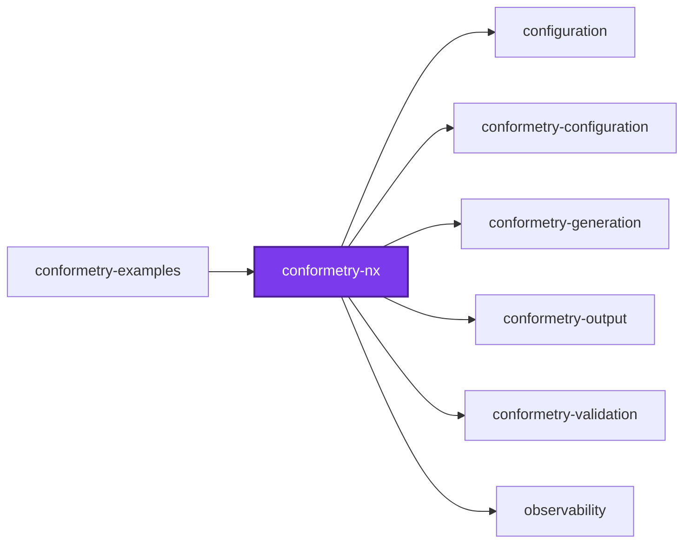
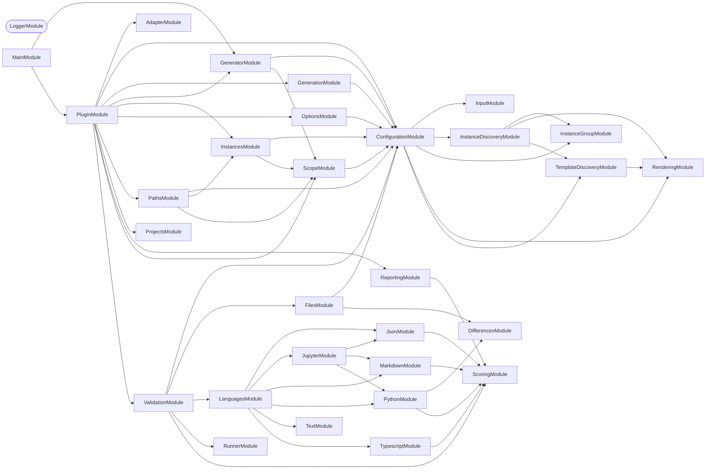

## 🕸️ Codependix

Dependency graphs exported by [codependix](https://github.com/Organizzolini/codebase/tree/main/projects/ic-suite/codependix/codependix-cli), regenerated by `nx run configuration:codependix:write`.

### Nx Neighborhood

<!-- codependix:start name="codependix-nx-projects" -->

<!-- codependix:end name="codependix-nx-projects" -->

### NestJS Module Graph

<!-- codependix:start name="codependix-nestjs-modules" -->


_Rounded modules are global: every module can inject them, so their edges are left out._
<!-- codependix:end name="codependix-nestjs-modules" -->

### File Imports

<!-- codependix:start name="codependix-file-imports" -->
```mermaid
graph LR
  file_callidescope_config_ts["callidescope.config.ts"]
  file_codependix_config_ts["codependix.config.ts"]
  file_codometer_config_ts["codometer.config.ts"]
  file_coinagerie_config_ts["coinagerie.config.ts"]
  file_eslint_config_ts["eslint.config.ts"]
  file_src_conformetry_nx_main_ts["src/conformetry-nx.main.ts"]
  file_src_conformetry_nx_main_unit_test_ts["src/conformetry-nx.main.unit.test.ts"]
  file_src_conformetry_nx_module_ts["src/conformetry-nx.module.ts"]
  file_src_executors_validate_executor_ts["src/executors/validate/executor.ts"]
  file_src_executors_validate_executor_types_ts["src/executors/validate/executor.types.ts"]
  file_src_executors_validate_executor_unit_test_ts["src/executors/validate/executor.unit.test.ts"]
  file_src_generators_sync_generator_ts["src/generators/sync/generator.ts"]
  file_src_generators_sync_generator_types_ts["src/generators/sync/generator.types.ts"]
  file_src_generators_sync_generator_unit_test_ts["src/generators/sync/generator.unit.test.ts"]
  file_src_index_ts["src/index.ts"]
  file_src_index_unit_test_ts["src/index.unit.test.ts"]
  file_src_modules_adapter_adapter_constants_ts["src/modules/adapter/adapter.constants.ts"]
  file_src_modules_adapter_adapter_module_ts["src/modules/adapter/adapter.module.ts"]
  file_src_modules_adapter_adapter_service_ts["src/modules/adapter/adapter.service.ts"]
  file_src_modules_adapter_adapter_service_unit_test_ts["src/modules/adapter/adapter.service.unit.test.ts"]
  file_src_modules_adapter_adapter_types_ts["src/modules/adapter/adapter.types.ts"]
  file_src_modules_generator_bootstrap_utilities_ts["src/modules/generator/bootstrap.utilities.ts"]
  file_src_modules_generator_bootstrap_utilities_unit_test_ts["src/modules/generator/bootstrap.utilities.unit.test.ts"]
  file_src_modules_generator_generator_constants_ts["src/modules/generator/generator.constants.ts"]
  file_src_modules_generator_generator_module_ts["src/modules/generator/generator.module.ts"]
  file_src_modules_generator_generator_service_ts["src/modules/generator/generator.service.ts"]
  file_src_modules_generator_generator_service_unit_test_ts["src/modules/generator/generator.service.unit.test.ts"]
  file_src_modules_generator_generator_types_ts["src/modules/generator/generator.types.ts"]
  file_src_modules_instances_instances_constants_ts["src/modules/instances/instances.constants.ts"]
  file_src_modules_instances_instances_module_ts["src/modules/instances/instances.module.ts"]
  file_src_modules_instances_instances_service_ts["src/modules/instances/instances.service.ts"]
  file_src_modules_instances_instances_service_unit_test_ts["src/modules/instances/instances.service.unit.test.ts"]
  file_src_modules_instances_instances_types_ts["src/modules/instances/instances.types.ts"]
  file_src_modules_options_options_constants_ts["src/modules/options/options.constants.ts"]
  file_src_modules_options_options_module_ts["src/modules/options/options.module.ts"]
  file_src_modules_options_options_service_ts["src/modules/options/options.service.ts"]
  file_src_modules_options_options_service_unit_test_ts["src/modules/options/options.service.unit.test.ts"]
  file_src_modules_options_options_types_ts["src/modules/options/options.types.ts"]
  file_src_modules_paths_paths_constants_ts["src/modules/paths/paths.constants.ts"]
  file_src_modules_paths_paths_module_ts["src/modules/paths/paths.module.ts"]
  file_src_modules_paths_paths_service_ts["src/modules/paths/paths.service.ts"]
  file_src_modules_paths_paths_service_unit_test_ts["src/modules/paths/paths.service.unit.test.ts"]
  file_src_modules_paths_paths_types_ts["src/modules/paths/paths.types.ts"]
  file_src_modules_paths_paths_utilities_ts["src/modules/paths/paths.utilities.ts"]
  file_src_modules_paths_paths_utilities_unit_test_ts["src/modules/paths/paths.utilities.unit.test.ts"]
  file_src_modules_plugin_plugin_context_utilities_ts["src/modules/plugin/plugin-context.utilities.ts"]
  file_src_modules_plugin_plugin_context_utilities_unit_test_ts["src/modules/plugin/plugin-context.utilities.unit.test.ts"]
  file_src_modules_plugin_plugin_constants_ts["src/modules/plugin/plugin.constants.ts"]
  file_src_modules_plugin_plugin_module_ts["src/modules/plugin/plugin.module.ts"]
  file_src_modules_plugin_plugin_service_ts["src/modules/plugin/plugin.service.ts"]
  file_src_modules_plugin_plugin_service_unit_test_ts["src/modules/plugin/plugin.service.unit.test.ts"]
  file_src_modules_plugin_plugin_types_ts["src/modules/plugin/plugin.types.ts"]
  file_src_modules_plugin_plugin_utilities_ts["src/modules/plugin/plugin.utilities.ts"]
  file_src_modules_plugin_plugin_utilities_unit_test_ts["src/modules/plugin/plugin.utilities.unit.test.ts"]
  file_src_modules_projects_projects_constants_ts["src/modules/projects/projects.constants.ts"]
  file_src_modules_projects_projects_module_ts["src/modules/projects/projects.module.ts"]
  file_src_modules_projects_projects_service_ts["src/modules/projects/projects.service.ts"]
  file_src_modules_projects_projects_service_unit_test_ts["src/modules/projects/projects.service.unit.test.ts"]
  file_src_modules_projects_projects_types_ts["src/modules/projects/projects.types.ts"]
  file_src_modules_scope_scope_constants_ts["src/modules/scope/scope.constants.ts"]
  file_src_modules_scope_scope_module_ts["src/modules/scope/scope.module.ts"]
  file_src_modules_scope_scope_service_ts["src/modules/scope/scope.service.ts"]
  file_src_modules_scope_scope_service_unit_test_ts["src/modules/scope/scope.service.unit.test.ts"]
  file_src_modules_scope_scope_types_ts["src/modules/scope/scope.types.ts"]
  file_testing_manifest_unit_test_ts["testing/manifest.unit.test.ts"]
  file_testing_mocks_ts["testing/mocks.ts"]
  file_testing_setup_ts["testing/setup.ts"]
  file_vite_config_ts["vite.config.ts"]
  file_vitest_config_ts["vitest.config.ts"]
  file_src_conformetry_nx_main_ts --> file_src_modules_generator_bootstrap_utilities_ts
  file_src_conformetry_nx_main_unit_test_ts --> file_src_modules_generator_bootstrap_utilities_ts
  file_src_conformetry_nx_module_ts --> file_src_modules_generator_generator_module_ts
  file_src_conformetry_nx_module_ts --> file_src_modules_plugin_plugin_module_ts
  file_src_executors_validate_executor_ts --> file_src_executors_validate_executor_types_ts
  file_src_executors_validate_executor_ts --> file_src_modules_plugin_plugin_context_utilities_ts
  file_src_executors_validate_executor_unit_test_ts --> file_src_executors_validate_executor_ts
  file_src_executors_validate_executor_unit_test_ts --> file_src_modules_plugin_plugin_context_utilities_ts
  file_src_generators_sync_generator_ts --> file_src_generators_sync_generator_types_ts
  file_src_generators_sync_generator_ts --> file_src_modules_generator_generator_constants_ts
  file_src_generators_sync_generator_ts --> file_src_modules_options_options_constants_ts
  file_src_generators_sync_generator_ts --> file_src_modules_plugin_plugin_context_utilities_ts
  file_src_generators_sync_generator_unit_test_ts --> file_src_generators_sync_generator_ts
  file_src_generators_sync_generator_unit_test_ts --> file_src_modules_options_options_constants_ts
  file_src_generators_sync_generator_unit_test_ts --> file_src_modules_plugin_plugin_context_utilities_ts
  file_src_index_ts --> file_src_modules_plugin_plugin_context_utilities_ts
  file_src_index_ts --> file_src_modules_plugin_plugin_constants_ts
  file_src_index_unit_test_ts --> file_src_index_ts
  file_src_index_unit_test_ts --> file_src_modules_plugin_plugin_context_utilities_ts
  file_src_modules_adapter_adapter_module_ts --> file_src_modules_adapter_adapter_service_ts
  file_src_modules_adapter_adapter_service_ts --> file_src_modules_adapter_adapter_constants_ts
  file_src_modules_adapter_adapter_service_ts --> file_src_modules_adapter_adapter_types_ts
  file_src_modules_adapter_adapter_service_unit_test_ts --> file_src_modules_adapter_adapter_service_ts
  file_src_modules_generator_bootstrap_utilities_ts --> file_src_modules_generator_generator_constants_ts
  file_src_modules_generator_bootstrap_utilities_ts --> file_src_modules_generator_generator_types_ts
  file_src_modules_generator_bootstrap_utilities_ts --> file_src_modules_options_options_constants_ts
  file_src_modules_generator_bootstrap_utilities_ts --> file_src_modules_plugin_plugin_context_utilities_ts
  file_src_modules_generator_bootstrap_utilities_unit_test_ts --> file_src_modules_generator_bootstrap_utilities_ts
  file_src_modules_generator_bootstrap_utilities_unit_test_ts --> file_src_modules_generator_generator_constants_ts
  file_src_modules_generator_bootstrap_utilities_unit_test_ts --> file_src_modules_plugin_plugin_context_utilities_ts
  file_src_modules_generator_generator_module_ts --> file_src_modules_generator_generator_service_ts
  file_src_modules_generator_generator_module_ts --> file_src_modules_scope_scope_module_ts
  file_src_modules_generator_generator_service_ts --> file_src_modules_generator_generator_constants_ts
  file_src_modules_generator_generator_service_ts --> file_src_modules_generator_generator_types_ts
  file_src_modules_generator_generator_service_ts --> file_src_modules_instances_instances_types_ts
  file_src_modules_generator_generator_service_ts --> file_src_modules_paths_paths_constants_ts
  file_src_modules_generator_generator_service_ts --> file_src_modules_scope_scope_service_ts
  file_src_modules_generator_generator_service_unit_test_ts --> file_src_modules_generator_generator_module_ts
  file_src_modules_generator_generator_service_unit_test_ts --> file_src_modules_generator_generator_service_ts
  file_src_modules_generator_generator_service_unit_test_ts --> file_src_modules_generator_generator_types_ts
  file_src_modules_generator_generator_types_ts --> file_src_modules_instances_instances_types_ts
  file_src_modules_instances_instances_module_ts --> file_src_modules_instances_instances_service_ts
  file_src_modules_instances_instances_module_ts --> file_src_modules_scope_scope_module_ts
  file_src_modules_instances_instances_service_ts --> file_src_modules_instances_instances_types_ts
  file_src_modules_instances_instances_service_ts --> file_src_modules_scope_scope_service_ts
  file_src_modules_instances_instances_service_unit_test_ts --> file_src_modules_instances_instances_service_ts
  file_src_modules_instances_instances_service_unit_test_ts --> file_src_modules_instances_instances_types_ts
  file_src_modules_instances_instances_service_unit_test_ts --> file_src_modules_scope_scope_module_ts
  file_src_modules_options_options_module_ts --> file_src_modules_options_options_service_ts
  file_src_modules_options_options_service_ts --> file_src_modules_options_options_constants_ts
  file_src_modules_options_options_service_ts --> file_src_modules_options_options_types_ts
  file_src_modules_options_options_service_unit_test_ts --> file_src_modules_options_options_constants_ts
  file_src_modules_options_options_service_unit_test_ts --> file_src_modules_options_options_service_ts
  file_src_modules_paths_paths_module_ts --> file_src_modules_instances_instances_module_ts
  file_src_modules_paths_paths_module_ts --> file_src_modules_paths_paths_service_ts
  file_src_modules_paths_paths_module_ts --> file_src_modules_scope_scope_module_ts
  file_src_modules_paths_paths_service_ts --> file_src_modules_instances_instances_service_ts
  file_src_modules_paths_paths_service_ts --> file_src_modules_paths_paths_constants_ts
  file_src_modules_paths_paths_service_ts --> file_src_modules_paths_paths_types_ts
  file_src_modules_paths_paths_service_ts --> file_src_modules_paths_paths_utilities_ts
  file_src_modules_paths_paths_service_ts --> file_src_modules_scope_scope_service_ts
  file_src_modules_paths_paths_service_unit_test_ts --> file_src_modules_instances_instances_service_ts
  file_src_modules_paths_paths_service_unit_test_ts --> file_src_modules_paths_paths_module_ts
  file_src_modules_paths_paths_service_unit_test_ts --> file_src_modules_paths_paths_service_ts
  file_src_modules_paths_paths_service_unit_test_ts --> file_src_modules_scope_scope_service_ts
  file_src_modules_paths_paths_utilities_unit_test_ts --> file_src_modules_paths_paths_utilities_ts
  file_src_modules_plugin_plugin_context_utilities_ts --> file_src_conformetry_nx_module_ts
  file_src_modules_plugin_plugin_context_utilities_ts --> file_src_modules_generator_generator_service_ts
  file_src_modules_plugin_plugin_context_utilities_ts --> file_src_modules_options_options_service_ts
  file_src_modules_plugin_plugin_context_utilities_ts --> file_src_modules_plugin_plugin_constants_ts
  file_src_modules_plugin_plugin_context_utilities_ts --> file_src_modules_plugin_plugin_service_ts
  file_src_modules_plugin_plugin_context_utilities_ts --> file_src_modules_plugin_plugin_types_ts
  file_src_modules_plugin_plugin_context_utilities_ts --> file_src_modules_projects_projects_service_ts
  file_src_modules_plugin_plugin_context_utilities_unit_test_ts --> file_src_modules_generator_generator_service_ts
  file_src_modules_plugin_plugin_context_utilities_unit_test_ts --> file_src_modules_options_options_service_ts
  file_src_modules_plugin_plugin_context_utilities_unit_test_ts --> file_src_modules_plugin_plugin_context_utilities_ts
  file_src_modules_plugin_plugin_context_utilities_unit_test_ts --> file_src_modules_plugin_plugin_constants_ts
  file_src_modules_plugin_plugin_context_utilities_unit_test_ts --> file_src_modules_plugin_plugin_service_ts
  file_src_modules_plugin_plugin_context_utilities_unit_test_ts --> file_src_modules_projects_projects_service_ts
  file_src_modules_plugin_plugin_module_ts --> file_src_modules_adapter_adapter_module_ts
  file_src_modules_plugin_plugin_module_ts --> file_src_modules_generator_generator_module_ts
  file_src_modules_plugin_plugin_module_ts --> file_src_modules_instances_instances_module_ts
  file_src_modules_plugin_plugin_module_ts --> file_src_modules_options_options_module_ts
  file_src_modules_plugin_plugin_module_ts --> file_src_modules_paths_paths_module_ts
  file_src_modules_plugin_plugin_module_ts --> file_src_modules_plugin_plugin_service_ts
  file_src_modules_plugin_plugin_module_ts --> file_src_modules_projects_projects_module_ts
  file_src_modules_plugin_plugin_module_ts --> file_src_modules_scope_scope_module_ts
  file_src_modules_plugin_plugin_service_ts --> file_src_modules_adapter_adapter_service_ts
  file_src_modules_plugin_plugin_service_ts --> file_src_modules_generator_generator_constants_ts
  file_src_modules_plugin_plugin_service_ts --> file_src_modules_generator_generator_service_ts
  file_src_modules_plugin_plugin_service_ts --> file_src_modules_instances_instances_service_ts
  file_src_modules_plugin_plugin_service_ts --> file_src_modules_options_options_constants_ts
  file_src_modules_plugin_plugin_service_ts --> file_src_modules_options_options_service_ts
  file_src_modules_plugin_plugin_service_ts --> file_src_modules_options_options_types_ts
  file_src_modules_plugin_plugin_service_ts --> file_src_modules_paths_paths_service_ts
  file_src_modules_plugin_plugin_service_ts --> file_src_modules_plugin_plugin_constants_ts
  file_src_modules_plugin_plugin_service_ts --> file_src_modules_plugin_plugin_types_ts
  file_src_modules_plugin_plugin_service_ts --> file_src_modules_plugin_plugin_utilities_ts
  file_src_modules_plugin_plugin_service_ts --> file_src_modules_projects_projects_service_ts
  file_src_modules_plugin_plugin_service_unit_test_ts --> file_src_modules_generator_generator_constants_ts
  file_src_modules_plugin_plugin_service_unit_test_ts --> file_src_modules_generator_generator_service_ts
  file_src_modules_plugin_plugin_service_unit_test_ts --> file_src_modules_instances_instances_types_ts
  file_src_modules_plugin_plugin_service_unit_test_ts --> file_src_modules_plugin_plugin_module_ts
  file_src_modules_plugin_plugin_service_unit_test_ts --> file_src_modules_plugin_plugin_service_ts
  file_src_modules_plugin_plugin_types_ts --> file_src_modules_instances_instances_types_ts
  file_src_modules_plugin_plugin_types_ts --> file_src_modules_plugin_plugin_constants_ts
  file_src_modules_plugin_plugin_utilities_ts --> file_src_modules_plugin_plugin_constants_ts
  file_src_modules_plugin_plugin_utilities_unit_test_ts --> file_src_modules_plugin_plugin_utilities_ts
  file_src_modules_projects_projects_module_ts --> file_src_modules_projects_projects_service_ts
  file_src_modules_projects_projects_service_ts --> file_src_modules_instances_instances_types_ts
  file_src_modules_projects_projects_service_ts --> file_src_modules_projects_projects_constants_ts
  file_src_modules_projects_projects_service_ts --> file_src_modules_projects_projects_types_ts
  file_src_modules_projects_projects_service_unit_test_ts --> file_src_modules_projects_projects_service_ts
  file_src_modules_scope_scope_module_ts --> file_src_modules_scope_scope_service_ts
  file_src_modules_scope_scope_service_ts --> file_src_modules_instances_instances_types_ts
  file_src_modules_scope_scope_service_ts --> file_src_modules_scope_scope_constants_ts
  file_src_modules_scope_scope_service_unit_test_ts --> file_src_modules_instances_instances_types_ts
  file_src_modules_scope_scope_service_unit_test_ts --> file_src_modules_scope_scope_service_ts
```
<!-- codependix:end name="codependix-file-imports" -->
