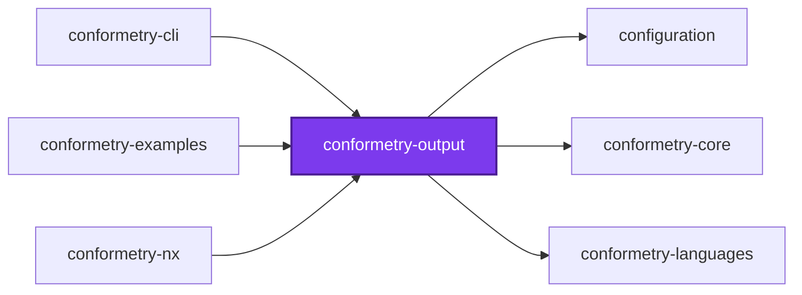
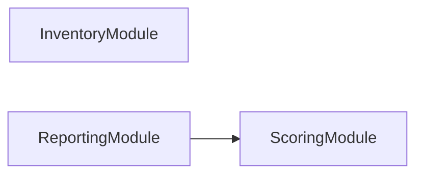
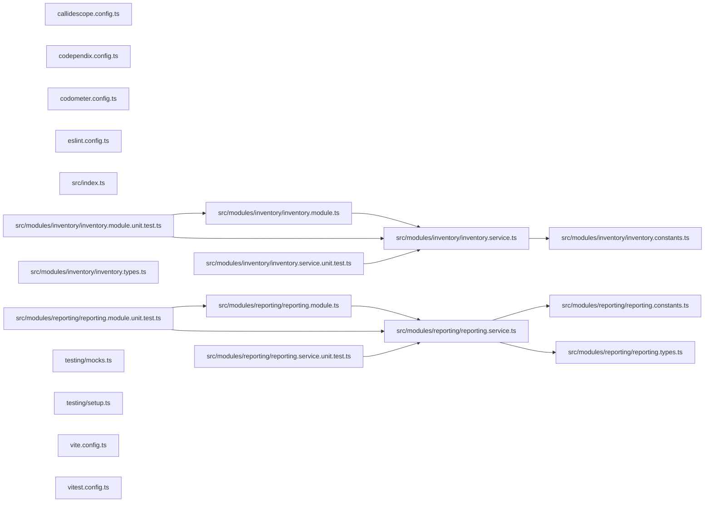

# 👔 Conformetry Output

[](https://www.npmjs.com/package/@conformetry/output)

Every render target [Conformetry](../conformetry-cli/README.md) has. It sits at
the output layer of the five-layer spine — `core <- configuration <- analysis
<- output <- cli` — so it reads what analysis produced and turns it into text,
and runs no analysis of its own.

```bash
npm install --save-dev @conformetry/output
```

## What it owns

| Module | Responsibility |
| ------ | -------------- |
| `reporting` | Renders structured conformance differences, and the per-instance score summary above them, as readable and actionable text |
| `inventory` | Renders the template and instance inventory: the indent ladder, the headings, and the match percentage |

Both are rendering, and both used to live in
[`@conformetry/core`](../conformetry-core/README.md) — which is why that package
could not be a contracts leaf. They are here so that "the host composes, the
output renders" is true of conformetry the way it is of its three siblings, and
so that adding a render format has exactly one home.

## Where a host gets them

`ReportingModule` and `InventoryModule` are named explicitly by whichever host
wants them. Neither is re-exported by `ValidationModule`: validation is an
analysis package and sits _beneath_ this one, so it cannot reach up to hand a
renderer on.

```ts
@Module({ imports: [ReportingModule, ValidationModule] })
class EmbeddedConformetryModule {}
```

## Paths

Paths arrive absolute, because that is the only stable way for discovery to
name an instance to another process. Shortening them against a working
directory is offered as a separate step rather than folded into rendering —
only a host knows which directory a person is standing in.

## Test

```bash
nx run conformetry-output:vitest
```

## License

MIT — see [LICENSE](../../../../LICENSE).

## 👔 Conformetry

This project was generated from the [nestjs-service-project](../../../configuration/conformetry-templates/nestjs-service-project) conformetry template.

## 🕸️ Codependix

Dependency graphs exported by [codependix](https://github.com/Organizzolini/codebase/tree/main/projects/ic-suite/codependix/codependix-cli), regenerated by `nx run configuration:codependix:write`.

### Nx Neighborhood

<!-- codependix:start name="codependix-nx-projects" -->

<!-- codependix:end name="codependix-nx-projects" -->

### NestJS Module Graph

<!-- codependix:start name="codependix-nestjs-modules" -->

<!-- codependix:end name="codependix-nestjs-modules" -->

### File Imports

<!-- codependix:start name="codependix-file-imports" -->

<!-- codependix:end name="codependix-file-imports" -->

<!-- callidescope:start -->

## 🔭 Callidescope

Call stacks traced through `projects/ic-suite/conformetry/conformetry-output`, deepest first. Each frame shows what it takes, what it returns, and what its documentation says.

| Measure | Value |
| --- | --- |
| Callables | 32 |
| Files | 15 |
| Calls traced | 34 |
| Call stacks | 0 |
| Deepest stack | 0 |
| Stacks through recursion | 0 |
| Unfollowable calls | 0 |

### Limits

What this project is judged against, as declared in its own `callidescope.config.ts`.

| Limit | Value |
| --- | --- |
| `maximumDepth` | 6 |
| `maximumBreadth` | 4 |

### Call stacks (depth)

None.

### Breadth

| Callable | Breadth | Calls directly | Location |
| --- | --- | --- | --- |
| `ReportingService.formatTotal` | 4 | `ReportingService.reduce(…)`, `ReportingService.reduce(…)`, `ReportingService.filter(…)`, `ReportingService.formatFraction` | `projects/ic-suite/conformetry/conformetry-output/src/modules/reporting/reporting.service.ts:234` |
| `ReportingService.formatFileResult` | 3 | `ReportingService.formatFraction`, `ScoringService.sumWeights`, `ReportingService.flatMap(…)` | `projects/ic-suite/conformetry/conformetry-output/src/modules/reporting/reporting.service.ts:98` |
| `ReportingService.formatScores` | 3 | `ReportingService.filter(…)`, `ReportingService.map(…)`, `ReportingService.formatTotal` | `projects/ic-suite/conformetry/conformetry-output/src/modules/reporting/reporting.service.ts:197` |

<details>
<summary>19 more callables</summary>

| Callable | Breadth | Calls directly | Location |
| --- | --- | --- | --- |
| `ReportingService.formatFraction` | 2 | `ScoringService.calculateScore`, `ReportingService.formatPercentage` | `projects/ic-suite/conformetry/conformetry-output/src/modules/reporting/reporting.service.ts:131` |
| `ReportingService.formatScore` | 2 | `ReportingService.formatPercentage`, `ReportingService.formatFraction` | `projects/ic-suite/conformetry/conformetry-output/src/modules/reporting/reporting.service.ts:166` |
| `ReportingService.formatReport` | 2 | `ReportingService.formatScores`, `ReportingService.flatMap(…)` | `projects/ic-suite/conformetry/conformetry-output/src/modules/reporting/reporting.service.ts:262` |
| `InventoryService.describePairing` | 1 | `InventoryService.formatRatio` | `projects/ic-suite/conformetry/conformetry-output/src/modules/inventory/inventory.service.ts:48` |
| `InventoryService.describeInstances` | 1 | `InventoryService.flatMap(…)` | `projects/ic-suite/conformetry/conformetry-output/src/modules/inventory/inventory.service.ts:77` |
| `InventoryService.flatMap(…)` | 1 | `InventoryService.map(…)` | `projects/ic-suite/conformetry/conformetry-output/src/modules/inventory/inventory.service.ts:78` |
| `InventoryService.map(…)` | 1 | `InventoryService.describePairing` | `projects/ic-suite/conformetry/conformetry-output/src/modules/inventory/inventory.service.ts:82` |
| `InventoryService.describeTemplates` | 1 | `InventoryService.flatMap(…)` | `projects/ic-suite/conformetry/conformetry-output/src/modules/inventory/inventory.service.ts:94` |
| `InventoryService.flatMap(…)` | 1 | `InventoryService.map(…)` | `projects/ic-suite/conformetry/conformetry-output/src/modules/inventory/inventory.service.ts:98` |
| `InventoryService.map(…)` | 1 | `InventoryService.describePairing` | `projects/ic-suite/conformetry/conformetry-output/src/modules/inventory/inventory.service.ts:109` |
| `InventoryService.shortenInstancePaths` | 1 | `InventoryService.map(…)` | `projects/ic-suite/conformetry/conformetry-output/src/modules/inventory/inventory.service.ts:120` |
| `InventoryService.map(…)` | 1 | `InventoryService.shortenPath` | `projects/ic-suite/conformetry/conformetry-output/src/modules/inventory/inventory.service.ts:124` |
| `InventoryService.shortenTemplatePairings` | 1 | `InventoryService.map(…)` | `projects/ic-suite/conformetry/conformetry-output/src/modules/inventory/inventory.service.ts:136` |
| `InventoryService.map(…)` | 1 | `InventoryService.map(…)` | `projects/ic-suite/conformetry/conformetry-output/src/modules/inventory/inventory.service.ts:140` |
| `InventoryService.map(…)` | 1 | `InventoryService.shortenPath` | `projects/ic-suite/conformetry/conformetry-output/src/modules/inventory/inventory.service.ts:143` |
| `ReportingService.formatError` | 1 | `ReportingService.formatLocation` | `projects/ic-suite/conformetry/conformetry-output/src/modules/reporting/reporting.service.ts:54` |
| `ReportingService.flatMap(…)` | 1 | `ReportingService.formatError` | `projects/ic-suite/conformetry/conformetry-output/src/modules/reporting/reporting.service.ts:115` |
| `ReportingService.map(…)` | 1 | `ReportingService.formatScore` | `projects/ic-suite/conformetry/conformetry-output/src/modules/reporting/reporting.service.ts:211` |
| `ReportingService.flatMap(…)` | 1 | `ReportingService.formatFileResult` | `projects/ic-suite/conformetry/conformetry-output/src/modules/reporting/reporting.service.ts:274` |

</details>
<!-- callidescope:end -->

<!-- coinagerie:start -->

## 🪙 Coinagerie

The words this project uses that the root glossary does not define, regenerated with `nx run conformetry-output:coinagerie-check:write`.

- **bare**: Inventory request with no path filter, so it lists a registry rather than the instances it matches.
- **below**: Verdict printed when an instance's percentage falls under its configured threshold, marking that instance as failing.
- **breadth**: Callidescope measure of how many callables one function calls directly, shown in the README breadth tables and gated per project.
- **calculate**: Work done by ScoringService.calculateScore, which turns an instance's weighted results into the score reporting prints.
- **detail**: Indented lines printed under each difference in the report, giving its expected and actual values, weight, and fix.
- **digit**: Count of decimal places kept when rendering a score percentage, fixed by SCORE_PERCENTAGE_DIGITS at one.
- **fraction**: Failed weight over total weight, printed beside a percentage so a reader can see how many requirements missed.
- **gear**: Sample module name in the inventory tests, a gears folder under packages/widgets used as the fixture path.
- **imperfect**: Instance whose score falls short of full weight, so only these appear in the summary of non-perfect scores.
- **inventoried**: Types for entries the inventory service has listed: InventoriedInstance, InventoriedTemplate, and InventoriedPairing.
- **inventory**: Module that renders the template and instance listing, with its indent ladder, headings, and match percentage.
- **meet**: Verdict wording used when an instance's score reaches its threshold, paired with below threshold for failing instances.
- **percent**: Share printed for a score or file overlap, produced by multiplying a zero-to-one ratio by PERCENT_SCALE.
- **percentage**: Printed form of an instance's score or file-overlap ratio, shown next to its fraction so the scale is not hidden.
- **perfect**: Score of exactly full weight; reporting leaves perfect instances out of the summary of scores that fell short.
- **ratio**: Matched-over-total value between zero and one, from which the inventory computes each pairing's match percentage.
- **scale**: Size of the denominator behind a percentage, which the report exposes by printing the fraction beside it.
- **shorten**: Turning an absolute path into a relative one against the host's working directory, a step kept out of rendering.
- **sum**: Total of requirement weights, computed by ScoringService.sumWeights and passed into formatting as totalWeight.
- **threshold**: Minimum percentage an instance's score must reach to pass, printed beside the verdict as meets or below threshold.
- **verdict**: Pass or fail phrase closing each instance's score line, with a check or cross marker, saying meets or below threshold.
- **weight**: Importance of one difference, counted in requirements, printed only when it stands in for more than one requirement.

<!-- coinagerie:end -->
