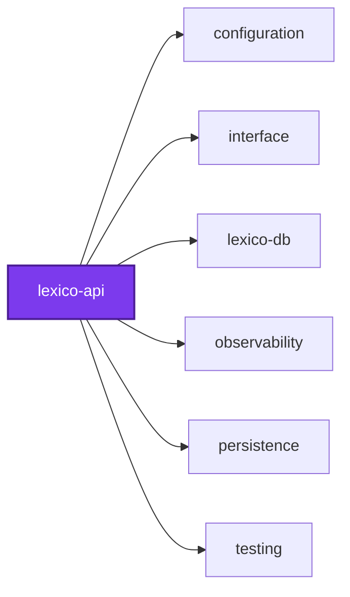
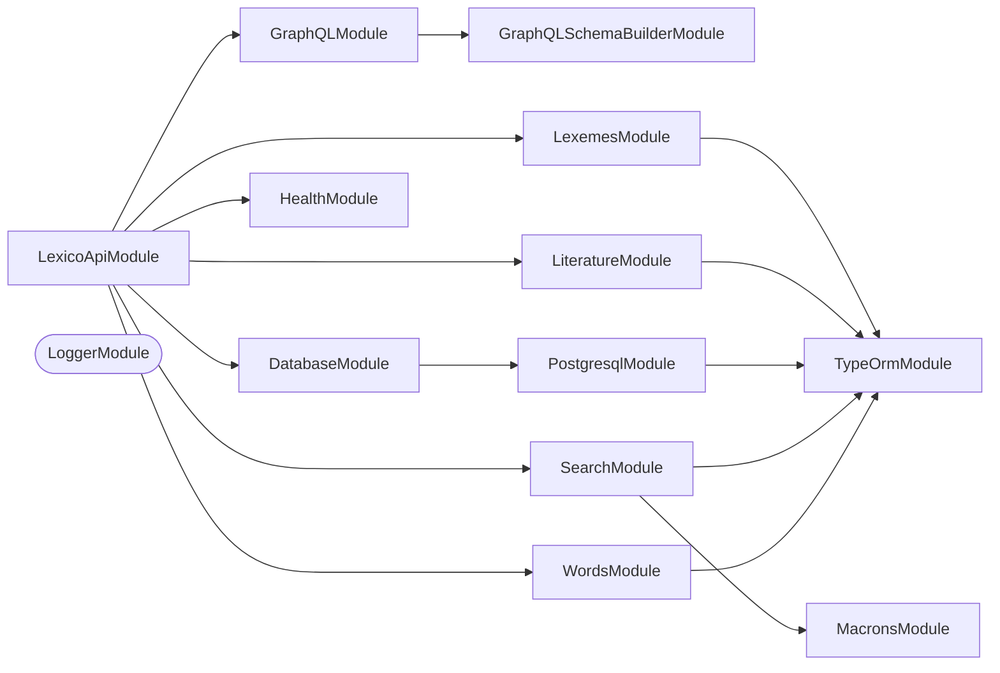

## 🕸️ Codependix

Dependency graphs exported by [codependix](https://github.com/Organizzolini/codebase/tree/main/projects/ic-suite/codependix/codependix-cli), regenerated by `nx run configuration:codependix:write`.

### Nx Neighborhood

<!-- codependix:start name="codependix-nx-projects" -->

<!-- codependix:end name="codependix-nx-projects" -->

### NestJS Module Graph

<!-- codependix:start name="codependix-nestjs-modules" -->


_Rounded modules are global: every module can inject them, so their edges are left out._
<!-- codependix:end name="codependix-nestjs-modules" -->

### File Imports

<!-- codependix:start name="codependix-file-imports" -->
```mermaid
graph LR
  file_configuration_callidescope_config_ts["configuration/callidescope.config.ts"]
  file_configuration_codependix_config_ts["configuration/codependix.config.ts"]
  file_configuration_codometer_config_ts["configuration/codometer.config.ts"]
  file_configuration_coinagerie_config_ts["configuration/coinagerie.config.ts"]
  file_configuration_eslint_config_ts["configuration/eslint.config.ts"]
  file_configuration_vitest_config_ts["configuration/vitest.config.ts"]
  file_src_deletable_entities_ts["src/deletable.entities.ts"]
  file_src_lexico_api_graphql_end_to_end_test_ts["src/lexico-api-graphql.end-to-end.test.ts"]
  file_src_lexico_api_constants_ts["src/lexico-api.constants.ts"]
  file_src_lexico_api_constants_unit_test_ts["src/lexico-api.constants.unit.test.ts"]
  file_src_lexico_api_module_ts["src/lexico-api.module.ts"]
  file_src_lexico_api_module_unit_test_ts["src/lexico-api.module.unit.test.ts"]
  file_src_lexico_api_ts["src/lexico-api.ts"]
  file_src_lexico_api_types_unit_test_ts["src/lexico-api.types.unit.test.ts"]
  file_src_lexico_api_unit_test_ts["src/lexico-api.unit.test.ts"]
  file_src_lexico_api_utilities_ts["src/lexico-api.utilities.ts"]
  file_src_lexico_api_utilities_unit_test_ts["src/lexico-api.utilities.unit.test.ts"]
  file_src_modules_health_health_constants_ts["src/modules/health/health.constants.ts"]
  file_src_modules_health_health_module_ts["src/modules/health/health.module.ts"]
  file_src_modules_health_health_module_unit_test_ts["src/modules/health/health.module.unit.test.ts"]
  file_src_modules_health_health_resolver_ts["src/modules/health/health.resolver.ts"]
  file_src_modules_health_health_resolver_unit_test_ts["src/modules/health/health.resolver.unit.test.ts"]
  file_src_modules_health_health_service_ts["src/modules/health/health.service.ts"]
  file_src_modules_health_health_service_unit_test_ts["src/modules/health/health.service.unit.test.ts"]
  file_src_modules_health_health_types_ts["src/modules/health/health.types.ts"]
  file_src_modules_lexemes_lexemes_constants_ts["src/modules/lexemes/lexemes.constants.ts"]
  file_src_modules_lexemes_lexemes_module_ts["src/modules/lexemes/lexemes.module.ts"]
  file_src_modules_lexemes_lexemes_module_unit_test_ts["src/modules/lexemes/lexemes.module.unit.test.ts"]
  file_src_modules_lexemes_lexemes_resolver_ts["src/modules/lexemes/lexemes.resolver.ts"]
  file_src_modules_lexemes_lexemes_resolver_unit_test_ts["src/modules/lexemes/lexemes.resolver.unit.test.ts"]
  file_src_modules_lexemes_lexemes_service_integration_test_ts["src/modules/lexemes/lexemes.service.integration.test.ts"]
  file_src_modules_lexemes_lexemes_service_ts["src/modules/lexemes/lexemes.service.ts"]
  file_src_modules_lexemes_lexemes_service_unit_test_ts["src/modules/lexemes/lexemes.service.unit.test.ts"]
  file_src_modules_lexemes_lexemes_types_ts["src/modules/lexemes/lexemes.types.ts"]
  file_src_modules_lexemes_lexemes_utilities_ts["src/modules/lexemes/lexemes.utilities.ts"]
  file_src_modules_lexemes_lexemes_utilities_unit_test_ts["src/modules/lexemes/lexemes.utilities.unit.test.ts"]
  file_src_modules_lexemes_modules_forms_adjectival_form_entities_ts["src/modules/lexemes/modules/forms/adjectival-form.entities.ts"]
  file_src_modules_lexemes_modules_forms_adverb_form_entities_ts["src/modules/lexemes/modules/forms/adverb-form.entities.ts"]
  file_src_modules_lexemes_modules_forms_finite_verb_form_entities_ts["src/modules/lexemes/modules/forms/finite-verb-form.entities.ts"]
  file_src_modules_lexemes_modules_forms_form_entities_ts["src/modules/lexemes/modules/forms/form.entities.ts"]
  file_src_modules_lexemes_modules_forms_forms_types_ts["src/modules/lexemes/modules/forms/forms.types.ts"]
  file_src_modules_lexemes_modules_forms_forms_utilities_ts["src/modules/lexemes/modules/forms/forms.utilities.ts"]
  file_src_modules_lexemes_modules_forms_forms_utilities_unit_test_ts["src/modules/lexemes/modules/forms/forms.utilities.unit.test.ts"]
  file_src_modules_lexemes_modules_forms_gerund_form_entities_ts["src/modules/lexemes/modules/forms/gerund-form.entities.ts"]
  file_src_modules_lexemes_modules_forms_infinitive_form_entities_ts["src/modules/lexemes/modules/forms/infinitive-form.entities.ts"]
  file_src_modules_lexemes_modules_forms_nominal_form_entities_ts["src/modules/lexemes/modules/forms/nominal-form.entities.ts"]
  file_src_modules_lexemes_modules_forms_participle_form_entities_ts["src/modules/lexemes/modules/forms/participle-form.entities.ts"]
  file_src_modules_lexemes_modules_forms_supine_form_entities_ts["src/modules/lexemes/modules/forms/supine-form.entities.ts"]
  file_src_modules_lexemes_modules_inflections_adjective_inflection_entities_ts["src/modules/lexemes/modules/inflections/adjective-inflection.entities.ts"]
  file_src_modules_lexemes_modules_inflections_adverb_inflection_entities_ts["src/modules/lexemes/modules/inflections/adverb-inflection.entities.ts"]
  file_src_modules_lexemes_modules_inflections_inflection_entities_ts["src/modules/lexemes/modules/inflections/inflection.entities.ts"]
  file_src_modules_lexemes_modules_inflections_inflections_types_ts["src/modules/lexemes/modules/inflections/inflections.types.ts"]
  file_src_modules_lexemes_modules_inflections_inflections_utilities_ts["src/modules/lexemes/modules/inflections/inflections.utilities.ts"]
  file_src_modules_lexemes_modules_inflections_inflections_utilities_unit_test_ts["src/modules/lexemes/modules/inflections/inflections.utilities.unit.test.ts"]
  file_src_modules_lexemes_modules_inflections_noun_inflection_entities_ts["src/modules/lexemes/modules/inflections/noun-inflection.entities.ts"]
  file_src_modules_lexemes_modules_inflections_preposition_inflection_entities_ts["src/modules/lexemes/modules/inflections/preposition-inflection.entities.ts"]
  file_src_modules_lexemes_modules_inflections_uninflected_inflection_entities_ts["src/modules/lexemes/modules/inflections/uninflected-inflection.entities.ts"]
  file_src_modules_lexemes_modules_inflections_verb_inflection_entities_ts["src/modules/lexemes/modules/inflections/verb-inflection.entities.ts"]
  file_src_modules_lexemes_modules_lexeme_details_principal_part_entities_ts["src/modules/lexemes/modules/lexeme-details/principal-part.entities.ts"]
  file_src_modules_lexemes_modules_lexeme_details_pronunciation_entities_ts["src/modules/lexemes/modules/lexeme-details/pronunciation.entities.ts"]
  file_src_modules_lexemes_modules_lexeme_details_translation_entities_ts["src/modules/lexemes/modules/lexeme-details/translation.entities.ts"]
  file_src_modules_lexemes_modules_lexeme_queries_lexeme_arguments_entities_ts["src/modules/lexemes/modules/lexeme-queries/lexeme-arguments.entities.ts"]
  file_src_modules_lexemes_modules_lexeme_queries_lexeme_connection_entities_ts["src/modules/lexemes/modules/lexeme-queries/lexeme-connection.entities.ts"]
  file_src_modules_lexemes_modules_lexeme_queries_lexeme_entities_ts["src/modules/lexemes/modules/lexeme-queries/lexeme.entities.ts"]
  file_src_modules_lexemes_modules_lexeme_queries_lexemes_arguments_entities_ts["src/modules/lexemes/modules/lexeme-queries/lexemes-arguments.entities.ts"]
  file_src_modules_literature_literature_constants_ts["src/modules/literature/literature.constants.ts"]
  file_src_modules_literature_literature_module_ts["src/modules/literature/literature.module.ts"]
  file_src_modules_literature_literature_resolver_ts["src/modules/literature/literature.resolver.ts"]
  file_src_modules_literature_literature_resolver_unit_test_ts["src/modules/literature/literature.resolver.unit.test.ts"]
  file_src_modules_literature_literature_service_ts["src/modules/literature/literature.service.ts"]
  file_src_modules_literature_literature_service_unit_test_ts["src/modules/literature/literature.service.unit.test.ts"]
  file_src_modules_literature_literature_types_ts["src/modules/literature/literature.types.ts"]
  file_src_modules_literature_literature_utilities_integration_test_ts["src/modules/literature/literature.utilities.integration.test.ts"]
  file_src_modules_literature_literature_utilities_ts["src/modules/literature/literature.utilities.ts"]
  file_src_modules_literature_literature_utilities_unit_test_ts["src/modules/literature/literature.utilities.unit.test.ts"]
  file_src_modules_literature_modules_authors_author_argument_entities_ts["src/modules/literature/modules/authors/author-argument.entities.ts"]
  file_src_modules_literature_modules_authors_author_lookup_input_entities_ts["src/modules/literature/modules/authors/author-lookup-input.entities.ts"]
  file_src_modules_literature_modules_authors_author_entities_ts["src/modules/literature/modules/authors/author.entities.ts"]
  file_src_modules_literature_modules_authors_authors_resolver_end_to_end_test_ts["src/modules/literature/modules/authors/authors.resolver.end-to-end.test.ts"]
  file_src_modules_literature_modules_authors_authors_resolver_integration_test_ts["src/modules/literature/modules/authors/authors.resolver.integration.test.ts"]
  file_src_modules_literature_modules_authors_authors_resolver_ts["src/modules/literature/modules/authors/authors.resolver.ts"]
  file_src_modules_literature_modules_authors_authors_resolver_unit_test_ts["src/modules/literature/modules/authors/authors.resolver.unit.test.ts"]
  file_src_modules_literature_modules_connections_literature_arguments_entities_unit_test_ts["src/modules/literature/modules/connections/literature-arguments.entities.unit.test.ts"]
  file_src_modules_literature_modules_connections_literature_connection_entities_ts["src/modules/literature/modules/connections/literature-connection.entities.ts"]
  file_src_modules_literature_modules_lines_line_arguments_entities_ts["src/modules/literature/modules/lines/line-arguments.entities.ts"]
  file_src_modules_literature_modules_lines_line_entities_ts["src/modules/literature/modules/lines/line.entities.ts"]
  file_src_modules_literature_modules_lines_lines_range_input_entities_ts["src/modules/literature/modules/lines/lines-range-input.entities.ts"]
  file_src_modules_literature_modules_lines_lines_resolver_end_to_end_test_ts["src/modules/literature/modules/lines/lines.resolver.end-to-end.test.ts"]
  file_src_modules_literature_modules_lines_lines_resolver_integration_test_ts["src/modules/literature/modules/lines/lines.resolver.integration.test.ts"]
  file_src_modules_literature_modules_lines_lines_resolver_ts["src/modules/literature/modules/lines/lines.resolver.ts"]
  file_src_modules_literature_modules_lines_lines_resolver_unit_test_ts["src/modules/literature/modules/lines/lines.resolver.unit.test.ts"]
  file_src_modules_literature_modules_relations_literature_relations_loader_ts["src/modules/literature/modules/relations/literature-relations.loader.ts"]
  file_src_modules_literature_modules_relations_literature_relations_loader_unit_test_ts["src/modules/literature/modules/relations/literature-relations.loader.unit.test.ts"]
  file_src_modules_literature_modules_relations_literature_relations_service_integration_test_ts["src/modules/literature/modules/relations/literature-relations.service.integration.test.ts"]
  file_src_modules_literature_modules_relations_literature_relations_service_ts["src/modules/literature/modules/relations/literature-relations.service.ts"]
  file_src_modules_literature_modules_relations_literature_relations_service_unit_test_ts["src/modules/literature/modules/relations/literature-relations.service.unit.test.ts"]
  file_src_modules_literature_modules_relations_literature_relations_utilities_ts["src/modules/literature/modules/relations/literature-relations.utilities.ts"]
  file_src_modules_literature_modules_relations_literature_relations_utilities_unit_test_ts["src/modules/literature/modules/relations/literature-relations.utilities.unit.test.ts"]
  file_src_modules_literature_modules_search_literature_search_result_entities_ts["src/modules/literature/modules/search/literature-search-result.entities.ts"]
  file_src_modules_literature_modules_search_literature_search_resolver_end_to_end_test_ts["src/modules/literature/modules/search/literature-search.resolver.end-to-end.test.ts"]
  file_src_modules_literature_modules_search_literature_search_service_integration_test_ts["src/modules/literature/modules/search/literature-search.service.integration.test.ts"]
  file_src_modules_literature_modules_search_search_authors_arguments_entities_ts["src/modules/literature/modules/search/search-authors-arguments.entities.ts"]
  file_src_modules_literature_modules_search_search_lines_arguments_entities_ts["src/modules/literature/modules/search/search-lines-arguments.entities.ts"]
  file_src_modules_literature_modules_search_search_literature_arguments_entities_ts["src/modules/literature/modules/search/search-literature-arguments.entities.ts"]
  file_src_modules_literature_modules_search_search_texts_arguments_entities_ts["src/modules/literature/modules/search/search-texts-arguments.entities.ts"]
  file_src_modules_literature_modules_texts_text_argument_entities_ts["src/modules/literature/modules/texts/text-argument.entities.ts"]
  file_src_modules_literature_modules_texts_text_lookup_input_entities_ts["src/modules/literature/modules/texts/text-lookup-input.entities.ts"]
  file_src_modules_literature_modules_texts_text_entities_ts["src/modules/literature/modules/texts/text.entities.ts"]
  file_src_modules_literature_modules_texts_texts_arguments_entities_ts["src/modules/literature/modules/texts/texts-arguments.entities.ts"]
  file_src_modules_literature_modules_texts_texts_resolver_end_to_end_test_ts["src/modules/literature/modules/texts/texts.resolver.end-to-end.test.ts"]
  file_src_modules_literature_modules_texts_texts_resolver_integration_test_ts["src/modules/literature/modules/texts/texts.resolver.integration.test.ts"]
  file_src_modules_literature_modules_texts_texts_resolver_ts["src/modules/literature/modules/texts/texts.resolver.ts"]
  file_src_modules_literature_modules_texts_texts_resolver_unit_test_ts["src/modules/literature/modules/texts/texts.resolver.unit.test.ts"]
  file_src_modules_literature_modules_tokens_token_entities_ts["src/modules/literature/modules/tokens/token.entities.ts"]
  file_src_modules_literature_modules_tokens_tokens_arguments_entities_ts["src/modules/literature/modules/tokens/tokens-arguments.entities.ts"]
  file_src_modules_literature_modules_tokens_tokens_resolver_integration_test_ts["src/modules/literature/modules/tokens/tokens.resolver.integration.test.ts"]
  file_src_modules_literature_modules_tokens_tokens_resolver_ts["src/modules/literature/modules/tokens/tokens.resolver.ts"]
  file_src_modules_literature_modules_tokens_tokens_resolver_unit_test_ts["src/modules/literature/modules/tokens/tokens.resolver.unit.test.ts"]
  file_src_modules_macrons_macrons_constants_ts["src/modules/macrons/macrons.constants.ts"]
  file_src_modules_macrons_macrons_module_ts["src/modules/macrons/macrons.module.ts"]
  file_src_modules_macrons_macrons_service_ts["src/modules/macrons/macrons.service.ts"]
  file_src_modules_macrons_macrons_service_unit_test_ts["src/modules/macrons/macrons.service.unit.test.ts"]
  file_src_modules_macrons_macrons_types_ts["src/modules/macrons/macrons.types.ts"]
  file_src_modules_search_modules_search_arguments_pagination_arguments_entities_ts["src/modules/search/modules/search-arguments/pagination-arguments.entities.ts"]
  file_src_modules_search_modules_search_arguments_pagination_arguments_entities_unit_test_ts["src/modules/search/modules/search-arguments/pagination-arguments.entities.unit.test.ts"]
  file_src_modules_search_modules_search_arguments_search_english_arguments_entities_ts["src/modules/search/modules/search-arguments/search-english-arguments.entities.ts"]
  file_src_modules_search_modules_search_arguments_search_latin_arguments_entities_ts["src/modules/search/modules/search-arguments/search-latin-arguments.entities.ts"]
  file_src_modules_search_modules_search_results_search_entities_ts["src/modules/search/modules/search-results/search.entities.ts"]
  file_src_modules_search_modules_search_results_search_entities_unit_test_ts["src/modules/search/modules/search-results/search.entities.unit.test.ts"]
  file_src_modules_search_search_constants_ts["src/modules/search/search.constants.ts"]
  file_src_modules_search_search_module_ts["src/modules/search/search.module.ts"]
  file_src_modules_search_search_module_unit_test_ts["src/modules/search/search.module.unit.test.ts"]
  file_src_modules_search_search_resolver_ts["src/modules/search/search.resolver.ts"]
  file_src_modules_search_search_resolver_unit_test_ts["src/modules/search/search.resolver.unit.test.ts"]
  file_src_modules_search_search_service_integration_test_ts["src/modules/search/search.service.integration.test.ts"]
  file_src_modules_search_search_service_ts["src/modules/search/search.service.ts"]
  file_src_modules_search_search_service_unit_test_ts["src/modules/search/search.service.unit.test.ts"]
  file_src_modules_search_search_types_ts["src/modules/search/search.types.ts"]
  file_src_modules_search_search_utilities_ts["src/modules/search/search.utilities.ts"]
  file_src_modules_search_search_utilities_unit_test_ts["src/modules/search/search.utilities.unit.test.ts"]
  file_src_modules_words_modules_word_forms_lexeme_word_form_entities_ts["src/modules/words/modules/word-forms/lexeme-word-form.entities.ts"]
  file_src_modules_words_modules_word_forms_lexeme_word_form_loader_ts["src/modules/words/modules/word-forms/lexeme-word-form.loader.ts"]
  file_src_modules_words_modules_word_forms_lexeme_word_form_loader_unit_test_ts["src/modules/words/modules/word-forms/lexeme-word-form.loader.unit.test.ts"]
  file_src_modules_words_modules_word_forms_lexeme_word_form_resolver_ts["src/modules/words/modules/word-forms/lexeme-word-form.resolver.ts"]
  file_src_modules_words_modules_word_forms_lexeme_word_form_resolver_unit_test_ts["src/modules/words/modules/word-forms/lexeme-word-form.resolver.unit.test.ts"]
  file_src_modules_words_modules_word_forms_word_form_entities_ts["src/modules/words/modules/word-forms/word-form.entities.ts"]
  file_src_modules_words_modules_word_forms_word_form_resolver_ts["src/modules/words/modules/word-forms/word-form.resolver.ts"]
  file_src_modules_words_modules_word_forms_word_form_resolver_unit_test_ts["src/modules/words/modules/word-forms/word-form.resolver.unit.test.ts"]
  file_src_modules_words_modules_word_lexemes_word_lexeme_entities_ts["src/modules/words/modules/word-lexemes/word-lexeme.entities.ts"]
  file_src_modules_words_modules_word_lexemes_word_lexeme_resolver_ts["src/modules/words/modules/word-lexemes/word-lexeme.resolver.ts"]
  file_src_modules_words_modules_word_lexemes_word_lexeme_resolver_unit_test_ts["src/modules/words/modules/word-lexemes/word-lexeme.resolver.unit.test.ts"]
  file_src_modules_words_modules_word_lexemes_word_link_loader_ts["src/modules/words/modules/word-lexemes/word-link.loader.ts"]
  file_src_modules_words_modules_word_lexemes_word_link_loader_unit_test_ts["src/modules/words/modules/word-lexemes/word-link.loader.unit.test.ts"]
  file_src_modules_words_modules_word_queries_word_arguments_entities_ts["src/modules/words/modules/word-queries/word-arguments.entities.ts"]
  file_src_modules_words_modules_word_queries_word_connection_entities_ts["src/modules/words/modules/word-queries/word-connection.entities.ts"]
  file_src_modules_words_modules_word_queries_word_entities_ts["src/modules/words/modules/word-queries/word.entities.ts"]
  file_src_modules_words_modules_word_queries_words_arguments_entities_ts["src/modules/words/modules/word-queries/words-arguments.entities.ts"]
  file_src_modules_words_words_constants_ts["src/modules/words/words.constants.ts"]
  file_src_modules_words_words_module_ts["src/modules/words/words.module.ts"]
  file_src_modules_words_words_resolver_end_to_end_test_ts["src/modules/words/words.resolver.end-to-end.test.ts"]
  file_src_modules_words_words_resolver_ts["src/modules/words/words.resolver.ts"]
  file_src_modules_words_words_resolver_unit_test_ts["src/modules/words/words.resolver.unit.test.ts"]
  file_src_modules_words_words_service_integration_test_ts["src/modules/words/words.service.integration.test.ts"]
  file_src_modules_words_words_service_ts["src/modules/words/words.service.ts"]
  file_src_modules_words_words_service_unit_test_ts["src/modules/words/words.service.unit.test.ts"]
  file_src_modules_words_words_types_ts["src/modules/words/words.types.ts"]
  file_src_modules_words_words_utilities_ts["src/modules/words/words.utilities.ts"]
  file_src_modules_words_words_utilities_unit_test_ts["src/modules/words/words.utilities.unit.test.ts"]
  file_testing_author_text_application_ts["testing/author-text-application.ts"]
  file_testing_author_text_catalog_ts["testing/author-text-catalog.ts"]
  file_testing_database_ts["testing/database.ts"]
  file_testing_graphql_application_ts["testing/graphql-application.ts"]
  file_testing_literature_search_corpus_ts["testing/literature-search-corpus.ts"]
  file_testing_literature_search_pagination_ts["testing/literature-search-pagination.ts"]
  file_testing_literature_services_ts["testing/literature-services.ts"]
  file_testing_mocks_ts["testing/mocks.ts"]
  file_testing_reading_application_ts["testing/reading-application.ts"]
  file_testing_reading_passage_ts["testing/reading-passage.ts"]
  file_testing_relay_connection_walk_ts["testing/relay-connection-walk.ts"]
  file_testing_word_lookups_ts["testing/word-lookups.ts"]
  file_src_lexico_api_graphql_end_to_end_test_ts --> file_src_modules_lexemes_lexemes_module_ts
  file_src_lexico_api_graphql_end_to_end_test_ts --> file_src_modules_literature_literature_module_ts
  file_src_lexico_api_graphql_end_to_end_test_ts --> file_src_modules_search_search_module_ts
  file_src_lexico_api_graphql_end_to_end_test_ts --> file_src_modules_words_words_module_ts
  file_src_lexico_api_graphql_end_to_end_test_ts --> file_testing_database_ts
  file_src_lexico_api_graphql_end_to_end_test_ts --> file_testing_graphql_application_ts
  file_src_lexico_api_graphql_end_to_end_test_ts --> file_testing_word_lookups_ts
  file_src_lexico_api_constants_unit_test_ts --> file_src_lexico_api_constants_ts
  file_src_lexico_api_module_ts --> file_src_lexico_api_constants_ts
  file_src_lexico_api_module_ts --> file_src_modules_health_health_module_ts
  file_src_lexico_api_module_ts --> file_src_modules_lexemes_lexemes_constants_ts
  file_src_lexico_api_module_ts --> file_src_modules_lexemes_lexemes_module_ts
  file_src_lexico_api_module_ts --> file_src_modules_literature_literature_module_ts
  file_src_lexico_api_module_ts --> file_src_modules_search_search_module_ts
  file_src_lexico_api_module_ts --> file_src_modules_words_words_module_ts
  file_src_lexico_api_module_unit_test_ts --> file_src_lexico_api_module_ts
  file_src_lexico_api_ts --> file_src_lexico_api_constants_ts
  file_src_lexico_api_ts --> file_src_lexico_api_module_ts
  file_src_lexico_api_types_unit_test_ts --> file_src_modules_lexemes_lexemes_types_ts
  file_src_lexico_api_types_unit_test_ts --> file_src_modules_lexemes_modules_forms_form_entities_ts
  file_src_lexico_api_types_unit_test_ts --> file_src_modules_lexemes_modules_inflections_inflection_entities_ts
  file_src_lexico_api_types_unit_test_ts --> file_src_modules_lexemes_modules_lexeme_details_pronunciation_entities_ts
  file_src_lexico_api_types_unit_test_ts --> file_src_modules_lexemes_modules_lexeme_details_translation_entities_ts
  file_src_lexico_api_types_unit_test_ts --> file_src_modules_lexemes_modules_lexeme_queries_lexeme_entities_ts
  file_src_lexico_api_types_unit_test_ts --> file_src_modules_literature_literature_types_ts
  file_src_lexico_api_types_unit_test_ts --> file_src_modules_literature_modules_authors_author_entities_ts
  file_src_lexico_api_utilities_ts --> file_src_deletable_entities_ts
  file_src_lexico_api_utilities_unit_test_ts --> file_src_lexico_api_utilities_ts
  file_src_modules_health_health_module_ts --> file_src_modules_health_health_resolver_ts
  file_src_modules_health_health_module_ts --> file_src_modules_health_health_service_ts
  file_src_modules_health_health_module_unit_test_ts --> file_src_modules_health_health_module_ts
  file_src_modules_health_health_resolver_ts --> file_src_modules_health_health_service_ts
  file_src_modules_health_health_resolver_unit_test_ts --> file_src_modules_health_health_resolver_ts
  file_src_modules_health_health_resolver_unit_test_ts --> file_src_modules_health_health_service_ts
  file_src_modules_health_health_service_unit_test_ts --> file_src_modules_health_health_service_ts
  file_src_modules_lexemes_lexemes_constants_ts --> file_src_modules_lexemes_modules_forms_adjectival_form_entities_ts
  file_src_modules_lexemes_lexemes_constants_ts --> file_src_modules_lexemes_modules_forms_adverb_form_entities_ts
  file_src_modules_lexemes_lexemes_constants_ts --> file_src_modules_lexemes_modules_forms_finite_verb_form_entities_ts
  file_src_modules_lexemes_lexemes_constants_ts --> file_src_modules_lexemes_modules_forms_gerund_form_entities_ts
  file_src_modules_lexemes_lexemes_constants_ts --> file_src_modules_lexemes_modules_forms_infinitive_form_entities_ts
  file_src_modules_lexemes_lexemes_constants_ts --> file_src_modules_lexemes_modules_forms_nominal_form_entities_ts
  file_src_modules_lexemes_lexemes_constants_ts --> file_src_modules_lexemes_modules_forms_participle_form_entities_ts
  file_src_modules_lexemes_lexemes_constants_ts --> file_src_modules_lexemes_modules_forms_supine_form_entities_ts
  file_src_modules_lexemes_lexemes_constants_ts --> file_src_modules_lexemes_modules_inflections_adjective_inflection_entities_ts
  file_src_modules_lexemes_lexemes_constants_ts --> file_src_modules_lexemes_modules_inflections_adverb_inflection_entities_ts
  file_src_modules_lexemes_lexemes_constants_ts --> file_src_modules_lexemes_modules_inflections_noun_inflection_entities_ts
  file_src_modules_lexemes_lexemes_constants_ts --> file_src_modules_lexemes_modules_inflections_preposition_inflection_entities_ts
  file_src_modules_lexemes_lexemes_constants_ts --> file_src_modules_lexemes_modules_inflections_uninflected_inflection_entities_ts
  file_src_modules_lexemes_lexemes_constants_ts --> file_src_modules_lexemes_modules_inflections_verb_inflection_entities_ts
  file_src_modules_lexemes_lexemes_module_ts --> file_src_modules_lexemes_lexemes_resolver_ts
  file_src_modules_lexemes_lexemes_module_ts --> file_src_modules_lexemes_lexemes_service_ts
  file_src_modules_lexemes_lexemes_module_unit_test_ts --> file_src_modules_lexemes_lexemes_module_ts
  file_src_modules_lexemes_lexemes_resolver_ts --> file_src_modules_lexemes_lexemes_service_ts
  file_src_modules_lexemes_lexemes_resolver_ts --> file_src_modules_lexemes_lexemes_utilities_ts
  file_src_modules_lexemes_lexemes_resolver_ts --> file_src_modules_lexemes_modules_lexeme_queries_lexeme_arguments_entities_ts
  file_src_modules_lexemes_lexemes_resolver_ts --> file_src_modules_lexemes_modules_lexeme_queries_lexeme_entities_ts
  file_src_modules_lexemes_lexemes_resolver_ts --> file_src_modules_lexemes_modules_lexeme_queries_lexemes_arguments_entities_ts
  file_src_modules_lexemes_lexemes_resolver_unit_test_ts --> file_src_modules_lexemes_lexemes_constants_ts
  file_src_modules_lexemes_lexemes_resolver_unit_test_ts --> file_src_modules_lexemes_lexemes_resolver_ts
  file_src_modules_lexemes_lexemes_resolver_unit_test_ts --> file_src_modules_lexemes_lexemes_service_ts
  file_src_modules_lexemes_lexemes_resolver_unit_test_ts --> file_src_modules_lexemes_modules_lexeme_queries_lexeme_entities_ts
  file_src_modules_lexemes_lexemes_service_integration_test_ts --> file_src_modules_lexemes_lexemes_service_ts
  file_src_modules_lexemes_lexemes_service_integration_test_ts --> file_testing_database_ts
  file_src_modules_lexemes_lexemes_service_unit_test_ts --> file_src_modules_lexemes_lexemes_service_ts
  file_src_modules_lexemes_lexemes_service_unit_test_ts --> file_testing_mocks_ts
  file_src_modules_lexemes_lexemes_utilities_ts --> file_src_lexico_api_utilities_ts
  file_src_modules_lexemes_lexemes_utilities_ts --> file_src_modules_lexemes_lexemes_types_ts
  file_src_modules_lexemes_lexemes_utilities_ts --> file_src_modules_lexemes_modules_forms_forms_utilities_ts
  file_src_modules_lexemes_lexemes_utilities_ts --> file_src_modules_lexemes_modules_inflections_inflections_utilities_ts
  file_src_modules_lexemes_lexemes_utilities_ts --> file_src_modules_lexemes_modules_lexeme_details_principal_part_entities_ts
  file_src_modules_lexemes_lexemes_utilities_ts --> file_src_modules_lexemes_modules_lexeme_details_pronunciation_entities_ts
  file_src_modules_lexemes_lexemes_utilities_ts --> file_src_modules_lexemes_modules_lexeme_details_translation_entities_ts
  file_src_modules_lexemes_lexemes_utilities_ts --> file_src_modules_lexemes_modules_lexeme_queries_lexeme_entities_ts
  file_src_modules_lexemes_lexemes_utilities_unit_test_ts --> file_src_modules_lexemes_lexemes_utilities_ts
  file_src_modules_lexemes_lexemes_utilities_unit_test_ts --> file_src_modules_lexemes_modules_forms_nominal_form_entities_ts
  file_src_modules_lexemes_lexemes_utilities_unit_test_ts --> file_src_modules_lexemes_modules_inflections_noun_inflection_entities_ts
  file_src_modules_lexemes_lexemes_utilities_unit_test_ts --> file_src_modules_lexemes_modules_lexeme_details_principal_part_entities_ts
  file_src_modules_lexemes_lexemes_utilities_unit_test_ts --> file_src_modules_lexemes_modules_lexeme_details_pronunciation_entities_ts
  file_src_modules_lexemes_lexemes_utilities_unit_test_ts --> file_src_modules_lexemes_modules_lexeme_details_translation_entities_ts
  file_src_modules_lexemes_lexemes_utilities_unit_test_ts --> file_src_modules_lexemes_modules_lexeme_queries_lexeme_entities_ts
  file_src_modules_lexemes_modules_forms_adjectival_form_entities_ts --> file_src_modules_lexemes_modules_forms_form_entities_ts
  file_src_modules_lexemes_modules_forms_adjectival_form_entities_ts --> file_src_modules_lexemes_modules_forms_forms_types_ts
  file_src_modules_lexemes_modules_forms_adverb_form_entities_ts --> file_src_modules_lexemes_modules_forms_form_entities_ts
  file_src_modules_lexemes_modules_forms_adverb_form_entities_ts --> file_src_modules_lexemes_modules_forms_forms_types_ts
  file_src_modules_lexemes_modules_forms_finite_verb_form_entities_ts --> file_src_modules_lexemes_modules_forms_form_entities_ts
  file_src_modules_lexemes_modules_forms_finite_verb_form_entities_ts --> file_src_modules_lexemes_modules_forms_forms_types_ts
  file_src_modules_lexemes_modules_forms_form_entities_ts --> file_src_modules_lexemes_modules_forms_forms_types_ts
  file_src_modules_lexemes_modules_forms_forms_utilities_ts --> file_src_modules_lexemes_modules_forms_adjectival_form_entities_ts
  file_src_modules_lexemes_modules_forms_forms_utilities_ts --> file_src_modules_lexemes_modules_forms_adverb_form_entities_ts
  file_src_modules_lexemes_modules_forms_forms_utilities_ts --> file_src_modules_lexemes_modules_forms_finite_verb_form_entities_ts
  file_src_modules_lexemes_modules_forms_forms_utilities_ts --> file_src_modules_lexemes_modules_forms_form_entities_ts
  file_src_modules_lexemes_modules_forms_forms_utilities_ts --> file_src_modules_lexemes_modules_forms_gerund_form_entities_ts
  file_src_modules_lexemes_modules_forms_forms_utilities_ts --> file_src_modules_lexemes_modules_forms_infinitive_form_entities_ts
  file_src_modules_lexemes_modules_forms_forms_utilities_ts --> file_src_modules_lexemes_modules_forms_nominal_form_entities_ts
  file_src_modules_lexemes_modules_forms_forms_utilities_ts --> file_src_modules_lexemes_modules_forms_participle_form_entities_ts
  file_src_modules_lexemes_modules_forms_forms_utilities_ts --> file_src_modules_lexemes_modules_forms_supine_form_entities_ts
  file_src_modules_lexemes_modules_forms_forms_utilities_unit_test_ts --> file_src_modules_lexemes_modules_forms_adjectival_form_entities_ts
  file_src_modules_lexemes_modules_forms_forms_utilities_unit_test_ts --> file_src_modules_lexemes_modules_forms_adverb_form_entities_ts
  file_src_modules_lexemes_modules_forms_forms_utilities_unit_test_ts --> file_src_modules_lexemes_modules_forms_finite_verb_form_entities_ts
  file_src_modules_lexemes_modules_forms_forms_utilities_unit_test_ts --> file_src_modules_lexemes_modules_forms_forms_utilities_ts
  file_src_modules_lexemes_modules_forms_forms_utilities_unit_test_ts --> file_src_modules_lexemes_modules_forms_gerund_form_entities_ts
  file_src_modules_lexemes_modules_forms_forms_utilities_unit_test_ts --> file_src_modules_lexemes_modules_forms_infinitive_form_entities_ts
  file_src_modules_lexemes_modules_forms_forms_utilities_unit_test_ts --> file_src_modules_lexemes_modules_forms_nominal_form_entities_ts
  file_src_modules_lexemes_modules_forms_forms_utilities_unit_test_ts --> file_src_modules_lexemes_modules_forms_participle_form_entities_ts
  file_src_modules_lexemes_modules_forms_forms_utilities_unit_test_ts --> file_src_modules_lexemes_modules_forms_supine_form_entities_ts
  file_src_modules_lexemes_modules_forms_gerund_form_entities_ts --> file_src_modules_lexemes_modules_forms_form_entities_ts
  file_src_modules_lexemes_modules_forms_gerund_form_entities_ts --> file_src_modules_lexemes_modules_forms_forms_types_ts
  file_src_modules_lexemes_modules_forms_infinitive_form_entities_ts --> file_src_modules_lexemes_modules_forms_form_entities_ts
  file_src_modules_lexemes_modules_forms_infinitive_form_entities_ts --> file_src_modules_lexemes_modules_forms_forms_types_ts
  file_src_modules_lexemes_modules_forms_nominal_form_entities_ts --> file_src_modules_lexemes_modules_forms_form_entities_ts
  file_src_modules_lexemes_modules_forms_nominal_form_entities_ts --> file_src_modules_lexemes_modules_forms_forms_types_ts
  file_src_modules_lexemes_modules_forms_participle_form_entities_ts --> file_src_modules_lexemes_modules_forms_form_entities_ts
  file_src_modules_lexemes_modules_forms_participle_form_entities_ts --> file_src_modules_lexemes_modules_forms_forms_types_ts
  file_src_modules_lexemes_modules_forms_supine_form_entities_ts --> file_src_modules_lexemes_modules_forms_form_entities_ts
  file_src_modules_lexemes_modules_forms_supine_form_entities_ts --> file_src_modules_lexemes_modules_forms_forms_types_ts
  file_src_modules_lexemes_modules_inflections_adjective_inflection_entities_ts --> file_src_modules_lexemes_modules_inflections_inflection_entities_ts
  file_src_modules_lexemes_modules_inflections_adjective_inflection_entities_ts --> file_src_modules_lexemes_modules_inflections_inflections_types_ts
  file_src_modules_lexemes_modules_inflections_adverb_inflection_entities_ts --> file_src_modules_lexemes_modules_inflections_inflection_entities_ts
  file_src_modules_lexemes_modules_inflections_adverb_inflection_entities_ts --> file_src_modules_lexemes_modules_inflections_inflections_types_ts
  file_src_modules_lexemes_modules_inflections_inflection_entities_ts --> file_src_modules_lexemes_modules_inflections_inflections_types_ts
  file_src_modules_lexemes_modules_inflections_inflections_utilities_ts --> file_src_modules_lexemes_modules_inflections_adjective_inflection_entities_ts
  file_src_modules_lexemes_modules_inflections_inflections_utilities_ts --> file_src_modules_lexemes_modules_inflections_adverb_inflection_entities_ts
  file_src_modules_lexemes_modules_inflections_inflections_utilities_ts --> file_src_modules_lexemes_modules_inflections_inflection_entities_ts
  file_src_modules_lexemes_modules_inflections_inflections_utilities_ts --> file_src_modules_lexemes_modules_inflections_noun_inflection_entities_ts
  file_src_modules_lexemes_modules_inflections_inflections_utilities_ts --> file_src_modules_lexemes_modules_inflections_preposition_inflection_entities_ts
  file_src_modules_lexemes_modules_inflections_inflections_utilities_ts --> file_src_modules_lexemes_modules_inflections_uninflected_inflection_entities_ts
  file_src_modules_lexemes_modules_inflections_inflections_utilities_ts --> file_src_modules_lexemes_modules_inflections_verb_inflection_entities_ts
  file_src_modules_lexemes_modules_inflections_inflections_utilities_unit_test_ts --> file_src_modules_lexemes_modules_inflections_adjective_inflection_entities_ts
  file_src_modules_lexemes_modules_inflections_inflections_utilities_unit_test_ts --> file_src_modules_lexemes_modules_inflections_adverb_inflection_entities_ts
  file_src_modules_lexemes_modules_inflections_inflections_utilities_unit_test_ts --> file_src_modules_lexemes_modules_inflections_inflections_utilities_ts
  file_src_modules_lexemes_modules_inflections_inflections_utilities_unit_test_ts --> file_src_modules_lexemes_modules_inflections_noun_inflection_entities_ts
  file_src_modules_lexemes_modules_inflections_inflections_utilities_unit_test_ts --> file_src_modules_lexemes_modules_inflections_preposition_inflection_entities_ts
  file_src_modules_lexemes_modules_inflections_inflections_utilities_unit_test_ts --> file_src_modules_lexemes_modules_inflections_uninflected_inflection_entities_ts
  file_src_modules_lexemes_modules_inflections_inflections_utilities_unit_test_ts --> file_src_modules_lexemes_modules_inflections_verb_inflection_entities_ts
  file_src_modules_lexemes_modules_inflections_noun_inflection_entities_ts --> file_src_modules_lexemes_modules_inflections_inflection_entities_ts
  file_src_modules_lexemes_modules_inflections_noun_inflection_entities_ts --> file_src_modules_lexemes_modules_inflections_inflections_types_ts
  file_src_modules_lexemes_modules_inflections_preposition_inflection_entities_ts --> file_src_modules_lexemes_modules_inflections_inflection_entities_ts
  file_src_modules_lexemes_modules_inflections_preposition_inflection_entities_ts --> file_src_modules_lexemes_modules_inflections_inflections_types_ts
  file_src_modules_lexemes_modules_inflections_uninflected_inflection_entities_ts --> file_src_modules_lexemes_modules_inflections_inflection_entities_ts
  file_src_modules_lexemes_modules_inflections_uninflected_inflection_entities_ts --> file_src_modules_lexemes_modules_inflections_inflections_types_ts
  file_src_modules_lexemes_modules_inflections_verb_inflection_entities_ts --> file_src_modules_lexemes_modules_inflections_inflection_entities_ts
  file_src_modules_lexemes_modules_inflections_verb_inflection_entities_ts --> file_src_modules_lexemes_modules_inflections_inflections_types_ts
  file_src_modules_lexemes_modules_lexeme_details_principal_part_entities_ts --> file_src_deletable_entities_ts
  file_src_modules_lexemes_modules_lexeme_details_principal_part_entities_ts --> file_src_modules_lexemes_lexemes_types_ts
  file_src_modules_lexemes_modules_lexeme_details_pronunciation_entities_ts --> file_src_deletable_entities_ts
  file_src_modules_lexemes_modules_lexeme_details_pronunciation_entities_ts --> file_src_modules_lexemes_lexemes_types_ts
  file_src_modules_lexemes_modules_lexeme_details_translation_entities_ts --> file_src_deletable_entities_ts
  file_src_modules_lexemes_modules_lexeme_details_translation_entities_ts --> file_src_modules_lexemes_lexemes_types_ts
  file_src_modules_lexemes_modules_lexeme_queries_lexeme_connection_entities_ts --> file_src_modules_lexemes_modules_forms_form_entities_ts
  file_src_modules_lexemes_modules_lexeme_queries_lexeme_connection_entities_ts --> file_src_modules_lexemes_modules_lexeme_details_principal_part_entities_ts
  file_src_modules_lexemes_modules_lexeme_queries_lexeme_connection_entities_ts --> file_src_modules_lexemes_modules_lexeme_details_pronunciation_entities_ts
  file_src_modules_lexemes_modules_lexeme_queries_lexeme_connection_entities_ts --> file_src_modules_lexemes_modules_lexeme_details_translation_entities_ts
  file_src_modules_lexemes_modules_lexeme_queries_lexeme_entities_ts --> file_src_deletable_entities_ts
  file_src_modules_lexemes_modules_lexeme_queries_lexeme_entities_ts --> file_src_modules_lexemes_lexemes_types_ts
  file_src_modules_lexemes_modules_lexeme_queries_lexeme_entities_ts --> file_src_modules_lexemes_modules_forms_form_entities_ts
  file_src_modules_lexemes_modules_lexeme_queries_lexeme_entities_ts --> file_src_modules_lexemes_modules_inflections_inflection_entities_ts
  file_src_modules_lexemes_modules_lexeme_queries_lexeme_entities_ts --> file_src_modules_lexemes_modules_lexeme_details_principal_part_entities_ts
  file_src_modules_lexemes_modules_lexeme_queries_lexeme_entities_ts --> file_src_modules_lexemes_modules_lexeme_details_pronunciation_entities_ts
  file_src_modules_lexemes_modules_lexeme_queries_lexeme_entities_ts --> file_src_modules_lexemes_modules_lexeme_details_translation_entities_ts
  file_src_modules_lexemes_modules_lexeme_queries_lexeme_entities_ts --> file_src_modules_lexemes_modules_lexeme_queries_lexeme_connection_entities_ts
  file_src_modules_literature_literature_constants_ts --> file_src_modules_literature_literature_types_ts
  file_src_modules_literature_literature_module_ts --> file_src_modules_literature_literature_resolver_ts
  file_src_modules_literature_literature_module_ts --> file_src_modules_literature_literature_service_ts
  file_src_modules_literature_literature_module_ts --> file_src_modules_literature_modules_authors_authors_resolver_ts
  file_src_modules_literature_literature_module_ts --> file_src_modules_literature_modules_lines_lines_resolver_ts
  file_src_modules_literature_literature_module_ts --> file_src_modules_literature_modules_relations_literature_relations_loader_ts
  file_src_modules_literature_literature_module_ts --> file_src_modules_literature_modules_relations_literature_relations_service_ts
  file_src_modules_literature_literature_module_ts --> file_src_modules_literature_modules_texts_texts_resolver_ts
  file_src_modules_literature_literature_module_ts --> file_src_modules_literature_modules_tokens_tokens_resolver_ts
  file_src_modules_literature_literature_resolver_ts --> file_src_modules_literature_literature_service_ts
  file_src_modules_literature_literature_resolver_ts --> file_src_modules_literature_literature_utilities_ts
  file_src_modules_literature_literature_resolver_ts --> file_src_modules_literature_modules_search_literature_search_result_entities_ts
  file_src_modules_literature_literature_resolver_ts --> file_src_modules_literature_modules_search_search_literature_arguments_entities_ts
  file_src_modules_literature_literature_resolver_unit_test_ts --> file_src_modules_literature_literature_resolver_ts
  file_src_modules_literature_literature_resolver_unit_test_ts --> file_src_modules_literature_literature_service_ts
  file_src_modules_literature_literature_resolver_unit_test_ts --> file_src_modules_literature_literature_utilities_ts
  file_src_modules_literature_literature_resolver_unit_test_ts --> file_src_modules_literature_modules_authors_authors_resolver_ts
  file_src_modules_literature_literature_resolver_unit_test_ts --> file_src_modules_literature_modules_lines_lines_resolver_ts
  file_src_modules_literature_literature_resolver_unit_test_ts --> file_src_modules_literature_modules_relations_literature_relations_loader_ts
  file_src_modules_literature_literature_resolver_unit_test_ts --> file_src_modules_literature_modules_texts_texts_resolver_ts
  file_src_modules_literature_literature_resolver_unit_test_ts --> file_src_modules_literature_modules_tokens_tokens_resolver_ts
  file_src_modules_literature_literature_service_ts --> file_src_modules_literature_literature_utilities_ts
  file_src_modules_literature_literature_service_ts --> file_src_modules_search_modules_search_arguments_pagination_arguments_entities_ts
  file_src_modules_literature_literature_service_unit_test_ts --> file_src_modules_literature_literature_service_ts
  file_src_modules_literature_literature_service_unit_test_ts --> file_src_modules_literature_literature_types_ts
  file_src_modules_literature_literature_service_unit_test_ts --> file_testing_mocks_ts
  file_src_modules_literature_literature_types_ts --> file_src_modules_search_modules_search_arguments_pagination_arguments_entities_ts
  file_src_modules_literature_literature_utilities_integration_test_ts --> file_src_modules_literature_literature_service_ts
  file_src_modules_literature_literature_utilities_integration_test_ts --> file_testing_database_ts
  file_src_modules_literature_literature_utilities_ts --> file_src_lexico_api_utilities_ts
  file_src_modules_literature_literature_utilities_ts --> file_src_modules_literature_literature_constants_ts
  file_src_modules_literature_literature_utilities_ts --> file_src_modules_literature_literature_types_ts
  file_src_modules_literature_literature_utilities_ts --> file_src_modules_literature_modules_authors_author_entities_ts
  file_src_modules_literature_literature_utilities_ts --> file_src_modules_literature_modules_lines_line_entities_ts
  file_src_modules_literature_literature_utilities_ts --> file_src_modules_literature_modules_texts_text_entities_ts
  file_src_modules_literature_literature_utilities_ts --> file_src_modules_literature_modules_tokens_token_entities_ts
  file_src_modules_literature_literature_utilities_ts --> file_src_modules_search_modules_search_arguments_pagination_arguments_entities_ts
  file_src_modules_literature_literature_utilities_ts --> file_src_modules_words_words_utilities_ts
  file_src_modules_literature_literature_utilities_unit_test_ts --> file_src_modules_literature_literature_constants_ts
  file_src_modules_literature_literature_utilities_unit_test_ts --> file_src_modules_literature_literature_types_ts
  file_src_modules_literature_literature_utilities_unit_test_ts --> file_src_modules_literature_literature_utilities_ts
  file_src_modules_literature_literature_utilities_unit_test_ts --> file_src_modules_literature_modules_authors_author_entities_ts
  file_src_modules_literature_literature_utilities_unit_test_ts --> file_src_modules_literature_modules_lines_line_entities_ts
  file_src_modules_literature_literature_utilities_unit_test_ts --> file_src_modules_literature_modules_texts_text_entities_ts
  file_src_modules_literature_literature_utilities_unit_test_ts --> file_src_modules_literature_modules_tokens_token_entities_ts
  file_src_modules_literature_literature_utilities_unit_test_ts --> file_src_modules_words_modules_word_queries_word_entities_ts
  file_src_modules_literature_literature_utilities_unit_test_ts --> file_testing_mocks_ts
  file_src_modules_literature_modules_authors_author_argument_entities_ts --> file_src_modules_literature_modules_authors_author_lookup_input_entities_ts
  file_src_modules_literature_modules_authors_author_entities_ts --> file_src_deletable_entities_ts
  file_src_modules_literature_modules_authors_author_entities_ts --> file_src_modules_literature_literature_types_ts
  file_src_modules_literature_modules_authors_authors_resolver_end_to_end_test_ts --> file_testing_author_text_application_ts
  file_src_modules_literature_modules_authors_authors_resolver_end_to_end_test_ts --> file_testing_author_text_catalog_ts
  file_src_modules_literature_modules_authors_authors_resolver_end_to_end_test_ts --> file_testing_database_ts
  file_src_modules_literature_modules_authors_authors_resolver_end_to_end_test_ts --> file_testing_relay_connection_walk_ts
  file_src_modules_literature_modules_authors_authors_resolver_integration_test_ts --> file_src_modules_literature_literature_utilities_ts
  file_src_modules_literature_modules_authors_authors_resolver_integration_test_ts --> file_src_modules_literature_modules_authors_authors_resolver_ts
  file_src_modules_literature_modules_authors_authors_resolver_integration_test_ts --> file_testing_author_text_catalog_ts
  file_src_modules_literature_modules_authors_authors_resolver_integration_test_ts --> file_testing_database_ts
  file_src_modules_literature_modules_authors_authors_resolver_integration_test_ts --> file_testing_literature_services_ts
  file_src_modules_literature_modules_authors_authors_resolver_integration_test_ts --> file_testing_relay_connection_walk_ts
  file_src_modules_literature_modules_authors_authors_resolver_ts --> file_src_modules_literature_literature_service_ts
  file_src_modules_literature_modules_authors_authors_resolver_ts --> file_src_modules_literature_literature_utilities_ts
  file_src_modules_literature_modules_authors_authors_resolver_ts --> file_src_modules_literature_modules_authors_author_argument_entities_ts
  file_src_modules_literature_modules_authors_authors_resolver_ts --> file_src_modules_literature_modules_authors_author_entities_ts
  file_src_modules_literature_modules_authors_authors_resolver_ts --> file_src_modules_literature_modules_connections_literature_connection_entities_ts
  file_src_modules_literature_modules_authors_authors_resolver_ts --> file_src_modules_literature_modules_relations_literature_relations_loader_ts
  file_src_modules_literature_modules_authors_authors_resolver_ts --> file_src_modules_literature_modules_search_search_authors_arguments_entities_ts
  file_src_modules_literature_modules_authors_authors_resolver_ts --> file_src_modules_literature_modules_texts_text_entities_ts
  file_src_modules_literature_modules_authors_authors_resolver_ts --> file_src_modules_search_modules_search_arguments_pagination_arguments_entities_ts
  file_src_modules_literature_modules_authors_authors_resolver_unit_test_ts --> file_src_modules_literature_literature_service_ts
  file_src_modules_literature_modules_authors_authors_resolver_unit_test_ts --> file_src_modules_literature_literature_utilities_ts
  file_src_modules_literature_modules_authors_authors_resolver_unit_test_ts --> file_src_modules_literature_modules_authors_authors_resolver_ts
  file_src_modules_literature_modules_authors_authors_resolver_unit_test_ts --> file_src_modules_literature_modules_relations_literature_relations_loader_ts
  file_src_modules_literature_modules_authors_authors_resolver_unit_test_ts --> file_src_modules_literature_modules_texts_texts_resolver_ts
  file_src_modules_literature_modules_connections_literature_arguments_entities_unit_test_ts --> file_src_modules_literature_modules_authors_author_argument_entities_ts
  file_src_modules_literature_modules_connections_literature_arguments_entities_unit_test_ts --> file_src_modules_literature_modules_authors_author_lookup_input_entities_ts
  file_src_modules_literature_modules_connections_literature_arguments_entities_unit_test_ts --> file_src_modules_literature_modules_authors_author_entities_ts
  file_src_modules_literature_modules_connections_literature_arguments_entities_unit_test_ts --> file_src_modules_literature_modules_connections_literature_connection_entities_ts
  file_src_modules_literature_modules_connections_literature_arguments_entities_unit_test_ts --> file_src_modules_literature_modules_lines_line_arguments_entities_ts
  file_src_modules_literature_modules_connections_literature_arguments_entities_unit_test_ts --> file_src_modules_literature_modules_lines_line_entities_ts
  file_src_modules_literature_modules_connections_literature_arguments_entities_unit_test_ts --> file_src_modules_literature_modules_lines_lines_range_input_entities_ts
  file_src_modules_literature_modules_connections_literature_arguments_entities_unit_test_ts --> file_src_modules_literature_modules_search_literature_search_result_entities_ts
  file_src_modules_literature_modules_connections_literature_arguments_entities_unit_test_ts --> file_src_modules_literature_modules_search_search_authors_arguments_entities_ts
  file_src_modules_literature_modules_connections_literature_arguments_entities_unit_test_ts --> file_src_modules_literature_modules_search_search_lines_arguments_entities_ts
  file_src_modules_literature_modules_connections_literature_arguments_entities_unit_test_ts --> file_src_modules_literature_modules_search_search_literature_arguments_entities_ts
  file_src_modules_literature_modules_connections_literature_arguments_entities_unit_test_ts --> file_src_modules_literature_modules_search_search_texts_arguments_entities_ts
  file_src_modules_literature_modules_connections_literature_arguments_entities_unit_test_ts --> file_src_modules_literature_modules_texts_text_argument_entities_ts
  file_src_modules_literature_modules_connections_literature_arguments_entities_unit_test_ts --> file_src_modules_literature_modules_texts_text_lookup_input_entities_ts
  file_src_modules_literature_modules_connections_literature_arguments_entities_unit_test_ts --> file_src_modules_literature_modules_texts_text_entities_ts
  file_src_modules_literature_modules_connections_literature_arguments_entities_unit_test_ts --> file_src_modules_literature_modules_texts_texts_arguments_entities_ts
  file_src_modules_literature_modules_connections_literature_arguments_entities_unit_test_ts --> file_src_modules_literature_modules_tokens_tokens_arguments_entities_ts
  file_src_modules_literature_modules_connections_literature_connection_entities_ts --> file_src_modules_literature_modules_authors_author_entities_ts
  file_src_modules_literature_modules_connections_literature_connection_entities_ts --> file_src_modules_literature_modules_lines_line_entities_ts
  file_src_modules_literature_modules_connections_literature_connection_entities_ts --> file_src_modules_literature_modules_texts_text_entities_ts
  file_src_modules_literature_modules_connections_literature_connection_entities_ts --> file_src_modules_literature_modules_tokens_token_entities_ts
  file_src_modules_literature_modules_lines_line_arguments_entities_ts --> file_src_modules_literature_modules_lines_lines_range_input_entities_ts
  file_src_modules_literature_modules_lines_line_entities_ts --> file_src_deletable_entities_ts
  file_src_modules_literature_modules_lines_line_entities_ts --> file_src_modules_literature_literature_types_ts
  file_src_modules_literature_modules_lines_line_entities_ts --> file_src_modules_literature_modules_authors_author_entities_ts
  file_src_modules_literature_modules_lines_line_entities_ts --> file_src_modules_literature_modules_texts_text_entities_ts
  file_src_modules_literature_modules_lines_lines_resolver_end_to_end_test_ts --> file_testing_database_ts
  file_src_modules_literature_modules_lines_lines_resolver_end_to_end_test_ts --> file_testing_reading_application_ts
  file_src_modules_literature_modules_lines_lines_resolver_end_to_end_test_ts --> file_testing_reading_passage_ts
  file_src_modules_literature_modules_lines_lines_resolver_integration_test_ts --> file_src_modules_literature_literature_utilities_ts
  file_src_modules_literature_modules_lines_lines_resolver_integration_test_ts --> file_src_modules_literature_modules_lines_line_arguments_entities_ts
  file_src_modules_literature_modules_lines_lines_resolver_integration_test_ts --> file_src_modules_literature_modules_lines_line_entities_ts
  file_src_modules_literature_modules_lines_lines_resolver_integration_test_ts --> file_src_modules_literature_modules_lines_lines_resolver_ts
  file_src_modules_literature_modules_lines_lines_resolver_integration_test_ts --> file_testing_database_ts
  file_src_modules_literature_modules_lines_lines_resolver_integration_test_ts --> file_testing_literature_services_ts
  file_src_modules_literature_modules_lines_lines_resolver_integration_test_ts --> file_testing_reading_passage_ts
  file_src_modules_literature_modules_lines_lines_resolver_ts --> file_src_modules_literature_literature_service_ts
  file_src_modules_literature_modules_lines_lines_resolver_ts --> file_src_modules_literature_literature_utilities_ts
  file_src_modules_literature_modules_lines_lines_resolver_ts --> file_src_modules_literature_modules_connections_literature_connection_entities_ts
  file_src_modules_literature_modules_lines_lines_resolver_ts --> file_src_modules_literature_modules_lines_line_arguments_entities_ts
  file_src_modules_literature_modules_lines_lines_resolver_ts --> file_src_modules_literature_modules_lines_line_entities_ts
  file_src_modules_literature_modules_lines_lines_resolver_ts --> file_src_modules_literature_modules_relations_literature_relations_loader_ts
  file_src_modules_literature_modules_lines_lines_resolver_ts --> file_src_modules_literature_modules_search_search_lines_arguments_entities_ts
  file_src_modules_literature_modules_lines_lines_resolver_ts --> file_src_modules_literature_modules_tokens_token_entities_ts
  file_src_modules_literature_modules_lines_lines_resolver_ts --> file_src_modules_search_modules_search_arguments_pagination_arguments_entities_ts
  file_src_modules_literature_modules_lines_lines_resolver_unit_test_ts --> file_src_modules_literature_literature_service_ts
  file_src_modules_literature_modules_lines_lines_resolver_unit_test_ts --> file_src_modules_literature_literature_utilities_ts
  file_src_modules_literature_modules_lines_lines_resolver_unit_test_ts --> file_src_modules_literature_modules_lines_lines_resolver_ts
  file_src_modules_literature_modules_lines_lines_resolver_unit_test_ts --> file_src_modules_literature_modules_relations_literature_relations_loader_ts
  file_src_modules_literature_modules_relations_literature_relations_loader_ts --> file_src_modules_literature_literature_constants_ts
  file_src_modules_literature_modules_relations_literature_relations_loader_ts --> file_src_modules_literature_modules_relations_literature_relations_service_ts
  file_src_modules_literature_modules_relations_literature_relations_loader_ts --> file_src_modules_literature_modules_relations_literature_relations_utilities_ts
  file_src_modules_literature_modules_relations_literature_relations_loader_unit_test_ts --> file_src_modules_literature_literature_utilities_ts
  file_src_modules_literature_modules_relations_literature_relations_loader_unit_test_ts --> file_src_modules_literature_modules_relations_literature_relations_loader_ts
  file_src_modules_literature_modules_relations_literature_relations_loader_unit_test_ts --> file_src_modules_literature_modules_relations_literature_relations_service_ts
  file_src_modules_literature_modules_relations_literature_relations_service_integration_test_ts --> file_src_modules_literature_literature_utilities_ts
  file_src_modules_literature_modules_relations_literature_relations_service_integration_test_ts --> file_src_modules_literature_modules_relations_literature_relations_service_ts
  file_src_modules_literature_modules_relations_literature_relations_service_integration_test_ts --> file_testing_database_ts
  file_src_modules_literature_modules_relations_literature_relations_service_ts --> file_src_modules_literature_modules_relations_literature_relations_utilities_ts
  file_src_modules_literature_modules_relations_literature_relations_service_ts --> file_src_modules_search_modules_search_arguments_pagination_arguments_entities_ts
  file_src_modules_literature_modules_relations_literature_relations_service_unit_test_ts --> file_src_modules_literature_modules_relations_literature_relations_service_ts
  file_src_modules_literature_modules_relations_literature_relations_service_unit_test_ts --> file_testing_mocks_ts
  file_src_modules_literature_modules_relations_literature_relations_utilities_ts --> file_src_modules_literature_literature_constants_ts
  file_src_modules_literature_modules_relations_literature_relations_utilities_ts --> file_src_modules_literature_literature_types_ts
  file_src_modules_literature_modules_relations_literature_relations_utilities_ts --> file_src_modules_literature_literature_utilities_ts
  file_src_modules_literature_modules_relations_literature_relations_utilities_ts --> file_src_modules_search_modules_search_arguments_pagination_arguments_entities_ts
  file_src_modules_literature_modules_relations_literature_relations_utilities_unit_test_ts --> file_src_modules_literature_literature_utilities_ts
  file_src_modules_literature_modules_relations_literature_relations_utilities_unit_test_ts --> file_src_modules_literature_modules_relations_literature_relations_utilities_ts
  file_src_modules_literature_modules_relations_literature_relations_utilities_unit_test_ts --> file_src_modules_search_modules_search_arguments_pagination_arguments_entities_ts
  file_src_modules_literature_modules_relations_literature_relations_utilities_unit_test_ts --> file_testing_mocks_ts
  file_src_modules_literature_modules_search_literature_search_result_entities_ts --> file_src_modules_literature_modules_authors_author_entities_ts
  file_src_modules_literature_modules_search_literature_search_result_entities_ts --> file_src_modules_literature_modules_connections_literature_connection_entities_ts
  file_src_modules_literature_modules_search_literature_search_result_entities_ts --> file_src_modules_literature_modules_lines_line_entities_ts
  file_src_modules_literature_modules_search_literature_search_result_entities_ts --> file_src_modules_literature_modules_texts_text_entities_ts
  file_src_modules_literature_modules_search_literature_search_resolver_end_to_end_test_ts --> file_testing_database_ts
  file_src_modules_literature_modules_search_literature_search_resolver_end_to_end_test_ts --> file_testing_literature_search_corpus_ts
  file_src_modules_literature_modules_search_literature_search_resolver_end_to_end_test_ts --> file_testing_literature_search_pagination_ts
  file_src_modules_literature_modules_search_literature_search_service_integration_test_ts --> file_src_modules_literature_literature_service_ts
  file_src_modules_literature_modules_search_literature_search_service_integration_test_ts --> file_testing_database_ts
  file_src_modules_literature_modules_search_literature_search_service_integration_test_ts --> file_testing_literature_search_corpus_ts
  file_src_modules_literature_modules_search_literature_search_service_integration_test_ts --> file_testing_literature_search_pagination_ts
  file_src_modules_literature_modules_texts_text_argument_entities_ts --> file_src_modules_literature_modules_texts_text_lookup_input_entities_ts
  file_src_modules_literature_modules_texts_text_entities_ts --> file_src_deletable_entities_ts
  file_src_modules_literature_modules_texts_text_entities_ts --> file_src_modules_literature_literature_types_ts
  file_src_modules_literature_modules_texts_text_entities_ts --> file_src_modules_literature_modules_authors_author_entities_ts
  file_src_modules_literature_modules_texts_texts_resolver_end_to_end_test_ts --> file_testing_author_text_application_ts
  file_src_modules_literature_modules_texts_texts_resolver_end_to_end_test_ts --> file_testing_author_text_catalog_ts
  file_src_modules_literature_modules_texts_texts_resolver_end_to_end_test_ts --> file_testing_database_ts
  file_src_modules_literature_modules_texts_texts_resolver_end_to_end_test_ts --> file_testing_relay_connection_walk_ts
  file_src_modules_literature_modules_texts_texts_resolver_integration_test_ts --> file_src_modules_literature_literature_utilities_ts
  file_src_modules_literature_modules_texts_texts_resolver_integration_test_ts --> file_src_modules_literature_modules_lines_line_entities_ts
  file_src_modules_literature_modules_texts_texts_resolver_integration_test_ts --> file_src_modules_literature_modules_texts_text_entities_ts
  file_src_modules_literature_modules_texts_texts_resolver_integration_test_ts --> file_src_modules_literature_modules_texts_texts_resolver_ts
  file_src_modules_literature_modules_texts_texts_resolver_integration_test_ts --> file_testing_author_text_catalog_ts
  file_src_modules_literature_modules_texts_texts_resolver_integration_test_ts --> file_testing_database_ts
  file_src_modules_literature_modules_texts_texts_resolver_integration_test_ts --> file_testing_literature_services_ts
  file_src_modules_literature_modules_texts_texts_resolver_integration_test_ts --> file_testing_relay_connection_walk_ts
  file_src_modules_literature_modules_texts_texts_resolver_ts --> file_src_modules_literature_literature_service_ts
  file_src_modules_literature_modules_texts_texts_resolver_ts --> file_src_modules_literature_literature_utilities_ts
  file_src_modules_literature_modules_texts_texts_resolver_ts --> file_src_modules_literature_modules_connections_literature_connection_entities_ts
  file_src_modules_literature_modules_texts_texts_resolver_ts --> file_src_modules_literature_modules_lines_line_entities_ts
  file_src_modules_literature_modules_texts_texts_resolver_ts --> file_src_modules_literature_modules_relations_literature_relations_loader_ts
  file_src_modules_literature_modules_texts_texts_resolver_ts --> file_src_modules_literature_modules_search_search_texts_arguments_entities_ts
  file_src_modules_literature_modules_texts_texts_resolver_ts --> file_src_modules_literature_modules_texts_text_argument_entities_ts
  file_src_modules_literature_modules_texts_texts_resolver_ts --> file_src_modules_literature_modules_texts_text_entities_ts
  file_src_modules_literature_modules_texts_texts_resolver_ts --> file_src_modules_literature_modules_texts_texts_arguments_entities_ts
  file_src_modules_literature_modules_texts_texts_resolver_ts --> file_src_modules_search_modules_search_arguments_pagination_arguments_entities_ts
  file_src_modules_literature_modules_texts_texts_resolver_unit_test_ts --> file_src_modules_literature_literature_service_ts
  file_src_modules_literature_modules_texts_texts_resolver_unit_test_ts --> file_src_modules_literature_literature_utilities_ts
  file_src_modules_literature_modules_texts_texts_resolver_unit_test_ts --> file_src_modules_literature_modules_relations_literature_relations_loader_ts
  file_src_modules_literature_modules_texts_texts_resolver_unit_test_ts --> file_src_modules_literature_modules_texts_texts_resolver_ts
  file_src_modules_literature_modules_tokens_token_entities_ts --> file_src_deletable_entities_ts
  file_src_modules_literature_modules_tokens_token_entities_ts --> file_src_modules_literature_literature_types_ts
  file_src_modules_literature_modules_tokens_token_entities_ts --> file_src_modules_literature_modules_authors_author_entities_ts
  file_src_modules_literature_modules_tokens_token_entities_ts --> file_src_modules_literature_modules_lines_line_entities_ts
  file_src_modules_literature_modules_tokens_token_entities_ts --> file_src_modules_literature_modules_texts_text_entities_ts
  file_src_modules_literature_modules_tokens_token_entities_ts --> file_src_modules_words_modules_word_queries_word_entities_ts
  file_src_modules_literature_modules_tokens_tokens_resolver_integration_test_ts --> file_src_modules_literature_modules_tokens_token_entities_ts
  file_src_modules_literature_modules_tokens_tokens_resolver_integration_test_ts --> file_src_modules_literature_modules_tokens_tokens_arguments_entities_ts
  file_src_modules_literature_modules_tokens_tokens_resolver_integration_test_ts --> file_src_modules_literature_modules_tokens_tokens_resolver_ts
  file_src_modules_literature_modules_tokens_tokens_resolver_integration_test_ts --> file_testing_database_ts
  file_src_modules_literature_modules_tokens_tokens_resolver_integration_test_ts --> file_testing_literature_services_ts
  file_src_modules_literature_modules_tokens_tokens_resolver_integration_test_ts --> file_testing_reading_passage_ts
  file_src_modules_literature_modules_tokens_tokens_resolver_ts --> file_src_modules_literature_literature_service_ts
  file_src_modules_literature_modules_tokens_tokens_resolver_ts --> file_src_modules_literature_literature_utilities_ts
  file_src_modules_literature_modules_tokens_tokens_resolver_ts --> file_src_modules_literature_modules_connections_literature_connection_entities_ts
  file_src_modules_literature_modules_tokens_tokens_resolver_ts --> file_src_modules_literature_modules_tokens_token_entities_ts
  file_src_modules_literature_modules_tokens_tokens_resolver_ts --> file_src_modules_literature_modules_tokens_tokens_arguments_entities_ts
  file_src_modules_literature_modules_tokens_tokens_resolver_unit_test_ts --> file_src_modules_literature_literature_service_ts
  file_src_modules_literature_modules_tokens_tokens_resolver_unit_test_ts --> file_src_modules_literature_modules_tokens_tokens_resolver_ts
  file_src_modules_macrons_macrons_module_ts --> file_src_modules_macrons_macrons_service_ts
  file_src_modules_macrons_macrons_service_ts --> file_src_modules_macrons_macrons_constants_ts
  file_src_modules_macrons_macrons_service_unit_test_ts --> file_src_modules_macrons_macrons_service_ts
  file_src_modules_search_modules_search_arguments_pagination_arguments_entities_unit_test_ts --> file_src_modules_search_modules_search_arguments_pagination_arguments_entities_ts
  file_src_modules_search_modules_search_arguments_pagination_arguments_entities_unit_test_ts --> file_src_modules_search_modules_search_arguments_search_english_arguments_entities_ts
  file_src_modules_search_modules_search_arguments_pagination_arguments_entities_unit_test_ts --> file_src_modules_search_modules_search_arguments_search_latin_arguments_entities_ts
  file_src_modules_search_modules_search_arguments_search_english_arguments_entities_ts --> file_src_modules_search_modules_search_arguments_pagination_arguments_entities_ts
  file_src_modules_search_modules_search_arguments_search_latin_arguments_entities_ts --> file_src_modules_search_modules_search_arguments_pagination_arguments_entities_ts
  file_src_modules_search_modules_search_results_search_entities_ts --> file_src_modules_lexemes_modules_lexeme_queries_lexeme_entities_ts
  file_src_modules_search_modules_search_results_search_entities_unit_test_ts --> file_src_modules_lexemes_lexemes_constants_ts
  file_src_modules_search_modules_search_results_search_entities_unit_test_ts --> file_src_modules_lexemes_modules_lexeme_queries_lexeme_entities_ts
  file_src_modules_search_modules_search_results_search_entities_unit_test_ts --> file_src_modules_search_modules_search_results_search_entities_ts
  file_src_modules_search_search_constants_ts --> file_src_modules_search_modules_search_results_search_entities_ts
  file_src_modules_search_search_module_ts --> file_src_modules_macrons_macrons_module_ts
  file_src_modules_search_search_module_ts --> file_src_modules_search_search_resolver_ts
  file_src_modules_search_search_module_ts --> file_src_modules_search_search_service_ts
  file_src_modules_search_search_module_unit_test_ts --> file_src_modules_search_search_module_ts
  file_src_modules_search_search_resolver_ts --> file_src_modules_search_modules_search_arguments_search_english_arguments_entities_ts
  file_src_modules_search_search_resolver_ts --> file_src_modules_search_modules_search_arguments_search_latin_arguments_entities_ts
  file_src_modules_search_search_resolver_ts --> file_src_modules_search_modules_search_results_search_entities_ts
  file_src_modules_search_search_resolver_ts --> file_src_modules_search_search_constants_ts
  file_src_modules_search_search_resolver_ts --> file_src_modules_search_search_service_ts
  file_src_modules_search_search_resolver_ts --> file_src_modules_search_search_utilities_ts
  file_src_modules_search_search_resolver_unit_test_ts --> file_src_modules_lexemes_lexemes_constants_ts
  file_src_modules_search_search_resolver_unit_test_ts --> file_src_modules_lexemes_modules_lexeme_queries_lexeme_entities_ts
  file_src_modules_search_search_resolver_unit_test_ts --> file_src_modules_search_modules_search_results_search_entities_ts
  file_src_modules_search_search_resolver_unit_test_ts --> file_src_modules_search_search_resolver_ts
  file_src_modules_search_search_resolver_unit_test_ts --> file_src_modules_search_search_service_ts
  file_src_modules_search_search_resolver_unit_test_ts --> file_src_modules_search_search_types_ts
  file_src_modules_search_search_service_integration_test_ts --> file_src_modules_macrons_macrons_service_ts
  file_src_modules_search_search_service_integration_test_ts --> file_src_modules_search_modules_search_results_search_entities_ts
  file_src_modules_search_search_service_integration_test_ts --> file_src_modules_search_search_service_ts
  file_src_modules_search_search_service_integration_test_ts --> file_src_modules_search_search_types_ts
  file_src_modules_search_search_service_integration_test_ts --> file_testing_database_ts
  file_src_modules_search_search_service_ts --> file_src_modules_literature_literature_utilities_ts
  file_src_modules_search_search_service_ts --> file_src_modules_macrons_macrons_service_ts
  file_src_modules_search_search_service_ts --> file_src_modules_search_modules_search_results_search_entities_ts
  file_src_modules_search_search_service_ts --> file_src_modules_search_search_constants_ts
  file_src_modules_search_search_service_ts --> file_src_modules_search_search_types_ts
  file_src_modules_search_search_service_ts --> file_src_modules_search_search_utilities_ts
  file_src_modules_search_search_service_unit_test_ts --> file_src_modules_macrons_macrons_service_ts
  file_src_modules_search_search_service_unit_test_ts --> file_src_modules_search_search_constants_ts
  file_src_modules_search_search_service_unit_test_ts --> file_src_modules_search_search_service_ts
  file_src_modules_search_search_service_unit_test_ts --> file_testing_mocks_ts
  file_src_modules_search_search_types_ts --> file_src_modules_search_modules_search_results_search_entities_ts
  file_src_modules_search_search_utilities_ts --> file_src_modules_lexemes_lexemes_utilities_ts
  file_src_modules_search_search_utilities_ts --> file_src_modules_literature_literature_constants_ts
  file_src_modules_search_search_utilities_ts --> file_src_modules_literature_literature_types_ts
  file_src_modules_search_search_utilities_ts --> file_src_modules_search_modules_search_results_search_entities_ts
  file_src_modules_search_search_utilities_ts --> file_src_modules_search_search_constants_ts
  file_src_modules_search_search_utilities_ts --> file_src_modules_search_search_types_ts
  file_src_modules_search_search_utilities_unit_test_ts --> file_src_modules_lexemes_modules_lexeme_queries_lexeme_entities_ts
  file_src_modules_search_search_utilities_unit_test_ts --> file_src_modules_search_modules_search_results_search_entities_ts
  file_src_modules_search_search_utilities_unit_test_ts --> file_src_modules_search_search_utilities_ts
  file_src_modules_words_modules_word_forms_lexeme_word_form_entities_ts --> file_src_modules_lexemes_modules_forms_form_entities_ts
  file_src_modules_words_modules_word_forms_lexeme_word_form_loader_ts --> file_src_modules_words_words_service_ts
  file_src_modules_words_modules_word_forms_lexeme_word_form_loader_unit_test_ts --> file_src_modules_words_modules_word_forms_lexeme_word_form_loader_ts
  file_src_modules_words_modules_word_forms_lexeme_word_form_loader_unit_test_ts --> file_src_modules_words_words_service_ts
  file_src_modules_words_modules_word_forms_lexeme_word_form_resolver_ts --> file_src_modules_lexemes_modules_lexeme_queries_lexeme_entities_ts
  file_src_modules_words_modules_word_forms_lexeme_word_form_resolver_ts --> file_src_modules_words_modules_word_forms_lexeme_word_form_entities_ts
  file_src_modules_words_modules_word_forms_lexeme_word_form_resolver_ts --> file_src_modules_words_modules_word_forms_lexeme_word_form_loader_ts
  file_src_modules_words_modules_word_forms_lexeme_word_form_resolver_ts --> file_src_modules_words_modules_word_queries_word_connection_entities_ts
  file_src_modules_words_modules_word_forms_lexeme_word_form_resolver_ts --> file_src_modules_words_words_utilities_ts
  file_src_modules_words_modules_word_forms_lexeme_word_form_resolver_unit_test_ts --> file_src_modules_lexemes_modules_lexeme_queries_lexeme_entities_ts
  file_src_modules_words_modules_word_forms_lexeme_word_form_resolver_unit_test_ts --> file_src_modules_words_modules_word_forms_lexeme_word_form_loader_ts
  file_src_modules_words_modules_word_forms_lexeme_word_form_resolver_unit_test_ts --> file_src_modules_words_modules_word_forms_lexeme_word_form_resolver_ts
  file_src_modules_words_modules_word_forms_word_form_entities_ts --> file_src_deletable_entities_ts
  file_src_modules_words_modules_word_forms_word_form_entities_ts --> file_src_modules_lexemes_modules_forms_form_entities_ts
  file_src_modules_words_modules_word_forms_word_form_entities_ts --> file_src_modules_words_words_types_ts
  file_src_modules_words_modules_word_forms_word_form_resolver_ts --> file_src_modules_words_modules_word_forms_word_form_entities_ts
  file_src_modules_words_modules_word_forms_word_form_resolver_ts --> file_src_modules_words_modules_word_lexemes_word_link_loader_ts
  file_src_modules_words_modules_word_forms_word_form_resolver_ts --> file_src_modules_words_modules_word_queries_word_entities_ts
  file_src_modules_words_modules_word_forms_word_form_resolver_ts --> file_src_modules_words_words_utilities_ts
  file_src_modules_words_modules_word_forms_word_form_resolver_unit_test_ts --> file_src_modules_words_modules_word_forms_word_form_entities_ts
  file_src_modules_words_modules_word_forms_word_form_resolver_unit_test_ts --> file_src_modules_words_modules_word_forms_word_form_resolver_ts
  file_src_modules_words_modules_word_forms_word_form_resolver_unit_test_ts --> file_src_modules_words_modules_word_lexemes_word_link_loader_ts
  file_src_modules_words_modules_word_forms_word_form_resolver_unit_test_ts --> file_src_modules_words_modules_word_queries_word_entities_ts
  file_src_modules_words_modules_word_forms_word_form_resolver_unit_test_ts --> file_src_modules_words_words_service_ts
  file_src_modules_words_modules_word_lexemes_word_lexeme_entities_ts --> file_src_deletable_entities_ts
  file_src_modules_words_modules_word_lexemes_word_lexeme_entities_ts --> file_src_modules_lexemes_modules_lexeme_queries_lexeme_entities_ts
  file_src_modules_words_modules_word_lexemes_word_lexeme_entities_ts --> file_src_modules_words_words_types_ts
  file_src_modules_words_modules_word_lexemes_word_lexeme_resolver_ts --> file_src_modules_words_modules_word_lexemes_word_lexeme_entities_ts
  file_src_modules_words_modules_word_lexemes_word_lexeme_resolver_ts --> file_src_modules_words_modules_word_lexemes_word_link_loader_ts
  file_src_modules_words_modules_word_lexemes_word_lexeme_resolver_ts --> file_src_modules_words_modules_word_queries_word_entities_ts
  file_src_modules_words_modules_word_lexemes_word_lexeme_resolver_ts --> file_src_modules_words_words_utilities_ts
  file_src_modules_words_modules_word_lexemes_word_lexeme_resolver_unit_test_ts --> file_src_modules_words_modules_word_lexemes_word_lexeme_entities_ts
  file_src_modules_words_modules_word_lexemes_word_lexeme_resolver_unit_test_ts --> file_src_modules_words_modules_word_lexemes_word_lexeme_resolver_ts
  file_src_modules_words_modules_word_lexemes_word_lexeme_resolver_unit_test_ts --> file_src_modules_words_modules_word_lexemes_word_link_loader_ts
  file_src_modules_words_modules_word_lexemes_word_lexeme_resolver_unit_test_ts --> file_src_modules_words_modules_word_queries_word_entities_ts
  file_src_modules_words_modules_word_lexemes_word_lexeme_resolver_unit_test_ts --> file_src_modules_words_words_service_ts
  file_src_modules_words_modules_word_lexemes_word_link_loader_ts --> file_src_modules_words_words_service_ts
  file_src_modules_words_modules_word_lexemes_word_link_loader_unit_test_ts --> file_src_modules_words_modules_word_lexemes_word_link_loader_ts
  file_src_modules_words_modules_word_lexemes_word_link_loader_unit_test_ts --> file_src_modules_words_words_service_ts
  file_src_modules_words_modules_word_queries_word_connection_entities_ts --> file_src_modules_words_modules_word_forms_lexeme_word_form_entities_ts
  file_src_modules_words_modules_word_queries_word_connection_entities_ts --> file_src_modules_words_modules_word_forms_word_form_entities_ts
  file_src_modules_words_modules_word_queries_word_connection_entities_ts --> file_src_modules_words_modules_word_lexemes_word_lexeme_entities_ts
  file_src_modules_words_modules_word_queries_word_entities_ts --> file_src_deletable_entities_ts
  file_src_modules_words_modules_word_queries_word_entities_ts --> file_src_modules_words_modules_word_forms_word_form_entities_ts
  file_src_modules_words_modules_word_queries_word_entities_ts --> file_src_modules_words_modules_word_lexemes_word_lexeme_entities_ts
  file_src_modules_words_modules_word_queries_word_entities_ts --> file_src_modules_words_modules_word_queries_word_connection_entities_ts
  file_src_modules_words_modules_word_queries_word_entities_ts --> file_src_modules_words_words_types_ts
  file_src_modules_words_words_module_ts --> file_src_modules_words_modules_word_forms_lexeme_word_form_loader_ts
  file_src_modules_words_words_module_ts --> file_src_modules_words_modules_word_forms_lexeme_word_form_resolver_ts
  file_src_modules_words_words_module_ts --> file_src_modules_words_modules_word_forms_word_form_resolver_ts
  file_src_modules_words_words_module_ts --> file_src_modules_words_modules_word_lexemes_word_lexeme_resolver_ts
  file_src_modules_words_words_module_ts --> file_src_modules_words_modules_word_lexemes_word_link_loader_ts
  file_src_modules_words_words_module_ts --> file_src_modules_words_words_resolver_ts
  file_src_modules_words_words_module_ts --> file_src_modules_words_words_service_ts
  file_src_modules_words_words_resolver_end_to_end_test_ts --> file_src_modules_words_words_module_ts
  file_src_modules_words_words_resolver_end_to_end_test_ts --> file_testing_graphql_application_ts
  file_src_modules_words_words_resolver_end_to_end_test_ts --> file_testing_word_lookups_ts
  file_src_modules_words_words_resolver_ts --> file_src_modules_words_modules_word_queries_word_arguments_entities_ts
  file_src_modules_words_words_resolver_ts --> file_src_modules_words_modules_word_queries_word_entities_ts
  file_src_modules_words_words_resolver_ts --> file_src_modules_words_modules_word_queries_words_arguments_entities_ts
  file_src_modules_words_words_resolver_ts --> file_src_modules_words_words_service_ts
  file_src_modules_words_words_resolver_ts --> file_src_modules_words_words_utilities_ts
  file_src_modules_words_words_resolver_unit_test_ts --> file_src_modules_words_modules_word_queries_word_entities_ts
  file_src_modules_words_words_resolver_unit_test_ts --> file_src_modules_words_words_resolver_ts
  file_src_modules_words_words_resolver_unit_test_ts --> file_src_modules_words_words_service_ts
  file_src_modules_words_words_service_integration_test_ts --> file_src_modules_words_words_service_ts
  file_src_modules_words_words_service_integration_test_ts --> file_testing_database_ts
  file_src_modules_words_words_service_integration_test_ts --> file_testing_word_lookups_ts
  file_src_modules_words_words_service_ts --> file_src_modules_words_words_constants_ts
  file_src_modules_words_words_service_unit_test_ts --> file_src_modules_words_words_constants_ts
  file_src_modules_words_words_service_unit_test_ts --> file_src_modules_words_words_service_ts
  file_src_modules_words_words_service_unit_test_ts --> file_testing_mocks_ts
  file_src_modules_words_words_utilities_ts --> file_src_lexico_api_utilities_ts
  file_src_modules_words_words_utilities_ts --> file_src_modules_lexemes_lexemes_utilities_ts
  file_src_modules_words_words_utilities_ts --> file_src_modules_lexemes_modules_forms_forms_utilities_ts
  file_src_modules_words_words_utilities_ts --> file_src_modules_words_modules_word_forms_lexeme_word_form_entities_ts
  file_src_modules_words_words_utilities_ts --> file_src_modules_words_modules_word_forms_word_form_entities_ts
  file_src_modules_words_words_utilities_ts --> file_src_modules_words_modules_word_lexemes_word_lexeme_entities_ts
  file_src_modules_words_words_utilities_ts --> file_src_modules_words_modules_word_queries_word_entities_ts
  file_src_modules_words_words_utilities_ts --> file_src_modules_words_words_types_ts
  file_src_modules_words_words_utilities_unit_test_ts --> file_src_modules_lexemes_modules_forms_nominal_form_entities_ts
  file_src_modules_words_words_utilities_unit_test_ts --> file_src_modules_lexemes_modules_lexeme_queries_lexeme_entities_ts
  file_src_modules_words_words_utilities_unit_test_ts --> file_src_modules_words_modules_word_forms_word_form_entities_ts
  file_src_modules_words_words_utilities_unit_test_ts --> file_src_modules_words_modules_word_lexemes_word_lexeme_entities_ts
  file_src_modules_words_words_utilities_unit_test_ts --> file_src_modules_words_modules_word_queries_word_entities_ts
  file_src_modules_words_words_utilities_unit_test_ts --> file_src_modules_words_words_utilities_ts
  file_testing_author_text_application_ts --> file_testing_author_text_catalog_ts
  file_testing_author_text_application_ts --> file_testing_database_ts
  file_testing_database_ts --> file_src_lexico_api_constants_ts
  file_testing_graphql_application_ts --> file_src_lexico_api_constants_ts
  file_testing_graphql_application_ts --> file_src_modules_lexemes_lexemes_constants_ts
  file_testing_graphql_application_ts --> file_testing_word_lookups_ts
  file_testing_literature_services_ts --> file_src_modules_literature_literature_service_ts
  file_testing_literature_services_ts --> file_src_modules_literature_modules_relations_literature_relations_loader_ts
  file_testing_literature_services_ts --> file_src_modules_literature_modules_relations_literature_relations_service_ts
  file_testing_reading_application_ts --> file_src_lexico_api_constants_ts
  file_testing_reading_application_ts --> file_src_modules_literature_literature_module_ts
  file_testing_reading_application_ts --> file_testing_database_ts
  file_testing_reading_application_ts --> file_testing_reading_passage_ts
```
<!-- codependix:end name="codependix-file-imports" -->
