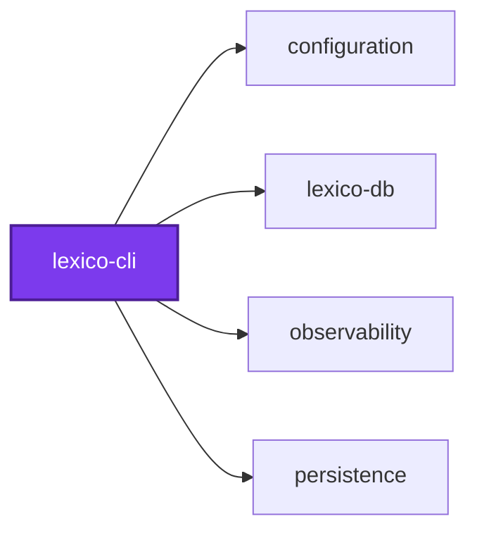
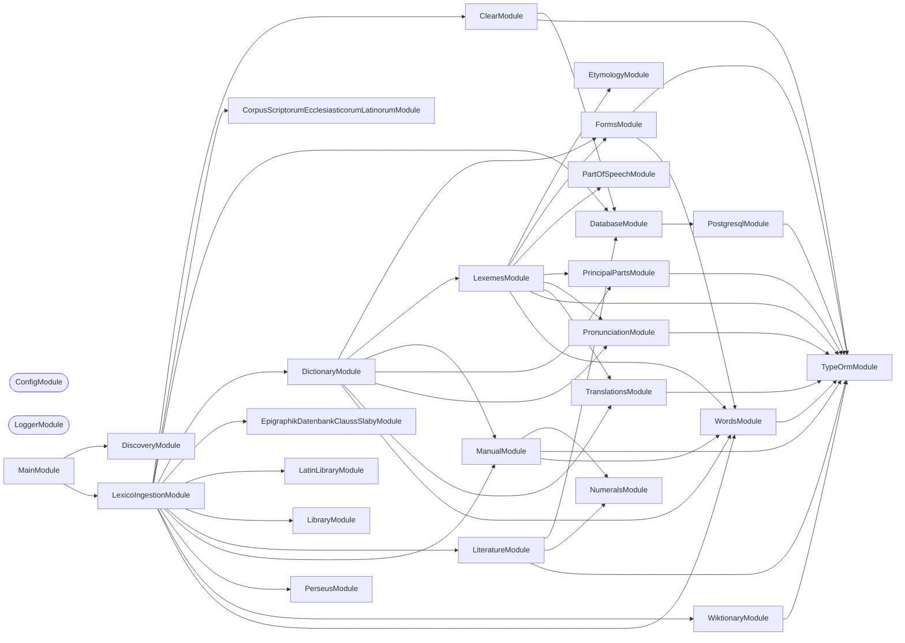

## 🕸️ Codependix

Dependency graphs exported by [codependix](https://github.com/Organizzolini/codebase/tree/main/projects/ic-suite/codependix/codependix-cli), regenerated by `nx run configuration:codependix:write`.

### Nx Neighborhood

<!-- codependix:start name="codependix-nx-projects" -->

<!-- codependix:end name="codependix-nx-projects" -->

### NestJS Module Graph

<!-- codependix:start name="codependix-nestjs-modules" -->


_Rounded modules are global: every module can inject them, so their edges are left out._
<!-- codependix:end name="codependix-nestjs-modules" -->

### File Imports

<!-- codependix:start name="codependix-file-imports" -->
```mermaid
graph LR
  file_callidescope_config_ts["callidescope.config.ts"]
  file_codependix_config_ts["codependix.config.ts"]
  file_codometer_config_ts["codometer.config.ts"]
  file_coinagerie_config_ts["coinagerie.config.ts"]
  file_eslint_config_ts["eslint.config.ts"]
  file_src_lexico_cli_constants_ts["src/lexico-cli.constants.ts"]
  file_src_lexico_cli_main_end_to_end_test_ts["src/lexico-cli.main.end-to-end.test.ts"]
  file_src_lexico_cli_main_ts["src/lexico-cli.main.ts"]
  file_src_lexico_cli_main_unit_test_ts["src/lexico-cli.main.unit.test.ts"]
  file_src_lexico_cli_module_ts["src/lexico-cli.module.ts"]
  file_src_lexico_cli_repl_ts["src/lexico-cli.repl.ts"]
  file_src_lexico_cli_repl_unit_test_ts["src/lexico-cli.repl.unit.test.ts"]
  file_src_modules_clear_clear_command_ts["src/modules/clear/clear.command.ts"]
  file_src_modules_clear_clear_command_unit_test_ts["src/modules/clear/clear.command.unit.test.ts"]
  file_src_modules_clear_clear_constants_ts["src/modules/clear/clear.constants.ts"]
  file_src_modules_clear_clear_module_ts["src/modules/clear/clear.module.ts"]
  file_src_modules_clear_clear_types_ts["src/modules/clear/clear.types.ts"]
  file_src_modules_corpus_scriptorum_ecclesiasticorum_latinorum_corpus_scriptorum_ecclesiasticorum_latinorum_command_ts["src/modules/corpus-scriptorum-ecclesiasticorum-latinorum/corpus-scriptorum-ecclesiasticorum-latinorum.command.ts"]
  file_src_modules_corpus_scriptorum_ecclesiasticorum_latinorum_corpus_scriptorum_ecclesiasticorum_latinorum_command_unit_test_ts["src/modules/corpus-scriptorum-ecclesiasticorum-latinorum/corpus-scriptorum-ecclesiasticorum-latinorum.command.unit.test.ts"]
  file_src_modules_corpus_scriptorum_ecclesiasticorum_latinorum_corpus_scriptorum_ecclesiasticorum_latinorum_constants_ts["src/modules/corpus-scriptorum-ecclesiasticorum-latinorum/corpus-scriptorum-ecclesiasticorum-latinorum.constants.ts"]
  file_src_modules_corpus_scriptorum_ecclesiasticorum_latinorum_corpus_scriptorum_ecclesiasticorum_latinorum_module_ts["src/modules/corpus-scriptorum-ecclesiasticorum-latinorum/corpus-scriptorum-ecclesiasticorum-latinorum.module.ts"]
  file_src_modules_corpus_scriptorum_ecclesiasticorum_latinorum_corpus_scriptorum_ecclesiasticorum_latinorum_types_ts["src/modules/corpus-scriptorum-ecclesiasticorum-latinorum/corpus-scriptorum-ecclesiasticorum-latinorum.types.ts"]
  file_src_modules_dictionary_dictionary_command_ts["src/modules/dictionary/dictionary.command.ts"]
  file_src_modules_dictionary_dictionary_command_unit_test_ts["src/modules/dictionary/dictionary.command.unit.test.ts"]
  file_src_modules_dictionary_dictionary_constants_ts["src/modules/dictionary/dictionary.constants.ts"]
  file_src_modules_dictionary_dictionary_module_ts["src/modules/dictionary/dictionary.module.ts"]
  file_src_modules_dictionary_dictionary_types_ts["src/modules/dictionary/dictionary.types.ts"]
  file_src_modules_epigraphik_datenbank_clauss_slaby_epigraphik_datenbank_clauss_slaby_command_ts["src/modules/epigraphik-datenbank-clauss-slaby/epigraphik-datenbank-clauss-slaby.command.ts"]
  file_src_modules_epigraphik_datenbank_clauss_slaby_epigraphik_datenbank_clauss_slaby_command_unit_test_ts["src/modules/epigraphik-datenbank-clauss-slaby/epigraphik-datenbank-clauss-slaby.command.unit.test.ts"]
  file_src_modules_epigraphik_datenbank_clauss_slaby_epigraphik_datenbank_clauss_slaby_constants_ts["src/modules/epigraphik-datenbank-clauss-slaby/epigraphik-datenbank-clauss-slaby.constants.ts"]
  file_src_modules_epigraphik_datenbank_clauss_slaby_epigraphik_datenbank_clauss_slaby_module_ts["src/modules/epigraphik-datenbank-clauss-slaby/epigraphik-datenbank-clauss-slaby.module.ts"]
  file_src_modules_epigraphik_datenbank_clauss_slaby_epigraphik_datenbank_clauss_slaby_types_ts["src/modules/epigraphik-datenbank-clauss-slaby/epigraphik-datenbank-clauss-slaby.types.ts"]
  file_src_modules_etymology_etymology_constants_ts["src/modules/etymology/etymology.constants.ts"]
  file_src_modules_etymology_etymology_module_ts["src/modules/etymology/etymology.module.ts"]
  file_src_modules_etymology_etymology_service_ts["src/modules/etymology/etymology.service.ts"]
  file_src_modules_etymology_etymology_service_unit_test_ts["src/modules/etymology/etymology.service.unit.test.ts"]
  file_src_modules_etymology_etymology_types_ts["src/modules/etymology/etymology.types.ts"]
  file_src_modules_forms_forms_builder_guards_service_ts["src/modules/forms/forms-builder-guards.service.ts"]
  file_src_modules_forms_forms_builder_guards_service_unit_test_ts["src/modules/forms/forms-builder-guards.service.unit.test.ts"]
  file_src_modules_forms_forms_builder_verb_service_ts["src/modules/forms/forms-builder-verb.service.ts"]
  file_src_modules_forms_forms_builder_verb_service_unit_test_ts["src/modules/forms/forms-builder-verb.service.unit.test.ts"]
  file_src_modules_forms_forms_builder_service_ts["src/modules/forms/forms-builder.service.ts"]
  file_src_modules_forms_forms_builder_service_unit_test_ts["src/modules/forms/forms-builder.service.unit.test.ts"]
  file_src_modules_forms_forms_transient_words_service_ts["src/modules/forms/forms-transient-words.service.ts"]
  file_src_modules_forms_forms_transient_words_service_unit_test_ts["src/modules/forms/forms-transient-words.service.unit.test.ts"]
  file_src_modules_forms_forms_constants_ts["src/modules/forms/forms.constants.ts"]
  file_src_modules_forms_forms_constants_unit_test_ts["src/modules/forms/forms.constants.unit.test.ts"]
  file_src_modules_forms_forms_module_ts["src/modules/forms/forms.module.ts"]
  file_src_modules_forms_forms_service_ts["src/modules/forms/forms.service.ts"]
  file_src_modules_forms_forms_service_unit_test_ts["src/modules/forms/forms.service.unit.test.ts"]
  file_src_modules_forms_forms_types_ts["src/modules/forms/forms.types.ts"]
  file_src_modules_latin_library_latin_library_command_ts["src/modules/latin-library/latin-library.command.ts"]
  file_src_modules_latin_library_latin_library_command_unit_test_ts["src/modules/latin-library/latin-library.command.unit.test.ts"]
  file_src_modules_latin_library_latin_library_constants_ts["src/modules/latin-library/latin-library.constants.ts"]
  file_src_modules_latin_library_latin_library_module_ts["src/modules/latin-library/latin-library.module.ts"]
  file_src_modules_latin_library_latin_library_types_ts["src/modules/latin-library/latin-library.types.ts"]
  file_src_modules_lexemes_lexemes_constants_ts["src/modules/lexemes/lexemes.constants.ts"]
  file_src_modules_lexemes_lexemes_module_ts["src/modules/lexemes/lexemes.module.ts"]
  file_src_modules_lexemes_lexemes_service_ts["src/modules/lexemes/lexemes.service.ts"]
  file_src_modules_lexemes_lexemes_service_unit_test_ts["src/modules/lexemes/lexemes.service.unit.test.ts"]
  file_src_modules_lexemes_lexemes_types_ts["src/modules/lexemes/lexemes.types.ts"]
  file_src_modules_lexico_ingestion_lexico_ingestion_command_ts["src/modules/lexico-ingestion/lexico-ingestion.command.ts"]
  file_src_modules_lexico_ingestion_lexico_ingestion_command_unit_test_ts["src/modules/lexico-ingestion/lexico-ingestion.command.unit.test.ts"]
  file_src_modules_lexico_ingestion_lexico_ingestion_constants_ts["src/modules/lexico-ingestion/lexico-ingestion.constants.ts"]
  file_src_modules_lexico_ingestion_lexico_ingestion_module_ts["src/modules/lexico-ingestion/lexico-ingestion.module.ts"]
  file_src_modules_lexico_ingestion_lexico_ingestion_types_ts["src/modules/lexico-ingestion/lexico-ingestion.types.ts"]
  file_src_modules_lexico_ingestion_lexico_ingestion_utilities_ts["src/modules/lexico-ingestion/lexico-ingestion.utilities.ts"]
  file_src_modules_lexico_ingestion_lexico_ingestion_utilities_unit_test_ts["src/modules/lexico-ingestion/lexico-ingestion.utilities.unit.test.ts"]
  file_src_modules_library_library_command_ts["src/modules/library/library.command.ts"]
  file_src_modules_library_library_command_unit_test_ts["src/modules/library/library.command.unit.test.ts"]
  file_src_modules_library_library_constants_ts["src/modules/library/library.constants.ts"]
  file_src_modules_library_library_module_ts["src/modules/library/library.module.ts"]
  file_src_modules_library_library_types_ts["src/modules/library/library.types.ts"]
  file_src_modules_library_library_utilities_ts["src/modules/library/library.utilities.ts"]
  file_src_modules_library_library_utilities_unit_test_ts["src/modules/library/library.utilities.unit.test.ts"]
  file_src_modules_library_providers_corpus_scriptorum_ecclesiasticorum_latinorum_library_provider_ts["src/modules/library/providers/corpus-scriptorum-ecclesiasticorum-latinorum-library.provider.ts"]
  file_src_modules_library_providers_corpus_scriptorum_ecclesiasticorum_latinorum_library_provider_unit_test_ts["src/modules/library/providers/corpus-scriptorum-ecclesiasticorum-latinorum-library.provider.unit.test.ts"]
  file_src_modules_library_providers_epigraphik_datenbank_clauss_slaby_library_provider_ts["src/modules/library/providers/epigraphik-datenbank-clauss-slaby-library.provider.ts"]
  file_src_modules_library_providers_epigraphik_datenbank_clauss_slaby_library_provider_unit_test_ts["src/modules/library/providers/epigraphik-datenbank-clauss-slaby-library.provider.unit.test.ts"]
  file_src_modules_library_providers_latin_library_builder_ts["src/modules/library/providers/latin-library.builder.ts"]
  file_src_modules_library_providers_latin_library_builder_unit_test_ts["src/modules/library/providers/latin-library.builder.unit.test.ts"]
  file_src_modules_library_providers_latin_library_provider_ts["src/modules/library/providers/latin-library.provider.ts"]
  file_src_modules_library_providers_latin_library_provider_unit_test_ts["src/modules/library/providers/latin-library.provider.unit.test.ts"]
  file_src_modules_library_providers_perseus_library_text_extraction_provider_ts["src/modules/library/providers/perseus-library-text-extraction.provider.ts"]
  file_src_modules_library_providers_perseus_library_text_extraction_provider_unit_test_ts["src/modules/library/providers/perseus-library-text-extraction.provider.unit.test.ts"]
  file_src_modules_library_providers_perseus_library_provider_ts["src/modules/library/providers/perseus-library.provider.ts"]
  file_src_modules_library_providers_perseus_library_provider_unit_test_ts["src/modules/library/providers/perseus-library.provider.unit.test.ts"]
  file_src_modules_literature_literature_library_scan_service_ts["src/modules/literature/literature-library-scan.service.ts"]
  file_src_modules_literature_literature_library_scan_service_unit_test_ts["src/modules/literature/literature-library-scan.service.unit.test.ts"]
  file_src_modules_literature_literature_text_ingestion_service_ts["src/modules/literature/literature-text-ingestion.service.ts"]
  file_src_modules_literature_literature_text_ingestion_service_unit_test_ts["src/modules/literature/literature-text-ingestion.service.unit.test.ts"]
  file_src_modules_literature_literature_word_normalization_service_ts["src/modules/literature/literature-word-normalization.service.ts"]
  file_src_modules_literature_literature_word_normalization_service_unit_test_ts["src/modules/literature/literature-word-normalization.service.unit.test.ts"]
  file_src_modules_literature_literature_command_ts["src/modules/literature/literature.command.ts"]
  file_src_modules_literature_literature_command_unit_test_ts["src/modules/literature/literature.command.unit.test.ts"]
  file_src_modules_literature_literature_constants_ts["src/modules/literature/literature.constants.ts"]
  file_src_modules_literature_literature_module_ts["src/modules/literature/literature.module.ts"]
  file_src_modules_literature_literature_service_ts["src/modules/literature/literature.service.ts"]
  file_src_modules_literature_literature_service_unit_test_ts["src/modules/literature/literature.service.unit.test.ts"]
  file_src_modules_literature_literature_types_ts["src/modules/literature/literature.types.ts"]
  file_src_modules_manual_manual_constants_ts["src/modules/manual/manual.constants.ts"]
  file_src_modules_manual_manual_module_ts["src/modules/manual/manual.module.ts"]
  file_src_modules_manual_manual_service_ts["src/modules/manual/manual.service.ts"]
  file_src_modules_manual_manual_service_unit_test_ts["src/modules/manual/manual.service.unit.test.ts"]
  file_src_modules_manual_manual_types_ts["src/modules/manual/manual.types.ts"]
  file_src_modules_manual_manual_utilities_ts["src/modules/manual/manual.utilities.ts"]
  file_src_modules_numerals_numerals_constants_ts["src/modules/numerals/numerals.constants.ts"]
  file_src_modules_numerals_numerals_module_ts["src/modules/numerals/numerals.module.ts"]
  file_src_modules_numerals_numerals_service_ts["src/modules/numerals/numerals.service.ts"]
  file_src_modules_numerals_numerals_service_unit_test_ts["src/modules/numerals/numerals.service.unit.test.ts"]
  file_src_modules_numerals_numerals_types_ts["src/modules/numerals/numerals.types.ts"]
  file_src_modules_part_of_speech_part_of_speech_forms_service_ts["src/modules/part-of-speech/part-of-speech-forms.service.ts"]
  file_src_modules_part_of_speech_part_of_speech_forms_service_unit_test_ts["src/modules/part-of-speech/part-of-speech-forms.service.unit.test.ts"]
  file_src_modules_part_of_speech_part_of_speech_constants_ts["src/modules/part-of-speech/part-of-speech.constants.ts"]
  file_src_modules_part_of_speech_part_of_speech_module_ts["src/modules/part-of-speech/part-of-speech.module.ts"]
  file_src_modules_part_of_speech_part_of_speech_service_ts["src/modules/part-of-speech/part-of-speech.service.ts"]
  file_src_modules_part_of_speech_part_of_speech_service_unit_test_ts["src/modules/part-of-speech/part-of-speech.service.unit.test.ts"]
  file_src_modules_part_of_speech_part_of_speech_types_ts["src/modules/part-of-speech/part-of-speech.types.ts"]
  file_src_modules_perseus_perseus_command_ts["src/modules/perseus/perseus.command.ts"]
  file_src_modules_perseus_perseus_command_unit_test_ts["src/modules/perseus/perseus.command.unit.test.ts"]
  file_src_modules_perseus_perseus_constants_ts["src/modules/perseus/perseus.constants.ts"]
  file_src_modules_perseus_perseus_module_ts["src/modules/perseus/perseus.module.ts"]
  file_src_modules_perseus_perseus_types_ts["src/modules/perseus/perseus.types.ts"]
  file_src_modules_principal_parts_principal_parts_constants_ts["src/modules/principal-parts/principal-parts.constants.ts"]
  file_src_modules_principal_parts_principal_parts_module_ts["src/modules/principal-parts/principal-parts.module.ts"]
  file_src_modules_principal_parts_principal_parts_service_ts["src/modules/principal-parts/principal-parts.service.ts"]
  file_src_modules_principal_parts_principal_parts_service_unit_test_ts["src/modules/principal-parts/principal-parts.service.unit.test.ts"]
  file_src_modules_principal_parts_principal_parts_types_ts["src/modules/principal-parts/principal-parts.types.ts"]
  file_src_modules_pronunciation_pronunciation_classical_service_ts["src/modules/pronunciation/pronunciation-classical.service.ts"]
  file_src_modules_pronunciation_pronunciation_classical_service_unit_test_ts["src/modules/pronunciation/pronunciation-classical.service.unit.test.ts"]
  file_src_modules_pronunciation_pronunciation_classifier_service_ts["src/modules/pronunciation/pronunciation-classifier.service.ts"]
  file_src_modules_pronunciation_pronunciation_classifier_service_unit_test_ts["src/modules/pronunciation/pronunciation-classifier.service.unit.test.ts"]
  file_src_modules_pronunciation_pronunciation_ecclesiastical_service_ts["src/modules/pronunciation/pronunciation-ecclesiastical.service.ts"]
  file_src_modules_pronunciation_pronunciation_ecclesiastical_service_unit_test_ts["src/modules/pronunciation/pronunciation-ecclesiastical.service.unit.test.ts"]
  file_src_modules_pronunciation_pronunciation_phonemes_service_ts["src/modules/pronunciation/pronunciation-phonemes.service.ts"]
  file_src_modules_pronunciation_pronunciation_phonemes_service_unit_test_ts["src/modules/pronunciation/pronunciation-phonemes.service.unit.test.ts"]
  file_src_modules_pronunciation_pronunciation_constants_ts["src/modules/pronunciation/pronunciation.constants.ts"]
  file_src_modules_pronunciation_pronunciation_module_ts["src/modules/pronunciation/pronunciation.module.ts"]
  file_src_modules_pronunciation_pronunciation_service_ts["src/modules/pronunciation/pronunciation.service.ts"]
  file_src_modules_pronunciation_pronunciation_service_unit_test_ts["src/modules/pronunciation/pronunciation.service.unit.test.ts"]
  file_src_modules_pronunciation_pronunciation_types_ts["src/modules/pronunciation/pronunciation.types.ts"]
  file_src_modules_translations_translations_constants_ts["src/modules/translations/translations.constants.ts"]
  file_src_modules_translations_translations_module_ts["src/modules/translations/translations.module.ts"]
  file_src_modules_translations_translations_service_ts["src/modules/translations/translations.service.ts"]
  file_src_modules_translations_translations_service_unit_test_ts["src/modules/translations/translations.service.unit.test.ts"]
  file_src_modules_translations_translations_types_ts["src/modules/translations/translations.types.ts"]
  file_src_modules_wiktionary_wiktionary_command_ts["src/modules/wiktionary/wiktionary.command.ts"]
  file_src_modules_wiktionary_wiktionary_command_unit_test_ts["src/modules/wiktionary/wiktionary.command.unit.test.ts"]
  file_src_modules_wiktionary_wiktionary_constants_ts["src/modules/wiktionary/wiktionary.constants.ts"]
  file_src_modules_wiktionary_wiktionary_module_ts["src/modules/wiktionary/wiktionary.module.ts"]
  file_src_modules_wiktionary_wiktionary_types_ts["src/modules/wiktionary/wiktionary.types.ts"]
  file_src_modules_words_words_constants_ts["src/modules/words/words.constants.ts"]
  file_src_modules_words_words_module_ts["src/modules/words/words.module.ts"]
  file_src_modules_words_words_service_ts["src/modules/words/words.service.ts"]
  file_src_modules_words_words_service_unit_test_ts["src/modules/words/words.service.unit.test.ts"]
  file_src_modules_words_words_types_ts["src/modules/words/words.types.ts"]
  file_testing_command_harness_ts["testing/command-harness.ts"]
  file_testing_mocks_ts["testing/mocks.ts"]
  file_testing_setup_ts["testing/setup.ts"]
  file_vitest_config_ts["vitest.config.ts"]
  file_src_lexico_cli_main_end_to_end_test_ts --> file_src_lexico_cli_constants_ts
  file_src_lexico_cli_main_ts --> file_src_lexico_cli_module_ts
  file_src_lexico_cli_module_ts --> file_src_lexico_cli_constants_ts
  file_src_lexico_cli_module_ts --> file_src_modules_lexico_ingestion_lexico_ingestion_module_ts
  file_src_lexico_cli_repl_ts --> file_src_lexico_cli_module_ts
  file_src_modules_clear_clear_command_ts --> file_src_modules_clear_clear_types_ts
  file_src_modules_clear_clear_command_unit_test_ts --> file_src_modules_clear_clear_command_ts
  file_src_modules_clear_clear_command_unit_test_ts --> file_testing_command_harness_ts
  file_src_modules_clear_clear_command_unit_test_ts --> file_testing_mocks_ts
  file_src_modules_clear_clear_module_ts --> file_src_modules_clear_clear_command_ts
  file_src_modules_corpus_scriptorum_ecclesiasticorum_latinorum_corpus_scriptorum_ecclesiasticorum_latinorum_command_ts --> file_src_modules_corpus_scriptorum_ecclesiasticorum_latinorum_corpus_scriptorum_ecclesiasticorum_latinorum_constants_ts
  file_src_modules_corpus_scriptorum_ecclesiasticorum_latinorum_corpus_scriptorum_ecclesiasticorum_latinorum_command_ts --> file_src_modules_corpus_scriptorum_ecclesiasticorum_latinorum_corpus_scriptorum_ecclesiasticorum_latinorum_types_ts
  file_src_modules_corpus_scriptorum_ecclesiasticorum_latinorum_corpus_scriptorum_ecclesiasticorum_latinorum_command_unit_test_ts --> file_src_modules_corpus_scriptorum_ecclesiasticorum_latinorum_corpus_scriptorum_ecclesiasticorum_latinorum_command_ts
  file_src_modules_corpus_scriptorum_ecclesiasticorum_latinorum_corpus_scriptorum_ecclesiasticorum_latinorum_command_unit_test_ts --> file_testing_command_harness_ts
  file_src_modules_corpus_scriptorum_ecclesiasticorum_latinorum_corpus_scriptorum_ecclesiasticorum_latinorum_module_ts --> file_src_modules_corpus_scriptorum_ecclesiasticorum_latinorum_corpus_scriptorum_ecclesiasticorum_latinorum_command_ts
  file_src_modules_dictionary_dictionary_command_ts --> file_src_modules_dictionary_dictionary_types_ts
  file_src_modules_dictionary_dictionary_command_ts --> file_src_modules_lexemes_lexemes_service_ts
  file_src_modules_dictionary_dictionary_command_ts --> file_src_modules_lexico_ingestion_lexico_ingestion_types_ts
  file_src_modules_dictionary_dictionary_command_ts --> file_src_modules_lexico_ingestion_lexico_ingestion_utilities_ts
  file_src_modules_dictionary_dictionary_command_ts --> file_src_modules_manual_manual_service_ts
  file_src_modules_dictionary_dictionary_command_ts --> file_src_modules_translations_translations_service_ts
  file_src_modules_dictionary_dictionary_command_unit_test_ts --> file_src_modules_dictionary_dictionary_command_ts
  file_src_modules_dictionary_dictionary_command_unit_test_ts --> file_src_modules_lexemes_lexemes_service_ts
  file_src_modules_dictionary_dictionary_command_unit_test_ts --> file_src_modules_lexico_ingestion_lexico_ingestion_types_ts
  file_src_modules_dictionary_dictionary_command_unit_test_ts --> file_src_modules_manual_manual_service_ts
  file_src_modules_dictionary_dictionary_command_unit_test_ts --> file_src_modules_translations_translations_service_ts
  file_src_modules_dictionary_dictionary_command_unit_test_ts --> file_testing_command_harness_ts
  file_src_modules_dictionary_dictionary_command_unit_test_ts --> file_testing_mocks_ts
  file_src_modules_dictionary_dictionary_module_ts --> file_src_modules_dictionary_dictionary_command_ts
  file_src_modules_dictionary_dictionary_module_ts --> file_src_modules_forms_forms_module_ts
  file_src_modules_dictionary_dictionary_module_ts --> file_src_modules_lexemes_lexemes_module_ts
  file_src_modules_dictionary_dictionary_module_ts --> file_src_modules_manual_manual_module_ts
  file_src_modules_dictionary_dictionary_module_ts --> file_src_modules_principal_parts_principal_parts_module_ts
  file_src_modules_dictionary_dictionary_module_ts --> file_src_modules_pronunciation_pronunciation_module_ts
  file_src_modules_dictionary_dictionary_module_ts --> file_src_modules_translations_translations_module_ts
  file_src_modules_dictionary_dictionary_module_ts --> file_src_modules_words_words_module_ts
  file_src_modules_dictionary_dictionary_types_ts --> file_src_modules_lexico_ingestion_lexico_ingestion_types_ts
  file_src_modules_epigraphik_datenbank_clauss_slaby_epigraphik_datenbank_clauss_slaby_command_ts --> file_src_modules_epigraphik_datenbank_clauss_slaby_epigraphik_datenbank_clauss_slaby_constants_ts
  file_src_modules_epigraphik_datenbank_clauss_slaby_epigraphik_datenbank_clauss_slaby_command_ts --> file_src_modules_epigraphik_datenbank_clauss_slaby_epigraphik_datenbank_clauss_slaby_types_ts
  file_src_modules_epigraphik_datenbank_clauss_slaby_epigraphik_datenbank_clauss_slaby_command_unit_test_ts --> file_src_modules_epigraphik_datenbank_clauss_slaby_epigraphik_datenbank_clauss_slaby_command_ts
  file_src_modules_epigraphik_datenbank_clauss_slaby_epigraphik_datenbank_clauss_slaby_command_unit_test_ts --> file_testing_command_harness_ts
  file_src_modules_epigraphik_datenbank_clauss_slaby_epigraphik_datenbank_clauss_slaby_module_ts --> file_src_modules_epigraphik_datenbank_clauss_slaby_epigraphik_datenbank_clauss_slaby_command_ts
  file_src_modules_etymology_etymology_module_ts --> file_src_modules_etymology_etymology_service_ts
  file_src_modules_etymology_etymology_service_unit_test_ts --> file_src_modules_etymology_etymology_service_ts
  file_src_modules_forms_forms_builder_guards_service_ts --> file_src_modules_forms_forms_constants_ts
  file_src_modules_forms_forms_builder_guards_service_ts --> file_src_modules_forms_forms_types_ts
  file_src_modules_forms_forms_builder_guards_service_unit_test_ts --> file_src_modules_forms_forms_builder_guards_service_ts
  file_src_modules_forms_forms_builder_verb_service_ts --> file_src_modules_forms_forms_builder_guards_service_ts
  file_src_modules_forms_forms_builder_verb_service_ts --> file_src_modules_forms_forms_transient_words_service_ts
  file_src_modules_forms_forms_builder_verb_service_ts --> file_src_modules_forms_forms_types_ts
  file_src_modules_forms_forms_builder_verb_service_unit_test_ts --> file_src_modules_forms_forms_builder_guards_service_ts
  file_src_modules_forms_forms_builder_verb_service_unit_test_ts --> file_src_modules_forms_forms_builder_verb_service_ts
  file_src_modules_forms_forms_builder_verb_service_unit_test_ts --> file_src_modules_forms_forms_transient_words_service_ts
  file_src_modules_forms_forms_builder_service_ts --> file_src_modules_forms_forms_builder_guards_service_ts
  file_src_modules_forms_forms_builder_service_ts --> file_src_modules_forms_forms_builder_verb_service_ts
  file_src_modules_forms_forms_builder_service_ts --> file_src_modules_forms_forms_transient_words_service_ts
  file_src_modules_forms_forms_builder_service_ts --> file_src_modules_forms_forms_constants_ts
  file_src_modules_forms_forms_builder_service_ts --> file_src_modules_forms_forms_types_ts
  file_src_modules_forms_forms_builder_service_unit_test_ts --> file_src_modules_forms_forms_builder_guards_service_ts
  file_src_modules_forms_forms_builder_service_unit_test_ts --> file_src_modules_forms_forms_builder_verb_service_ts
  file_src_modules_forms_forms_builder_service_unit_test_ts --> file_src_modules_forms_forms_builder_service_ts
  file_src_modules_forms_forms_builder_service_unit_test_ts --> file_src_modules_forms_forms_transient_words_service_ts
  file_src_modules_forms_forms_transient_words_service_unit_test_ts --> file_src_modules_forms_forms_transient_words_service_ts
  file_src_modules_forms_forms_module_ts --> file_src_modules_forms_forms_builder_guards_service_ts
  file_src_modules_forms_forms_module_ts --> file_src_modules_forms_forms_builder_verb_service_ts
  file_src_modules_forms_forms_module_ts --> file_src_modules_forms_forms_builder_service_ts
  file_src_modules_forms_forms_module_ts --> file_src_modules_forms_forms_transient_words_service_ts
  file_src_modules_forms_forms_module_ts --> file_src_modules_forms_forms_service_ts
  file_src_modules_forms_forms_module_ts --> file_src_modules_words_words_module_ts
  file_src_modules_forms_forms_service_ts --> file_src_modules_forms_forms_transient_words_service_ts
  file_src_modules_forms_forms_service_ts --> file_src_modules_words_words_service_ts
  file_src_modules_forms_forms_service_unit_test_ts --> file_src_modules_forms_forms_transient_words_service_ts
  file_src_modules_forms_forms_service_unit_test_ts --> file_src_modules_forms_forms_service_ts
  file_src_modules_forms_forms_service_unit_test_ts --> file_src_modules_words_words_service_ts
  file_src_modules_forms_forms_service_unit_test_ts --> file_testing_mocks_ts
  file_src_modules_latin_library_latin_library_command_unit_test_ts --> file_src_modules_latin_library_latin_library_command_ts
  file_src_modules_latin_library_latin_library_command_unit_test_ts --> file_testing_command_harness_ts
  file_src_modules_latin_library_latin_library_module_ts --> file_src_modules_latin_library_latin_library_command_ts
  file_src_modules_lexemes_lexemes_module_ts --> file_src_modules_etymology_etymology_module_ts
  file_src_modules_lexemes_lexemes_module_ts --> file_src_modules_forms_forms_module_ts
  file_src_modules_lexemes_lexemes_module_ts --> file_src_modules_lexemes_lexemes_service_ts
  file_src_modules_lexemes_lexemes_module_ts --> file_src_modules_part_of_speech_part_of_speech_module_ts
  file_src_modules_lexemes_lexemes_module_ts --> file_src_modules_principal_parts_principal_parts_module_ts
  file_src_modules_lexemes_lexemes_module_ts --> file_src_modules_pronunciation_pronunciation_module_ts
  file_src_modules_lexemes_lexemes_module_ts --> file_src_modules_translations_translations_module_ts
  file_src_modules_lexemes_lexemes_module_ts --> file_src_modules_words_words_module_ts
  file_src_modules_lexemes_lexemes_service_ts --> file_src_modules_etymology_etymology_service_ts
  file_src_modules_lexemes_lexemes_service_ts --> file_src_modules_forms_forms_builder_service_ts
  file_src_modules_lexemes_lexemes_service_ts --> file_src_modules_forms_forms_service_ts
  file_src_modules_lexemes_lexemes_service_ts --> file_src_modules_lexemes_lexemes_constants_ts
  file_src_modules_lexemes_lexemes_service_ts --> file_src_modules_lexico_ingestion_lexico_ingestion_constants_ts
  file_src_modules_lexemes_lexemes_service_ts --> file_src_modules_lexico_ingestion_lexico_ingestion_types_ts
  file_src_modules_lexemes_lexemes_service_ts --> file_src_modules_part_of_speech_part_of_speech_service_ts
  file_src_modules_lexemes_lexemes_service_ts --> file_src_modules_principal_parts_principal_parts_service_ts
  file_src_modules_lexemes_lexemes_service_ts --> file_src_modules_pronunciation_pronunciation_service_ts
  file_src_modules_lexemes_lexemes_service_ts --> file_src_modules_translations_translations_service_ts
  file_src_modules_lexemes_lexemes_service_ts --> file_src_modules_words_words_service_ts
  file_src_modules_lexemes_lexemes_service_unit_test_ts --> file_src_modules_etymology_etymology_service_ts
  file_src_modules_lexemes_lexemes_service_unit_test_ts --> file_src_modules_forms_forms_builder_service_ts
  file_src_modules_lexemes_lexemes_service_unit_test_ts --> file_src_modules_forms_forms_service_ts
  file_src_modules_lexemes_lexemes_service_unit_test_ts --> file_src_modules_lexemes_lexemes_service_ts
  file_src_modules_lexemes_lexemes_service_unit_test_ts --> file_src_modules_lexico_ingestion_lexico_ingestion_types_ts
  file_src_modules_lexemes_lexemes_service_unit_test_ts --> file_src_modules_part_of_speech_part_of_speech_service_ts
  file_src_modules_lexemes_lexemes_service_unit_test_ts --> file_src_modules_principal_parts_principal_parts_service_ts
  file_src_modules_lexemes_lexemes_service_unit_test_ts --> file_src_modules_pronunciation_pronunciation_service_ts
  file_src_modules_lexemes_lexemes_service_unit_test_ts --> file_src_modules_translations_translations_service_ts
  file_src_modules_lexemes_lexemes_service_unit_test_ts --> file_src_modules_words_words_service_ts
  file_src_modules_lexemes_lexemes_service_unit_test_ts --> file_testing_mocks_ts
  file_src_modules_lexico_ingestion_lexico_ingestion_command_ts --> file_src_modules_corpus_scriptorum_ecclesiasticorum_latinorum_corpus_scriptorum_ecclesiasticorum_latinorum_command_ts
  file_src_modules_lexico_ingestion_lexico_ingestion_command_ts --> file_src_modules_dictionary_dictionary_command_ts
  file_src_modules_lexico_ingestion_lexico_ingestion_command_ts --> file_src_modules_epigraphik_datenbank_clauss_slaby_epigraphik_datenbank_clauss_slaby_command_ts
  file_src_modules_lexico_ingestion_lexico_ingestion_command_ts --> file_src_modules_latin_library_latin_library_command_ts
  file_src_modules_lexico_ingestion_lexico_ingestion_command_ts --> file_src_modules_lexico_ingestion_lexico_ingestion_types_ts
  file_src_modules_lexico_ingestion_lexico_ingestion_command_ts --> file_src_modules_library_library_command_ts
  file_src_modules_lexico_ingestion_lexico_ingestion_command_ts --> file_src_modules_literature_literature_command_ts
  file_src_modules_lexico_ingestion_lexico_ingestion_command_ts --> file_src_modules_perseus_perseus_command_ts
  file_src_modules_lexico_ingestion_lexico_ingestion_command_ts --> file_src_modules_wiktionary_wiktionary_command_ts
  file_src_modules_lexico_ingestion_lexico_ingestion_command_unit_test_ts --> file_src_modules_corpus_scriptorum_ecclesiasticorum_latinorum_corpus_scriptorum_ecclesiasticorum_latinorum_command_ts
  file_src_modules_lexico_ingestion_lexico_ingestion_command_unit_test_ts --> file_src_modules_dictionary_dictionary_command_ts
  file_src_modules_lexico_ingestion_lexico_ingestion_command_unit_test_ts --> file_src_modules_epigraphik_datenbank_clauss_slaby_epigraphik_datenbank_clauss_slaby_command_ts
  file_src_modules_lexico_ingestion_lexico_ingestion_command_unit_test_ts --> file_src_modules_latin_library_latin_library_command_ts
  file_src_modules_lexico_ingestion_lexico_ingestion_command_unit_test_ts --> file_src_modules_lexico_ingestion_lexico_ingestion_command_ts
  file_src_modules_lexico_ingestion_lexico_ingestion_command_unit_test_ts --> file_src_modules_lexico_ingestion_lexico_ingestion_types_ts
  file_src_modules_lexico_ingestion_lexico_ingestion_command_unit_test_ts --> file_src_modules_library_library_command_ts
  file_src_modules_lexico_ingestion_lexico_ingestion_command_unit_test_ts --> file_src_modules_literature_literature_command_ts
  file_src_modules_lexico_ingestion_lexico_ingestion_command_unit_test_ts --> file_src_modules_perseus_perseus_command_ts
  file_src_modules_lexico_ingestion_lexico_ingestion_command_unit_test_ts --> file_src_modules_wiktionary_wiktionary_command_ts
  file_src_modules_lexico_ingestion_lexico_ingestion_command_unit_test_ts --> file_testing_mocks_ts
  file_src_modules_lexico_ingestion_lexico_ingestion_module_ts --> file_src_modules_clear_clear_module_ts
  file_src_modules_lexico_ingestion_lexico_ingestion_module_ts --> file_src_modules_corpus_scriptorum_ecclesiasticorum_latinorum_corpus_scriptorum_ecclesiasticorum_latinorum_module_ts
  file_src_modules_lexico_ingestion_lexico_ingestion_module_ts --> file_src_modules_dictionary_dictionary_module_ts
  file_src_modules_lexico_ingestion_lexico_ingestion_module_ts --> file_src_modules_epigraphik_datenbank_clauss_slaby_epigraphik_datenbank_clauss_slaby_module_ts
  file_src_modules_lexico_ingestion_lexico_ingestion_module_ts --> file_src_modules_latin_library_latin_library_module_ts
  file_src_modules_lexico_ingestion_lexico_ingestion_module_ts --> file_src_modules_lexico_ingestion_lexico_ingestion_command_ts
  file_src_modules_lexico_ingestion_lexico_ingestion_module_ts --> file_src_modules_library_library_module_ts
  file_src_modules_lexico_ingestion_lexico_ingestion_module_ts --> file_src_modules_literature_literature_module_ts
  file_src_modules_lexico_ingestion_lexico_ingestion_module_ts --> file_src_modules_manual_manual_module_ts
  file_src_modules_lexico_ingestion_lexico_ingestion_module_ts --> file_src_modules_perseus_perseus_module_ts
  file_src_modules_lexico_ingestion_lexico_ingestion_module_ts --> file_src_modules_wiktionary_wiktionary_module_ts
  file_src_modules_lexico_ingestion_lexico_ingestion_module_ts --> file_src_modules_words_words_module_ts
  file_src_modules_lexico_ingestion_lexico_ingestion_utilities_ts --> file_src_modules_lexico_ingestion_lexico_ingestion_constants_ts
  file_src_modules_lexico_ingestion_lexico_ingestion_utilities_ts --> file_src_modules_lexico_ingestion_lexico_ingestion_types_ts
  file_src_modules_lexico_ingestion_lexico_ingestion_utilities_unit_test_ts --> file_src_modules_lexico_ingestion_lexico_ingestion_constants_ts
  file_src_modules_lexico_ingestion_lexico_ingestion_utilities_unit_test_ts --> file_src_modules_lexico_ingestion_lexico_ingestion_utilities_ts
  file_src_modules_lexico_ingestion_lexico_ingestion_utilities_unit_test_ts --> file_testing_mocks_ts
  file_src_modules_library_library_command_ts --> file_src_modules_lexico_ingestion_lexico_ingestion_types_ts
  file_src_modules_library_library_command_ts --> file_src_modules_lexico_ingestion_lexico_ingestion_utilities_ts
  file_src_modules_library_library_command_ts --> file_src_modules_library_library_constants_ts
  file_src_modules_library_library_command_ts --> file_src_modules_library_library_types_ts
  file_src_modules_library_library_command_unit_test_ts --> file_src_modules_library_library_command_ts
  file_src_modules_library_library_command_unit_test_ts --> file_src_modules_library_library_constants_ts
  file_src_modules_library_library_command_unit_test_ts --> file_src_modules_library_library_types_ts
  file_src_modules_library_library_command_unit_test_ts --> file_testing_command_harness_ts
  file_src_modules_library_library_command_unit_test_ts --> file_testing_mocks_ts
  file_src_modules_library_library_module_ts --> file_src_modules_library_library_command_ts
  file_src_modules_library_library_module_ts --> file_src_modules_library_library_constants_ts
  file_src_modules_library_library_module_ts --> file_src_modules_library_library_types_ts
  file_src_modules_library_library_module_ts --> file_src_modules_library_providers_corpus_scriptorum_ecclesiasticorum_latinorum_library_provider_ts
  file_src_modules_library_library_module_ts --> file_src_modules_library_providers_epigraphik_datenbank_clauss_slaby_library_provider_ts
  file_src_modules_library_library_module_ts --> file_src_modules_library_providers_latin_library_builder_ts
  file_src_modules_library_library_module_ts --> file_src_modules_library_providers_latin_library_provider_ts
  file_src_modules_library_library_module_ts --> file_src_modules_library_providers_perseus_library_text_extraction_provider_ts
  file_src_modules_library_library_module_ts --> file_src_modules_library_providers_perseus_library_provider_ts
  file_src_modules_library_library_types_ts --> file_src_modules_lexico_ingestion_lexico_ingestion_types_ts
  file_src_modules_library_library_utilities_unit_test_ts --> file_src_modules_library_library_utilities_ts
  file_src_modules_library_providers_corpus_scriptorum_ecclesiasticorum_latinorum_library_provider_ts --> file_src_modules_library_library_utilities_ts
  file_src_modules_library_providers_corpus_scriptorum_ecclesiasticorum_latinorum_library_provider_unit_test_ts --> file_src_modules_library_providers_corpus_scriptorum_ecclesiasticorum_latinorum_library_provider_ts
  file_src_modules_library_providers_epigraphik_datenbank_clauss_slaby_library_provider_unit_test_ts --> file_src_modules_library_providers_epigraphik_datenbank_clauss_slaby_library_provider_ts
  file_src_modules_library_providers_latin_library_builder_ts --> file_src_modules_library_library_utilities_ts
  file_src_modules_library_providers_latin_library_builder_ts --> file_src_modules_literature_literature_constants_ts
  file_src_modules_library_providers_latin_library_builder_unit_test_ts --> file_src_modules_library_providers_latin_library_builder_ts
  file_src_modules_library_providers_latin_library_provider_ts --> file_src_modules_library_library_utilities_ts
  file_src_modules_library_providers_latin_library_provider_ts --> file_src_modules_library_providers_latin_library_builder_ts
  file_src_modules_library_providers_latin_library_provider_unit_test_ts --> file_src_modules_library_providers_latin_library_builder_ts
  file_src_modules_library_providers_latin_library_provider_unit_test_ts --> file_src_modules_library_providers_latin_library_provider_ts
  file_src_modules_library_providers_perseus_library_text_extraction_provider_ts --> file_src_modules_library_library_utilities_ts
  file_src_modules_library_providers_perseus_library_text_extraction_provider_unit_test_ts --> file_src_modules_library_providers_perseus_library_text_extraction_provider_ts
  file_src_modules_library_providers_perseus_library_provider_ts --> file_src_modules_library_providers_perseus_library_text_extraction_provider_ts
  file_src_modules_library_providers_perseus_library_provider_unit_test_ts --> file_src_modules_library_providers_perseus_library_text_extraction_provider_ts
  file_src_modules_library_providers_perseus_library_provider_unit_test_ts --> file_src_modules_library_providers_perseus_library_provider_ts
  file_src_modules_literature_literature_library_scan_service_ts --> file_src_modules_literature_literature_types_ts
  file_src_modules_literature_literature_library_scan_service_unit_test_ts --> file_src_modules_literature_literature_library_scan_service_ts
  file_src_modules_literature_literature_text_ingestion_service_ts --> file_src_modules_literature_literature_types_ts
  file_src_modules_literature_literature_text_ingestion_service_unit_test_ts --> file_src_modules_literature_literature_text_ingestion_service_ts
  file_src_modules_literature_literature_text_ingestion_service_unit_test_ts --> file_src_modules_literature_literature_types_ts
  file_src_modules_literature_literature_word_normalization_service_ts --> file_src_modules_literature_literature_constants_ts
  file_src_modules_literature_literature_word_normalization_service_unit_test_ts --> file_src_modules_literature_literature_word_normalization_service_ts
  file_src_modules_literature_literature_command_ts --> file_src_modules_lexico_ingestion_lexico_ingestion_types_ts
  file_src_modules_literature_literature_command_ts --> file_src_modules_lexico_ingestion_lexico_ingestion_utilities_ts
  file_src_modules_literature_literature_command_ts --> file_src_modules_literature_literature_service_ts
  file_src_modules_literature_literature_command_ts --> file_src_modules_literature_literature_types_ts
  file_src_modules_literature_literature_command_unit_test_ts --> file_src_modules_literature_literature_command_ts
  file_src_modules_literature_literature_command_unit_test_ts --> file_src_modules_literature_literature_service_ts
  file_src_modules_literature_literature_command_unit_test_ts --> file_src_modules_literature_literature_types_ts
  file_src_modules_literature_literature_command_unit_test_ts --> file_testing_command_harness_ts
  file_src_modules_literature_literature_command_unit_test_ts --> file_testing_mocks_ts
  file_src_modules_literature_literature_module_ts --> file_src_modules_literature_literature_library_scan_service_ts
  file_src_modules_literature_literature_module_ts --> file_src_modules_literature_literature_text_ingestion_service_ts
  file_src_modules_literature_literature_module_ts --> file_src_modules_literature_literature_word_normalization_service_ts
  file_src_modules_literature_literature_module_ts --> file_src_modules_literature_literature_command_ts
  file_src_modules_literature_literature_module_ts --> file_src_modules_literature_literature_service_ts
  file_src_modules_literature_literature_module_ts --> file_src_modules_numerals_numerals_module_ts
  file_src_modules_literature_literature_service_ts --> file_src_modules_literature_literature_library_scan_service_ts
  file_src_modules_literature_literature_service_ts --> file_src_modules_literature_literature_text_ingestion_service_ts
  file_src_modules_literature_literature_service_ts --> file_src_modules_literature_literature_word_normalization_service_ts
  file_src_modules_literature_literature_service_ts --> file_src_modules_literature_literature_constants_ts
  file_src_modules_literature_literature_service_ts --> file_src_modules_literature_literature_types_ts
  file_src_modules_literature_literature_service_ts --> file_src_modules_numerals_numerals_service_ts
  file_src_modules_literature_literature_service_unit_test_ts --> file_src_modules_literature_literature_library_scan_service_ts
  file_src_modules_literature_literature_service_unit_test_ts --> file_src_modules_literature_literature_text_ingestion_service_ts
  file_src_modules_literature_literature_service_unit_test_ts --> file_src_modules_literature_literature_word_normalization_service_ts
  file_src_modules_literature_literature_service_unit_test_ts --> file_src_modules_literature_literature_service_ts
  file_src_modules_literature_literature_service_unit_test_ts --> file_src_modules_literature_literature_types_ts
  file_src_modules_literature_literature_service_unit_test_ts --> file_src_modules_numerals_numerals_service_ts
  file_src_modules_literature_literature_service_unit_test_ts --> file_testing_mocks_ts
  file_src_modules_literature_literature_types_ts --> file_src_modules_lexico_ingestion_lexico_ingestion_types_ts
  file_src_modules_manual_manual_constants_ts --> file_src_modules_manual_manual_types_ts
  file_src_modules_manual_manual_module_ts --> file_src_modules_manual_manual_service_ts
  file_src_modules_manual_manual_module_ts --> file_src_modules_numerals_numerals_module_ts
  file_src_modules_manual_manual_module_ts --> file_src_modules_words_words_module_ts
  file_src_modules_manual_manual_service_ts --> file_src_modules_manual_manual_constants_ts
  file_src_modules_manual_manual_service_ts --> file_src_modules_manual_manual_types_ts
  file_src_modules_manual_manual_service_ts --> file_src_modules_manual_manual_utilities_ts
  file_src_modules_manual_manual_service_ts --> file_src_modules_numerals_numerals_service_ts
  file_src_modules_manual_manual_service_ts --> file_src_modules_words_words_service_ts
  file_src_modules_manual_manual_service_unit_test_ts --> file_src_modules_manual_manual_constants_ts
  file_src_modules_manual_manual_service_unit_test_ts --> file_src_modules_manual_manual_service_ts
  file_src_modules_manual_manual_service_unit_test_ts --> file_src_modules_manual_manual_types_ts
  file_src_modules_manual_manual_service_unit_test_ts --> file_src_modules_manual_manual_utilities_ts
  file_src_modules_manual_manual_service_unit_test_ts --> file_src_modules_numerals_numerals_service_ts
  file_src_modules_manual_manual_service_unit_test_ts --> file_src_modules_words_words_service_ts
  file_src_modules_manual_manual_service_unit_test_ts --> file_testing_mocks_ts
  file_src_modules_numerals_numerals_module_ts --> file_src_modules_numerals_numerals_service_ts
  file_src_modules_numerals_numerals_service_ts --> file_src_modules_numerals_numerals_constants_ts
  file_src_modules_numerals_numerals_service_unit_test_ts --> file_src_modules_numerals_numerals_service_ts
  file_src_modules_part_of_speech_part_of_speech_forms_service_ts --> file_src_modules_part_of_speech_part_of_speech_constants_ts
  file_src_modules_part_of_speech_part_of_speech_forms_service_unit_test_ts --> file_src_modules_part_of_speech_part_of_speech_forms_service_ts
  file_src_modules_part_of_speech_part_of_speech_forms_service_unit_test_ts --> file_testing_mocks_ts
  file_src_modules_part_of_speech_part_of_speech_module_ts --> file_src_modules_part_of_speech_part_of_speech_forms_service_ts
  file_src_modules_part_of_speech_part_of_speech_module_ts --> file_src_modules_part_of_speech_part_of_speech_service_ts
  file_src_modules_part_of_speech_part_of_speech_service_ts --> file_src_modules_part_of_speech_part_of_speech_forms_service_ts
  file_src_modules_part_of_speech_part_of_speech_service_ts --> file_src_modules_part_of_speech_part_of_speech_constants_ts
  file_src_modules_part_of_speech_part_of_speech_service_unit_test_ts --> file_src_modules_part_of_speech_part_of_speech_forms_service_ts
  file_src_modules_part_of_speech_part_of_speech_service_unit_test_ts --> file_src_modules_part_of_speech_part_of_speech_module_ts
  file_src_modules_part_of_speech_part_of_speech_service_unit_test_ts --> file_src_modules_part_of_speech_part_of_speech_service_ts
  file_src_modules_perseus_perseus_command_ts --> file_src_modules_perseus_perseus_constants_ts
  file_src_modules_perseus_perseus_command_ts --> file_src_modules_perseus_perseus_types_ts
  file_src_modules_perseus_perseus_command_unit_test_ts --> file_src_modules_perseus_perseus_command_ts
  file_src_modules_perseus_perseus_command_unit_test_ts --> file_testing_command_harness_ts
  file_src_modules_perseus_perseus_module_ts --> file_src_modules_perseus_perseus_command_ts
  file_src_modules_principal_parts_principal_parts_module_ts --> file_src_modules_principal_parts_principal_parts_service_ts
  file_src_modules_principal_parts_principal_parts_service_unit_test_ts --> file_src_modules_principal_parts_principal_parts_service_ts
  file_src_modules_principal_parts_principal_parts_service_unit_test_ts --> file_testing_mocks_ts
  file_src_modules_pronunciation_pronunciation_classical_service_ts --> file_src_modules_pronunciation_pronunciation_constants_ts
  file_src_modules_pronunciation_pronunciation_classical_service_ts --> file_src_modules_pronunciation_pronunciation_types_ts
  file_src_modules_pronunciation_pronunciation_classical_service_unit_test_ts --> file_src_modules_pronunciation_pronunciation_classical_service_ts
  file_src_modules_pronunciation_pronunciation_classifier_service_ts --> file_src_modules_pronunciation_pronunciation_classical_service_ts
  file_src_modules_pronunciation_pronunciation_classifier_service_ts --> file_src_modules_pronunciation_pronunciation_ecclesiastical_service_ts
  file_src_modules_pronunciation_pronunciation_classifier_service_ts --> file_src_modules_pronunciation_pronunciation_types_ts
  file_src_modules_pronunciation_pronunciation_classifier_service_unit_test_ts --> file_src_modules_pronunciation_pronunciation_classical_service_ts
  file_src_modules_pronunciation_pronunciation_classifier_service_unit_test_ts --> file_src_modules_pronunciation_pronunciation_classifier_service_ts
  file_src_modules_pronunciation_pronunciation_classifier_service_unit_test_ts --> file_src_modules_pronunciation_pronunciation_ecclesiastical_service_ts
  file_src_modules_pronunciation_pronunciation_classifier_service_unit_test_ts --> file_src_modules_pronunciation_pronunciation_types_ts
  file_src_modules_pronunciation_pronunciation_ecclesiastical_service_ts --> file_src_modules_pronunciation_pronunciation_phonemes_service_ts
  file_src_modules_pronunciation_pronunciation_ecclesiastical_service_ts --> file_src_modules_pronunciation_pronunciation_constants_ts
  file_src_modules_pronunciation_pronunciation_ecclesiastical_service_ts --> file_src_modules_pronunciation_pronunciation_types_ts
  file_src_modules_pronunciation_pronunciation_ecclesiastical_service_unit_test_ts --> file_src_modules_pronunciation_pronunciation_ecclesiastical_service_ts
  file_src_modules_pronunciation_pronunciation_ecclesiastical_service_unit_test_ts --> file_src_modules_pronunciation_pronunciation_phonemes_service_ts
  file_src_modules_pronunciation_pronunciation_ecclesiastical_service_unit_test_ts --> file_src_modules_pronunciation_pronunciation_types_ts
  file_src_modules_pronunciation_pronunciation_phonemes_service_ts --> file_src_modules_pronunciation_pronunciation_types_ts
  file_src_modules_pronunciation_pronunciation_phonemes_service_unit_test_ts --> file_src_modules_pronunciation_pronunciation_phonemes_service_ts
  file_src_modules_pronunciation_pronunciation_constants_ts --> file_src_modules_pronunciation_pronunciation_types_ts
  file_src_modules_pronunciation_pronunciation_module_ts --> file_src_modules_pronunciation_pronunciation_classical_service_ts
  file_src_modules_pronunciation_pronunciation_module_ts --> file_src_modules_pronunciation_pronunciation_classifier_service_ts
  file_src_modules_pronunciation_pronunciation_module_ts --> file_src_modules_pronunciation_pronunciation_ecclesiastical_service_ts
  file_src_modules_pronunciation_pronunciation_module_ts --> file_src_modules_pronunciation_pronunciation_phonemes_service_ts
  file_src_modules_pronunciation_pronunciation_module_ts --> file_src_modules_pronunciation_pronunciation_service_ts
  file_src_modules_pronunciation_pronunciation_service_ts --> file_src_modules_pronunciation_pronunciation_classifier_service_ts
  file_src_modules_pronunciation_pronunciation_service_ts --> file_src_modules_pronunciation_pronunciation_constants_ts
  file_src_modules_pronunciation_pronunciation_service_ts --> file_src_modules_pronunciation_pronunciation_types_ts
  file_src_modules_pronunciation_pronunciation_service_unit_test_ts --> file_src_modules_pronunciation_pronunciation_classical_service_ts
  file_src_modules_pronunciation_pronunciation_service_unit_test_ts --> file_src_modules_pronunciation_pronunciation_classifier_service_ts
  file_src_modules_pronunciation_pronunciation_service_unit_test_ts --> file_src_modules_pronunciation_pronunciation_ecclesiastical_service_ts
  file_src_modules_pronunciation_pronunciation_service_unit_test_ts --> file_src_modules_pronunciation_pronunciation_phonemes_service_ts
  file_src_modules_pronunciation_pronunciation_service_unit_test_ts --> file_src_modules_pronunciation_pronunciation_service_ts
  file_src_modules_pronunciation_pronunciation_service_unit_test_ts --> file_src_modules_pronunciation_pronunciation_types_ts
  file_src_modules_pronunciation_pronunciation_service_unit_test_ts --> file_testing_mocks_ts
  file_src_modules_translations_translations_module_ts --> file_src_modules_translations_translations_service_ts
  file_src_modules_translations_translations_service_ts --> file_src_modules_translations_translations_constants_ts
  file_src_modules_translations_translations_service_unit_test_ts --> file_src_modules_translations_translations_service_ts
  file_src_modules_translations_translations_service_unit_test_ts --> file_testing_mocks_ts
  file_src_modules_wiktionary_wiktionary_command_ts --> file_src_modules_lexico_ingestion_lexico_ingestion_types_ts
  file_src_modules_wiktionary_wiktionary_command_ts --> file_src_modules_wiktionary_wiktionary_constants_ts
  file_src_modules_wiktionary_wiktionary_command_ts --> file_src_modules_wiktionary_wiktionary_types_ts
  file_src_modules_wiktionary_wiktionary_command_unit_test_ts --> file_src_modules_wiktionary_wiktionary_command_ts
  file_src_modules_wiktionary_wiktionary_command_unit_test_ts --> file_testing_command_harness_ts
  file_src_modules_wiktionary_wiktionary_module_ts --> file_src_modules_wiktionary_wiktionary_command_ts
  file_src_modules_wiktionary_wiktionary_types_ts --> file_src_modules_wiktionary_wiktionary_constants_ts
  file_src_modules_words_words_module_ts --> file_src_modules_words_words_service_ts
  file_src_modules_words_words_service_ts --> file_src_modules_lexico_ingestion_lexico_ingestion_constants_ts
  file_src_modules_words_words_service_unit_test_ts --> file_src_modules_lexico_ingestion_lexico_ingestion_constants_ts
  file_src_modules_words_words_service_unit_test_ts --> file_src_modules_words_words_service_ts
  file_src_modules_words_words_service_unit_test_ts --> file_testing_mocks_ts
```
<!-- codependix:end name="codependix-file-imports" -->
