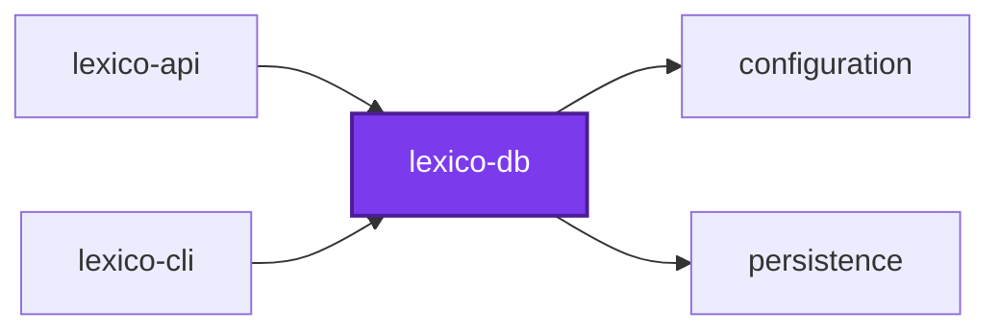
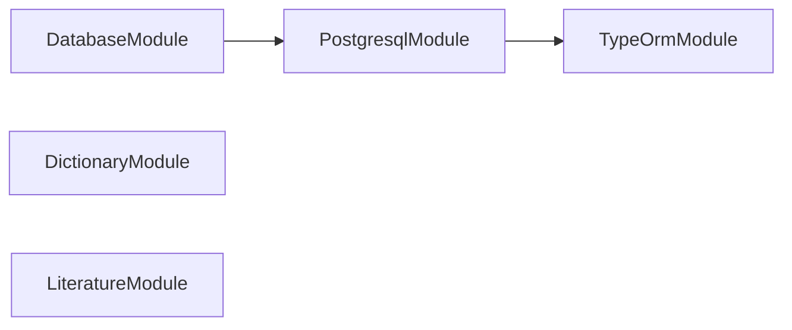

## 🕸️ Codependix

Dependency graphs exported by [codependix](https://github.com/Organizzolini/codebase/tree/main/projects/ic-suite/codependix/codependix-cli), regenerated by `nx run configuration:codependix:write`.

### Nx Neighborhood

<!-- codependix:start name="codependix-nx-projects" -->

<!-- codependix:end name="codependix-nx-projects" -->

### NestJS Module Graph

<!-- codependix:start name="codependix-nestjs-modules" -->

<!-- codependix:end name="codependix-nestjs-modules" -->

### File Imports

<!-- codependix:start name="codependix-file-imports" -->
```mermaid
graph LR
  file_callidescope_config_ts["callidescope.config.ts"]
  file_codependix_config_ts["codependix.config.ts"]
  file_codometer_config_ts["codometer.config.ts"]
  file_coinagerie_config_ts["coinagerie.config.ts"]
  file_eslint_config_ts["eslint.config.ts"]
  file_src_index_ts["src/index.ts"]
  file_src_modules_database_data_source_constants_ts["src/modules/database/data-source.constants.ts"]
  file_src_modules_database_data_source_constants_unit_test_ts["src/modules/database/data-source.constants.unit.test.ts"]
  file_src_modules_database_database_constants_ts["src/modules/database/database.constants.ts"]
  file_src_modules_database_database_entities_integration_test_ts["src/modules/database/database.entities.integration.test.ts"]
  file_src_modules_database_database_entities_unit_test_ts["src/modules/database/database.entities.unit.test.ts"]
  file_src_modules_database_database_module_integration_test_ts["src/modules/database/database.module.integration.test.ts"]
  file_src_modules_database_database_module_ts["src/modules/database/database.module.ts"]
  file_src_modules_database_database_service_ts["src/modules/database/database.service.ts"]
  file_src_modules_database_database_service_unit_test_ts["src/modules/database/database.service.unit.test.ts"]
  file_src_modules_database_database_types_ts["src/modules/database/database.types.ts"]
  file_src_modules_database_migrations_1791164926316_migration_ts["src/modules/database/migrations/1791164926316-migration.ts"]
  file_src_modules_database_migrations_1792000000000_migration_ts["src/modules/database/migrations/1792000000000-migration.ts"]
  file_src_modules_dictionary_dictionary_constants_ts["src/modules/dictionary/dictionary.constants.ts"]
  file_src_modules_dictionary_dictionary_module_ts["src/modules/dictionary/dictionary.module.ts"]
  file_src_modules_dictionary_dictionary_service_ts["src/modules/dictionary/dictionary.service.ts"]
  file_src_modules_dictionary_dictionary_service_unit_test_ts["src/modules/dictionary/dictionary.service.unit.test.ts"]
  file_src_modules_dictionary_dictionary_types_ts["src/modules/dictionary/dictionary.types.ts"]
  file_src_modules_dictionary_entities_form_adjectival_form_entity_ts["src/modules/dictionary/entities/form/adjectival-form.entity.ts"]
  file_src_modules_dictionary_entities_form_adverb_form_entity_ts["src/modules/dictionary/entities/form/adverb-form.entity.ts"]
  file_src_modules_dictionary_entities_form_finite_verb_form_entity_ts["src/modules/dictionary/entities/form/finite-verb-form.entity.ts"]
  file_src_modules_dictionary_entities_form_form_entity_ts["src/modules/dictionary/entities/form/form.entity.ts"]
  file_src_modules_dictionary_entities_form_gerund_form_entity_ts["src/modules/dictionary/entities/form/gerund-form.entity.ts"]
  file_src_modules_dictionary_entities_form_infinitive_form_entity_ts["src/modules/dictionary/entities/form/infinitive-form.entity.ts"]
  file_src_modules_dictionary_entities_form_nominal_form_entity_ts["src/modules/dictionary/entities/form/nominal-form.entity.ts"]
  file_src_modules_dictionary_entities_form_participle_form_entity_ts["src/modules/dictionary/entities/form/participle-form.entity.ts"]
  file_src_modules_dictionary_entities_form_supine_form_entity_ts["src/modules/dictionary/entities/form/supine-form.entity.ts"]
  file_src_modules_dictionary_entities_inflection_adjective_inflection_entity_ts["src/modules/dictionary/entities/inflection/adjective-inflection.entity.ts"]
  file_src_modules_dictionary_entities_inflection_adverb_inflection_entity_ts["src/modules/dictionary/entities/inflection/adverb-inflection.entity.ts"]
  file_src_modules_dictionary_entities_inflection_inflection_entity_ts["src/modules/dictionary/entities/inflection/inflection.entity.ts"]
  file_src_modules_dictionary_entities_inflection_noun_inflection_entity_ts["src/modules/dictionary/entities/inflection/noun-inflection.entity.ts"]
  file_src_modules_dictionary_entities_inflection_preposition_inflection_entity_ts["src/modules/dictionary/entities/inflection/preposition-inflection.entity.ts"]
  file_src_modules_dictionary_entities_inflection_uninflected_entity_ts["src/modules/dictionary/entities/inflection/uninflected.entity.ts"]
  file_src_modules_dictionary_entities_inflection_verb_inflection_entity_ts["src/modules/dictionary/entities/inflection/verb-inflection.entity.ts"]
  file_src_modules_dictionary_entities_lexeme_entity_ts["src/modules/dictionary/entities/lexeme.entity.ts"]
  file_src_modules_dictionary_entities_part_of_speech_entity_ts["src/modules/dictionary/entities/part-of-speech.entity.ts"]
  file_src_modules_dictionary_entities_principal_part_entity_ts["src/modules/dictionary/entities/principal-part.entity.ts"]
  file_src_modules_dictionary_entities_pronunciation_entity_ts["src/modules/dictionary/entities/pronunciation.entity.ts"]
  file_src_modules_dictionary_entities_translation_entity_ts["src/modules/dictionary/entities/translation.entity.ts"]
  file_src_modules_dictionary_entities_word_form_entity_ts["src/modules/dictionary/entities/word-form.entity.ts"]
  file_src_modules_dictionary_entities_word_lexeme_entity_ts["src/modules/dictionary/entities/word-lexeme.entity.ts"]
  file_src_modules_dictionary_entities_word_entity_ts["src/modules/dictionary/entities/word.entity.ts"]
  file_src_modules_literature_entities_author_entity_ts["src/modules/literature/entities/author.entity.ts"]
  file_src_modules_literature_entities_line_entity_ts["src/modules/literature/entities/line.entity.ts"]
  file_src_modules_literature_entities_text_entity_ts["src/modules/literature/entities/text.entity.ts"]
  file_src_modules_literature_entities_token_entity_ts["src/modules/literature/entities/token.entity.ts"]
  file_src_modules_literature_literature_constants_ts["src/modules/literature/literature.constants.ts"]
  file_src_modules_literature_literature_constants_unit_test_ts["src/modules/literature/literature.constants.unit.test.ts"]
  file_src_modules_literature_literature_module_ts["src/modules/literature/literature.module.ts"]
  file_src_modules_literature_literature_service_ts["src/modules/literature/literature.service.ts"]
  file_src_modules_literature_literature_service_unit_test_ts["src/modules/literature/literature.service.unit.test.ts"]
  file_src_modules_literature_literature_types_ts["src/modules/literature/literature.types.ts"]
  file_testing_entity_definition_assertions_ts["testing/entity-definition-assertions.ts"]
  file_testing_setup_ts["testing/setup.ts"]
  file_vitest_config_ts["vitest.config.ts"]
  file_src_modules_database_data_source_constants_ts --> file_src_modules_database_migrations_1791164926316_migration_ts
  file_src_modules_database_data_source_constants_ts --> file_src_modules_database_migrations_1792000000000_migration_ts
  file_src_modules_database_data_source_constants_ts --> file_src_modules_dictionary_entities_form_adjectival_form_entity_ts
  file_src_modules_database_data_source_constants_ts --> file_src_modules_dictionary_entities_form_adverb_form_entity_ts
  file_src_modules_database_data_source_constants_ts --> file_src_modules_dictionary_entities_form_finite_verb_form_entity_ts
  file_src_modules_database_data_source_constants_ts --> file_src_modules_dictionary_entities_form_form_entity_ts
  file_src_modules_database_data_source_constants_ts --> file_src_modules_dictionary_entities_form_gerund_form_entity_ts
  file_src_modules_database_data_source_constants_ts --> file_src_modules_dictionary_entities_form_infinitive_form_entity_ts
  file_src_modules_database_data_source_constants_ts --> file_src_modules_dictionary_entities_form_nominal_form_entity_ts
  file_src_modules_database_data_source_constants_ts --> file_src_modules_dictionary_entities_form_participle_form_entity_ts
  file_src_modules_database_data_source_constants_ts --> file_src_modules_dictionary_entities_form_supine_form_entity_ts
  file_src_modules_database_data_source_constants_ts --> file_src_modules_dictionary_entities_inflection_adjective_inflection_entity_ts
  file_src_modules_database_data_source_constants_ts --> file_src_modules_dictionary_entities_inflection_adverb_inflection_entity_ts
  file_src_modules_database_data_source_constants_ts --> file_src_modules_dictionary_entities_inflection_inflection_entity_ts
  file_src_modules_database_data_source_constants_ts --> file_src_modules_dictionary_entities_inflection_noun_inflection_entity_ts
  file_src_modules_database_data_source_constants_ts --> file_src_modules_dictionary_entities_inflection_preposition_inflection_entity_ts
  file_src_modules_database_data_source_constants_ts --> file_src_modules_dictionary_entities_inflection_uninflected_entity_ts
  file_src_modules_database_data_source_constants_ts --> file_src_modules_dictionary_entities_inflection_verb_inflection_entity_ts
  file_src_modules_database_data_source_constants_ts --> file_src_modules_dictionary_entities_lexeme_entity_ts
  file_src_modules_database_data_source_constants_ts --> file_src_modules_dictionary_entities_principal_part_entity_ts
  file_src_modules_database_data_source_constants_ts --> file_src_modules_dictionary_entities_pronunciation_entity_ts
  file_src_modules_database_data_source_constants_ts --> file_src_modules_dictionary_entities_translation_entity_ts
  file_src_modules_database_data_source_constants_ts --> file_src_modules_dictionary_entities_word_form_entity_ts
  file_src_modules_database_data_source_constants_ts --> file_src_modules_dictionary_entities_word_lexeme_entity_ts
  file_src_modules_database_data_source_constants_ts --> file_src_modules_dictionary_entities_word_entity_ts
  file_src_modules_database_data_source_constants_ts --> file_src_modules_literature_entities_author_entity_ts
  file_src_modules_database_data_source_constants_ts --> file_src_modules_literature_entities_line_entity_ts
  file_src_modules_database_data_source_constants_ts --> file_src_modules_literature_entities_text_entity_ts
  file_src_modules_database_data_source_constants_ts --> file_src_modules_literature_entities_token_entity_ts
  file_src_modules_database_data_source_constants_unit_test_ts --> file_src_modules_database_data_source_constants_ts
  file_src_modules_database_database_entities_integration_test_ts --> file_src_modules_database_data_source_constants_ts
  file_src_modules_database_database_entities_integration_test_ts --> file_src_modules_literature_entities_author_entity_ts
  file_src_modules_database_database_entities_integration_test_ts --> file_src_modules_literature_entities_line_entity_ts
  file_src_modules_database_database_entities_integration_test_ts --> file_src_modules_literature_entities_text_entity_ts
  file_src_modules_database_database_entities_integration_test_ts --> file_src_modules_literature_entities_token_entity_ts
  file_src_modules_database_database_entities_unit_test_ts --> file_src_modules_database_data_source_constants_ts
  file_src_modules_database_database_entities_unit_test_ts --> file_src_modules_database_database_constants_ts
  file_src_modules_database_database_entities_unit_test_ts --> file_src_modules_dictionary_entities_part_of_speech_entity_ts
  file_src_modules_database_database_entities_unit_test_ts --> file_src_modules_dictionary_entities_pronunciation_entity_ts
  file_src_modules_database_database_entities_unit_test_ts --> file_testing_entity_definition_assertions_ts
  file_src_modules_database_database_module_ts --> file_src_modules_database_data_source_constants_ts
  file_src_modules_database_database_module_ts --> file_src_modules_database_database_service_ts
  file_src_modules_database_database_service_unit_test_ts --> file_src_modules_database_database_service_ts
  file_src_modules_database_database_types_ts --> file_src_modules_database_database_constants_ts
  file_src_modules_dictionary_dictionary_module_ts --> file_src_modules_dictionary_dictionary_service_ts
  file_src_modules_dictionary_dictionary_service_unit_test_ts --> file_src_modules_dictionary_dictionary_service_ts
  file_src_modules_dictionary_entities_form_adjectival_form_entity_ts --> file_src_modules_database_database_constants_ts
  file_src_modules_dictionary_entities_form_adjectival_form_entity_ts --> file_src_modules_database_database_types_ts
  file_src_modules_dictionary_entities_form_adjectival_form_entity_ts --> file_src_modules_dictionary_entities_form_form_entity_ts
  file_src_modules_dictionary_entities_form_adverb_form_entity_ts --> file_src_modules_database_database_constants_ts
  file_src_modules_dictionary_entities_form_adverb_form_entity_ts --> file_src_modules_database_database_types_ts
  file_src_modules_dictionary_entities_form_adverb_form_entity_ts --> file_src_modules_dictionary_entities_form_form_entity_ts
  file_src_modules_dictionary_entities_form_finite_verb_form_entity_ts --> file_src_modules_database_database_constants_ts
  file_src_modules_dictionary_entities_form_finite_verb_form_entity_ts --> file_src_modules_database_database_types_ts
  file_src_modules_dictionary_entities_form_finite_verb_form_entity_ts --> file_src_modules_dictionary_entities_form_form_entity_ts
  file_src_modules_dictionary_entities_form_form_entity_ts --> file_src_modules_dictionary_entities_lexeme_entity_ts
  file_src_modules_dictionary_entities_form_form_entity_ts --> file_src_modules_dictionary_entities_word_form_entity_ts
  file_src_modules_dictionary_entities_form_gerund_form_entity_ts --> file_src_modules_database_database_constants_ts
  file_src_modules_dictionary_entities_form_gerund_form_entity_ts --> file_src_modules_database_database_types_ts
  file_src_modules_dictionary_entities_form_gerund_form_entity_ts --> file_src_modules_dictionary_entities_form_form_entity_ts
  file_src_modules_dictionary_entities_form_infinitive_form_entity_ts --> file_src_modules_database_database_constants_ts
  file_src_modules_dictionary_entities_form_infinitive_form_entity_ts --> file_src_modules_database_database_types_ts
  file_src_modules_dictionary_entities_form_infinitive_form_entity_ts --> file_src_modules_dictionary_entities_form_form_entity_ts
  file_src_modules_dictionary_entities_form_nominal_form_entity_ts --> file_src_modules_database_database_constants_ts
  file_src_modules_dictionary_entities_form_nominal_form_entity_ts --> file_src_modules_database_database_types_ts
  file_src_modules_dictionary_entities_form_nominal_form_entity_ts --> file_src_modules_dictionary_entities_form_form_entity_ts
  file_src_modules_dictionary_entities_form_participle_form_entity_ts --> file_src_modules_database_database_constants_ts
  file_src_modules_dictionary_entities_form_participle_form_entity_ts --> file_src_modules_database_database_types_ts
  file_src_modules_dictionary_entities_form_participle_form_entity_ts --> file_src_modules_dictionary_entities_form_form_entity_ts
  file_src_modules_dictionary_entities_form_supine_form_entity_ts --> file_src_modules_database_database_constants_ts
  file_src_modules_dictionary_entities_form_supine_form_entity_ts --> file_src_modules_database_database_types_ts
  file_src_modules_dictionary_entities_form_supine_form_entity_ts --> file_src_modules_dictionary_entities_form_form_entity_ts
  file_src_modules_dictionary_entities_inflection_adjective_inflection_entity_ts --> file_src_modules_database_database_constants_ts
  file_src_modules_dictionary_entities_inflection_adjective_inflection_entity_ts --> file_src_modules_database_database_types_ts
  file_src_modules_dictionary_entities_inflection_adjective_inflection_entity_ts --> file_src_modules_dictionary_entities_inflection_inflection_entity_ts
  file_src_modules_dictionary_entities_inflection_adverb_inflection_entity_ts --> file_src_modules_database_database_constants_ts
  file_src_modules_dictionary_entities_inflection_adverb_inflection_entity_ts --> file_src_modules_database_database_types_ts
  file_src_modules_dictionary_entities_inflection_adverb_inflection_entity_ts --> file_src_modules_dictionary_entities_inflection_inflection_entity_ts
  file_src_modules_dictionary_entities_inflection_inflection_entity_ts --> file_src_modules_dictionary_entities_lexeme_entity_ts
  file_src_modules_dictionary_entities_inflection_noun_inflection_entity_ts --> file_src_modules_database_database_constants_ts
  file_src_modules_dictionary_entities_inflection_noun_inflection_entity_ts --> file_src_modules_database_database_types_ts
  file_src_modules_dictionary_entities_inflection_noun_inflection_entity_ts --> file_src_modules_dictionary_entities_inflection_inflection_entity_ts
  file_src_modules_dictionary_entities_inflection_preposition_inflection_entity_ts --> file_src_modules_database_database_constants_ts
  file_src_modules_dictionary_entities_inflection_preposition_inflection_entity_ts --> file_src_modules_database_database_types_ts
  file_src_modules_dictionary_entities_inflection_preposition_inflection_entity_ts --> file_src_modules_dictionary_entities_inflection_inflection_entity_ts
  file_src_modules_dictionary_entities_inflection_uninflected_entity_ts --> file_src_modules_dictionary_entities_inflection_inflection_entity_ts
  file_src_modules_dictionary_entities_inflection_verb_inflection_entity_ts --> file_src_modules_database_database_constants_ts
  file_src_modules_dictionary_entities_inflection_verb_inflection_entity_ts --> file_src_modules_database_database_types_ts
  file_src_modules_dictionary_entities_inflection_verb_inflection_entity_ts --> file_src_modules_dictionary_entities_inflection_inflection_entity_ts
  file_src_modules_dictionary_entities_lexeme_entity_ts --> file_src_modules_dictionary_entities_form_form_entity_ts
  file_src_modules_dictionary_entities_lexeme_entity_ts --> file_src_modules_dictionary_entities_inflection_inflection_entity_ts
  file_src_modules_dictionary_entities_lexeme_entity_ts --> file_src_modules_dictionary_entities_part_of_speech_entity_ts
  file_src_modules_dictionary_entities_lexeme_entity_ts --> file_src_modules_dictionary_entities_principal_part_entity_ts
  file_src_modules_dictionary_entities_lexeme_entity_ts --> file_src_modules_dictionary_entities_pronunciation_entity_ts
  file_src_modules_dictionary_entities_lexeme_entity_ts --> file_src_modules_dictionary_entities_translation_entity_ts
  file_src_modules_dictionary_entities_lexeme_entity_ts --> file_src_modules_dictionary_entities_word_lexeme_entity_ts
  file_src_modules_dictionary_entities_principal_part_entity_ts --> file_src_modules_dictionary_entities_lexeme_entity_ts
  file_src_modules_dictionary_entities_pronunciation_entity_ts --> file_src_modules_dictionary_entities_lexeme_entity_ts
  file_src_modules_dictionary_entities_translation_entity_ts --> file_src_modules_dictionary_entities_lexeme_entity_ts
  file_src_modules_dictionary_entities_word_form_entity_ts --> file_src_modules_dictionary_entities_form_form_entity_ts
  file_src_modules_dictionary_entities_word_form_entity_ts --> file_src_modules_dictionary_entities_word_entity_ts
  file_src_modules_dictionary_entities_word_lexeme_entity_ts --> file_src_modules_dictionary_entities_lexeme_entity_ts
  file_src_modules_dictionary_entities_word_lexeme_entity_ts --> file_src_modules_dictionary_entities_word_entity_ts
  file_src_modules_dictionary_entities_word_entity_ts --> file_src_modules_dictionary_entities_word_form_entity_ts
  file_src_modules_dictionary_entities_word_entity_ts --> file_src_modules_dictionary_entities_word_lexeme_entity_ts
  file_src_modules_literature_entities_author_entity_ts --> file_src_modules_literature_entities_text_entity_ts
  file_src_modules_literature_entities_line_entity_ts --> file_src_modules_literature_entities_author_entity_ts
  file_src_modules_literature_entities_line_entity_ts --> file_src_modules_literature_entities_text_entity_ts
  file_src_modules_literature_entities_line_entity_ts --> file_src_modules_literature_entities_token_entity_ts
  file_src_modules_literature_entities_line_entity_ts --> file_src_modules_literature_literature_constants_ts
  file_src_modules_literature_entities_text_entity_ts --> file_src_modules_literature_entities_author_entity_ts
  file_src_modules_literature_entities_text_entity_ts --> file_src_modules_literature_entities_line_entity_ts
  file_src_modules_literature_entities_token_entity_ts --> file_src_modules_dictionary_entities_word_entity_ts
  file_src_modules_literature_entities_token_entity_ts --> file_src_modules_literature_entities_author_entity_ts
  file_src_modules_literature_entities_token_entity_ts --> file_src_modules_literature_entities_line_entity_ts
  file_src_modules_literature_entities_token_entity_ts --> file_src_modules_literature_entities_text_entity_ts
  file_src_modules_literature_entities_token_entity_ts --> file_src_modules_literature_literature_constants_ts
  file_src_modules_literature_literature_constants_unit_test_ts --> file_src_modules_literature_literature_constants_ts
  file_src_modules_literature_literature_module_ts --> file_src_modules_literature_literature_service_ts
  file_src_modules_literature_literature_service_unit_test_ts --> file_src_modules_literature_literature_service_ts
```
<!-- codependix:end name="codependix-file-imports" -->
