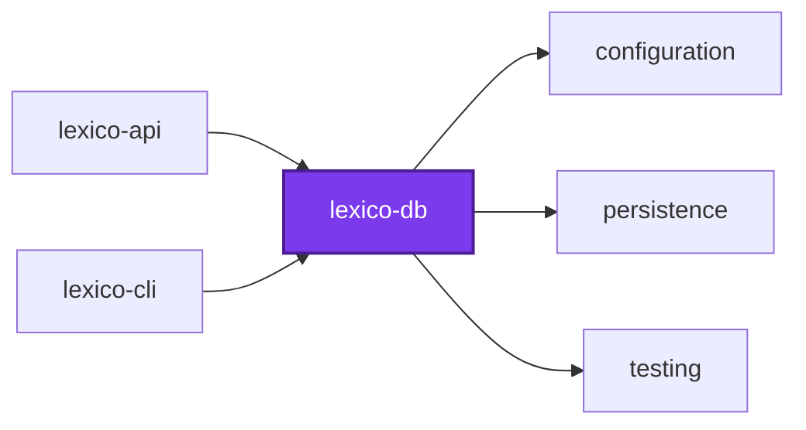
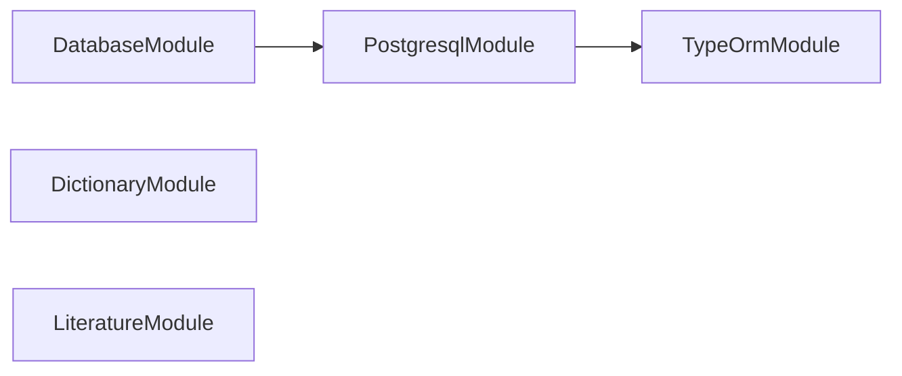

## 🕸️ Codependix

Dependency graphs exported by [codependix](https://github.com/Organizzolini/codebase/tree/main/projects/ic-suite/codependix/codependix-cli), regenerated by `nx run configuration:codependix:write`.

### Nx Neighborhood

<!-- codependix:start name="codependix-nx-projects" -->

<!-- codependix:end name="codependix-nx-projects" -->

### NestJS Module Graph

<!-- codependix:start name="codependix-nestjs-modules" -->

<!-- codependix:end name="codependix-nestjs-modules" -->

### File Imports

<!-- codependix:start name="codependix-file-imports" -->
```mermaid
graph LR
  file_configuration_callidescope_config_ts["configuration/callidescope.config.ts"]
  file_configuration_codependix_config_ts["configuration/codependix.config.ts"]
  file_configuration_codometer_config_ts["configuration/codometer.config.ts"]
  file_configuration_coinagerie_config_ts["configuration/coinagerie.config.ts"]
  file_configuration_eslint_config_ts["configuration/eslint.config.ts"]
  file_configuration_vitest_config_ts["configuration/vitest.config.ts"]
  file_migrations_1791164926316_migration_ts["migrations/1791164926316-migration.ts"]
  file_migrations_1792000000000_migration_ts["migrations/1792000000000-migration.ts"]
  file_src_index_ts["src/index.ts"]
  file_src_modules_database_data_source_constants_ts["src/modules/database/data-source.constants.ts"]
  file_src_modules_database_data_source_constants_unit_test_ts["src/modules/database/data-source.constants.unit.test.ts"]
  file_src_modules_database_database_constants_ts["src/modules/database/database.constants.ts"]
  file_src_modules_database_database_entities_integration_test_ts["src/modules/database/database.entities.integration.test.ts"]
  file_src_modules_database_database_entities_unit_test_ts["src/modules/database/database.entities.unit.test.ts"]
  file_src_modules_database_database_module_integration_test_ts["src/modules/database/database.module.integration.test.ts"]
  file_src_modules_database_database_module_ts["src/modules/database/database.module.ts"]
  file_src_modules_database_database_service_ts["src/modules/database/database.service.ts"]
  file_src_modules_database_database_service_unit_test_ts["src/modules/database/database.service.unit.test.ts"]
  file_src_modules_database_database_types_ts["src/modules/database/database.types.ts"]
  file_src_modules_dictionary_dictionary_constants_ts["src/modules/dictionary/dictionary.constants.ts"]
  file_src_modules_dictionary_dictionary_module_ts["src/modules/dictionary/dictionary.module.ts"]
  file_src_modules_dictionary_dictionary_service_ts["src/modules/dictionary/dictionary.service.ts"]
  file_src_modules_dictionary_dictionary_service_unit_test_ts["src/modules/dictionary/dictionary.service.unit.test.ts"]
  file_src_modules_dictionary_dictionary_types_ts["src/modules/dictionary/dictionary.types.ts"]
  file_src_modules_dictionary_modules_forms_adjectival_form_entity_ts["src/modules/dictionary/modules/forms/adjectival-form.entity.ts"]
  file_src_modules_dictionary_modules_forms_adverb_form_entity_ts["src/modules/dictionary/modules/forms/adverb-form.entity.ts"]
  file_src_modules_dictionary_modules_forms_finite_verb_form_entity_ts["src/modules/dictionary/modules/forms/finite-verb-form.entity.ts"]
  file_src_modules_dictionary_modules_forms_form_entity_ts["src/modules/dictionary/modules/forms/form.entity.ts"]
  file_src_modules_dictionary_modules_forms_gerund_form_entity_ts["src/modules/dictionary/modules/forms/gerund-form.entity.ts"]
  file_src_modules_dictionary_modules_forms_infinitive_form_entity_ts["src/modules/dictionary/modules/forms/infinitive-form.entity.ts"]
  file_src_modules_dictionary_modules_forms_nominal_form_entity_ts["src/modules/dictionary/modules/forms/nominal-form.entity.ts"]
  file_src_modules_dictionary_modules_forms_participle_form_entity_ts["src/modules/dictionary/modules/forms/participle-form.entity.ts"]
  file_src_modules_dictionary_modules_forms_supine_form_entity_ts["src/modules/dictionary/modules/forms/supine-form.entity.ts"]
  file_src_modules_dictionary_modules_inflections_adjective_inflection_entity_ts["src/modules/dictionary/modules/inflections/adjective-inflection.entity.ts"]
  file_src_modules_dictionary_modules_inflections_adverb_inflection_entity_ts["src/modules/dictionary/modules/inflections/adverb-inflection.entity.ts"]
  file_src_modules_dictionary_modules_inflections_inflection_entity_ts["src/modules/dictionary/modules/inflections/inflection.entity.ts"]
  file_src_modules_dictionary_modules_inflections_noun_inflection_entity_ts["src/modules/dictionary/modules/inflections/noun-inflection.entity.ts"]
  file_src_modules_dictionary_modules_inflections_preposition_inflection_entity_ts["src/modules/dictionary/modules/inflections/preposition-inflection.entity.ts"]
  file_src_modules_dictionary_modules_inflections_uninflected_entity_ts["src/modules/dictionary/modules/inflections/uninflected.entity.ts"]
  file_src_modules_dictionary_modules_inflections_verb_inflection_entity_ts["src/modules/dictionary/modules/inflections/verb-inflection.entity.ts"]
  file_src_modules_dictionary_modules_lexemes_lexeme_entity_ts["src/modules/dictionary/modules/lexemes/lexeme.entity.ts"]
  file_src_modules_dictionary_modules_lexemes_part_of_speech_entity_ts["src/modules/dictionary/modules/lexemes/part-of-speech.entity.ts"]
  file_src_modules_dictionary_modules_lexemes_principal_part_entity_ts["src/modules/dictionary/modules/lexemes/principal-part.entity.ts"]
  file_src_modules_dictionary_modules_lexemes_pronunciation_entity_ts["src/modules/dictionary/modules/lexemes/pronunciation.entity.ts"]
  file_src_modules_dictionary_modules_lexemes_translation_entity_ts["src/modules/dictionary/modules/lexemes/translation.entity.ts"]
  file_src_modules_dictionary_modules_words_word_form_entity_ts["src/modules/dictionary/modules/words/word-form.entity.ts"]
  file_src_modules_dictionary_modules_words_word_lexeme_entity_ts["src/modules/dictionary/modules/words/word-lexeme.entity.ts"]
  file_src_modules_dictionary_modules_words_word_entity_ts["src/modules/dictionary/modules/words/word.entity.ts"]
  file_src_modules_literature_author_entity_ts["src/modules/literature/author.entity.ts"]
  file_src_modules_literature_line_entity_ts["src/modules/literature/line.entity.ts"]
  file_src_modules_literature_literature_constants_ts["src/modules/literature/literature.constants.ts"]
  file_src_modules_literature_literature_constants_unit_test_ts["src/modules/literature/literature.constants.unit.test.ts"]
  file_src_modules_literature_literature_module_ts["src/modules/literature/literature.module.ts"]
  file_src_modules_literature_literature_service_ts["src/modules/literature/literature.service.ts"]
  file_src_modules_literature_literature_service_unit_test_ts["src/modules/literature/literature.service.unit.test.ts"]
  file_src_modules_literature_literature_types_ts["src/modules/literature/literature.types.ts"]
  file_src_modules_literature_text_entity_ts["src/modules/literature/text.entity.ts"]
  file_src_modules_literature_token_entity_ts["src/modules/literature/token.entity.ts"]
  file_testing_entity_definition_assertions_ts["testing/entity-definition-assertions.ts"]
  file_src_modules_database_data_source_constants_ts --> file_migrations_1791164926316_migration_ts
  file_src_modules_database_data_source_constants_ts --> file_migrations_1792000000000_migration_ts
  file_src_modules_database_data_source_constants_ts --> file_src_modules_dictionary_modules_forms_adjectival_form_entity_ts
  file_src_modules_database_data_source_constants_ts --> file_src_modules_dictionary_modules_forms_adverb_form_entity_ts
  file_src_modules_database_data_source_constants_ts --> file_src_modules_dictionary_modules_forms_finite_verb_form_entity_ts
  file_src_modules_database_data_source_constants_ts --> file_src_modules_dictionary_modules_forms_form_entity_ts
  file_src_modules_database_data_source_constants_ts --> file_src_modules_dictionary_modules_forms_gerund_form_entity_ts
  file_src_modules_database_data_source_constants_ts --> file_src_modules_dictionary_modules_forms_infinitive_form_entity_ts
  file_src_modules_database_data_source_constants_ts --> file_src_modules_dictionary_modules_forms_nominal_form_entity_ts
  file_src_modules_database_data_source_constants_ts --> file_src_modules_dictionary_modules_forms_participle_form_entity_ts
  file_src_modules_database_data_source_constants_ts --> file_src_modules_dictionary_modules_forms_supine_form_entity_ts
  file_src_modules_database_data_source_constants_ts --> file_src_modules_dictionary_modules_inflections_adjective_inflection_entity_ts
  file_src_modules_database_data_source_constants_ts --> file_src_modules_dictionary_modules_inflections_adverb_inflection_entity_ts
  file_src_modules_database_data_source_constants_ts --> file_src_modules_dictionary_modules_inflections_inflection_entity_ts
  file_src_modules_database_data_source_constants_ts --> file_src_modules_dictionary_modules_inflections_noun_inflection_entity_ts
  file_src_modules_database_data_source_constants_ts --> file_src_modules_dictionary_modules_inflections_preposition_inflection_entity_ts
  file_src_modules_database_data_source_constants_ts --> file_src_modules_dictionary_modules_inflections_uninflected_entity_ts
  file_src_modules_database_data_source_constants_ts --> file_src_modules_dictionary_modules_inflections_verb_inflection_entity_ts
  file_src_modules_database_data_source_constants_ts --> file_src_modules_dictionary_modules_lexemes_lexeme_entity_ts
  file_src_modules_database_data_source_constants_ts --> file_src_modules_dictionary_modules_lexemes_principal_part_entity_ts
  file_src_modules_database_data_source_constants_ts --> file_src_modules_dictionary_modules_lexemes_pronunciation_entity_ts
  file_src_modules_database_data_source_constants_ts --> file_src_modules_dictionary_modules_lexemes_translation_entity_ts
  file_src_modules_database_data_source_constants_ts --> file_src_modules_dictionary_modules_words_word_form_entity_ts
  file_src_modules_database_data_source_constants_ts --> file_src_modules_dictionary_modules_words_word_lexeme_entity_ts
  file_src_modules_database_data_source_constants_ts --> file_src_modules_dictionary_modules_words_word_entity_ts
  file_src_modules_database_data_source_constants_ts --> file_src_modules_literature_author_entity_ts
  file_src_modules_database_data_source_constants_ts --> file_src_modules_literature_line_entity_ts
  file_src_modules_database_data_source_constants_ts --> file_src_modules_literature_text_entity_ts
  file_src_modules_database_data_source_constants_ts --> file_src_modules_literature_token_entity_ts
  file_src_modules_database_data_source_constants_unit_test_ts --> file_src_modules_database_data_source_constants_ts
  file_src_modules_database_database_entities_integration_test_ts --> file_src_modules_database_data_source_constants_ts
  file_src_modules_database_database_entities_integration_test_ts --> file_src_modules_literature_author_entity_ts
  file_src_modules_database_database_entities_integration_test_ts --> file_src_modules_literature_line_entity_ts
  file_src_modules_database_database_entities_integration_test_ts --> file_src_modules_literature_text_entity_ts
  file_src_modules_database_database_entities_integration_test_ts --> file_src_modules_literature_token_entity_ts
  file_src_modules_database_database_entities_unit_test_ts --> file_src_modules_database_data_source_constants_ts
  file_src_modules_database_database_entities_unit_test_ts --> file_src_modules_database_database_constants_ts
  file_src_modules_database_database_entities_unit_test_ts --> file_src_modules_dictionary_modules_lexemes_part_of_speech_entity_ts
  file_src_modules_database_database_entities_unit_test_ts --> file_src_modules_dictionary_modules_lexemes_pronunciation_entity_ts
  file_src_modules_database_database_entities_unit_test_ts --> file_testing_entity_definition_assertions_ts
  file_src_modules_database_database_module_ts --> file_src_modules_database_data_source_constants_ts
  file_src_modules_database_database_module_ts --> file_src_modules_database_database_service_ts
  file_src_modules_database_database_service_unit_test_ts --> file_src_modules_database_database_service_ts
  file_src_modules_database_database_types_ts --> file_src_modules_database_database_constants_ts
  file_src_modules_dictionary_dictionary_module_ts --> file_src_modules_dictionary_dictionary_service_ts
  file_src_modules_dictionary_dictionary_service_unit_test_ts --> file_src_modules_dictionary_dictionary_service_ts
  file_src_modules_dictionary_modules_forms_adjectival_form_entity_ts --> file_src_modules_database_database_constants_ts
  file_src_modules_dictionary_modules_forms_adjectival_form_entity_ts --> file_src_modules_database_database_types_ts
  file_src_modules_dictionary_modules_forms_adjectival_form_entity_ts --> file_src_modules_dictionary_modules_forms_form_entity_ts
  file_src_modules_dictionary_modules_forms_adverb_form_entity_ts --> file_src_modules_database_database_constants_ts
  file_src_modules_dictionary_modules_forms_adverb_form_entity_ts --> file_src_modules_database_database_types_ts
  file_src_modules_dictionary_modules_forms_adverb_form_entity_ts --> file_src_modules_dictionary_modules_forms_form_entity_ts
  file_src_modules_dictionary_modules_forms_finite_verb_form_entity_ts --> file_src_modules_database_database_constants_ts
  file_src_modules_dictionary_modules_forms_finite_verb_form_entity_ts --> file_src_modules_database_database_types_ts
  file_src_modules_dictionary_modules_forms_finite_verb_form_entity_ts --> file_src_modules_dictionary_modules_forms_form_entity_ts
  file_src_modules_dictionary_modules_forms_form_entity_ts --> file_src_modules_dictionary_modules_lexemes_lexeme_entity_ts
  file_src_modules_dictionary_modules_forms_form_entity_ts --> file_src_modules_dictionary_modules_words_word_form_entity_ts
  file_src_modules_dictionary_modules_forms_gerund_form_entity_ts --> file_src_modules_database_database_constants_ts
  file_src_modules_dictionary_modules_forms_gerund_form_entity_ts --> file_src_modules_database_database_types_ts
  file_src_modules_dictionary_modules_forms_gerund_form_entity_ts --> file_src_modules_dictionary_modules_forms_form_entity_ts
  file_src_modules_dictionary_modules_forms_infinitive_form_entity_ts --> file_src_modules_database_database_constants_ts
  file_src_modules_dictionary_modules_forms_infinitive_form_entity_ts --> file_src_modules_database_database_types_ts
  file_src_modules_dictionary_modules_forms_infinitive_form_entity_ts --> file_src_modules_dictionary_modules_forms_form_entity_ts
  file_src_modules_dictionary_modules_forms_nominal_form_entity_ts --> file_src_modules_database_database_constants_ts
  file_src_modules_dictionary_modules_forms_nominal_form_entity_ts --> file_src_modules_database_database_types_ts
  file_src_modules_dictionary_modules_forms_nominal_form_entity_ts --> file_src_modules_dictionary_modules_forms_form_entity_ts
  file_src_modules_dictionary_modules_forms_participle_form_entity_ts --> file_src_modules_database_database_constants_ts
  file_src_modules_dictionary_modules_forms_participle_form_entity_ts --> file_src_modules_database_database_types_ts
  file_src_modules_dictionary_modules_forms_participle_form_entity_ts --> file_src_modules_dictionary_modules_forms_form_entity_ts
  file_src_modules_dictionary_modules_forms_supine_form_entity_ts --> file_src_modules_database_database_constants_ts
  file_src_modules_dictionary_modules_forms_supine_form_entity_ts --> file_src_modules_database_database_types_ts
  file_src_modules_dictionary_modules_forms_supine_form_entity_ts --> file_src_modules_dictionary_modules_forms_form_entity_ts
  file_src_modules_dictionary_modules_inflections_adjective_inflection_entity_ts --> file_src_modules_database_database_constants_ts
  file_src_modules_dictionary_modules_inflections_adjective_inflection_entity_ts --> file_src_modules_database_database_types_ts
  file_src_modules_dictionary_modules_inflections_adjective_inflection_entity_ts --> file_src_modules_dictionary_modules_inflections_inflection_entity_ts
  file_src_modules_dictionary_modules_inflections_adverb_inflection_entity_ts --> file_src_modules_database_database_constants_ts
  file_src_modules_dictionary_modules_inflections_adverb_inflection_entity_ts --> file_src_modules_database_database_types_ts
  file_src_modules_dictionary_modules_inflections_adverb_inflection_entity_ts --> file_src_modules_dictionary_modules_inflections_inflection_entity_ts
  file_src_modules_dictionary_modules_inflections_inflection_entity_ts --> file_src_modules_dictionary_modules_lexemes_lexeme_entity_ts
  file_src_modules_dictionary_modules_inflections_noun_inflection_entity_ts --> file_src_modules_database_database_constants_ts
  file_src_modules_dictionary_modules_inflections_noun_inflection_entity_ts --> file_src_modules_database_database_types_ts
  file_src_modules_dictionary_modules_inflections_noun_inflection_entity_ts --> file_src_modules_dictionary_modules_inflections_inflection_entity_ts
  file_src_modules_dictionary_modules_inflections_preposition_inflection_entity_ts --> file_src_modules_database_database_constants_ts
  file_src_modules_dictionary_modules_inflections_preposition_inflection_entity_ts --> file_src_modules_database_database_types_ts
  file_src_modules_dictionary_modules_inflections_preposition_inflection_entity_ts --> file_src_modules_dictionary_modules_inflections_inflection_entity_ts
  file_src_modules_dictionary_modules_inflections_uninflected_entity_ts --> file_src_modules_dictionary_modules_inflections_inflection_entity_ts
  file_src_modules_dictionary_modules_inflections_verb_inflection_entity_ts --> file_src_modules_database_database_constants_ts
  file_src_modules_dictionary_modules_inflections_verb_inflection_entity_ts --> file_src_modules_database_database_types_ts
  file_src_modules_dictionary_modules_inflections_verb_inflection_entity_ts --> file_src_modules_dictionary_modules_inflections_inflection_entity_ts
  file_src_modules_dictionary_modules_lexemes_lexeme_entity_ts --> file_src_modules_dictionary_modules_forms_form_entity_ts
  file_src_modules_dictionary_modules_lexemes_lexeme_entity_ts --> file_src_modules_dictionary_modules_inflections_inflection_entity_ts
  file_src_modules_dictionary_modules_lexemes_lexeme_entity_ts --> file_src_modules_dictionary_modules_lexemes_part_of_speech_entity_ts
  file_src_modules_dictionary_modules_lexemes_lexeme_entity_ts --> file_src_modules_dictionary_modules_lexemes_principal_part_entity_ts
  file_src_modules_dictionary_modules_lexemes_lexeme_entity_ts --> file_src_modules_dictionary_modules_lexemes_pronunciation_entity_ts
  file_src_modules_dictionary_modules_lexemes_lexeme_entity_ts --> file_src_modules_dictionary_modules_lexemes_translation_entity_ts
  file_src_modules_dictionary_modules_lexemes_lexeme_entity_ts --> file_src_modules_dictionary_modules_words_word_lexeme_entity_ts
  file_src_modules_dictionary_modules_lexemes_principal_part_entity_ts --> file_src_modules_dictionary_modules_lexemes_lexeme_entity_ts
  file_src_modules_dictionary_modules_lexemes_pronunciation_entity_ts --> file_src_modules_dictionary_modules_lexemes_lexeme_entity_ts
  file_src_modules_dictionary_modules_lexemes_translation_entity_ts --> file_src_modules_dictionary_modules_lexemes_lexeme_entity_ts
  file_src_modules_dictionary_modules_words_word_form_entity_ts --> file_src_modules_dictionary_modules_forms_form_entity_ts
  file_src_modules_dictionary_modules_words_word_form_entity_ts --> file_src_modules_dictionary_modules_words_word_entity_ts
  file_src_modules_dictionary_modules_words_word_lexeme_entity_ts --> file_src_modules_dictionary_modules_lexemes_lexeme_entity_ts
  file_src_modules_dictionary_modules_words_word_lexeme_entity_ts --> file_src_modules_dictionary_modules_words_word_entity_ts
  file_src_modules_dictionary_modules_words_word_entity_ts --> file_src_modules_dictionary_modules_words_word_form_entity_ts
  file_src_modules_dictionary_modules_words_word_entity_ts --> file_src_modules_dictionary_modules_words_word_lexeme_entity_ts
  file_src_modules_literature_author_entity_ts --> file_src_modules_literature_text_entity_ts
  file_src_modules_literature_line_entity_ts --> file_src_modules_literature_author_entity_ts
  file_src_modules_literature_line_entity_ts --> file_src_modules_literature_literature_constants_ts
  file_src_modules_literature_line_entity_ts --> file_src_modules_literature_text_entity_ts
  file_src_modules_literature_line_entity_ts --> file_src_modules_literature_token_entity_ts
  file_src_modules_literature_literature_constants_unit_test_ts --> file_src_modules_literature_literature_constants_ts
  file_src_modules_literature_literature_module_ts --> file_src_modules_literature_literature_service_ts
  file_src_modules_literature_literature_service_unit_test_ts --> file_src_modules_literature_literature_service_ts
  file_src_modules_literature_text_entity_ts --> file_src_modules_literature_author_entity_ts
  file_src_modules_literature_text_entity_ts --> file_src_modules_literature_line_entity_ts
  file_src_modules_literature_token_entity_ts --> file_src_modules_dictionary_modules_words_word_entity_ts
  file_src_modules_literature_token_entity_ts --> file_src_modules_literature_author_entity_ts
  file_src_modules_literature_token_entity_ts --> file_src_modules_literature_line_entity_ts
  file_src_modules_literature_token_entity_ts --> file_src_modules_literature_literature_constants_ts
  file_src_modules_literature_token_entity_ts --> file_src_modules_literature_text_entity_ts
```
<!-- codependix:end name="codependix-file-imports" -->
