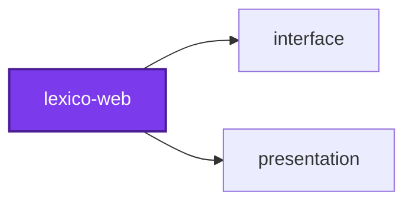

# 🐺 Lexico

**A Latin–English dictionary, rebuilt.**

> ⚠️ **Work in progress.** The old application is being replaced one page at
> a time. Search is the first page rebuilt: it answers from the
> [lexico-api](../lexico-api/README.md) GraphQL endpoint. Bookmarks, literature,
> grammar, and accounts are gone until their replacements land.

Lexico is a server-side rendered web application built with TanStack Start and
React 19. It is the front end of a small suite: the dictionary's shape lives in
[lexico-entities](../lexico-entities/README.md), the data that
fills it is gathered by
[lexico-cli](../lexico-cli/README.md), and the interface is built
from [presentation](../../common/presentation/README.md).

## Projects

| Project | Role |
| ------- | ---- |
| 🐺 [lexico-web](README.md) | The SSR web application — routes, server functions, pages |
| 🎨 [presentation](../../common/presentation/README.md) | Shared React component library on shadcn/ui and Base UI primitives |
| 📖 [lexico-entities](../lexico-entities/README.md) | TypeORM entities and migrations for the dictionary and literature schema |
| 🚰 [lexico-cli](../lexico-cli/README.md) | CLI that scrapes and loads dictionary, literature, and etymology sources |

## Quick Start

```bash
pnpm install
nx run lexico-web:start     # http://localhost:7797
```

| Target | Does |
| ------ | ---- |
| `start` | Vite dev server with hot reload, once the API is ready |
| `stop` | Free port 7797; `nx stop lexico-api` stops this and then the API |
| `build` | Production SSR bundle |
| `codegen` | Generate typed GraphQL operations, Zod schemas, and MSW handlers |
| `codegen-watch` | Regenerate GraphQL artifacts as operations or schema change |
| `preview` | Build, then serve the production build locally |
| `codometer` | Measure the entry, route, CSS, and server bundles and gate the limit each declares |
| `vitest` | Tests — `:unit`, `:integration`, `:end-to-end` |
| `lint-code` | All static analysis; `--configuration=write` to auto-fix |

## Structure

```text
src/
├── routes/              # File-based routing (TanStack Router)
│   ├── __root.tsx       # Root layout and sidebar
│   ├── index.tsx        # / (redirects to /search)
│   └── search.tsx       # /search — loader, server function, page
├── routeTree.gen.ts     # Generated route tree, never edited
├── components/          # One component and its test per file
├── styles/              # Lexico's accent color over the shadcn tokens
├── client.tsx           # Client entry
└── router.tsx           # Router construction
```

Routes are defined by file structure: `src/routes/search.tsx` serves `/search`.

Data access goes through a TanStack Start **server function** — type-safe RPC
from client to server — defined beside the route that uses it and called from
its loader, so the first render is already populated. `/search` asks the API
for Latin and English matches at once and merges them, best first; set
`LEXICO_API_URL` to point it somewhere other than `http://localhost:5003/graphql`.
GraphQL documents live in `src/graphql/operations/*.graphql` and are compiled
into `src/graphql/generated/` by GraphQL Code Generator, which emits operation
types, Zod validators, and MSW mock helpers for tests.

## Technology

- **React 19** with TanStack Router for file-based routing
- **TanStack Start** for SSR and server functions
- **Tailwind CSS** with shadcn/ui components from
  [presentation](../../common/presentation/README.md)
- **Vite 7** with Nitro for the SSR bundle
- **TypeScript 5.9**, strict mode throughout

## Documentation

- [AGENTS.md](AGENTS.md) — architecture and development patterns
- [Codebase AGENTS.md](../../../AGENTS.md) — workspace conventions and Nx workflows
- [TanStack Start](https://tanstack.com/router/latest/docs/framework/react/start/overview)

## Develop

```bash
nx run lexico-web:start
```

## Test

```bash
nx run lexico-web:vitest
```

## 👔 Conformetry

This project was generated from the [tanstack-application](/configuration/conformetry-templates/tanstack-application) conformetry template.

## License

MIT — see [LICENSE](../../../LICENSE).

<!-- callidescope:start -->

## 🔭 Callidescope

Call stacks traced through `projects/lexico/lexico-web`, deepest first. Each frame shows what it takes, what it returns, and what its documentation says.

| Measure | Value |
| --- | --- |
| Callables | 137 |
| Files | 90 |
| Calls traced | 83 |
| Call stacks | 21 |
| Deepest stack | 6 |
| Stacks through recursion | 0 |
| Unfollowable calls | 15 |

### Limits

What this project is judged against, as declared in its own `callidescope.config.ts`.

| Limit | Value |
| --- | --- |
| `maximumDepth` | 9 |
| `maximumBreadth` | 9 |

### Call stacks (depth)

**1. `handler(…)`** — depth 6 · orphan-root

```text
🚀 handler(…)(…): Promise<LexemeResult[]> [projects/lexico/lexico-web/src/components/search-results/search.constants.ts:22]
  └─> searchDictionary(query: string): Promise<LexemeResult[]> [projects/lexico/lexico-web/src/components/search-results/search.utilities.ts:58]
     ↳ Searches the dictionary in Latin and in English at once, since a query is not labeled with the language it is written…
    └─> map(…)(node: ResultNode): LexemeResult [projects/lexico/lexico-web/src/components/search-results/search.utilities.ts:74]
      └─> toLexemeResult(node: ResultNode, query: string): LexemeResult [projects/lexico/lexico-web/src/components/search-results/search.utilities.ts:122]
         ↳ One result as the page shows it, from one as the API returns it.
        └─> toLexemeForms(lexeme: ResultNode["lexeme"]): LexemeFormRow[] [projects/lexico/lexico-web/src/components/search-results/search.utilities.ts:201]
           ↳ A lexeme's forms with the grammar of each beside its kind.
          └─> map(…)(…): { id: string; kind: string; word: string; number?: string; case?: string; degree?: string; gender?: string; mood?: string; person?: string; tense?: string; voice?: string; } [projects/lexico/lexico-web/src/components/search-results/search.utilities.ts:203]
```

**2. `FormsTable`** — depth ≥ 4 · orphan-root

```text
🚀 FormsTable(properties: Readonly<FormsTableProperties>): ReactNode [projects/lexico/lexico-web/src/components/forms-table/forms-table.tsx:38]
   ↳ A grid of the words a lexeme's forms are written as, such as a noun's cases down the side and its numbers across the…
  └─> map(…)(row: FormsTableAxis, rowIndex: number): JSX.Element [projects/lexico/lexico-web/src/components/forms-table/forms-table.tsx:62]
    └─> map(…)(column: FormsTableAxis, columnIndex: number): JSX.Element [projects/lexico/lexico-web/src/components/forms-table/forms-table.tsx:67]
      └─> map(…)(word: string): JSX.Element [projects/lexico/lexico-web/src/components/forms-table/forms-table.tsx:101]
```

**3. `VerbForms`** — depth 4 · orphan-root

```text
🚀 VerbForms(properties: Readonly<VerbFormsProperties>): ReactNode [projects/lexico/lexico-web/src/components/verb-forms/verb-forms.tsx:35]
   ↳ A verb's conjugation: tabs for voice, then mood, then tense, over a table of its words by person and number, and a last…
  └─> narrow(rows: VerbFormRow[], selection: Selection): Conjugation [projects/lexico/lexico-web/src/components/verb-forms/verb-forms.utilities.ts:20]
     ↳ Narrows a conjugation down by the voice, mood and tense chosen.
    └─> filter(…)(voice: string): boolean [projects/lexico/lexico-web/src/components/verb-forms/verb-forms.utilities.ts:24]
      └─> some(…)(row: VerbFormRow): boolean [projects/lexico/lexico-web/src/components/verb-forms/verb-forms.utilities.ts:24]
```

<details>
<summary>18 more call stacks</summary>

**4. `AdjectiveForms`** — depth 3 · orphan-root

```text
🚀 AdjectiveForms(properties: Readonly<AdjectiveFormsProperties>): ReactNode [projects/lexico/lexico-web/src/components/adjective-forms/adjective-forms.tsx:28]
   ↳ An adjective's declension: a table of its words by case and number for each gender, switched with tabs.
  └─> filter(…)(gender: string): boolean [projects/lexico/lexico-web/src/components/adjective-forms/adjective-forms.tsx:37]
    └─> some(…)(row: AdjectiveFormRow): boolean [projects/lexico/lexico-web/src/components/adjective-forms/adjective-forms.tsx:38]
```

**5. `NounForms`** — depth 3 · orphan-root

```text
🚀 NounForms(properties: Readonly<NounFormsProperties>): ReactNode [projects/lexico/lexico-web/src/components/noun-forms/noun-forms.tsx:24]
   ↳ A noun's declension: its words by case and number. Cases the noun has no form for are left out.
  └─> filter(…)(case_: string): boolean [projects/lexico/lexico-web/src/components/noun-forms/noun-forms.tsx:32]
    └─> some(…)(row: NounFormRow): boolean [projects/lexico/lexico-web/src/components/noun-forms/noun-forms.tsx:32]
```

**6. `handleOpenChange`** — depth ≥ 3 · orphan-root

```text
🚀 handleOpenChange(open: boolean): void [projects/lexico/lexico-web/src/components/lexeme-forms/lexeme-forms.tsx:71]
   ↳ Opens or closes the table, loading the forms on the way open.
  └─> load(): void [projects/lexico/lexico-web/src/components/lexeme-forms/lexeme-forms.tsx:53]
     ↳ Asks for the forms, unless they are already loaded or on their way.
    └─> catch(…)(): void [projects/lexico/lexico-web/src/components/lexeme-forms/lexeme-forms.tsx:63]
```

**7. `LexemeHeader`** — depth 3 · orphan-root

```text
🚀 LexemeHeader(properties: Readonly<LexemeHeaderProperties>): ReactNode [projects/lexico/lexico-web/src/components/lexeme-header/lexeme-header.tsx:28]
   ↳ The top of a lexeme card: its principal parts, or its lemma when none were ingested, over its part of speech and…
  └─> describeInflection(…): string[] [projects/lexico/lexico-web/src/components/lexeme-header/lexeme-header.utilities.ts:37]
     ↳ What an inflection says about a lexeme, as the fields its part of speech fills, with the empty ones left out.
    └─> findDescriber(…): (inflection: LexemeInflection) => (string | null | undefined)[] [projects/lexico/lexico-web/src/components/lexeme-header/lexeme-header.utilities.ts:104]
       ↳ How to describe the inflection of a part of speech, or its plain details when it has no inflection of its own.
```

**8. `LexemeIdentifiers`** — depth 3 · orphan-root

```text
🚀 LexemeIdentifiers(properties: Readonly<LexemeIdentifiersProperties>): ReactNode [projects/lexico/lexico-web/src/components/lexeme-identifiers/lexeme-identifiers.tsx:26]
   ↳ What the searched word is as a form of this lexeme, such as "1ST SG PRES ACT IND", for when a search matched an…
  └─> map(…)(identifier: string): JSX.Element [projects/lexico/lexico-web/src/components/lexeme-identifiers/lexeme-identifiers.tsx:51]
    └─> flatMap(…)(this: undefined, word: string): string | never[] [projects/lexico/lexico-web/src/components/lexeme-identifiers/lexeme-identifiers.tsx:60]
```

**9. `SearchResults`** — depth ≥ 3 · orphan-root

```text
🚀 SearchResults(properties: Readonly<SearchResultsProperties>): ReactNode [projects/lexico/lexico-web/src/components/search-results/search-results.tsx:31]
   ↳ The lexemes a query matched, in a masonry of cards.
  └─> from(…)(_: unknown, column: number): LexemeResult[] [projects/lexico/lexico-web/src/components/search-results/search-results.tsx:45]
    └─> filter(…)(_result: LexemeResult, index: number): boolean [projects/lexico/lexico-web/src/components/search-results/search-results.tsx:46]
```

**10. `SearchPage`** — depth 3 · orphan-root

```text
🚀 SearchPage(): ReactNode [projects/lexico/lexico-web/src/routes/search.tsx:88]
   ↳ The search page: a search bar over either the landing logo or the results.
  └─> useMemo(…)(): Map<string, LexemeFormRow[]> [projects/lexico/lexico-web/src/routes/search.tsx:97]
    └─> map(…)(result: LexemeResult): readonly [string, LexemeFormRow[]] [projects/lexico/lexico-web/src/routes/search.tsx:99]
```

**11. `ApplicationSidebar`** — depth 2 · orphan-root

```text
🚀 ApplicationSidebar(properties: Readonly<ApplicationSidebarProperties>): ReactNode [projects/lexico/lexico-web/src/components/application-sidebar/application-sidebar.tsx:41]
   ↳ Application sidebar: a rail that collapses to icons, with the brand in the header, navigation in a labelled group, and…
  └─> map(…)(item: NavigationItem): JSX.Element [projects/lexico/lexico-web/src/components/application-sidebar/application-sidebar.tsx:98]
```

**12. `SearchBar`** — depth 2 · orphan-root

```text
🚀 SearchBar(properties: Readonly<SearchBarProperties>): ReactNode [projects/lexico/lexico-web/src/components/search-bar/search-bar.tsx:36]
   ↳ The search field. It searches as you type, once typing pauses, and at once when the form is submitted.
  └─> useMemo(…)(): lodash.DebouncedFunc<(query: string) => void> [projects/lexico/lexico-web/src/components/search-bar/search-bar.tsx:51]
```

**13. `anonymous`** — depth 2 · orphan-root

```text
🚀 anonymous(case_: string, number: string): string[] [projects/lexico/lexico-web/src/components/adjective-forms/adjective-forms.tsx:81]
  └─> map(…)(row: AdjectiveFormRow): string [projects/lexico/lexico-web/src/components/adjective-forms/adjective-forms.tsx:84]
```

**14. `anonymous`** — depth 2 · orphan-root

```text
🚀 anonymous(case_: string, number: string): string[] [projects/lexico/lexico-web/src/components/noun-forms/noun-forms.tsx:48]
  └─> map(…)(row: NounFormRow): string [projects/lexico/lexico-web/src/components/noun-forms/noun-forms.tsx:51]
```

**15. `AxisTabs`** — depth 2 · orphan-root

```text
🚀 AxisTabs(properties: Readonly<AxisTabsProperties>): ReactNode [projects/lexico/lexico-web/src/components/verb-forms/axis-tabs.tsx:31]
   ↳ One row of tabs for a single axis of the conjugation, such as its moods.
  └─> map(…)(option: string): JSX.Element [projects/lexico/lexico-web/src/components/verb-forms/axis-tabs.tsx:61]
```

**16. `NonFiniteForms`** — depth 2 · orphan-root

```text
🚀 NonFiniteForms(properties: Readonly<NonFiniteFormsProperties>): ReactNode [projects/lexico/lexico-web/src/components/verb-forms/non-finite-forms.tsx:22]
   ↳ The forms that have no person, such as infinitives, participles, gerunds and supines, each named for its kind and what…
  └─> filter(…)(row: VerbFormRow): boolean [projects/lexico/lexico-web/src/components/verb-forms/non-finite-forms.tsx:30]
```

**17. `anonymous`** — depth 2 · orphan-root

```text
🚀 anonymous(person: string, number: string): string[] [projects/lexico/lexico-web/src/components/verb-forms/verb-forms.tsx:93]
  └─> map(…)(row: VerbFormRow): string [projects/lexico/lexico-web/src/components/verb-forms/verb-forms.tsx:98]
```

**18. `FormsOfKind`** — depth 2 · orphan-root

```text
🚀 FormsOfKind(properties: Readonly<FormsOfKindProperties>): ReactNode [projects/lexico/lexico-web/src/components/lexeme-forms/forms-of-kind.tsx:27]
   ↳ The table for the kind of forms a lexeme turned out to have, or a note that it has none.
  └─> filter(…)(row: LexemeFormRow): boolean [projects/lexico/lexico-web/src/components/lexeme-forms/forms-of-kind.tsx:35]
```

**19. `LexemeMatch`** — depth 2 · orphan-root

```text
🚀 LexemeMatch(properties: Readonly<LexemeMatchProperties>): ReactNode [projects/lexico/lexico-web/src/components/lexeme-match/lexeme-match.tsx:31]
   ↳ Two small icons saying how the search matched this lexeme: whether through a Latin word or an English translation, and…
  └─> describeExtent(match: LexemeMatchInfo): string [projects/lexico/lexico-web/src/components/lexeme-match/lexeme-match.utilities.ts:13]
     ↳ Says how far a match is from the query: its edit distance when fuzzy, or the letters a headword has beyond it.
```

**20. `LexemePronunciations`** — depth 2 · orphan-root

```text
🚀 LexemePronunciations(properties: Readonly<LexemePronunciationsProperties>): ReactNode [projects/lexico/lexico-web/src/components/lexeme-pronunciations/lexeme-pronunciations.tsx:31]
   ↳ How a lexeme is pronounced in each variant of Latin that has a transcription, such as classical and ecclesiastical,…
  └─> map(…)({ phonetic, variant }: LexemePronunciation): JSX.Element [projects/lexico/lexico-web/src/components/lexeme-pronunciations/lexeme-pronunciations.tsx:71]
```

**21. `LexemeTranslations`** — depth 2 · orphan-root

```text
🚀 LexemeTranslations(properties: Readonly<LexemeTranslationsProperties>): ReactNode [projects/lexico/lexico-web/src/components/lexeme-translations/lexeme-translations.tsx:31]
   ↳ A lexeme's English translations as a bulleted list under a heading. Folded, it shows the first two; opened, all of them.
  └─> map(…)(translation: string): JSX.Element [projects/lexico/lexico-web/src/components/lexeme-translations/lexeme-translations.tsx:77]
```

</details>

### Breadth

| Callable | Breadth | Calls directly | Location |
| --- | --- | --- | --- |
| `narrow` | 8 | `filter(…)`, `filter(…)`, `pick`, `filter(…)`, `filter(…)`, `filter(…)`, `filter(…)`, `filter(…)` | `projects/lexico/lexico-web/src/components/verb-forms/verb-forms.utilities.ts:20` |
| `AdjectiveForms` | 6 | `filter(…)`, `filter(…)`, `filter(…)`, `map(…)`, `map(…)`, `map(…)` | `projects/lexico/lexico-web/src/components/adjective-forms/adjective-forms.tsx:28` |
| `toLexemeResult` | 6 | `toLexemeForms`, `toLexemeInflection`, `describeMatch`, `flatMap(…)`, `toPronunciations`, `map(…)` | `projects/lexico/lexico-web/src/components/search-results/search.utilities.ts:122` |

<details>
<summary>41 more callables</summary>

| Callable | Breadth | Calls directly | Location |
| --- | --- | --- | --- |
| `NounForms` | 3 | `filter(…)`, `map(…)`, `map(…)` | `projects/lexico/lexico-web/src/components/noun-forms/noun-forms.tsx:24` |
| `SearchResults` | 3 | `from(…)`, `useEffect(…)`, `map(…)` | `projects/lexico/lexico-web/src/components/search-results/search-results.tsx:31` |
| `searchDictionary` | 3 | `searchLatin`, `searchEnglish`, `map(…)` | `projects/lexico/lexico-web/src/components/search-results/search.utilities.ts:58` |
| `SearchPage` | 3 | `useMemo(…)`, `useCallback(…)`, `useCallback(…)` | `projects/lexico/lexico-web/src/routes/search.tsx:88` |
| `SearchBar` | 2 | `useMemo(…)`, `useEffect(…)` | `projects/lexico/lexico-web/src/components/search-bar/search-bar.tsx:36` |
| `anonymous` | 2 | `map(…)`, `filter(…)` | `projects/lexico/lexico-web/src/components/adjective-forms/adjective-forms.tsx:81` |
| `anonymous` | 2 | `map(…)`, `filter(…)` | `projects/lexico/lexico-web/src/components/noun-forms/noun-forms.tsx:48` |
| `NonFiniteForms` | 2 | `filter(…)`, `map(…)` | `projects/lexico/lexico-web/src/components/verb-forms/non-finite-forms.tsx:22` |
| `anonymous` | 2 | `map(…)`, `filter(…)` | `projects/lexico/lexico-web/src/components/verb-forms/verb-forms.tsx:93` |
| `FormsOfKind` | 2 | `filter(…)`, `filter(…)` | `projects/lexico/lexico-web/src/components/lexeme-forms/forms-of-kind.tsx:27` |
| `load` | 2 | `catch(…)`, `then(…)` | `projects/lexico/lexico-web/src/components/lexeme-forms/lexeme-forms.tsx:53` |
| `describeInflection` | 2 | `findDescriber`, `filter(…)` | `projects/lexico/lexico-web/src/components/lexeme-header/lexeme-header.utilities.ts:37` |
| `LexemeTranslations` | 2 | `map(…)`, `map(…)` | `projects/lexico/lexico-web/src/components/lexeme-translations/lexeme-translations.tsx:31` |
| `map(…)` | 2 | `map(…)`, `map(…)` | `projects/lexico/lexico-web/src/components/search-results/search-results.tsx:84` |
| `searchEnglish` | 2 | `queryApi`, `searchLanguage` | `projects/lexico/lexico-web/src/components/search-results/search.utilities.ts:80` |
| `searchLatin` | 2 | `queryApi`, `searchLanguage` | `projects/lexico/lexico-web/src/components/search-results/search.utilities.ts:95` |
| `ApplicationSidebar` | 1 | `map(…)` | `projects/lexico/lexico-web/src/components/application-sidebar/application-sidebar.tsx:41` |
| `FormsTable` | 1 | `map(…)` | `projects/lexico/lexico-web/src/components/forms-table/forms-table.tsx:38` |
| `map(…)` | 1 | `map(…)` | `projects/lexico/lexico-web/src/components/forms-table/forms-table.tsx:62` |
| `map(…)` | 1 | `map(…)` | `projects/lexico/lexico-web/src/components/forms-table/forms-table.tsx:67` |
| `filter(…)` | 1 | `some(…)` | `projects/lexico/lexico-web/src/components/adjective-forms/adjective-forms.tsx:37` |
| `filter(…)` | 1 | `some(…)` | `projects/lexico/lexico-web/src/components/adjective-forms/adjective-forms.tsx:44` |
| `filter(…)` | 1 | `some(…)` | `projects/lexico/lexico-web/src/components/noun-forms/noun-forms.tsx:32` |
| `AxisTabs` | 1 | `map(…)` | `projects/lexico/lexico-web/src/components/verb-forms/axis-tabs.tsx:31` |
| `filter(…)` | 1 | `some(…)` | `projects/lexico/lexico-web/src/components/verb-forms/verb-forms.utilities.ts:24` |
| `filter(…)` | 1 | `some(…)` | `projects/lexico/lexico-web/src/components/verb-forms/verb-forms.utilities.ts:29` |
| `filter(…)` | 1 | `some(…)` | `projects/lexico/lexico-web/src/components/verb-forms/verb-forms.utilities.ts:34` |
| `VerbForms` | 1 | `narrow` | `projects/lexico/lexico-web/src/components/verb-forms/verb-forms.tsx:35` |
| `handleOpenChange` | 1 | `load` | `projects/lexico/lexico-web/src/components/lexeme-forms/lexeme-forms.tsx:71` |
| `LexemeHeader` | 1 | `describeInflection` | `projects/lexico/lexico-web/src/components/lexeme-header/lexeme-header.tsx:28` |
| `LexemeIdentifiers` | 1 | `map(…)` | `projects/lexico/lexico-web/src/components/lexeme-identifiers/lexeme-identifiers.tsx:26` |
| `map(…)` | 1 | `flatMap(…)` | `projects/lexico/lexico-web/src/components/lexeme-identifiers/lexeme-identifiers.tsx:51` |
| `LexemeMatch` | 1 | `describeExtent` | `projects/lexico/lexico-web/src/components/lexeme-match/lexeme-match.tsx:31` |
| `LexemePronunciations` | 1 | `map(…)` | `projects/lexico/lexico-web/src/components/lexeme-pronunciations/lexeme-pronunciations.tsx:31` |
| `from(…)` | 1 | `filter(…)` | `projects/lexico/lexico-web/src/components/search-results/search-results.tsx:45` |
| `map(…)` | 1 | `toLexemeResult` | `projects/lexico/lexico-web/src/components/search-results/search.utilities.ts:74` |
| `searchLanguage` | 1 | `map(…)` | `projects/lexico/lexico-web/src/components/search-results/search.utilities.ts:179` |
| `toLexemeForms` | 1 | `map(…)` | `projects/lexico/lexico-web/src/components/search-results/search.utilities.ts:201` |
| `toPronunciations` | 1 | `flatMap(…)` | `projects/lexico/lexico-web/src/components/search-results/search.utilities.ts:216` |
| `handler(…)` | 1 | `searchDictionary` | `projects/lexico/lexico-web/src/components/search-results/search.constants.ts:22` |
| `useMemo(…)` | 1 | `map(…)` | `projects/lexico/lexico-web/src/routes/search.tsx:97` |

</details>
<!-- callidescope:end -->

## 🕸️ Codependix

Dependency graphs exported by [codependix](https://github.com/Organizzolini/codebase/tree/main/projects/ic-suite/codependix/codependix-cli), regenerated by `nx run configuration:codependix:write`.

### Nx Neighborhood

<!-- codependix:start name="codependix-nx-projects" -->

<!-- codependix:end name="codependix-nx-projects" -->

### File Imports

<!-- codependix:start name="codependix-file-imports" -->
```mermaid
graph LR
  file_callidescope_config_ts["callidescope.config.ts"]
  file_codegen_ts["codegen.ts"]
  file_codependix_config_ts["codependix.config.ts"]
  file_codometer_config_ts["codometer.config.ts"]
  file_coinagerie_config_ts["coinagerie.config.ts"]
  file_eslint_config_ts["eslint.config.ts"]
  file_src_client_tsx["src/client.tsx"]
  file_src_components_adjective_forms_adjective_forms_constants_ts["src/components/adjective-forms/adjective-forms.constants.ts"]
  file_src_components_adjective_forms_adjective_forms_tsx["src/components/adjective-forms/adjective-forms.tsx"]
  file_src_components_adjective_forms_adjective_forms_types_ts["src/components/adjective-forms/adjective-forms.types.ts"]
  file_src_components_adjective_forms_adjective_forms_unit_test_tsx["src/components/adjective-forms/adjective-forms.unit.test.tsx"]
  file_src_components_adjective_forms_adjective_forms_utilities_ts["src/components/adjective-forms/adjective-forms.utilities.ts"]
  file_src_components_application_sidebar_application_sidebar_constants_ts["src/components/application-sidebar/application-sidebar.constants.ts"]
  file_src_components_application_sidebar_application_sidebar_tsx["src/components/application-sidebar/application-sidebar.tsx"]
  file_src_components_application_sidebar_application_sidebar_types_ts["src/components/application-sidebar/application-sidebar.types.ts"]
  file_src_components_application_sidebar_application_sidebar_unit_test_tsx["src/components/application-sidebar/application-sidebar.unit.test.tsx"]
  file_src_components_application_sidebar_application_sidebar_utilities_ts["src/components/application-sidebar/application-sidebar.utilities.ts"]
  file_src_components_application_sidebar_navigation_link_tsx["src/components/application-sidebar/navigation-link.tsx"]
  file_src_components_application_sidebar_navigation_link_unit_test_tsx["src/components/application-sidebar/navigation-link.unit.test.tsx"]
  file_src_components_forms_table_forms_table_constants_ts["src/components/forms-table/forms-table.constants.ts"]
  file_src_components_forms_table_forms_table_tsx["src/components/forms-table/forms-table.tsx"]
  file_src_components_forms_table_forms_table_types_ts["src/components/forms-table/forms-table.types.ts"]
  file_src_components_forms_table_forms_table_unit_test_tsx["src/components/forms-table/forms-table.unit.test.tsx"]
  file_src_components_forms_table_forms_table_utilities_ts["src/components/forms-table/forms-table.utilities.ts"]
  file_src_components_lexeme_card_lexeme_card_constants_ts["src/components/lexeme-card/lexeme-card.constants.ts"]
  file_src_components_lexeme_card_lexeme_card_tsx["src/components/lexeme-card/lexeme-card.tsx"]
  file_src_components_lexeme_card_lexeme_card_types_ts["src/components/lexeme-card/lexeme-card.types.ts"]
  file_src_components_lexeme_card_lexeme_card_unit_test_tsx["src/components/lexeme-card/lexeme-card.unit.test.tsx"]
  file_src_components_lexeme_card_lexeme_card_utilities_ts["src/components/lexeme-card/lexeme-card.utilities.ts"]
  file_src_components_lexeme_etymology_lexeme_etymology_constants_ts["src/components/lexeme-etymology/lexeme-etymology.constants.ts"]
  file_src_components_lexeme_etymology_lexeme_etymology_tsx["src/components/lexeme-etymology/lexeme-etymology.tsx"]
  file_src_components_lexeme_etymology_lexeme_etymology_types_ts["src/components/lexeme-etymology/lexeme-etymology.types.ts"]
  file_src_components_lexeme_etymology_lexeme_etymology_unit_test_tsx["src/components/lexeme-etymology/lexeme-etymology.unit.test.tsx"]
  file_src_components_lexeme_etymology_lexeme_etymology_utilities_ts["src/components/lexeme-etymology/lexeme-etymology.utilities.ts"]
  file_src_components_lexeme_forms_forms_of_kind_tsx["src/components/lexeme-forms/forms-of-kind.tsx"]
  file_src_components_lexeme_forms_forms_of_kind_unit_test_tsx["src/components/lexeme-forms/forms-of-kind.unit.test.tsx"]
  file_src_components_lexeme_forms_lexeme_forms_constants_ts["src/components/lexeme-forms/lexeme-forms.constants.ts"]
  file_src_components_lexeme_forms_lexeme_forms_tsx["src/components/lexeme-forms/lexeme-forms.tsx"]
  file_src_components_lexeme_forms_lexeme_forms_types_ts["src/components/lexeme-forms/lexeme-forms.types.ts"]
  file_src_components_lexeme_forms_lexeme_forms_unit_test_tsx["src/components/lexeme-forms/lexeme-forms.unit.test.tsx"]
  file_src_components_lexeme_forms_lexeme_forms_utilities_ts["src/components/lexeme-forms/lexeme-forms.utilities.ts"]
  file_src_components_lexeme_forms_no_forms_tsx["src/components/lexeme-forms/no-forms.tsx"]
  file_src_components_lexeme_forms_no_forms_unit_test_tsx["src/components/lexeme-forms/no-forms.unit.test.tsx"]
  file_src_components_lexeme_header_lexeme_header_constants_ts["src/components/lexeme-header/lexeme-header.constants.ts"]
  file_src_components_lexeme_header_lexeme_header_tsx["src/components/lexeme-header/lexeme-header.tsx"]
  file_src_components_lexeme_header_lexeme_header_types_ts["src/components/lexeme-header/lexeme-header.types.ts"]
  file_src_components_lexeme_header_lexeme_header_unit_test_tsx["src/components/lexeme-header/lexeme-header.unit.test.tsx"]
  file_src_components_lexeme_header_lexeme_header_utilities_ts["src/components/lexeme-header/lexeme-header.utilities.ts"]
  file_src_components_lexeme_identifiers_lexeme_identifiers_constants_ts["src/components/lexeme-identifiers/lexeme-identifiers.constants.ts"]
  file_src_components_lexeme_identifiers_lexeme_identifiers_tsx["src/components/lexeme-identifiers/lexeme-identifiers.tsx"]
  file_src_components_lexeme_identifiers_lexeme_identifiers_types_ts["src/components/lexeme-identifiers/lexeme-identifiers.types.ts"]
  file_src_components_lexeme_identifiers_lexeme_identifiers_unit_test_tsx["src/components/lexeme-identifiers/lexeme-identifiers.unit.test.tsx"]
  file_src_components_lexeme_identifiers_lexeme_identifiers_utilities_ts["src/components/lexeme-identifiers/lexeme-identifiers.utilities.ts"]
  file_src_components_lexeme_match_lexeme_match_constants_ts["src/components/lexeme-match/lexeme-match.constants.ts"]
  file_src_components_lexeme_match_lexeme_match_tsx["src/components/lexeme-match/lexeme-match.tsx"]
  file_src_components_lexeme_match_lexeme_match_types_ts["src/components/lexeme-match/lexeme-match.types.ts"]
  file_src_components_lexeme_match_lexeme_match_unit_test_tsx["src/components/lexeme-match/lexeme-match.unit.test.tsx"]
  file_src_components_lexeme_match_lexeme_match_utilities_ts["src/components/lexeme-match/lexeme-match.utilities.ts"]
  file_src_components_lexeme_pronunciations_lexeme_pronunciations_constants_ts["src/components/lexeme-pronunciations/lexeme-pronunciations.constants.ts"]
  file_src_components_lexeme_pronunciations_lexeme_pronunciations_tsx["src/components/lexeme-pronunciations/lexeme-pronunciations.tsx"]
  file_src_components_lexeme_pronunciations_lexeme_pronunciations_types_ts["src/components/lexeme-pronunciations/lexeme-pronunciations.types.ts"]
  file_src_components_lexeme_pronunciations_lexeme_pronunciations_unit_test_tsx["src/components/lexeme-pronunciations/lexeme-pronunciations.unit.test.tsx"]
  file_src_components_lexeme_pronunciations_lexeme_pronunciations_utilities_ts["src/components/lexeme-pronunciations/lexeme-pronunciations.utilities.ts"]
  file_src_components_lexeme_translations_lexeme_translations_constants_ts["src/components/lexeme-translations/lexeme-translations.constants.ts"]
  file_src_components_lexeme_translations_lexeme_translations_tsx["src/components/lexeme-translations/lexeme-translations.tsx"]
  file_src_components_lexeme_translations_lexeme_translations_types_ts["src/components/lexeme-translations/lexeme-translations.types.ts"]
  file_src_components_lexeme_translations_lexeme_translations_unit_test_tsx["src/components/lexeme-translations/lexeme-translations.unit.test.tsx"]
  file_src_components_lexeme_translations_lexeme_translations_utilities_ts["src/components/lexeme-translations/lexeme-translations.utilities.ts"]
  file_src_components_logo_logo_constants_ts["src/components/logo/logo.constants.ts"]
  file_src_components_logo_logo_tsx["src/components/logo/logo.tsx"]
  file_src_components_logo_logo_types_ts["src/components/logo/logo.types.ts"]
  file_src_components_logo_logo_unit_test_tsx["src/components/logo/logo.unit.test.tsx"]
  file_src_components_logo_logo_utilities_ts["src/components/logo/logo.utilities.ts"]
  file_src_components_noun_forms_noun_forms_constants_ts["src/components/noun-forms/noun-forms.constants.ts"]
  file_src_components_noun_forms_noun_forms_tsx["src/components/noun-forms/noun-forms.tsx"]
  file_src_components_noun_forms_noun_forms_types_ts["src/components/noun-forms/noun-forms.types.ts"]
  file_src_components_noun_forms_noun_forms_unit_test_tsx["src/components/noun-forms/noun-forms.unit.test.tsx"]
  file_src_components_noun_forms_noun_forms_utilities_ts["src/components/noun-forms/noun-forms.utilities.ts"]
  file_src_components_search_bar_search_bar_constants_ts["src/components/search-bar/search-bar.constants.ts"]
  file_src_components_search_bar_search_bar_tsx["src/components/search-bar/search-bar.tsx"]
  file_src_components_search_bar_search_bar_types_ts["src/components/search-bar/search-bar.types.ts"]
  file_src_components_search_bar_search_bar_unit_test_tsx["src/components/search-bar/search-bar.unit.test.tsx"]
  file_src_components_search_bar_search_bar_utilities_ts["src/components/search-bar/search-bar.utilities.ts"]
  file_src_components_search_landing_search_landing_constants_ts["src/components/search-landing/search-landing.constants.ts"]
  file_src_components_search_landing_search_landing_tsx["src/components/search-landing/search-landing.tsx"]
  file_src_components_search_landing_search_landing_types_ts["src/components/search-landing/search-landing.types.ts"]
  file_src_components_search_landing_search_landing_unit_test_tsx["src/components/search-landing/search-landing.unit.test.tsx"]
  file_src_components_search_landing_search_landing_utilities_ts["src/components/search-landing/search-landing.utilities.ts"]
  file_src_components_search_results_search_api_constants_ts["src/components/search-results/search-api.constants.ts"]
  file_src_components_search_results_search_results_constants_ts["src/components/search-results/search-results.constants.ts"]
  file_src_components_search_results_search_results_tsx["src/components/search-results/search-results.tsx"]
  file_src_components_search_results_search_results_types_ts["src/components/search-results/search-results.types.ts"]
  file_src_components_search_results_search_results_unit_test_tsx["src/components/search-results/search-results.unit.test.tsx"]
  file_src_components_search_results_search_results_utilities_ts["src/components/search-results/search-results.utilities.ts"]
  file_src_components_search_results_search_constants_ts["src/components/search-results/search.constants.ts"]
  file_src_components_search_results_search_types_ts["src/components/search-results/search.types.ts"]
  file_src_components_search_results_search_utilities_ts["src/components/search-results/search.utilities.ts"]
  file_src_components_verb_forms_axis_tabs_tsx["src/components/verb-forms/axis-tabs.tsx"]
  file_src_components_verb_forms_axis_tabs_unit_test_tsx["src/components/verb-forms/axis-tabs.unit.test.tsx"]
  file_src_components_verb_forms_non_finite_forms_tsx["src/components/verb-forms/non-finite-forms.tsx"]
  file_src_components_verb_forms_non_finite_forms_unit_test_tsx["src/components/verb-forms/non-finite-forms.unit.test.tsx"]
  file_src_components_verb_forms_verb_forms_constants_ts["src/components/verb-forms/verb-forms.constants.ts"]
  file_src_components_verb_forms_verb_forms_tsx["src/components/verb-forms/verb-forms.tsx"]
  file_src_components_verb_forms_verb_forms_types_ts["src/components/verb-forms/verb-forms.types.ts"]
  file_src_components_verb_forms_verb_forms_unit_test_tsx["src/components/verb-forms/verb-forms.unit.test.tsx"]
  file_src_components_verb_forms_verb_forms_utilities_ts["src/components/verb-forms/verb-forms.utilities.ts"]
  file_src_graphql_generated_mocks_ts["src/graphql/generated/mocks.ts"]
  file_src_graphql_generated_operations_ts["src/graphql/generated/operations.ts"]
  file_src_graphql_generated_validation_ts["src/graphql/generated/validation.ts"]
  file_src_router_tsx["src/router.tsx"]
  file_src_routes___root_tsx["src/routes/__root.tsx"]
  file_src_routes_index_integration_test_tsx["src/routes/index.integration.test.tsx"]
  file_src_routes_index_tsx["src/routes/index.tsx"]
  file_src_routes_search_integration_test_tsx["src/routes/search.integration.test.tsx"]
  file_src_routes_search_tsx["src/routes/search.tsx"]
  file_src_routeTree_gen_ts["src/routeTree.gen.ts"]
  file_testing_render_route_tsx["testing/render-route.tsx"]
  file_testing_setup_ts["testing/setup.ts"]
  file_vite_config_mts["vite.config.mts"]
  file_vitest_config_ts["vitest.config.ts"]
  file_src_components_adjective_forms_adjective_forms_tsx --> file_src_components_adjective_forms_adjective_forms_constants_ts
  file_src_components_adjective_forms_adjective_forms_tsx --> file_src_components_adjective_forms_adjective_forms_types_ts
  file_src_components_adjective_forms_adjective_forms_tsx --> file_src_components_forms_table_forms_table_tsx
  file_src_components_adjective_forms_adjective_forms_unit_test_tsx --> file_src_components_adjective_forms_adjective_forms_tsx
  file_src_components_application_sidebar_application_sidebar_constants_ts --> file_src_components_application_sidebar_application_sidebar_types_ts
  file_src_components_application_sidebar_application_sidebar_tsx --> file_src_components_application_sidebar_application_sidebar_constants_ts
  file_src_components_application_sidebar_application_sidebar_tsx --> file_src_components_application_sidebar_navigation_link_tsx
  file_src_components_application_sidebar_application_sidebar_tsx --> file_src_components_logo_logo_tsx
  file_src_components_application_sidebar_application_sidebar_unit_test_tsx --> file_src_components_application_sidebar_application_sidebar_tsx
  file_src_components_application_sidebar_navigation_link_tsx --> file_src_components_application_sidebar_application_sidebar_types_ts
  file_src_components_application_sidebar_navigation_link_unit_test_tsx --> file_src_components_application_sidebar_navigation_link_tsx
  file_src_components_forms_table_forms_table_tsx --> file_src_components_forms_table_forms_table_types_ts
  file_src_components_forms_table_forms_table_tsx --> file_src_components_lexeme_identifiers_lexeme_identifiers_constants_ts
  file_src_components_forms_table_forms_table_unit_test_tsx --> file_src_components_forms_table_forms_table_tsx
  file_src_components_lexeme_card_lexeme_card_tsx --> file_src_components_lexeme_card_lexeme_card_constants_ts
  file_src_components_lexeme_card_lexeme_card_tsx --> file_src_components_lexeme_card_lexeme_card_types_ts
  file_src_components_lexeme_card_lexeme_card_tsx --> file_src_components_lexeme_etymology_lexeme_etymology_tsx
  file_src_components_lexeme_card_lexeme_card_tsx --> file_src_components_lexeme_forms_lexeme_forms_tsx
  file_src_components_lexeme_card_lexeme_card_tsx --> file_src_components_lexeme_forms_lexeme_forms_types_ts
  file_src_components_lexeme_card_lexeme_card_tsx --> file_src_components_lexeme_header_lexeme_header_tsx
  file_src_components_lexeme_card_lexeme_card_tsx --> file_src_components_lexeme_identifiers_lexeme_identifiers_tsx
  file_src_components_lexeme_card_lexeme_card_tsx --> file_src_components_lexeme_match_lexeme_match_tsx
  file_src_components_lexeme_card_lexeme_card_tsx --> file_src_components_lexeme_pronunciations_lexeme_pronunciations_tsx
  file_src_components_lexeme_card_lexeme_card_tsx --> file_src_components_lexeme_translations_lexeme_translations_tsx
  file_src_components_lexeme_card_lexeme_card_types_ts --> file_src_components_lexeme_forms_lexeme_forms_types_ts
  file_src_components_lexeme_card_lexeme_card_types_ts --> file_src_components_lexeme_header_lexeme_header_types_ts
  file_src_components_lexeme_card_lexeme_card_types_ts --> file_src_components_lexeme_match_lexeme_match_types_ts
  file_src_components_lexeme_card_lexeme_card_types_ts --> file_src_components_lexeme_pronunciations_lexeme_pronunciations_types_ts
  file_src_components_lexeme_card_lexeme_card_unit_test_tsx --> file_src_components_lexeme_card_lexeme_card_tsx
  file_src_components_lexeme_card_lexeme_card_unit_test_tsx --> file_src_components_lexeme_card_lexeme_card_types_ts
  file_src_components_lexeme_card_lexeme_card_unit_test_tsx --> file_src_components_lexeme_forms_lexeme_forms_types_ts
  file_src_components_lexeme_etymology_lexeme_etymology_unit_test_tsx --> file_src_components_lexeme_etymology_lexeme_etymology_tsx
  file_src_components_lexeme_forms_forms_of_kind_tsx --> file_src_components_adjective_forms_adjective_forms_tsx
  file_src_components_lexeme_forms_forms_of_kind_tsx --> file_src_components_lexeme_forms_lexeme_forms_types_ts
  file_src_components_lexeme_forms_forms_of_kind_tsx --> file_src_components_lexeme_forms_no_forms_tsx
  file_src_components_lexeme_forms_forms_of_kind_tsx --> file_src_components_noun_forms_noun_forms_tsx
  file_src_components_lexeme_forms_forms_of_kind_tsx --> file_src_components_verb_forms_verb_forms_tsx
  file_src_components_lexeme_forms_forms_of_kind_unit_test_tsx --> file_src_components_lexeme_forms_forms_of_kind_tsx
  file_src_components_lexeme_forms_lexeme_forms_tsx --> file_src_components_lexeme_forms_forms_of_kind_tsx
  file_src_components_lexeme_forms_lexeme_forms_tsx --> file_src_components_lexeme_forms_lexeme_forms_constants_ts
  file_src_components_lexeme_forms_lexeme_forms_tsx --> file_src_components_lexeme_forms_lexeme_forms_types_ts
  file_src_components_lexeme_forms_lexeme_forms_unit_test_tsx --> file_src_components_lexeme_forms_lexeme_forms_tsx
  file_src_components_lexeme_forms_lexeme_forms_unit_test_tsx --> file_src_components_lexeme_forms_lexeme_forms_types_ts
  file_src_components_lexeme_forms_no_forms_unit_test_tsx --> file_src_components_lexeme_forms_no_forms_tsx
  file_src_components_lexeme_header_lexeme_header_tsx --> file_src_components_lexeme_header_lexeme_header_types_ts
  file_src_components_lexeme_header_lexeme_header_tsx --> file_src_components_lexeme_header_lexeme_header_utilities_ts
  file_src_components_lexeme_header_lexeme_header_unit_test_tsx --> file_src_components_lexeme_header_lexeme_header_tsx
  file_src_components_lexeme_header_lexeme_header_utilities_ts --> file_src_components_lexeme_header_lexeme_header_constants_ts
  file_src_components_lexeme_header_lexeme_header_utilities_ts --> file_src_components_lexeme_header_lexeme_header_types_ts
  file_src_components_lexeme_identifiers_lexeme_identifiers_tsx --> file_src_components_lexeme_identifiers_lexeme_identifiers_constants_ts
  file_src_components_lexeme_identifiers_lexeme_identifiers_unit_test_tsx --> file_src_components_lexeme_identifiers_lexeme_identifiers_tsx
  file_src_components_lexeme_match_lexeme_match_constants_ts --> file_src_components_lexeme_match_lexeme_match_types_ts
  file_src_components_lexeme_match_lexeme_match_tsx --> file_src_components_lexeme_match_lexeme_match_constants_ts
  file_src_components_lexeme_match_lexeme_match_tsx --> file_src_components_lexeme_match_lexeme_match_types_ts
  file_src_components_lexeme_match_lexeme_match_tsx --> file_src_components_lexeme_match_lexeme_match_utilities_ts
  file_src_components_lexeme_match_lexeme_match_unit_test_tsx --> file_src_components_lexeme_match_lexeme_match_tsx
  file_src_components_lexeme_match_lexeme_match_utilities_ts --> file_src_components_lexeme_match_lexeme_match_types_ts
  file_src_components_lexeme_pronunciations_lexeme_pronunciations_tsx --> file_src_components_lexeme_pronunciations_lexeme_pronunciations_types_ts
  file_src_components_lexeme_pronunciations_lexeme_pronunciations_unit_test_tsx --> file_src_components_lexeme_pronunciations_lexeme_pronunciations_tsx
  file_src_components_lexeme_translations_lexeme_translations_tsx --> file_src_components_lexeme_translations_lexeme_translations_constants_ts
  file_src_components_lexeme_translations_lexeme_translations_unit_test_tsx --> file_src_components_lexeme_translations_lexeme_translations_tsx
  file_src_components_logo_logo_unit_test_tsx --> file_src_components_logo_logo_tsx
  file_src_components_noun_forms_noun_forms_tsx --> file_src_components_forms_table_forms_table_tsx
  file_src_components_noun_forms_noun_forms_tsx --> file_src_components_noun_forms_noun_forms_constants_ts
  file_src_components_noun_forms_noun_forms_tsx --> file_src_components_noun_forms_noun_forms_types_ts
  file_src_components_noun_forms_noun_forms_unit_test_tsx --> file_src_components_noun_forms_noun_forms_tsx
  file_src_components_search_bar_search_bar_tsx --> file_src_components_search_bar_search_bar_constants_ts
  file_src_components_search_bar_search_bar_unit_test_tsx --> file_src_components_search_bar_search_bar_tsx
  file_src_components_search_landing_search_landing_tsx --> file_src_components_logo_logo_tsx
  file_src_components_search_landing_search_landing_unit_test_tsx --> file_src_components_search_landing_search_landing_tsx
  file_src_components_search_results_search_api_constants_ts --> file_src_components_lexeme_match_lexeme_match_types_ts
  file_src_components_search_results_search_api_constants_ts --> file_src_components_search_results_search_types_ts
  file_src_components_search_results_search_results_tsx --> file_src_components_lexeme_card_lexeme_card_tsx
  file_src_components_search_results_search_results_tsx --> file_src_components_lexeme_card_lexeme_card_types_ts
  file_src_components_search_results_search_results_tsx --> file_src_components_lexeme_forms_lexeme_forms_types_ts
  file_src_components_search_results_search_results_unit_test_tsx --> file_src_components_lexeme_card_lexeme_card_types_ts
  file_src_components_search_results_search_results_unit_test_tsx --> file_src_components_lexeme_forms_lexeme_forms_types_ts
  file_src_components_search_results_search_results_unit_test_tsx --> file_src_components_search_results_search_results_tsx
  file_src_components_search_results_search_constants_ts --> file_src_components_lexeme_card_lexeme_card_types_ts
  file_src_components_search_results_search_constants_ts --> file_src_components_search_results_search_utilities_ts
  file_src_components_search_results_search_types_ts --> file_src_components_lexeme_forms_lexeme_forms_types_ts
  file_src_components_search_results_search_types_ts --> file_src_components_lexeme_header_lexeme_header_types_ts
  file_src_components_search_results_search_utilities_ts --> file_src_components_lexeme_card_lexeme_card_types_ts
  file_src_components_search_results_search_utilities_ts --> file_src_components_lexeme_forms_lexeme_forms_types_ts
  file_src_components_search_results_search_utilities_ts --> file_src_components_lexeme_header_lexeme_header_types_ts
  file_src_components_search_results_search_utilities_ts --> file_src_components_lexeme_match_lexeme_match_types_ts
  file_src_components_search_results_search_utilities_ts --> file_src_components_search_results_search_api_constants_ts
  file_src_components_search_results_search_utilities_ts --> file_src_components_search_results_search_types_ts
  file_src_components_search_results_search_utilities_ts --> file_src_graphql_generated_operations_ts
  file_src_components_verb_forms_axis_tabs_tsx --> file_src_components_lexeme_identifiers_lexeme_identifiers_constants_ts
  file_src_components_verb_forms_axis_tabs_tsx --> file_src_components_verb_forms_verb_forms_constants_ts
  file_src_components_verb_forms_axis_tabs_unit_test_tsx --> file_src_components_verb_forms_axis_tabs_tsx
  file_src_components_verb_forms_non_finite_forms_tsx --> file_src_components_verb_forms_verb_forms_constants_ts
  file_src_components_verb_forms_non_finite_forms_tsx --> file_src_components_verb_forms_verb_forms_types_ts
  file_src_components_verb_forms_non_finite_forms_unit_test_tsx --> file_src_components_verb_forms_non_finite_forms_tsx
  file_src_components_verb_forms_verb_forms_tsx --> file_src_components_forms_table_forms_table_tsx
  file_src_components_verb_forms_verb_forms_tsx --> file_src_components_verb_forms_axis_tabs_tsx
  file_src_components_verb_forms_verb_forms_tsx --> file_src_components_verb_forms_non_finite_forms_tsx
  file_src_components_verb_forms_verb_forms_tsx --> file_src_components_verb_forms_verb_forms_constants_ts
  file_src_components_verb_forms_verb_forms_tsx --> file_src_components_verb_forms_verb_forms_types_ts
  file_src_components_verb_forms_verb_forms_tsx --> file_src_components_verb_forms_verb_forms_utilities_ts
  file_src_components_verb_forms_verb_forms_unit_test_tsx --> file_src_components_verb_forms_verb_forms_tsx
  file_src_components_verb_forms_verb_forms_unit_test_tsx --> file_src_components_verb_forms_verb_forms_types_ts
  file_src_components_verb_forms_verb_forms_utilities_ts --> file_src_components_verb_forms_verb_forms_constants_ts
  file_src_components_verb_forms_verb_forms_utilities_ts --> file_src_components_verb_forms_verb_forms_types_ts
  file_src_graphql_generated_validation_ts --> file_src_graphql_generated_operations_ts
  file_src_router_tsx --> file_src_routeTree_gen_ts
  file_src_routes___root_tsx --> file_src_components_application_sidebar_application_sidebar_tsx
  file_src_routes_index_integration_test_tsx --> file_src_routes_index_tsx
  file_src_routes_index_integration_test_tsx --> file_testing_render_route_tsx
  file_src_routes_search_integration_test_tsx --> file_src_graphql_generated_mocks_ts
  file_src_routes_search_integration_test_tsx --> file_src_routes_search_tsx
  file_src_routes_search_integration_test_tsx --> file_testing_render_route_tsx
  file_src_routes_search_tsx --> file_src_components_lexeme_forms_lexeme_forms_types_ts
  file_src_routes_search_tsx --> file_src_components_search_bar_search_bar_tsx
  file_src_routes_search_tsx --> file_src_components_search_landing_search_landing_tsx
  file_src_routes_search_tsx --> file_src_components_search_results_search_results_tsx
  file_src_routes_search_tsx --> file_src_components_search_results_search_constants_ts
  file_src_routes_search_tsx --> file_src_components_search_results_search_types_ts
  file_src_routeTree_gen_ts --> file_src_router_tsx
  file_src_routeTree_gen_ts --> file_src_routes___root_tsx
  file_src_routeTree_gen_ts --> file_src_routes_index_tsx
  file_src_routeTree_gen_ts --> file_src_routes_search_tsx
  file_testing_render_route_tsx --> file_src_router_tsx
```
<!-- codependix:end name="codependix-file-imports" -->

<!-- codometer:start -->

## ⏲️ Codometer

### Project


### Measured Targets


### TypeScript


### JavaScript


### Python


### JSON


### YAML


### TOML


### Shell


### SQL


### HCL


### CSS


### Conventions


### Jupyter


### Markdown


<!-- codometer:end -->

<!-- coinagerie:start -->

## 🪙 Coinagerie

The words this project uses that the root glossary does not define, regenerated with `nx run lexico-web:coinagerie-check:write`.

- **abbreviation**: Short grammar label shown in place of a full name, such as ABL for ablative, looked up in ABBREVIATIONS.
- **ablative**: Latin case listed in noun and adjective form tables and tagged ABL in lexeme identifiers and constants.
- **accusative**: Latin case listed in the noun and adjective form tables, abbreviated ACC, and also a preposition's governing case label.
- **addon**: Not found in lexico-web source, so this project attaches no add-on meaning to the word beyond generic tooling vocabulary.
- **adjectival**: Name of the kind of form an adjective's entries carry; forms-of-kind routes rows whose kind is AdjectivalForm to the adjective table.
- **adjective**: Part of speech whose declension table of cases, numbers and genders the adjective-forms component renders in tabs.
- **advance**: Only appears as vi.advanceTimersByTime in a search bar test, moving fake timers past the debounce delay.
- **adverb**: Part of speech whose inflection carries an adverbType, such as conjunctional, alongside its degree, in lexeme headers and tests.
- **align**: Attribute on the search bar's input group addon that places the button at the inline end.
- **alt**: Alternate text on the Lexico logo image, so screen readers announce the brand name rather than the file.
- **aria**: Accessibility attribute prefix used on sidebar, identifier, and table elements, such as aria-label and aria-hidden.
- **axi**: One dimension of a conjugation picked with tabs, such as voice, mood, tense, number or person, in the axis-tabs component.
- **background**: Tailwind utility class and CSS variable for the page color, such as bg-background on the body element.
- **badge**: Presentation component imported from the shared library, used to render each identifier chip in lexeme-identifiers.
- **bar**: Mostly part of the search-bar component name, the input at the top of the search page that debounces queries.
- **best**: Word in search-results code naming the top-scoring matches, which are dealt round-robin across the masonry columns.
- **breadth**: Callidescope measure of how many callees one frame fans out to, bounded by maximumBreadth in each project's config.
- **breakpoint**: Viewport width threshold, such as the 2xl point at 1536px, that decides how many masonry columns search results use.
- **button**: Shared presentation button component, used for the lexeme forms toggle and for the search bar's action slot.
- **card**: Surface panel from the shared presentation library wrapping each lexeme result, the search bar, and the header panels.
- **chevron**: Lucide ChevronDown icon used as the disclosure arrow on collapsible sections like etymology and forms.
- **click**: Test verb: fireEvent.click simulates a user selecting a tab, toggle, or word inside a component under test.
- **collapsible**: Shared Collapsible primitive that folds etymology text, and the sidebar's collapsible=icon rail mode.
- **commonj**: Option in vite.config.mts that configures how CommonJS dependencies are converted during the bundle build.
- **compress**: Codometer setting whose compression value is gzip, applied to each size budget in codometer.config.ts.
- **compression**: Codometer size-measurement setting, a constant set to gzip, applied to every size budget declared in codometer.config.ts.
- **condition**: Not used in lexico-web source, so the word names no project construct and carries only its everyday English sense here.
- **configurable**: Logo width property that sets the rendered size, with height derived from it, plus a test setup property descriptor.
- **conjugation**: Verb paradigm axis of a lexeme's inflection, such as first conjugation, shown in verb forms and matched-form identifiers.
- **dark**: Theme selector class applied to the root html element, which switches Tailwind dark variants and the dark palette.
- **dative**: Latin case listed in noun and adjective form tables, tagged DAT in identifiers and used for indirect objects.
- **dd**: HTML definition-description element wrapping phonetic spellings and word values in pronunciation and non-finite verb lists.
- **debounce**: Lodash technique in the search bar that delays a query until typing pauses for a set period.
- **debounced**: Name of the lodash-debounced search function in the search bar that the bar cancels so a stale query never fires.
- **declension**: Paradigm of case and number endings for nouns and adjectives, shown in the noun and adjective forms tables.
- **decline**: Not used in lexico-web source, which says declension instead, so the verb has no project meaning here.
- **degree**: Comparison grade of an adjective or adverb, such as positive, shown in lexeme inflection data and header details.
- **describer**: Not used in lexico-web source; the project has no describer abstraction, so the word has no local meaning.
- **detail**: Header line of extra facts, such as gender and degree, joined into the lexeme header's card description.
- **determiner**: Part of speech listed among declension forms in lexeme-forms constants, grouped with pronoun and numeral.
- **dictionary**: Latin reference the app searches in Latin and English, shown as the sidebar brand and as each lexeme entry.
- **disambiguator**: Float field on GraphQL search results giving a numeric index that tells apart lexemes sharing a headword.
- **distance**: Edit-distance number on a fuzzy match, shown as the letters-away hint in the lexeme match component.
- **div**: Generic HTML block container used throughout the components for layout, such as the adjective forms wrapper.
- **dl**: HTML description list used for pronunciation variants and non-finite verb forms, pairing labels with values.
- **down**: Word in callidescope and codometer config comments, where a limit is a ceiling to ratchet lower, not a target.
- **effect**: Ordering term in search-results comments, referring to React effects that set breakpoint state before the cards render.
- **element**: Generic DOM node in tests, such as a found link whose href is checked to confirm navigation to a route.
- **enclitic**: Suffix such as que split from a searched word, which the API returns and the card shows as a form match.
- **english**: Language key for matches on an English translation, labeled English match with a Languages icon in lexeme-match.
- **es**: Stray fragment left by stemming words such as eslint and AXES, with no meaning of its own in lexico-web source.
- **etymology**: Origin note for a lexeme, such as From Proto-Italic, shown in a collapsible section on each lexeme card.
- **exact**: Match kind for a search hit on the whole headword or form, labeled Exact match with an Equal icon.
- **extent**: Not used in lexico-web source, so the word appears in no code here and carries only its everyday English sense.
- **favicon**: Icon link in the root document head pointing at favicon.ico, the browser tab icon for the Lexico site.
- **feminine**: Gender value, shown as a tab in adjective forms and matched by a fixture row, used alongside masculine and neuter.
- **fire**: Test verb: fireEvent dispatches a DOM event, such as click or focus, on an element rendered under test.
- **float**: Numeric GraphQL scalar type, used for score and disambiguator fields on search results and lexeme data.
- **focus**: Event name in tests that focuses the match icon so its tooltip label appears, such as Fuzzy match.
- **follow**: Variable name in lexeme-card tests, a list of flags showing whether each section follows the one before it.
- **footer**: Bottom section of the application sidebar, so the page itself needs no separate bar of its own.
- **foreground**: Tailwind text-color token suffix, such as sidebar-foreground at 70 percent opacity for muted sidebar captions.
- **fulltext**: Not used in lexico-web source; search is served by the GraphQL API, so no full-text term appears here.
- **future**: Tense name for the future, abbreviated FUT in identifiers and listed among finite verb tenses.
- **fuzzy**: Match kind for a near-miss search hit within a small edit distance, labeled Fuzzy match with a ScanSearch icon.
- **gender**: Noun class for adjectives, one of masculine, feminine or neuter, selected via tabs in the adjective forms table.
- **genitive**: Latin case listed in noun and adjective form tables, and used as a row label in forms-table test fixtures.
- **gerund**: Non-finite verb form ending in -ing, listed among infinitives and participles, whose kind maps to the gerund label.
- **grammar**: Word in code comments naming grammar-book conventions, such as the short labels and case order in form tables.
- **grid**: CSS layout used for search result cards and forms-table cells, with its container tagged by a testid.
- **handle**: Name for event-handler functions grouped under the handlers comment header in components, such as adjective forms.
- **headword**: Dictionary entry's main Latin form, the lemma a search matches exactly, shown as exact-headword in match kinds.
- **height**: Pixel height computed for the logo from its width at a four-to-three ratio, applied as an inline style.
- **hint**: Tooltip text on a match icon, such as Matched a Latin word, explaining why a search hit was found.
- **history**: Test router option that seeds memory navigation with an initial path, such as /search or /, for each render.
- **html**: Root document element rendered by the root route, with the dark class and language set around the matched route.
- **hydrate**: React function hydrateRoot used in client.tsx to attach server-rendered markup to the page for interactivity.
- **icon**: Lucide glyph component passed to navigation items and match kinds, such as Search or ScanSearch.
- **img**: HTML image element used for the Lexico logo, with alt text Lexico, and queried in tests by its img role.
- **imperative**: Mood name for command forms, listed among indicative, subjunctive and imperative, and abbreviated IMP in identifiers.
- **imperfect**: Verb tense name for the imperfect, abbreviated IMPF in identifiers and shown as a tense tab in verb forms.
- **incremental**: GraphQL generated type helper that makes a value partial with fragment and typename fields, used by mocks and operations.
- **indicative**: Mood name for statements of fact, abbreviated IND in identifiers and the first mood in verb form tabs.
- **infinitive**: Non-finite verb form such as amare, abbreviated INF, shown in the non-finite forms table with participles and gerunds.
- **inflection**: Grammar details of a lexeme or matched form, such as conjugation, declension and degree, passed to the lexeme header and card.
- **inset**: Not found as a word in lexico-web source, so the term carries no project meaning here beyond generic UI vocabulary.
- **invalidate**: Router method from useRouter that the search route calls to re-run its loaders and refresh the current results.
- **land**: Stem of search-landing and Landmark, the landing page component and the icon marking a Latin match.
- **landmark**: Lucide icon component used to mark a Latin language match in the language constants.
- **lang**: Short for language, as in the LANGUAGES constant and the lang key that decides how a match is labeled.
- **latin**: Language of dictionary headwords and forms; a Latin match is a hit on a Latin word, labeled with its own icon.
- **lemma**: Dictionary citation form of a lexeme, such as amo, passed from the lexeme card to its header.
- **letter**: Count of extra letters in a fuzzy headword match, shown in the tooltip for a prefix match beyond the query.
- **lexeme**: Dictionary entry for one headword with its forms, pronunciations and etymology, the core record every card shows.
- **lg**: Size token meaning large, used on the sidebar menu button and as the shadow-lg class on cards.
- **li**: HTML list item element, used for each translation in the lexeme translations list.
- **literature**: GraphQL type for literature search results, present in generated mocks and operations but not yet rebuilt as a page.
- **locative**: Latin case listed in noun form tables for place expressions, and abbreviated LOC in lexeme identifiers.
- **logo**: Lexico brand mark rendered as an image with its height derived from width, shown in the application sidebar.
- **masculine**: Gender value among three, switched by tab in adjective forms and abbreviated MASC in identifiers.
- **maybe**: Name of the GraphQL Maybe type alias, T or null, used by generated mocks and operations for optional fields.
- **measure**: Verb in callidescope comments for what the project is judged by, measured rather than assumed.
- **memo**: Not used in lexico-web source, so the word names no memoization construct here and has no project meaning.
- **menu**: Sidebar menu wrapper that navigation-link tests place each row inside, so rows render as they do in the app.
- **mix**: Not used in lexico-web source, so the word appears in no code here and carries only its everyday English sense.
- **mood**: Verb category such as indicative, subjunctive or imperative, switched by tabs in the conjugation table.
- **narrow**: Function in verb-forms utilities that narrows a conjugation to the chosen voice, mood and tense for display.
- **native**: Prop on the root Button element setting nativeButton false, so a link-styled control renders without a native button.
- **navigate**: TanStack Router hook returned by Route.useNavigate, used in the search route to update the URL with new search state.
- **navigation**: Sidebar link list: the navigationItems constant, drawn by NavigationLink rows that point at search and other routes.
- **neuter**: Gender value of the third class, alongside masculine and feminine, shown as a tab and abbreviated NEUT in identifiers.
- **nominal**: Kind of form for nouns, selected by the NominalForm row kind and routed to the noun forms table.
- **nominative**: Latin case of the subject, listed first in noun and adjective form tables and in fixture rows.
- **noun**: Part of speech whose forms render as a case-by-number table in the noun forms component, from the nominal rows.
- **nullish**: Zod nullish method in generated validation schemas, accepting a value that is null or undefined for optional IDs and indexes.
- **numeral**: Part of speech grouped with declined forms in lexeme-forms and lexeme-header constants, mapped to declension.
- **onchange**: React input change handler prop in the search bar and axis tabs, forwarding the new value to the parent component.
- **outlet**: TanStack Router Outlet component in the root route, rendering whichever child route matched inside the document shell.
- **participle**: Non-finite verb form listed in the non-finite forms table and mapped to its participle label.
- **passive**: Voice value for the passive, abbreviated PASS in identifiers and shown as a voice tab in verb forms.
- **pathname**: Router match property giving the current URL path, read in the sidebar to mark the active navigation item.
- **perfect**: Verb tense name for the perfect, abbreviated PERF in identifiers and listed among the finite verb tenses.
- **person**: Grammatical category of a finite verb form, first to third, carried in the form's person field of lexeme forms.
- **phoneme**: Sound unit field on generated pronunciation data, the phonemes string, alongside the phonemic and phonetic spellings.
- **phonemic**: Field on pronunciation data holding the broad transcription, stored alongside the phonetic and phonemes strings.
- **phonetic**: Narrow transcription of how a lexeme is pronounced, displayed per variant such as classical in the pronunciations list.
- **pluperfect**: Verb tense name for the pluperfect, abbreviated PLUP in identifiers and listed among the finite verb tenses.
- **plural**: Grammatical number value opposing singular, used as a tab and as a row or column key in forms tables.
- **popover**: Surface color token for popovers, set in the stylesheet to the sidebar background, with its own dark variant.
- **preload**: Generated route-tree type field for TanStack preloader route imports, owned by routeTree.gen.ts and never hand-edited.
- **preposition**: Part of speech whose inflection names the case it governs, such as with accusative, shown in lexeme headers.
- **presentation**: Shared component library package @codebase/presentation, built on shadcn/ui, supplying Card, Badge, Tabs and Button.
- **prevent**: Method call on a keyboard or form event in the search bar, stopping the browser's default submit behavior.
- **principal**: Dictionary key forms of a verb, such as amo and amare, carried as the principalParts list on each lexeme.
- **pronoun**: Part of speech whose forms are rendered as a declension table and mapped to the declension label in lexeme-forms.
- **pronunciation**: Spoken form of a lexeme, a list of phonetic variants with their variant label, rendered in the lexeme pronunciations section.
- **proper**: Stem used in the codebase's Properties interface naming, such as AdjectiveFormsProperties and the properties parameter.
- **punctuation**: Not used in lexico-web source, so the word names no code here and carries only its everyday English sense.
- **redirect**: TanStack Router function that throws a redirect, sending the index route to the search page.
- **refine**: Zod method on the any schema, adding a predicate check that the value is defined and non-null.
- **rel**: Link relation attribute on head links in the root route, set to icon or stylesheet for the favicon and CSS.
- **rerender**: Testing Library function returned by render that re-renders the same component tree with new props, asserting updated output.
- **restoration**: Not used in lexico-web source, so the word appears in no code here and carries only its everyday English sense.
- **reverse**: Lodash reverse call in noun-forms tests, reversing a copied row array to confirm the table orders rows by case regardless of input order.
- **ring**: Focus outline color variable and ring-0 utility, which removes the focus ring from the search bar's input group.
- **role**: ARIA role attribute set to navigation on the application sidebar and to search on the search bar form.
- **rolldown**: Key rolldownOptions in vite.config.mts, which tunes the Rolldown bundler during the production build.
- **route**: TanStack Router page definition, one file per URL in src/routes, which the generator wires into routeTree.gen.ts.
- **scalar**: Built-in or custom GraphQL scalar type such as String or Float, mapped to actual value types in generated mocks.ts.
- **scan**: Lucide ScanSearch icon imported in lexeme-match constants and used as the icon for fuzzy matches.
- **screen**: Testing Library screen object used in unit tests to query rendered output with getByText and getByTestId.
- **scroll**: Router option scrollRestoration, enabled in the app router and disabled in test rendering so pages restore scroll.
- **selection**: Verb-forms state holding the chosen voice, mood and tense, set by tab clicks and passed to the narrow helper.
- **selector**: Not used in lexico-web source; tests find elements by role and test id rather than through any selector abstraction.
- **sidebar**: Application navigation rail component from the presentation library, holding the brand, navigation items and footer.
- **singular**: Grammatical number value paired with plural as a tab and a row key in the adjective and noun forms tables.
- **slug**: URL-friendly identifier string field on generated GraphQL types, such as a lexeme's slug used in its address.
- **sourcemap**: Not found in lexico-web source, so no sourcemap setting is named here and the word carries no project meaning.
- **span**: HTML inline element used for the sidebar's brand text and icon wrappers, styled with Tailwind utility classes.
- **speech**: Part of speech, the grammatical category such as verb or noun, that picks which forms table a lexeme shows.
- **spinner**: Presentation Spinner icon shown in the search bar's action slot while a query is loading.
- **ssr**: Flag ssr set to true on a generated route entry, meaning that route renders on the server, as recorded in routeTree.gen.ts.
- **sub**: Stray stem with no exact occurrence in lexico-web source, so the fragment carries no project meaning here.
- **subjunctive**: Mood name for hypothetical and wishful statements, abbreviated SUBJ in identifiers and listed among verb moods.
- **submit**: Submit button type and form submit event in the search bar, which runs a search when the form is submitted.
- **supine**: Non-finite verb form named for its kind, listed in the non-finite forms table and mapped to the SupineForm type.
- **tab**: Tabs trigger rendered once per option, such as each gender, mood or voice, and switched to show that row's forms.
- **tan**: Stem of TanStack, the router and Start framework named in full in lexico-web imports, so this is a stray fragment.
- **testid**: data-testid attribute on component roots, such as adjective-forms or forms-table, used by tests to locate elements.
- **third**: Third person of a verb form, abbreviated 3RD in lexeme identifiers and listed among the person axes of verb forms.
- **threshold**: Coverage floor in vitest.config.ts thresholds, which the test gate enforces and which must never be lowered to pass.
- **toggle**: Sidebar collapse control wired to toggleSidebar from useSidebar, labeled Toggle sidebar in its tooltip.
- **tooltip**: Presentation tooltip wrapper on sidebar buttons and match icons that shows a label on hover or focus.
- **transform**: Word in callidescope config comments for per-part-of-speech dispatch functions, and the transform utility on chevron icons.
- **transition**: Tailwind transition-transform class on chevron icons, animating the disclosure arrow when a section opens or closes.
- **translation**: English or Latin rendering of a lexeme, listed as bullets by LexemeTranslations and matched by search.
- **typename**: GraphQL __typename field, which search utilities strip so that an inflection matches the shape UI copy expects.
- **ul**: HTML unordered list used for translation bullets in lexeme translations, styled with list-disc and spacing utilities.
- **uninflected**: Inflection type for words that take no forms, emitted in generated mocks as UninflectedInflection.
- **uniq**: Lodash uniqBy call in search utilities that removes duplicate lexemes from the best-match list.
- **validator**: Route builder method that attaches a Zod schema to validate search params, stubbed in the testing setup.
- **variant**: Prop choosing a component's look, such as floating sidebar or outline button, and a pronunciation label like classical.
- **verb**: Part of speech whose forms render as a conjugation table, routed to the VerbForms component when partOfSpeech is verb.
- **viewport**: Browser window size that sets the masonry column count, stubbed in tests and declared as the root meta viewport.
- **visible**: Tailwind overflow-visible class on the search bar card, so content can extend past the card edges.
- **vocative**: Latin case of direct address, listed in noun and adjective tables and abbreviated VOC in lexeme identifiers.
- **voice**: Verb voice dimension, active or passive, switched with tabs in verb forms and carried on each form row.
- **width**: Size prop on the Logo component that sets its rendered width, with height derived from it at four-to-three.
- **window**: Browser global that the testing setup stubs with a matchMedia function, so components reading media queries run in jsdom.
- **writable**: Property descriptor flag in the testing setup's stubbed matchMedia, marking the defined property as writable.
- **xl**: Tailwind max-w-xl class on the search bar card, capping the search input's width on wide screens.

<!-- coinagerie:end -->
