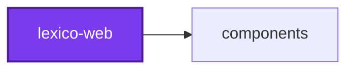

# 🐺 Lexico

**A Latin–English dictionary, rebuilt.**

> ⚠️ **Work in progress.** The old application is being replaced one page at
> a time. Search is the first page rebuilt: it answers from the
> [lexico-api](../lexico-api/README.md) GraphQL endpoint. Bookmarks, literature,
> grammar, and accounts are gone until their replacements land.

Lexico is a server-side rendered web application built with TanStack Start and
React 19. It is the front end of a small suite: the dictionary's shape lives in
[lexico-entities](../lexico-entities/README.md), the data that
fills it is gathered by
[lexico-cli](../lexico-cli/README.md), and the interface is built
from [components](../../components/README.md).

## Projects

| Project | Role |
| ------- | ---- |
| 🐺 [lexico-web](README.md) | The SSR web application — routes, server functions, pages |
| 🎨 [components](../../components/README.md) | Shared React component library on shadcn/ui and Base UI primitives |
| 📖 [lexico-entities](../lexico-entities/README.md) | TypeORM entities and migrations for the dictionary and literature schema |
| 🚰 [lexico-cli](../lexico-cli/README.md) | CLI that scrapes and loads dictionary, literature, and etymology sources |

## Quick Start

```bash
pnpm install
nx run lexico-web:start     # http://localhost:7797
```

| Target | Does |
| ------ | ---- |
| `start` | Vite dev server with hot reload, once the API is ready |
| `stop` | Free port 7797; `nx stop lexico-api` stops this and then the API |
| `build` | Production SSR bundle |
| `preview` | Build, then serve the production build locally |
| `codometer` | Measure the entry, route, CSS, and server bundles and gate the limit each declares |
| `vitest` | Tests — `:unit`, `:integration`, `:end-to-end` |
| `lint-code` | All static analysis; `--configuration=write` to auto-fix |

## Structure

```text
src/
├── routes/              # File-based routing (TanStack Router)
│   ├── __root.tsx       # Root layout and sidebar
│   ├── index.tsx        # / (redirects to /search)
│   ├── search.tsx       # /search — loader, server function, page
│   └── routeTree.gen.ts # Generated route tree, never edited
├── components/          # One component and its test per file
├── styles/              # Lexico's accent color over the shadcn tokens
├── client.tsx           # Client entry
└── router.tsx           # Router construction
```

Routes are defined by file structure: `src/routes/search.tsx` serves `/search`.

Data access goes through a TanStack Start **server function** — type-safe RPC
from client to server — defined beside the route that uses it and called from
its loader, so the first render is already populated. `/search` asks the API
for Latin and English matches at once and merges them, best first; set
`LEXICO_API_URL` to point it somewhere other than `http://localhost:5003/graphql`.

## Technology

- **React 19** with TanStack Router for file-based routing
- **TanStack Start** for SSR and server functions
- **Tailwind CSS** with shadcn/ui components from
  [components](../../components/README.md)
- **Vite 7** with Nitro for the SSR bundle
- **TypeScript 5.9**, strict mode throughout

## Documentation

- [AGENTS.md](AGENTS.md) — architecture and development patterns
- [Codebase AGENTS.md](../../../AGENTS.md) — workspace conventions and Nx workflows
- [TanStack Start](https://tanstack.com/router/latest/docs/framework/react/start/overview)

## License

MIT — see [LICENSE](../../../LICENSE).

<!-- callidescope:start -->

## 🔭 Callidescope

Call stacks traced through `projects/lexico/lexico-web`, deepest first. Each frame shows what it takes, what it returns, and what its documentation says.

| Measure | Value |
| --- | --- |
| Callables | 127 |
| Files | 28 |
| Calls traced | 72 |
| Call stacks | 21 |
| Deepest stack | 4 |
| Stacks through recursion | 0 |
| Unfollowable calls | 14 |

### Limits

What this project is judged against, as declared in its own `callidescope.config.ts`.

| Limit | Value |
| --- | --- |
| `maximumDepth` | 9 |
| `maximumBreadth` | 9 |

### Call stacks (depth)

**1. `FormsTable`** — depth ≥ 4 · orphan-root

```text
🚀 FormsTable(properties: Readonly<FormsTableProperties>): ReactNode [projects/lexico/lexico-web/src/components/forms-table.tsx:46]
   ↳ A grid of the words a lexeme's forms are written as, such as a noun's cases down the side and its numbers across the…
  └─> map(…)(row: FormsTableAxis, rowIndex: number): JSX.Element [projects/lexico/lexico-web/src/components/forms-table.tsx:70]
    └─> map(…)(column: FormsTableAxis, columnIndex: number): JSX.Element [projects/lexico/lexico-web/src/components/forms-table.tsx:75]
      └─> map(…)(word: string): JSX.Element [projects/lexico/lexico-web/src/components/forms-table.tsx:109]
```

**2. `VerbForms`** — depth 4 · orphan-root

```text
🚀 VerbForms(properties: Readonly<VerbFormsProperties>): ReactNode [projects/lexico/lexico-web/src/components/verb-forms.tsx:117]
   ↳ A verb's conjugation: tabs for voice, then mood, then tense, over a table of its words by person and number, and a last…
  └─> narrow(rows: VerbFormRow[], selection: Selection): Conjugation [projects/lexico/lexico-web/src/components/verb-forms.tsx:241]
     ↳ Narrows a conjugation down by the voice, mood and tense chosen.
    └─> filter(…)(voice: string): boolean [projects/lexico/lexico-web/src/components/verb-forms.tsx:245]
      └─> some(…)(row: VerbFormRow): boolean [projects/lexico/lexico-web/src/components/verb-forms.tsx:245]
```

**3. `LexemeIdentifiers`** — depth 3 · orphan-root

```text
🚀 LexemeIdentifiers(properties: Readonly<LexemeIdentifiersProperties>): ReactNode [projects/lexico/lexico-web/src/components/lexeme-identifiers.tsx:60]
   ↳ What the searched word is as a form of this lexeme, such as "1ST SG PRES ACT IND", for when a search matched an…
  └─> map(…)(identifier: string): JSX.Element [projects/lexico/lexico-web/src/components/lexeme-identifiers.tsx:85]
    └─> flatMap(…)(this: undefined, word: string): string | never[] [projects/lexico/lexico-web/src/components/lexeme-identifiers.tsx:94]
```

<details>
<summary>18 more call stacks</summary>

**4. `AdjectiveForms`** — depth 3 · orphan-root

```text
🚀 AdjectiveForms(properties: Readonly<AdjectiveFormsProperties>): ReactNode [projects/lexico/lexico-web/src/components/adjective-forms.tsx:50]
   ↳ An adjective's declension: a table of its words by case and number for each gender, switched with tabs.
  └─> filter(…)(gender: string): boolean [projects/lexico/lexico-web/src/components/adjective-forms.tsx:59]
    └─> some(…)(row: AdjectiveFormRow): boolean [projects/lexico/lexico-web/src/components/adjective-forms.tsx:60]
```

**5. `NounForms`** — depth 3 · orphan-root

```text
🚀 NounForms(properties: Readonly<NounFormsProperties>): ReactNode [projects/lexico/lexico-web/src/components/noun-forms.tsx:47]
   ↳ A noun's declension: its words by case and number. Cases the noun has no form for are left out.
  └─> filter(…)(case_: string): boolean [projects/lexico/lexico-web/src/components/noun-forms.tsx:55]
    └─> some(…)(row: NounFormRow): boolean [projects/lexico/lexico-web/src/components/noun-forms.tsx:55]
```

**6. `handleOpenChange`** — depth ≥ 3 · orphan-root

```text
🚀 handleOpenChange(open: boolean): void [projects/lexico/lexico-web/src/components/lexeme-forms.tsx:121]
   ↳ Opens or closes the table, loading the forms on the way open.
  └─> load(): void [projects/lexico/lexico-web/src/components/lexeme-forms.tsx:103]
     ↳ Asks for the forms, unless they are already loaded or on their way.
    └─> catch(…)(): void [projects/lexico/lexico-web/src/components/lexeme-forms.tsx:113]
```

**7. `LexemeHeader`** — depth 3 · orphan-root

```text
🚀 LexemeHeader(properties: Readonly<LexemeHeaderProperties>): ReactNode [projects/lexico/lexico-web/src/components/lexeme-header.tsx:40]
   ↳ The top of a lexeme card: its principal parts, or its lemma when none were ingested, over its part of speech and…
  └─> describeInflection(…): string[] [projects/lexico/lexico-web/src/components/lexeme-header.tsx:106]
     ↳ What an inflection says about a lexeme, as the fields its part of speech fills, with the empty ones left out.
    └─> filter(…)(detail: string | null | undefined): detail is string [projects/lexico/lexico-web/src/components/lexeme-header.tsx:117]
```

**8. `SearchResults`** — depth ≥ 3 · orphan-root

```text
🚀 SearchResults(properties: Readonly<SearchResultsProperties>): ReactNode [projects/lexico/lexico-web/src/components/search-results.tsx:31]
   ↳ The lexemes a query matched, in a masonry of cards.
  └─> from(…)(_: unknown, column: number): LexemeResult[] [projects/lexico/lexico-web/src/components/search-results.tsx:45]
    └─> filter(…)(_result: LexemeResult, index: number): boolean [projects/lexico/lexico-web/src/components/search-results.tsx:46]
```

**9. `handler(…)`** — depth 3 · orphan-root

```text
🚀 handler(…)(…): Promise<LexemeResult[]> [projects/lexico/lexico-web/src/routes/search.tsx:233]
  └─> searchLanguage(field: "searchEnglish" | "searchLatin", query: string): Promise<ResultNode[]> [projects/lexico/lexico-web/src/routes/search.tsx:211]
     ↳ Searches Latin or English through the lexico API, which exposes each as its own query, and returns the results it…
    └─> queryApi(…): Promise<Record<string, unknown>> [projects/lexico/lexico-web/src/routes/search.tsx:186]
       ↳ Runs one GraphQL query against the lexico API and returns its data.
```

**10. `ApplicationSidebar`** — depth 2 · orphan-root

```text
🚀 ApplicationSidebar(): ReactNode [projects/lexico/lexico-web/src/routes/__root.tsx:90]
   ↳ Application sidebar: a rail that collapses to icons, with the brand in the header, navigation in a labelled group, and…
  └─> map(…)(item: NavigationItem): JSX.Element [projects/lexico/lexico-web/src/routes/__root.tsx:128]
```

**11. `SearchBar`** — depth 2 · orphan-root

```text
🚀 SearchBar(properties: Readonly<SearchBarProperties>): ReactNode [projects/lexico/lexico-web/src/components/search-bar.tsx:40]
   ↳ The search field. It searches as you type, once typing pauses, and at once when the form is submitted.
  └─> useMemo(…)(): lodash.DebouncedFunc<(query: string) => void> [projects/lexico/lexico-web/src/components/search-bar.tsx:55]
```

**12. `anonymous`** — depth 2 · orphan-root

```text
🚀 anonymous(case_: string, number: string): string[] [projects/lexico/lexico-web/src/components/adjective-forms.tsx:103]
  └─> map(…)(row: AdjectiveFormRow): string [projects/lexico/lexico-web/src/components/adjective-forms.tsx:106]
```

**13. `anonymous`** — depth 2 · orphan-root

```text
🚀 anonymous(case_: string, number: string): string[] [projects/lexico/lexico-web/src/components/noun-forms.tsx:71]
  └─> map(…)(row: NounFormRow): string [projects/lexico/lexico-web/src/components/noun-forms.tsx:74]
```

**14. `anonymous`** — depth 2 · orphan-root

```text
🚀 anonymous(person: string, number: string): string[] [projects/lexico/lexico-web/src/components/verb-forms.tsx:175]
  └─> map(…)(row: VerbFormRow): string [projects/lexico/lexico-web/src/components/verb-forms.tsx:180]
```

**15. `AxisTabs`** — depth 2 · orphan-root

```text
🚀 AxisTabs(properties: Readonly<AxisTabsProperties>): ReactNode [projects/lexico/lexico-web/src/components/verb-forms.tsx:200]
   ↳ One row of tabs for a single axis of the conjugation, such as its moods.
  └─> map(…)(option: string): JSX.Element [projects/lexico/lexico-web/src/components/verb-forms.tsx:216]
```

**16. `NonFiniteForms`** — depth 2 · orphan-root

```text
🚀 NonFiniteForms(properties: Readonly<{ rows: VerbFormRow[]; }>): ReactNode [projects/lexico/lexico-web/src/components/verb-forms.tsx:275]
   ↳ The forms that have no person, such as infinitives, participles, gerunds and supines, each named for its kind and what…
  └─> filter(…)(row: VerbFormRow): boolean [projects/lexico/lexico-web/src/components/verb-forms.tsx:278]
```

**17. `FormsOfKind`** — depth 2 · orphan-root

```text
🚀 FormsOfKind(…): ReactNode [projects/lexico/lexico-web/src/components/lexeme-forms.tsx:193]
   ↳ The table for the kind of forms a lexeme turned out to have, or a note that it has none.
  └─> filter(…)(row: LexemeFormRow): boolean [projects/lexico/lexico-web/src/components/lexeme-forms.tsx:202]
```

**18. `LexemePronunciations`** — depth 2 · orphan-root

```text
🚀 LexemePronunciations(properties: Readonly<LexemePronunciationsProperties>): ReactNode [projects/lexico/lexico-web/src/components/lexeme-pronunciations.tsx:38]
   ↳ How a lexeme is pronounced in each variant of Latin that has a transcription, such as classical and ecclesiastical,…
  └─> map(…)({ phonetic, variant }: LexemePronunciation): JSX.Element [projects/lexico/lexico-web/src/components/lexeme-pronunciations.tsx:78]
```

**19. `LexemeTranslations`** — depth 2 · orphan-root

```text
🚀 LexemeTranslations(properties: Readonly<LexemeTranslationsProperties>): ReactNode [projects/lexico/lexico-web/src/components/lexeme-translations.tsx:37]
   ↳ A lexeme's English translations as a bulleted list under a heading. Folded, it shows the first two; opened, all of them.
  └─> map(…)(translation: string): JSX.Element [projects/lexico/lexico-web/src/components/lexeme-translations.tsx:83]
```

**20. `handler(…)`** — depth 2 · orphan-root

```text
🚀 handler(…)(…): Promise<LexemeFormRow[]> [projects/lexico/lexico-web/src/routes/search.tsx:284]
  └─> queryApi(…): Promise<Record<string, unknown>> [projects/lexico/lexico-web/src/routes/search.tsx:186]
     ↳ Runs one GraphQL query against the lexico API and returns its data.
```

**21. `SearchPage`** — depth 2 · orphan-root

```text
🚀 SearchPage(): ReactNode [projects/lexico/lexico-web/src/routes/search.tsx:367]
   ↳ The search page: a search bar over either the landing logo or the results.
  └─> useCallback(…)(nextQuery: string): void [projects/lexico/lexico-web/src/routes/search.tsx:380]
```

</details>

### Breadth

| Callable | Breadth | Calls directly | Location |
| --- | --- | --- | --- |
| `narrow` | 8 | `filter(…)`, `filter(…)`, `pick`, `filter(…)`, `filter(…)`, `filter(…)`, `filter(…)`, `filter(…)` | `projects/lexico/lexico-web/src/components/verb-forms.tsx:241` |
| `AdjectiveForms` | 6 | `filter(…)`, `filter(…)`, `filter(…)`, `map(…)`, `map(…)`, `map(…)` | `projects/lexico/lexico-web/src/components/adjective-forms.tsx:50` |
| `map(…)` | 4 | `describeMatch`, `flatMap(…)`, `flatMap(…)`, `map(…)` | `projects/lexico/lexico-web/src/routes/search.tsx:249` |

<details>
<summary>34 more callables</summary>

| Callable | Breadth | Calls directly | Location |
| --- | --- | --- | --- |
| `NounForms` | 3 | `filter(…)`, `map(…)`, `map(…)` | `projects/lexico/lexico-web/src/components/noun-forms.tsx:47` |
| `SearchResults` | 3 | `from(…)`, `useEffect(…)`, `map(…)` | `projects/lexico/lexico-web/src/components/search-results.tsx:31` |
| `SearchBar` | 2 | `useMemo(…)`, `useEffect(…)` | `projects/lexico/lexico-web/src/components/search-bar.tsx:40` |
| `anonymous` | 2 | `map(…)`, `filter(…)` | `projects/lexico/lexico-web/src/components/adjective-forms.tsx:103` |
| `anonymous` | 2 | `map(…)`, `filter(…)` | `projects/lexico/lexico-web/src/components/noun-forms.tsx:71` |
| `anonymous` | 2 | `map(…)`, `filter(…)` | `projects/lexico/lexico-web/src/components/verb-forms.tsx:175` |
| `NonFiniteForms` | 2 | `filter(…)`, `map(…)` | `projects/lexico/lexico-web/src/components/verb-forms.tsx:275` |
| `load` | 2 | `catch(…)`, `then(…)` | `projects/lexico/lexico-web/src/components/lexeme-forms.tsx:103` |
| `FormsOfKind` | 2 | `filter(…)`, `filter(…)` | `projects/lexico/lexico-web/src/components/lexeme-forms.tsx:193` |
| `LexemeTranslations` | 2 | `map(…)`, `map(…)` | `projects/lexico/lexico-web/src/components/lexeme-translations.tsx:37` |
| `map(…)` | 2 | `map(…)`, `map(…)` | `projects/lexico/lexico-web/src/components/search-results.tsx:84` |
| `searchLanguage` | 2 | `queryApi`, `map(…)` | `projects/lexico/lexico-web/src/routes/search.tsx:211` |
| `handler(…)` | 2 | `searchLanguage`, `map(…)` | `projects/lexico/lexico-web/src/routes/search.tsx:233` |
| `handler(…)` | 2 | `queryApi`, `map(…)` | `projects/lexico/lexico-web/src/routes/search.tsx:284` |
| `SearchPage` | 2 | `useCallback(…)`, `useCallback(…)` | `projects/lexico/lexico-web/src/routes/search.tsx:367` |
| `ApplicationSidebar` | 1 | `map(…)` | `projects/lexico/lexico-web/src/routes/__root.tsx:90` |
| `LexemeIdentifiers` | 1 | `map(…)` | `projects/lexico/lexico-web/src/components/lexeme-identifiers.tsx:60` |
| `map(…)` | 1 | `flatMap(…)` | `projects/lexico/lexico-web/src/components/lexeme-identifiers.tsx:85` |
| `FormsTable` | 1 | `map(…)` | `projects/lexico/lexico-web/src/components/forms-table.tsx:46` |
| `map(…)` | 1 | `map(…)` | `projects/lexico/lexico-web/src/components/forms-table.tsx:70` |
| `map(…)` | 1 | `map(…)` | `projects/lexico/lexico-web/src/components/forms-table.tsx:75` |
| `filter(…)` | 1 | `some(…)` | `projects/lexico/lexico-web/src/components/adjective-forms.tsx:59` |
| `filter(…)` | 1 | `some(…)` | `projects/lexico/lexico-web/src/components/adjective-forms.tsx:66` |
| `filter(…)` | 1 | `some(…)` | `projects/lexico/lexico-web/src/components/noun-forms.tsx:55` |
| `VerbForms` | 1 | `narrow` | `projects/lexico/lexico-web/src/components/verb-forms.tsx:117` |
| `AxisTabs` | 1 | `map(…)` | `projects/lexico/lexico-web/src/components/verb-forms.tsx:200` |
| `filter(…)` | 1 | `some(…)` | `projects/lexico/lexico-web/src/components/verb-forms.tsx:245` |
| `filter(…)` | 1 | `some(…)` | `projects/lexico/lexico-web/src/components/verb-forms.tsx:250` |
| `filter(…)` | 1 | `some(…)` | `projects/lexico/lexico-web/src/components/verb-forms.tsx:255` |
| `handleOpenChange` | 1 | `load` | `projects/lexico/lexico-web/src/components/lexeme-forms.tsx:121` |
| `LexemeHeader` | 1 | `describeInflection` | `projects/lexico/lexico-web/src/components/lexeme-header.tsx:40` |
| `describeInflection` | 1 | `filter(…)` | `projects/lexico/lexico-web/src/components/lexeme-header.tsx:106` |
| `LexemePronunciations` | 1 | `map(…)` | `projects/lexico/lexico-web/src/components/lexeme-pronunciations.tsx:38` |
| `from(…)` | 1 | `filter(…)` | `projects/lexico/lexico-web/src/components/search-results.tsx:45` |

</details>
<!-- callidescope:end -->

## 🕸️ Codependix

Dependency graphs exported by [codependix](https://github.com/Organizzolini/codebase/tree/main/projects/ic-suite/codependix/codependix-cli), regenerated by `nx run configuration:codependix:write`.

### Nx Neighborhood

<!-- codependix:start name="codependix-nx-projects" -->

<!-- codependix:end name="codependix-nx-projects" -->

### File Imports

```mermaid
graph LR
  file_callidescope_config_ts["callidescope.config.ts"]
  file_codependix_config_ts["codependix.config.ts"]
  file_codometer_config_ts["codometer.config.ts"]
  file_eslint_config_ts["eslint.config.ts"]
  file_src_client_tsx["src/client.tsx"]
  file_src_components_adjective_forms_tsx["src/components/adjective-forms.tsx"]
  file_src_components_adjective_forms_unit_test_tsx["src/components/adjective-forms.unit.test.tsx"]
  file_src_components_forms_table_tsx["src/components/forms-table.tsx"]
  file_src_components_forms_table_unit_test_tsx["src/components/forms-table.unit.test.tsx"]
  file_src_components_layout_index_ts["src/components/layout/index.ts"]
  file_src_components_layout_logo_tsx["src/components/layout/logo.tsx"]
  file_src_components_lexeme_card_tsx["src/components/lexeme-card.tsx"]
  file_src_components_lexeme_card_unit_test_tsx["src/components/lexeme-card.unit.test.tsx"]
  file_src_components_lexeme_etymology_tsx["src/components/lexeme-etymology.tsx"]
  file_src_components_lexeme_etymology_unit_test_tsx["src/components/lexeme-etymology.unit.test.tsx"]
  file_src_components_lexeme_forms_tsx["src/components/lexeme-forms.tsx"]
  file_src_components_lexeme_forms_unit_test_tsx["src/components/lexeme-forms.unit.test.tsx"]
  file_src_components_lexeme_header_tsx["src/components/lexeme-header.tsx"]
  file_src_components_lexeme_header_unit_test_tsx["src/components/lexeme-header.unit.test.tsx"]
  file_src_components_lexeme_identifiers_tsx["src/components/lexeme-identifiers.tsx"]
  file_src_components_lexeme_identifiers_unit_test_tsx["src/components/lexeme-identifiers.unit.test.tsx"]
  file_src_components_lexeme_match_tsx["src/components/lexeme-match.tsx"]
  file_src_components_lexeme_match_unit_test_tsx["src/components/lexeme-match.unit.test.tsx"]
  file_src_components_lexeme_pronunciations_tsx["src/components/lexeme-pronunciations.tsx"]
  file_src_components_lexeme_pronunciations_unit_test_tsx["src/components/lexeme-pronunciations.unit.test.tsx"]
  file_src_components_lexeme_translations_tsx["src/components/lexeme-translations.tsx"]
  file_src_components_lexeme_translations_unit_test_tsx["src/components/lexeme-translations.unit.test.tsx"]
  file_src_components_noun_forms_tsx["src/components/noun-forms.tsx"]
  file_src_components_noun_forms_unit_test_tsx["src/components/noun-forms.unit.test.tsx"]
  file_src_components_search_bar_tsx["src/components/search-bar.tsx"]
  file_src_components_search_bar_unit_test_tsx["src/components/search-bar.unit.test.tsx"]
  file_src_components_search_landing_tsx["src/components/search-landing.tsx"]
  file_src_components_search_landing_unit_test_tsx["src/components/search-landing.unit.test.tsx"]
  file_src_components_search_results_tsx["src/components/search-results.tsx"]
  file_src_components_search_results_unit_test_tsx["src/components/search-results.unit.test.tsx"]
  file_src_components_verb_forms_tsx["src/components/verb-forms.tsx"]
  file_src_components_verb_forms_unit_test_tsx["src/components/verb-forms.unit.test.tsx"]
  file_src_router_tsx["src/router.tsx"]
  file_src_routes___root_tsx["src/routes/__root.tsx"]
  file_src_routes_index_integration_test_tsx["src/routes/index.integration.test.tsx"]
  file_src_routes_index_tsx["src/routes/index.tsx"]
  file_src_routes_routeTree_gen_ts["src/routes/routeTree.gen.ts"]
  file_src_routes_search_integration_test_tsx["src/routes/search.integration.test.tsx"]
  file_src_routes_search_tsx["src/routes/search.tsx"]
  file_testing_render_route_tsx["testing/render-route.tsx"]
  file_testing_setup_ts["testing/setup.ts"]
  file_vite_config_mts["vite.config.mts"]
  file_vitest_config_ts["vitest.config.ts"]
  file_src_components_adjective_forms_tsx --> file_src_components_forms_table_tsx
  file_src_components_adjective_forms_unit_test_tsx --> file_src_components_adjective_forms_tsx
  file_src_components_forms_table_tsx --> file_src_components_lexeme_identifiers_tsx
  file_src_components_forms_table_unit_test_tsx --> file_src_components_forms_table_tsx
  file_src_components_lexeme_card_tsx --> file_src_components_lexeme_etymology_tsx
  file_src_components_lexeme_card_tsx --> file_src_components_lexeme_forms_tsx
  file_src_components_lexeme_card_tsx --> file_src_components_lexeme_header_tsx
  file_src_components_lexeme_card_tsx --> file_src_components_lexeme_identifiers_tsx
  file_src_components_lexeme_card_tsx --> file_src_components_lexeme_match_tsx
  file_src_components_lexeme_card_tsx --> file_src_components_lexeme_pronunciations_tsx
  file_src_components_lexeme_card_tsx --> file_src_components_lexeme_translations_tsx
  file_src_components_lexeme_card_unit_test_tsx --> file_src_components_lexeme_card_tsx
  file_src_components_lexeme_card_unit_test_tsx --> file_src_components_lexeme_forms_tsx
  file_src_components_lexeme_etymology_unit_test_tsx --> file_src_components_lexeme_etymology_tsx
  file_src_components_lexeme_forms_tsx --> file_src_components_adjective_forms_tsx
  file_src_components_lexeme_forms_tsx --> file_src_components_noun_forms_tsx
  file_src_components_lexeme_forms_tsx --> file_src_components_verb_forms_tsx
  file_src_components_lexeme_forms_unit_test_tsx --> file_src_components_lexeme_forms_tsx
  file_src_components_lexeme_header_unit_test_tsx --> file_src_components_lexeme_header_tsx
  file_src_components_lexeme_identifiers_unit_test_tsx --> file_src_components_lexeme_identifiers_tsx
  file_src_components_lexeme_match_unit_test_tsx --> file_src_components_lexeme_match_tsx
  file_src_components_lexeme_pronunciations_unit_test_tsx --> file_src_components_lexeme_pronunciations_tsx
  file_src_components_lexeme_translations_unit_test_tsx --> file_src_components_lexeme_translations_tsx
  file_src_components_noun_forms_tsx --> file_src_components_forms_table_tsx
  file_src_components_noun_forms_unit_test_tsx --> file_src_components_noun_forms_tsx
  file_src_components_search_bar_unit_test_tsx --> file_src_components_search_bar_tsx
  file_src_components_search_landing_tsx --> file_src_components_layout_index_ts
  file_src_components_search_landing_unit_test_tsx --> file_src_components_search_landing_tsx
  file_src_components_search_results_tsx --> file_src_components_lexeme_card_tsx
  file_src_components_search_results_tsx --> file_src_components_lexeme_forms_tsx
  file_src_components_search_results_unit_test_tsx --> file_src_components_lexeme_card_tsx
  file_src_components_search_results_unit_test_tsx --> file_src_components_lexeme_forms_tsx
  file_src_components_search_results_unit_test_tsx --> file_src_components_search_results_tsx
  file_src_components_verb_forms_tsx --> file_src_components_forms_table_tsx
  file_src_components_verb_forms_tsx --> file_src_components_lexeme_identifiers_tsx
  file_src_components_verb_forms_unit_test_tsx --> file_src_components_verb_forms_tsx
  file_src_router_tsx --> file_src_routes_routeTree_gen_ts
  file_src_routes___root_tsx --> file_src_components_layout_index_ts
  file_src_routes_index_integration_test_tsx --> file_src_routes_index_tsx
  file_src_routes_index_integration_test_tsx --> file_testing_render_route_tsx
  file_src_routes_routeTree_gen_ts --> file_src_router_tsx
  file_src_routes_routeTree_gen_ts --> file_src_routes___root_tsx
  file_src_routes_routeTree_gen_ts --> file_src_routes_index_tsx
  file_src_routes_routeTree_gen_ts --> file_src_routes_search_tsx
  file_src_routes_search_integration_test_tsx --> file_src_routes_search_tsx
  file_src_routes_search_integration_test_tsx --> file_testing_render_route_tsx
  file_src_routes_search_tsx --> file_src_components_lexeme_card_tsx
  file_src_routes_search_tsx --> file_src_components_lexeme_forms_tsx
  file_src_routes_search_tsx --> file_src_components_lexeme_header_tsx
  file_src_routes_search_tsx --> file_src_components_lexeme_match_tsx
  file_src_routes_search_tsx --> file_src_components_search_bar_tsx
  file_src_routes_search_tsx --> file_src_components_search_landing_tsx
  file_src_routes_search_tsx --> file_src_components_search_results_tsx
  file_testing_render_route_tsx --> file_src_router_tsx
```

<!-- codependix:start name="codependix-file-imports" -->

<!-- codependix:end name="codependix-file-imports" -->

<!-- codometer:start -->

## ⏲️ Codometer

### Project


### Measured Targets


### TypeScript


### JavaScript


### Python


### JSON


### YAML


### TOML


### Shell


### SQL


### HCL


### CSS


### Conventions


### Jupyter


### Markdown


<!-- codometer:end -->
