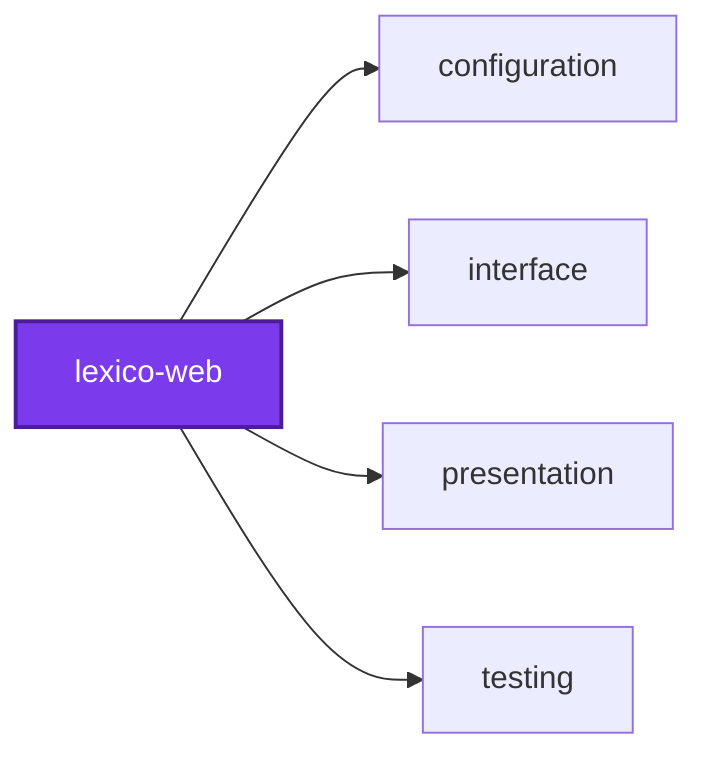

## 🕸️ Codependix

Dependency graphs exported by [codependix](https://github.com/Organizzolini/codebase/tree/main/projects/ic-suite/codependix/codependix-cli), regenerated by `nx run configuration:codependix:write`.

### Nx Neighborhood

<!-- codependix:start name="codependix-nx-projects" -->

<!-- codependix:end name="codependix-nx-projects" -->

### File Imports

<!-- codependix:start name="codependix-file-imports" -->
```mermaid
graph LR
  file_callidescope_config_ts["callidescope.config.ts"]
  file_codegen_ts["codegen.ts"]
  file_codependix_config_ts["codependix.config.ts"]
  file_codometer_config_ts["codometer.config.ts"]
  file_coinagerie_config_ts["coinagerie.config.ts"]
  file_eslint_config_ts["eslint.config.ts"]
  file_src_client_tsx["src/client.tsx"]
  file_src_components_adjective_forms_adjective_forms_constants_ts["src/components/adjective-forms/adjective-forms.constants.ts"]
  file_src_components_adjective_forms_adjective_forms_tsx["src/components/adjective-forms/adjective-forms.tsx"]
  file_src_components_adjective_forms_adjective_forms_types_ts["src/components/adjective-forms/adjective-forms.types.ts"]
  file_src_components_adjective_forms_adjective_forms_unit_test_tsx["src/components/adjective-forms/adjective-forms.unit.test.tsx"]
  file_src_components_adjective_forms_adjective_forms_utilities_ts["src/components/adjective-forms/adjective-forms.utilities.ts"]
  file_src_components_application_sidebar_application_sidebar_constants_ts["src/components/application-sidebar/application-sidebar.constants.ts"]
  file_src_components_application_sidebar_application_sidebar_tsx["src/components/application-sidebar/application-sidebar.tsx"]
  file_src_components_application_sidebar_application_sidebar_types_ts["src/components/application-sidebar/application-sidebar.types.ts"]
  file_src_components_application_sidebar_application_sidebar_unit_test_tsx["src/components/application-sidebar/application-sidebar.unit.test.tsx"]
  file_src_components_application_sidebar_application_sidebar_utilities_ts["src/components/application-sidebar/application-sidebar.utilities.ts"]
  file_src_components_application_sidebar_navigation_link_tsx["src/components/application-sidebar/navigation-link.tsx"]
  file_src_components_application_sidebar_navigation_link_unit_test_tsx["src/components/application-sidebar/navigation-link.unit.test.tsx"]
  file_src_components_font_size_control_font_size_control_constants_ts["src/components/font-size-control/font-size-control.constants.ts"]
  file_src_components_font_size_control_font_size_control_tsx["src/components/font-size-control/font-size-control.tsx"]
  file_src_components_font_size_control_font_size_control_types_ts["src/components/font-size-control/font-size-control.types.ts"]
  file_src_components_font_size_control_font_size_control_unit_test_tsx["src/components/font-size-control/font-size-control.unit.test.tsx"]
  file_src_components_font_size_control_font_size_control_utilities_ts["src/components/font-size-control/font-size-control.utilities.ts"]
  file_src_components_forms_table_forms_table_constants_ts["src/components/forms-table/forms-table.constants.ts"]
  file_src_components_forms_table_forms_table_tsx["src/components/forms-table/forms-table.tsx"]
  file_src_components_forms_table_forms_table_types_ts["src/components/forms-table/forms-table.types.ts"]
  file_src_components_forms_table_forms_table_unit_test_tsx["src/components/forms-table/forms-table.unit.test.tsx"]
  file_src_components_forms_table_forms_table_utilities_ts["src/components/forms-table/forms-table.utilities.ts"]
  file_src_components_lexeme_card_lexeme_card_constants_ts["src/components/lexeme-card/lexeme-card.constants.ts"]
  file_src_components_lexeme_card_lexeme_card_tsx["src/components/lexeme-card/lexeme-card.tsx"]
  file_src_components_lexeme_card_lexeme_card_types_ts["src/components/lexeme-card/lexeme-card.types.ts"]
  file_src_components_lexeme_card_lexeme_card_unit_test_tsx["src/components/lexeme-card/lexeme-card.unit.test.tsx"]
  file_src_components_lexeme_card_lexeme_card_utilities_ts["src/components/lexeme-card/lexeme-card.utilities.ts"]
  file_src_components_lexeme_etymology_lexeme_etymology_constants_ts["src/components/lexeme-etymology/lexeme-etymology.constants.ts"]
  file_src_components_lexeme_etymology_lexeme_etymology_tsx["src/components/lexeme-etymology/lexeme-etymology.tsx"]
  file_src_components_lexeme_etymology_lexeme_etymology_types_ts["src/components/lexeme-etymology/lexeme-etymology.types.ts"]
  file_src_components_lexeme_etymology_lexeme_etymology_unit_test_tsx["src/components/lexeme-etymology/lexeme-etymology.unit.test.tsx"]
  file_src_components_lexeme_etymology_lexeme_etymology_utilities_ts["src/components/lexeme-etymology/lexeme-etymology.utilities.ts"]
  file_src_components_lexeme_forms_forms_of_kind_tsx["src/components/lexeme-forms/forms-of-kind.tsx"]
  file_src_components_lexeme_forms_forms_of_kind_unit_test_tsx["src/components/lexeme-forms/forms-of-kind.unit.test.tsx"]
  file_src_components_lexeme_forms_lexeme_forms_constants_ts["src/components/lexeme-forms/lexeme-forms.constants.ts"]
  file_src_components_lexeme_forms_lexeme_forms_tsx["src/components/lexeme-forms/lexeme-forms.tsx"]
  file_src_components_lexeme_forms_lexeme_forms_types_ts["src/components/lexeme-forms/lexeme-forms.types.ts"]
  file_src_components_lexeme_forms_lexeme_forms_unit_test_tsx["src/components/lexeme-forms/lexeme-forms.unit.test.tsx"]
  file_src_components_lexeme_forms_lexeme_forms_utilities_ts["src/components/lexeme-forms/lexeme-forms.utilities.ts"]
  file_src_components_lexeme_forms_no_forms_tsx["src/components/lexeme-forms/no-forms.tsx"]
  file_src_components_lexeme_forms_no_forms_unit_test_tsx["src/components/lexeme-forms/no-forms.unit.test.tsx"]
  file_src_components_lexeme_header_lexeme_header_constants_ts["src/components/lexeme-header/lexeme-header.constants.ts"]
  file_src_components_lexeme_header_lexeme_header_tsx["src/components/lexeme-header/lexeme-header.tsx"]
  file_src_components_lexeme_header_lexeme_header_types_ts["src/components/lexeme-header/lexeme-header.types.ts"]
  file_src_components_lexeme_header_lexeme_header_unit_test_tsx["src/components/lexeme-header/lexeme-header.unit.test.tsx"]
  file_src_components_lexeme_header_lexeme_header_utilities_ts["src/components/lexeme-header/lexeme-header.utilities.ts"]
  file_src_components_lexeme_identifiers_lexeme_identifiers_constants_ts["src/components/lexeme-identifiers/lexeme-identifiers.constants.ts"]
  file_src_components_lexeme_identifiers_lexeme_identifiers_tsx["src/components/lexeme-identifiers/lexeme-identifiers.tsx"]
  file_src_components_lexeme_identifiers_lexeme_identifiers_types_ts["src/components/lexeme-identifiers/lexeme-identifiers.types.ts"]
  file_src_components_lexeme_identifiers_lexeme_identifiers_unit_test_tsx["src/components/lexeme-identifiers/lexeme-identifiers.unit.test.tsx"]
  file_src_components_lexeme_identifiers_lexeme_identifiers_utilities_ts["src/components/lexeme-identifiers/lexeme-identifiers.utilities.ts"]
  file_src_components_lexeme_match_lexeme_match_constants_ts["src/components/lexeme-match/lexeme-match.constants.ts"]
  file_src_components_lexeme_match_lexeme_match_tsx["src/components/lexeme-match/lexeme-match.tsx"]
  file_src_components_lexeme_match_lexeme_match_types_ts["src/components/lexeme-match/lexeme-match.types.ts"]
  file_src_components_lexeme_match_lexeme_match_unit_test_tsx["src/components/lexeme-match/lexeme-match.unit.test.tsx"]
  file_src_components_lexeme_match_lexeme_match_utilities_ts["src/components/lexeme-match/lexeme-match.utilities.ts"]
  file_src_components_lexeme_pronunciations_lexeme_pronunciations_constants_ts["src/components/lexeme-pronunciations/lexeme-pronunciations.constants.ts"]
  file_src_components_lexeme_pronunciations_lexeme_pronunciations_tsx["src/components/lexeme-pronunciations/lexeme-pronunciations.tsx"]
  file_src_components_lexeme_pronunciations_lexeme_pronunciations_types_ts["src/components/lexeme-pronunciations/lexeme-pronunciations.types.ts"]
  file_src_components_lexeme_pronunciations_lexeme_pronunciations_unit_test_tsx["src/components/lexeme-pronunciations/lexeme-pronunciations.unit.test.tsx"]
  file_src_components_lexeme_pronunciations_lexeme_pronunciations_utilities_ts["src/components/lexeme-pronunciations/lexeme-pronunciations.utilities.ts"]
  file_src_components_lexeme_translations_lexeme_translations_constants_ts["src/components/lexeme-translations/lexeme-translations.constants.ts"]
  file_src_components_lexeme_translations_lexeme_translations_tsx["src/components/lexeme-translations/lexeme-translations.tsx"]
  file_src_components_lexeme_translations_lexeme_translations_types_ts["src/components/lexeme-translations/lexeme-translations.types.ts"]
  file_src_components_lexeme_translations_lexeme_translations_unit_test_tsx["src/components/lexeme-translations/lexeme-translations.unit.test.tsx"]
  file_src_components_lexeme_translations_lexeme_translations_utilities_ts["src/components/lexeme-translations/lexeme-translations.utilities.ts"]
  file_src_components_library_author_card_library_author_card_constants_ts["src/components/library-author-card/library-author-card.constants.ts"]
  file_src_components_library_author_card_library_author_card_tsx["src/components/library-author-card/library-author-card.tsx"]
  file_src_components_library_author_card_library_author_card_types_ts["src/components/library-author-card/library-author-card.types.ts"]
  file_src_components_library_author_card_library_author_card_unit_test_tsx["src/components/library-author-card/library-author-card.unit.test.tsx"]
  file_src_components_library_author_card_library_author_card_utilities_ts["src/components/library-author-card/library-author-card.utilities.ts"]
  file_src_components_library_author_card_library_author_texts_tsx["src/components/library-author-card/library-author-texts.tsx"]
  file_src_components_library_author_card_library_author_texts_unit_test_tsx["src/components/library-author-card/library-author-texts.unit.test.tsx"]
  file_src_components_library_author_card_library_text_link_tsx["src/components/library-author-card/library-text-link.tsx"]
  file_src_components_library_author_card_library_text_link_unit_test_tsx["src/components/library-author-card/library-text-link.unit.test.tsx"]
  file_src_components_library_filters_library_filter_choices_tsx["src/components/library-filters/library-filter-choices.tsx"]
  file_src_components_library_filters_library_filter_choices_unit_test_tsx["src/components/library-filters/library-filter-choices.unit.test.tsx"]
  file_src_components_library_filters_library_filter_ranges_tsx["src/components/library-filters/library-filter-ranges.tsx"]
  file_src_components_library_filters_library_filter_ranges_unit_test_tsx["src/components/library-filters/library-filter-ranges.unit.test.tsx"]
  file_src_components_library_filters_library_filters_constants_ts["src/components/library-filters/library-filters.constants.ts"]
  file_src_components_library_filters_library_filters_tsx["src/components/library-filters/library-filters.tsx"]
  file_src_components_library_filters_library_filters_types_ts["src/components/library-filters/library-filters.types.ts"]
  file_src_components_library_filters_library_filters_unit_test_tsx["src/components/library-filters/library-filters.unit.test.tsx"]
  file_src_components_library_filters_library_filters_utilities_ts["src/components/library-filters/library-filters.utilities.ts"]
  file_src_components_library_grid_library_grid_api_constants_ts["src/components/library-grid/library-grid-api.constants.ts"]
  file_src_components_library_grid_library_grid_constants_ts["src/components/library-grid/library-grid.constants.ts"]
  file_src_components_library_grid_library_grid_tsx["src/components/library-grid/library-grid.tsx"]
  file_src_components_library_grid_library_grid_types_ts["src/components/library-grid/library-grid.types.ts"]
  file_src_components_library_grid_library_grid_unit_test_tsx["src/components/library-grid/library-grid.unit.test.tsx"]
  file_src_components_library_grid_library_grid_utilities_ts["src/components/library-grid/library-grid.utilities.ts"]
  file_src_components_library_highlight_library_highlight_constants_ts["src/components/library-highlight/library-highlight.constants.ts"]
  file_src_components_library_highlight_library_highlight_tsx["src/components/library-highlight/library-highlight.tsx"]
  file_src_components_library_highlight_library_highlight_types_ts["src/components/library-highlight/library-highlight.types.ts"]
  file_src_components_library_highlight_library_highlight_unit_test_tsx["src/components/library-highlight/library-highlight.unit.test.tsx"]
  file_src_components_library_highlight_library_highlight_utilities_ts["src/components/library-highlight/library-highlight.utilities.ts"]
  file_src_components_library_no_results_library_no_results_constants_ts["src/components/library-no-results/library-no-results.constants.ts"]
  file_src_components_library_no_results_library_no_results_tsx["src/components/library-no-results/library-no-results.tsx"]
  file_src_components_library_no_results_library_no_results_types_ts["src/components/library-no-results/library-no-results.types.ts"]
  file_src_components_library_no_results_library_no_results_unit_test_tsx["src/components/library-no-results/library-no-results.unit.test.tsx"]
  file_src_components_library_no_results_library_no_results_utilities_ts["src/components/library-no-results/library-no-results.utilities.ts"]
  file_src_components_library_pagination_library_pagination_constants_ts["src/components/library-pagination/library-pagination.constants.ts"]
  file_src_components_library_pagination_library_pagination_tsx["src/components/library-pagination/library-pagination.tsx"]
  file_src_components_library_pagination_library_pagination_types_ts["src/components/library-pagination/library-pagination.types.ts"]
  file_src_components_library_pagination_library_pagination_unit_test_tsx["src/components/library-pagination/library-pagination.unit.test.tsx"]
  file_src_components_library_pagination_library_pagination_utilities_ts["src/components/library-pagination/library-pagination.utilities.ts"]
  file_src_components_library_past_end_library_past_end_constants_ts["src/components/library-past-end/library-past-end.constants.ts"]
  file_src_components_library_past_end_library_past_end_tsx["src/components/library-past-end/library-past-end.tsx"]
  file_src_components_library_past_end_library_past_end_types_ts["src/components/library-past-end/library-past-end.types.ts"]
  file_src_components_library_past_end_library_past_end_unit_test_tsx["src/components/library-past-end/library-past-end.unit.test.tsx"]
  file_src_components_library_past_end_library_past_end_utilities_ts["src/components/library-past-end/library-past-end.utilities.ts"]
  file_src_components_library_search_library_search_constants_ts["src/components/library-search/library-search.constants.ts"]
  file_src_components_library_search_library_search_tsx["src/components/library-search/library-search.tsx"]
  file_src_components_library_search_library_search_types_ts["src/components/library-search/library-search.types.ts"]
  file_src_components_library_search_library_search_unit_test_tsx["src/components/library-search/library-search.unit.test.tsx"]
  file_src_components_library_search_library_search_utilities_ts["src/components/library-search/library-search.utilities.ts"]
  file_src_components_library_sort_library_sort_constants_ts["src/components/library-sort/library-sort.constants.ts"]
  file_src_components_library_sort_library_sort_tsx["src/components/library-sort/library-sort.tsx"]
  file_src_components_library_sort_library_sort_types_ts["src/components/library-sort/library-sort.types.ts"]
  file_src_components_library_sort_library_sort_unit_test_tsx["src/components/library-sort/library-sort.unit.test.tsx"]
  file_src_components_library_sort_library_sort_utilities_ts["src/components/library-sort/library-sort.utilities.ts"]
  file_src_components_logo_logo_constants_ts["src/components/logo/logo.constants.ts"]
  file_src_components_logo_logo_tsx["src/components/logo/logo.tsx"]
  file_src_components_logo_logo_types_ts["src/components/logo/logo.types.ts"]
  file_src_components_logo_logo_unit_test_tsx["src/components/logo/logo.unit.test.tsx"]
  file_src_components_logo_logo_utilities_ts["src/components/logo/logo.utilities.ts"]
  file_src_components_noun_forms_noun_forms_constants_ts["src/components/noun-forms/noun-forms.constants.ts"]
  file_src_components_noun_forms_noun_forms_tsx["src/components/noun-forms/noun-forms.tsx"]
  file_src_components_noun_forms_noun_forms_types_ts["src/components/noun-forms/noun-forms.types.ts"]
  file_src_components_noun_forms_noun_forms_unit_test_tsx["src/components/noun-forms/noun-forms.unit.test.tsx"]
  file_src_components_noun_forms_noun_forms_utilities_ts["src/components/noun-forms/noun-forms.utilities.ts"]
  file_src_components_reader_header_reader_header_constants_ts["src/components/reader-header/reader-header.constants.ts"]
  file_src_components_reader_header_reader_header_tsx["src/components/reader-header/reader-header.tsx"]
  file_src_components_reader_header_reader_header_types_ts["src/components/reader-header/reader-header.types.ts"]
  file_src_components_reader_header_reader_header_unit_test_tsx["src/components/reader-header/reader-header.unit.test.tsx"]
  file_src_components_reader_header_reader_header_utilities_ts["src/components/reader-header/reader-header.utilities.ts"]
  file_src_components_reader_hint_reader_hint_constants_ts["src/components/reader-hint/reader-hint.constants.ts"]
  file_src_components_reader_hint_reader_hint_tsx["src/components/reader-hint/reader-hint.tsx"]
  file_src_components_reader_hint_reader_hint_types_ts["src/components/reader-hint/reader-hint.types.ts"]
  file_src_components_reader_hint_reader_hint_unit_test_tsx["src/components/reader-hint/reader-hint.unit.test.tsx"]
  file_src_components_reader_hint_reader_hint_utilities_ts["src/components/reader-hint/reader-hint.utilities.ts"]
  file_src_components_reader_line_reader_line_constants_ts["src/components/reader-line/reader-line.constants.ts"]
  file_src_components_reader_line_reader_line_tsx["src/components/reader-line/reader-line.tsx"]
  file_src_components_reader_line_reader_line_types_ts["src/components/reader-line/reader-line.types.ts"]
  file_src_components_reader_line_reader_line_unit_test_tsx["src/components/reader-line/reader-line.unit.test.tsx"]
  file_src_components_reader_line_reader_line_utilities_ts["src/components/reader-line/reader-line.utilities.ts"]
  file_src_components_reader_lines_reader_lines_api_constants_ts["src/components/reader-lines/reader-lines-api.constants.ts"]
  file_src_components_reader_lines_reader_lines_constants_ts["src/components/reader-lines/reader-lines.constants.ts"]
  file_src_components_reader_lines_reader_lines_tsx["src/components/reader-lines/reader-lines.tsx"]
  file_src_components_reader_lines_reader_lines_types_ts["src/components/reader-lines/reader-lines.types.ts"]
  file_src_components_reader_lines_reader_lines_unit_test_tsx["src/components/reader-lines/reader-lines.unit.test.tsx"]
  file_src_components_reader_lines_reader_lines_utilities_ts["src/components/reader-lines/reader-lines.utilities.ts"]
  file_src_components_reader_navigation_reader_navigation_constants_ts["src/components/reader-navigation/reader-navigation.constants.ts"]
  file_src_components_reader_navigation_reader_navigation_tsx["src/components/reader-navigation/reader-navigation.tsx"]
  file_src_components_reader_navigation_reader_navigation_types_ts["src/components/reader-navigation/reader-navigation.types.ts"]
  file_src_components_reader_navigation_reader_navigation_unit_test_tsx["src/components/reader-navigation/reader-navigation.unit.test.tsx"]
  file_src_components_reader_navigation_reader_navigation_utilities_ts["src/components/reader-navigation/reader-navigation.utilities.ts"]
  file_src_components_search_bar_search_bar_constants_ts["src/components/search-bar/search-bar.constants.ts"]
  file_src_components_search_bar_search_bar_tsx["src/components/search-bar/search-bar.tsx"]
  file_src_components_search_bar_search_bar_types_ts["src/components/search-bar/search-bar.types.ts"]
  file_src_components_search_bar_search_bar_unit_test_tsx["src/components/search-bar/search-bar.unit.test.tsx"]
  file_src_components_search_bar_search_bar_utilities_ts["src/components/search-bar/search-bar.utilities.ts"]
  file_src_components_search_landing_search_landing_constants_ts["src/components/search-landing/search-landing.constants.ts"]
  file_src_components_search_landing_search_landing_tsx["src/components/search-landing/search-landing.tsx"]
  file_src_components_search_landing_search_landing_types_ts["src/components/search-landing/search-landing.types.ts"]
  file_src_components_search_landing_search_landing_unit_test_tsx["src/components/search-landing/search-landing.unit.test.tsx"]
  file_src_components_search_landing_search_landing_utilities_ts["src/components/search-landing/search-landing.utilities.ts"]
  file_src_components_search_results_search_api_constants_ts["src/components/search-results/search-api.constants.ts"]
  file_src_components_search_results_search_results_constants_ts["src/components/search-results/search-results.constants.ts"]
  file_src_components_search_results_search_results_tsx["src/components/search-results/search-results.tsx"]
  file_src_components_search_results_search_results_types_ts["src/components/search-results/search-results.types.ts"]
  file_src_components_search_results_search_results_unit_test_tsx["src/components/search-results/search-results.unit.test.tsx"]
  file_src_components_search_results_search_results_utilities_ts["src/components/search-results/search-results.utilities.ts"]
  file_src_components_search_results_search_constants_ts["src/components/search-results/search.constants.ts"]
  file_src_components_search_results_search_types_ts["src/components/search-results/search.types.ts"]
  file_src_components_search_results_search_utilities_ts["src/components/search-results/search.utilities.ts"]
  file_src_components_verb_forms_axis_tabs_tsx["src/components/verb-forms/axis-tabs.tsx"]
  file_src_components_verb_forms_axis_tabs_unit_test_tsx["src/components/verb-forms/axis-tabs.unit.test.tsx"]
  file_src_components_verb_forms_non_finite_forms_tsx["src/components/verb-forms/non-finite-forms.tsx"]
  file_src_components_verb_forms_non_finite_forms_unit_test_tsx["src/components/verb-forms/non-finite-forms.unit.test.tsx"]
  file_src_components_verb_forms_verb_forms_constants_ts["src/components/verb-forms/verb-forms.constants.ts"]
  file_src_components_verb_forms_verb_forms_tsx["src/components/verb-forms/verb-forms.tsx"]
  file_src_components_verb_forms_verb_forms_types_ts["src/components/verb-forms/verb-forms.types.ts"]
  file_src_components_verb_forms_verb_forms_unit_test_tsx["src/components/verb-forms/verb-forms.unit.test.tsx"]
  file_src_components_verb_forms_verb_forms_utilities_ts["src/components/verb-forms/verb-forms.utilities.ts"]
  file_src_graphql_generated_mocks_ts["src/graphql/generated/mocks.ts"]
  file_src_graphql_generated_operations_ts["src/graphql/generated/operations.ts"]
  file_src_router_tsx["src/router.tsx"]
  file_src_routes___root_tsx["src/routes/__root.tsx"]
  file_src_routes_index_integration_test_tsx["src/routes/index.integration.test.tsx"]
  file_src_routes_index_tsx["src/routes/index.tsx"]
  file_src_routes_library_integration_test_tsx["src/routes/library.integration.test.tsx"]
  file_src_routes_library_tsx["src/routes/library.tsx"]
  file_src_routes_search_integration_test_tsx["src/routes/search.integration.test.tsx"]
  file_src_routes_search_tsx["src/routes/search.tsx"]
  file_src_routes_texts__slug_integration_test_tsx["src/routes/texts.$slug.integration.test.tsx"]
  file_src_routes_texts__slug_tsx["src/routes/texts.$slug.tsx"]
  file_src_routeTree_gen_ts["src/routeTree.gen.ts"]
  file_testing_setup_ts["testing/setup.ts"]
  file_vite_config_mts["vite.config.mts"]
  file_vitest_config_ts["vitest.config.ts"]
  file_src_components_adjective_forms_adjective_forms_tsx --> file_src_components_adjective_forms_adjective_forms_constants_ts
  file_src_components_adjective_forms_adjective_forms_tsx --> file_src_components_adjective_forms_adjective_forms_types_ts
  file_src_components_adjective_forms_adjective_forms_tsx --> file_src_components_forms_table_forms_table_tsx
  file_src_components_adjective_forms_adjective_forms_unit_test_tsx --> file_src_components_adjective_forms_adjective_forms_tsx
  file_src_components_application_sidebar_application_sidebar_constants_ts --> file_src_components_application_sidebar_application_sidebar_types_ts
  file_src_components_application_sidebar_application_sidebar_tsx --> file_src_components_application_sidebar_application_sidebar_constants_ts
  file_src_components_application_sidebar_application_sidebar_tsx --> file_src_components_application_sidebar_navigation_link_tsx
  file_src_components_application_sidebar_application_sidebar_tsx --> file_src_components_logo_logo_tsx
  file_src_components_application_sidebar_application_sidebar_unit_test_tsx --> file_src_components_application_sidebar_application_sidebar_tsx
  file_src_components_application_sidebar_navigation_link_tsx --> file_src_components_application_sidebar_application_sidebar_types_ts
  file_src_components_application_sidebar_navigation_link_unit_test_tsx --> file_src_components_application_sidebar_navigation_link_tsx
  file_src_components_font_size_control_font_size_control_constants_ts --> file_src_components_font_size_control_font_size_control_types_ts
  file_src_components_font_size_control_font_size_control_tsx --> file_src_components_font_size_control_font_size_control_types_ts
  file_src_components_font_size_control_font_size_control_tsx --> file_src_components_font_size_control_font_size_control_utilities_ts
  file_src_components_font_size_control_font_size_control_unit_test_tsx --> file_src_components_font_size_control_font_size_control_tsx
  file_src_components_font_size_control_font_size_control_unit_test_tsx --> file_src_components_font_size_control_font_size_control_types_ts
  file_src_components_font_size_control_font_size_control_unit_test_tsx --> file_src_components_font_size_control_font_size_control_utilities_ts
  file_src_components_font_size_control_font_size_control_utilities_ts --> file_src_components_font_size_control_font_size_control_constants_ts
  file_src_components_font_size_control_font_size_control_utilities_ts --> file_src_components_font_size_control_font_size_control_types_ts
  file_src_components_forms_table_forms_table_tsx --> file_src_components_forms_table_forms_table_types_ts
  file_src_components_forms_table_forms_table_tsx --> file_src_components_lexeme_identifiers_lexeme_identifiers_constants_ts
  file_src_components_forms_table_forms_table_unit_test_tsx --> file_src_components_forms_table_forms_table_tsx
  file_src_components_lexeme_card_lexeme_card_tsx --> file_src_components_lexeme_card_lexeme_card_constants_ts
  file_src_components_lexeme_card_lexeme_card_tsx --> file_src_components_lexeme_card_lexeme_card_types_ts
  file_src_components_lexeme_card_lexeme_card_tsx --> file_src_components_lexeme_etymology_lexeme_etymology_tsx
  file_src_components_lexeme_card_lexeme_card_tsx --> file_src_components_lexeme_forms_lexeme_forms_tsx
  file_src_components_lexeme_card_lexeme_card_tsx --> file_src_components_lexeme_forms_lexeme_forms_types_ts
  file_src_components_lexeme_card_lexeme_card_tsx --> file_src_components_lexeme_header_lexeme_header_tsx
  file_src_components_lexeme_card_lexeme_card_tsx --> file_src_components_lexeme_identifiers_lexeme_identifiers_tsx
  file_src_components_lexeme_card_lexeme_card_tsx --> file_src_components_lexeme_match_lexeme_match_tsx
  file_src_components_lexeme_card_lexeme_card_tsx --> file_src_components_lexeme_pronunciations_lexeme_pronunciations_tsx
  file_src_components_lexeme_card_lexeme_card_tsx --> file_src_components_lexeme_translations_lexeme_translations_tsx
  file_src_components_lexeme_card_lexeme_card_types_ts --> file_src_components_lexeme_forms_lexeme_forms_types_ts
  file_src_components_lexeme_card_lexeme_card_types_ts --> file_src_components_lexeme_header_lexeme_header_types_ts
  file_src_components_lexeme_card_lexeme_card_types_ts --> file_src_components_lexeme_match_lexeme_match_types_ts
  file_src_components_lexeme_card_lexeme_card_types_ts --> file_src_components_lexeme_pronunciations_lexeme_pronunciations_types_ts
  file_src_components_lexeme_card_lexeme_card_unit_test_tsx --> file_src_components_lexeme_card_lexeme_card_tsx
  file_src_components_lexeme_card_lexeme_card_unit_test_tsx --> file_src_components_lexeme_card_lexeme_card_types_ts
  file_src_components_lexeme_card_lexeme_card_unit_test_tsx --> file_src_components_lexeme_forms_lexeme_forms_types_ts
  file_src_components_lexeme_etymology_lexeme_etymology_unit_test_tsx --> file_src_components_lexeme_etymology_lexeme_etymology_tsx
  file_src_components_lexeme_forms_forms_of_kind_tsx --> file_src_components_adjective_forms_adjective_forms_tsx
  file_src_components_lexeme_forms_forms_of_kind_tsx --> file_src_components_lexeme_forms_lexeme_forms_types_ts
  file_src_components_lexeme_forms_forms_of_kind_tsx --> file_src_components_lexeme_forms_no_forms_tsx
  file_src_components_lexeme_forms_forms_of_kind_tsx --> file_src_components_noun_forms_noun_forms_tsx
  file_src_components_lexeme_forms_forms_of_kind_tsx --> file_src_components_verb_forms_verb_forms_tsx
  file_src_components_lexeme_forms_forms_of_kind_unit_test_tsx --> file_src_components_lexeme_forms_forms_of_kind_tsx
  file_src_components_lexeme_forms_lexeme_forms_tsx --> file_src_components_lexeme_forms_forms_of_kind_tsx
  file_src_components_lexeme_forms_lexeme_forms_tsx --> file_src_components_lexeme_forms_lexeme_forms_constants_ts
  file_src_components_lexeme_forms_lexeme_forms_tsx --> file_src_components_lexeme_forms_lexeme_forms_types_ts
  file_src_components_lexeme_forms_lexeme_forms_unit_test_tsx --> file_src_components_lexeme_forms_lexeme_forms_tsx
  file_src_components_lexeme_forms_lexeme_forms_unit_test_tsx --> file_src_components_lexeme_forms_lexeme_forms_types_ts
  file_src_components_lexeme_forms_no_forms_unit_test_tsx --> file_src_components_lexeme_forms_no_forms_tsx
  file_src_components_lexeme_header_lexeme_header_tsx --> file_src_components_lexeme_header_lexeme_header_types_ts
  file_src_components_lexeme_header_lexeme_header_tsx --> file_src_components_lexeme_header_lexeme_header_utilities_ts
  file_src_components_lexeme_header_lexeme_header_unit_test_tsx --> file_src_components_lexeme_header_lexeme_header_tsx
  file_src_components_lexeme_header_lexeme_header_utilities_ts --> file_src_components_lexeme_header_lexeme_header_constants_ts
  file_src_components_lexeme_header_lexeme_header_utilities_ts --> file_src_components_lexeme_header_lexeme_header_types_ts
  file_src_components_lexeme_identifiers_lexeme_identifiers_tsx --> file_src_components_lexeme_identifiers_lexeme_identifiers_constants_ts
  file_src_components_lexeme_identifiers_lexeme_identifiers_unit_test_tsx --> file_src_components_lexeme_identifiers_lexeme_identifiers_tsx
  file_src_components_lexeme_match_lexeme_match_constants_ts --> file_src_components_lexeme_match_lexeme_match_types_ts
  file_src_components_lexeme_match_lexeme_match_tsx --> file_src_components_lexeme_match_lexeme_match_constants_ts
  file_src_components_lexeme_match_lexeme_match_tsx --> file_src_components_lexeme_match_lexeme_match_types_ts
  file_src_components_lexeme_match_lexeme_match_tsx --> file_src_components_lexeme_match_lexeme_match_utilities_ts
  file_src_components_lexeme_match_lexeme_match_unit_test_tsx --> file_src_components_lexeme_match_lexeme_match_tsx
  file_src_components_lexeme_match_lexeme_match_utilities_ts --> file_src_components_lexeme_match_lexeme_match_types_ts
  file_src_components_lexeme_pronunciations_lexeme_pronunciations_tsx --> file_src_components_lexeme_pronunciations_lexeme_pronunciations_types_ts
  file_src_components_lexeme_pronunciations_lexeme_pronunciations_unit_test_tsx --> file_src_components_lexeme_pronunciations_lexeme_pronunciations_tsx
  file_src_components_lexeme_translations_lexeme_translations_tsx --> file_src_components_lexeme_translations_lexeme_translations_constants_ts
  file_src_components_lexeme_translations_lexeme_translations_unit_test_tsx --> file_src_components_lexeme_translations_lexeme_translations_tsx
  file_src_components_library_author_card_library_author_card_tsx --> file_src_components_library_author_card_library_author_card_constants_ts
  file_src_components_library_author_card_library_author_card_tsx --> file_src_components_library_author_card_library_author_card_utilities_ts
  file_src_components_library_author_card_library_author_card_tsx --> file_src_components_library_author_card_library_author_texts_tsx
  file_src_components_library_author_card_library_author_card_tsx --> file_src_components_library_grid_library_grid_types_ts
  file_src_components_library_author_card_library_author_card_tsx --> file_src_components_library_highlight_library_highlight_tsx
  file_src_components_library_author_card_library_author_card_types_ts --> file_src_components_library_grid_library_grid_types_ts
  file_src_components_library_author_card_library_author_card_unit_test_tsx --> file_src_components_library_author_card_library_author_card_tsx
  file_src_components_library_author_card_library_author_card_utilities_ts --> file_src_components_library_author_card_library_author_card_constants_ts
  file_src_components_library_author_card_library_author_card_utilities_ts --> file_src_components_library_author_card_library_author_card_types_ts
  file_src_components_library_author_card_library_author_card_utilities_ts --> file_src_components_library_grid_library_grid_types_ts
  file_src_components_library_author_card_library_author_texts_tsx --> file_src_components_library_author_card_library_author_card_utilities_ts
  file_src_components_library_author_card_library_author_texts_tsx --> file_src_components_library_author_card_library_text_link_tsx
  file_src_components_library_author_card_library_author_texts_tsx --> file_src_components_library_grid_library_grid_types_ts
  file_src_components_library_author_card_library_author_texts_tsx --> file_src_components_library_highlight_library_highlight_tsx
  file_src_components_library_author_card_library_author_texts_unit_test_tsx --> file_src_components_library_author_card_library_author_texts_tsx
  file_src_components_library_author_card_library_text_link_tsx --> file_src_components_library_author_card_library_author_card_constants_ts
  file_src_components_library_author_card_library_text_link_tsx --> file_src_components_library_author_card_library_author_card_utilities_ts
  file_src_components_library_author_card_library_text_link_tsx --> file_src_components_library_grid_library_grid_types_ts
  file_src_components_library_author_card_library_text_link_tsx --> file_src_components_library_highlight_library_highlight_tsx
  file_src_components_library_author_card_library_text_link_unit_test_tsx --> file_src_components_library_author_card_library_text_link_tsx
  file_src_components_library_author_card_library_text_link_unit_test_tsx --> file_src_graphql_generated_mocks_ts
  file_src_components_library_filters_library_filter_choices_tsx --> file_src_components_library_filters_library_filters_constants_ts
  file_src_components_library_filters_library_filter_choices_tsx --> file_src_components_library_filters_library_filters_types_ts
  file_src_components_library_filters_library_filter_choices_unit_test_tsx --> file_src_components_library_filters_library_filter_choices_tsx
  file_src_components_library_filters_library_filter_ranges_tsx --> file_src_components_library_filters_library_filters_constants_ts
  file_src_components_library_filters_library_filter_ranges_tsx --> file_src_components_library_filters_library_filters_types_ts
  file_src_components_library_filters_library_filter_ranges_unit_test_tsx --> file_src_components_library_filters_library_filter_ranges_tsx
  file_src_components_library_filters_library_filters_constants_ts --> file_src_graphql_generated_operations_ts
  file_src_components_library_filters_library_filters_tsx --> file_src_components_library_filters_library_filter_choices_tsx
  file_src_components_library_filters_library_filters_tsx --> file_src_components_library_filters_library_filter_ranges_tsx
  file_src_components_library_filters_library_filters_tsx --> file_src_components_library_filters_library_filters_utilities_ts
  file_src_components_library_filters_library_filters_tsx --> file_src_components_library_grid_library_grid_types_ts
  file_src_components_library_filters_library_filters_unit_test_tsx --> file_src_components_library_filters_library_filters_tsx
  file_src_components_library_filters_library_filters_unit_test_tsx --> file_src_components_library_filters_library_filters_utilities_ts
  file_src_components_library_filters_library_filters_unit_test_tsx --> file_src_components_library_grid_library_grid_types_ts
  file_src_components_library_filters_library_filters_unit_test_tsx --> file_src_graphql_generated_operations_ts
  file_src_components_library_filters_library_filters_utilities_ts --> file_src_components_library_filters_library_filters_constants_ts
  file_src_components_library_filters_library_filters_utilities_ts --> file_src_components_library_filters_library_filters_types_ts
  file_src_components_library_filters_library_filters_utilities_ts --> file_src_components_library_grid_library_grid_api_constants_ts
  file_src_components_library_filters_library_filters_utilities_ts --> file_src_components_library_grid_library_grid_types_ts
  file_src_components_library_grid_library_grid_api_constants_ts --> file_src_graphql_generated_operations_ts
  file_src_components_library_grid_library_grid_constants_ts --> file_src_components_library_grid_library_grid_api_constants_ts
  file_src_components_library_grid_library_grid_constants_ts --> file_src_components_library_grid_library_grid_types_ts
  file_src_components_library_grid_library_grid_constants_ts --> file_src_components_library_grid_library_grid_utilities_ts
  file_src_components_library_grid_library_grid_tsx --> file_src_components_library_author_card_library_author_card_tsx
  file_src_components_library_grid_library_grid_tsx --> file_src_components_library_grid_library_grid_types_ts
  file_src_components_library_grid_library_grid_types_ts --> file_src_components_library_grid_library_grid_api_constants_ts
  file_src_components_library_grid_library_grid_types_ts --> file_src_graphql_generated_operations_ts
  file_src_components_library_grid_library_grid_unit_test_tsx --> file_src_components_library_grid_library_grid_tsx
  file_src_components_library_grid_library_grid_utilities_ts --> file_src_components_library_grid_library_grid_api_constants_ts
  file_src_components_library_grid_library_grid_utilities_ts --> file_src_components_library_grid_library_grid_types_ts
  file_src_components_library_grid_library_grid_utilities_ts --> file_src_components_search_results_search_utilities_ts
  file_src_components_library_grid_library_grid_utilities_ts --> file_src_graphql_generated_operations_ts
  file_src_components_library_highlight_library_highlight_tsx --> file_src_components_library_grid_library_grid_types_ts
  file_src_components_library_highlight_library_highlight_tsx --> file_src_components_library_highlight_library_highlight_utilities_ts
  file_src_components_library_highlight_library_highlight_unit_test_tsx --> file_src_components_library_highlight_library_highlight_tsx
  file_src_components_library_highlight_library_highlight_utilities_ts --> file_src_components_library_grid_library_grid_types_ts
  file_src_components_library_highlight_library_highlight_utilities_ts --> file_src_components_library_highlight_library_highlight_types_ts
  file_src_components_library_no_results_library_no_results_unit_test_tsx --> file_src_components_library_no_results_library_no_results_tsx
  file_src_components_library_pagination_library_pagination_tsx --> file_src_components_library_pagination_library_pagination_utilities_ts
  file_src_components_library_pagination_library_pagination_unit_test_tsx --> file_src_components_library_pagination_library_pagination_tsx
  file_src_components_library_past_end_library_past_end_tsx --> file_src_components_library_pagination_library_pagination_utilities_ts
  file_src_components_library_past_end_library_past_end_unit_test_tsx --> file_src_components_library_past_end_library_past_end_tsx
  file_src_components_library_search_library_search_unit_test_tsx --> file_src_components_library_search_library_search_tsx
  file_src_components_library_sort_library_sort_constants_ts --> file_src_graphql_generated_operations_ts
  file_src_components_library_sort_library_sort_tsx --> file_src_components_library_sort_library_sort_constants_ts
  file_src_components_library_sort_library_sort_tsx --> file_src_graphql_generated_operations_ts
  file_src_components_library_sort_library_sort_unit_test_tsx --> file_src_components_library_sort_library_sort_tsx
  file_src_components_library_sort_library_sort_unit_test_tsx --> file_src_graphql_generated_operations_ts
  file_src_components_logo_logo_unit_test_tsx --> file_src_components_logo_logo_tsx
  file_src_components_noun_forms_noun_forms_tsx --> file_src_components_forms_table_forms_table_tsx
  file_src_components_noun_forms_noun_forms_tsx --> file_src_components_noun_forms_noun_forms_constants_ts
  file_src_components_noun_forms_noun_forms_tsx --> file_src_components_noun_forms_noun_forms_types_ts
  file_src_components_noun_forms_noun_forms_unit_test_tsx --> file_src_components_noun_forms_noun_forms_tsx
  file_src_components_reader_header_reader_header_tsx --> file_src_components_reader_lines_reader_lines_types_ts
  file_src_components_reader_header_reader_header_unit_test_tsx --> file_src_components_reader_header_reader_header_tsx
  file_src_components_reader_hint_reader_hint_tsx --> file_src_components_reader_hint_reader_hint_utilities_ts
  file_src_components_reader_hint_reader_hint_unit_test_tsx --> file_src_components_reader_hint_reader_hint_constants_ts
  file_src_components_reader_hint_reader_hint_unit_test_tsx --> file_src_components_reader_hint_reader_hint_tsx
  file_src_components_reader_hint_reader_hint_unit_test_tsx --> file_src_components_reader_hint_reader_hint_utilities_ts
  file_src_components_reader_hint_reader_hint_utilities_ts --> file_src_components_reader_hint_reader_hint_constants_ts
  file_src_components_reader_line_reader_line_tsx --> file_src_components_reader_lines_reader_lines_types_ts
  file_src_components_reader_line_reader_line_unit_test_tsx --> file_src_components_reader_line_reader_line_tsx
  file_src_components_reader_line_reader_line_unit_test_tsx --> file_src_components_reader_lines_reader_lines_types_ts
  file_src_components_reader_lines_reader_lines_constants_ts --> file_src_components_reader_lines_reader_lines_api_constants_ts
  file_src_components_reader_lines_reader_lines_constants_ts --> file_src_components_reader_lines_reader_lines_types_ts
  file_src_components_reader_lines_reader_lines_constants_ts --> file_src_components_reader_lines_reader_lines_utilities_ts
  file_src_components_reader_lines_reader_lines_tsx --> file_src_components_reader_line_reader_line_tsx
  file_src_components_reader_lines_reader_lines_tsx --> file_src_components_reader_lines_reader_lines_constants_ts
  file_src_components_reader_lines_reader_lines_tsx --> file_src_components_reader_lines_reader_lines_types_ts
  file_src_components_reader_lines_reader_lines_tsx --> file_src_components_reader_lines_reader_lines_utilities_ts
  file_src_components_reader_lines_reader_lines_types_ts --> file_src_components_reader_lines_reader_lines_api_constants_ts
  file_src_components_reader_lines_reader_lines_types_ts --> file_src_graphql_generated_operations_ts
  file_src_components_reader_lines_reader_lines_unit_test_tsx --> file_src_components_reader_lines_reader_lines_tsx
  file_src_components_reader_lines_reader_lines_unit_test_tsx --> file_src_components_reader_lines_reader_lines_types_ts
  file_src_components_reader_lines_reader_lines_unit_test_tsx --> file_src_components_reader_lines_reader_lines_utilities_ts
  file_src_components_reader_lines_reader_lines_utilities_ts --> file_src_components_reader_lines_reader_lines_api_constants_ts
  file_src_components_reader_lines_reader_lines_utilities_ts --> file_src_components_reader_lines_reader_lines_types_ts
  file_src_components_reader_lines_reader_lines_utilities_ts --> file_src_components_search_results_search_utilities_ts
  file_src_components_reader_lines_reader_lines_utilities_ts --> file_src_graphql_generated_operations_ts
  file_src_components_reader_navigation_reader_navigation_tsx --> file_src_components_reader_lines_reader_lines_types_ts
  file_src_components_reader_navigation_reader_navigation_unit_test_tsx --> file_src_components_reader_navigation_reader_navigation_tsx
  file_src_components_search_bar_search_bar_tsx --> file_src_components_search_bar_search_bar_constants_ts
  file_src_components_search_bar_search_bar_unit_test_tsx --> file_src_components_search_bar_search_bar_tsx
  file_src_components_search_landing_search_landing_tsx --> file_src_components_logo_logo_tsx
  file_src_components_search_landing_search_landing_unit_test_tsx --> file_src_components_search_landing_search_landing_tsx
  file_src_components_search_results_search_api_constants_ts --> file_src_components_lexeme_match_lexeme_match_types_ts
  file_src_components_search_results_search_api_constants_ts --> file_src_components_search_results_search_types_ts
  file_src_components_search_results_search_results_tsx --> file_src_components_lexeme_card_lexeme_card_tsx
  file_src_components_search_results_search_results_tsx --> file_src_components_lexeme_card_lexeme_card_types_ts
  file_src_components_search_results_search_results_tsx --> file_src_components_lexeme_forms_lexeme_forms_types_ts
  file_src_components_search_results_search_results_unit_test_tsx --> file_src_components_lexeme_card_lexeme_card_types_ts
  file_src_components_search_results_search_results_unit_test_tsx --> file_src_components_lexeme_forms_lexeme_forms_types_ts
  file_src_components_search_results_search_results_unit_test_tsx --> file_src_components_search_results_search_results_tsx
  file_src_components_search_results_search_constants_ts --> file_src_components_lexeme_card_lexeme_card_types_ts
  file_src_components_search_results_search_constants_ts --> file_src_components_search_results_search_utilities_ts
  file_src_components_search_results_search_types_ts --> file_src_components_lexeme_forms_lexeme_forms_types_ts
  file_src_components_search_results_search_types_ts --> file_src_components_lexeme_header_lexeme_header_types_ts
  file_src_components_search_results_search_utilities_ts --> file_src_components_lexeme_card_lexeme_card_types_ts
  file_src_components_search_results_search_utilities_ts --> file_src_components_lexeme_forms_lexeme_forms_types_ts
  file_src_components_search_results_search_utilities_ts --> file_src_components_lexeme_header_lexeme_header_types_ts
  file_src_components_search_results_search_utilities_ts --> file_src_components_lexeme_match_lexeme_match_types_ts
  file_src_components_search_results_search_utilities_ts --> file_src_components_search_results_search_api_constants_ts
  file_src_components_search_results_search_utilities_ts --> file_src_components_search_results_search_types_ts
  file_src_components_search_results_search_utilities_ts --> file_src_graphql_generated_operations_ts
  file_src_components_verb_forms_axis_tabs_tsx --> file_src_components_lexeme_identifiers_lexeme_identifiers_constants_ts
  file_src_components_verb_forms_axis_tabs_tsx --> file_src_components_verb_forms_verb_forms_constants_ts
  file_src_components_verb_forms_axis_tabs_unit_test_tsx --> file_src_components_verb_forms_axis_tabs_tsx
  file_src_components_verb_forms_non_finite_forms_tsx --> file_src_components_verb_forms_verb_forms_constants_ts
  file_src_components_verb_forms_non_finite_forms_tsx --> file_src_components_verb_forms_verb_forms_types_ts
  file_src_components_verb_forms_non_finite_forms_unit_test_tsx --> file_src_components_verb_forms_non_finite_forms_tsx
  file_src_components_verb_forms_verb_forms_tsx --> file_src_components_forms_table_forms_table_tsx
  file_src_components_verb_forms_verb_forms_tsx --> file_src_components_verb_forms_axis_tabs_tsx
  file_src_components_verb_forms_verb_forms_tsx --> file_src_components_verb_forms_non_finite_forms_tsx
  file_src_components_verb_forms_verb_forms_tsx --> file_src_components_verb_forms_verb_forms_constants_ts
  file_src_components_verb_forms_verb_forms_tsx --> file_src_components_verb_forms_verb_forms_types_ts
  file_src_components_verb_forms_verb_forms_tsx --> file_src_components_verb_forms_verb_forms_utilities_ts
  file_src_components_verb_forms_verb_forms_unit_test_tsx --> file_src_components_verb_forms_verb_forms_tsx
  file_src_components_verb_forms_verb_forms_unit_test_tsx --> file_src_components_verb_forms_verb_forms_types_ts
  file_src_components_verb_forms_verb_forms_utilities_ts --> file_src_components_verb_forms_verb_forms_constants_ts
  file_src_components_verb_forms_verb_forms_utilities_ts --> file_src_components_verb_forms_verb_forms_types_ts
  file_src_router_tsx --> file_src_routeTree_gen_ts
  file_src_routes___root_tsx --> file_src_components_application_sidebar_application_sidebar_tsx
  file_src_routes_index_integration_test_tsx --> file_src_router_tsx
  file_src_routes_index_integration_test_tsx --> file_src_routes_index_tsx
  file_src_routes_library_integration_test_tsx --> file_src_components_library_grid_library_grid_types_ts
  file_src_routes_library_integration_test_tsx --> file_src_components_library_sort_library_sort_constants_ts
  file_src_routes_library_integration_test_tsx --> file_src_graphql_generated_mocks_ts
  file_src_routes_library_integration_test_tsx --> file_src_router_tsx
  file_src_routes_library_integration_test_tsx --> file_src_routes_library_tsx
  file_src_routes_library_tsx --> file_src_components_library_filters_library_filters_tsx
  file_src_routes_library_tsx --> file_src_components_library_grid_library_grid_api_constants_ts
  file_src_routes_library_tsx --> file_src_components_library_grid_library_grid_constants_ts
  file_src_routes_library_tsx --> file_src_components_library_grid_library_grid_tsx
  file_src_routes_library_tsx --> file_src_components_library_grid_library_grid_types_ts
  file_src_routes_library_tsx --> file_src_components_library_no_results_library_no_results_tsx
  file_src_routes_library_tsx --> file_src_components_library_pagination_library_pagination_tsx
  file_src_routes_library_tsx --> file_src_components_library_pagination_library_pagination_utilities_ts
  file_src_routes_library_tsx --> file_src_components_library_past_end_library_past_end_tsx
  file_src_routes_library_tsx --> file_src_components_library_search_library_search_tsx
  file_src_routes_library_tsx --> file_src_components_library_sort_library_sort_tsx
  file_src_routes_search_integration_test_tsx --> file_src_graphql_generated_mocks_ts
  file_src_routes_search_integration_test_tsx --> file_src_router_tsx
  file_src_routes_search_integration_test_tsx --> file_src_routes_search_tsx
  file_src_routes_search_tsx --> file_src_components_lexeme_forms_lexeme_forms_types_ts
  file_src_routes_search_tsx --> file_src_components_search_bar_search_bar_tsx
  file_src_routes_search_tsx --> file_src_components_search_landing_search_landing_tsx
  file_src_routes_search_tsx --> file_src_components_search_results_search_results_tsx
  file_src_routes_search_tsx --> file_src_components_search_results_search_constants_ts
  file_src_routes_search_tsx --> file_src_components_search_results_search_types_ts
  file_src_routes_texts__slug_integration_test_tsx --> file_src_graphql_generated_mocks_ts
  file_src_routes_texts__slug_integration_test_tsx --> file_src_router_tsx
  file_src_routes_texts__slug_integration_test_tsx --> file_src_routes_texts__slug_tsx
  file_src_routes_texts__slug_tsx --> file_src_components_font_size_control_font_size_control_constants_ts
  file_src_routes_texts__slug_tsx --> file_src_components_font_size_control_font_size_control_tsx
  file_src_routes_texts__slug_tsx --> file_src_components_font_size_control_font_size_control_types_ts
  file_src_routes_texts__slug_tsx --> file_src_components_font_size_control_font_size_control_utilities_ts
  file_src_routes_texts__slug_tsx --> file_src_components_reader_header_reader_header_tsx
  file_src_routes_texts__slug_tsx --> file_src_components_reader_hint_reader_hint_tsx
  file_src_routes_texts__slug_tsx --> file_src_components_reader_lines_reader_lines_api_constants_ts
  file_src_routes_texts__slug_tsx --> file_src_components_reader_lines_reader_lines_constants_ts
  file_src_routes_texts__slug_tsx --> file_src_components_reader_lines_reader_lines_tsx
  file_src_routes_texts__slug_tsx --> file_src_components_reader_lines_reader_lines_types_ts
  file_src_routes_texts__slug_tsx --> file_src_components_reader_lines_reader_lines_utilities_ts
  file_src_routes_texts__slug_tsx --> file_src_components_reader_navigation_reader_navigation_tsx
  file_src_routeTree_gen_ts --> file_src_router_tsx
  file_src_routeTree_gen_ts --> file_src_routes___root_tsx
  file_src_routeTree_gen_ts --> file_src_routes_index_tsx
  file_src_routeTree_gen_ts --> file_src_routes_library_tsx
  file_src_routeTree_gen_ts --> file_src_routes_search_tsx
  file_src_routeTree_gen_ts --> file_src_routes_texts__slug_tsx
```
<!-- codependix:end name="codependix-file-imports" -->
