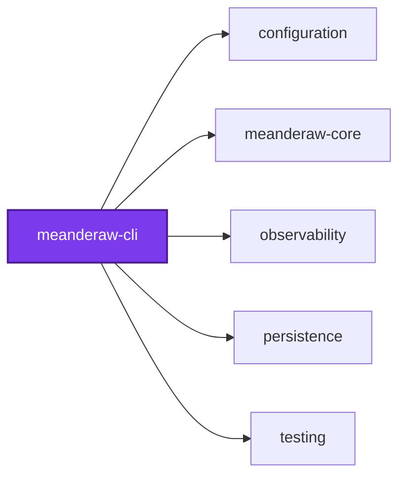
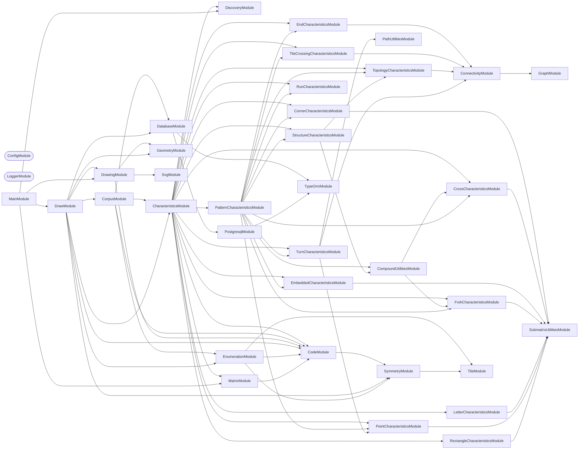

## 🕸️ Codependix

Dependency graphs exported by [codependix](https://github.com/Organizzolini/codebase/tree/main/projects/ic-suite/codependix/codependix-cli), regenerated by `nx run configuration:codependix:write`.

### Nx Neighborhood

<!-- codependix:start name="codependix-nx-projects" -->

<!-- codependix:end name="codependix-nx-projects" -->

### NestJS Module Graph

<!-- codependix:start name="codependix-nestjs-modules" -->


_Rounded modules are global: every module can inject them, so their edges are left out._
<!-- codependix:end name="codependix-nestjs-modules" -->

### File Imports

<!-- codependix:start name="codependix-file-imports" -->
```mermaid
graph LR
  file_callidescope_config_ts["callidescope.config.ts"]
  file_codependix_config_ts["codependix.config.ts"]
  file_codometer_config_ts["codometer.config.ts"]
  file_coinagerie_config_ts["coinagerie.config.ts"]
  file_eslint_config_ts["eslint.config.ts"]
  file_src_meanderaw_cli_constants_ts["src/meanderaw-cli.constants.ts"]
  file_src_meanderaw_cli_main_end_to_end_test_ts["src/meanderaw-cli.main.end-to-end.test.ts"]
  file_src_meanderaw_cli_main_ts["src/meanderaw-cli.main.ts"]
  file_src_meanderaw_cli_main_unit_test_ts["src/meanderaw-cli.main.unit.test.ts"]
  file_src_meanderaw_cli_module_ts["src/meanderaw-cli.module.ts"]
  file_src_meanderaw_cli_repl_ts["src/meanderaw-cli.repl.ts"]
  file_src_modules_characteristics_characteristic_context_service_ts["src/modules/characteristics/characteristic-context.service.ts"]
  file_src_modules_characteristics_characteristic_context_service_unit_test_ts["src/modules/characteristics/characteristic-context.service.unit.test.ts"]
  file_src_modules_characteristics_characteristics_constants_ts["src/modules/characteristics/characteristics.constants.ts"]
  file_src_modules_characteristics_characteristics_module_ts["src/modules/characteristics/characteristics.module.ts"]
  file_src_modules_characteristics_characteristics_module_unit_test_ts["src/modules/characteristics/characteristics.module.unit.test.ts"]
  file_src_modules_characteristics_characteristics_service_integration_test_ts["src/modules/characteristics/characteristics.service.integration.test.ts"]
  file_src_modules_characteristics_characteristics_service_ts["src/modules/characteristics/characteristics.service.ts"]
  file_src_modules_characteristics_characteristics_service_unit_test_ts["src/modules/characteristics/characteristics.service.unit.test.ts"]
  file_src_modules_characteristics_characteristics_types_ts["src/modules/characteristics/characteristics.types.ts"]
  file_src_modules_characteristics_compound_compound_utilities_module_ts["src/modules/characteristics/compound/compound-utilities.module.ts"]
  file_src_modules_characteristics_compound_compound_utilities_module_unit_test_ts["src/modules/characteristics/compound/compound-utilities.module.unit.test.ts"]
  file_src_modules_characteristics_compound_compound_utilities_service_ts["src/modules/characteristics/compound/compound-utilities.service.ts"]
  file_src_modules_characteristics_compound_compound_utilities_service_unit_test_ts["src/modules/characteristics/compound/compound-utilities.service.unit.test.ts"]
  file_src_modules_characteristics_compound_pattern_is_arcade_characteristic_service_ts["src/modules/characteristics/compound/pattern/is-arcade-characteristic.service.ts"]
  file_src_modules_characteristics_compound_pattern_is_arcade_characteristic_service_unit_test_ts["src/modules/characteristics/compound/pattern/is-arcade-characteristic.service.unit.test.ts"]
  file_src_modules_characteristics_compound_pattern_is_bars_characteristic_service_ts["src/modules/characteristics/compound/pattern/is-bars-characteristic.service.ts"]
  file_src_modules_characteristics_compound_pattern_is_bars_characteristic_service_unit_test_ts["src/modules/characteristics/compound/pattern/is-bars-characteristic.service.unit.test.ts"]
  file_src_modules_characteristics_compound_pattern_is_boxes_characteristic_service_ts["src/modules/characteristics/compound/pattern/is-boxes-characteristic.service.ts"]
  file_src_modules_characteristics_compound_pattern_is_boxes_characteristic_service_unit_test_ts["src/modules/characteristics/compound/pattern/is-boxes-characteristic.service.unit.test.ts"]
  file_src_modules_characteristics_compound_pattern_is_chain_characteristic_service_ts["src/modules/characteristics/compound/pattern/is-chain-characteristic.service.ts"]
  file_src_modules_characteristics_compound_pattern_is_chain_characteristic_service_unit_test_ts["src/modules/characteristics/compound/pattern/is-chain-characteristic.service.unit.test.ts"]
  file_src_modules_characteristics_compound_pattern_is_clasps_characteristic_service_ts["src/modules/characteristics/compound/pattern/is-clasps-characteristic.service.ts"]
  file_src_modules_characteristics_compound_pattern_is_clasps_characteristic_service_unit_test_ts["src/modules/characteristics/compound/pattern/is-clasps-characteristic.service.unit.test.ts"]
  file_src_modules_characteristics_compound_pattern_is_comb_characteristic_service_ts["src/modules/characteristics/compound/pattern/is-comb-characteristic.service.ts"]
  file_src_modules_characteristics_compound_pattern_is_comb_characteristic_service_unit_test_ts["src/modules/characteristics/compound/pattern/is-comb-characteristic.service.unit.test.ts"]
  file_src_modules_characteristics_compound_pattern_is_cross_characteristic_service_ts["src/modules/characteristics/compound/pattern/is-cross-characteristic.service.ts"]
  file_src_modules_characteristics_compound_pattern_is_cross_characteristic_service_unit_test_ts["src/modules/characteristics/compound/pattern/is-cross-characteristic.service.unit.test.ts"]
  file_src_modules_characteristics_compound_pattern_is_dots_characteristic_service_ts["src/modules/characteristics/compound/pattern/is-dots-characteristic.service.ts"]
  file_src_modules_characteristics_compound_pattern_is_dots_characteristic_service_unit_test_ts["src/modules/characteristics/compound/pattern/is-dots-characteristic.service.unit.test.ts"]
  file_src_modules_characteristics_compound_pattern_is_double_chain_characteristic_service_ts["src/modules/characteristics/compound/pattern/is-double-chain-characteristic.service.ts"]
  file_src_modules_characteristics_compound_pattern_is_double_chain_characteristic_service_unit_test_ts["src/modules/characteristics/compound/pattern/is-double-chain-characteristic.service.unit.test.ts"]
  file_src_modules_characteristics_compound_pattern_is_fork_characteristic_service_ts["src/modules/characteristics/compound/pattern/is-fork-characteristic.service.ts"]
  file_src_modules_characteristics_compound_pattern_is_fork_characteristic_service_unit_test_ts["src/modules/characteristics/compound/pattern/is-fork-characteristic.service.unit.test.ts"]
  file_src_modules_characteristics_compound_pattern_is_lines_characteristic_service_ts["src/modules/characteristics/compound/pattern/is-lines-characteristic.service.ts"]
  file_src_modules_characteristics_compound_pattern_is_lines_characteristic_service_unit_test_ts["src/modules/characteristics/compound/pattern/is-lines-characteristic.service.unit.test.ts"]
  file_src_modules_characteristics_compound_pattern_is_mesh_characteristic_service_ts["src/modules/characteristics/compound/pattern/is-mesh-characteristic.service.ts"]
  file_src_modules_characteristics_compound_pattern_is_mesh_characteristic_service_unit_test_ts["src/modules/characteristics/compound/pattern/is-mesh-characteristic.service.unit.test.ts"]
  file_src_modules_characteristics_compound_pattern_is_parallel_characteristic_service_ts["src/modules/characteristics/compound/pattern/is-parallel-characteristic.service.ts"]
  file_src_modules_characteristics_compound_pattern_is_parallel_characteristic_service_unit_test_ts["src/modules/characteristics/compound/pattern/is-parallel-characteristic.service.unit.test.ts"]
  file_src_modules_characteristics_compound_pattern_is_pure_tree_characteristic_service_ts["src/modules/characteristics/compound/pattern/is-pure-tree-characteristic.service.ts"]
  file_src_modules_characteristics_compound_pattern_is_pure_tree_characteristic_service_unit_test_ts["src/modules/characteristics/compound/pattern/is-pure-tree-characteristic.service.unit.test.ts"]
  file_src_modules_characteristics_compound_pattern_is_snake_characteristic_service_ts["src/modules/characteristics/compound/pattern/is-snake-characteristic.service.ts"]
  file_src_modules_characteristics_compound_pattern_is_snake_characteristic_service_unit_test_ts["src/modules/characteristics/compound/pattern/is-snake-characteristic.service.unit.test.ts"]
  file_src_modules_characteristics_compound_pattern_is_swirl_characteristic_service_ts["src/modules/characteristics/compound/pattern/is-swirl-characteristic.service.ts"]
  file_src_modules_characteristics_compound_pattern_is_swirl_characteristic_service_unit_test_ts["src/modules/characteristics/compound/pattern/is-swirl-characteristic.service.unit.test.ts"]
  file_src_modules_characteristics_compound_pattern_is_waterfalls_characteristic_service_ts["src/modules/characteristics/compound/pattern/is-waterfalls-characteristic.service.ts"]
  file_src_modules_characteristics_compound_pattern_is_waterfalls_characteristic_service_unit_test_ts["src/modules/characteristics/compound/pattern/is-waterfalls-characteristic.service.unit.test.ts"]
  file_src_modules_characteristics_compound_pattern_is_whirl_characteristic_service_ts["src/modules/characteristics/compound/pattern/is-whirl-characteristic.service.ts"]
  file_src_modules_characteristics_compound_pattern_is_whirl_characteristic_service_unit_test_ts["src/modules/characteristics/compound/pattern/is-whirl-characteristic.service.unit.test.ts"]
  file_src_modules_characteristics_compound_pattern_pattern_characteristics_module_ts["src/modules/characteristics/compound/pattern/pattern-characteristics.module.ts"]
  file_src_modules_characteristics_compound_pattern_strand_utilities_service_ts["src/modules/characteristics/compound/pattern/strand-utilities.service.ts"]
  file_src_modules_characteristics_compound_pattern_strand_utilities_service_unit_test_ts["src/modules/characteristics/compound/pattern/strand-utilities.service.unit.test.ts"]
  file_src_modules_characteristics_compound_structure_is_closed_loop_characteristic_service_ts["src/modules/characteristics/compound/structure/is-closed-loop-characteristic.service.ts"]
  file_src_modules_characteristics_compound_structure_is_closed_loop_characteristic_service_unit_test_ts["src/modules/characteristics/compound/structure/is-closed-loop-characteristic.service.unit.test.ts"]
  file_src_modules_characteristics_compound_structure_is_single_arc_characteristic_service_ts["src/modules/characteristics/compound/structure/is-single-arc-characteristic.service.ts"]
  file_src_modules_characteristics_compound_structure_is_single_arc_characteristic_service_unit_test_ts["src/modules/characteristics/compound/structure/is-single-arc-characteristic.service.unit.test.ts"]
  file_src_modules_characteristics_compound_structure_structure_characteristics_module_ts["src/modules/characteristics/compound/structure/structure-characteristics.module.ts"]
  file_src_modules_characteristics_connectivity_connectivity_module_ts["src/modules/characteristics/connectivity/connectivity.module.ts"]
  file_src_modules_characteristics_connectivity_connectivity_module_unit_test_ts["src/modules/characteristics/connectivity/connectivity.module.unit.test.ts"]
  file_src_modules_characteristics_connectivity_connectivity_service_ts["src/modules/characteristics/connectivity/connectivity.service.ts"]
  file_src_modules_characteristics_connectivity_connectivity_service_unit_test_ts["src/modules/characteristics/connectivity/connectivity.service.unit.test.ts"]
  file_src_modules_characteristics_connectivity_connectivity_types_ts["src/modules/characteristics/connectivity/connectivity.types.ts"]
  file_src_modules_characteristics_path_end_end_characteristics_module_ts["src/modules/characteristics/path/end/end-characteristics.module.ts"]
  file_src_modules_characteristics_path_end_end_utilities_service_ts["src/modules/characteristics/path/end/end-utilities.service.ts"]
  file_src_modules_characteristics_path_end_end_utilities_service_unit_test_ts["src/modules/characteristics/path/end/end-utilities.service.unit.test.ts"]
  file_src_modules_characteristics_path_end_end_types_ts["src/modules/characteristics/path/end/end.types.ts"]
  file_src_modules_characteristics_path_end_ends_are_lattice_neighbors_characteristic_service_ts["src/modules/characteristics/path/end/ends-are-lattice-neighbors-characteristic.service.ts"]
  file_src_modules_characteristics_path_end_ends_are_lattice_neighbors_characteristic_service_unit_test_ts["src/modules/characteristics/path/end/ends-are-lattice-neighbors-characteristic.service.unit.test.ts"]
  file_src_modules_characteristics_path_end_ends_on_border_rules_characteristic_service_ts["src/modules/characteristics/path/end/ends-on-border-rules-characteristic.service.ts"]
  file_src_modules_characteristics_path_end_ends_on_border_rules_characteristic_service_unit_test_ts["src/modules/characteristics/path/end/ends-on-border-rules-characteristic.service.unit.test.ts"]
  file_src_modules_characteristics_path_path_utilities_module_ts["src/modules/characteristics/path/path-utilities.module.ts"]
  file_src_modules_characteristics_path_path_utilities_module_unit_test_ts["src/modules/characteristics/path/path-utilities.module.unit.test.ts"]
  file_src_modules_characteristics_path_path_utilities_service_ts["src/modules/characteristics/path/path-utilities.service.ts"]
  file_src_modules_characteristics_path_path_utilities_service_unit_test_ts["src/modules/characteristics/path/path-utilities.service.unit.test.ts"]
  file_src_modules_characteristics_path_path_types_ts["src/modules/characteristics/path/path.types.ts"]
  file_src_modules_characteristics_path_tile_crossing_tile_crossing_characteristics_module_ts["src/modules/characteristics/path/tile-crossing/tile-crossing-characteristics.module.ts"]
  file_src_modules_characteristics_path_tile_crossing_tile_crossing_component_delta_count_characteristic_service_ts["src/modules/characteristics/path/tile-crossing/tile-crossing-component-delta-count-characteristic.service.ts"]
  file_src_modules_characteristics_path_tile_crossing_tile_crossing_component_delta_count_characteristic_service_unit_test_ts["src/modules/characteristics/path/tile-crossing/tile-crossing-component-delta-count-characteristic.service.unit.test.ts"]
  file_src_modules_characteristics_path_tile_crossing_tile_crossing_count_characteristic_service_ts["src/modules/characteristics/path/tile-crossing/tile-crossing-count-characteristic.service.ts"]
  file_src_modules_characteristics_path_tile_crossing_tile_crossing_count_characteristic_service_unit_test_ts["src/modules/characteristics/path/tile-crossing/tile-crossing-count-characteristic.service.unit.test.ts"]
  file_src_modules_characteristics_path_tile_crossing_tile_crossing_cycle_count_characteristic_service_ts["src/modules/characteristics/path/tile-crossing/tile-crossing-cycle-count-characteristic.service.ts"]
  file_src_modules_characteristics_path_tile_crossing_tile_crossing_cycle_count_characteristic_service_unit_test_ts["src/modules/characteristics/path/tile-crossing/tile-crossing-cycle-count-characteristic.service.unit.test.ts"]
  file_src_modules_characteristics_path_topology_betti_number_0_count_characteristic_service_ts["src/modules/characteristics/path/topology/betti-number-0-count-characteristic.service.ts"]
  file_src_modules_characteristics_path_topology_betti_number_0_count_characteristic_service_unit_test_ts["src/modules/characteristics/path/topology/betti-number-0-count-characteristic.service.unit.test.ts"]
  file_src_modules_characteristics_path_topology_betti_number_1_count_characteristic_service_ts["src/modules/characteristics/path/topology/betti-number-1-count-characteristic.service.ts"]
  file_src_modules_characteristics_path_topology_betti_number_1_count_characteristic_service_unit_test_ts["src/modules/characteristics/path/topology/betti-number-1-count-characteristic.service.unit.test.ts"]
  file_src_modules_characteristics_path_topology_free_end_count_characteristic_service_ts["src/modules/characteristics/path/topology/free-end-count-characteristic.service.ts"]
  file_src_modules_characteristics_path_topology_free_end_count_characteristic_service_unit_test_ts["src/modules/characteristics/path/topology/free-end-count-characteristic.service.unit.test.ts"]
  file_src_modules_characteristics_path_topology_topology_characteristics_module_ts["src/modules/characteristics/path/topology/topology-characteristics.module.ts"]
  file_src_modules_characteristics_path_turn_bottom_border_touch_count_characteristic_service_ts["src/modules/characteristics/path/turn/bottom-border-touch-count-characteristic.service.ts"]
  file_src_modules_characteristics_path_turn_bottom_border_touch_count_characteristic_service_unit_test_ts["src/modules/characteristics/path/turn/bottom-border-touch-count-characteristic.service.unit.test.ts"]
  file_src_modules_characteristics_path_turn_inflection_count_characteristic_service_ts["src/modules/characteristics/path/turn/inflection-count-characteristic.service.ts"]
  file_src_modules_characteristics_path_turn_inflection_count_characteristic_service_unit_test_ts["src/modules/characteristics/path/turn/inflection-count-characteristic.service.unit.test.ts"]
  file_src_modules_characteristics_path_turn_max_monotonic_turn_length_characteristic_service_ts["src/modules/characteristics/path/turn/max-monotonic-turn-length-characteristic.service.ts"]
  file_src_modules_characteristics_path_turn_max_monotonic_turn_length_characteristic_service_unit_test_ts["src/modules/characteristics/path/turn/max-monotonic-turn-length-characteristic.service.unit.test.ts"]
  file_src_modules_characteristics_path_turn_reverses_at_its_tightest_turn_characteristic_service_ts["src/modules/characteristics/path/turn/reverses-at-its-tightest-turn-characteristic.service.ts"]
  file_src_modules_characteristics_path_turn_reverses_at_its_tightest_turn_characteristic_service_unit_test_ts["src/modules/characteristics/path/turn/reverses-at-its-tightest-turn-characteristic.service.unit.test.ts"]
  file_src_modules_characteristics_path_turn_reverses_at_its_tightest_turn_types_ts["src/modules/characteristics/path/turn/reverses-at-its-tightest-turn.types.ts"]
  file_src_modules_characteristics_path_turn_tightest_turn_count_characteristic_service_ts["src/modules/characteristics/path/turn/tightest-turn-count-characteristic.service.ts"]
  file_src_modules_characteristics_path_turn_tightest_turn_count_characteristic_service_unit_test_ts["src/modules/characteristics/path/turn/tightest-turn-count-characteristic.service.unit.test.ts"]
  file_src_modules_characteristics_path_turn_top_border_touch_count_characteristic_service_ts["src/modules/characteristics/path/turn/top-border-touch-count-characteristic.service.ts"]
  file_src_modules_characteristics_path_turn_top_border_touch_count_characteristic_service_unit_test_ts["src/modules/characteristics/path/turn/top-border-touch-count-characteristic.service.unit.test.ts"]
  file_src_modules_characteristics_path_turn_total_turn_count_characteristic_service_ts["src/modules/characteristics/path/turn/total-turn-count-characteristic.service.ts"]
  file_src_modules_characteristics_path_turn_total_turn_count_characteristic_service_unit_test_ts["src/modules/characteristics/path/turn/total-turn-count-characteristic.service.unit.test.ts"]
  file_src_modules_characteristics_path_turn_turn_characteristics_module_ts["src/modules/characteristics/path/turn/turn-characteristics.module.ts"]
  file_src_modules_characteristics_submatrix_corner_corner_characteristics_module_ts["src/modules/characteristics/submatrix/corner/corner-characteristics.module.ts"]
  file_src_modules_characteristics_submatrix_corner_corner_count_characteristic_service_ts["src/modules/characteristics/submatrix/corner/corner-count-characteristic.service.ts"]
  file_src_modules_characteristics_submatrix_corner_corner_count_characteristic_service_unit_test_ts["src/modules/characteristics/submatrix/corner/corner-count-characteristic.service.unit.test.ts"]
  file_src_modules_characteristics_submatrix_corner_north_east_corner_count_characteristic_service_ts["src/modules/characteristics/submatrix/corner/north-east-corner-count-characteristic.service.ts"]
  file_src_modules_characteristics_submatrix_corner_north_east_corner_count_characteristic_service_unit_test_ts["src/modules/characteristics/submatrix/corner/north-east-corner-count-characteristic.service.unit.test.ts"]
  file_src_modules_characteristics_submatrix_corner_north_west_corner_count_characteristic_service_ts["src/modules/characteristics/submatrix/corner/north-west-corner-count-characteristic.service.ts"]
  file_src_modules_characteristics_submatrix_corner_north_west_corner_count_characteristic_service_unit_test_ts["src/modules/characteristics/submatrix/corner/north-west-corner-count-characteristic.service.unit.test.ts"]
  file_src_modules_characteristics_submatrix_corner_south_east_corner_count_characteristic_service_ts["src/modules/characteristics/submatrix/corner/south-east-corner-count-characteristic.service.ts"]
  file_src_modules_characteristics_submatrix_corner_south_east_corner_count_characteristic_service_unit_test_ts["src/modules/characteristics/submatrix/corner/south-east-corner-count-characteristic.service.unit.test.ts"]
  file_src_modules_characteristics_submatrix_corner_south_west_corner_count_characteristic_service_ts["src/modules/characteristics/submatrix/corner/south-west-corner-count-characteristic.service.ts"]
  file_src_modules_characteristics_submatrix_corner_south_west_corner_count_characteristic_service_unit_test_ts["src/modules/characteristics/submatrix/corner/south-west-corner-count-characteristic.service.unit.test.ts"]
  file_src_modules_characteristics_submatrix_cross_cross_characteristics_module_ts["src/modules/characteristics/submatrix/cross/cross-characteristics.module.ts"]
  file_src_modules_characteristics_submatrix_cross_cross_count_characteristic_service_ts["src/modules/characteristics/submatrix/cross/cross-count-characteristic.service.ts"]
  file_src_modules_characteristics_submatrix_cross_cross_count_characteristic_service_unit_test_ts["src/modules/characteristics/submatrix/cross/cross-count-characteristic.service.unit.test.ts"]
  file_src_modules_characteristics_submatrix_embedded_embedded_characteristics_module_ts["src/modules/characteristics/submatrix/embedded/embedded-characteristics.module.ts"]
  file_src_modules_characteristics_submatrix_embedded_embedded_u_count_characteristic_service_ts["src/modules/characteristics/submatrix/embedded/embedded-u-count-characteristic.service.ts"]
  file_src_modules_characteristics_submatrix_embedded_embedded_u_count_characteristic_service_unit_test_ts["src/modules/characteristics/submatrix/embedded/embedded-u-count-characteristic.service.unit.test.ts"]
  file_src_modules_characteristics_submatrix_fork_east_fork_count_characteristic_service_ts["src/modules/characteristics/submatrix/fork/east-fork-count-characteristic.service.ts"]
  file_src_modules_characteristics_submatrix_fork_east_fork_count_characteristic_service_unit_test_ts["src/modules/characteristics/submatrix/fork/east-fork-count-characteristic.service.unit.test.ts"]
  file_src_modules_characteristics_submatrix_fork_fork_characteristics_module_ts["src/modules/characteristics/submatrix/fork/fork-characteristics.module.ts"]
  file_src_modules_characteristics_submatrix_fork_fork_count_characteristic_service_ts["src/modules/characteristics/submatrix/fork/fork-count-characteristic.service.ts"]
  file_src_modules_characteristics_submatrix_fork_fork_count_characteristic_service_unit_test_ts["src/modules/characteristics/submatrix/fork/fork-count-characteristic.service.unit.test.ts"]
  file_src_modules_characteristics_submatrix_fork_north_fork_count_characteristic_service_ts["src/modules/characteristics/submatrix/fork/north-fork-count-characteristic.service.ts"]
  file_src_modules_characteristics_submatrix_fork_north_fork_count_characteristic_service_unit_test_ts["src/modules/characteristics/submatrix/fork/north-fork-count-characteristic.service.unit.test.ts"]
  file_src_modules_characteristics_submatrix_fork_south_fork_count_characteristic_service_ts["src/modules/characteristics/submatrix/fork/south-fork-count-characteristic.service.ts"]
  file_src_modules_characteristics_submatrix_fork_south_fork_count_characteristic_service_unit_test_ts["src/modules/characteristics/submatrix/fork/south-fork-count-characteristic.service.unit.test.ts"]
  file_src_modules_characteristics_submatrix_fork_west_fork_count_characteristic_service_ts["src/modules/characteristics/submatrix/fork/west-fork-count-characteristic.service.ts"]
  file_src_modules_characteristics_submatrix_fork_west_fork_count_characteristic_service_unit_test_ts["src/modules/characteristics/submatrix/fork/west-fork-count-characteristic.service.unit.test.ts"]
  file_src_modules_characteristics_submatrix_letter_a_latin_letter_characteristics_service_ts["src/modules/characteristics/submatrix/letter/a-latin-letter-characteristics.service.ts"]
  file_src_modules_characteristics_submatrix_letter_a_latin_letter_characteristics_service_unit_test_ts["src/modules/characteristics/submatrix/letter/a-latin-letter-characteristics.service.unit.test.ts"]
  file_src_modules_characteristics_submatrix_letter_ain_arabic_letter_characteristics_service_ts["src/modules/characteristics/submatrix/letter/ain-arabic-letter-characteristics.service.ts"]
  file_src_modules_characteristics_submatrix_letter_ain_arabic_letter_characteristics_service_unit_test_ts["src/modules/characteristics/submatrix/letter/ain-arabic-letter-characteristics.service.unit.test.ts"]
  file_src_modules_characteristics_submatrix_letter_alef_arabic_letter_characteristics_service_ts["src/modules/characteristics/submatrix/letter/alef-arabic-letter-characteristics.service.ts"]
  file_src_modules_characteristics_submatrix_letter_alef_arabic_letter_characteristics_service_unit_test_ts["src/modules/characteristics/submatrix/letter/alef-arabic-letter-characteristics.service.unit.test.ts"]
  file_src_modules_characteristics_submatrix_letter_ao_hanzi_letter_characteristics_service_ts["src/modules/characteristics/submatrix/letter/ao-hanzi-letter-characteristics.service.ts"]
  file_src_modules_characteristics_submatrix_letter_ao_hanzi_letter_characteristics_service_unit_test_ts["src/modules/characteristics/submatrix/letter/ao-hanzi-letter-characteristics.service.unit.test.ts"]
  file_src_modules_characteristics_submatrix_letter_b_latin_letter_characteristics_service_ts["src/modules/characteristics/submatrix/letter/b-latin-letter-characteristics.service.ts"]
  file_src_modules_characteristics_submatrix_letter_b_latin_letter_characteristics_service_unit_test_ts["src/modules/characteristics/submatrix/letter/b-latin-letter-characteristics.service.unit.test.ts"]
  file_src_modules_characteristics_submatrix_letter_beh_arabic_letter_characteristics_service_ts["src/modules/characteristics/submatrix/letter/beh-arabic-letter-characteristics.service.ts"]
  file_src_modules_characteristics_submatrix_letter_beh_arabic_letter_characteristics_service_unit_test_ts["src/modules/characteristics/submatrix/letter/beh-arabic-letter-characteristics.service.unit.test.ts"]
  file_src_modules_characteristics_submatrix_letter_c_latin_letter_characteristics_service_ts["src/modules/characteristics/submatrix/letter/c-latin-letter-characteristics.service.ts"]
  file_src_modules_characteristics_submatrix_letter_c_latin_letter_characteristics_service_unit_test_ts["src/modules/characteristics/submatrix/letter/c-latin-letter-characteristics.service.unit.test.ts"]
  file_src_modules_characteristics_submatrix_letter_dal_arabic_letter_characteristics_service_ts["src/modules/characteristics/submatrix/letter/dal-arabic-letter-characteristics.service.ts"]
  file_src_modules_characteristics_submatrix_letter_dal_arabic_letter_characteristics_service_unit_test_ts["src/modules/characteristics/submatrix/letter/dal-arabic-letter-characteristics.service.unit.test.ts"]
  file_src_modules_characteristics_submatrix_letter_dalet_hebrew_letter_characteristics_service_ts["src/modules/characteristics/submatrix/letter/dalet-hebrew-letter-characteristics.service.ts"]
  file_src_modules_characteristics_submatrix_letter_dalet_hebrew_letter_characteristics_service_unit_test_ts["src/modules/characteristics/submatrix/letter/dalet-hebrew-letter-characteristics.service.unit.test.ts"]
  file_src_modules_characteristics_submatrix_letter_delta_greek_letter_characteristics_service_ts["src/modules/characteristics/submatrix/letter/delta-greek-letter-characteristics.service.ts"]
  file_src_modules_characteristics_submatrix_letter_delta_greek_letter_characteristics_service_unit_test_ts["src/modules/characteristics/submatrix/letter/delta-greek-letter-characteristics.service.unit.test.ts"]
  file_src_modules_characteristics_submatrix_letter_e_latin_letter_characteristics_service_ts["src/modules/characteristics/submatrix/letter/e-latin-letter-characteristics.service.ts"]
  file_src_modules_characteristics_submatrix_letter_e_latin_letter_characteristics_service_unit_test_ts["src/modules/characteristics/submatrix/letter/e-latin-letter-characteristics.service.unit.test.ts"]
  file_src_modules_characteristics_submatrix_letter_f_latin_letter_characteristics_service_ts["src/modules/characteristics/submatrix/letter/f-latin-letter-characteristics.service.ts"]
  file_src_modules_characteristics_submatrix_letter_f_latin_letter_characteristics_service_unit_test_ts["src/modules/characteristics/submatrix/letter/f-latin-letter-characteristics.service.unit.test.ts"]
  file_src_modules_characteristics_submatrix_letter_feh_arabic_letter_characteristics_service_ts["src/modules/characteristics/submatrix/letter/feh-arabic-letter-characteristics.service.ts"]
  file_src_modules_characteristics_submatrix_letter_feh_arabic_letter_characteristics_service_unit_test_ts["src/modules/characteristics/submatrix/letter/feh-arabic-letter-characteristics.service.unit.test.ts"]
  file_src_modules_characteristics_submatrix_letter_gan_hanzi_letter_characteristics_service_ts["src/modules/characteristics/submatrix/letter/gan-hanzi-letter-characteristics.service.ts"]
  file_src_modules_characteristics_submatrix_letter_gan_hanzi_letter_characteristics_service_unit_test_ts["src/modules/characteristics/submatrix/letter/gan-hanzi-letter-characteristics.service.unit.test.ts"]
  file_src_modules_characteristics_submatrix_letter_h_latin_letter_characteristics_service_ts["src/modules/characteristics/submatrix/letter/h-latin-letter-characteristics.service.ts"]
  file_src_modules_characteristics_submatrix_letter_h_latin_letter_characteristics_service_unit_test_ts["src/modules/characteristics/submatrix/letter/h-latin-letter-characteristics.service.unit.test.ts"]
  file_src_modules_characteristics_submatrix_letter_hah_arabic_letter_characteristics_service_ts["src/modules/characteristics/submatrix/letter/hah-arabic-letter-characteristics.service.ts"]
  file_src_modules_characteristics_submatrix_letter_hah_arabic_letter_characteristics_service_unit_test_ts["src/modules/characteristics/submatrix/letter/hah-arabic-letter-characteristics.service.unit.test.ts"]
  file_src_modules_characteristics_submatrix_letter_heh_arabic_letter_characteristics_service_ts["src/modules/characteristics/submatrix/letter/heh-arabic-letter-characteristics.service.ts"]
  file_src_modules_characteristics_submatrix_letter_heh_arabic_letter_characteristics_service_unit_test_ts["src/modules/characteristics/submatrix/letter/heh-arabic-letter-characteristics.service.unit.test.ts"]
  file_src_modules_characteristics_submatrix_letter_i_latin_letter_characteristics_service_ts["src/modules/characteristics/submatrix/letter/i-latin-letter-characteristics.service.ts"]
  file_src_modules_characteristics_submatrix_letter_i_latin_letter_characteristics_service_unit_test_ts["src/modules/characteristics/submatrix/letter/i-latin-letter-characteristics.service.unit.test.ts"]
  file_src_modules_characteristics_submatrix_letter_jia_hanzi_letter_characteristics_service_ts["src/modules/characteristics/submatrix/letter/jia-hanzi-letter-characteristics.service.ts"]
  file_src_modules_characteristics_submatrix_letter_jia_hanzi_letter_characteristics_service_unit_test_ts["src/modules/characteristics/submatrix/letter/jia-hanzi-letter-characteristics.service.unit.test.ts"]
  file_src_modules_characteristics_submatrix_letter_jing_hanzi_letter_characteristics_service_ts["src/modules/characteristics/submatrix/letter/jing-hanzi-letter-characteristics.service.ts"]
  file_src_modules_characteristics_submatrix_letter_jing_hanzi_letter_characteristics_service_unit_test_ts["src/modules/characteristics/submatrix/letter/jing-hanzi-letter-characteristics.service.unit.test.ts"]
  file_src_modules_characteristics_submatrix_letter_kaf_arabic_letter_characteristics_service_ts["src/modules/characteristics/submatrix/letter/kaf-arabic-letter-characteristics.service.ts"]
  file_src_modules_characteristics_submatrix_letter_kaf_arabic_letter_characteristics_service_unit_test_ts["src/modules/characteristics/submatrix/letter/kaf-arabic-letter-characteristics.service.unit.test.ts"]
  file_src_modules_characteristics_submatrix_letter_kappa_greek_letter_characteristics_service_ts["src/modules/characteristics/submatrix/letter/kappa-greek-letter-characteristics.service.ts"]
  file_src_modules_characteristics_submatrix_letter_kappa_greek_letter_characteristics_service_unit_test_ts["src/modules/characteristics/submatrix/letter/kappa-greek-letter-characteristics.service.unit.test.ts"]
  file_src_modules_characteristics_submatrix_letter_kieuk_hangul_letter_characteristics_service_ts["src/modules/characteristics/submatrix/letter/kieuk-hangul-letter-characteristics.service.ts"]
  file_src_modules_characteristics_submatrix_letter_kieuk_hangul_letter_characteristics_service_unit_test_ts["src/modules/characteristics/submatrix/letter/kieuk-hangul-letter-characteristics.service.unit.test.ts"]
  file_src_modules_characteristics_submatrix_letter_l_latin_letter_characteristics_service_ts["src/modules/characteristics/submatrix/letter/l-latin-letter-characteristics.service.ts"]
  file_src_modules_characteristics_submatrix_letter_l_latin_letter_characteristics_service_unit_test_ts["src/modules/characteristics/submatrix/letter/l-latin-letter-characteristics.service.unit.test.ts"]
  file_src_modules_characteristics_submatrix_letter_lam_arabic_letter_characteristics_service_ts["src/modules/characteristics/submatrix/letter/lam-arabic-letter-characteristics.service.ts"]
  file_src_modules_characteristics_submatrix_letter_lam_arabic_letter_characteristics_service_unit_test_ts["src/modules/characteristics/submatrix/letter/lam-arabic-letter-characteristics.service.unit.test.ts"]
  file_src_modules_characteristics_submatrix_letter_lambda_greek_letter_characteristics_service_ts["src/modules/characteristics/submatrix/letter/lambda-greek-letter-characteristics.service.ts"]
  file_src_modules_characteristics_submatrix_letter_lambda_greek_letter_characteristics_service_unit_test_ts["src/modules/characteristics/submatrix/letter/lambda-greek-letter-characteristics.service.unit.test.ts"]
  file_src_modules_characteristics_submatrix_letter_lamed_hebrew_letter_characteristics_service_ts["src/modules/characteristics/submatrix/letter/lamed-hebrew-letter-characteristics.service.ts"]
  file_src_modules_characteristics_submatrix_letter_lamed_hebrew_letter_characteristics_service_unit_test_ts["src/modules/characteristics/submatrix/letter/lamed-hebrew-letter-characteristics.service.unit.test.ts"]
  file_src_modules_characteristics_submatrix_letter_letter_characteristics_module_ts["src/modules/characteristics/submatrix/letter/letter-characteristics.module.ts"]
  file_src_modules_characteristics_submatrix_letter_letter_characteristics_module_unit_test_ts["src/modules/characteristics/submatrix/letter/letter-characteristics.module.unit.test.ts"]
  file_src_modules_characteristics_submatrix_letter_letter_utilities_service_ts["src/modules/characteristics/submatrix/letter/letter-utilities.service.ts"]
  file_src_modules_characteristics_submatrix_letter_letter_utilities_service_unit_test_ts["src/modules/characteristics/submatrix/letter/letter-utilities.service.unit.test.ts"]
  file_src_modules_characteristics_submatrix_letter_letter_constants_ts["src/modules/characteristics/submatrix/letter/letter.constants.ts"]
  file_src_modules_characteristics_submatrix_letter_letter_types_ts["src/modules/characteristics/submatrix/letter/letter.types.ts"]
  file_src_modules_characteristics_submatrix_letter_m_latin_letter_characteristics_service_ts["src/modules/characteristics/submatrix/letter/m-latin-letter-characteristics.service.ts"]
  file_src_modules_characteristics_submatrix_letter_m_latin_letter_characteristics_service_unit_test_ts["src/modules/characteristics/submatrix/letter/m-latin-letter-characteristics.service.unit.test.ts"]
  file_src_modules_characteristics_submatrix_letter_meem_arabic_letter_characteristics_service_ts["src/modules/characteristics/submatrix/letter/meem-arabic-letter-characteristics.service.ts"]
  file_src_modules_characteristics_submatrix_letter_meem_arabic_letter_characteristics_service_unit_test_ts["src/modules/characteristics/submatrix/letter/meem-arabic-letter-characteristics.service.unit.test.ts"]
  file_src_modules_characteristics_submatrix_letter_mu_hanzi_letter_characteristics_service_ts["src/modules/characteristics/submatrix/letter/mu-hanzi-letter-characteristics.service.ts"]
  file_src_modules_characteristics_submatrix_letter_mu_hanzi_letter_characteristics_service_unit_test_ts["src/modules/characteristics/submatrix/letter/mu-hanzi-letter-characteristics.service.unit.test.ts"]
  file_src_modules_characteristics_submatrix_letter_n_latin_letter_characteristics_service_ts["src/modules/characteristics/submatrix/letter/n-latin-letter-characteristics.service.ts"]
  file_src_modules_characteristics_submatrix_letter_n_latin_letter_characteristics_service_unit_test_ts["src/modules/characteristics/submatrix/letter/n-latin-letter-characteristics.service.unit.test.ts"]
  file_src_modules_characteristics_submatrix_letter_noon_arabic_letter_characteristics_service_ts["src/modules/characteristics/submatrix/letter/noon-arabic-letter-characteristics.service.ts"]
  file_src_modules_characteristics_submatrix_letter_noon_arabic_letter_characteristics_service_unit_test_ts["src/modules/characteristics/submatrix/letter/noon-arabic-letter-characteristics.service.unit.test.ts"]
  file_src_modules_characteristics_submatrix_letter_o_latin_letter_characteristics_service_ts["src/modules/characteristics/submatrix/letter/o-latin-letter-characteristics.service.ts"]
  file_src_modules_characteristics_submatrix_letter_o_latin_letter_characteristics_service_unit_test_ts["src/modules/characteristics/submatrix/letter/o-latin-letter-characteristics.service.unit.test.ts"]
  file_src_modules_characteristics_submatrix_letter_omega_greek_letter_characteristics_service_ts["src/modules/characteristics/submatrix/letter/omega-greek-letter-characteristics.service.ts"]
  file_src_modules_characteristics_submatrix_letter_omega_greek_letter_characteristics_service_unit_test_ts["src/modules/characteristics/submatrix/letter/omega-greek-letter-characteristics.service.unit.test.ts"]
  file_src_modules_characteristics_submatrix_letter_phi_greek_letter_characteristics_service_ts["src/modules/characteristics/submatrix/letter/phi-greek-letter-characteristics.service.ts"]
  file_src_modules_characteristics_submatrix_letter_phi_greek_letter_characteristics_service_unit_test_ts["src/modules/characteristics/submatrix/letter/phi-greek-letter-characteristics.service.unit.test.ts"]
  file_src_modules_characteristics_submatrix_letter_pieup_hangul_letter_characteristics_service_ts["src/modules/characteristics/submatrix/letter/pieup-hangul-letter-characteristics.service.ts"]
  file_src_modules_characteristics_submatrix_letter_pieup_hangul_letter_characteristics_service_unit_test_ts["src/modules/characteristics/submatrix/letter/pieup-hangul-letter-characteristics.service.unit.test.ts"]
  file_src_modules_characteristics_submatrix_letter_psi_greek_letter_characteristics_service_ts["src/modules/characteristics/submatrix/letter/psi-greek-letter-characteristics.service.ts"]
  file_src_modules_characteristics_submatrix_letter_psi_greek_letter_characteristics_service_unit_test_ts["src/modules/characteristics/submatrix/letter/psi-greek-letter-characteristics.service.unit.test.ts"]
  file_src_modules_characteristics_submatrix_letter_qaf_arabic_letter_characteristics_service_ts["src/modules/characteristics/submatrix/letter/qaf-arabic-letter-characteristics.service.ts"]
  file_src_modules_characteristics_submatrix_letter_qaf_arabic_letter_characteristics_service_unit_test_ts["src/modules/characteristics/submatrix/letter/qaf-arabic-letter-characteristics.service.unit.test.ts"]
  file_src_modules_characteristics_submatrix_letter_reh_arabic_letter_characteristics_service_ts["src/modules/characteristics/submatrix/letter/reh-arabic-letter-characteristics.service.ts"]
  file_src_modules_characteristics_submatrix_letter_reh_arabic_letter_characteristics_service_unit_test_ts["src/modules/characteristics/submatrix/letter/reh-arabic-letter-characteristics.service.unit.test.ts"]
  file_src_modules_characteristics_submatrix_letter_rho_greek_letter_characteristics_service_ts["src/modules/characteristics/submatrix/letter/rho-greek-letter-characteristics.service.ts"]
  file_src_modules_characteristics_submatrix_letter_rho_greek_letter_characteristics_service_unit_test_ts["src/modules/characteristics/submatrix/letter/rho-greek-letter-characteristics.service.unit.test.ts"]
  file_src_modules_characteristics_submatrix_letter_s_latin_letter_characteristics_service_ts["src/modules/characteristics/submatrix/letter/s-latin-letter-characteristics.service.ts"]
  file_src_modules_characteristics_submatrix_letter_s_latin_letter_characteristics_service_unit_test_ts["src/modules/characteristics/submatrix/letter/s-latin-letter-characteristics.service.unit.test.ts"]
  file_src_modules_characteristics_submatrix_letter_sad_arabic_letter_characteristics_service_ts["src/modules/characteristics/submatrix/letter/sad-arabic-letter-characteristics.service.ts"]
  file_src_modules_characteristics_submatrix_letter_sad_arabic_letter_characteristics_service_unit_test_ts["src/modules/characteristics/submatrix/letter/sad-arabic-letter-characteristics.service.unit.test.ts"]
  file_src_modules_characteristics_submatrix_letter_seen_arabic_letter_characteristics_service_ts["src/modules/characteristics/submatrix/letter/seen-arabic-letter-characteristics.service.ts"]
  file_src_modules_characteristics_submatrix_letter_seen_arabic_letter_characteristics_service_unit_test_ts["src/modules/characteristics/submatrix/letter/seen-arabic-letter-characteristics.service.unit.test.ts"]
  file_src_modules_characteristics_submatrix_letter_shang_hanzi_letter_characteristics_service_ts["src/modules/characteristics/submatrix/letter/shang-hanzi-letter-characteristics.service.ts"]
  file_src_modules_characteristics_submatrix_letter_shang_hanzi_letter_characteristics_service_unit_test_ts["src/modules/characteristics/submatrix/letter/shang-hanzi-letter-characteristics.service.unit.test.ts"]
  file_src_modules_characteristics_submatrix_letter_shen_hanzi_letter_characteristics_service_ts["src/modules/characteristics/submatrix/letter/shen-hanzi-letter-characteristics.service.ts"]
  file_src_modules_characteristics_submatrix_letter_shen_hanzi_letter_characteristics_service_unit_test_ts["src/modules/characteristics/submatrix/letter/shen-hanzi-letter-characteristics.service.unit.test.ts"]
  file_src_modules_characteristics_submatrix_letter_sigma_greek_letter_characteristics_service_ts["src/modules/characteristics/submatrix/letter/sigma-greek-letter-characteristics.service.ts"]
  file_src_modules_characteristics_submatrix_letter_sigma_greek_letter_characteristics_service_unit_test_ts["src/modules/characteristics/submatrix/letter/sigma-greek-letter-characteristics.service.unit.test.ts"]
  file_src_modules_characteristics_submatrix_letter_t_latin_letter_characteristics_service_ts["src/modules/characteristics/submatrix/letter/t-latin-letter-characteristics.service.ts"]
  file_src_modules_characteristics_submatrix_letter_t_latin_letter_characteristics_service_unit_test_ts["src/modules/characteristics/submatrix/letter/t-latin-letter-characteristics.service.unit.test.ts"]
  file_src_modules_characteristics_submatrix_letter_tah_arabic_letter_characteristics_service_ts["src/modules/characteristics/submatrix/letter/tah-arabic-letter-characteristics.service.ts"]
  file_src_modules_characteristics_submatrix_letter_tah_arabic_letter_characteristics_service_unit_test_ts["src/modules/characteristics/submatrix/letter/tah-arabic-letter-characteristics.service.unit.test.ts"]
  file_src_modules_characteristics_submatrix_letter_tav_hebrew_letter_characteristics_service_ts["src/modules/characteristics/submatrix/letter/tav-hebrew-letter-characteristics.service.ts"]
  file_src_modules_characteristics_submatrix_letter_tav_hebrew_letter_characteristics_service_unit_test_ts["src/modules/characteristics/submatrix/letter/tav-hebrew-letter-characteristics.service.unit.test.ts"]
  file_src_modules_characteristics_submatrix_letter_tian_hanzi_letter_characteristics_service_ts["src/modules/characteristics/submatrix/letter/tian-hanzi-letter-characteristics.service.ts"]
  file_src_modules_characteristics_submatrix_letter_tian_hanzi_letter_characteristics_service_unit_test_ts["src/modules/characteristics/submatrix/letter/tian-hanzi-letter-characteristics.service.unit.test.ts"]
  file_src_modules_characteristics_submatrix_letter_tu_hanzi_letter_characteristics_service_ts["src/modules/characteristics/submatrix/letter/tu-hanzi-letter-characteristics.service.ts"]
  file_src_modules_characteristics_submatrix_letter_tu_hanzi_letter_characteristics_service_unit_test_ts["src/modules/characteristics/submatrix/letter/tu-hanzi-letter-characteristics.service.unit.test.ts"]
  file_src_modules_characteristics_submatrix_letter_tu_soil_hanzi_letter_characteristics_service_ts["src/modules/characteristics/submatrix/letter/tu-soil-hanzi-letter-characteristics.service.ts"]
  file_src_modules_characteristics_submatrix_letter_tu_soil_hanzi_letter_characteristics_service_unit_test_ts["src/modules/characteristics/submatrix/letter/tu-soil-hanzi-letter-characteristics.service.unit.test.ts"]
  file_src_modules_characteristics_submatrix_letter_u_latin_letter_characteristics_service_ts["src/modules/characteristics/submatrix/letter/u-latin-letter-characteristics.service.ts"]
  file_src_modules_characteristics_submatrix_letter_u_latin_letter_characteristics_service_unit_test_ts["src/modules/characteristics/submatrix/letter/u-latin-letter-characteristics.service.unit.test.ts"]
  file_src_modules_characteristics_submatrix_letter_w_latin_letter_characteristics_service_ts["src/modules/characteristics/submatrix/letter/w-latin-letter-characteristics.service.ts"]
  file_src_modules_characteristics_submatrix_letter_w_latin_letter_characteristics_service_unit_test_ts["src/modules/characteristics/submatrix/letter/w-latin-letter-characteristics.service.unit.test.ts"]
  file_src_modules_characteristics_submatrix_letter_wang_hanzi_letter_characteristics_service_ts["src/modules/characteristics/submatrix/letter/wang-hanzi-letter-characteristics.service.ts"]
  file_src_modules_characteristics_submatrix_letter_wang_hanzi_letter_characteristics_service_unit_test_ts["src/modules/characteristics/submatrix/letter/wang-hanzi-letter-characteristics.service.unit.test.ts"]
  file_src_modules_characteristics_submatrix_letter_waw_arabic_letter_characteristics_service_ts["src/modules/characteristics/submatrix/letter/waw-arabic-letter-characteristics.service.ts"]
  file_src_modules_characteristics_submatrix_letter_waw_arabic_letter_characteristics_service_unit_test_ts["src/modules/characteristics/submatrix/letter/waw-arabic-letter-characteristics.service.unit.test.ts"]
  file_src_modules_characteristics_submatrix_letter_x_latin_letter_characteristics_service_ts["src/modules/characteristics/submatrix/letter/x-latin-letter-characteristics.service.ts"]
  file_src_modules_characteristics_submatrix_letter_x_latin_letter_characteristics_service_unit_test_ts["src/modules/characteristics/submatrix/letter/x-latin-letter-characteristics.service.unit.test.ts"]
  file_src_modules_characteristics_submatrix_letter_y_latin_letter_characteristics_service_ts["src/modules/characteristics/submatrix/letter/y-latin-letter-characteristics.service.ts"]
  file_src_modules_characteristics_submatrix_letter_y_latin_letter_characteristics_service_unit_test_ts["src/modules/characteristics/submatrix/letter/y-latin-letter-characteristics.service.unit.test.ts"]
  file_src_modules_characteristics_submatrix_letter_ya_hangul_letter_characteristics_service_ts["src/modules/characteristics/submatrix/letter/ya-hangul-letter-characteristics.service.ts"]
  file_src_modules_characteristics_submatrix_letter_ya_hangul_letter_characteristics_service_unit_test_ts["src/modules/characteristics/submatrix/letter/ya-hangul-letter-characteristics.service.unit.test.ts"]
  file_src_modules_characteristics_submatrix_letter_yeh_arabic_letter_characteristics_service_ts["src/modules/characteristics/submatrix/letter/yeh-arabic-letter-characteristics.service.ts"]
  file_src_modules_characteristics_submatrix_letter_yeh_arabic_letter_characteristics_service_unit_test_ts["src/modules/characteristics/submatrix/letter/yeh-arabic-letter-characteristics.service.unit.test.ts"]
  file_src_modules_characteristics_submatrix_letter_yeo_hangul_letter_characteristics_service_ts["src/modules/characteristics/submatrix/letter/yeo-hangul-letter-characteristics.service.ts"]
  file_src_modules_characteristics_submatrix_letter_yeo_hangul_letter_characteristics_service_unit_test_ts["src/modules/characteristics/submatrix/letter/yeo-hangul-letter-characteristics.service.unit.test.ts"]
  file_src_modules_characteristics_submatrix_letter_yo_hangul_letter_characteristics_service_ts["src/modules/characteristics/submatrix/letter/yo-hangul-letter-characteristics.service.ts"]
  file_src_modules_characteristics_submatrix_letter_yo_hangul_letter_characteristics_service_unit_test_ts["src/modules/characteristics/submatrix/letter/yo-hangul-letter-characteristics.service.unit.test.ts"]
  file_src_modules_characteristics_submatrix_letter_you_hanzi_letter_characteristics_service_ts["src/modules/characteristics/submatrix/letter/you-hanzi-letter-characteristics.service.ts"]
  file_src_modules_characteristics_submatrix_letter_you_hanzi_letter_characteristics_service_unit_test_ts["src/modules/characteristics/submatrix/letter/you-hanzi-letter-characteristics.service.unit.test.ts"]
  file_src_modules_characteristics_submatrix_letter_yu_hangul_letter_characteristics_service_ts["src/modules/characteristics/submatrix/letter/yu-hangul-letter-characteristics.service.ts"]
  file_src_modules_characteristics_submatrix_letter_yu_hangul_letter_characteristics_service_unit_test_ts["src/modules/characteristics/submatrix/letter/yu-hangul-letter-characteristics.service.unit.test.ts"]
  file_src_modules_characteristics_submatrix_letter_yu_katakana_letter_characteristics_service_ts["src/modules/characteristics/submatrix/letter/yu-katakana-letter-characteristics.service.ts"]
  file_src_modules_characteristics_submatrix_letter_yu_katakana_letter_characteristics_service_unit_test_ts["src/modules/characteristics/submatrix/letter/yu-katakana-letter-characteristics.service.unit.test.ts"]
  file_src_modules_characteristics_submatrix_letter_z_latin_letter_characteristics_service_ts["src/modules/characteristics/submatrix/letter/z-latin-letter-characteristics.service.ts"]
  file_src_modules_characteristics_submatrix_letter_z_latin_letter_characteristics_service_unit_test_ts["src/modules/characteristics/submatrix/letter/z-latin-letter-characteristics.service.unit.test.ts"]
  file_src_modules_characteristics_submatrix_point_density_characteristic_service_ts["src/modules/characteristics/submatrix/point/density-characteristic.service.ts"]
  file_src_modules_characteristics_submatrix_point_density_characteristic_service_unit_test_ts["src/modules/characteristics/submatrix/point/density-characteristic.service.unit.test.ts"]
  file_src_modules_characteristics_submatrix_point_dot_count_characteristic_service_ts["src/modules/characteristics/submatrix/point/dot-count-characteristic.service.ts"]
  file_src_modules_characteristics_submatrix_point_dot_count_characteristic_service_unit_test_ts["src/modules/characteristics/submatrix/point/dot-count-characteristic.service.unit.test.ts"]
  file_src_modules_characteristics_submatrix_point_double_horizontal_edge_count_characteristic_service_ts["src/modules/characteristics/submatrix/point/double-horizontal-edge-count-characteristic.service.ts"]
  file_src_modules_characteristics_submatrix_point_double_horizontal_edge_count_characteristic_service_unit_test_ts["src/modules/characteristics/submatrix/point/double-horizontal-edge-count-characteristic.service.unit.test.ts"]
  file_src_modules_characteristics_submatrix_point_double_vertical_edge_count_characteristic_service_ts["src/modules/characteristics/submatrix/point/double-vertical-edge-count-characteristic.service.ts"]
  file_src_modules_characteristics_submatrix_point_double_vertical_edge_count_characteristic_service_unit_test_ts["src/modules/characteristics/submatrix/point/double-vertical-edge-count-characteristic.service.unit.test.ts"]
  file_src_modules_characteristics_submatrix_point_east_edge_count_characteristic_service_ts["src/modules/characteristics/submatrix/point/east-edge-count-characteristic.service.ts"]
  file_src_modules_characteristics_submatrix_point_east_edge_count_characteristic_service_unit_test_ts["src/modules/characteristics/submatrix/point/east-edge-count-characteristic.service.unit.test.ts"]
  file_src_modules_characteristics_submatrix_point_edge_count_characteristic_service_ts["src/modules/characteristics/submatrix/point/edge-count-characteristic.service.ts"]
  file_src_modules_characteristics_submatrix_point_edge_count_characteristic_service_unit_test_ts["src/modules/characteristics/submatrix/point/edge-count-characteristic.service.unit.test.ts"]
  file_src_modules_characteristics_submatrix_point_ink_point_count_characteristic_service_ts["src/modules/characteristics/submatrix/point/ink-point-count-characteristic.service.ts"]
  file_src_modules_characteristics_submatrix_point_ink_point_count_characteristic_service_unit_test_ts["src/modules/characteristics/submatrix/point/ink-point-count-characteristic.service.unit.test.ts"]
  file_src_modules_characteristics_submatrix_point_north_edge_count_characteristic_service_ts["src/modules/characteristics/submatrix/point/north-edge-count-characteristic.service.ts"]
  file_src_modules_characteristics_submatrix_point_north_edge_count_characteristic_service_unit_test_ts["src/modules/characteristics/submatrix/point/north-edge-count-characteristic.service.unit.test.ts"]
  file_src_modules_characteristics_submatrix_point_point_characteristics_module_ts["src/modules/characteristics/submatrix/point/point-characteristics.module.ts"]
  file_src_modules_characteristics_submatrix_point_point_characteristics_module_unit_test_ts["src/modules/characteristics/submatrix/point/point-characteristics.module.unit.test.ts"]
  file_src_modules_characteristics_submatrix_point_point_utilities_service_ts["src/modules/characteristics/submatrix/point/point-utilities.service.ts"]
  file_src_modules_characteristics_submatrix_point_point_utilities_service_unit_test_ts["src/modules/characteristics/submatrix/point/point-utilities.service.unit.test.ts"]
  file_src_modules_characteristics_submatrix_point_south_edge_count_characteristic_service_ts["src/modules/characteristics/submatrix/point/south-edge-count-characteristic.service.ts"]
  file_src_modules_characteristics_submatrix_point_south_edge_count_characteristic_service_unit_test_ts["src/modules/characteristics/submatrix/point/south-edge-count-characteristic.service.unit.test.ts"]
  file_src_modules_characteristics_submatrix_point_west_edge_count_characteristic_service_ts["src/modules/characteristics/submatrix/point/west-edge-count-characteristic.service.ts"]
  file_src_modules_characteristics_submatrix_point_west_edge_count_characteristic_service_unit_test_ts["src/modules/characteristics/submatrix/point/west-edge-count-characteristic.service.unit.test.ts"]
  file_src_modules_characteristics_submatrix_rectangle_horizontal_rectangle_count_characteristic_service_ts["src/modules/characteristics/submatrix/rectangle/horizontal-rectangle-count-characteristic.service.ts"]
  file_src_modules_characteristics_submatrix_rectangle_horizontal_rectangle_count_characteristic_service_unit_test_ts["src/modules/characteristics/submatrix/rectangle/horizontal-rectangle-count-characteristic.service.unit.test.ts"]
  file_src_modules_characteristics_submatrix_rectangle_rectangle_characteristics_module_ts["src/modules/characteristics/submatrix/rectangle/rectangle-characteristics.module.ts"]
  file_src_modules_characteristics_submatrix_rectangle_rectangle_utilities_service_ts["src/modules/characteristics/submatrix/rectangle/rectangle-utilities.service.ts"]
  file_src_modules_characteristics_submatrix_rectangle_rectangle_utilities_service_unit_test_ts["src/modules/characteristics/submatrix/rectangle/rectangle-utilities.service.unit.test.ts"]
  file_src_modules_characteristics_submatrix_rectangle_vertical_rectangle_count_characteristic_service_ts["src/modules/characteristics/submatrix/rectangle/vertical-rectangle-count-characteristic.service.ts"]
  file_src_modules_characteristics_submatrix_rectangle_vertical_rectangle_count_characteristic_service_unit_test_ts["src/modules/characteristics/submatrix/rectangle/vertical-rectangle-count-characteristic.service.unit.test.ts"]
  file_src_modules_characteristics_submatrix_run_longest_horizontal_run_length_characteristic_service_ts["src/modules/characteristics/submatrix/run/longest-horizontal-run-length-characteristic.service.ts"]
  file_src_modules_characteristics_submatrix_run_longest_horizontal_run_length_characteristic_service_unit_test_ts["src/modules/characteristics/submatrix/run/longest-horizontal-run-length-characteristic.service.unit.test.ts"]
  file_src_modules_characteristics_submatrix_run_longest_vertical_run_length_characteristic_service_ts["src/modules/characteristics/submatrix/run/longest-vertical-run-length-characteristic.service.ts"]
  file_src_modules_characteristics_submatrix_run_longest_vertical_run_length_characteristic_service_unit_test_ts["src/modules/characteristics/submatrix/run/longest-vertical-run-length-characteristic.service.unit.test.ts"]
  file_src_modules_characteristics_submatrix_run_run_characteristics_module_ts["src/modules/characteristics/submatrix/run/run-characteristics.module.ts"]
  file_src_modules_characteristics_submatrix_run_run_utilities_service_ts["src/modules/characteristics/submatrix/run/run-utilities.service.ts"]
  file_src_modules_characteristics_submatrix_run_run_utilities_service_unit_test_ts["src/modules/characteristics/submatrix/run/run-utilities.service.unit.test.ts"]
  file_src_modules_characteristics_submatrix_submatrix_utilities_module_ts["src/modules/characteristics/submatrix/submatrix-utilities.module.ts"]
  file_src_modules_characteristics_submatrix_submatrix_utilities_module_unit_test_ts["src/modules/characteristics/submatrix/submatrix-utilities.module.unit.test.ts"]
  file_src_modules_characteristics_submatrix_submatrix_utilities_service_ts["src/modules/characteristics/submatrix/submatrix-utilities.service.ts"]
  file_src_modules_characteristics_submatrix_submatrix_utilities_service_unit_test_ts["src/modules/characteristics/submatrix/submatrix-utilities.service.unit.test.ts"]
  file_src_modules_characteristics_submatrix_submatrix_types_ts["src/modules/characteristics/submatrix/submatrix.types.ts"]
  file_src_modules_corpus_corpus_constants_ts["src/modules/corpus/corpus.constants.ts"]
  file_src_modules_corpus_corpus_module_ts["src/modules/corpus/corpus.module.ts"]
  file_src_modules_corpus_corpus_service_ts["src/modules/corpus/corpus.service.ts"]
  file_src_modules_corpus_corpus_service_unit_test_ts["src/modules/corpus/corpus.service.unit.test.ts"]
  file_src_modules_corpus_corpus_types_ts["src/modules/corpus/corpus.types.ts"]
  file_src_modules_corpus_historical_corpus_1_constants_ts["src/modules/corpus/historical-corpus-1.constants.ts"]
  file_src_modules_corpus_historical_corpus_10_constants_ts["src/modules/corpus/historical-corpus-10.constants.ts"]
  file_src_modules_corpus_historical_corpus_11_constants_ts["src/modules/corpus/historical-corpus-11.constants.ts"]
  file_src_modules_corpus_historical_corpus_2_constants_ts["src/modules/corpus/historical-corpus-2.constants.ts"]
  file_src_modules_corpus_historical_corpus_3_constants_ts["src/modules/corpus/historical-corpus-3.constants.ts"]
  file_src_modules_corpus_historical_corpus_4_constants_ts["src/modules/corpus/historical-corpus-4.constants.ts"]
  file_src_modules_corpus_historical_corpus_5_constants_ts["src/modules/corpus/historical-corpus-5.constants.ts"]
  file_src_modules_corpus_historical_corpus_6_constants_ts["src/modules/corpus/historical-corpus-6.constants.ts"]
  file_src_modules_corpus_historical_corpus_7_constants_ts["src/modules/corpus/historical-corpus-7.constants.ts"]
  file_src_modules_corpus_historical_corpus_8_constants_ts["src/modules/corpus/historical-corpus-8.constants.ts"]
  file_src_modules_corpus_historical_corpus_9_constants_ts["src/modules/corpus/historical-corpus-9.constants.ts"]
  file_src_modules_corpus_historical_corpus_constants_ts["src/modules/corpus/historical-corpus.constants.ts"]
  file_src_modules_database_data_source_constants_ts["src/modules/database/data-source.constants.ts"]
  file_src_modules_database_database_patterns_service_integration_test_ts["src/modules/database/database-patterns.service.integration.test.ts"]
  file_src_modules_database_database_constants_ts["src/modules/database/database.constants.ts"]
  file_src_modules_database_database_module_integration_test_ts["src/modules/database/database.module.integration.test.ts"]
  file_src_modules_database_database_module_ts["src/modules/database/database.module.ts"]
  file_src_modules_database_database_service_integration_test_ts["src/modules/database/database.service.integration.test.ts"]
  file_src_modules_database_database_service_ts["src/modules/database/database.service.ts"]
  file_src_modules_database_database_service_unit_test_ts["src/modules/database/database.service.unit.test.ts"]
  file_src_modules_database_database_types_ts["src/modules/database/database.types.ts"]
  file_src_modules_database_entities_meander_entity_ts["src/modules/database/entities/meander.entity.ts"]
  file_src_modules_database_migrations_1791160950069_migration_ts["src/modules/database/migrations/1791160950069-migration.ts"]
  file_src_modules_database_migrations_1791414023001_migration_ts["src/modules/database/migrations/1791414023001-migration.ts"]
  file_src_modules_draw_draw_code_service_ts["src/modules/draw/draw-code.service.ts"]
  file_src_modules_draw_draw_code_service_unit_test_ts["src/modules/draw/draw-code.service.unit.test.ts"]
  file_src_modules_draw_draw_enumeration_service_integration_test_ts["src/modules/draw/draw-enumeration.service.integration.test.ts"]
  file_src_modules_draw_draw_enumeration_service_ts["src/modules/draw/draw-enumeration.service.ts"]
  file_src_modules_draw_draw_enumeration_service_unit_test_ts["src/modules/draw/draw-enumeration.service.unit.test.ts"]
  file_src_modules_draw_draw_index_constants_ts["src/modules/draw/draw-index.constants.ts"]
  file_src_modules_draw_draw_index_service_integration_test_ts["src/modules/draw/draw-index.service.integration.test.ts"]
  file_src_modules_draw_draw_index_service_ts["src/modules/draw/draw-index.service.ts"]
  file_src_modules_draw_draw_index_service_unit_test_ts["src/modules/draw/draw-index.service.unit.test.ts"]
  file_src_modules_draw_draw_index_types_ts["src/modules/draw/draw-index.types.ts"]
  file_src_modules_draw_draw_pool_service_integration_test_ts["src/modules/draw/draw-pool.service.integration.test.ts"]
  file_src_modules_draw_draw_pool_service_ts["src/modules/draw/draw-pool.service.ts"]
  file_src_modules_draw_draw_pool_service_unit_test_ts["src/modules/draw/draw-pool.service.unit.test.ts"]
  file_src_modules_draw_draw_record_service_ts["src/modules/draw/draw-record.service.ts"]
  file_src_modules_draw_draw_record_service_unit_test_ts["src/modules/draw/draw-record.service.unit.test.ts"]
  file_src_modules_draw_draw_run_collision_command_integration_test_ts["src/modules/draw/draw-run-collision.command.integration.test.ts"]
  file_src_modules_draw_draw_run_regeneration_command_integration_test_ts["src/modules/draw/draw-run-regeneration.command.integration.test.ts"]
  file_src_modules_draw_draw_run_command_integration_test_ts["src/modules/draw/draw-run.command.integration.test.ts"]
  file_src_modules_draw_draw_worker_module_ts["src/modules/draw/draw-worker.module.ts"]
  file_src_modules_draw_draw_worker_service_ts["src/modules/draw/draw-worker.service.ts"]
  file_src_modules_draw_draw_worker_service_unit_test_ts["src/modules/draw/draw-worker.service.unit.test.ts"]
  file_src_modules_draw_draw_command_integration_test_ts["src/modules/draw/draw.command.integration.test.ts"]
  file_src_modules_draw_draw_command_ts["src/modules/draw/draw.command.ts"]
  file_src_modules_draw_draw_command_unit_test_ts["src/modules/draw/draw.command.unit.test.ts"]
  file_src_modules_draw_draw_constants_ts["src/modules/draw/draw.constants.ts"]
  file_src_modules_draw_draw_module_ts["src/modules/draw/draw.module.ts"]
  file_src_modules_draw_draw_types_ts["src/modules/draw/draw.types.ts"]
  file_src_modules_enumeration_enumeration_constants_ts["src/modules/enumeration/enumeration.constants.ts"]
  file_src_modules_enumeration_enumeration_module_ts["src/modules/enumeration/enumeration.module.ts"]
  file_src_modules_enumeration_enumeration_service_ts["src/modules/enumeration/enumeration.service.ts"]
  file_src_modules_enumeration_enumeration_service_unit_test_ts["src/modules/enumeration/enumeration.service.unit.test.ts"]
  file_src_modules_enumeration_enumeration_types_ts["src/modules/enumeration/enumeration.types.ts"]
  file_src_modules_enumeration_tile_enumeration_service_ts["src/modules/enumeration/tile-enumeration.service.ts"]
  file_src_modules_enumeration_tile_enumeration_service_unit_test_ts["src/modules/enumeration/tile-enumeration.service.unit.test.ts"]
  file_src_modules_graph_graph_constants_ts["src/modules/graph/graph.constants.ts"]
  file_src_modules_graph_graph_module_ts["src/modules/graph/graph.module.ts"]
  file_src_modules_graph_graph_service_ts["src/modules/graph/graph.service.ts"]
  file_src_modules_graph_graph_service_unit_test_ts["src/modules/graph/graph.service.unit.test.ts"]
  file_src_modules_graph_graph_types_ts["src/modules/graph/graph.types.ts"]
  file_src_worker_ts["src/worker.ts"]
  file_src_worker_unit_test_ts["src/worker.unit.test.ts"]
  file_testing_draw_run_budget_ts["testing/draw-run-budget.ts"]
  file_testing_draw_run_ts["testing/draw-run.ts"]
  file_testing_legacy_characteristics_ts["testing/legacy-characteristics.ts"]
  file_testing_letters_ts["testing/letters.ts"]
  file_testing_meanders_ts["testing/meanders.ts"]
  file_testing_path_data_ts["testing/path-data.ts"]
  file_testing_setup_ts["testing/setup.ts"]
  file_vitest_config_ts["vitest.config.ts"]
  file_src_meanderaw_cli_constants_ts --> file_src_modules_enumeration_enumeration_constants_ts
  file_src_meanderaw_cli_main_end_to_end_test_ts --> file_src_meanderaw_cli_constants_ts
  file_src_meanderaw_cli_main_ts --> file_src_meanderaw_cli_module_ts
  file_src_meanderaw_cli_main_unit_test_ts --> file_src_meanderaw_cli_module_ts
  file_src_meanderaw_cli_module_ts --> file_src_meanderaw_cli_constants_ts
  file_src_meanderaw_cli_module_ts --> file_src_modules_draw_draw_module_ts
  file_src_meanderaw_cli_repl_ts --> file_src_meanderaw_cli_module_ts
  file_src_modules_characteristics_characteristic_context_service_ts --> file_src_modules_characteristics_characteristics_types_ts
  file_src_modules_characteristics_characteristic_context_service_unit_test_ts --> file_src_modules_characteristics_characteristic_context_service_ts
  file_src_modules_characteristics_characteristics_constants_ts --> file_src_modules_characteristics_submatrix_letter_letter_constants_ts
  file_src_modules_characteristics_characteristics_module_ts --> file_src_modules_characteristics_characteristic_context_service_ts
  file_src_modules_characteristics_characteristics_module_ts --> file_src_modules_characteristics_characteristics_service_ts
  file_src_modules_characteristics_characteristics_module_ts --> file_src_modules_characteristics_compound_pattern_pattern_characteristics_module_ts
  file_src_modules_characteristics_characteristics_module_ts --> file_src_modules_characteristics_compound_structure_structure_characteristics_module_ts
  file_src_modules_characteristics_characteristics_module_ts --> file_src_modules_characteristics_path_end_end_characteristics_module_ts
  file_src_modules_characteristics_characteristics_module_ts --> file_src_modules_characteristics_path_tile_crossing_tile_crossing_characteristics_module_ts
  file_src_modules_characteristics_characteristics_module_ts --> file_src_modules_characteristics_path_topology_topology_characteristics_module_ts
  file_src_modules_characteristics_characteristics_module_ts --> file_src_modules_characteristics_path_turn_turn_characteristics_module_ts
  file_src_modules_characteristics_characteristics_module_ts --> file_src_modules_characteristics_submatrix_corner_corner_characteristics_module_ts
  file_src_modules_characteristics_characteristics_module_ts --> file_src_modules_characteristics_submatrix_cross_cross_characteristics_module_ts
  file_src_modules_characteristics_characteristics_module_ts --> file_src_modules_characteristics_submatrix_embedded_embedded_characteristics_module_ts
  file_src_modules_characteristics_characteristics_module_ts --> file_src_modules_characteristics_submatrix_fork_fork_characteristics_module_ts
  file_src_modules_characteristics_characteristics_module_ts --> file_src_modules_characteristics_submatrix_letter_letter_characteristics_module_ts
  file_src_modules_characteristics_characteristics_module_ts --> file_src_modules_characteristics_submatrix_point_point_characteristics_module_ts
  file_src_modules_characteristics_characteristics_module_ts --> file_src_modules_characteristics_submatrix_rectangle_rectangle_characteristics_module_ts
  file_src_modules_characteristics_characteristics_module_ts --> file_src_modules_characteristics_submatrix_run_run_characteristics_module_ts
  file_src_modules_characteristics_characteristics_module_unit_test_ts --> file_src_modules_characteristics_characteristic_context_service_ts
  file_src_modules_characteristics_characteristics_module_unit_test_ts --> file_src_modules_characteristics_characteristics_constants_ts
  file_src_modules_characteristics_characteristics_module_unit_test_ts --> file_src_modules_characteristics_characteristics_module_ts
  file_src_modules_characteristics_characteristics_module_unit_test_ts --> file_src_modules_characteristics_characteristics_types_ts
  file_src_modules_characteristics_characteristics_module_unit_test_ts --> file_src_modules_characteristics_compound_pattern_is_arcade_characteristic_service_ts
  file_src_modules_characteristics_characteristics_module_unit_test_ts --> file_src_modules_characteristics_compound_pattern_is_bars_characteristic_service_ts
  file_src_modules_characteristics_characteristics_module_unit_test_ts --> file_src_modules_characteristics_compound_pattern_is_boxes_characteristic_service_ts
  file_src_modules_characteristics_characteristics_module_unit_test_ts --> file_src_modules_characteristics_compound_pattern_is_chain_characteristic_service_ts
  file_src_modules_characteristics_characteristics_module_unit_test_ts --> file_src_modules_characteristics_compound_pattern_is_clasps_characteristic_service_ts
  file_src_modules_characteristics_characteristics_module_unit_test_ts --> file_src_modules_characteristics_compound_pattern_is_comb_characteristic_service_ts
  file_src_modules_characteristics_characteristics_module_unit_test_ts --> file_src_modules_characteristics_compound_pattern_is_cross_characteristic_service_ts
  file_src_modules_characteristics_characteristics_module_unit_test_ts --> file_src_modules_characteristics_compound_pattern_is_dots_characteristic_service_ts
  file_src_modules_characteristics_characteristics_module_unit_test_ts --> file_src_modules_characteristics_compound_pattern_is_double_chain_characteristic_service_ts
  file_src_modules_characteristics_characteristics_module_unit_test_ts --> file_src_modules_characteristics_compound_pattern_is_fork_characteristic_service_ts
  file_src_modules_characteristics_characteristics_module_unit_test_ts --> file_src_modules_characteristics_compound_pattern_is_lines_characteristic_service_ts
  file_src_modules_characteristics_characteristics_module_unit_test_ts --> file_src_modules_characteristics_compound_pattern_is_mesh_characteristic_service_ts
  file_src_modules_characteristics_characteristics_module_unit_test_ts --> file_src_modules_characteristics_compound_pattern_is_parallel_characteristic_service_ts
  file_src_modules_characteristics_characteristics_module_unit_test_ts --> file_src_modules_characteristics_compound_pattern_is_pure_tree_characteristic_service_ts
  file_src_modules_characteristics_characteristics_module_unit_test_ts --> file_src_modules_characteristics_compound_pattern_is_snake_characteristic_service_ts
  file_src_modules_characteristics_characteristics_module_unit_test_ts --> file_src_modules_characteristics_compound_pattern_is_swirl_characteristic_service_ts
  file_src_modules_characteristics_characteristics_module_unit_test_ts --> file_src_modules_characteristics_compound_pattern_is_waterfalls_characteristic_service_ts
  file_src_modules_characteristics_characteristics_module_unit_test_ts --> file_src_modules_characteristics_compound_pattern_is_whirl_characteristic_service_ts
  file_src_modules_characteristics_characteristics_module_unit_test_ts --> file_src_modules_characteristics_compound_structure_is_closed_loop_characteristic_service_ts
  file_src_modules_characteristics_characteristics_module_unit_test_ts --> file_src_modules_characteristics_compound_structure_is_single_arc_characteristic_service_ts
  file_src_modules_characteristics_characteristics_module_unit_test_ts --> file_src_modules_characteristics_path_end_ends_are_lattice_neighbors_characteristic_service_ts
  file_src_modules_characteristics_characteristics_module_unit_test_ts --> file_src_modules_characteristics_path_end_ends_on_border_rules_characteristic_service_ts
  file_src_modules_characteristics_characteristics_module_unit_test_ts --> file_src_modules_characteristics_path_tile_crossing_tile_crossing_component_delta_count_characteristic_service_ts
  file_src_modules_characteristics_characteristics_module_unit_test_ts --> file_src_modules_characteristics_path_tile_crossing_tile_crossing_count_characteristic_service_ts
  file_src_modules_characteristics_characteristics_module_unit_test_ts --> file_src_modules_characteristics_path_tile_crossing_tile_crossing_cycle_count_characteristic_service_ts
  file_src_modules_characteristics_characteristics_module_unit_test_ts --> file_src_modules_characteristics_path_topology_betti_number_0_count_characteristic_service_ts
  file_src_modules_characteristics_characteristics_module_unit_test_ts --> file_src_modules_characteristics_path_topology_betti_number_1_count_characteristic_service_ts
  file_src_modules_characteristics_characteristics_module_unit_test_ts --> file_src_modules_characteristics_path_topology_free_end_count_characteristic_service_ts
  file_src_modules_characteristics_characteristics_module_unit_test_ts --> file_src_modules_characteristics_path_turn_bottom_border_touch_count_characteristic_service_ts
  file_src_modules_characteristics_characteristics_module_unit_test_ts --> file_src_modules_characteristics_path_turn_inflection_count_characteristic_service_ts
  file_src_modules_characteristics_characteristics_module_unit_test_ts --> file_src_modules_characteristics_path_turn_max_monotonic_turn_length_characteristic_service_ts
  file_src_modules_characteristics_characteristics_module_unit_test_ts --> file_src_modules_characteristics_path_turn_reverses_at_its_tightest_turn_characteristic_service_ts
  file_src_modules_characteristics_characteristics_module_unit_test_ts --> file_src_modules_characteristics_path_turn_tightest_turn_count_characteristic_service_ts
  file_src_modules_characteristics_characteristics_module_unit_test_ts --> file_src_modules_characteristics_path_turn_top_border_touch_count_characteristic_service_ts
  file_src_modules_characteristics_characteristics_module_unit_test_ts --> file_src_modules_characteristics_path_turn_total_turn_count_characteristic_service_ts
  file_src_modules_characteristics_characteristics_module_unit_test_ts --> file_src_modules_characteristics_submatrix_corner_corner_count_characteristic_service_ts
  file_src_modules_characteristics_characteristics_module_unit_test_ts --> file_src_modules_characteristics_submatrix_corner_north_east_corner_count_characteristic_service_ts
  file_src_modules_characteristics_characteristics_module_unit_test_ts --> file_src_modules_characteristics_submatrix_corner_north_west_corner_count_characteristic_service_ts
  file_src_modules_characteristics_characteristics_module_unit_test_ts --> file_src_modules_characteristics_submatrix_corner_south_east_corner_count_characteristic_service_ts
  file_src_modules_characteristics_characteristics_module_unit_test_ts --> file_src_modules_characteristics_submatrix_corner_south_west_corner_count_characteristic_service_ts
  file_src_modules_characteristics_characteristics_module_unit_test_ts --> file_src_modules_characteristics_submatrix_cross_cross_count_characteristic_service_ts
  file_src_modules_characteristics_characteristics_module_unit_test_ts --> file_src_modules_characteristics_submatrix_embedded_embedded_u_count_characteristic_service_ts
  file_src_modules_characteristics_characteristics_module_unit_test_ts --> file_src_modules_characteristics_submatrix_fork_east_fork_count_characteristic_service_ts
  file_src_modules_characteristics_characteristics_module_unit_test_ts --> file_src_modules_characteristics_submatrix_fork_fork_count_characteristic_service_ts
  file_src_modules_characteristics_characteristics_module_unit_test_ts --> file_src_modules_characteristics_submatrix_fork_north_fork_count_characteristic_service_ts
  file_src_modules_characteristics_characteristics_module_unit_test_ts --> file_src_modules_characteristics_submatrix_fork_south_fork_count_characteristic_service_ts
  file_src_modules_characteristics_characteristics_module_unit_test_ts --> file_src_modules_characteristics_submatrix_fork_west_fork_count_characteristic_service_ts
  file_src_modules_characteristics_characteristics_module_unit_test_ts --> file_src_modules_characteristics_submatrix_letter_letter_characteristics_module_ts
  file_src_modules_characteristics_characteristics_module_unit_test_ts --> file_src_modules_characteristics_submatrix_letter_letter_constants_ts
  file_src_modules_characteristics_characteristics_module_unit_test_ts --> file_src_modules_characteristics_submatrix_point_density_characteristic_service_ts
  file_src_modules_characteristics_characteristics_module_unit_test_ts --> file_src_modules_characteristics_submatrix_point_dot_count_characteristic_service_ts
  file_src_modules_characteristics_characteristics_module_unit_test_ts --> file_src_modules_characteristics_submatrix_point_double_horizontal_edge_count_characteristic_service_ts
  file_src_modules_characteristics_characteristics_module_unit_test_ts --> file_src_modules_characteristics_submatrix_point_double_vertical_edge_count_characteristic_service_ts
  file_src_modules_characteristics_characteristics_module_unit_test_ts --> file_src_modules_characteristics_submatrix_point_east_edge_count_characteristic_service_ts
  file_src_modules_characteristics_characteristics_module_unit_test_ts --> file_src_modules_characteristics_submatrix_point_edge_count_characteristic_service_ts
  file_src_modules_characteristics_characteristics_module_unit_test_ts --> file_src_modules_characteristics_submatrix_point_ink_point_count_characteristic_service_ts
  file_src_modules_characteristics_characteristics_module_unit_test_ts --> file_src_modules_characteristics_submatrix_point_north_edge_count_characteristic_service_ts
  file_src_modules_characteristics_characteristics_module_unit_test_ts --> file_src_modules_characteristics_submatrix_point_south_edge_count_characteristic_service_ts
  file_src_modules_characteristics_characteristics_module_unit_test_ts --> file_src_modules_characteristics_submatrix_point_west_edge_count_characteristic_service_ts
  file_src_modules_characteristics_characteristics_module_unit_test_ts --> file_src_modules_characteristics_submatrix_rectangle_horizontal_rectangle_count_characteristic_service_ts
  file_src_modules_characteristics_characteristics_module_unit_test_ts --> file_src_modules_characteristics_submatrix_rectangle_vertical_rectangle_count_characteristic_service_ts
  file_src_modules_characteristics_characteristics_module_unit_test_ts --> file_src_modules_characteristics_submatrix_run_longest_horizontal_run_length_characteristic_service_ts
  file_src_modules_characteristics_characteristics_module_unit_test_ts --> file_src_modules_characteristics_submatrix_run_longest_vertical_run_length_characteristic_service_ts
  file_src_modules_characteristics_characteristics_service_integration_test_ts --> file_src_modules_characteristics_characteristic_context_service_ts
  file_src_modules_characteristics_characteristics_service_integration_test_ts --> file_src_modules_characteristics_characteristics_constants_ts
  file_src_modules_characteristics_characteristics_service_integration_test_ts --> file_src_modules_characteristics_characteristics_module_ts
  file_src_modules_characteristics_characteristics_service_integration_test_ts --> file_src_modules_characteristics_characteristics_service_ts
  file_src_modules_characteristics_characteristics_service_integration_test_ts --> file_src_modules_characteristics_characteristics_types_ts
  file_src_modules_characteristics_characteristics_service_integration_test_ts --> file_src_modules_corpus_historical_corpus_constants_ts
  file_src_modules_characteristics_characteristics_service_integration_test_ts --> file_testing_legacy_characteristics_ts
  file_src_modules_characteristics_characteristics_service_integration_test_ts --> file_testing_meanders_ts
  file_src_modules_characteristics_characteristics_service_ts --> file_src_modules_characteristics_characteristic_context_service_ts
  file_src_modules_characteristics_characteristics_service_ts --> file_src_modules_characteristics_characteristics_constants_ts
  file_src_modules_characteristics_characteristics_service_ts --> file_src_modules_characteristics_characteristics_types_ts
  file_src_modules_characteristics_characteristics_service_ts --> file_src_modules_characteristics_path_tile_crossing_tile_crossing_component_delta_count_characteristic_service_ts
  file_src_modules_characteristics_characteristics_service_unit_test_ts --> file_src_modules_characteristics_characteristic_context_service_ts
  file_src_modules_characteristics_characteristics_service_unit_test_ts --> file_src_modules_characteristics_characteristics_constants_ts
  file_src_modules_characteristics_characteristics_service_unit_test_ts --> file_src_modules_characteristics_characteristics_service_ts
  file_src_modules_characteristics_characteristics_service_unit_test_ts --> file_src_modules_characteristics_path_tile_crossing_tile_crossing_component_delta_count_characteristic_service_ts
  file_src_modules_characteristics_characteristics_types_ts --> file_src_modules_characteristics_characteristics_constants_ts
  file_src_modules_characteristics_compound_compound_utilities_module_ts --> file_src_modules_characteristics_compound_compound_utilities_service_ts
  file_src_modules_characteristics_compound_compound_utilities_module_ts --> file_src_modules_characteristics_submatrix_cross_cross_characteristics_module_ts
  file_src_modules_characteristics_compound_compound_utilities_module_ts --> file_src_modules_characteristics_submatrix_fork_fork_characteristics_module_ts
  file_src_modules_characteristics_compound_compound_utilities_module_unit_test_ts --> file_src_modules_characteristics_characteristic_context_service_ts
  file_src_modules_characteristics_compound_compound_utilities_module_unit_test_ts --> file_src_modules_characteristics_characteristics_module_ts
  file_src_modules_characteristics_compound_compound_utilities_module_unit_test_ts --> file_src_modules_characteristics_compound_compound_utilities_module_ts
  file_src_modules_characteristics_compound_compound_utilities_module_unit_test_ts --> file_src_modules_characteristics_compound_compound_utilities_service_ts
  file_src_modules_characteristics_compound_compound_utilities_service_ts --> file_src_modules_characteristics_characteristics_types_ts
  file_src_modules_characteristics_compound_compound_utilities_service_ts --> file_src_modules_characteristics_submatrix_cross_cross_count_characteristic_service_ts
  file_src_modules_characteristics_compound_compound_utilities_service_ts --> file_src_modules_characteristics_submatrix_fork_fork_count_characteristic_service_ts
  file_src_modules_characteristics_compound_compound_utilities_service_unit_test_ts --> file_src_modules_characteristics_characteristics_types_ts
  file_src_modules_characteristics_compound_compound_utilities_service_unit_test_ts --> file_src_modules_characteristics_compound_compound_utilities_service_ts
  file_src_modules_characteristics_compound_compound_utilities_service_unit_test_ts --> file_src_modules_characteristics_submatrix_cross_cross_count_characteristic_service_ts
  file_src_modules_characteristics_compound_compound_utilities_service_unit_test_ts --> file_src_modules_characteristics_submatrix_fork_fork_count_characteristic_service_ts
  file_src_modules_characteristics_compound_pattern_is_arcade_characteristic_service_ts --> file_src_modules_characteristics_characteristics_types_ts
  file_src_modules_characteristics_compound_pattern_is_arcade_characteristic_service_ts --> file_src_modules_characteristics_path_topology_betti_number_1_count_characteristic_service_ts
  file_src_modules_characteristics_compound_pattern_is_arcade_characteristic_service_ts --> file_src_modules_characteristics_path_topology_free_end_count_characteristic_service_ts
  file_src_modules_characteristics_compound_pattern_is_arcade_characteristic_service_ts --> file_src_modules_characteristics_submatrix_cross_cross_count_characteristic_service_ts
  file_src_modules_characteristics_compound_pattern_is_arcade_characteristic_service_ts --> file_src_modules_characteristics_submatrix_fork_fork_count_characteristic_service_ts
  file_src_modules_characteristics_compound_pattern_is_arcade_characteristic_service_ts --> file_src_modules_characteristics_submatrix_point_dot_count_characteristic_service_ts
  file_src_modules_characteristics_compound_pattern_is_arcade_characteristic_service_ts --> file_src_modules_characteristics_submatrix_run_longest_vertical_run_length_characteristic_service_ts
  file_src_modules_characteristics_compound_pattern_is_arcade_characteristic_service_unit_test_ts --> file_src_modules_characteristics_characteristic_context_service_ts
  file_src_modules_characteristics_compound_pattern_is_arcade_characteristic_service_unit_test_ts --> file_src_modules_characteristics_characteristics_types_ts
  file_src_modules_characteristics_compound_pattern_is_arcade_characteristic_service_unit_test_ts --> file_src_modules_characteristics_compound_pattern_is_arcade_characteristic_service_ts
  file_src_modules_characteristics_compound_pattern_is_arcade_characteristic_service_unit_test_ts --> file_src_modules_characteristics_compound_pattern_pattern_characteristics_module_ts
  file_src_modules_characteristics_compound_pattern_is_arcade_characteristic_service_unit_test_ts --> file_src_modules_characteristics_path_topology_betti_number_1_count_characteristic_service_ts
  file_src_modules_characteristics_compound_pattern_is_arcade_characteristic_service_unit_test_ts --> file_src_modules_characteristics_path_topology_free_end_count_characteristic_service_ts
  file_src_modules_characteristics_compound_pattern_is_arcade_characteristic_service_unit_test_ts --> file_src_modules_characteristics_submatrix_cross_cross_count_characteristic_service_ts
  file_src_modules_characteristics_compound_pattern_is_arcade_characteristic_service_unit_test_ts --> file_src_modules_characteristics_submatrix_fork_fork_count_characteristic_service_ts
  file_src_modules_characteristics_compound_pattern_is_arcade_characteristic_service_unit_test_ts --> file_src_modules_characteristics_submatrix_point_dot_count_characteristic_service_ts
  file_src_modules_characteristics_compound_pattern_is_arcade_characteristic_service_unit_test_ts --> file_src_modules_characteristics_submatrix_run_longest_vertical_run_length_characteristic_service_ts
  file_src_modules_characteristics_compound_pattern_is_bars_characteristic_service_ts --> file_src_modules_characteristics_characteristics_types_ts
  file_src_modules_characteristics_compound_pattern_is_bars_characteristic_service_ts --> file_src_modules_characteristics_submatrix_point_dot_count_characteristic_service_ts
  file_src_modules_characteristics_compound_pattern_is_bars_characteristic_service_ts --> file_src_modules_characteristics_submatrix_point_east_edge_count_characteristic_service_ts
  file_src_modules_characteristics_compound_pattern_is_bars_characteristic_service_ts --> file_src_modules_characteristics_submatrix_point_edge_count_characteristic_service_ts
  file_src_modules_characteristics_compound_pattern_is_bars_characteristic_service_ts --> file_src_modules_characteristics_submatrix_run_longest_vertical_run_length_characteristic_service_ts
  file_src_modules_characteristics_compound_pattern_is_bars_characteristic_service_unit_test_ts --> file_src_modules_characteristics_characteristic_context_service_ts
  file_src_modules_characteristics_compound_pattern_is_bars_characteristic_service_unit_test_ts --> file_src_modules_characteristics_characteristics_types_ts
  file_src_modules_characteristics_compound_pattern_is_bars_characteristic_service_unit_test_ts --> file_src_modules_characteristics_compound_pattern_is_bars_characteristic_service_ts
  file_src_modules_characteristics_compound_pattern_is_bars_characteristic_service_unit_test_ts --> file_src_modules_characteristics_compound_pattern_pattern_characteristics_module_ts
  file_src_modules_characteristics_compound_pattern_is_bars_characteristic_service_unit_test_ts --> file_src_modules_characteristics_submatrix_point_dot_count_characteristic_service_ts
  file_src_modules_characteristics_compound_pattern_is_bars_characteristic_service_unit_test_ts --> file_src_modules_characteristics_submatrix_point_east_edge_count_characteristic_service_ts
  file_src_modules_characteristics_compound_pattern_is_bars_characteristic_service_unit_test_ts --> file_src_modules_characteristics_submatrix_point_edge_count_characteristic_service_ts
  file_src_modules_characteristics_compound_pattern_is_bars_characteristic_service_unit_test_ts --> file_src_modules_characteristics_submatrix_run_longest_vertical_run_length_characteristic_service_ts
  file_src_modules_characteristics_compound_pattern_is_boxes_characteristic_service_ts --> file_src_modules_characteristics_characteristics_types_ts
  file_src_modules_characteristics_compound_pattern_is_boxes_characteristic_service_ts --> file_src_modules_characteristics_path_topology_betti_number_0_count_characteristic_service_ts
  file_src_modules_characteristics_compound_pattern_is_boxes_characteristic_service_ts --> file_src_modules_characteristics_path_turn_inflection_count_characteristic_service_ts
  file_src_modules_characteristics_compound_pattern_is_boxes_characteristic_service_ts --> file_src_modules_characteristics_path_turn_max_monotonic_turn_length_characteristic_service_ts
  file_src_modules_characteristics_compound_pattern_is_boxes_characteristic_service_ts --> file_src_modules_characteristics_path_turn_tightest_turn_count_characteristic_service_ts
  file_src_modules_characteristics_compound_pattern_is_boxes_characteristic_service_unit_test_ts --> file_src_modules_characteristics_characteristic_context_service_ts
  file_src_modules_characteristics_compound_pattern_is_boxes_characteristic_service_unit_test_ts --> file_src_modules_characteristics_characteristics_types_ts
  file_src_modules_characteristics_compound_pattern_is_boxes_characteristic_service_unit_test_ts --> file_src_modules_characteristics_compound_pattern_is_boxes_characteristic_service_ts
  file_src_modules_characteristics_compound_pattern_is_boxes_characteristic_service_unit_test_ts --> file_src_modules_characteristics_compound_pattern_pattern_characteristics_module_ts
  file_src_modules_characteristics_compound_pattern_is_boxes_characteristic_service_unit_test_ts --> file_src_modules_characteristics_path_topology_betti_number_0_count_characteristic_service_ts
  file_src_modules_characteristics_compound_pattern_is_boxes_characteristic_service_unit_test_ts --> file_src_modules_characteristics_path_turn_inflection_count_characteristic_service_ts
  file_src_modules_characteristics_compound_pattern_is_boxes_characteristic_service_unit_test_ts --> file_src_modules_characteristics_path_turn_max_monotonic_turn_length_characteristic_service_ts
  file_src_modules_characteristics_compound_pattern_is_boxes_characteristic_service_unit_test_ts --> file_src_modules_characteristics_path_turn_tightest_turn_count_characteristic_service_ts
  file_src_modules_characteristics_compound_pattern_is_chain_characteristic_service_ts --> file_src_modules_characteristics_characteristics_types_ts
  file_src_modules_characteristics_compound_pattern_is_chain_characteristic_service_ts --> file_src_modules_characteristics_path_tile_crossing_tile_crossing_component_delta_count_characteristic_service_ts
  file_src_modules_characteristics_compound_pattern_is_chain_characteristic_service_ts --> file_src_modules_characteristics_path_turn_max_monotonic_turn_length_characteristic_service_ts
  file_src_modules_characteristics_compound_pattern_is_chain_characteristic_service_ts --> file_src_modules_characteristics_path_turn_tightest_turn_count_characteristic_service_ts
  file_src_modules_characteristics_compound_pattern_is_chain_characteristic_service_unit_test_ts --> file_src_modules_characteristics_characteristic_context_service_ts
  file_src_modules_characteristics_compound_pattern_is_chain_characteristic_service_unit_test_ts --> file_src_modules_characteristics_characteristics_types_ts
  file_src_modules_characteristics_compound_pattern_is_chain_characteristic_service_unit_test_ts --> file_src_modules_characteristics_compound_pattern_is_chain_characteristic_service_ts
  file_src_modules_characteristics_compound_pattern_is_chain_characteristic_service_unit_test_ts --> file_src_modules_characteristics_compound_pattern_pattern_characteristics_module_ts
  file_src_modules_characteristics_compound_pattern_is_chain_characteristic_service_unit_test_ts --> file_src_modules_characteristics_path_tile_crossing_tile_crossing_component_delta_count_characteristic_service_ts
  file_src_modules_characteristics_compound_pattern_is_chain_characteristic_service_unit_test_ts --> file_src_modules_characteristics_path_turn_max_monotonic_turn_length_characteristic_service_ts
  file_src_modules_characteristics_compound_pattern_is_chain_characteristic_service_unit_test_ts --> file_src_modules_characteristics_path_turn_tightest_turn_count_characteristic_service_ts
  file_src_modules_characteristics_compound_pattern_is_clasps_characteristic_service_ts --> file_src_modules_characteristics_characteristics_types_ts
  file_src_modules_characteristics_compound_pattern_is_clasps_characteristic_service_ts --> file_src_modules_characteristics_compound_compound_utilities_service_ts
  file_src_modules_characteristics_compound_pattern_is_clasps_characteristic_service_ts --> file_src_modules_characteristics_path_end_ends_are_lattice_neighbors_characteristic_service_ts
  file_src_modules_characteristics_compound_pattern_is_clasps_characteristic_service_ts --> file_src_modules_characteristics_path_turn_max_monotonic_turn_length_characteristic_service_ts
  file_src_modules_characteristics_compound_pattern_is_clasps_characteristic_service_ts --> file_src_modules_characteristics_path_turn_reverses_at_its_tightest_turn_characteristic_service_ts
  file_src_modules_characteristics_compound_pattern_is_clasps_characteristic_service_ts --> file_src_modules_characteristics_submatrix_run_longest_horizontal_run_length_characteristic_service_ts
  file_src_modules_characteristics_compound_pattern_is_clasps_characteristic_service_unit_test_ts --> file_src_modules_characteristics_characteristic_context_service_ts
  file_src_modules_characteristics_compound_pattern_is_clasps_characteristic_service_unit_test_ts --> file_src_modules_characteristics_characteristics_types_ts
  file_src_modules_characteristics_compound_pattern_is_clasps_characteristic_service_unit_test_ts --> file_src_modules_characteristics_compound_compound_utilities_service_ts
  file_src_modules_characteristics_compound_pattern_is_clasps_characteristic_service_unit_test_ts --> file_src_modules_characteristics_compound_pattern_is_clasps_characteristic_service_ts
  file_src_modules_characteristics_compound_pattern_is_clasps_characteristic_service_unit_test_ts --> file_src_modules_characteristics_compound_pattern_pattern_characteristics_module_ts
  file_src_modules_characteristics_compound_pattern_is_clasps_characteristic_service_unit_test_ts --> file_src_modules_characteristics_path_end_ends_are_lattice_neighbors_characteristic_service_ts
  file_src_modules_characteristics_compound_pattern_is_clasps_characteristic_service_unit_test_ts --> file_src_modules_characteristics_path_turn_max_monotonic_turn_length_characteristic_service_ts
  file_src_modules_characteristics_compound_pattern_is_clasps_characteristic_service_unit_test_ts --> file_src_modules_characteristics_path_turn_reverses_at_its_tightest_turn_characteristic_service_ts
  file_src_modules_characteristics_compound_pattern_is_clasps_characteristic_service_unit_test_ts --> file_src_modules_characteristics_submatrix_cross_cross_count_characteristic_service_ts
  file_src_modules_characteristics_compound_pattern_is_clasps_characteristic_service_unit_test_ts --> file_src_modules_characteristics_submatrix_fork_fork_count_characteristic_service_ts
  file_src_modules_characteristics_compound_pattern_is_clasps_characteristic_service_unit_test_ts --> file_src_modules_characteristics_submatrix_run_longest_horizontal_run_length_characteristic_service_ts
  file_src_modules_characteristics_compound_pattern_is_comb_characteristic_service_ts --> file_src_modules_characteristics_characteristics_types_ts
  file_src_modules_characteristics_compound_pattern_is_comb_characteristic_service_ts --> file_src_modules_characteristics_path_topology_betti_number_0_count_characteristic_service_ts
  file_src_modules_characteristics_compound_pattern_is_comb_characteristic_service_ts --> file_src_modules_characteristics_path_topology_betti_number_1_count_characteristic_service_ts
  file_src_modules_characteristics_compound_pattern_is_comb_characteristic_service_ts --> file_src_modules_characteristics_path_turn_total_turn_count_characteristic_service_ts
  file_src_modules_characteristics_compound_pattern_is_comb_characteristic_service_ts --> file_src_modules_characteristics_submatrix_cross_cross_count_characteristic_service_ts
  file_src_modules_characteristics_compound_pattern_is_comb_characteristic_service_ts --> file_src_modules_characteristics_submatrix_fork_fork_count_characteristic_service_ts
  file_src_modules_characteristics_compound_pattern_is_comb_characteristic_service_unit_test_ts --> file_src_modules_characteristics_characteristic_context_service_ts
  file_src_modules_characteristics_compound_pattern_is_comb_characteristic_service_unit_test_ts --> file_src_modules_characteristics_characteristics_types_ts
  file_src_modules_characteristics_compound_pattern_is_comb_characteristic_service_unit_test_ts --> file_src_modules_characteristics_compound_pattern_is_comb_characteristic_service_ts
  file_src_modules_characteristics_compound_pattern_is_comb_characteristic_service_unit_test_ts --> file_src_modules_characteristics_compound_pattern_pattern_characteristics_module_ts
  file_src_modules_characteristics_compound_pattern_is_comb_characteristic_service_unit_test_ts --> file_src_modules_characteristics_path_topology_betti_number_0_count_characteristic_service_ts
  file_src_modules_characteristics_compound_pattern_is_comb_characteristic_service_unit_test_ts --> file_src_modules_characteristics_path_topology_betti_number_1_count_characteristic_service_ts
  file_src_modules_characteristics_compound_pattern_is_comb_characteristic_service_unit_test_ts --> file_src_modules_characteristics_path_turn_total_turn_count_characteristic_service_ts
  file_src_modules_characteristics_compound_pattern_is_comb_characteristic_service_unit_test_ts --> file_src_modules_characteristics_submatrix_cross_cross_count_characteristic_service_ts
  file_src_modules_characteristics_compound_pattern_is_comb_characteristic_service_unit_test_ts --> file_src_modules_characteristics_submatrix_fork_fork_count_characteristic_service_ts
  file_src_modules_characteristics_compound_pattern_is_cross_characteristic_service_ts --> file_src_modules_characteristics_characteristics_types_ts
  file_src_modules_characteristics_compound_pattern_is_cross_characteristic_service_ts --> file_src_modules_characteristics_path_topology_free_end_count_characteristic_service_ts
  file_src_modules_characteristics_compound_pattern_is_cross_characteristic_service_ts --> file_src_modules_characteristics_submatrix_cross_cross_count_characteristic_service_ts
  file_src_modules_characteristics_compound_pattern_is_cross_characteristic_service_ts --> file_src_modules_characteristics_submatrix_fork_fork_count_characteristic_service_ts
  file_src_modules_characteristics_compound_pattern_is_cross_characteristic_service_ts --> file_src_modules_characteristics_submatrix_point_dot_count_characteristic_service_ts
  file_src_modules_characteristics_compound_pattern_is_cross_characteristic_service_unit_test_ts --> file_src_modules_characteristics_characteristic_context_service_ts
  file_src_modules_characteristics_compound_pattern_is_cross_characteristic_service_unit_test_ts --> file_src_modules_characteristics_characteristics_types_ts
  file_src_modules_characteristics_compound_pattern_is_cross_characteristic_service_unit_test_ts --> file_src_modules_characteristics_compound_pattern_is_cross_characteristic_service_ts
  file_src_modules_characteristics_compound_pattern_is_cross_characteristic_service_unit_test_ts --> file_src_modules_characteristics_compound_pattern_pattern_characteristics_module_ts
  file_src_modules_characteristics_compound_pattern_is_cross_characteristic_service_unit_test_ts --> file_src_modules_characteristics_path_topology_free_end_count_characteristic_service_ts
  file_src_modules_characteristics_compound_pattern_is_cross_characteristic_service_unit_test_ts --> file_src_modules_characteristics_submatrix_cross_cross_count_characteristic_service_ts
  file_src_modules_characteristics_compound_pattern_is_cross_characteristic_service_unit_test_ts --> file_src_modules_characteristics_submatrix_fork_fork_count_characteristic_service_ts
  file_src_modules_characteristics_compound_pattern_is_cross_characteristic_service_unit_test_ts --> file_src_modules_characteristics_submatrix_point_dot_count_characteristic_service_ts
  file_src_modules_characteristics_compound_pattern_is_dots_characteristic_service_ts --> file_src_modules_characteristics_characteristics_types_ts
  file_src_modules_characteristics_compound_pattern_is_dots_characteristic_service_ts --> file_src_modules_characteristics_submatrix_point_ink_point_count_characteristic_service_ts
  file_src_modules_characteristics_compound_pattern_is_dots_characteristic_service_unit_test_ts --> file_src_modules_characteristics_characteristic_context_service_ts
  file_src_modules_characteristics_compound_pattern_is_dots_characteristic_service_unit_test_ts --> file_src_modules_characteristics_characteristics_types_ts
  file_src_modules_characteristics_compound_pattern_is_dots_characteristic_service_unit_test_ts --> file_src_modules_characteristics_compound_pattern_is_dots_characteristic_service_ts
  file_src_modules_characteristics_compound_pattern_is_dots_characteristic_service_unit_test_ts --> file_src_modules_characteristics_compound_pattern_pattern_characteristics_module_ts
  file_src_modules_characteristics_compound_pattern_is_dots_characteristic_service_unit_test_ts --> file_src_modules_characteristics_submatrix_point_ink_point_count_characteristic_service_ts
  file_src_modules_characteristics_compound_pattern_is_double_chain_characteristic_service_ts --> file_src_modules_characteristics_characteristics_types_ts
  file_src_modules_characteristics_compound_pattern_is_double_chain_characteristic_service_ts --> file_src_modules_characteristics_compound_compound_utilities_service_ts
  file_src_modules_characteristics_compound_pattern_is_double_chain_characteristic_service_ts --> file_src_modules_characteristics_compound_pattern_strand_utilities_service_ts
  file_src_modules_characteristics_compound_pattern_is_double_chain_characteristic_service_ts --> file_src_modules_characteristics_path_topology_betti_number_1_count_characteristic_service_ts
  file_src_modules_characteristics_compound_pattern_is_double_chain_characteristic_service_ts --> file_src_modules_characteristics_submatrix_run_longest_horizontal_run_length_characteristic_service_ts
  file_src_modules_characteristics_compound_pattern_is_double_chain_characteristic_service_ts --> file_src_modules_characteristics_submatrix_run_longest_vertical_run_length_characteristic_service_ts
  file_src_modules_characteristics_compound_pattern_is_double_chain_characteristic_service_unit_test_ts --> file_src_modules_characteristics_characteristic_context_service_ts
  file_src_modules_characteristics_compound_pattern_is_double_chain_characteristic_service_unit_test_ts --> file_src_modules_characteristics_characteristics_types_ts
  file_src_modules_characteristics_compound_pattern_is_double_chain_characteristic_service_unit_test_ts --> file_src_modules_characteristics_compound_compound_utilities_service_ts
  file_src_modules_characteristics_compound_pattern_is_double_chain_characteristic_service_unit_test_ts --> file_src_modules_characteristics_compound_pattern_is_double_chain_characteristic_service_ts
  file_src_modules_characteristics_compound_pattern_is_double_chain_characteristic_service_unit_test_ts --> file_src_modules_characteristics_compound_pattern_pattern_characteristics_module_ts
  file_src_modules_characteristics_compound_pattern_is_double_chain_characteristic_service_unit_test_ts --> file_src_modules_characteristics_compound_pattern_strand_utilities_service_ts
  file_src_modules_characteristics_compound_pattern_is_double_chain_characteristic_service_unit_test_ts --> file_src_modules_characteristics_path_topology_betti_number_1_count_characteristic_service_ts
  file_src_modules_characteristics_compound_pattern_is_double_chain_characteristic_service_unit_test_ts --> file_src_modules_characteristics_submatrix_cross_cross_count_characteristic_service_ts
  file_src_modules_characteristics_compound_pattern_is_double_chain_characteristic_service_unit_test_ts --> file_src_modules_characteristics_submatrix_fork_fork_count_characteristic_service_ts
  file_src_modules_characteristics_compound_pattern_is_double_chain_characteristic_service_unit_test_ts --> file_src_modules_characteristics_submatrix_run_longest_horizontal_run_length_characteristic_service_ts
  file_src_modules_characteristics_compound_pattern_is_double_chain_characteristic_service_unit_test_ts --> file_src_modules_characteristics_submatrix_run_longest_vertical_run_length_characteristic_service_ts
  file_src_modules_characteristics_compound_pattern_is_fork_characteristic_service_ts --> file_src_modules_characteristics_characteristics_types_ts
  file_src_modules_characteristics_compound_pattern_is_fork_characteristic_service_ts --> file_src_modules_characteristics_compound_pattern_is_comb_characteristic_service_ts
  file_src_modules_characteristics_compound_pattern_is_fork_characteristic_service_ts --> file_src_modules_characteristics_path_topology_betti_number_0_count_characteristic_service_ts
  file_src_modules_characteristics_compound_pattern_is_fork_characteristic_service_ts --> file_src_modules_characteristics_path_topology_betti_number_1_count_characteristic_service_ts
  file_src_modules_characteristics_compound_pattern_is_fork_characteristic_service_ts --> file_src_modules_characteristics_path_topology_free_end_count_characteristic_service_ts
  file_src_modules_characteristics_compound_pattern_is_fork_characteristic_service_ts --> file_src_modules_characteristics_submatrix_cross_cross_count_characteristic_service_ts
  file_src_modules_characteristics_compound_pattern_is_fork_characteristic_service_ts --> file_src_modules_characteristics_submatrix_fork_fork_count_characteristic_service_ts
  file_src_modules_characteristics_compound_pattern_is_fork_characteristic_service_ts --> file_src_modules_characteristics_submatrix_point_dot_count_characteristic_service_ts
  file_src_modules_characteristics_compound_pattern_is_fork_characteristic_service_unit_test_ts --> file_src_modules_characteristics_characteristic_context_service_ts
  file_src_modules_characteristics_compound_pattern_is_fork_characteristic_service_unit_test_ts --> file_src_modules_characteristics_characteristics_types_ts
  file_src_modules_characteristics_compound_pattern_is_fork_characteristic_service_unit_test_ts --> file_src_modules_characteristics_compound_pattern_is_comb_characteristic_service_ts
  file_src_modules_characteristics_compound_pattern_is_fork_characteristic_service_unit_test_ts --> file_src_modules_characteristics_compound_pattern_is_fork_characteristic_service_ts
  file_src_modules_characteristics_compound_pattern_is_fork_characteristic_service_unit_test_ts --> file_src_modules_characteristics_compound_pattern_pattern_characteristics_module_ts
  file_src_modules_characteristics_compound_pattern_is_fork_characteristic_service_unit_test_ts --> file_src_modules_characteristics_path_topology_betti_number_0_count_characteristic_service_ts
  file_src_modules_characteristics_compound_pattern_is_fork_characteristic_service_unit_test_ts --> file_src_modules_characteristics_path_topology_betti_number_1_count_characteristic_service_ts
  file_src_modules_characteristics_compound_pattern_is_fork_characteristic_service_unit_test_ts --> file_src_modules_characteristics_path_topology_free_end_count_characteristic_service_ts
  file_src_modules_characteristics_compound_pattern_is_fork_characteristic_service_unit_test_ts --> file_src_modules_characteristics_submatrix_cross_cross_count_characteristic_service_ts
  file_src_modules_characteristics_compound_pattern_is_fork_characteristic_service_unit_test_ts --> file_src_modules_characteristics_submatrix_fork_fork_count_characteristic_service_ts
  file_src_modules_characteristics_compound_pattern_is_fork_characteristic_service_unit_test_ts --> file_src_modules_characteristics_submatrix_point_dot_count_characteristic_service_ts
  file_src_modules_characteristics_compound_pattern_is_lines_characteristic_service_ts --> file_src_modules_characteristics_characteristics_types_ts
  file_src_modules_characteristics_compound_pattern_is_lines_characteristic_service_ts --> file_src_modules_characteristics_path_topology_betti_number_1_count_characteristic_service_ts
  file_src_modules_characteristics_compound_pattern_is_lines_characteristic_service_ts --> file_src_modules_characteristics_submatrix_point_north_edge_count_characteristic_service_ts
  file_src_modules_characteristics_compound_pattern_is_lines_characteristic_service_unit_test_ts --> file_src_modules_characteristics_characteristic_context_service_ts
  file_src_modules_characteristics_compound_pattern_is_lines_characteristic_service_unit_test_ts --> file_src_modules_characteristics_characteristics_types_ts
  file_src_modules_characteristics_compound_pattern_is_lines_characteristic_service_unit_test_ts --> file_src_modules_characteristics_compound_pattern_is_lines_characteristic_service_ts
  file_src_modules_characteristics_compound_pattern_is_lines_characteristic_service_unit_test_ts --> file_src_modules_characteristics_compound_pattern_pattern_characteristics_module_ts
  file_src_modules_characteristics_compound_pattern_is_lines_characteristic_service_unit_test_ts --> file_src_modules_characteristics_path_topology_betti_number_1_count_characteristic_service_ts
  file_src_modules_characteristics_compound_pattern_is_lines_characteristic_service_unit_test_ts --> file_src_modules_characteristics_submatrix_point_north_edge_count_characteristic_service_ts
  file_src_modules_characteristics_compound_pattern_is_mesh_characteristic_service_ts --> file_src_modules_characteristics_characteristics_types_ts
  file_src_modules_characteristics_compound_pattern_is_mesh_characteristic_service_ts --> file_src_modules_characteristics_path_tile_crossing_tile_crossing_count_characteristic_service_ts
  file_src_modules_characteristics_compound_pattern_is_mesh_characteristic_service_ts --> file_src_modules_characteristics_path_topology_free_end_count_characteristic_service_ts
  file_src_modules_characteristics_compound_pattern_is_mesh_characteristic_service_ts --> file_src_modules_characteristics_submatrix_corner_corner_count_characteristic_service_ts
  file_src_modules_characteristics_compound_pattern_is_mesh_characteristic_service_ts --> file_src_modules_characteristics_submatrix_cross_cross_count_characteristic_service_ts
  file_src_modules_characteristics_compound_pattern_is_mesh_characteristic_service_ts --> file_src_modules_characteristics_submatrix_point_dot_count_characteristic_service_ts
  file_src_modules_characteristics_compound_pattern_is_mesh_characteristic_service_ts --> file_src_modules_characteristics_submatrix_run_longest_vertical_run_length_characteristic_service_ts
  file_src_modules_characteristics_compound_pattern_is_mesh_characteristic_service_unit_test_ts --> file_src_modules_characteristics_characteristic_context_service_ts
  file_src_modules_characteristics_compound_pattern_is_mesh_characteristic_service_unit_test_ts --> file_src_modules_characteristics_characteristics_types_ts
  file_src_modules_characteristics_compound_pattern_is_mesh_characteristic_service_unit_test_ts --> file_src_modules_characteristics_compound_pattern_is_mesh_characteristic_service_ts
  file_src_modules_characteristics_compound_pattern_is_mesh_characteristic_service_unit_test_ts --> file_src_modules_characteristics_compound_pattern_pattern_characteristics_module_ts
  file_src_modules_characteristics_compound_pattern_is_mesh_characteristic_service_unit_test_ts --> file_src_modules_characteristics_path_tile_crossing_tile_crossing_count_characteristic_service_ts
  file_src_modules_characteristics_compound_pattern_is_mesh_characteristic_service_unit_test_ts --> file_src_modules_characteristics_path_topology_free_end_count_characteristic_service_ts
  file_src_modules_characteristics_compound_pattern_is_mesh_characteristic_service_unit_test_ts --> file_src_modules_characteristics_submatrix_corner_corner_count_characteristic_service_ts
  file_src_modules_characteristics_compound_pattern_is_mesh_characteristic_service_unit_test_ts --> file_src_modules_characteristics_submatrix_cross_cross_count_characteristic_service_ts
  file_src_modules_characteristics_compound_pattern_is_mesh_characteristic_service_unit_test_ts --> file_src_modules_characteristics_submatrix_point_dot_count_characteristic_service_ts
  file_src_modules_characteristics_compound_pattern_is_mesh_characteristic_service_unit_test_ts --> file_src_modules_characteristics_submatrix_run_longest_vertical_run_length_characteristic_service_ts
  file_src_modules_characteristics_compound_pattern_is_parallel_characteristic_service_ts --> file_src_modules_characteristics_characteristics_types_ts
  file_src_modules_characteristics_compound_pattern_is_parallel_characteristic_service_ts --> file_src_modules_characteristics_compound_compound_utilities_service_ts
  file_src_modules_characteristics_compound_pattern_is_parallel_characteristic_service_ts --> file_src_modules_characteristics_path_turn_max_monotonic_turn_length_characteristic_service_ts
  file_src_modules_characteristics_compound_pattern_is_parallel_characteristic_service_ts --> file_src_modules_characteristics_submatrix_point_dot_count_characteristic_service_ts
  file_src_modules_characteristics_compound_pattern_is_parallel_characteristic_service_ts --> file_src_modules_characteristics_submatrix_point_edge_count_characteristic_service_ts
  file_src_modules_characteristics_compound_pattern_is_parallel_characteristic_service_unit_test_ts --> file_src_modules_characteristics_characteristic_context_service_ts
  file_src_modules_characteristics_compound_pattern_is_parallel_characteristic_service_unit_test_ts --> file_src_modules_characteristics_characteristics_types_ts
  file_src_modules_characteristics_compound_pattern_is_parallel_characteristic_service_unit_test_ts --> file_src_modules_characteristics_compound_compound_utilities_service_ts
  file_src_modules_characteristics_compound_pattern_is_parallel_characteristic_service_unit_test_ts --> file_src_modules_characteristics_compound_pattern_is_parallel_characteristic_service_ts
  file_src_modules_characteristics_compound_pattern_is_parallel_characteristic_service_unit_test_ts --> file_src_modules_characteristics_compound_pattern_pattern_characteristics_module_ts
  file_src_modules_characteristics_compound_pattern_is_parallel_characteristic_service_unit_test_ts --> file_src_modules_characteristics_path_turn_max_monotonic_turn_length_characteristic_service_ts
  file_src_modules_characteristics_compound_pattern_is_parallel_characteristic_service_unit_test_ts --> file_src_modules_characteristics_submatrix_cross_cross_count_characteristic_service_ts
  file_src_modules_characteristics_compound_pattern_is_parallel_characteristic_service_unit_test_ts --> file_src_modules_characteristics_submatrix_fork_fork_count_characteristic_service_ts
  file_src_modules_characteristics_compound_pattern_is_parallel_characteristic_service_unit_test_ts --> file_src_modules_characteristics_submatrix_point_dot_count_characteristic_service_ts
  file_src_modules_characteristics_compound_pattern_is_parallel_characteristic_service_unit_test_ts --> file_src_modules_characteristics_submatrix_point_edge_count_characteristic_service_ts
  file_src_modules_characteristics_compound_pattern_is_pure_tree_characteristic_service_ts --> file_src_modules_characteristics_characteristics_types_ts
  file_src_modules_characteristics_compound_pattern_is_pure_tree_characteristic_service_ts --> file_src_modules_characteristics_compound_pattern_is_arcade_characteristic_service_ts
  file_src_modules_characteristics_compound_pattern_is_pure_tree_characteristic_service_ts --> file_src_modules_characteristics_compound_pattern_is_comb_characteristic_service_ts
  file_src_modules_characteristics_compound_pattern_is_pure_tree_characteristic_service_ts --> file_src_modules_characteristics_path_topology_betti_number_0_count_characteristic_service_ts
  file_src_modules_characteristics_compound_pattern_is_pure_tree_characteristic_service_ts --> file_src_modules_characteristics_path_topology_betti_number_1_count_characteristic_service_ts
  file_src_modules_characteristics_compound_pattern_is_pure_tree_characteristic_service_ts --> file_src_modules_characteristics_submatrix_cross_cross_count_characteristic_service_ts
  file_src_modules_characteristics_compound_pattern_is_pure_tree_characteristic_service_ts --> file_src_modules_characteristics_submatrix_fork_fork_count_characteristic_service_ts
  file_src_modules_characteristics_compound_pattern_is_pure_tree_characteristic_service_ts --> file_src_modules_characteristics_submatrix_point_dot_count_characteristic_service_ts
  file_src_modules_characteristics_compound_pattern_is_pure_tree_characteristic_service_unit_test_ts --> file_src_modules_characteristics_characteristic_context_service_ts
  file_src_modules_characteristics_compound_pattern_is_pure_tree_characteristic_service_unit_test_ts --> file_src_modules_characteristics_characteristics_types_ts
  file_src_modules_characteristics_compound_pattern_is_pure_tree_characteristic_service_unit_test_ts --> file_src_modules_characteristics_compound_pattern_is_arcade_characteristic_service_ts
  file_src_modules_characteristics_compound_pattern_is_pure_tree_characteristic_service_unit_test_ts --> file_src_modules_characteristics_compound_pattern_is_comb_characteristic_service_ts
  file_src_modules_characteristics_compound_pattern_is_pure_tree_characteristic_service_unit_test_ts --> file_src_modules_characteristics_compound_pattern_is_pure_tree_characteristic_service_ts
  file_src_modules_characteristics_compound_pattern_is_pure_tree_characteristic_service_unit_test_ts --> file_src_modules_characteristics_compound_pattern_pattern_characteristics_module_ts
  file_src_modules_characteristics_compound_pattern_is_pure_tree_characteristic_service_unit_test_ts --> file_src_modules_characteristics_path_topology_betti_number_0_count_characteristic_service_ts
  file_src_modules_characteristics_compound_pattern_is_pure_tree_characteristic_service_unit_test_ts --> file_src_modules_characteristics_path_topology_betti_number_1_count_characteristic_service_ts
  file_src_modules_characteristics_compound_pattern_is_pure_tree_characteristic_service_unit_test_ts --> file_src_modules_characteristics_submatrix_cross_cross_count_characteristic_service_ts
  file_src_modules_characteristics_compound_pattern_is_pure_tree_characteristic_service_unit_test_ts --> file_src_modules_characteristics_submatrix_fork_fork_count_characteristic_service_ts
  file_src_modules_characteristics_compound_pattern_is_pure_tree_characteristic_service_unit_test_ts --> file_src_modules_characteristics_submatrix_point_dot_count_characteristic_service_ts
  file_src_modules_characteristics_compound_pattern_is_snake_characteristic_service_ts --> file_src_modules_characteristics_characteristics_types_ts
  file_src_modules_characteristics_compound_pattern_is_snake_characteristic_service_ts --> file_src_modules_characteristics_compound_structure_is_closed_loop_characteristic_service_ts
  file_src_modules_characteristics_compound_pattern_is_snake_characteristic_service_ts --> file_src_modules_characteristics_submatrix_point_double_horizontal_edge_count_characteristic_service_ts
  file_src_modules_characteristics_compound_pattern_is_snake_characteristic_service_unit_test_ts --> file_src_modules_characteristics_characteristic_context_service_ts
  file_src_modules_characteristics_compound_pattern_is_snake_characteristic_service_unit_test_ts --> file_src_modules_characteristics_characteristics_types_ts
  file_src_modules_characteristics_compound_pattern_is_snake_characteristic_service_unit_test_ts --> file_src_modules_characteristics_compound_pattern_is_snake_characteristic_service_ts
  file_src_modules_characteristics_compound_pattern_is_snake_characteristic_service_unit_test_ts --> file_src_modules_characteristics_compound_pattern_pattern_characteristics_module_ts
  file_src_modules_characteristics_compound_pattern_is_snake_characteristic_service_unit_test_ts --> file_src_modules_characteristics_compound_structure_is_closed_loop_characteristic_service_ts
  file_src_modules_characteristics_compound_pattern_is_snake_characteristic_service_unit_test_ts --> file_src_modules_characteristics_submatrix_point_double_horizontal_edge_count_characteristic_service_ts
  file_src_modules_characteristics_compound_pattern_is_swirl_characteristic_service_ts --> file_src_modules_characteristics_characteristics_types_ts
  file_src_modules_characteristics_compound_pattern_is_swirl_characteristic_service_ts --> file_src_modules_characteristics_compound_compound_utilities_service_ts
  file_src_modules_characteristics_compound_pattern_is_swirl_characteristic_service_ts --> file_src_modules_characteristics_path_topology_betti_number_1_count_characteristic_service_ts
  file_src_modules_characteristics_compound_pattern_is_swirl_characteristic_service_ts --> file_src_modules_characteristics_path_topology_free_end_count_characteristic_service_ts
  file_src_modules_characteristics_compound_pattern_is_swirl_characteristic_service_ts --> file_src_modules_characteristics_path_turn_max_monotonic_turn_length_characteristic_service_ts
  file_src_modules_characteristics_compound_pattern_is_swirl_characteristic_service_ts --> file_src_modules_characteristics_path_turn_tightest_turn_count_characteristic_service_ts
  file_src_modules_characteristics_compound_pattern_is_swirl_characteristic_service_unit_test_ts --> file_src_modules_characteristics_characteristic_context_service_ts
  file_src_modules_characteristics_compound_pattern_is_swirl_characteristic_service_unit_test_ts --> file_src_modules_characteristics_characteristics_types_ts
  file_src_modules_characteristics_compound_pattern_is_swirl_characteristic_service_unit_test_ts --> file_src_modules_characteristics_compound_compound_utilities_service_ts
  file_src_modules_characteristics_compound_pattern_is_swirl_characteristic_service_unit_test_ts --> file_src_modules_characteristics_compound_pattern_is_swirl_characteristic_service_ts
  file_src_modules_characteristics_compound_pattern_is_swirl_characteristic_service_unit_test_ts --> file_src_modules_characteristics_compound_pattern_pattern_characteristics_module_ts
  file_src_modules_characteristics_compound_pattern_is_swirl_characteristic_service_unit_test_ts --> file_src_modules_characteristics_path_topology_betti_number_1_count_characteristic_service_ts
  file_src_modules_characteristics_compound_pattern_is_swirl_characteristic_service_unit_test_ts --> file_src_modules_characteristics_path_topology_free_end_count_characteristic_service_ts
  file_src_modules_characteristics_compound_pattern_is_swirl_characteristic_service_unit_test_ts --> file_src_modules_characteristics_path_turn_max_monotonic_turn_length_characteristic_service_ts
  file_src_modules_characteristics_compound_pattern_is_swirl_characteristic_service_unit_test_ts --> file_src_modules_characteristics_path_turn_tightest_turn_count_characteristic_service_ts
  file_src_modules_characteristics_compound_pattern_is_swirl_characteristic_service_unit_test_ts --> file_src_modules_characteristics_submatrix_cross_cross_count_characteristic_service_ts
  file_src_modules_characteristics_compound_pattern_is_swirl_characteristic_service_unit_test_ts --> file_src_modules_characteristics_submatrix_fork_fork_count_characteristic_service_ts
  file_src_modules_characteristics_compound_pattern_is_waterfalls_characteristic_service_ts --> file_src_modules_characteristics_characteristics_types_ts
  file_src_modules_characteristics_compound_pattern_is_waterfalls_characteristic_service_ts --> file_src_modules_characteristics_compound_structure_is_single_arc_characteristic_service_ts
  file_src_modules_characteristics_compound_pattern_is_waterfalls_characteristic_service_ts --> file_src_modules_characteristics_path_turn_max_monotonic_turn_length_characteristic_service_ts
  file_src_modules_characteristics_compound_pattern_is_waterfalls_characteristic_service_unit_test_ts --> file_src_modules_characteristics_characteristic_context_service_ts
  file_src_modules_characteristics_compound_pattern_is_waterfalls_characteristic_service_unit_test_ts --> file_src_modules_characteristics_characteristics_types_ts
  file_src_modules_characteristics_compound_pattern_is_waterfalls_characteristic_service_unit_test_ts --> file_src_modules_characteristics_compound_pattern_is_waterfalls_characteristic_service_ts
  file_src_modules_characteristics_compound_pattern_is_waterfalls_characteristic_service_unit_test_ts --> file_src_modules_characteristics_compound_pattern_pattern_characteristics_module_ts
  file_src_modules_characteristics_compound_pattern_is_waterfalls_characteristic_service_unit_test_ts --> file_src_modules_characteristics_compound_structure_is_single_arc_characteristic_service_ts
  file_src_modules_characteristics_compound_pattern_is_waterfalls_characteristic_service_unit_test_ts --> file_src_modules_characteristics_path_turn_max_monotonic_turn_length_characteristic_service_ts
  file_src_modules_characteristics_compound_pattern_is_whirl_characteristic_service_ts --> file_src_modules_characteristics_characteristics_types_ts
  file_src_modules_characteristics_compound_pattern_is_whirl_characteristic_service_ts --> file_src_modules_characteristics_compound_compound_utilities_service_ts
  file_src_modules_characteristics_compound_pattern_is_whirl_characteristic_service_ts --> file_src_modules_characteristics_path_topology_betti_number_0_count_characteristic_service_ts
  file_src_modules_characteristics_compound_pattern_is_whirl_characteristic_service_ts --> file_src_modules_characteristics_path_topology_betti_number_1_count_characteristic_service_ts
  file_src_modules_characteristics_compound_pattern_is_whirl_characteristic_service_ts --> file_src_modules_characteristics_path_topology_free_end_count_characteristic_service_ts
  file_src_modules_characteristics_compound_pattern_is_whirl_characteristic_service_ts --> file_src_modules_characteristics_path_turn_inflection_count_characteristic_service_ts
  file_src_modules_characteristics_compound_pattern_is_whirl_characteristic_service_ts --> file_src_modules_characteristics_path_turn_max_monotonic_turn_length_characteristic_service_ts
  file_src_modules_characteristics_compound_pattern_is_whirl_characteristic_service_ts --> file_src_modules_characteristics_path_turn_total_turn_count_characteristic_service_ts
  file_src_modules_characteristics_compound_pattern_is_whirl_characteristic_service_ts --> file_src_modules_characteristics_submatrix_point_dot_count_characteristic_service_ts
  file_src_modules_characteristics_compound_pattern_is_whirl_characteristic_service_ts --> file_src_modules_characteristics_submatrix_run_longest_horizontal_run_length_characteristic_service_ts
  file_src_modules_characteristics_compound_pattern_is_whirl_characteristic_service_unit_test_ts --> file_src_modules_characteristics_characteristic_context_service_ts
  file_src_modules_characteristics_compound_pattern_is_whirl_characteristic_service_unit_test_ts --> file_src_modules_characteristics_characteristics_types_ts
  file_src_modules_characteristics_compound_pattern_is_whirl_characteristic_service_unit_test_ts --> file_src_modules_characteristics_compound_compound_utilities_service_ts
  file_src_modules_characteristics_compound_pattern_is_whirl_characteristic_service_unit_test_ts --> file_src_modules_characteristics_compound_pattern_is_whirl_characteristic_service_ts
  file_src_modules_characteristics_compound_pattern_is_whirl_characteristic_service_unit_test_ts --> file_src_modules_characteristics_compound_pattern_pattern_characteristics_module_ts
  file_src_modules_characteristics_compound_pattern_is_whirl_characteristic_service_unit_test_ts --> file_src_modules_characteristics_path_topology_betti_number_0_count_characteristic_service_ts
  file_src_modules_characteristics_compound_pattern_is_whirl_characteristic_service_unit_test_ts --> file_src_modules_characteristics_path_topology_betti_number_1_count_characteristic_service_ts
  file_src_modules_characteristics_compound_pattern_is_whirl_characteristic_service_unit_test_ts --> file_src_modules_characteristics_path_topology_free_end_count_characteristic_service_ts
  file_src_modules_characteristics_compound_pattern_is_whirl_characteristic_service_unit_test_ts --> file_src_modules_characteristics_path_turn_inflection_count_characteristic_service_ts
  file_src_modules_characteristics_compound_pattern_is_whirl_characteristic_service_unit_test_ts --> file_src_modules_characteristics_path_turn_max_monotonic_turn_length_characteristic_service_ts
  file_src_modules_characteristics_compound_pattern_is_whirl_characteristic_service_unit_test_ts --> file_src_modules_characteristics_path_turn_total_turn_count_characteristic_service_ts
  file_src_modules_characteristics_compound_pattern_is_whirl_characteristic_service_unit_test_ts --> file_src_modules_characteristics_submatrix_cross_cross_count_characteristic_service_ts
  file_src_modules_characteristics_compound_pattern_is_whirl_characteristic_service_unit_test_ts --> file_src_modules_characteristics_submatrix_fork_fork_count_characteristic_service_ts
  file_src_modules_characteristics_compound_pattern_is_whirl_characteristic_service_unit_test_ts --> file_src_modules_characteristics_submatrix_point_dot_count_characteristic_service_ts
  file_src_modules_characteristics_compound_pattern_is_whirl_characteristic_service_unit_test_ts --> file_src_modules_characteristics_submatrix_run_longest_horizontal_run_length_characteristic_service_ts
  file_src_modules_characteristics_compound_pattern_pattern_characteristics_module_ts --> file_src_modules_characteristics_compound_compound_utilities_module_ts
  file_src_modules_characteristics_compound_pattern_pattern_characteristics_module_ts --> file_src_modules_characteristics_compound_pattern_is_arcade_characteristic_service_ts
  file_src_modules_characteristics_compound_pattern_pattern_characteristics_module_ts --> file_src_modules_characteristics_compound_pattern_is_bars_characteristic_service_ts
  file_src_modules_characteristics_compound_pattern_pattern_characteristics_module_ts --> file_src_modules_characteristics_compound_pattern_is_boxes_characteristic_service_ts
  file_src_modules_characteristics_compound_pattern_pattern_characteristics_module_ts --> file_src_modules_characteristics_compound_pattern_is_chain_characteristic_service_ts
  file_src_modules_characteristics_compound_pattern_pattern_characteristics_module_ts --> file_src_modules_characteristics_compound_pattern_is_clasps_characteristic_service_ts
  file_src_modules_characteristics_compound_pattern_pattern_characteristics_module_ts --> file_src_modules_characteristics_compound_pattern_is_comb_characteristic_service_ts
  file_src_modules_characteristics_compound_pattern_pattern_characteristics_module_ts --> file_src_modules_characteristics_compound_pattern_is_cross_characteristic_service_ts
  file_src_modules_characteristics_compound_pattern_pattern_characteristics_module_ts --> file_src_modules_characteristics_compound_pattern_is_dots_characteristic_service_ts
  file_src_modules_characteristics_compound_pattern_pattern_characteristics_module_ts --> file_src_modules_characteristics_compound_pattern_is_double_chain_characteristic_service_ts
  file_src_modules_characteristics_compound_pattern_pattern_characteristics_module_ts --> file_src_modules_characteristics_compound_pattern_is_fork_characteristic_service_ts
  file_src_modules_characteristics_compound_pattern_pattern_characteristics_module_ts --> file_src_modules_characteristics_compound_pattern_is_lines_characteristic_service_ts
  file_src_modules_characteristics_compound_pattern_pattern_characteristics_module_ts --> file_src_modules_characteristics_compound_pattern_is_mesh_characteristic_service_ts
  file_src_modules_characteristics_compound_pattern_pattern_characteristics_module_ts --> file_src_modules_characteristics_compound_pattern_is_parallel_characteristic_service_ts
  file_src_modules_characteristics_compound_pattern_pattern_characteristics_module_ts --> file_src_modules_characteristics_compound_pattern_is_pure_tree_characteristic_service_ts
  file_src_modules_characteristics_compound_pattern_pattern_characteristics_module_ts --> file_src_modules_characteristics_compound_pattern_is_snake_characteristic_service_ts
  file_src_modules_characteristics_compound_pattern_pattern_characteristics_module_ts --> file_src_modules_characteristics_compound_pattern_is_swirl_characteristic_service_ts
  file_src_modules_characteristics_compound_pattern_pattern_characteristics_module_ts --> file_src_modules_characteristics_compound_pattern_is_waterfalls_characteristic_service_ts
  file_src_modules_characteristics_compound_pattern_pattern_characteristics_module_ts --> file_src_modules_characteristics_compound_pattern_is_whirl_characteristic_service_ts
  file_src_modules_characteristics_compound_pattern_pattern_characteristics_module_ts --> file_src_modules_characteristics_compound_pattern_strand_utilities_service_ts
  file_src_modules_characteristics_compound_pattern_pattern_characteristics_module_ts --> file_src_modules_characteristics_compound_structure_structure_characteristics_module_ts
  file_src_modules_characteristics_compound_pattern_pattern_characteristics_module_ts --> file_src_modules_characteristics_path_end_end_characteristics_module_ts
  file_src_modules_characteristics_compound_pattern_pattern_characteristics_module_ts --> file_src_modules_characteristics_path_tile_crossing_tile_crossing_characteristics_module_ts
  file_src_modules_characteristics_compound_pattern_pattern_characteristics_module_ts --> file_src_modules_characteristics_path_topology_topology_characteristics_module_ts
  file_src_modules_characteristics_compound_pattern_pattern_characteristics_module_ts --> file_src_modules_characteristics_path_turn_turn_characteristics_module_ts
  file_src_modules_characteristics_compound_pattern_pattern_characteristics_module_ts --> file_src_modules_characteristics_submatrix_corner_corner_characteristics_module_ts
  file_src_modules_characteristics_compound_pattern_pattern_characteristics_module_ts --> file_src_modules_characteristics_submatrix_cross_cross_characteristics_module_ts
  file_src_modules_characteristics_compound_pattern_pattern_characteristics_module_ts --> file_src_modules_characteristics_submatrix_embedded_embedded_characteristics_module_ts
  file_src_modules_characteristics_compound_pattern_pattern_characteristics_module_ts --> file_src_modules_characteristics_submatrix_fork_fork_characteristics_module_ts
  file_src_modules_characteristics_compound_pattern_pattern_characteristics_module_ts --> file_src_modules_characteristics_submatrix_point_point_characteristics_module_ts
  file_src_modules_characteristics_compound_pattern_pattern_characteristics_module_ts --> file_src_modules_characteristics_submatrix_run_run_characteristics_module_ts
  file_src_modules_characteristics_compound_pattern_strand_utilities_service_ts --> file_src_modules_characteristics_characteristics_types_ts
  file_src_modules_characteristics_compound_pattern_strand_utilities_service_ts --> file_src_modules_characteristics_path_end_ends_on_border_rules_characteristic_service_ts
  file_src_modules_characteristics_compound_pattern_strand_utilities_service_ts --> file_src_modules_characteristics_path_tile_crossing_tile_crossing_count_characteristic_service_ts
  file_src_modules_characteristics_compound_pattern_strand_utilities_service_ts --> file_src_modules_characteristics_path_topology_betti_number_0_count_characteristic_service_ts
  file_src_modules_characteristics_compound_pattern_strand_utilities_service_ts --> file_src_modules_characteristics_path_topology_free_end_count_characteristic_service_ts
  file_src_modules_characteristics_compound_pattern_strand_utilities_service_ts --> file_src_modules_characteristics_path_turn_reverses_at_its_tightest_turn_characteristic_service_ts
  file_src_modules_characteristics_compound_pattern_strand_utilities_service_ts --> file_src_modules_characteristics_submatrix_point_density_characteristic_service_ts
  file_src_modules_characteristics_compound_pattern_strand_utilities_service_ts --> file_src_modules_characteristics_submatrix_point_dot_count_characteristic_service_ts
  file_src_modules_characteristics_compound_pattern_strand_utilities_service_unit_test_ts --> file_src_modules_characteristics_characteristics_types_ts
  file_src_modules_characteristics_compound_pattern_strand_utilities_service_unit_test_ts --> file_src_modules_characteristics_compound_pattern_strand_utilities_service_ts
  file_src_modules_characteristics_compound_pattern_strand_utilities_service_unit_test_ts --> file_src_modules_characteristics_path_end_ends_on_border_rules_characteristic_service_ts
  file_src_modules_characteristics_compound_pattern_strand_utilities_service_unit_test_ts --> file_src_modules_characteristics_path_tile_crossing_tile_crossing_count_characteristic_service_ts
  file_src_modules_characteristics_compound_pattern_strand_utilities_service_unit_test_ts --> file_src_modules_characteristics_path_topology_betti_number_0_count_characteristic_service_ts
  file_src_modules_characteristics_compound_pattern_strand_utilities_service_unit_test_ts --> file_src_modules_characteristics_path_topology_free_end_count_characteristic_service_ts
  file_src_modules_characteristics_compound_pattern_strand_utilities_service_unit_test_ts --> file_src_modules_characteristics_path_turn_reverses_at_its_tightest_turn_characteristic_service_ts
  file_src_modules_characteristics_compound_pattern_strand_utilities_service_unit_test_ts --> file_src_modules_characteristics_submatrix_point_density_characteristic_service_ts
  file_src_modules_characteristics_compound_pattern_strand_utilities_service_unit_test_ts --> file_src_modules_characteristics_submatrix_point_dot_count_characteristic_service_ts
  file_src_modules_characteristics_compound_structure_is_closed_loop_characteristic_service_ts --> file_src_modules_characteristics_characteristics_types_ts
  file_src_modules_characteristics_compound_structure_is_closed_loop_characteristic_service_ts --> file_src_modules_characteristics_compound_compound_utilities_service_ts
  file_src_modules_characteristics_compound_structure_is_closed_loop_characteristic_service_ts --> file_src_modules_characteristics_path_topology_betti_number_0_count_characteristic_service_ts
  file_src_modules_characteristics_compound_structure_is_closed_loop_characteristic_service_ts --> file_src_modules_characteristics_path_topology_betti_number_1_count_characteristic_service_ts
  file_src_modules_characteristics_compound_structure_is_closed_loop_characteristic_service_ts --> file_src_modules_characteristics_path_topology_free_end_count_characteristic_service_ts
  file_src_modules_characteristics_compound_structure_is_closed_loop_characteristic_service_unit_test_ts --> file_src_modules_characteristics_characteristic_context_service_ts
  file_src_modules_characteristics_compound_structure_is_closed_loop_characteristic_service_unit_test_ts --> file_src_modules_characteristics_characteristics_types_ts
  file_src_modules_characteristics_compound_structure_is_closed_loop_characteristic_service_unit_test_ts --> file_src_modules_characteristics_compound_compound_utilities_service_ts
  file_src_modules_characteristics_compound_structure_is_closed_loop_characteristic_service_unit_test_ts --> file_src_modules_characteristics_compound_structure_is_closed_loop_characteristic_service_ts
  file_src_modules_characteristics_compound_structure_is_closed_loop_characteristic_service_unit_test_ts --> file_src_modules_characteristics_compound_structure_structure_characteristics_module_ts
  file_src_modules_characteristics_compound_structure_is_closed_loop_characteristic_service_unit_test_ts --> file_src_modules_characteristics_path_topology_betti_number_0_count_characteristic_service_ts
  file_src_modules_characteristics_compound_structure_is_closed_loop_characteristic_service_unit_test_ts --> file_src_modules_characteristics_path_topology_betti_number_1_count_characteristic_service_ts
  file_src_modules_characteristics_compound_structure_is_closed_loop_characteristic_service_unit_test_ts --> file_src_modules_characteristics_path_topology_free_end_count_characteristic_service_ts
  file_src_modules_characteristics_compound_structure_is_closed_loop_characteristic_service_unit_test_ts --> file_src_modules_characteristics_submatrix_cross_cross_count_characteristic_service_ts
  file_src_modules_characteristics_compound_structure_is_closed_loop_characteristic_service_unit_test_ts --> file_src_modules_characteristics_submatrix_fork_fork_count_characteristic_service_ts
  file_src_modules_characteristics_compound_structure_is_single_arc_characteristic_service_ts --> file_src_modules_characteristics_characteristics_types_ts
  file_src_modules_characteristics_compound_structure_is_single_arc_characteristic_service_ts --> file_src_modules_characteristics_compound_compound_utilities_service_ts
  file_src_modules_characteristics_compound_structure_is_single_arc_characteristic_service_ts --> file_src_modules_characteristics_path_topology_betti_number_0_count_characteristic_service_ts
  file_src_modules_characteristics_compound_structure_is_single_arc_characteristic_service_ts --> file_src_modules_characteristics_path_topology_betti_number_1_count_characteristic_service_ts
  file_src_modules_characteristics_compound_structure_is_single_arc_characteristic_service_ts --> file_src_modules_characteristics_path_topology_free_end_count_characteristic_service_ts
  file_src_modules_characteristics_compound_structure_is_single_arc_characteristic_service_unit_test_ts --> file_src_modules_characteristics_characteristic_context_service_ts
  file_src_modules_characteristics_compound_structure_is_single_arc_characteristic_service_unit_test_ts --> file_src_modules_characteristics_characteristics_types_ts
  file_src_modules_characteristics_compound_structure_is_single_arc_characteristic_service_unit_test_ts --> file_src_modules_characteristics_compound_compound_utilities_service_ts
  file_src_modules_characteristics_compound_structure_is_single_arc_characteristic_service_unit_test_ts --> file_src_modules_characteristics_compound_structure_is_single_arc_characteristic_service_ts
  file_src_modules_characteristics_compound_structure_is_single_arc_characteristic_service_unit_test_ts --> file_src_modules_characteristics_compound_structure_structure_characteristics_module_ts
  file_src_modules_characteristics_compound_structure_is_single_arc_characteristic_service_unit_test_ts --> file_src_modules_characteristics_path_topology_betti_number_0_count_characteristic_service_ts
  file_src_modules_characteristics_compound_structure_is_single_arc_characteristic_service_unit_test_ts --> file_src_modules_characteristics_path_topology_betti_number_1_count_characteristic_service_ts
  file_src_modules_characteristics_compound_structure_is_single_arc_characteristic_service_unit_test_ts --> file_src_modules_characteristics_path_topology_free_end_count_characteristic_service_ts
  file_src_modules_characteristics_compound_structure_is_single_arc_characteristic_service_unit_test_ts --> file_src_modules_characteristics_submatrix_cross_cross_count_characteristic_service_ts
  file_src_modules_characteristics_compound_structure_is_single_arc_characteristic_service_unit_test_ts --> file_src_modules_characteristics_submatrix_fork_fork_count_characteristic_service_ts
  file_src_modules_characteristics_compound_structure_structure_characteristics_module_ts --> file_src_modules_characteristics_compound_compound_utilities_module_ts
  file_src_modules_characteristics_compound_structure_structure_characteristics_module_ts --> file_src_modules_characteristics_compound_structure_is_closed_loop_characteristic_service_ts
  file_src_modules_characteristics_compound_structure_structure_characteristics_module_ts --> file_src_modules_characteristics_compound_structure_is_single_arc_characteristic_service_ts
  file_src_modules_characteristics_compound_structure_structure_characteristics_module_ts --> file_src_modules_characteristics_path_topology_topology_characteristics_module_ts
  file_src_modules_characteristics_connectivity_connectivity_module_ts --> file_src_modules_characteristics_connectivity_connectivity_service_ts
  file_src_modules_characteristics_connectivity_connectivity_module_ts --> file_src_modules_graph_graph_module_ts
  file_src_modules_characteristics_connectivity_connectivity_module_unit_test_ts --> file_src_modules_characteristics_characteristic_context_service_ts
  file_src_modules_characteristics_connectivity_connectivity_module_unit_test_ts --> file_src_modules_characteristics_characteristics_module_ts
  file_src_modules_characteristics_connectivity_connectivity_module_unit_test_ts --> file_src_modules_characteristics_connectivity_connectivity_module_ts
  file_src_modules_characteristics_connectivity_connectivity_module_unit_test_ts --> file_src_modules_characteristics_connectivity_connectivity_service_ts
  file_src_modules_characteristics_connectivity_connectivity_service_ts --> file_src_modules_characteristics_connectivity_connectivity_types_ts
  file_src_modules_characteristics_connectivity_connectivity_service_ts --> file_src_modules_graph_graph_service_ts
  file_src_modules_characteristics_connectivity_connectivity_service_ts --> file_src_modules_graph_graph_types_ts
  file_src_modules_characteristics_connectivity_connectivity_service_unit_test_ts --> file_src_modules_characteristics_connectivity_connectivity_service_ts
  file_src_modules_characteristics_connectivity_connectivity_service_unit_test_ts --> file_src_modules_graph_graph_service_ts
  file_src_modules_characteristics_path_end_end_characteristics_module_ts --> file_src_modules_characteristics_connectivity_connectivity_module_ts
  file_src_modules_characteristics_path_end_end_characteristics_module_ts --> file_src_modules_characteristics_path_end_end_utilities_service_ts
  file_src_modules_characteristics_path_end_end_characteristics_module_ts --> file_src_modules_characteristics_path_end_ends_are_lattice_neighbors_characteristic_service_ts
  file_src_modules_characteristics_path_end_end_characteristics_module_ts --> file_src_modules_characteristics_path_end_ends_on_border_rules_characteristic_service_ts
  file_src_modules_characteristics_path_end_end_utilities_service_ts --> file_src_modules_characteristics_connectivity_connectivity_types_ts
  file_src_modules_characteristics_path_end_end_utilities_service_ts --> file_src_modules_characteristics_path_end_end_types_ts
  file_src_modules_characteristics_path_end_end_utilities_service_unit_test_ts --> file_src_modules_characteristics_path_end_end_utilities_service_ts
  file_src_modules_characteristics_path_end_ends_are_lattice_neighbors_characteristic_service_ts --> file_src_modules_characteristics_characteristics_types_ts
  file_src_modules_characteristics_path_end_ends_are_lattice_neighbors_characteristic_service_ts --> file_src_modules_characteristics_connectivity_connectivity_service_ts
  file_src_modules_characteristics_path_end_ends_are_lattice_neighbors_characteristic_service_ts --> file_src_modules_characteristics_path_end_end_utilities_service_ts
  file_src_modules_characteristics_path_end_ends_are_lattice_neighbors_characteristic_service_unit_test_ts --> file_src_modules_characteristics_characteristic_context_service_ts
  file_src_modules_characteristics_path_end_ends_are_lattice_neighbors_characteristic_service_unit_test_ts --> file_src_modules_characteristics_connectivity_connectivity_service_ts
  file_src_modules_characteristics_path_end_ends_are_lattice_neighbors_characteristic_service_unit_test_ts --> file_src_modules_characteristics_path_end_end_utilities_service_ts
  file_src_modules_characteristics_path_end_ends_are_lattice_neighbors_characteristic_service_unit_test_ts --> file_src_modules_characteristics_path_end_ends_are_lattice_neighbors_characteristic_service_ts
  file_src_modules_characteristics_path_end_ends_are_lattice_neighbors_characteristic_service_unit_test_ts --> file_src_modules_graph_graph_module_ts
  file_src_modules_characteristics_path_end_ends_on_border_rules_characteristic_service_ts --> file_src_modules_characteristics_characteristics_types_ts
  file_src_modules_characteristics_path_end_ends_on_border_rules_characteristic_service_ts --> file_src_modules_characteristics_connectivity_connectivity_service_ts
  file_src_modules_characteristics_path_end_ends_on_border_rules_characteristic_service_ts --> file_src_modules_characteristics_path_end_end_utilities_service_ts
  file_src_modules_characteristics_path_end_ends_on_border_rules_characteristic_service_unit_test_ts --> file_src_modules_characteristics_characteristic_context_service_ts
  file_src_modules_characteristics_path_end_ends_on_border_rules_characteristic_service_unit_test_ts --> file_src_modules_characteristics_connectivity_connectivity_service_ts
  file_src_modules_characteristics_path_end_ends_on_border_rules_characteristic_service_unit_test_ts --> file_src_modules_characteristics_path_end_end_utilities_service_ts
  file_src_modules_characteristics_path_end_ends_on_border_rules_characteristic_service_unit_test_ts --> file_src_modules_characteristics_path_end_ends_on_border_rules_characteristic_service_ts
  file_src_modules_characteristics_path_end_ends_on_border_rules_characteristic_service_unit_test_ts --> file_src_modules_graph_graph_module_ts
  file_src_modules_characteristics_path_path_utilities_module_ts --> file_src_modules_characteristics_path_path_utilities_service_ts
  file_src_modules_characteristics_path_path_utilities_module_unit_test_ts --> file_src_modules_characteristics_characteristic_context_service_ts
  file_src_modules_characteristics_path_path_utilities_module_unit_test_ts --> file_src_modules_characteristics_characteristics_module_ts
  file_src_modules_characteristics_path_path_utilities_module_unit_test_ts --> file_src_modules_characteristics_path_path_utilities_module_ts
  file_src_modules_characteristics_path_path_utilities_module_unit_test_ts --> file_src_modules_characteristics_path_path_utilities_service_ts
  file_src_modules_characteristics_path_path_utilities_service_ts --> file_src_modules_characteristics_connectivity_connectivity_types_ts
  file_src_modules_characteristics_path_path_utilities_service_ts --> file_src_modules_characteristics_path_path_types_ts
  file_src_modules_characteristics_path_path_utilities_service_unit_test_ts --> file_src_modules_characteristics_path_path_utilities_service_ts
  file_src_modules_characteristics_path_tile_crossing_tile_crossing_characteristics_module_ts --> file_src_modules_characteristics_connectivity_connectivity_module_ts
  file_src_modules_characteristics_path_tile_crossing_tile_crossing_characteristics_module_ts --> file_src_modules_characteristics_path_tile_crossing_tile_crossing_component_delta_count_characteristic_service_ts
  file_src_modules_characteristics_path_tile_crossing_tile_crossing_characteristics_module_ts --> file_src_modules_characteristics_path_tile_crossing_tile_crossing_count_characteristic_service_ts
  file_src_modules_characteristics_path_tile_crossing_tile_crossing_characteristics_module_ts --> file_src_modules_characteristics_path_tile_crossing_tile_crossing_cycle_count_characteristic_service_ts
  file_src_modules_characteristics_path_tile_crossing_tile_crossing_component_delta_count_characteristic_service_ts --> file_src_modules_characteristics_characteristics_types_ts
  file_src_modules_characteristics_path_tile_crossing_tile_crossing_component_delta_count_characteristic_service_ts --> file_src_modules_characteristics_connectivity_connectivity_service_ts
  file_src_modules_characteristics_path_tile_crossing_tile_crossing_component_delta_count_characteristic_service_unit_test_ts --> file_src_modules_characteristics_characteristic_context_service_ts
  file_src_modules_characteristics_path_tile_crossing_tile_crossing_component_delta_count_characteristic_service_unit_test_ts --> file_src_modules_characteristics_connectivity_connectivity_service_ts
  file_src_modules_characteristics_path_tile_crossing_tile_crossing_component_delta_count_characteristic_service_unit_test_ts --> file_src_modules_characteristics_path_tile_crossing_tile_crossing_component_delta_count_characteristic_service_ts
  file_src_modules_characteristics_path_tile_crossing_tile_crossing_component_delta_count_characteristic_service_unit_test_ts --> file_src_modules_graph_graph_module_ts
  file_src_modules_characteristics_path_tile_crossing_tile_crossing_count_characteristic_service_ts --> file_src_modules_characteristics_characteristics_types_ts
  file_src_modules_characteristics_path_tile_crossing_tile_crossing_count_characteristic_service_ts --> file_src_modules_characteristics_connectivity_connectivity_service_ts
  file_src_modules_characteristics_path_tile_crossing_tile_crossing_count_characteristic_service_unit_test_ts --> file_src_modules_characteristics_characteristic_context_service_ts
  file_src_modules_characteristics_path_tile_crossing_tile_crossing_count_characteristic_service_unit_test_ts --> file_src_modules_characteristics_connectivity_connectivity_service_ts
  file_src_modules_characteristics_path_tile_crossing_tile_crossing_count_characteristic_service_unit_test_ts --> file_src_modules_characteristics_path_tile_crossing_tile_crossing_count_characteristic_service_ts
  file_src_modules_characteristics_path_tile_crossing_tile_crossing_count_characteristic_service_unit_test_ts --> file_src_modules_graph_graph_module_ts
  file_src_modules_characteristics_path_tile_crossing_tile_crossing_cycle_count_characteristic_service_ts --> file_src_modules_characteristics_characteristics_types_ts
  file_src_modules_characteristics_path_tile_crossing_tile_crossing_cycle_count_characteristic_service_ts --> file_src_modules_characteristics_connectivity_connectivity_service_ts
  file_src_modules_characteristics_path_tile_crossing_tile_crossing_cycle_count_characteristic_service_unit_test_ts --> file_src_modules_characteristics_characteristic_context_service_ts
  file_src_modules_characteristics_path_tile_crossing_tile_crossing_cycle_count_characteristic_service_unit_test_ts --> file_src_modules_characteristics_connectivity_connectivity_service_ts
  file_src_modules_characteristics_path_tile_crossing_tile_crossing_cycle_count_characteristic_service_unit_test_ts --> file_src_modules_characteristics_path_tile_crossing_tile_crossing_cycle_count_characteristic_service_ts
  file_src_modules_characteristics_path_tile_crossing_tile_crossing_cycle_count_characteristic_service_unit_test_ts --> file_src_modules_graph_graph_module_ts
  file_src_modules_characteristics_path_topology_betti_number_0_count_characteristic_service_ts --> file_src_modules_characteristics_characteristics_types_ts
  file_src_modules_characteristics_path_topology_betti_number_0_count_characteristic_service_ts --> file_src_modules_characteristics_connectivity_connectivity_service_ts
  file_src_modules_characteristics_path_topology_betti_number_0_count_characteristic_service_unit_test_ts --> file_src_modules_characteristics_characteristic_context_service_ts
  file_src_modules_characteristics_path_topology_betti_number_0_count_characteristic_service_unit_test_ts --> file_src_modules_characteristics_connectivity_connectivity_service_ts
  file_src_modules_characteristics_path_topology_betti_number_0_count_characteristic_service_unit_test_ts --> file_src_modules_characteristics_path_topology_betti_number_0_count_characteristic_service_ts
  file_src_modules_characteristics_path_topology_betti_number_0_count_characteristic_service_unit_test_ts --> file_src_modules_graph_graph_module_ts
  file_src_modules_characteristics_path_topology_betti_number_1_count_characteristic_service_ts --> file_src_modules_characteristics_characteristics_types_ts
  file_src_modules_characteristics_path_topology_betti_number_1_count_characteristic_service_ts --> file_src_modules_characteristics_connectivity_connectivity_service_ts
  file_src_modules_characteristics_path_topology_betti_number_1_count_characteristic_service_unit_test_ts --> file_src_modules_characteristics_characteristic_context_service_ts
  file_src_modules_characteristics_path_topology_betti_number_1_count_characteristic_service_unit_test_ts --> file_src_modules_characteristics_connectivity_connectivity_service_ts
  file_src_modules_characteristics_path_topology_betti_number_1_count_characteristic_service_unit_test_ts --> file_src_modules_characteristics_path_topology_betti_number_1_count_characteristic_service_ts
  file_src_modules_characteristics_path_topology_betti_number_1_count_characteristic_service_unit_test_ts --> file_src_modules_graph_graph_module_ts
  file_src_modules_characteristics_path_topology_free_end_count_characteristic_service_ts --> file_src_modules_characteristics_characteristics_types_ts
  file_src_modules_characteristics_path_topology_free_end_count_characteristic_service_ts --> file_src_modules_characteristics_connectivity_connectivity_service_ts
  file_src_modules_characteristics_path_topology_free_end_count_characteristic_service_unit_test_ts --> file_src_modules_characteristics_characteristic_context_service_ts
  file_src_modules_characteristics_path_topology_free_end_count_characteristic_service_unit_test_ts --> file_src_modules_characteristics_connectivity_connectivity_service_ts
  file_src_modules_characteristics_path_topology_free_end_count_characteristic_service_unit_test_ts --> file_src_modules_characteristics_path_topology_free_end_count_characteristic_service_ts
  file_src_modules_characteristics_path_topology_free_end_count_characteristic_service_unit_test_ts --> file_src_modules_graph_graph_module_ts
  file_src_modules_characteristics_path_topology_topology_characteristics_module_ts --> file_src_modules_characteristics_connectivity_connectivity_module_ts
  file_src_modules_characteristics_path_topology_topology_characteristics_module_ts --> file_src_modules_characteristics_path_topology_betti_number_0_count_characteristic_service_ts
  file_src_modules_characteristics_path_topology_topology_characteristics_module_ts --> file_src_modules_characteristics_path_topology_betti_number_1_count_characteristic_service_ts
  file_src_modules_characteristics_path_topology_topology_characteristics_module_ts --> file_src_modules_characteristics_path_topology_free_end_count_characteristic_service_ts
  file_src_modules_characteristics_path_turn_bottom_border_touch_count_characteristic_service_ts --> file_src_modules_characteristics_characteristics_types_ts
  file_src_modules_characteristics_path_turn_bottom_border_touch_count_characteristic_service_ts --> file_src_modules_characteristics_connectivity_connectivity_service_ts
  file_src_modules_characteristics_path_turn_bottom_border_touch_count_characteristic_service_ts --> file_src_modules_characteristics_path_path_utilities_service_ts
  file_src_modules_characteristics_path_turn_bottom_border_touch_count_characteristic_service_unit_test_ts --> file_src_modules_characteristics_characteristic_context_service_ts
  file_src_modules_characteristics_path_turn_bottom_border_touch_count_characteristic_service_unit_test_ts --> file_src_modules_characteristics_connectivity_connectivity_service_ts
  file_src_modules_characteristics_path_turn_bottom_border_touch_count_characteristic_service_unit_test_ts --> file_src_modules_characteristics_path_path_utilities_service_ts
  file_src_modules_characteristics_path_turn_bottom_border_touch_count_characteristic_service_unit_test_ts --> file_src_modules_characteristics_path_turn_bottom_border_touch_count_characteristic_service_ts
  file_src_modules_characteristics_path_turn_bottom_border_touch_count_characteristic_service_unit_test_ts --> file_src_modules_graph_graph_module_ts
  file_src_modules_characteristics_path_turn_inflection_count_characteristic_service_ts --> file_src_modules_characteristics_characteristics_types_ts
  file_src_modules_characteristics_path_turn_inflection_count_characteristic_service_ts --> file_src_modules_characteristics_connectivity_connectivity_service_ts
  file_src_modules_characteristics_path_turn_inflection_count_characteristic_service_ts --> file_src_modules_characteristics_path_path_utilities_service_ts
  file_src_modules_characteristics_path_turn_inflection_count_characteristic_service_unit_test_ts --> file_src_modules_characteristics_characteristic_context_service_ts
  file_src_modules_characteristics_path_turn_inflection_count_characteristic_service_unit_test_ts --> file_src_modules_characteristics_connectivity_connectivity_service_ts
  file_src_modules_characteristics_path_turn_inflection_count_characteristic_service_unit_test_ts --> file_src_modules_characteristics_path_path_utilities_service_ts
  file_src_modules_characteristics_path_turn_inflection_count_characteristic_service_unit_test_ts --> file_src_modules_characteristics_path_turn_inflection_count_characteristic_service_ts
  file_src_modules_characteristics_path_turn_inflection_count_characteristic_service_unit_test_ts --> file_src_modules_graph_graph_module_ts
  file_src_modules_characteristics_path_turn_max_monotonic_turn_length_characteristic_service_ts --> file_src_modules_characteristics_characteristics_types_ts
  file_src_modules_characteristics_path_turn_max_monotonic_turn_length_characteristic_service_ts --> file_src_modules_characteristics_connectivity_connectivity_service_ts
  file_src_modules_characteristics_path_turn_max_monotonic_turn_length_characteristic_service_ts --> file_src_modules_characteristics_path_path_utilities_service_ts
  file_src_modules_characteristics_path_turn_max_monotonic_turn_length_characteristic_service_unit_test_ts --> file_src_modules_characteristics_characteristic_context_service_ts
  file_src_modules_characteristics_path_turn_max_monotonic_turn_length_characteristic_service_unit_test_ts --> file_src_modules_characteristics_connectivity_connectivity_service_ts
  file_src_modules_characteristics_path_turn_max_monotonic_turn_length_characteristic_service_unit_test_ts --> file_src_modules_characteristics_path_path_utilities_service_ts
  file_src_modules_characteristics_path_turn_max_monotonic_turn_length_characteristic_service_unit_test_ts --> file_src_modules_characteristics_path_turn_max_monotonic_turn_length_characteristic_service_ts
  file_src_modules_characteristics_path_turn_max_monotonic_turn_length_characteristic_service_unit_test_ts --> file_src_modules_graph_graph_module_ts
  file_src_modules_characteristics_path_turn_reverses_at_its_tightest_turn_characteristic_service_ts --> file_src_modules_characteristics_characteristics_types_ts
  file_src_modules_characteristics_path_turn_reverses_at_its_tightest_turn_characteristic_service_ts --> file_src_modules_characteristics_connectivity_connectivity_service_ts
  file_src_modules_characteristics_path_turn_reverses_at_its_tightest_turn_characteristic_service_ts --> file_src_modules_characteristics_connectivity_connectivity_types_ts
  file_src_modules_characteristics_path_turn_reverses_at_its_tightest_turn_characteristic_service_ts --> file_src_modules_characteristics_path_turn_reverses_at_its_tightest_turn_types_ts
  file_src_modules_characteristics_path_turn_reverses_at_its_tightest_turn_characteristic_service_ts --> file_src_modules_characteristics_submatrix_point_point_utilities_service_ts
  file_src_modules_characteristics_path_turn_reverses_at_its_tightest_turn_characteristic_service_unit_test_ts --> file_src_modules_characteristics_characteristic_context_service_ts
  file_src_modules_characteristics_path_turn_reverses_at_its_tightest_turn_characteristic_service_unit_test_ts --> file_src_modules_characteristics_connectivity_connectivity_service_ts
  file_src_modules_characteristics_path_turn_reverses_at_its_tightest_turn_characteristic_service_unit_test_ts --> file_src_modules_characteristics_path_turn_reverses_at_its_tightest_turn_characteristic_service_ts
  file_src_modules_characteristics_path_turn_reverses_at_its_tightest_turn_characteristic_service_unit_test_ts --> file_src_modules_characteristics_submatrix_point_point_utilities_service_ts
  file_src_modules_characteristics_path_turn_reverses_at_its_tightest_turn_characteristic_service_unit_test_ts --> file_src_modules_graph_graph_module_ts
  file_src_modules_characteristics_path_turn_tightest_turn_count_characteristic_service_ts --> file_src_modules_characteristics_characteristics_types_ts
  file_src_modules_characteristics_path_turn_tightest_turn_count_characteristic_service_ts --> file_src_modules_characteristics_connectivity_connectivity_service_ts
  file_src_modules_characteristics_path_turn_tightest_turn_count_characteristic_service_ts --> file_src_modules_characteristics_path_path_utilities_service_ts
  file_src_modules_characteristics_path_turn_tightest_turn_count_characteristic_service_unit_test_ts --> file_src_modules_characteristics_characteristic_context_service_ts
  file_src_modules_characteristics_path_turn_tightest_turn_count_characteristic_service_unit_test_ts --> file_src_modules_characteristics_connectivity_connectivity_service_ts
  file_src_modules_characteristics_path_turn_tightest_turn_count_characteristic_service_unit_test_ts --> file_src_modules_characteristics_path_path_utilities_service_ts
  file_src_modules_characteristics_path_turn_tightest_turn_count_characteristic_service_unit_test_ts --> file_src_modules_characteristics_path_turn_tightest_turn_count_characteristic_service_ts
  file_src_modules_characteristics_path_turn_tightest_turn_count_characteristic_service_unit_test_ts --> file_src_modules_graph_graph_module_ts
  file_src_modules_characteristics_path_turn_top_border_touch_count_characteristic_service_ts --> file_src_modules_characteristics_characteristics_types_ts
  file_src_modules_characteristics_path_turn_top_border_touch_count_characteristic_service_ts --> file_src_modules_characteristics_connectivity_connectivity_service_ts
  file_src_modules_characteristics_path_turn_top_border_touch_count_characteristic_service_ts --> file_src_modules_characteristics_path_path_utilities_service_ts
  file_src_modules_characteristics_path_turn_top_border_touch_count_characteristic_service_unit_test_ts --> file_src_modules_characteristics_characteristic_context_service_ts
  file_src_modules_characteristics_path_turn_top_border_touch_count_characteristic_service_unit_test_ts --> file_src_modules_characteristics_connectivity_connectivity_service_ts
  file_src_modules_characteristics_path_turn_top_border_touch_count_characteristic_service_unit_test_ts --> file_src_modules_characteristics_path_path_utilities_service_ts
  file_src_modules_characteristics_path_turn_top_border_touch_count_characteristic_service_unit_test_ts --> file_src_modules_characteristics_path_turn_top_border_touch_count_characteristic_service_ts
  file_src_modules_characteristics_path_turn_top_border_touch_count_characteristic_service_unit_test_ts --> file_src_modules_graph_graph_module_ts
  file_src_modules_characteristics_path_turn_total_turn_count_characteristic_service_ts --> file_src_modules_characteristics_characteristics_types_ts
  file_src_modules_characteristics_path_turn_total_turn_count_characteristic_service_ts --> file_src_modules_characteristics_connectivity_connectivity_service_ts
  file_src_modules_characteristics_path_turn_total_turn_count_characteristic_service_ts --> file_src_modules_characteristics_path_path_utilities_service_ts
  file_src_modules_characteristics_path_turn_total_turn_count_characteristic_service_unit_test_ts --> file_src_modules_characteristics_characteristic_context_service_ts
  file_src_modules_characteristics_path_turn_total_turn_count_characteristic_service_unit_test_ts --> file_src_modules_characteristics_connectivity_connectivity_service_ts
  file_src_modules_characteristics_path_turn_total_turn_count_characteristic_service_unit_test_ts --> file_src_modules_characteristics_path_path_utilities_service_ts
  file_src_modules_characteristics_path_turn_total_turn_count_characteristic_service_unit_test_ts --> file_src_modules_characteristics_path_turn_total_turn_count_characteristic_service_ts
  file_src_modules_characteristics_path_turn_total_turn_count_characteristic_service_unit_test_ts --> file_src_modules_graph_graph_module_ts
  file_src_modules_characteristics_path_turn_turn_characteristics_module_ts --> file_src_modules_characteristics_connectivity_connectivity_module_ts
  file_src_modules_characteristics_path_turn_turn_characteristics_module_ts --> file_src_modules_characteristics_path_path_utilities_module_ts
  file_src_modules_characteristics_path_turn_turn_characteristics_module_ts --> file_src_modules_characteristics_path_turn_bottom_border_touch_count_characteristic_service_ts
  file_src_modules_characteristics_path_turn_turn_characteristics_module_ts --> file_src_modules_characteristics_path_turn_inflection_count_characteristic_service_ts
  file_src_modules_characteristics_path_turn_turn_characteristics_module_ts --> file_src_modules_characteristics_path_turn_max_monotonic_turn_length_characteristic_service_ts
  file_src_modules_characteristics_path_turn_turn_characteristics_module_ts --> file_src_modules_characteristics_path_turn_reverses_at_its_tightest_turn_characteristic_service_ts
  file_src_modules_characteristics_path_turn_turn_characteristics_module_ts --> file_src_modules_characteristics_path_turn_tightest_turn_count_characteristic_service_ts
  file_src_modules_characteristics_path_turn_turn_characteristics_module_ts --> file_src_modules_characteristics_path_turn_top_border_touch_count_characteristic_service_ts
  file_src_modules_characteristics_path_turn_turn_characteristics_module_ts --> file_src_modules_characteristics_path_turn_total_turn_count_characteristic_service_ts
  file_src_modules_characteristics_path_turn_turn_characteristics_module_ts --> file_src_modules_characteristics_submatrix_point_point_characteristics_module_ts
  file_src_modules_characteristics_submatrix_corner_corner_characteristics_module_ts --> file_src_modules_characteristics_submatrix_corner_corner_count_characteristic_service_ts
  file_src_modules_characteristics_submatrix_corner_corner_characteristics_module_ts --> file_src_modules_characteristics_submatrix_corner_north_east_corner_count_characteristic_service_ts
  file_src_modules_characteristics_submatrix_corner_corner_characteristics_module_ts --> file_src_modules_characteristics_submatrix_corner_north_west_corner_count_characteristic_service_ts
  file_src_modules_characteristics_submatrix_corner_corner_characteristics_module_ts --> file_src_modules_characteristics_submatrix_corner_south_east_corner_count_characteristic_service_ts
  file_src_modules_characteristics_submatrix_corner_corner_characteristics_module_ts --> file_src_modules_characteristics_submatrix_corner_south_west_corner_count_characteristic_service_ts
  file_src_modules_characteristics_submatrix_corner_corner_characteristics_module_ts --> file_src_modules_characteristics_submatrix_submatrix_utilities_module_ts
  file_src_modules_characteristics_submatrix_corner_corner_count_characteristic_service_ts --> file_src_modules_characteristics_characteristics_types_ts
  file_src_modules_characteristics_submatrix_corner_corner_count_characteristic_service_ts --> file_src_modules_characteristics_submatrix_corner_north_east_corner_count_characteristic_service_ts
  file_src_modules_characteristics_submatrix_corner_corner_count_characteristic_service_ts --> file_src_modules_characteristics_submatrix_corner_north_west_corner_count_characteristic_service_ts
  file_src_modules_characteristics_submatrix_corner_corner_count_characteristic_service_ts --> file_src_modules_characteristics_submatrix_corner_south_east_corner_count_characteristic_service_ts
  file_src_modules_characteristics_submatrix_corner_corner_count_characteristic_service_ts --> file_src_modules_characteristics_submatrix_corner_south_west_corner_count_characteristic_service_ts
  file_src_modules_characteristics_submatrix_corner_corner_count_characteristic_service_unit_test_ts --> file_src_modules_characteristics_characteristic_context_service_ts
  file_src_modules_characteristics_submatrix_corner_corner_count_characteristic_service_unit_test_ts --> file_src_modules_characteristics_characteristics_types_ts
  file_src_modules_characteristics_submatrix_corner_corner_count_characteristic_service_unit_test_ts --> file_src_modules_characteristics_submatrix_corner_corner_count_characteristic_service_ts
  file_src_modules_characteristics_submatrix_corner_corner_count_characteristic_service_unit_test_ts --> file_src_modules_characteristics_submatrix_corner_north_east_corner_count_characteristic_service_ts
  file_src_modules_characteristics_submatrix_corner_corner_count_characteristic_service_unit_test_ts --> file_src_modules_characteristics_submatrix_corner_north_west_corner_count_characteristic_service_ts
  file_src_modules_characteristics_submatrix_corner_corner_count_characteristic_service_unit_test_ts --> file_src_modules_characteristics_submatrix_corner_south_east_corner_count_characteristic_service_ts
  file_src_modules_characteristics_submatrix_corner_corner_count_characteristic_service_unit_test_ts --> file_src_modules_characteristics_submatrix_corner_south_west_corner_count_characteristic_service_ts
  file_src_modules_characteristics_submatrix_corner_corner_count_characteristic_service_unit_test_ts --> file_src_modules_characteristics_submatrix_submatrix_utilities_service_ts
  file_src_modules_characteristics_submatrix_corner_north_east_corner_count_characteristic_service_ts --> file_src_modules_characteristics_characteristics_types_ts
  file_src_modules_characteristics_submatrix_corner_north_east_corner_count_characteristic_service_ts --> file_src_modules_characteristics_submatrix_submatrix_utilities_service_ts
  file_src_modules_characteristics_submatrix_corner_north_east_corner_count_characteristic_service_unit_test_ts --> file_src_modules_characteristics_characteristic_context_service_ts
  file_src_modules_characteristics_submatrix_corner_north_east_corner_count_characteristic_service_unit_test_ts --> file_src_modules_characteristics_submatrix_corner_north_east_corner_count_characteristic_service_ts
  file_src_modules_characteristics_submatrix_corner_north_east_corner_count_characteristic_service_unit_test_ts --> file_src_modules_characteristics_submatrix_submatrix_utilities_service_ts
  file_src_modules_characteristics_submatrix_corner_north_west_corner_count_characteristic_service_ts --> file_src_modules_characteristics_characteristics_types_ts
  file_src_modules_characteristics_submatrix_corner_north_west_corner_count_characteristic_service_ts --> file_src_modules_characteristics_submatrix_submatrix_utilities_service_ts
  file_src_modules_characteristics_submatrix_corner_north_west_corner_count_characteristic_service_unit_test_ts --> file_src_modules_characteristics_characteristic_context_service_ts
  file_src_modules_characteristics_submatrix_corner_north_west_corner_count_characteristic_service_unit_test_ts --> file_src_modules_characteristics_submatrix_corner_north_west_corner_count_characteristic_service_ts
  file_src_modules_characteristics_submatrix_corner_north_west_corner_count_characteristic_service_unit_test_ts --> file_src_modules_characteristics_submatrix_submatrix_utilities_service_ts
  file_src_modules_characteristics_submatrix_corner_south_east_corner_count_characteristic_service_ts --> file_src_modules_characteristics_characteristics_types_ts
  file_src_modules_characteristics_submatrix_corner_south_east_corner_count_characteristic_service_ts --> file_src_modules_characteristics_submatrix_submatrix_utilities_service_ts
  file_src_modules_characteristics_submatrix_corner_south_east_corner_count_characteristic_service_unit_test_ts --> file_src_modules_characteristics_characteristic_context_service_ts
  file_src_modules_characteristics_submatrix_corner_south_east_corner_count_characteristic_service_unit_test_ts --> file_src_modules_characteristics_submatrix_corner_south_east_corner_count_characteristic_service_ts
  file_src_modules_characteristics_submatrix_corner_south_east_corner_count_characteristic_service_unit_test_ts --> file_src_modules_characteristics_submatrix_submatrix_utilities_service_ts
  file_src_modules_characteristics_submatrix_corner_south_west_corner_count_characteristic_service_ts --> file_src_modules_characteristics_characteristics_types_ts
  file_src_modules_characteristics_submatrix_corner_south_west_corner_count_characteristic_service_ts --> file_src_modules_characteristics_submatrix_submatrix_utilities_service_ts
  file_src_modules_characteristics_submatrix_corner_south_west_corner_count_characteristic_service_unit_test_ts --> file_src_modules_characteristics_characteristic_context_service_ts
  file_src_modules_characteristics_submatrix_corner_south_west_corner_count_characteristic_service_unit_test_ts --> file_src_modules_characteristics_submatrix_corner_south_west_corner_count_characteristic_service_ts
  file_src_modules_characteristics_submatrix_corner_south_west_corner_count_characteristic_service_unit_test_ts --> file_src_modules_characteristics_submatrix_submatrix_utilities_service_ts
  file_src_modules_characteristics_submatrix_cross_cross_characteristics_module_ts --> file_src_modules_characteristics_submatrix_cross_cross_count_characteristic_service_ts
  file_src_modules_characteristics_submatrix_cross_cross_characteristics_module_ts --> file_src_modules_characteristics_submatrix_submatrix_utilities_module_ts
  file_src_modules_characteristics_submatrix_cross_cross_count_characteristic_service_ts --> file_src_modules_characteristics_characteristics_types_ts
  file_src_modules_characteristics_submatrix_cross_cross_count_characteristic_service_ts --> file_src_modules_characteristics_submatrix_submatrix_utilities_service_ts
  file_src_modules_characteristics_submatrix_cross_cross_count_characteristic_service_unit_test_ts --> file_src_modules_characteristics_characteristic_context_service_ts
  file_src_modules_characteristics_submatrix_cross_cross_count_characteristic_service_unit_test_ts --> file_src_modules_characteristics_submatrix_cross_cross_count_characteristic_service_ts
  file_src_modules_characteristics_submatrix_cross_cross_count_characteristic_service_unit_test_ts --> file_src_modules_characteristics_submatrix_submatrix_utilities_service_ts
  file_src_modules_characteristics_submatrix_embedded_embedded_characteristics_module_ts --> file_src_modules_characteristics_submatrix_embedded_embedded_u_count_characteristic_service_ts
  file_src_modules_characteristics_submatrix_embedded_embedded_characteristics_module_ts --> file_src_modules_characteristics_submatrix_submatrix_utilities_module_ts
  file_src_modules_characteristics_submatrix_embedded_embedded_u_count_characteristic_service_ts --> file_src_modules_characteristics_characteristics_types_ts
  file_src_modules_characteristics_submatrix_embedded_embedded_u_count_characteristic_service_ts --> file_src_modules_characteristics_submatrix_submatrix_utilities_service_ts
  file_src_modules_characteristics_submatrix_embedded_embedded_u_count_characteristic_service_unit_test_ts --> file_src_modules_characteristics_characteristic_context_service_ts
  file_src_modules_characteristics_submatrix_embedded_embedded_u_count_characteristic_service_unit_test_ts --> file_src_modules_characteristics_submatrix_embedded_embedded_u_count_characteristic_service_ts
  file_src_modules_characteristics_submatrix_embedded_embedded_u_count_characteristic_service_unit_test_ts --> file_src_modules_characteristics_submatrix_submatrix_utilities_service_ts
  file_src_modules_characteristics_submatrix_fork_east_fork_count_characteristic_service_ts --> file_src_modules_characteristics_characteristics_types_ts
  file_src_modules_characteristics_submatrix_fork_east_fork_count_characteristic_service_ts --> file_src_modules_characteristics_submatrix_submatrix_utilities_service_ts
  file_src_modules_characteristics_submatrix_fork_east_fork_count_characteristic_service_unit_test_ts --> file_src_modules_characteristics_characteristic_context_service_ts
  file_src_modules_characteristics_submatrix_fork_east_fork_count_characteristic_service_unit_test_ts --> file_src_modules_characteristics_submatrix_fork_east_fork_count_characteristic_service_ts
  file_src_modules_characteristics_submatrix_fork_east_fork_count_characteristic_service_unit_test_ts --> file_src_modules_characteristics_submatrix_submatrix_utilities_service_ts
  file_src_modules_characteristics_submatrix_fork_fork_characteristics_module_ts --> file_src_modules_characteristics_submatrix_fork_east_fork_count_characteristic_service_ts
  file_src_modules_characteristics_submatrix_fork_fork_characteristics_module_ts --> file_src_modules_characteristics_submatrix_fork_fork_count_characteristic_service_ts
  file_src_modules_characteristics_submatrix_fork_fork_characteristics_module_ts --> file_src_modules_characteristics_submatrix_fork_north_fork_count_characteristic_service_ts
  file_src_modules_characteristics_submatrix_fork_fork_characteristics_module_ts --> file_src_modules_characteristics_submatrix_fork_south_fork_count_characteristic_service_ts
  file_src_modules_characteristics_submatrix_fork_fork_characteristics_module_ts --> file_src_modules_characteristics_submatrix_fork_west_fork_count_characteristic_service_ts
  file_src_modules_characteristics_submatrix_fork_fork_characteristics_module_ts --> file_src_modules_characteristics_submatrix_submatrix_utilities_module_ts
  file_src_modules_characteristics_submatrix_fork_fork_count_characteristic_service_ts --> file_src_modules_characteristics_characteristics_types_ts
  file_src_modules_characteristics_submatrix_fork_fork_count_characteristic_service_ts --> file_src_modules_characteristics_submatrix_fork_east_fork_count_characteristic_service_ts
  file_src_modules_characteristics_submatrix_fork_fork_count_characteristic_service_ts --> file_src_modules_characteristics_submatrix_fork_north_fork_count_characteristic_service_ts
  file_src_modules_characteristics_submatrix_fork_fork_count_characteristic_service_ts --> file_src_modules_characteristics_submatrix_fork_south_fork_count_characteristic_service_ts
  file_src_modules_characteristics_submatrix_fork_fork_count_characteristic_service_ts --> file_src_modules_characteristics_submatrix_fork_west_fork_count_characteristic_service_ts
  file_src_modules_characteristics_submatrix_fork_fork_count_characteristic_service_unit_test_ts --> file_src_modules_characteristics_characteristic_context_service_ts
  file_src_modules_characteristics_submatrix_fork_fork_count_characteristic_service_unit_test_ts --> file_src_modules_characteristics_characteristics_types_ts
  file_src_modules_characteristics_submatrix_fork_fork_count_characteristic_service_unit_test_ts --> file_src_modules_characteristics_submatrix_fork_east_fork_count_characteristic_service_ts
  file_src_modules_characteristics_submatrix_fork_fork_count_characteristic_service_unit_test_ts --> file_src_modules_characteristics_submatrix_fork_fork_count_characteristic_service_ts
  file_src_modules_characteristics_submatrix_fork_fork_count_characteristic_service_unit_test_ts --> file_src_modules_characteristics_submatrix_fork_north_fork_count_characteristic_service_ts
  file_src_modules_characteristics_submatrix_fork_fork_count_characteristic_service_unit_test_ts --> file_src_modules_characteristics_submatrix_fork_south_fork_count_characteristic_service_ts
  file_src_modules_characteristics_submatrix_fork_fork_count_characteristic_service_unit_test_ts --> file_src_modules_characteristics_submatrix_fork_west_fork_count_characteristic_service_ts
  file_src_modules_characteristics_submatrix_fork_fork_count_characteristic_service_unit_test_ts --> file_src_modules_characteristics_submatrix_submatrix_utilities_service_ts
  file_src_modules_characteristics_submatrix_fork_north_fork_count_characteristic_service_ts --> file_src_modules_characteristics_characteristics_types_ts
  file_src_modules_characteristics_submatrix_fork_north_fork_count_characteristic_service_ts --> file_src_modules_characteristics_submatrix_submatrix_utilities_service_ts
  file_src_modules_characteristics_submatrix_fork_north_fork_count_characteristic_service_unit_test_ts --> file_src_modules_characteristics_characteristic_context_service_ts
  file_src_modules_characteristics_submatrix_fork_north_fork_count_characteristic_service_unit_test_ts --> file_src_modules_characteristics_submatrix_fork_north_fork_count_characteristic_service_ts
  file_src_modules_characteristics_submatrix_fork_north_fork_count_characteristic_service_unit_test_ts --> file_src_modules_characteristics_submatrix_submatrix_utilities_service_ts
  file_src_modules_characteristics_submatrix_fork_south_fork_count_characteristic_service_ts --> file_src_modules_characteristics_characteristics_types_ts
  file_src_modules_characteristics_submatrix_fork_south_fork_count_characteristic_service_ts --> file_src_modules_characteristics_submatrix_submatrix_utilities_service_ts
  file_src_modules_characteristics_submatrix_fork_south_fork_count_characteristic_service_unit_test_ts --> file_src_modules_characteristics_characteristic_context_service_ts
  file_src_modules_characteristics_submatrix_fork_south_fork_count_characteristic_service_unit_test_ts --> file_src_modules_characteristics_submatrix_fork_south_fork_count_characteristic_service_ts
  file_src_modules_characteristics_submatrix_fork_south_fork_count_characteristic_service_unit_test_ts --> file_src_modules_characteristics_submatrix_submatrix_utilities_service_ts
  file_src_modules_characteristics_submatrix_fork_west_fork_count_characteristic_service_ts --> file_src_modules_characteristics_characteristics_types_ts
  file_src_modules_characteristics_submatrix_fork_west_fork_count_characteristic_service_ts --> file_src_modules_characteristics_submatrix_submatrix_utilities_service_ts
  file_src_modules_characteristics_submatrix_fork_west_fork_count_characteristic_service_unit_test_ts --> file_src_modules_characteristics_characteristic_context_service_ts
  file_src_modules_characteristics_submatrix_fork_west_fork_count_characteristic_service_unit_test_ts --> file_src_modules_characteristics_submatrix_fork_west_fork_count_characteristic_service_ts
  file_src_modules_characteristics_submatrix_fork_west_fork_count_characteristic_service_unit_test_ts --> file_src_modules_characteristics_submatrix_submatrix_utilities_service_ts
  file_src_modules_characteristics_submatrix_letter_a_latin_letter_characteristics_service_ts --> file_src_modules_characteristics_characteristics_types_ts
  file_src_modules_characteristics_submatrix_letter_a_latin_letter_characteristics_service_ts --> file_src_modules_characteristics_submatrix_letter_letter_utilities_service_ts
  file_src_modules_characteristics_submatrix_letter_a_latin_letter_characteristics_service_unit_test_ts --> file_src_modules_characteristics_submatrix_letter_a_latin_letter_characteristics_service_ts
  file_src_modules_characteristics_submatrix_letter_a_latin_letter_characteristics_service_unit_test_ts --> file_src_modules_characteristics_submatrix_letter_letter_constants_ts
  file_src_modules_characteristics_submatrix_letter_a_latin_letter_characteristics_service_unit_test_ts --> file_testing_letters_ts
  file_src_modules_characteristics_submatrix_letter_ain_arabic_letter_characteristics_service_ts --> file_src_modules_characteristics_characteristics_types_ts
  file_src_modules_characteristics_submatrix_letter_ain_arabic_letter_characteristics_service_ts --> file_src_modules_characteristics_submatrix_letter_letter_utilities_service_ts
  file_src_modules_characteristics_submatrix_letter_ain_arabic_letter_characteristics_service_unit_test_ts --> file_src_modules_characteristics_submatrix_letter_ain_arabic_letter_characteristics_service_ts
  file_src_modules_characteristics_submatrix_letter_ain_arabic_letter_characteristics_service_unit_test_ts --> file_src_modules_characteristics_submatrix_letter_letter_constants_ts
  file_src_modules_characteristics_submatrix_letter_ain_arabic_letter_characteristics_service_unit_test_ts --> file_testing_letters_ts
  file_src_modules_characteristics_submatrix_letter_alef_arabic_letter_characteristics_service_ts --> file_src_modules_characteristics_characteristics_types_ts
  file_src_modules_characteristics_submatrix_letter_alef_arabic_letter_characteristics_service_ts --> file_src_modules_characteristics_submatrix_letter_letter_utilities_service_ts
  file_src_modules_characteristics_submatrix_letter_alef_arabic_letter_characteristics_service_unit_test_ts --> file_src_modules_characteristics_submatrix_letter_alef_arabic_letter_characteristics_service_ts
  file_src_modules_characteristics_submatrix_letter_alef_arabic_letter_characteristics_service_unit_test_ts --> file_src_modules_characteristics_submatrix_letter_letter_constants_ts
  file_src_modules_characteristics_submatrix_letter_alef_arabic_letter_characteristics_service_unit_test_ts --> file_testing_letters_ts
  file_src_modules_characteristics_submatrix_letter_ao_hanzi_letter_characteristics_service_ts --> file_src_modules_characteristics_characteristics_types_ts
  file_src_modules_characteristics_submatrix_letter_ao_hanzi_letter_characteristics_service_ts --> file_src_modules_characteristics_submatrix_letter_letter_utilities_service_ts
  file_src_modules_characteristics_submatrix_letter_ao_hanzi_letter_characteristics_service_unit_test_ts --> file_src_modules_characteristics_submatrix_letter_ao_hanzi_letter_characteristics_service_ts
  file_src_modules_characteristics_submatrix_letter_ao_hanzi_letter_characteristics_service_unit_test_ts --> file_src_modules_characteristics_submatrix_letter_letter_constants_ts
  file_src_modules_characteristics_submatrix_letter_ao_hanzi_letter_characteristics_service_unit_test_ts --> file_testing_letters_ts
  file_src_modules_characteristics_submatrix_letter_b_latin_letter_characteristics_service_ts --> file_src_modules_characteristics_characteristics_types_ts
  file_src_modules_characteristics_submatrix_letter_b_latin_letter_characteristics_service_ts --> file_src_modules_characteristics_submatrix_letter_letter_utilities_service_ts
  file_src_modules_characteristics_submatrix_letter_b_latin_letter_characteristics_service_unit_test_ts --> file_src_modules_characteristics_submatrix_letter_b_latin_letter_characteristics_service_ts
  file_src_modules_characteristics_submatrix_letter_b_latin_letter_characteristics_service_unit_test_ts --> file_src_modules_characteristics_submatrix_letter_letter_constants_ts
  file_src_modules_characteristics_submatrix_letter_b_latin_letter_characteristics_service_unit_test_ts --> file_testing_letters_ts
  file_src_modules_characteristics_submatrix_letter_beh_arabic_letter_characteristics_service_ts --> file_src_modules_characteristics_characteristics_types_ts
  file_src_modules_characteristics_submatrix_letter_beh_arabic_letter_characteristics_service_ts --> file_src_modules_characteristics_submatrix_letter_letter_utilities_service_ts
  file_src_modules_characteristics_submatrix_letter_beh_arabic_letter_characteristics_service_unit_test_ts --> file_src_modules_characteristics_submatrix_letter_beh_arabic_letter_characteristics_service_ts
  file_src_modules_characteristics_submatrix_letter_beh_arabic_letter_characteristics_service_unit_test_ts --> file_src_modules_characteristics_submatrix_letter_letter_constants_ts
  file_src_modules_characteristics_submatrix_letter_beh_arabic_letter_characteristics_service_unit_test_ts --> file_testing_letters_ts
  file_src_modules_characteristics_submatrix_letter_c_latin_letter_characteristics_service_ts --> file_src_modules_characteristics_characteristics_types_ts
  file_src_modules_characteristics_submatrix_letter_c_latin_letter_characteristics_service_ts --> file_src_modules_characteristics_submatrix_letter_letter_utilities_service_ts
  file_src_modules_characteristics_submatrix_letter_c_latin_letter_characteristics_service_unit_test_ts --> file_src_modules_characteristics_submatrix_letter_c_latin_letter_characteristics_service_ts
  file_src_modules_characteristics_submatrix_letter_c_latin_letter_characteristics_service_unit_test_ts --> file_src_modules_characteristics_submatrix_letter_letter_constants_ts
  file_src_modules_characteristics_submatrix_letter_c_latin_letter_characteristics_service_unit_test_ts --> file_testing_letters_ts
  file_src_modules_characteristics_submatrix_letter_dal_arabic_letter_characteristics_service_ts --> file_src_modules_characteristics_characteristics_types_ts
  file_src_modules_characteristics_submatrix_letter_dal_arabic_letter_characteristics_service_ts --> file_src_modules_characteristics_submatrix_letter_letter_utilities_service_ts
  file_src_modules_characteristics_submatrix_letter_dal_arabic_letter_characteristics_service_unit_test_ts --> file_src_modules_characteristics_submatrix_letter_dal_arabic_letter_characteristics_service_ts
  file_src_modules_characteristics_submatrix_letter_dal_arabic_letter_characteristics_service_unit_test_ts --> file_src_modules_characteristics_submatrix_letter_letter_constants_ts
  file_src_modules_characteristics_submatrix_letter_dal_arabic_letter_characteristics_service_unit_test_ts --> file_testing_letters_ts
  file_src_modules_characteristics_submatrix_letter_dalet_hebrew_letter_characteristics_service_ts --> file_src_modules_characteristics_characteristics_types_ts
  file_src_modules_characteristics_submatrix_letter_dalet_hebrew_letter_characteristics_service_ts --> file_src_modules_characteristics_submatrix_letter_letter_utilities_service_ts
  file_src_modules_characteristics_submatrix_letter_dalet_hebrew_letter_characteristics_service_unit_test_ts --> file_src_modules_characteristics_submatrix_letter_dalet_hebrew_letter_characteristics_service_ts
  file_src_modules_characteristics_submatrix_letter_dalet_hebrew_letter_characteristics_service_unit_test_ts --> file_src_modules_characteristics_submatrix_letter_letter_constants_ts
  file_src_modules_characteristics_submatrix_letter_dalet_hebrew_letter_characteristics_service_unit_test_ts --> file_testing_letters_ts
  file_src_modules_characteristics_submatrix_letter_delta_greek_letter_characteristics_service_ts --> file_src_modules_characteristics_characteristics_types_ts
  file_src_modules_characteristics_submatrix_letter_delta_greek_letter_characteristics_service_ts --> file_src_modules_characteristics_submatrix_letter_letter_utilities_service_ts
  file_src_modules_characteristics_submatrix_letter_delta_greek_letter_characteristics_service_unit_test_ts --> file_src_modules_characteristics_submatrix_letter_delta_greek_letter_characteristics_service_ts
  file_src_modules_characteristics_submatrix_letter_delta_greek_letter_characteristics_service_unit_test_ts --> file_src_modules_characteristics_submatrix_letter_letter_constants_ts
  file_src_modules_characteristics_submatrix_letter_delta_greek_letter_characteristics_service_unit_test_ts --> file_testing_letters_ts
  file_src_modules_characteristics_submatrix_letter_e_latin_letter_characteristics_service_ts --> file_src_modules_characteristics_characteristics_types_ts
  file_src_modules_characteristics_submatrix_letter_e_latin_letter_characteristics_service_ts --> file_src_modules_characteristics_submatrix_letter_letter_utilities_service_ts
  file_src_modules_characteristics_submatrix_letter_e_latin_letter_characteristics_service_unit_test_ts --> file_src_modules_characteristics_submatrix_letter_e_latin_letter_characteristics_service_ts
  file_src_modules_characteristics_submatrix_letter_e_latin_letter_characteristics_service_unit_test_ts --> file_src_modules_characteristics_submatrix_letter_letter_constants_ts
  file_src_modules_characteristics_submatrix_letter_e_latin_letter_characteristics_service_unit_test_ts --> file_testing_letters_ts
  file_src_modules_characteristics_submatrix_letter_f_latin_letter_characteristics_service_ts --> file_src_modules_characteristics_characteristics_types_ts
  file_src_modules_characteristics_submatrix_letter_f_latin_letter_characteristics_service_ts --> file_src_modules_characteristics_submatrix_letter_letter_utilities_service_ts
  file_src_modules_characteristics_submatrix_letter_f_latin_letter_characteristics_service_unit_test_ts --> file_src_modules_characteristics_submatrix_letter_f_latin_letter_characteristics_service_ts
  file_src_modules_characteristics_submatrix_letter_f_latin_letter_characteristics_service_unit_test_ts --> file_src_modules_characteristics_submatrix_letter_letter_constants_ts
  file_src_modules_characteristics_submatrix_letter_f_latin_letter_characteristics_service_unit_test_ts --> file_testing_letters_ts
  file_src_modules_characteristics_submatrix_letter_feh_arabic_letter_characteristics_service_ts --> file_src_modules_characteristics_characteristics_types_ts
  file_src_modules_characteristics_submatrix_letter_feh_arabic_letter_characteristics_service_ts --> file_src_modules_characteristics_submatrix_letter_letter_utilities_service_ts
  file_src_modules_characteristics_submatrix_letter_feh_arabic_letter_characteristics_service_unit_test_ts --> file_src_modules_characteristics_submatrix_letter_feh_arabic_letter_characteristics_service_ts
  file_src_modules_characteristics_submatrix_letter_feh_arabic_letter_characteristics_service_unit_test_ts --> file_src_modules_characteristics_submatrix_letter_letter_constants_ts
  file_src_modules_characteristics_submatrix_letter_feh_arabic_letter_characteristics_service_unit_test_ts --> file_testing_letters_ts
  file_src_modules_characteristics_submatrix_letter_gan_hanzi_letter_characteristics_service_ts --> file_src_modules_characteristics_characteristics_types_ts
  file_src_modules_characteristics_submatrix_letter_gan_hanzi_letter_characteristics_service_ts --> file_src_modules_characteristics_submatrix_letter_letter_utilities_service_ts
  file_src_modules_characteristics_submatrix_letter_gan_hanzi_letter_characteristics_service_unit_test_ts --> file_src_modules_characteristics_submatrix_letter_gan_hanzi_letter_characteristics_service_ts
  file_src_modules_characteristics_submatrix_letter_gan_hanzi_letter_characteristics_service_unit_test_ts --> file_src_modules_characteristics_submatrix_letter_letter_constants_ts
  file_src_modules_characteristics_submatrix_letter_gan_hanzi_letter_characteristics_service_unit_test_ts --> file_testing_letters_ts
  file_src_modules_characteristics_submatrix_letter_h_latin_letter_characteristics_service_ts --> file_src_modules_characteristics_characteristics_types_ts
  file_src_modules_characteristics_submatrix_letter_h_latin_letter_characteristics_service_ts --> file_src_modules_characteristics_submatrix_letter_letter_utilities_service_ts
  file_src_modules_characteristics_submatrix_letter_h_latin_letter_characteristics_service_unit_test_ts --> file_src_modules_characteristics_submatrix_letter_h_latin_letter_characteristics_service_ts
  file_src_modules_characteristics_submatrix_letter_h_latin_letter_characteristics_service_unit_test_ts --> file_src_modules_characteristics_submatrix_letter_letter_constants_ts
  file_src_modules_characteristics_submatrix_letter_h_latin_letter_characteristics_service_unit_test_ts --> file_testing_letters_ts
  file_src_modules_characteristics_submatrix_letter_hah_arabic_letter_characteristics_service_ts --> file_src_modules_characteristics_characteristics_types_ts
  file_src_modules_characteristics_submatrix_letter_hah_arabic_letter_characteristics_service_ts --> file_src_modules_characteristics_submatrix_letter_letter_utilities_service_ts
  file_src_modules_characteristics_submatrix_letter_hah_arabic_letter_characteristics_service_unit_test_ts --> file_src_modules_characteristics_submatrix_letter_hah_arabic_letter_characteristics_service_ts
  file_src_modules_characteristics_submatrix_letter_hah_arabic_letter_characteristics_service_unit_test_ts --> file_src_modules_characteristics_submatrix_letter_letter_constants_ts
  file_src_modules_characteristics_submatrix_letter_hah_arabic_letter_characteristics_service_unit_test_ts --> file_testing_letters_ts
  file_src_modules_characteristics_submatrix_letter_heh_arabic_letter_characteristics_service_ts --> file_src_modules_characteristics_characteristics_types_ts
  file_src_modules_characteristics_submatrix_letter_heh_arabic_letter_characteristics_service_ts --> file_src_modules_characteristics_submatrix_letter_letter_utilities_service_ts
  file_src_modules_characteristics_submatrix_letter_heh_arabic_letter_characteristics_service_unit_test_ts --> file_src_modules_characteristics_submatrix_letter_heh_arabic_letter_characteristics_service_ts
  file_src_modules_characteristics_submatrix_letter_heh_arabic_letter_characteristics_service_unit_test_ts --> file_src_modules_characteristics_submatrix_letter_letter_constants_ts
  file_src_modules_characteristics_submatrix_letter_heh_arabic_letter_characteristics_service_unit_test_ts --> file_testing_letters_ts
  file_src_modules_characteristics_submatrix_letter_i_latin_letter_characteristics_service_ts --> file_src_modules_characteristics_characteristics_types_ts
  file_src_modules_characteristics_submatrix_letter_i_latin_letter_characteristics_service_ts --> file_src_modules_characteristics_submatrix_letter_letter_utilities_service_ts
  file_src_modules_characteristics_submatrix_letter_i_latin_letter_characteristics_service_unit_test_ts --> file_src_modules_characteristics_submatrix_letter_i_latin_letter_characteristics_service_ts
  file_src_modules_characteristics_submatrix_letter_i_latin_letter_characteristics_service_unit_test_ts --> file_src_modules_characteristics_submatrix_letter_letter_constants_ts
  file_src_modules_characteristics_submatrix_letter_i_latin_letter_characteristics_service_unit_test_ts --> file_testing_letters_ts
  file_src_modules_characteristics_submatrix_letter_jia_hanzi_letter_characteristics_service_ts --> file_src_modules_characteristics_characteristics_types_ts
  file_src_modules_characteristics_submatrix_letter_jia_hanzi_letter_characteristics_service_ts --> file_src_modules_characteristics_submatrix_letter_letter_utilities_service_ts
  file_src_modules_characteristics_submatrix_letter_jia_hanzi_letter_characteristics_service_unit_test_ts --> file_src_modules_characteristics_submatrix_letter_jia_hanzi_letter_characteristics_service_ts
  file_src_modules_characteristics_submatrix_letter_jia_hanzi_letter_characteristics_service_unit_test_ts --> file_src_modules_characteristics_submatrix_letter_letter_constants_ts
  file_src_modules_characteristics_submatrix_letter_jia_hanzi_letter_characteristics_service_unit_test_ts --> file_testing_letters_ts
  file_src_modules_characteristics_submatrix_letter_jing_hanzi_letter_characteristics_service_ts --> file_src_modules_characteristics_characteristics_types_ts
  file_src_modules_characteristics_submatrix_letter_jing_hanzi_letter_characteristics_service_ts --> file_src_modules_characteristics_submatrix_letter_letter_utilities_service_ts
  file_src_modules_characteristics_submatrix_letter_jing_hanzi_letter_characteristics_service_unit_test_ts --> file_src_modules_characteristics_submatrix_letter_jing_hanzi_letter_characteristics_service_ts
  file_src_modules_characteristics_submatrix_letter_jing_hanzi_letter_characteristics_service_unit_test_ts --> file_src_modules_characteristics_submatrix_letter_letter_constants_ts
  file_src_modules_characteristics_submatrix_letter_jing_hanzi_letter_characteristics_service_unit_test_ts --> file_testing_letters_ts
  file_src_modules_characteristics_submatrix_letter_kaf_arabic_letter_characteristics_service_ts --> file_src_modules_characteristics_characteristics_types_ts
  file_src_modules_characteristics_submatrix_letter_kaf_arabic_letter_characteristics_service_ts --> file_src_modules_characteristics_submatrix_letter_letter_utilities_service_ts
  file_src_modules_characteristics_submatrix_letter_kaf_arabic_letter_characteristics_service_unit_test_ts --> file_src_modules_characteristics_submatrix_letter_kaf_arabic_letter_characteristics_service_ts
  file_src_modules_characteristics_submatrix_letter_kaf_arabic_letter_characteristics_service_unit_test_ts --> file_src_modules_characteristics_submatrix_letter_letter_constants_ts
  file_src_modules_characteristics_submatrix_letter_kaf_arabic_letter_characteristics_service_unit_test_ts --> file_testing_letters_ts
  file_src_modules_characteristics_submatrix_letter_kappa_greek_letter_characteristics_service_ts --> file_src_modules_characteristics_characteristics_types_ts
  file_src_modules_characteristics_submatrix_letter_kappa_greek_letter_characteristics_service_ts --> file_src_modules_characteristics_submatrix_letter_letter_utilities_service_ts
  file_src_modules_characteristics_submatrix_letter_kappa_greek_letter_characteristics_service_unit_test_ts --> file_src_modules_characteristics_submatrix_letter_kappa_greek_letter_characteristics_service_ts
  file_src_modules_characteristics_submatrix_letter_kappa_greek_letter_characteristics_service_unit_test_ts --> file_src_modules_characteristics_submatrix_letter_letter_constants_ts
  file_src_modules_characteristics_submatrix_letter_kappa_greek_letter_characteristics_service_unit_test_ts --> file_testing_letters_ts
  file_src_modules_characteristics_submatrix_letter_kieuk_hangul_letter_characteristics_service_ts --> file_src_modules_characteristics_characteristics_types_ts
  file_src_modules_characteristics_submatrix_letter_kieuk_hangul_letter_characteristics_service_ts --> file_src_modules_characteristics_submatrix_letter_letter_utilities_service_ts
  file_src_modules_characteristics_submatrix_letter_kieuk_hangul_letter_characteristics_service_unit_test_ts --> file_src_modules_characteristics_submatrix_letter_kieuk_hangul_letter_characteristics_service_ts
  file_src_modules_characteristics_submatrix_letter_kieuk_hangul_letter_characteristics_service_unit_test_ts --> file_src_modules_characteristics_submatrix_letter_letter_constants_ts
  file_src_modules_characteristics_submatrix_letter_kieuk_hangul_letter_characteristics_service_unit_test_ts --> file_testing_letters_ts
  file_src_modules_characteristics_submatrix_letter_l_latin_letter_characteristics_service_ts --> file_src_modules_characteristics_characteristics_types_ts
  file_src_modules_characteristics_submatrix_letter_l_latin_letter_characteristics_service_ts --> file_src_modules_characteristics_submatrix_letter_letter_utilities_service_ts
  file_src_modules_characteristics_submatrix_letter_l_latin_letter_characteristics_service_unit_test_ts --> file_src_modules_characteristics_submatrix_letter_l_latin_letter_characteristics_service_ts
  file_src_modules_characteristics_submatrix_letter_l_latin_letter_characteristics_service_unit_test_ts --> file_src_modules_characteristics_submatrix_letter_letter_constants_ts
  file_src_modules_characteristics_submatrix_letter_l_latin_letter_characteristics_service_unit_test_ts --> file_testing_letters_ts
  file_src_modules_characteristics_submatrix_letter_lam_arabic_letter_characteristics_service_ts --> file_src_modules_characteristics_characteristics_types_ts
  file_src_modules_characteristics_submatrix_letter_lam_arabic_letter_characteristics_service_ts --> file_src_modules_characteristics_submatrix_letter_letter_utilities_service_ts
  file_src_modules_characteristics_submatrix_letter_lam_arabic_letter_characteristics_service_unit_test_ts --> file_src_modules_characteristics_submatrix_letter_lam_arabic_letter_characteristics_service_ts
  file_src_modules_characteristics_submatrix_letter_lam_arabic_letter_characteristics_service_unit_test_ts --> file_src_modules_characteristics_submatrix_letter_letter_constants_ts
  file_src_modules_characteristics_submatrix_letter_lam_arabic_letter_characteristics_service_unit_test_ts --> file_testing_letters_ts
  file_src_modules_characteristics_submatrix_letter_lambda_greek_letter_characteristics_service_ts --> file_src_modules_characteristics_characteristics_types_ts
  file_src_modules_characteristics_submatrix_letter_lambda_greek_letter_characteristics_service_ts --> file_src_modules_characteristics_submatrix_letter_letter_utilities_service_ts
  file_src_modules_characteristics_submatrix_letter_lambda_greek_letter_characteristics_service_unit_test_ts --> file_src_modules_characteristics_submatrix_letter_lambda_greek_letter_characteristics_service_ts
  file_src_modules_characteristics_submatrix_letter_lambda_greek_letter_characteristics_service_unit_test_ts --> file_src_modules_characteristics_submatrix_letter_letter_constants_ts
  file_src_modules_characteristics_submatrix_letter_lambda_greek_letter_characteristics_service_unit_test_ts --> file_testing_letters_ts
  file_src_modules_characteristics_submatrix_letter_lamed_hebrew_letter_characteristics_service_ts --> file_src_modules_characteristics_characteristics_types_ts
  file_src_modules_characteristics_submatrix_letter_lamed_hebrew_letter_characteristics_service_ts --> file_src_modules_characteristics_submatrix_letter_letter_utilities_service_ts
  file_src_modules_characteristics_submatrix_letter_lamed_hebrew_letter_characteristics_service_unit_test_ts --> file_src_modules_characteristics_submatrix_letter_lamed_hebrew_letter_characteristics_service_ts
  file_src_modules_characteristics_submatrix_letter_lamed_hebrew_letter_characteristics_service_unit_test_ts --> file_src_modules_characteristics_submatrix_letter_letter_constants_ts
  file_src_modules_characteristics_submatrix_letter_lamed_hebrew_letter_characteristics_service_unit_test_ts --> file_testing_letters_ts
  file_src_modules_characteristics_submatrix_letter_letter_characteristics_module_ts --> file_src_modules_characteristics_submatrix_letter_a_latin_letter_characteristics_service_ts
  file_src_modules_characteristics_submatrix_letter_letter_characteristics_module_ts --> file_src_modules_characteristics_submatrix_letter_ain_arabic_letter_characteristics_service_ts
  file_src_modules_characteristics_submatrix_letter_letter_characteristics_module_ts --> file_src_modules_characteristics_submatrix_letter_alef_arabic_letter_characteristics_service_ts
  file_src_modules_characteristics_submatrix_letter_letter_characteristics_module_ts --> file_src_modules_characteristics_submatrix_letter_ao_hanzi_letter_characteristics_service_ts
  file_src_modules_characteristics_submatrix_letter_letter_characteristics_module_ts --> file_src_modules_characteristics_submatrix_letter_b_latin_letter_characteristics_service_ts
  file_src_modules_characteristics_submatrix_letter_letter_characteristics_module_ts --> file_src_modules_characteristics_submatrix_letter_beh_arabic_letter_characteristics_service_ts
  file_src_modules_characteristics_submatrix_letter_letter_characteristics_module_ts --> file_src_modules_characteristics_submatrix_letter_c_latin_letter_characteristics_service_ts
  file_src_modules_characteristics_submatrix_letter_letter_characteristics_module_ts --> file_src_modules_characteristics_submatrix_letter_dal_arabic_letter_characteristics_service_ts
  file_src_modules_characteristics_submatrix_letter_letter_characteristics_module_ts --> file_src_modules_characteristics_submatrix_letter_dalet_hebrew_letter_characteristics_service_ts
  file_src_modules_characteristics_submatrix_letter_letter_characteristics_module_ts --> file_src_modules_characteristics_submatrix_letter_delta_greek_letter_characteristics_service_ts
  file_src_modules_characteristics_submatrix_letter_letter_characteristics_module_ts --> file_src_modules_characteristics_submatrix_letter_e_latin_letter_characteristics_service_ts
  file_src_modules_characteristics_submatrix_letter_letter_characteristics_module_ts --> file_src_modules_characteristics_submatrix_letter_f_latin_letter_characteristics_service_ts
  file_src_modules_characteristics_submatrix_letter_letter_characteristics_module_ts --> file_src_modules_characteristics_submatrix_letter_feh_arabic_letter_characteristics_service_ts
  file_src_modules_characteristics_submatrix_letter_letter_characteristics_module_ts --> file_src_modules_characteristics_submatrix_letter_gan_hanzi_letter_characteristics_service_ts
  file_src_modules_characteristics_submatrix_letter_letter_characteristics_module_ts --> file_src_modules_characteristics_submatrix_letter_h_latin_letter_characteristics_service_ts
  file_src_modules_characteristics_submatrix_letter_letter_characteristics_module_ts --> file_src_modules_characteristics_submatrix_letter_hah_arabic_letter_characteristics_service_ts
  file_src_modules_characteristics_submatrix_letter_letter_characteristics_module_ts --> file_src_modules_characteristics_submatrix_letter_heh_arabic_letter_characteristics_service_ts
  file_src_modules_characteristics_submatrix_letter_letter_characteristics_module_ts --> file_src_modules_characteristics_submatrix_letter_i_latin_letter_characteristics_service_ts
  file_src_modules_characteristics_submatrix_letter_letter_characteristics_module_ts --> file_src_modules_characteristics_submatrix_letter_jia_hanzi_letter_characteristics_service_ts
  file_src_modules_characteristics_submatrix_letter_letter_characteristics_module_ts --> file_src_modules_characteristics_submatrix_letter_jing_hanzi_letter_characteristics_service_ts
  file_src_modules_characteristics_submatrix_letter_letter_characteristics_module_ts --> file_src_modules_characteristics_submatrix_letter_kaf_arabic_letter_characteristics_service_ts
  file_src_modules_characteristics_submatrix_letter_letter_characteristics_module_ts --> file_src_modules_characteristics_submatrix_letter_kappa_greek_letter_characteristics_service_ts
  file_src_modules_characteristics_submatrix_letter_letter_characteristics_module_ts --> file_src_modules_characteristics_submatrix_letter_kieuk_hangul_letter_characteristics_service_ts
  file_src_modules_characteristics_submatrix_letter_letter_characteristics_module_ts --> file_src_modules_characteristics_submatrix_letter_l_latin_letter_characteristics_service_ts
  file_src_modules_characteristics_submatrix_letter_letter_characteristics_module_ts --> file_src_modules_characteristics_submatrix_letter_lam_arabic_letter_characteristics_service_ts
  file_src_modules_characteristics_submatrix_letter_letter_characteristics_module_ts --> file_src_modules_characteristics_submatrix_letter_lambda_greek_letter_characteristics_service_ts
  file_src_modules_characteristics_submatrix_letter_letter_characteristics_module_ts --> file_src_modules_characteristics_submatrix_letter_lamed_hebrew_letter_characteristics_service_ts
  file_src_modules_characteristics_submatrix_letter_letter_characteristics_module_ts --> file_src_modules_characteristics_submatrix_letter_letter_utilities_service_ts
  file_src_modules_characteristics_submatrix_letter_letter_characteristics_module_ts --> file_src_modules_characteristics_submatrix_letter_m_latin_letter_characteristics_service_ts
  file_src_modules_characteristics_submatrix_letter_letter_characteristics_module_ts --> file_src_modules_characteristics_submatrix_letter_meem_arabic_letter_characteristics_service_ts
  file_src_modules_characteristics_submatrix_letter_letter_characteristics_module_ts --> file_src_modules_characteristics_submatrix_letter_mu_hanzi_letter_characteristics_service_ts
  file_src_modules_characteristics_submatrix_letter_letter_characteristics_module_ts --> file_src_modules_characteristics_submatrix_letter_n_latin_letter_characteristics_service_ts
  file_src_modules_characteristics_submatrix_letter_letter_characteristics_module_ts --> file_src_modules_characteristics_submatrix_letter_noon_arabic_letter_characteristics_service_ts
  file_src_modules_characteristics_submatrix_letter_letter_characteristics_module_ts --> file_src_modules_characteristics_submatrix_letter_o_latin_letter_characteristics_service_ts
  file_src_modules_characteristics_submatrix_letter_letter_characteristics_module_ts --> file_src_modules_characteristics_submatrix_letter_omega_greek_letter_characteristics_service_ts
  file_src_modules_characteristics_submatrix_letter_letter_characteristics_module_ts --> file_src_modules_characteristics_submatrix_letter_phi_greek_letter_characteristics_service_ts
  file_src_modules_characteristics_submatrix_letter_letter_characteristics_module_ts --> file_src_modules_characteristics_submatrix_letter_pieup_hangul_letter_characteristics_service_ts
  file_src_modules_characteristics_submatrix_letter_letter_characteristics_module_ts --> file_src_modules_characteristics_submatrix_letter_psi_greek_letter_characteristics_service_ts
  file_src_modules_characteristics_submatrix_letter_letter_characteristics_module_ts --> file_src_modules_characteristics_submatrix_letter_qaf_arabic_letter_characteristics_service_ts
  file_src_modules_characteristics_submatrix_letter_letter_characteristics_module_ts --> file_src_modules_characteristics_submatrix_letter_reh_arabic_letter_characteristics_service_ts
  file_src_modules_characteristics_submatrix_letter_letter_characteristics_module_ts --> file_src_modules_characteristics_submatrix_letter_rho_greek_letter_characteristics_service_ts
  file_src_modules_characteristics_submatrix_letter_letter_characteristics_module_ts --> file_src_modules_characteristics_submatrix_letter_s_latin_letter_characteristics_service_ts
  file_src_modules_characteristics_submatrix_letter_letter_characteristics_module_ts --> file_src_modules_characteristics_submatrix_letter_sad_arabic_letter_characteristics_service_ts
  file_src_modules_characteristics_submatrix_letter_letter_characteristics_module_ts --> file_src_modules_characteristics_submatrix_letter_seen_arabic_letter_characteristics_service_ts
  file_src_modules_characteristics_submatrix_letter_letter_characteristics_module_ts --> file_src_modules_characteristics_submatrix_letter_shang_hanzi_letter_characteristics_service_ts
  file_src_modules_characteristics_submatrix_letter_letter_characteristics_module_ts --> file_src_modules_characteristics_submatrix_letter_shen_hanzi_letter_characteristics_service_ts
  file_src_modules_characteristics_submatrix_letter_letter_characteristics_module_ts --> file_src_modules_characteristics_submatrix_letter_sigma_greek_letter_characteristics_service_ts
  file_src_modules_characteristics_submatrix_letter_letter_characteristics_module_ts --> file_src_modules_characteristics_submatrix_letter_t_latin_letter_characteristics_service_ts
  file_src_modules_characteristics_submatrix_letter_letter_characteristics_module_ts --> file_src_modules_characteristics_submatrix_letter_tah_arabic_letter_characteristics_service_ts
  file_src_modules_characteristics_submatrix_letter_letter_characteristics_module_ts --> file_src_modules_characteristics_submatrix_letter_tav_hebrew_letter_characteristics_service_ts
  file_src_modules_characteristics_submatrix_letter_letter_characteristics_module_ts --> file_src_modules_characteristics_submatrix_letter_tian_hanzi_letter_characteristics_service_ts
  file_src_modules_characteristics_submatrix_letter_letter_characteristics_module_ts --> file_src_modules_characteristics_submatrix_letter_tu_hanzi_letter_characteristics_service_ts
  file_src_modules_characteristics_submatrix_letter_letter_characteristics_module_ts --> file_src_modules_characteristics_submatrix_letter_tu_soil_hanzi_letter_characteristics_service_ts
  file_src_modules_characteristics_submatrix_letter_letter_characteristics_module_ts --> file_src_modules_characteristics_submatrix_letter_u_latin_letter_characteristics_service_ts
  file_src_modules_characteristics_submatrix_letter_letter_characteristics_module_ts --> file_src_modules_characteristics_submatrix_letter_w_latin_letter_characteristics_service_ts
  file_src_modules_characteristics_submatrix_letter_letter_characteristics_module_ts --> file_src_modules_characteristics_submatrix_letter_wang_hanzi_letter_characteristics_service_ts
  file_src_modules_characteristics_submatrix_letter_letter_characteristics_module_ts --> file_src_modules_characteristics_submatrix_letter_waw_arabic_letter_characteristics_service_ts
  file_src_modules_characteristics_submatrix_letter_letter_characteristics_module_ts --> file_src_modules_characteristics_submatrix_letter_x_latin_letter_characteristics_service_ts
  file_src_modules_characteristics_submatrix_letter_letter_characteristics_module_ts --> file_src_modules_characteristics_submatrix_letter_y_latin_letter_characteristics_service_ts
  file_src_modules_characteristics_submatrix_letter_letter_characteristics_module_ts --> file_src_modules_characteristics_submatrix_letter_ya_hangul_letter_characteristics_service_ts
  file_src_modules_characteristics_submatrix_letter_letter_characteristics_module_ts --> file_src_modules_characteristics_submatrix_letter_yeh_arabic_letter_characteristics_service_ts
  file_src_modules_characteristics_submatrix_letter_letter_characteristics_module_ts --> file_src_modules_characteristics_submatrix_letter_yeo_hangul_letter_characteristics_service_ts
  file_src_modules_characteristics_submatrix_letter_letter_characteristics_module_ts --> file_src_modules_characteristics_submatrix_letter_yo_hangul_letter_characteristics_service_ts
  file_src_modules_characteristics_submatrix_letter_letter_characteristics_module_ts --> file_src_modules_characteristics_submatrix_letter_you_hanzi_letter_characteristics_service_ts
  file_src_modules_characteristics_submatrix_letter_letter_characteristics_module_ts --> file_src_modules_characteristics_submatrix_letter_yu_hangul_letter_characteristics_service_ts
  file_src_modules_characteristics_submatrix_letter_letter_characteristics_module_ts --> file_src_modules_characteristics_submatrix_letter_yu_katakana_letter_characteristics_service_ts
  file_src_modules_characteristics_submatrix_letter_letter_characteristics_module_ts --> file_src_modules_characteristics_submatrix_letter_z_latin_letter_characteristics_service_ts
  file_src_modules_characteristics_submatrix_letter_letter_characteristics_module_ts --> file_src_modules_characteristics_submatrix_submatrix_utilities_module_ts
  file_src_modules_characteristics_submatrix_letter_letter_characteristics_module_unit_test_ts --> file_src_modules_characteristics_characteristics_types_ts
  file_src_modules_characteristics_submatrix_letter_letter_characteristics_module_unit_test_ts --> file_src_modules_characteristics_submatrix_letter_a_latin_letter_characteristics_service_ts
  file_src_modules_characteristics_submatrix_letter_letter_characteristics_module_unit_test_ts --> file_src_modules_characteristics_submatrix_letter_ain_arabic_letter_characteristics_service_ts
  file_src_modules_characteristics_submatrix_letter_letter_characteristics_module_unit_test_ts --> file_src_modules_characteristics_submatrix_letter_alef_arabic_letter_characteristics_service_ts
  file_src_modules_characteristics_submatrix_letter_letter_characteristics_module_unit_test_ts --> file_src_modules_characteristics_submatrix_letter_ao_hanzi_letter_characteristics_service_ts
  file_src_modules_characteristics_submatrix_letter_letter_characteristics_module_unit_test_ts --> file_src_modules_characteristics_submatrix_letter_b_latin_letter_characteristics_service_ts
  file_src_modules_characteristics_submatrix_letter_letter_characteristics_module_unit_test_ts --> file_src_modules_characteristics_submatrix_letter_beh_arabic_letter_characteristics_service_ts
  file_src_modules_characteristics_submatrix_letter_letter_characteristics_module_unit_test_ts --> file_src_modules_characteristics_submatrix_letter_c_latin_letter_characteristics_service_ts
  file_src_modules_characteristics_submatrix_letter_letter_characteristics_module_unit_test_ts --> file_src_modules_characteristics_submatrix_letter_dal_arabic_letter_characteristics_service_ts
  file_src_modules_characteristics_submatrix_letter_letter_characteristics_module_unit_test_ts --> file_src_modules_characteristics_submatrix_letter_dalet_hebrew_letter_characteristics_service_ts
  file_src_modules_characteristics_submatrix_letter_letter_characteristics_module_unit_test_ts --> file_src_modules_characteristics_submatrix_letter_delta_greek_letter_characteristics_service_ts
  file_src_modules_characteristics_submatrix_letter_letter_characteristics_module_unit_test_ts --> file_src_modules_characteristics_submatrix_letter_e_latin_letter_characteristics_service_ts
  file_src_modules_characteristics_submatrix_letter_letter_characteristics_module_unit_test_ts --> file_src_modules_characteristics_submatrix_letter_f_latin_letter_characteristics_service_ts
  file_src_modules_characteristics_submatrix_letter_letter_characteristics_module_unit_test_ts --> file_src_modules_characteristics_submatrix_letter_feh_arabic_letter_characteristics_service_ts
  file_src_modules_characteristics_submatrix_letter_letter_characteristics_module_unit_test_ts --> file_src_modules_characteristics_submatrix_letter_gan_hanzi_letter_characteristics_service_ts
  file_src_modules_characteristics_submatrix_letter_letter_characteristics_module_unit_test_ts --> file_src_modules_characteristics_submatrix_letter_h_latin_letter_characteristics_service_ts
  file_src_modules_characteristics_submatrix_letter_letter_characteristics_module_unit_test_ts --> file_src_modules_characteristics_submatrix_letter_hah_arabic_letter_characteristics_service_ts
  file_src_modules_characteristics_submatrix_letter_letter_characteristics_module_unit_test_ts --> file_src_modules_characteristics_submatrix_letter_heh_arabic_letter_characteristics_service_ts
  file_src_modules_characteristics_submatrix_letter_letter_characteristics_module_unit_test_ts --> file_src_modules_characteristics_submatrix_letter_i_latin_letter_characteristics_service_ts
  file_src_modules_characteristics_submatrix_letter_letter_characteristics_module_unit_test_ts --> file_src_modules_characteristics_submatrix_letter_jia_hanzi_letter_characteristics_service_ts
  file_src_modules_characteristics_submatrix_letter_letter_characteristics_module_unit_test_ts --> file_src_modules_characteristics_submatrix_letter_jing_hanzi_letter_characteristics_service_ts
  file_src_modules_characteristics_submatrix_letter_letter_characteristics_module_unit_test_ts --> file_src_modules_characteristics_submatrix_letter_kaf_arabic_letter_characteristics_service_ts
  file_src_modules_characteristics_submatrix_letter_letter_characteristics_module_unit_test_ts --> file_src_modules_characteristics_submatrix_letter_kappa_greek_letter_characteristics_service_ts
  file_src_modules_characteristics_submatrix_letter_letter_characteristics_module_unit_test_ts --> file_src_modules_characteristics_submatrix_letter_kieuk_hangul_letter_characteristics_service_ts
  file_src_modules_characteristics_submatrix_letter_letter_characteristics_module_unit_test_ts --> file_src_modules_characteristics_submatrix_letter_l_latin_letter_characteristics_service_ts
  file_src_modules_characteristics_submatrix_letter_letter_characteristics_module_unit_test_ts --> file_src_modules_characteristics_submatrix_letter_lam_arabic_letter_characteristics_service_ts
  file_src_modules_characteristics_submatrix_letter_letter_characteristics_module_unit_test_ts --> file_src_modules_characteristics_submatrix_letter_lambda_greek_letter_characteristics_service_ts
  file_src_modules_characteristics_submatrix_letter_letter_characteristics_module_unit_test_ts --> file_src_modules_characteristics_submatrix_letter_lamed_hebrew_letter_characteristics_service_ts
  file_src_modules_characteristics_submatrix_letter_letter_characteristics_module_unit_test_ts --> file_src_modules_characteristics_submatrix_letter_letter_characteristics_module_ts
  file_src_modules_characteristics_submatrix_letter_letter_characteristics_module_unit_test_ts --> file_src_modules_characteristics_submatrix_letter_letter_utilities_service_ts
  file_src_modules_characteristics_submatrix_letter_letter_characteristics_module_unit_test_ts --> file_src_modules_characteristics_submatrix_letter_letter_constants_ts
  file_src_modules_characteristics_submatrix_letter_letter_characteristics_module_unit_test_ts --> file_src_modules_characteristics_submatrix_letter_letter_types_ts
  file_src_modules_characteristics_submatrix_letter_letter_characteristics_module_unit_test_ts --> file_src_modules_characteristics_submatrix_letter_m_latin_letter_characteristics_service_ts
  file_src_modules_characteristics_submatrix_letter_letter_characteristics_module_unit_test_ts --> file_src_modules_characteristics_submatrix_letter_meem_arabic_letter_characteristics_service_ts
  file_src_modules_characteristics_submatrix_letter_letter_characteristics_module_unit_test_ts --> file_src_modules_characteristics_submatrix_letter_mu_hanzi_letter_characteristics_service_ts
  file_src_modules_characteristics_submatrix_letter_letter_characteristics_module_unit_test_ts --> file_src_modules_characteristics_submatrix_letter_n_latin_letter_characteristics_service_ts
  file_src_modules_characteristics_submatrix_letter_letter_characteristics_module_unit_test_ts --> file_src_modules_characteristics_submatrix_letter_noon_arabic_letter_characteristics_service_ts
  file_src_modules_characteristics_submatrix_letter_letter_characteristics_module_unit_test_ts --> file_src_modules_characteristics_submatrix_letter_o_latin_letter_characteristics_service_ts
  file_src_modules_characteristics_submatrix_letter_letter_characteristics_module_unit_test_ts --> file_src_modules_characteristics_submatrix_letter_omega_greek_letter_characteristics_service_ts
  file_src_modules_characteristics_submatrix_letter_letter_characteristics_module_unit_test_ts --> file_src_modules_characteristics_submatrix_letter_phi_greek_letter_characteristics_service_ts
  file_src_modules_characteristics_submatrix_letter_letter_characteristics_module_unit_test_ts --> file_src_modules_characteristics_submatrix_letter_pieup_hangul_letter_characteristics_service_ts
  file_src_modules_characteristics_submatrix_letter_letter_characteristics_module_unit_test_ts --> file_src_modules_characteristics_submatrix_letter_psi_greek_letter_characteristics_service_ts
  file_src_modules_characteristics_submatrix_letter_letter_characteristics_module_unit_test_ts --> file_src_modules_characteristics_submatrix_letter_qaf_arabic_letter_characteristics_service_ts
  file_src_modules_characteristics_submatrix_letter_letter_characteristics_module_unit_test_ts --> file_src_modules_characteristics_submatrix_letter_reh_arabic_letter_characteristics_service_ts
  file_src_modules_characteristics_submatrix_letter_letter_characteristics_module_unit_test_ts --> file_src_modules_characteristics_submatrix_letter_rho_greek_letter_characteristics_service_ts
  file_src_modules_characteristics_submatrix_letter_letter_characteristics_module_unit_test_ts --> file_src_modules_characteristics_submatrix_letter_s_latin_letter_characteristics_service_ts
  file_src_modules_characteristics_submatrix_letter_letter_characteristics_module_unit_test_ts --> file_src_modules_characteristics_submatrix_letter_sad_arabic_letter_characteristics_service_ts
  file_src_modules_characteristics_submatrix_letter_letter_characteristics_module_unit_test_ts --> file_src_modules_characteristics_submatrix_letter_seen_arabic_letter_characteristics_service_ts
  file_src_modules_characteristics_submatrix_letter_letter_characteristics_module_unit_test_ts --> file_src_modules_characteristics_submatrix_letter_shang_hanzi_letter_characteristics_service_ts
  file_src_modules_characteristics_submatrix_letter_letter_characteristics_module_unit_test_ts --> file_src_modules_characteristics_submatrix_letter_shen_hanzi_letter_characteristics_service_ts
  file_src_modules_characteristics_submatrix_letter_letter_characteristics_module_unit_test_ts --> file_src_modules_characteristics_submatrix_letter_sigma_greek_letter_characteristics_service_ts
  file_src_modules_characteristics_submatrix_letter_letter_characteristics_module_unit_test_ts --> file_src_modules_characteristics_submatrix_letter_t_latin_letter_characteristics_service_ts
  file_src_modules_characteristics_submatrix_letter_letter_characteristics_module_unit_test_ts --> file_src_modules_characteristics_submatrix_letter_tah_arabic_letter_characteristics_service_ts
  file_src_modules_characteristics_submatrix_letter_letter_characteristics_module_unit_test_ts --> file_src_modules_characteristics_submatrix_letter_tav_hebrew_letter_characteristics_service_ts
  file_src_modules_characteristics_submatrix_letter_letter_characteristics_module_unit_test_ts --> file_src_modules_characteristics_submatrix_letter_tian_hanzi_letter_characteristics_service_ts
  file_src_modules_characteristics_submatrix_letter_letter_characteristics_module_unit_test_ts --> file_src_modules_characteristics_submatrix_letter_tu_hanzi_letter_characteristics_service_ts
  file_src_modules_characteristics_submatrix_letter_letter_characteristics_module_unit_test_ts --> file_src_modules_characteristics_submatrix_letter_tu_soil_hanzi_letter_characteristics_service_ts
  file_src_modules_characteristics_submatrix_letter_letter_characteristics_module_unit_test_ts --> file_src_modules_characteristics_submatrix_letter_u_latin_letter_characteristics_service_ts
  file_src_modules_characteristics_submatrix_letter_letter_characteristics_module_unit_test_ts --> file_src_modules_characteristics_submatrix_letter_w_latin_letter_characteristics_service_ts
  file_src_modules_characteristics_submatrix_letter_letter_characteristics_module_unit_test_ts --> file_src_modules_characteristics_submatrix_letter_wang_hanzi_letter_characteristics_service_ts
  file_src_modules_characteristics_submatrix_letter_letter_characteristics_module_unit_test_ts --> file_src_modules_characteristics_submatrix_letter_waw_arabic_letter_characteristics_service_ts
  file_src_modules_characteristics_submatrix_letter_letter_characteristics_module_unit_test_ts --> file_src_modules_characteristics_submatrix_letter_x_latin_letter_characteristics_service_ts
  file_src_modules_characteristics_submatrix_letter_letter_characteristics_module_unit_test_ts --> file_src_modules_characteristics_submatrix_letter_y_latin_letter_characteristics_service_ts
  file_src_modules_characteristics_submatrix_letter_letter_characteristics_module_unit_test_ts --> file_src_modules_characteristics_submatrix_letter_ya_hangul_letter_characteristics_service_ts
  file_src_modules_characteristics_submatrix_letter_letter_characteristics_module_unit_test_ts --> file_src_modules_characteristics_submatrix_letter_yeh_arabic_letter_characteristics_service_ts
  file_src_modules_characteristics_submatrix_letter_letter_characteristics_module_unit_test_ts --> file_src_modules_characteristics_submatrix_letter_yeo_hangul_letter_characteristics_service_ts
  file_src_modules_characteristics_submatrix_letter_letter_characteristics_module_unit_test_ts --> file_src_modules_characteristics_submatrix_letter_yo_hangul_letter_characteristics_service_ts
  file_src_modules_characteristics_submatrix_letter_letter_characteristics_module_unit_test_ts --> file_src_modules_characteristics_submatrix_letter_you_hanzi_letter_characteristics_service_ts
  file_src_modules_characteristics_submatrix_letter_letter_characteristics_module_unit_test_ts --> file_src_modules_characteristics_submatrix_letter_yu_hangul_letter_characteristics_service_ts
  file_src_modules_characteristics_submatrix_letter_letter_characteristics_module_unit_test_ts --> file_src_modules_characteristics_submatrix_letter_yu_katakana_letter_characteristics_service_ts
  file_src_modules_characteristics_submatrix_letter_letter_characteristics_module_unit_test_ts --> file_src_modules_characteristics_submatrix_letter_z_latin_letter_characteristics_service_ts
  file_src_modules_characteristics_submatrix_letter_letter_characteristics_module_unit_test_ts --> file_src_modules_characteristics_submatrix_submatrix_utilities_service_ts
  file_src_modules_characteristics_submatrix_letter_letter_utilities_service_ts --> file_src_modules_characteristics_characteristics_types_ts
  file_src_modules_characteristics_submatrix_letter_letter_utilities_service_ts --> file_src_modules_characteristics_submatrix_letter_letter_constants_ts
  file_src_modules_characteristics_submatrix_letter_letter_utilities_service_ts --> file_src_modules_characteristics_submatrix_letter_letter_types_ts
  file_src_modules_characteristics_submatrix_letter_letter_utilities_service_ts --> file_src_modules_characteristics_submatrix_submatrix_utilities_service_ts
  file_src_modules_characteristics_submatrix_letter_letter_utilities_service_unit_test_ts --> file_src_modules_characteristics_characteristic_context_service_ts
  file_src_modules_characteristics_submatrix_letter_letter_utilities_service_unit_test_ts --> file_src_modules_characteristics_characteristics_types_ts
  file_src_modules_characteristics_submatrix_letter_letter_utilities_service_unit_test_ts --> file_src_modules_characteristics_submatrix_letter_letter_characteristics_module_ts
  file_src_modules_characteristics_submatrix_letter_letter_utilities_service_unit_test_ts --> file_src_modules_characteristics_submatrix_letter_letter_utilities_service_ts
  file_src_modules_characteristics_submatrix_letter_letter_utilities_service_unit_test_ts --> file_src_modules_characteristics_submatrix_letter_letter_constants_ts
  file_src_modules_characteristics_submatrix_letter_letter_utilities_service_unit_test_ts --> file_src_modules_characteristics_submatrix_letter_letter_types_ts
  file_src_modules_characteristics_submatrix_letter_letter_utilities_service_unit_test_ts --> file_src_modules_characteristics_submatrix_submatrix_utilities_service_ts
  file_src_modules_characteristics_submatrix_letter_letter_types_ts --> file_src_modules_characteristics_characteristics_types_ts
  file_src_modules_characteristics_submatrix_letter_letter_types_ts --> file_src_modules_characteristics_submatrix_letter_letter_constants_ts
  file_src_modules_characteristics_submatrix_letter_m_latin_letter_characteristics_service_ts --> file_src_modules_characteristics_characteristics_types_ts
  file_src_modules_characteristics_submatrix_letter_m_latin_letter_characteristics_service_ts --> file_src_modules_characteristics_submatrix_letter_letter_utilities_service_ts
  file_src_modules_characteristics_submatrix_letter_m_latin_letter_characteristics_service_unit_test_ts --> file_src_modules_characteristics_submatrix_letter_letter_constants_ts
  file_src_modules_characteristics_submatrix_letter_m_latin_letter_characteristics_service_unit_test_ts --> file_src_modules_characteristics_submatrix_letter_m_latin_letter_characteristics_service_ts
  file_src_modules_characteristics_submatrix_letter_m_latin_letter_characteristics_service_unit_test_ts --> file_testing_letters_ts
  file_src_modules_characteristics_submatrix_letter_meem_arabic_letter_characteristics_service_ts --> file_src_modules_characteristics_characteristics_types_ts
  file_src_modules_characteristics_submatrix_letter_meem_arabic_letter_characteristics_service_ts --> file_src_modules_characteristics_submatrix_letter_letter_utilities_service_ts
  file_src_modules_characteristics_submatrix_letter_meem_arabic_letter_characteristics_service_unit_test_ts --> file_src_modules_characteristics_submatrix_letter_letter_constants_ts
  file_src_modules_characteristics_submatrix_letter_meem_arabic_letter_characteristics_service_unit_test_ts --> file_src_modules_characteristics_submatrix_letter_meem_arabic_letter_characteristics_service_ts
  file_src_modules_characteristics_submatrix_letter_meem_arabic_letter_characteristics_service_unit_test_ts --> file_testing_letters_ts
  file_src_modules_characteristics_submatrix_letter_mu_hanzi_letter_characteristics_service_ts --> file_src_modules_characteristics_characteristics_types_ts
  file_src_modules_characteristics_submatrix_letter_mu_hanzi_letter_characteristics_service_ts --> file_src_modules_characteristics_submatrix_letter_letter_utilities_service_ts
  file_src_modules_characteristics_submatrix_letter_mu_hanzi_letter_characteristics_service_unit_test_ts --> file_src_modules_characteristics_submatrix_letter_letter_constants_ts
  file_src_modules_characteristics_submatrix_letter_mu_hanzi_letter_characteristics_service_unit_test_ts --> file_src_modules_characteristics_submatrix_letter_mu_hanzi_letter_characteristics_service_ts
  file_src_modules_characteristics_submatrix_letter_mu_hanzi_letter_characteristics_service_unit_test_ts --> file_testing_letters_ts
  file_src_modules_characteristics_submatrix_letter_n_latin_letter_characteristics_service_ts --> file_src_modules_characteristics_characteristics_types_ts
  file_src_modules_characteristics_submatrix_letter_n_latin_letter_characteristics_service_ts --> file_src_modules_characteristics_submatrix_letter_letter_utilities_service_ts
  file_src_modules_characteristics_submatrix_letter_n_latin_letter_characteristics_service_unit_test_ts --> file_src_modules_characteristics_submatrix_letter_letter_constants_ts
  file_src_modules_characteristics_submatrix_letter_n_latin_letter_characteristics_service_unit_test_ts --> file_src_modules_characteristics_submatrix_letter_n_latin_letter_characteristics_service_ts
  file_src_modules_characteristics_submatrix_letter_n_latin_letter_characteristics_service_unit_test_ts --> file_testing_letters_ts
  file_src_modules_characteristics_submatrix_letter_noon_arabic_letter_characteristics_service_ts --> file_src_modules_characteristics_characteristics_types_ts
  file_src_modules_characteristics_submatrix_letter_noon_arabic_letter_characteristics_service_ts --> file_src_modules_characteristics_submatrix_letter_letter_utilities_service_ts
  file_src_modules_characteristics_submatrix_letter_noon_arabic_letter_characteristics_service_unit_test_ts --> file_src_modules_characteristics_submatrix_letter_letter_constants_ts
  file_src_modules_characteristics_submatrix_letter_noon_arabic_letter_characteristics_service_unit_test_ts --> file_src_modules_characteristics_submatrix_letter_noon_arabic_letter_characteristics_service_ts
  file_src_modules_characteristics_submatrix_letter_noon_arabic_letter_characteristics_service_unit_test_ts --> file_testing_letters_ts
  file_src_modules_characteristics_submatrix_letter_o_latin_letter_characteristics_service_ts --> file_src_modules_characteristics_characteristics_types_ts
  file_src_modules_characteristics_submatrix_letter_o_latin_letter_characteristics_service_ts --> file_src_modules_characteristics_submatrix_letter_letter_utilities_service_ts
  file_src_modules_characteristics_submatrix_letter_o_latin_letter_characteristics_service_unit_test_ts --> file_src_modules_characteristics_submatrix_letter_letter_constants_ts
  file_src_modules_characteristics_submatrix_letter_o_latin_letter_characteristics_service_unit_test_ts --> file_src_modules_characteristics_submatrix_letter_o_latin_letter_characteristics_service_ts
  file_src_modules_characteristics_submatrix_letter_o_latin_letter_characteristics_service_unit_test_ts --> file_testing_letters_ts
  file_src_modules_characteristics_submatrix_letter_omega_greek_letter_characteristics_service_ts --> file_src_modules_characteristics_characteristics_types_ts
  file_src_modules_characteristics_submatrix_letter_omega_greek_letter_characteristics_service_ts --> file_src_modules_characteristics_submatrix_letter_letter_utilities_service_ts
  file_src_modules_characteristics_submatrix_letter_omega_greek_letter_characteristics_service_unit_test_ts --> file_src_modules_characteristics_submatrix_letter_letter_constants_ts
  file_src_modules_characteristics_submatrix_letter_omega_greek_letter_characteristics_service_unit_test_ts --> file_src_modules_characteristics_submatrix_letter_omega_greek_letter_characteristics_service_ts
  file_src_modules_characteristics_submatrix_letter_omega_greek_letter_characteristics_service_unit_test_ts --> file_testing_letters_ts
  file_src_modules_characteristics_submatrix_letter_phi_greek_letter_characteristics_service_ts --> file_src_modules_characteristics_characteristics_types_ts
  file_src_modules_characteristics_submatrix_letter_phi_greek_letter_characteristics_service_ts --> file_src_modules_characteristics_submatrix_letter_letter_utilities_service_ts
  file_src_modules_characteristics_submatrix_letter_phi_greek_letter_characteristics_service_unit_test_ts --> file_src_modules_characteristics_submatrix_letter_letter_constants_ts
  file_src_modules_characteristics_submatrix_letter_phi_greek_letter_characteristics_service_unit_test_ts --> file_src_modules_characteristics_submatrix_letter_phi_greek_letter_characteristics_service_ts
  file_src_modules_characteristics_submatrix_letter_phi_greek_letter_characteristics_service_unit_test_ts --> file_testing_letters_ts
  file_src_modules_characteristics_submatrix_letter_pieup_hangul_letter_characteristics_service_ts --> file_src_modules_characteristics_characteristics_types_ts
  file_src_modules_characteristics_submatrix_letter_pieup_hangul_letter_characteristics_service_ts --> file_src_modules_characteristics_submatrix_letter_letter_utilities_service_ts
  file_src_modules_characteristics_submatrix_letter_pieup_hangul_letter_characteristics_service_unit_test_ts --> file_src_modules_characteristics_submatrix_letter_letter_constants_ts
  file_src_modules_characteristics_submatrix_letter_pieup_hangul_letter_characteristics_service_unit_test_ts --> file_src_modules_characteristics_submatrix_letter_pieup_hangul_letter_characteristics_service_ts
  file_src_modules_characteristics_submatrix_letter_pieup_hangul_letter_characteristics_service_unit_test_ts --> file_testing_letters_ts
  file_src_modules_characteristics_submatrix_letter_psi_greek_letter_characteristics_service_ts --> file_src_modules_characteristics_characteristics_types_ts
  file_src_modules_characteristics_submatrix_letter_psi_greek_letter_characteristics_service_ts --> file_src_modules_characteristics_submatrix_letter_letter_utilities_service_ts
  file_src_modules_characteristics_submatrix_letter_psi_greek_letter_characteristics_service_unit_test_ts --> file_src_modules_characteristics_submatrix_letter_letter_constants_ts
  file_src_modules_characteristics_submatrix_letter_psi_greek_letter_characteristics_service_unit_test_ts --> file_src_modules_characteristics_submatrix_letter_psi_greek_letter_characteristics_service_ts
  file_src_modules_characteristics_submatrix_letter_psi_greek_letter_characteristics_service_unit_test_ts --> file_testing_letters_ts
  file_src_modules_characteristics_submatrix_letter_qaf_arabic_letter_characteristics_service_ts --> file_src_modules_characteristics_characteristics_types_ts
  file_src_modules_characteristics_submatrix_letter_qaf_arabic_letter_characteristics_service_ts --> file_src_modules_characteristics_submatrix_letter_letter_utilities_service_ts
  file_src_modules_characteristics_submatrix_letter_qaf_arabic_letter_characteristics_service_unit_test_ts --> file_src_modules_characteristics_submatrix_letter_letter_constants_ts
  file_src_modules_characteristics_submatrix_letter_qaf_arabic_letter_characteristics_service_unit_test_ts --> file_src_modules_characteristics_submatrix_letter_qaf_arabic_letter_characteristics_service_ts
  file_src_modules_characteristics_submatrix_letter_qaf_arabic_letter_characteristics_service_unit_test_ts --> file_testing_letters_ts
  file_src_modules_characteristics_submatrix_letter_reh_arabic_letter_characteristics_service_ts --> file_src_modules_characteristics_characteristics_types_ts
  file_src_modules_characteristics_submatrix_letter_reh_arabic_letter_characteristics_service_ts --> file_src_modules_characteristics_submatrix_letter_letter_utilities_service_ts
  file_src_modules_characteristics_submatrix_letter_reh_arabic_letter_characteristics_service_unit_test_ts --> file_src_modules_characteristics_submatrix_letter_letter_constants_ts
  file_src_modules_characteristics_submatrix_letter_reh_arabic_letter_characteristics_service_unit_test_ts --> file_src_modules_characteristics_submatrix_letter_reh_arabic_letter_characteristics_service_ts
  file_src_modules_characteristics_submatrix_letter_reh_arabic_letter_characteristics_service_unit_test_ts --> file_testing_letters_ts
  file_src_modules_characteristics_submatrix_letter_rho_greek_letter_characteristics_service_ts --> file_src_modules_characteristics_characteristics_types_ts
  file_src_modules_characteristics_submatrix_letter_rho_greek_letter_characteristics_service_ts --> file_src_modules_characteristics_submatrix_letter_letter_utilities_service_ts
  file_src_modules_characteristics_submatrix_letter_rho_greek_letter_characteristics_service_unit_test_ts --> file_src_modules_characteristics_submatrix_letter_letter_constants_ts
  file_src_modules_characteristics_submatrix_letter_rho_greek_letter_characteristics_service_unit_test_ts --> file_src_modules_characteristics_submatrix_letter_rho_greek_letter_characteristics_service_ts
  file_src_modules_characteristics_submatrix_letter_rho_greek_letter_characteristics_service_unit_test_ts --> file_testing_letters_ts
  file_src_modules_characteristics_submatrix_letter_s_latin_letter_characteristics_service_ts --> file_src_modules_characteristics_characteristics_types_ts
  file_src_modules_characteristics_submatrix_letter_s_latin_letter_characteristics_service_ts --> file_src_modules_characteristics_submatrix_letter_letter_utilities_service_ts
  file_src_modules_characteristics_submatrix_letter_s_latin_letter_characteristics_service_unit_test_ts --> file_src_modules_characteristics_submatrix_letter_letter_constants_ts
  file_src_modules_characteristics_submatrix_letter_s_latin_letter_characteristics_service_unit_test_ts --> file_src_modules_characteristics_submatrix_letter_s_latin_letter_characteristics_service_ts
  file_src_modules_characteristics_submatrix_letter_s_latin_letter_characteristics_service_unit_test_ts --> file_testing_letters_ts
  file_src_modules_characteristics_submatrix_letter_sad_arabic_letter_characteristics_service_ts --> file_src_modules_characteristics_characteristics_types_ts
  file_src_modules_characteristics_submatrix_letter_sad_arabic_letter_characteristics_service_ts --> file_src_modules_characteristics_submatrix_letter_letter_utilities_service_ts
  file_src_modules_characteristics_submatrix_letter_sad_arabic_letter_characteristics_service_unit_test_ts --> file_src_modules_characteristics_submatrix_letter_letter_constants_ts
  file_src_modules_characteristics_submatrix_letter_sad_arabic_letter_characteristics_service_unit_test_ts --> file_src_modules_characteristics_submatrix_letter_sad_arabic_letter_characteristics_service_ts
  file_src_modules_characteristics_submatrix_letter_sad_arabic_letter_characteristics_service_unit_test_ts --> file_testing_letters_ts
  file_src_modules_characteristics_submatrix_letter_seen_arabic_letter_characteristics_service_ts --> file_src_modules_characteristics_characteristics_types_ts
  file_src_modules_characteristics_submatrix_letter_seen_arabic_letter_characteristics_service_ts --> file_src_modules_characteristics_submatrix_letter_letter_utilities_service_ts
  file_src_modules_characteristics_submatrix_letter_seen_arabic_letter_characteristics_service_unit_test_ts --> file_src_modules_characteristics_submatrix_letter_letter_constants_ts
  file_src_modules_characteristics_submatrix_letter_seen_arabic_letter_characteristics_service_unit_test_ts --> file_src_modules_characteristics_submatrix_letter_seen_arabic_letter_characteristics_service_ts
  file_src_modules_characteristics_submatrix_letter_seen_arabic_letter_characteristics_service_unit_test_ts --> file_testing_letters_ts
  file_src_modules_characteristics_submatrix_letter_shang_hanzi_letter_characteristics_service_ts --> file_src_modules_characteristics_characteristics_types_ts
  file_src_modules_characteristics_submatrix_letter_shang_hanzi_letter_characteristics_service_ts --> file_src_modules_characteristics_submatrix_letter_letter_utilities_service_ts
  file_src_modules_characteristics_submatrix_letter_shang_hanzi_letter_characteristics_service_unit_test_ts --> file_src_modules_characteristics_submatrix_letter_letter_constants_ts
  file_src_modules_characteristics_submatrix_letter_shang_hanzi_letter_characteristics_service_unit_test_ts --> file_src_modules_characteristics_submatrix_letter_shang_hanzi_letter_characteristics_service_ts
  file_src_modules_characteristics_submatrix_letter_shang_hanzi_letter_characteristics_service_unit_test_ts --> file_testing_letters_ts
  file_src_modules_characteristics_submatrix_letter_shen_hanzi_letter_characteristics_service_ts --> file_src_modules_characteristics_characteristics_types_ts
  file_src_modules_characteristics_submatrix_letter_shen_hanzi_letter_characteristics_service_ts --> file_src_modules_characteristics_submatrix_letter_letter_utilities_service_ts
  file_src_modules_characteristics_submatrix_letter_shen_hanzi_letter_characteristics_service_unit_test_ts --> file_src_modules_characteristics_submatrix_letter_letter_constants_ts
  file_src_modules_characteristics_submatrix_letter_shen_hanzi_letter_characteristics_service_unit_test_ts --> file_src_modules_characteristics_submatrix_letter_shen_hanzi_letter_characteristics_service_ts
  file_src_modules_characteristics_submatrix_letter_shen_hanzi_letter_characteristics_service_unit_test_ts --> file_testing_letters_ts
  file_src_modules_characteristics_submatrix_letter_sigma_greek_letter_characteristics_service_ts --> file_src_modules_characteristics_characteristics_types_ts
  file_src_modules_characteristics_submatrix_letter_sigma_greek_letter_characteristics_service_ts --> file_src_modules_characteristics_submatrix_letter_letter_utilities_service_ts
  file_src_modules_characteristics_submatrix_letter_sigma_greek_letter_characteristics_service_unit_test_ts --> file_src_modules_characteristics_submatrix_letter_letter_constants_ts
  file_src_modules_characteristics_submatrix_letter_sigma_greek_letter_characteristics_service_unit_test_ts --> file_src_modules_characteristics_submatrix_letter_sigma_greek_letter_characteristics_service_ts
  file_src_modules_characteristics_submatrix_letter_sigma_greek_letter_characteristics_service_unit_test_ts --> file_testing_letters_ts
  file_src_modules_characteristics_submatrix_letter_t_latin_letter_characteristics_service_ts --> file_src_modules_characteristics_characteristics_types_ts
  file_src_modules_characteristics_submatrix_letter_t_latin_letter_characteristics_service_ts --> file_src_modules_characteristics_submatrix_letter_letter_utilities_service_ts
  file_src_modules_characteristics_submatrix_letter_t_latin_letter_characteristics_service_unit_test_ts --> file_src_modules_characteristics_submatrix_letter_letter_constants_ts
  file_src_modules_characteristics_submatrix_letter_t_latin_letter_characteristics_service_unit_test_ts --> file_src_modules_characteristics_submatrix_letter_t_latin_letter_characteristics_service_ts
  file_src_modules_characteristics_submatrix_letter_t_latin_letter_characteristics_service_unit_test_ts --> file_testing_letters_ts
  file_src_modules_characteristics_submatrix_letter_tah_arabic_letter_characteristics_service_ts --> file_src_modules_characteristics_characteristics_types_ts
  file_src_modules_characteristics_submatrix_letter_tah_arabic_letter_characteristics_service_ts --> file_src_modules_characteristics_submatrix_letter_letter_utilities_service_ts
  file_src_modules_characteristics_submatrix_letter_tah_arabic_letter_characteristics_service_unit_test_ts --> file_src_modules_characteristics_submatrix_letter_letter_constants_ts
  file_src_modules_characteristics_submatrix_letter_tah_arabic_letter_characteristics_service_unit_test_ts --> file_src_modules_characteristics_submatrix_letter_tah_arabic_letter_characteristics_service_ts
  file_src_modules_characteristics_submatrix_letter_tah_arabic_letter_characteristics_service_unit_test_ts --> file_testing_letters_ts
  file_src_modules_characteristics_submatrix_letter_tav_hebrew_letter_characteristics_service_ts --> file_src_modules_characteristics_characteristics_types_ts
  file_src_modules_characteristics_submatrix_letter_tav_hebrew_letter_characteristics_service_ts --> file_src_modules_characteristics_submatrix_letter_letter_utilities_service_ts
  file_src_modules_characteristics_submatrix_letter_tav_hebrew_letter_characteristics_service_unit_test_ts --> file_src_modules_characteristics_submatrix_letter_letter_constants_ts
  file_src_modules_characteristics_submatrix_letter_tav_hebrew_letter_characteristics_service_unit_test_ts --> file_src_modules_characteristics_submatrix_letter_tav_hebrew_letter_characteristics_service_ts
  file_src_modules_characteristics_submatrix_letter_tav_hebrew_letter_characteristics_service_unit_test_ts --> file_testing_letters_ts
  file_src_modules_characteristics_submatrix_letter_tian_hanzi_letter_characteristics_service_ts --> file_src_modules_characteristics_characteristics_types_ts
  file_src_modules_characteristics_submatrix_letter_tian_hanzi_letter_characteristics_service_ts --> file_src_modules_characteristics_submatrix_letter_letter_utilities_service_ts
  file_src_modules_characteristics_submatrix_letter_tian_hanzi_letter_characteristics_service_unit_test_ts --> file_src_modules_characteristics_submatrix_letter_letter_constants_ts
  file_src_modules_characteristics_submatrix_letter_tian_hanzi_letter_characteristics_service_unit_test_ts --> file_src_modules_characteristics_submatrix_letter_tian_hanzi_letter_characteristics_service_ts
  file_src_modules_characteristics_submatrix_letter_tian_hanzi_letter_characteristics_service_unit_test_ts --> file_testing_letters_ts
  file_src_modules_characteristics_submatrix_letter_tu_hanzi_letter_characteristics_service_ts --> file_src_modules_characteristics_characteristics_types_ts
  file_src_modules_characteristics_submatrix_letter_tu_hanzi_letter_characteristics_service_ts --> file_src_modules_characteristics_submatrix_letter_letter_utilities_service_ts
  file_src_modules_characteristics_submatrix_letter_tu_hanzi_letter_characteristics_service_unit_test_ts --> file_src_modules_characteristics_submatrix_letter_letter_constants_ts
  file_src_modules_characteristics_submatrix_letter_tu_hanzi_letter_characteristics_service_unit_test_ts --> file_src_modules_characteristics_submatrix_letter_tu_hanzi_letter_characteristics_service_ts
  file_src_modules_characteristics_submatrix_letter_tu_hanzi_letter_characteristics_service_unit_test_ts --> file_testing_letters_ts
  file_src_modules_characteristics_submatrix_letter_tu_soil_hanzi_letter_characteristics_service_ts --> file_src_modules_characteristics_characteristics_types_ts
  file_src_modules_characteristics_submatrix_letter_tu_soil_hanzi_letter_characteristics_service_ts --> file_src_modules_characteristics_submatrix_letter_letter_utilities_service_ts
  file_src_modules_characteristics_submatrix_letter_tu_soil_hanzi_letter_characteristics_service_unit_test_ts --> file_src_modules_characteristics_submatrix_letter_letter_constants_ts
  file_src_modules_characteristics_submatrix_letter_tu_soil_hanzi_letter_characteristics_service_unit_test_ts --> file_src_modules_characteristics_submatrix_letter_tu_soil_hanzi_letter_characteristics_service_ts
  file_src_modules_characteristics_submatrix_letter_tu_soil_hanzi_letter_characteristics_service_unit_test_ts --> file_testing_letters_ts
  file_src_modules_characteristics_submatrix_letter_u_latin_letter_characteristics_service_ts --> file_src_modules_characteristics_characteristics_types_ts
  file_src_modules_characteristics_submatrix_letter_u_latin_letter_characteristics_service_ts --> file_src_modules_characteristics_submatrix_letter_letter_utilities_service_ts
  file_src_modules_characteristics_submatrix_letter_u_latin_letter_characteristics_service_unit_test_ts --> file_src_modules_characteristics_submatrix_letter_letter_constants_ts
  file_src_modules_characteristics_submatrix_letter_u_latin_letter_characteristics_service_unit_test_ts --> file_src_modules_characteristics_submatrix_letter_u_latin_letter_characteristics_service_ts
  file_src_modules_characteristics_submatrix_letter_u_latin_letter_characteristics_service_unit_test_ts --> file_testing_letters_ts
  file_src_modules_characteristics_submatrix_letter_w_latin_letter_characteristics_service_ts --> file_src_modules_characteristics_characteristics_types_ts
  file_src_modules_characteristics_submatrix_letter_w_latin_letter_characteristics_service_ts --> file_src_modules_characteristics_submatrix_letter_letter_utilities_service_ts
  file_src_modules_characteristics_submatrix_letter_w_latin_letter_characteristics_service_unit_test_ts --> file_src_modules_characteristics_submatrix_letter_letter_constants_ts
  file_src_modules_characteristics_submatrix_letter_w_latin_letter_characteristics_service_unit_test_ts --> file_src_modules_characteristics_submatrix_letter_w_latin_letter_characteristics_service_ts
  file_src_modules_characteristics_submatrix_letter_w_latin_letter_characteristics_service_unit_test_ts --> file_testing_letters_ts
  file_src_modules_characteristics_submatrix_letter_wang_hanzi_letter_characteristics_service_ts --> file_src_modules_characteristics_characteristics_types_ts
  file_src_modules_characteristics_submatrix_letter_wang_hanzi_letter_characteristics_service_ts --> file_src_modules_characteristics_submatrix_letter_letter_utilities_service_ts
  file_src_modules_characteristics_submatrix_letter_wang_hanzi_letter_characteristics_service_unit_test_ts --> file_src_modules_characteristics_submatrix_letter_letter_constants_ts
  file_src_modules_characteristics_submatrix_letter_wang_hanzi_letter_characteristics_service_unit_test_ts --> file_src_modules_characteristics_submatrix_letter_wang_hanzi_letter_characteristics_service_ts
  file_src_modules_characteristics_submatrix_letter_wang_hanzi_letter_characteristics_service_unit_test_ts --> file_testing_letters_ts
  file_src_modules_characteristics_submatrix_letter_waw_arabic_letter_characteristics_service_ts --> file_src_modules_characteristics_characteristics_types_ts
  file_src_modules_characteristics_submatrix_letter_waw_arabic_letter_characteristics_service_ts --> file_src_modules_characteristics_submatrix_letter_letter_utilities_service_ts
  file_src_modules_characteristics_submatrix_letter_waw_arabic_letter_characteristics_service_unit_test_ts --> file_src_modules_characteristics_submatrix_letter_letter_constants_ts
  file_src_modules_characteristics_submatrix_letter_waw_arabic_letter_characteristics_service_unit_test_ts --> file_src_modules_characteristics_submatrix_letter_waw_arabic_letter_characteristics_service_ts
  file_src_modules_characteristics_submatrix_letter_waw_arabic_letter_characteristics_service_unit_test_ts --> file_testing_letters_ts
  file_src_modules_characteristics_submatrix_letter_x_latin_letter_characteristics_service_ts --> file_src_modules_characteristics_characteristics_types_ts
  file_src_modules_characteristics_submatrix_letter_x_latin_letter_characteristics_service_ts --> file_src_modules_characteristics_submatrix_letter_letter_utilities_service_ts
  file_src_modules_characteristics_submatrix_letter_x_latin_letter_characteristics_service_unit_test_ts --> file_src_modules_characteristics_submatrix_letter_letter_constants_ts
  file_src_modules_characteristics_submatrix_letter_x_latin_letter_characteristics_service_unit_test_ts --> file_src_modules_characteristics_submatrix_letter_x_latin_letter_characteristics_service_ts
  file_src_modules_characteristics_submatrix_letter_x_latin_letter_characteristics_service_unit_test_ts --> file_testing_letters_ts
  file_src_modules_characteristics_submatrix_letter_y_latin_letter_characteristics_service_ts --> file_src_modules_characteristics_characteristics_types_ts
  file_src_modules_characteristics_submatrix_letter_y_latin_letter_characteristics_service_ts --> file_src_modules_characteristics_submatrix_letter_letter_utilities_service_ts
  file_src_modules_characteristics_submatrix_letter_y_latin_letter_characteristics_service_unit_test_ts --> file_src_modules_characteristics_submatrix_letter_letter_constants_ts
  file_src_modules_characteristics_submatrix_letter_y_latin_letter_characteristics_service_unit_test_ts --> file_src_modules_characteristics_submatrix_letter_y_latin_letter_characteristics_service_ts
  file_src_modules_characteristics_submatrix_letter_y_latin_letter_characteristics_service_unit_test_ts --> file_testing_letters_ts
  file_src_modules_characteristics_submatrix_letter_ya_hangul_letter_characteristics_service_ts --> file_src_modules_characteristics_characteristics_types_ts
  file_src_modules_characteristics_submatrix_letter_ya_hangul_letter_characteristics_service_ts --> file_src_modules_characteristics_submatrix_letter_letter_utilities_service_ts
  file_src_modules_characteristics_submatrix_letter_ya_hangul_letter_characteristics_service_unit_test_ts --> file_src_modules_characteristics_submatrix_letter_letter_constants_ts
  file_src_modules_characteristics_submatrix_letter_ya_hangul_letter_characteristics_service_unit_test_ts --> file_src_modules_characteristics_submatrix_letter_ya_hangul_letter_characteristics_service_ts
  file_src_modules_characteristics_submatrix_letter_ya_hangul_letter_characteristics_service_unit_test_ts --> file_testing_letters_ts
  file_src_modules_characteristics_submatrix_letter_yeh_arabic_letter_characteristics_service_ts --> file_src_modules_characteristics_characteristics_types_ts
  file_src_modules_characteristics_submatrix_letter_yeh_arabic_letter_characteristics_service_ts --> file_src_modules_characteristics_submatrix_letter_letter_utilities_service_ts
  file_src_modules_characteristics_submatrix_letter_yeh_arabic_letter_characteristics_service_unit_test_ts --> file_src_modules_characteristics_submatrix_letter_letter_constants_ts
  file_src_modules_characteristics_submatrix_letter_yeh_arabic_letter_characteristics_service_unit_test_ts --> file_src_modules_characteristics_submatrix_letter_yeh_arabic_letter_characteristics_service_ts
  file_src_modules_characteristics_submatrix_letter_yeh_arabic_letter_characteristics_service_unit_test_ts --> file_testing_letters_ts
  file_src_modules_characteristics_submatrix_letter_yeo_hangul_letter_characteristics_service_ts --> file_src_modules_characteristics_characteristics_types_ts
  file_src_modules_characteristics_submatrix_letter_yeo_hangul_letter_characteristics_service_ts --> file_src_modules_characteristics_submatrix_letter_letter_utilities_service_ts
  file_src_modules_characteristics_submatrix_letter_yeo_hangul_letter_characteristics_service_unit_test_ts --> file_src_modules_characteristics_submatrix_letter_letter_constants_ts
  file_src_modules_characteristics_submatrix_letter_yeo_hangul_letter_characteristics_service_unit_test_ts --> file_src_modules_characteristics_submatrix_letter_yeo_hangul_letter_characteristics_service_ts
  file_src_modules_characteristics_submatrix_letter_yeo_hangul_letter_characteristics_service_unit_test_ts --> file_testing_letters_ts
  file_src_modules_characteristics_submatrix_letter_yo_hangul_letter_characteristics_service_ts --> file_src_modules_characteristics_characteristics_types_ts
  file_src_modules_characteristics_submatrix_letter_yo_hangul_letter_characteristics_service_ts --> file_src_modules_characteristics_submatrix_letter_letter_utilities_service_ts
  file_src_modules_characteristics_submatrix_letter_yo_hangul_letter_characteristics_service_unit_test_ts --> file_src_modules_characteristics_submatrix_letter_letter_constants_ts
  file_src_modules_characteristics_submatrix_letter_yo_hangul_letter_characteristics_service_unit_test_ts --> file_src_modules_characteristics_submatrix_letter_yo_hangul_letter_characteristics_service_ts
  file_src_modules_characteristics_submatrix_letter_yo_hangul_letter_characteristics_service_unit_test_ts --> file_testing_letters_ts
  file_src_modules_characteristics_submatrix_letter_you_hanzi_letter_characteristics_service_ts --> file_src_modules_characteristics_characteristics_types_ts
  file_src_modules_characteristics_submatrix_letter_you_hanzi_letter_characteristics_service_ts --> file_src_modules_characteristics_submatrix_letter_letter_utilities_service_ts
  file_src_modules_characteristics_submatrix_letter_you_hanzi_letter_characteristics_service_unit_test_ts --> file_src_modules_characteristics_submatrix_letter_letter_constants_ts
  file_src_modules_characteristics_submatrix_letter_you_hanzi_letter_characteristics_service_unit_test_ts --> file_src_modules_characteristics_submatrix_letter_you_hanzi_letter_characteristics_service_ts
  file_src_modules_characteristics_submatrix_letter_you_hanzi_letter_characteristics_service_unit_test_ts --> file_testing_letters_ts
  file_src_modules_characteristics_submatrix_letter_yu_hangul_letter_characteristics_service_ts --> file_src_modules_characteristics_characteristics_types_ts
  file_src_modules_characteristics_submatrix_letter_yu_hangul_letter_characteristics_service_ts --> file_src_modules_characteristics_submatrix_letter_letter_utilities_service_ts
  file_src_modules_characteristics_submatrix_letter_yu_hangul_letter_characteristics_service_unit_test_ts --> file_src_modules_characteristics_submatrix_letter_letter_constants_ts
  file_src_modules_characteristics_submatrix_letter_yu_hangul_letter_characteristics_service_unit_test_ts --> file_src_modules_characteristics_submatrix_letter_yu_hangul_letter_characteristics_service_ts
  file_src_modules_characteristics_submatrix_letter_yu_hangul_letter_characteristics_service_unit_test_ts --> file_testing_letters_ts
  file_src_modules_characteristics_submatrix_letter_yu_katakana_letter_characteristics_service_ts --> file_src_modules_characteristics_characteristics_types_ts
  file_src_modules_characteristics_submatrix_letter_yu_katakana_letter_characteristics_service_ts --> file_src_modules_characteristics_submatrix_letter_letter_utilities_service_ts
  file_src_modules_characteristics_submatrix_letter_yu_katakana_letter_characteristics_service_unit_test_ts --> file_src_modules_characteristics_submatrix_letter_letter_constants_ts
  file_src_modules_characteristics_submatrix_letter_yu_katakana_letter_characteristics_service_unit_test_ts --> file_src_modules_characteristics_submatrix_letter_yu_katakana_letter_characteristics_service_ts
  file_src_modules_characteristics_submatrix_letter_yu_katakana_letter_characteristics_service_unit_test_ts --> file_testing_letters_ts
  file_src_modules_characteristics_submatrix_letter_z_latin_letter_characteristics_service_ts --> file_src_modules_characteristics_characteristics_types_ts
  file_src_modules_characteristics_submatrix_letter_z_latin_letter_characteristics_service_ts --> file_src_modules_characteristics_submatrix_letter_letter_utilities_service_ts
  file_src_modules_characteristics_submatrix_letter_z_latin_letter_characteristics_service_unit_test_ts --> file_src_modules_characteristics_submatrix_letter_letter_constants_ts
  file_src_modules_characteristics_submatrix_letter_z_latin_letter_characteristics_service_unit_test_ts --> file_src_modules_characteristics_submatrix_letter_z_latin_letter_characteristics_service_ts
  file_src_modules_characteristics_submatrix_letter_z_latin_letter_characteristics_service_unit_test_ts --> file_testing_letters_ts
  file_src_modules_characteristics_submatrix_point_density_characteristic_service_ts --> file_src_modules_characteristics_characteristics_types_ts
  file_src_modules_characteristics_submatrix_point_density_characteristic_service_ts --> file_src_modules_characteristics_submatrix_point_ink_point_count_characteristic_service_ts
  file_src_modules_characteristics_submatrix_point_density_characteristic_service_unit_test_ts --> file_src_modules_characteristics_characteristic_context_service_ts
  file_src_modules_characteristics_submatrix_point_density_characteristic_service_unit_test_ts --> file_src_modules_characteristics_characteristics_types_ts
  file_src_modules_characteristics_submatrix_point_density_characteristic_service_unit_test_ts --> file_src_modules_characteristics_submatrix_point_density_characteristic_service_ts
  file_src_modules_characteristics_submatrix_point_density_characteristic_service_unit_test_ts --> file_src_modules_characteristics_submatrix_point_ink_point_count_characteristic_service_ts
  file_src_modules_characteristics_submatrix_point_density_characteristic_service_unit_test_ts --> file_src_modules_characteristics_submatrix_point_point_utilities_service_ts
  file_src_modules_characteristics_submatrix_point_dot_count_characteristic_service_ts --> file_src_modules_characteristics_characteristics_types_ts
  file_src_modules_characteristics_submatrix_point_dot_count_characteristic_service_ts --> file_src_modules_characteristics_submatrix_submatrix_utilities_service_ts
  file_src_modules_characteristics_submatrix_point_dot_count_characteristic_service_unit_test_ts --> file_src_modules_characteristics_characteristic_context_service_ts
  file_src_modules_characteristics_submatrix_point_dot_count_characteristic_service_unit_test_ts --> file_src_modules_characteristics_submatrix_point_dot_count_characteristic_service_ts
  file_src_modules_characteristics_submatrix_point_dot_count_characteristic_service_unit_test_ts --> file_src_modules_characteristics_submatrix_submatrix_utilities_service_ts
  file_src_modules_characteristics_submatrix_point_double_horizontal_edge_count_characteristic_service_ts --> file_src_modules_characteristics_characteristics_types_ts
  file_src_modules_characteristics_submatrix_point_double_horizontal_edge_count_characteristic_service_ts --> file_src_modules_characteristics_submatrix_submatrix_utilities_service_ts
  file_src_modules_characteristics_submatrix_point_double_horizontal_edge_count_characteristic_service_unit_test_ts --> file_src_modules_characteristics_characteristic_context_service_ts
  file_src_modules_characteristics_submatrix_point_double_horizontal_edge_count_characteristic_service_unit_test_ts --> file_src_modules_characteristics_submatrix_point_double_horizontal_edge_count_characteristic_service_ts
  file_src_modules_characteristics_submatrix_point_double_horizontal_edge_count_characteristic_service_unit_test_ts --> file_src_modules_characteristics_submatrix_submatrix_utilities_service_ts
  file_src_modules_characteristics_submatrix_point_double_vertical_edge_count_characteristic_service_ts --> file_src_modules_characteristics_characteristics_types_ts
  file_src_modules_characteristics_submatrix_point_double_vertical_edge_count_characteristic_service_ts --> file_src_modules_characteristics_submatrix_submatrix_utilities_service_ts
  file_src_modules_characteristics_submatrix_point_double_vertical_edge_count_characteristic_service_unit_test_ts --> file_src_modules_characteristics_characteristic_context_service_ts
  file_src_modules_characteristics_submatrix_point_double_vertical_edge_count_characteristic_service_unit_test_ts --> file_src_modules_characteristics_submatrix_point_double_vertical_edge_count_characteristic_service_ts
  file_src_modules_characteristics_submatrix_point_double_vertical_edge_count_characteristic_service_unit_test_ts --> file_src_modules_characteristics_submatrix_submatrix_utilities_service_ts
  file_src_modules_characteristics_submatrix_point_east_edge_count_characteristic_service_ts --> file_src_modules_characteristics_characteristics_types_ts
  file_src_modules_characteristics_submatrix_point_east_edge_count_characteristic_service_ts --> file_src_modules_characteristics_submatrix_submatrix_utilities_service_ts
  file_src_modules_characteristics_submatrix_point_east_edge_count_characteristic_service_unit_test_ts --> file_src_modules_characteristics_characteristic_context_service_ts
  file_src_modules_characteristics_submatrix_point_east_edge_count_characteristic_service_unit_test_ts --> file_src_modules_characteristics_submatrix_point_east_edge_count_characteristic_service_ts
  file_src_modules_characteristics_submatrix_point_east_edge_count_characteristic_service_unit_test_ts --> file_src_modules_characteristics_submatrix_submatrix_utilities_service_ts
  file_src_modules_characteristics_submatrix_point_edge_count_characteristic_service_ts --> file_src_modules_characteristics_characteristics_types_ts
  file_src_modules_characteristics_submatrix_point_edge_count_characteristic_service_ts --> file_src_modules_characteristics_submatrix_point_point_utilities_service_ts
  file_src_modules_characteristics_submatrix_point_edge_count_characteristic_service_unit_test_ts --> file_src_modules_characteristics_characteristic_context_service_ts
  file_src_modules_characteristics_submatrix_point_edge_count_characteristic_service_unit_test_ts --> file_src_modules_characteristics_submatrix_point_edge_count_characteristic_service_ts
  file_src_modules_characteristics_submatrix_point_edge_count_characteristic_service_unit_test_ts --> file_src_modules_characteristics_submatrix_point_point_utilities_service_ts
  file_src_modules_characteristics_submatrix_point_ink_point_count_characteristic_service_ts --> file_src_modules_characteristics_characteristics_types_ts
  file_src_modules_characteristics_submatrix_point_ink_point_count_characteristic_service_ts --> file_src_modules_characteristics_submatrix_point_point_utilities_service_ts
  file_src_modules_characteristics_submatrix_point_ink_point_count_characteristic_service_unit_test_ts --> file_src_modules_characteristics_characteristic_context_service_ts
  file_src_modules_characteristics_submatrix_point_ink_point_count_characteristic_service_unit_test_ts --> file_src_modules_characteristics_submatrix_point_ink_point_count_characteristic_service_ts
  file_src_modules_characteristics_submatrix_point_ink_point_count_characteristic_service_unit_test_ts --> file_src_modules_characteristics_submatrix_point_point_utilities_service_ts
  file_src_modules_characteristics_submatrix_point_north_edge_count_characteristic_service_ts --> file_src_modules_characteristics_characteristics_types_ts
  file_src_modules_characteristics_submatrix_point_north_edge_count_characteristic_service_ts --> file_src_modules_characteristics_submatrix_submatrix_utilities_service_ts
  file_src_modules_characteristics_submatrix_point_north_edge_count_characteristic_service_unit_test_ts --> file_src_modules_characteristics_characteristic_context_service_ts
  file_src_modules_characteristics_submatrix_point_north_edge_count_characteristic_service_unit_test_ts --> file_src_modules_characteristics_submatrix_point_north_edge_count_characteristic_service_ts
  file_src_modules_characteristics_submatrix_point_north_edge_count_characteristic_service_unit_test_ts --> file_src_modules_characteristics_submatrix_submatrix_utilities_service_ts
  file_src_modules_characteristics_submatrix_point_point_characteristics_module_ts --> file_src_modules_characteristics_submatrix_point_density_characteristic_service_ts
  file_src_modules_characteristics_submatrix_point_point_characteristics_module_ts --> file_src_modules_characteristics_submatrix_point_dot_count_characteristic_service_ts
  file_src_modules_characteristics_submatrix_point_point_characteristics_module_ts --> file_src_modules_characteristics_submatrix_point_double_horizontal_edge_count_characteristic_service_ts
  file_src_modules_characteristics_submatrix_point_point_characteristics_module_ts --> file_src_modules_characteristics_submatrix_point_double_vertical_edge_count_characteristic_service_ts
  file_src_modules_characteristics_submatrix_point_point_characteristics_module_ts --> file_src_modules_characteristics_submatrix_point_east_edge_count_characteristic_service_ts
  file_src_modules_characteristics_submatrix_point_point_characteristics_module_ts --> file_src_modules_characteristics_submatrix_point_edge_count_characteristic_service_ts
  file_src_modules_characteristics_submatrix_point_point_characteristics_module_ts --> file_src_modules_characteristics_submatrix_point_ink_point_count_characteristic_service_ts
  file_src_modules_characteristics_submatrix_point_point_characteristics_module_ts --> file_src_modules_characteristics_submatrix_point_north_edge_count_characteristic_service_ts
  file_src_modules_characteristics_submatrix_point_point_characteristics_module_ts --> file_src_modules_characteristics_submatrix_point_point_utilities_service_ts
  file_src_modules_characteristics_submatrix_point_point_characteristics_module_ts --> file_src_modules_characteristics_submatrix_point_south_edge_count_characteristic_service_ts
  file_src_modules_characteristics_submatrix_point_point_characteristics_module_ts --> file_src_modules_characteristics_submatrix_point_west_edge_count_characteristic_service_ts
  file_src_modules_characteristics_submatrix_point_point_characteristics_module_ts --> file_src_modules_characteristics_submatrix_submatrix_utilities_module_ts
  file_src_modules_characteristics_submatrix_point_point_characteristics_module_unit_test_ts --> file_src_modules_characteristics_characteristic_context_service_ts
  file_src_modules_characteristics_submatrix_point_point_characteristics_module_unit_test_ts --> file_src_modules_characteristics_characteristics_types_ts
  file_src_modules_characteristics_submatrix_point_point_characteristics_module_unit_test_ts --> file_src_modules_characteristics_submatrix_point_east_edge_count_characteristic_service_ts
  file_src_modules_characteristics_submatrix_point_point_characteristics_module_unit_test_ts --> file_src_modules_characteristics_submatrix_point_edge_count_characteristic_service_ts
  file_src_modules_characteristics_submatrix_point_point_characteristics_module_unit_test_ts --> file_src_modules_characteristics_submatrix_point_north_edge_count_characteristic_service_ts
  file_src_modules_characteristics_submatrix_point_point_characteristics_module_unit_test_ts --> file_src_modules_characteristics_submatrix_point_point_characteristics_module_ts
  file_src_modules_characteristics_submatrix_point_point_characteristics_module_unit_test_ts --> file_src_modules_characteristics_submatrix_point_south_edge_count_characteristic_service_ts
  file_src_modules_characteristics_submatrix_point_point_characteristics_module_unit_test_ts --> file_src_modules_characteristics_submatrix_point_west_edge_count_characteristic_service_ts
  file_src_modules_characteristics_submatrix_point_point_utilities_service_unit_test_ts --> file_src_modules_characteristics_submatrix_point_point_utilities_service_ts
  file_src_modules_characteristics_submatrix_point_south_edge_count_characteristic_service_ts --> file_src_modules_characteristics_characteristics_types_ts
  file_src_modules_characteristics_submatrix_point_south_edge_count_characteristic_service_ts --> file_src_modules_characteristics_submatrix_submatrix_utilities_service_ts
  file_src_modules_characteristics_submatrix_point_south_edge_count_characteristic_service_unit_test_ts --> file_src_modules_characteristics_characteristic_context_service_ts
  file_src_modules_characteristics_submatrix_point_south_edge_count_characteristic_service_unit_test_ts --> file_src_modules_characteristics_submatrix_point_south_edge_count_characteristic_service_ts
  file_src_modules_characteristics_submatrix_point_south_edge_count_characteristic_service_unit_test_ts --> file_src_modules_characteristics_submatrix_submatrix_utilities_service_ts
  file_src_modules_characteristics_submatrix_point_west_edge_count_characteristic_service_ts --> file_src_modules_characteristics_characteristics_types_ts
  file_src_modules_characteristics_submatrix_point_west_edge_count_characteristic_service_ts --> file_src_modules_characteristics_submatrix_submatrix_utilities_service_ts
  file_src_modules_characteristics_submatrix_point_west_edge_count_characteristic_service_unit_test_ts --> file_src_modules_characteristics_characteristic_context_service_ts
  file_src_modules_characteristics_submatrix_point_west_edge_count_characteristic_service_unit_test_ts --> file_src_modules_characteristics_submatrix_point_west_edge_count_characteristic_service_ts
  file_src_modules_characteristics_submatrix_point_west_edge_count_characteristic_service_unit_test_ts --> file_src_modules_characteristics_submatrix_submatrix_utilities_service_ts
  file_src_modules_characteristics_submatrix_rectangle_horizontal_rectangle_count_characteristic_service_ts --> file_src_modules_characteristics_characteristics_types_ts
  file_src_modules_characteristics_submatrix_rectangle_horizontal_rectangle_count_characteristic_service_ts --> file_src_modules_characteristics_submatrix_rectangle_rectangle_utilities_service_ts
  file_src_modules_characteristics_submatrix_rectangle_horizontal_rectangle_count_characteristic_service_unit_test_ts --> file_src_modules_characteristics_characteristic_context_service_ts
  file_src_modules_characteristics_submatrix_rectangle_horizontal_rectangle_count_characteristic_service_unit_test_ts --> file_src_modules_characteristics_submatrix_rectangle_horizontal_rectangle_count_characteristic_service_ts
  file_src_modules_characteristics_submatrix_rectangle_horizontal_rectangle_count_characteristic_service_unit_test_ts --> file_src_modules_characteristics_submatrix_rectangle_rectangle_utilities_service_ts
  file_src_modules_characteristics_submatrix_rectangle_horizontal_rectangle_count_characteristic_service_unit_test_ts --> file_src_modules_characteristics_submatrix_submatrix_utilities_service_ts
  file_src_modules_characteristics_submatrix_rectangle_rectangle_characteristics_module_ts --> file_src_modules_characteristics_submatrix_rectangle_horizontal_rectangle_count_characteristic_service_ts
  file_src_modules_characteristics_submatrix_rectangle_rectangle_characteristics_module_ts --> file_src_modules_characteristics_submatrix_rectangle_rectangle_utilities_service_ts
  file_src_modules_characteristics_submatrix_rectangle_rectangle_characteristics_module_ts --> file_src_modules_characteristics_submatrix_rectangle_vertical_rectangle_count_characteristic_service_ts
  file_src_modules_characteristics_submatrix_rectangle_rectangle_characteristics_module_ts --> file_src_modules_characteristics_submatrix_submatrix_utilities_module_ts
  file_src_modules_characteristics_submatrix_rectangle_rectangle_utilities_service_ts --> file_src_modules_characteristics_submatrix_submatrix_utilities_service_ts
  file_src_modules_characteristics_submatrix_rectangle_rectangle_utilities_service_ts --> file_src_modules_characteristics_submatrix_submatrix_types_ts
  file_src_modules_characteristics_submatrix_rectangle_rectangle_utilities_service_unit_test_ts --> file_src_modules_characteristics_submatrix_rectangle_rectangle_utilities_service_ts
  file_src_modules_characteristics_submatrix_rectangle_rectangle_utilities_service_unit_test_ts --> file_src_modules_characteristics_submatrix_submatrix_utilities_service_ts
  file_src_modules_characteristics_submatrix_rectangle_vertical_rectangle_count_characteristic_service_ts --> file_src_modules_characteristics_characteristics_types_ts
  file_src_modules_characteristics_submatrix_rectangle_vertical_rectangle_count_characteristic_service_ts --> file_src_modules_characteristics_submatrix_rectangle_rectangle_utilities_service_ts
  file_src_modules_characteristics_submatrix_rectangle_vertical_rectangle_count_characteristic_service_unit_test_ts --> file_src_modules_characteristics_characteristic_context_service_ts
  file_src_modules_characteristics_submatrix_rectangle_vertical_rectangle_count_characteristic_service_unit_test_ts --> file_src_modules_characteristics_submatrix_rectangle_rectangle_utilities_service_ts
  file_src_modules_characteristics_submatrix_rectangle_vertical_rectangle_count_characteristic_service_unit_test_ts --> file_src_modules_characteristics_submatrix_rectangle_vertical_rectangle_count_characteristic_service_ts
  file_src_modules_characteristics_submatrix_rectangle_vertical_rectangle_count_characteristic_service_unit_test_ts --> file_src_modules_characteristics_submatrix_submatrix_utilities_service_ts
  file_src_modules_characteristics_submatrix_run_longest_horizontal_run_length_characteristic_service_ts --> file_src_modules_characteristics_characteristics_types_ts
  file_src_modules_characteristics_submatrix_run_longest_horizontal_run_length_characteristic_service_ts --> file_src_modules_characteristics_submatrix_run_run_utilities_service_ts
  file_src_modules_characteristics_submatrix_run_longest_horizontal_run_length_characteristic_service_unit_test_ts --> file_src_modules_characteristics_characteristic_context_service_ts
  file_src_modules_characteristics_submatrix_run_longest_horizontal_run_length_characteristic_service_unit_test_ts --> file_src_modules_characteristics_submatrix_run_longest_horizontal_run_length_characteristic_service_ts
  file_src_modules_characteristics_submatrix_run_longest_horizontal_run_length_characteristic_service_unit_test_ts --> file_src_modules_characteristics_submatrix_run_run_utilities_service_ts
  file_src_modules_characteristics_submatrix_run_longest_vertical_run_length_characteristic_service_ts --> file_src_modules_characteristics_characteristics_types_ts
  file_src_modules_characteristics_submatrix_run_longest_vertical_run_length_characteristic_service_ts --> file_src_modules_characteristics_submatrix_run_run_utilities_service_ts
  file_src_modules_characteristics_submatrix_run_longest_vertical_run_length_characteristic_service_unit_test_ts --> file_src_modules_characteristics_characteristic_context_service_ts
  file_src_modules_characteristics_submatrix_run_longest_vertical_run_length_characteristic_service_unit_test_ts --> file_src_modules_characteristics_submatrix_run_longest_vertical_run_length_characteristic_service_ts
  file_src_modules_characteristics_submatrix_run_longest_vertical_run_length_characteristic_service_unit_test_ts --> file_src_modules_characteristics_submatrix_run_run_utilities_service_ts
  file_src_modules_characteristics_submatrix_run_run_characteristics_module_ts --> file_src_modules_characteristics_submatrix_run_longest_horizontal_run_length_characteristic_service_ts
  file_src_modules_characteristics_submatrix_run_run_characteristics_module_ts --> file_src_modules_characteristics_submatrix_run_longest_vertical_run_length_characteristic_service_ts
  file_src_modules_characteristics_submatrix_run_run_characteristics_module_ts --> file_src_modules_characteristics_submatrix_run_run_utilities_service_ts
  file_src_modules_characteristics_submatrix_run_run_utilities_service_unit_test_ts --> file_src_modules_characteristics_submatrix_run_run_utilities_service_ts
  file_src_modules_characteristics_submatrix_submatrix_utilities_module_ts --> file_src_modules_characteristics_submatrix_submatrix_utilities_service_ts
  file_src_modules_characteristics_submatrix_submatrix_utilities_module_unit_test_ts --> file_src_modules_characteristics_characteristic_context_service_ts
  file_src_modules_characteristics_submatrix_submatrix_utilities_module_unit_test_ts --> file_src_modules_characteristics_characteristics_module_ts
  file_src_modules_characteristics_submatrix_submatrix_utilities_module_unit_test_ts --> file_src_modules_characteristics_submatrix_submatrix_utilities_module_ts
  file_src_modules_characteristics_submatrix_submatrix_utilities_module_unit_test_ts --> file_src_modules_characteristics_submatrix_submatrix_utilities_service_ts
  file_src_modules_characteristics_submatrix_submatrix_utilities_service_ts --> file_src_modules_characteristics_characteristics_types_ts
  file_src_modules_characteristics_submatrix_submatrix_utilities_service_ts --> file_src_modules_characteristics_submatrix_submatrix_types_ts
  file_src_modules_characteristics_submatrix_submatrix_utilities_service_unit_test_ts --> file_src_modules_characteristics_submatrix_submatrix_utilities_service_ts
  file_src_modules_corpus_corpus_module_ts --> file_src_modules_characteristics_characteristics_module_ts
  file_src_modules_corpus_corpus_module_ts --> file_src_modules_corpus_corpus_service_ts
  file_src_modules_corpus_corpus_module_ts --> file_src_modules_database_database_module_ts
  file_src_modules_corpus_corpus_module_ts --> file_src_modules_enumeration_enumeration_module_ts
  file_src_modules_corpus_corpus_service_ts --> file_src_modules_characteristics_characteristics_service_ts
  file_src_modules_corpus_corpus_service_ts --> file_src_modules_corpus_corpus_constants_ts
  file_src_modules_corpus_corpus_service_ts --> file_src_modules_corpus_corpus_types_ts
  file_src_modules_corpus_corpus_service_ts --> file_src_modules_database_database_service_ts
  file_src_modules_corpus_corpus_service_ts --> file_src_modules_database_entities_meander_entity_ts
  file_src_modules_corpus_corpus_service_ts --> file_src_modules_enumeration_enumeration_constants_ts
  file_src_modules_corpus_corpus_service_ts --> file_src_modules_enumeration_tile_enumeration_service_ts
  file_src_modules_corpus_corpus_service_unit_test_ts --> file_src_modules_characteristics_characteristics_service_ts
  file_src_modules_corpus_corpus_service_unit_test_ts --> file_src_modules_corpus_corpus_constants_ts
  file_src_modules_corpus_corpus_service_unit_test_ts --> file_src_modules_corpus_corpus_service_ts
  file_src_modules_corpus_corpus_service_unit_test_ts --> file_src_modules_corpus_corpus_types_ts
  file_src_modules_corpus_corpus_service_unit_test_ts --> file_src_modules_database_database_service_ts
  file_src_modules_corpus_corpus_service_unit_test_ts --> file_src_modules_database_entities_meander_entity_ts
  file_src_modules_corpus_corpus_service_unit_test_ts --> file_src_modules_enumeration_tile_enumeration_service_ts
  file_src_modules_corpus_corpus_service_unit_test_ts --> file_testing_meanders_ts
  file_src_modules_corpus_historical_corpus_1_constants_ts --> file_src_modules_corpus_corpus_types_ts
  file_src_modules_corpus_historical_corpus_10_constants_ts --> file_src_modules_corpus_corpus_types_ts
  file_src_modules_corpus_historical_corpus_11_constants_ts --> file_src_modules_corpus_corpus_types_ts
  file_src_modules_corpus_historical_corpus_2_constants_ts --> file_src_modules_corpus_corpus_types_ts
  file_src_modules_corpus_historical_corpus_3_constants_ts --> file_src_modules_corpus_corpus_types_ts
  file_src_modules_corpus_historical_corpus_4_constants_ts --> file_src_modules_corpus_corpus_types_ts
  file_src_modules_corpus_historical_corpus_5_constants_ts --> file_src_modules_corpus_corpus_types_ts
  file_src_modules_corpus_historical_corpus_6_constants_ts --> file_src_modules_corpus_corpus_types_ts
  file_src_modules_corpus_historical_corpus_7_constants_ts --> file_src_modules_corpus_corpus_types_ts
  file_src_modules_corpus_historical_corpus_8_constants_ts --> file_src_modules_corpus_corpus_types_ts
  file_src_modules_corpus_historical_corpus_9_constants_ts --> file_src_modules_corpus_corpus_types_ts
  file_src_modules_corpus_historical_corpus_constants_ts --> file_src_modules_corpus_corpus_types_ts
  file_src_modules_corpus_historical_corpus_constants_ts --> file_src_modules_corpus_historical_corpus_1_constants_ts
  file_src_modules_corpus_historical_corpus_constants_ts --> file_src_modules_corpus_historical_corpus_10_constants_ts
  file_src_modules_corpus_historical_corpus_constants_ts --> file_src_modules_corpus_historical_corpus_11_constants_ts
  file_src_modules_corpus_historical_corpus_constants_ts --> file_src_modules_corpus_historical_corpus_2_constants_ts
  file_src_modules_corpus_historical_corpus_constants_ts --> file_src_modules_corpus_historical_corpus_3_constants_ts
  file_src_modules_corpus_historical_corpus_constants_ts --> file_src_modules_corpus_historical_corpus_4_constants_ts
  file_src_modules_corpus_historical_corpus_constants_ts --> file_src_modules_corpus_historical_corpus_5_constants_ts
  file_src_modules_corpus_historical_corpus_constants_ts --> file_src_modules_corpus_historical_corpus_6_constants_ts
  file_src_modules_corpus_historical_corpus_constants_ts --> file_src_modules_corpus_historical_corpus_7_constants_ts
  file_src_modules_corpus_historical_corpus_constants_ts --> file_src_modules_corpus_historical_corpus_8_constants_ts
  file_src_modules_corpus_historical_corpus_constants_ts --> file_src_modules_corpus_historical_corpus_9_constants_ts
  file_src_modules_database_data_source_constants_ts --> file_src_modules_database_entities_meander_entity_ts
  file_src_modules_database_database_patterns_service_integration_test_ts --> file_src_modules_database_database_module_ts
  file_src_modules_database_database_patterns_service_integration_test_ts --> file_src_modules_database_database_service_ts
  file_src_modules_database_database_patterns_service_integration_test_ts --> file_src_modules_database_entities_meander_entity_ts
  file_src_modules_database_database_patterns_service_integration_test_ts --> file_src_modules_database_migrations_1791160950069_migration_ts
  file_src_modules_database_database_patterns_service_integration_test_ts --> file_src_modules_database_migrations_1791414023001_migration_ts
  file_src_modules_database_database_patterns_service_integration_test_ts --> file_testing_meanders_ts
  file_src_modules_database_database_module_integration_test_ts --> file_src_meanderaw_cli_constants_ts
  file_src_modules_database_database_module_integration_test_ts --> file_src_modules_database_database_module_ts
  file_src_modules_database_database_module_integration_test_ts --> file_src_modules_database_database_service_ts
  file_src_modules_database_database_module_integration_test_ts --> file_src_modules_database_entities_meander_entity_ts
  file_src_modules_database_database_module_integration_test_ts --> file_src_modules_database_migrations_1791160950069_migration_ts
  file_src_modules_database_database_module_integration_test_ts --> file_src_modules_database_migrations_1791414023001_migration_ts
  file_src_modules_database_database_module_integration_test_ts --> file_testing_meanders_ts
  file_src_modules_database_database_module_ts --> file_src_modules_database_database_service_ts
  file_src_modules_database_database_module_ts --> file_src_modules_database_entities_meander_entity_ts
  file_src_modules_database_database_service_integration_test_ts --> file_src_modules_characteristics_characteristics_constants_ts
  file_src_modules_database_database_service_integration_test_ts --> file_src_modules_database_database_constants_ts
  file_src_modules_database_database_service_integration_test_ts --> file_src_modules_database_database_module_ts
  file_src_modules_database_database_service_integration_test_ts --> file_src_modules_database_database_service_ts
  file_src_modules_database_database_service_integration_test_ts --> file_src_modules_database_database_types_ts
  file_src_modules_database_database_service_integration_test_ts --> file_src_modules_database_entities_meander_entity_ts
  file_src_modules_database_database_service_integration_test_ts --> file_src_modules_database_migrations_1791160950069_migration_ts
  file_src_modules_database_database_service_integration_test_ts --> file_src_modules_database_migrations_1791414023001_migration_ts
  file_src_modules_database_database_service_integration_test_ts --> file_testing_meanders_ts
  file_src_modules_database_database_service_ts --> file_src_modules_characteristics_characteristics_types_ts
  file_src_modules_database_database_service_ts --> file_src_modules_database_database_constants_ts
  file_src_modules_database_database_service_ts --> file_src_modules_database_database_types_ts
  file_src_modules_database_database_service_ts --> file_src_modules_database_entities_meander_entity_ts
  file_src_modules_database_database_service_unit_test_ts --> file_src_modules_database_database_service_ts
  file_src_modules_database_database_service_unit_test_ts --> file_src_modules_database_database_types_ts
  file_src_modules_database_database_service_unit_test_ts --> file_src_modules_database_entities_meander_entity_ts
  file_src_modules_database_database_service_unit_test_ts --> file_testing_meanders_ts
  file_src_modules_database_database_types_ts --> file_src_modules_characteristics_characteristics_types_ts
  file_src_modules_database_database_types_ts --> file_src_modules_database_entities_meander_entity_ts
  file_src_modules_database_entities_meander_entity_ts --> file_src_modules_characteristics_characteristics_types_ts
  file_src_modules_database_entities_meander_entity_ts --> file_src_modules_database_database_constants_ts
  file_src_modules_draw_draw_code_service_ts --> file_src_modules_database_database_service_ts
  file_src_modules_draw_draw_code_service_ts --> file_src_modules_database_entities_meander_entity_ts
  file_src_modules_draw_draw_code_service_ts --> file_src_modules_draw_draw_record_service_ts
  file_src_modules_draw_draw_code_service_ts --> file_src_modules_draw_draw_types_ts
  file_src_modules_draw_draw_code_service_unit_test_ts --> file_src_modules_database_database_service_ts
  file_src_modules_draw_draw_code_service_unit_test_ts --> file_src_modules_database_database_types_ts
  file_src_modules_draw_draw_code_service_unit_test_ts --> file_src_modules_database_entities_meander_entity_ts
  file_src_modules_draw_draw_code_service_unit_test_ts --> file_src_modules_draw_draw_code_service_ts
  file_src_modules_draw_draw_code_service_unit_test_ts --> file_src_modules_draw_draw_record_service_ts
  file_src_modules_draw_draw_enumeration_service_integration_test_ts --> file_src_meanderaw_cli_constants_ts
  file_src_modules_draw_draw_enumeration_service_integration_test_ts --> file_src_modules_characteristics_characteristics_module_ts
  file_src_modules_draw_draw_enumeration_service_integration_test_ts --> file_src_modules_database_database_module_ts
  file_src_modules_draw_draw_enumeration_service_integration_test_ts --> file_src_modules_database_entities_meander_entity_ts
  file_src_modules_draw_draw_enumeration_service_integration_test_ts --> file_src_modules_database_migrations_1791160950069_migration_ts
  file_src_modules_draw_draw_enumeration_service_integration_test_ts --> file_src_modules_database_migrations_1791414023001_migration_ts
  file_src_modules_draw_draw_enumeration_service_integration_test_ts --> file_src_modules_draw_draw_enumeration_service_ts
  file_src_modules_draw_draw_enumeration_service_integration_test_ts --> file_src_modules_draw_draw_pool_service_ts
  file_src_modules_draw_draw_enumeration_service_integration_test_ts --> file_src_modules_draw_draw_record_service_ts
  file_src_modules_draw_draw_enumeration_service_integration_test_ts --> file_src_modules_draw_draw_worker_service_ts
  file_src_modules_draw_draw_enumeration_service_integration_test_ts --> file_src_modules_enumeration_enumeration_service_ts
  file_src_modules_draw_draw_enumeration_service_integration_test_ts --> file_src_modules_enumeration_enumeration_types_ts
  file_src_modules_draw_draw_enumeration_service_integration_test_ts --> file_src_modules_enumeration_tile_enumeration_service_ts
  file_src_modules_draw_draw_enumeration_service_integration_test_ts --> file_src_modules_graph_graph_service_ts
  file_src_modules_draw_draw_enumeration_service_integration_test_ts --> file_testing_draw_run_budget_ts
  file_src_modules_draw_draw_enumeration_service_ts --> file_src_modules_database_database_service_ts
  file_src_modules_draw_draw_enumeration_service_ts --> file_src_modules_database_database_types_ts
  file_src_modules_draw_draw_enumeration_service_ts --> file_src_modules_draw_draw_pool_service_ts
  file_src_modules_draw_draw_enumeration_service_ts --> file_src_modules_enumeration_enumeration_service_ts
  file_src_modules_draw_draw_enumeration_service_unit_test_ts --> file_src_modules_database_database_service_ts
  file_src_modules_draw_draw_enumeration_service_unit_test_ts --> file_src_modules_database_database_types_ts
  file_src_modules_draw_draw_enumeration_service_unit_test_ts --> file_src_modules_draw_draw_enumeration_service_ts
  file_src_modules_draw_draw_enumeration_service_unit_test_ts --> file_src_modules_draw_draw_pool_service_ts
  file_src_modules_draw_draw_enumeration_service_unit_test_ts --> file_src_modules_enumeration_enumeration_service_ts
  file_src_modules_draw_draw_index_service_integration_test_ts --> file_src_modules_database_database_module_ts
  file_src_modules_draw_draw_index_service_integration_test_ts --> file_src_modules_database_database_types_ts
  file_src_modules_draw_draw_index_service_integration_test_ts --> file_src_modules_database_entities_meander_entity_ts
  file_src_modules_draw_draw_index_service_integration_test_ts --> file_src_modules_database_migrations_1791160950069_migration_ts
  file_src_modules_draw_draw_index_service_integration_test_ts --> file_src_modules_database_migrations_1791414023001_migration_ts
  file_src_modules_draw_draw_index_service_integration_test_ts --> file_src_modules_draw_draw_index_service_ts
  file_src_modules_draw_draw_index_service_integration_test_ts --> file_testing_meanders_ts
  file_src_modules_draw_draw_index_service_ts --> file_src_modules_characteristics_characteristics_constants_ts
  file_src_modules_draw_draw_index_service_ts --> file_src_modules_characteristics_characteristics_types_ts
  file_src_modules_draw_draw_index_service_ts --> file_src_modules_database_database_service_ts
  file_src_modules_draw_draw_index_service_ts --> file_src_modules_database_database_types_ts
  file_src_modules_draw_draw_index_service_ts --> file_src_modules_database_entities_meander_entity_ts
  file_src_modules_draw_draw_index_service_ts --> file_src_modules_draw_draw_index_constants_ts
  file_src_modules_draw_draw_index_service_ts --> file_src_modules_draw_draw_index_types_ts
  file_src_modules_draw_draw_index_service_unit_test_ts --> file_src_modules_characteristics_characteristics_constants_ts
  file_src_modules_draw_draw_index_service_unit_test_ts --> file_src_modules_database_database_service_ts
  file_src_modules_draw_draw_index_service_unit_test_ts --> file_src_modules_database_entities_meander_entity_ts
  file_src_modules_draw_draw_index_service_unit_test_ts --> file_src_modules_draw_draw_index_service_ts
  file_src_modules_draw_draw_index_service_unit_test_ts --> file_src_modules_draw_draw_index_types_ts
  file_src_modules_draw_draw_index_service_unit_test_ts --> file_testing_meanders_ts
  file_src_modules_draw_draw_index_types_ts --> file_src_modules_characteristics_characteristics_types_ts
  file_src_modules_draw_draw_index_types_ts --> file_src_modules_database_database_types_ts
  file_src_modules_draw_draw_index_types_ts --> file_src_modules_database_entities_meander_entity_ts
  file_src_modules_draw_draw_pool_service_integration_test_ts --> file_src_meanderaw_cli_constants_ts
  file_src_modules_draw_draw_pool_service_integration_test_ts --> file_src_modules_characteristics_characteristics_module_ts
  file_src_modules_draw_draw_pool_service_integration_test_ts --> file_src_modules_database_database_types_ts
  file_src_modules_draw_draw_pool_service_integration_test_ts --> file_src_modules_draw_draw_pool_service_ts
  file_src_modules_draw_draw_pool_service_integration_test_ts --> file_src_modules_draw_draw_record_service_ts
  file_src_modules_draw_draw_pool_service_integration_test_ts --> file_src_modules_draw_draw_worker_service_ts
  file_src_modules_draw_draw_pool_service_integration_test_ts --> file_src_modules_enumeration_enumeration_module_ts
  file_src_modules_draw_draw_pool_service_ts --> file_src_modules_database_database_types_ts
  file_src_modules_draw_draw_pool_service_ts --> file_src_modules_draw_draw_worker_service_ts
  file_src_modules_draw_draw_pool_service_ts --> file_src_modules_draw_draw_constants_ts
  file_src_modules_draw_draw_pool_service_ts --> file_src_modules_draw_draw_types_ts
  file_src_modules_draw_draw_pool_service_ts --> file_src_modules_enumeration_enumeration_types_ts
  file_src_modules_draw_draw_pool_service_ts --> file_src_modules_enumeration_tile_enumeration_service_ts
  file_src_modules_draw_draw_pool_service_unit_test_ts --> file_src_modules_database_database_types_ts
  file_src_modules_draw_draw_pool_service_unit_test_ts --> file_src_modules_draw_draw_pool_service_ts
  file_src_modules_draw_draw_pool_service_unit_test_ts --> file_src_modules_draw_draw_worker_service_ts
  file_src_modules_draw_draw_pool_service_unit_test_ts --> file_src_modules_draw_draw_constants_ts
  file_src_modules_draw_draw_pool_service_unit_test_ts --> file_src_modules_draw_draw_types_ts
  file_src_modules_draw_draw_pool_service_unit_test_ts --> file_src_modules_enumeration_tile_enumeration_service_ts
  file_src_modules_draw_draw_record_service_ts --> file_src_modules_characteristics_characteristics_service_ts
  file_src_modules_draw_draw_record_service_ts --> file_src_modules_database_database_types_ts
  file_src_modules_draw_draw_record_service_unit_test_ts --> file_src_modules_characteristics_characteristics_constants_ts
  file_src_modules_draw_draw_record_service_unit_test_ts --> file_src_modules_characteristics_characteristics_module_ts
  file_src_modules_draw_draw_record_service_unit_test_ts --> file_src_modules_characteristics_characteristics_service_ts
  file_src_modules_draw_draw_record_service_unit_test_ts --> file_src_modules_draw_draw_record_service_ts
  file_src_modules_draw_draw_run_collision_command_integration_test_ts --> file_src_modules_corpus_historical_corpus_constants_ts
  file_src_modules_draw_draw_run_collision_command_integration_test_ts --> file_src_modules_draw_draw_code_service_ts
  file_src_modules_draw_draw_run_collision_command_integration_test_ts --> file_testing_draw_run_ts
  file_src_modules_draw_draw_run_collision_command_integration_test_ts --> file_testing_meanders_ts
  file_src_modules_draw_draw_run_regeneration_command_integration_test_ts --> file_src_modules_database_entities_meander_entity_ts
  file_src_modules_draw_draw_run_regeneration_command_integration_test_ts --> file_src_modules_draw_draw_code_service_ts
  file_src_modules_draw_draw_run_regeneration_command_integration_test_ts --> file_testing_draw_run_ts
  file_src_modules_draw_draw_run_command_integration_test_ts --> file_src_modules_corpus_historical_corpus_constants_ts
  file_src_modules_draw_draw_run_command_integration_test_ts --> file_src_modules_draw_draw_code_service_ts
  file_src_modules_draw_draw_run_command_integration_test_ts --> file_testing_draw_run_ts
  file_src_modules_draw_draw_worker_module_ts --> file_src_meanderaw_cli_constants_ts
  file_src_modules_draw_draw_worker_module_ts --> file_src_modules_characteristics_characteristics_module_ts
  file_src_modules_draw_draw_worker_module_ts --> file_src_modules_draw_draw_record_service_ts
  file_src_modules_draw_draw_worker_module_ts --> file_src_modules_draw_draw_worker_service_ts
  file_src_modules_draw_draw_worker_module_ts --> file_src_modules_enumeration_enumeration_module_ts
  file_src_modules_draw_draw_worker_service_ts --> file_src_modules_database_database_types_ts
  file_src_modules_draw_draw_worker_service_ts --> file_src_modules_draw_draw_record_service_ts
  file_src_modules_draw_draw_worker_service_ts --> file_src_modules_enumeration_tile_enumeration_service_ts
  file_src_modules_draw_draw_worker_service_unit_test_ts --> file_src_modules_database_database_types_ts
  file_src_modules_draw_draw_worker_service_unit_test_ts --> file_src_modules_draw_draw_record_service_ts
  file_src_modules_draw_draw_worker_service_unit_test_ts --> file_src_modules_draw_draw_worker_service_ts
  file_src_modules_draw_draw_worker_service_unit_test_ts --> file_src_modules_enumeration_tile_enumeration_service_ts
  file_src_modules_draw_draw_command_integration_test_ts --> file_src_modules_characteristics_characteristics_module_ts
  file_src_modules_draw_draw_command_integration_test_ts --> file_src_modules_corpus_corpus_service_ts
  file_src_modules_draw_draw_command_integration_test_ts --> file_src_modules_database_database_module_ts
  file_src_modules_draw_draw_command_integration_test_ts --> file_src_modules_database_entities_meander_entity_ts
  file_src_modules_draw_draw_command_integration_test_ts --> file_src_modules_database_migrations_1791160950069_migration_ts
  file_src_modules_draw_draw_command_integration_test_ts --> file_src_modules_database_migrations_1791414023001_migration_ts
  file_src_modules_draw_draw_command_integration_test_ts --> file_src_modules_draw_draw_code_service_ts
  file_src_modules_draw_draw_command_integration_test_ts --> file_src_modules_draw_draw_enumeration_service_ts
  file_src_modules_draw_draw_command_integration_test_ts --> file_src_modules_draw_draw_index_service_ts
  file_src_modules_draw_draw_command_integration_test_ts --> file_src_modules_draw_draw_record_service_ts
  file_src_modules_draw_draw_command_integration_test_ts --> file_src_modules_draw_draw_command_ts
  file_src_modules_draw_draw_command_integration_test_ts --> file_src_modules_graph_graph_service_ts
  file_src_modules_draw_draw_command_ts --> file_src_modules_corpus_corpus_service_ts
  file_src_modules_draw_draw_command_ts --> file_src_modules_corpus_historical_corpus_constants_ts
  file_src_modules_draw_draw_command_ts --> file_src_modules_database_database_service_ts
  file_src_modules_draw_draw_command_ts --> file_src_modules_draw_draw_code_service_ts
  file_src_modules_draw_draw_command_ts --> file_src_modules_draw_draw_enumeration_service_ts
  file_src_modules_draw_draw_command_ts --> file_src_modules_draw_draw_index_service_ts
  file_src_modules_draw_draw_command_ts --> file_src_modules_draw_draw_constants_ts
  file_src_modules_draw_draw_command_ts --> file_src_modules_draw_draw_types_ts
  file_src_modules_draw_draw_command_unit_test_ts --> file_src_modules_corpus_corpus_service_ts
  file_src_modules_draw_draw_command_unit_test_ts --> file_src_modules_database_database_service_ts
  file_src_modules_draw_draw_command_unit_test_ts --> file_src_modules_database_entities_meander_entity_ts
  file_src_modules_draw_draw_command_unit_test_ts --> file_src_modules_draw_draw_code_service_ts
  file_src_modules_draw_draw_command_unit_test_ts --> file_src_modules_draw_draw_enumeration_service_ts
  file_src_modules_draw_draw_command_unit_test_ts --> file_src_modules_draw_draw_index_service_ts
  file_src_modules_draw_draw_command_unit_test_ts --> file_src_modules_draw_draw_index_types_ts
  file_src_modules_draw_draw_command_unit_test_ts --> file_src_modules_draw_draw_command_ts
  file_src_modules_draw_draw_module_ts --> file_src_modules_characteristics_characteristics_module_ts
  file_src_modules_draw_draw_module_ts --> file_src_modules_corpus_corpus_module_ts
  file_src_modules_draw_draw_module_ts --> file_src_modules_database_database_module_ts
  file_src_modules_draw_draw_module_ts --> file_src_modules_draw_draw_code_service_ts
  file_src_modules_draw_draw_module_ts --> file_src_modules_draw_draw_enumeration_service_ts
  file_src_modules_draw_draw_module_ts --> file_src_modules_draw_draw_index_service_ts
  file_src_modules_draw_draw_module_ts --> file_src_modules_draw_draw_pool_service_ts
  file_src_modules_draw_draw_module_ts --> file_src_modules_draw_draw_record_service_ts
  file_src_modules_draw_draw_module_ts --> file_src_modules_draw_draw_worker_service_ts
  file_src_modules_draw_draw_module_ts --> file_src_modules_draw_draw_command_ts
  file_src_modules_draw_draw_module_ts --> file_src_modules_enumeration_enumeration_module_ts
  file_src_modules_draw_draw_types_ts --> file_src_modules_database_database_types_ts
  file_src_modules_enumeration_enumeration_module_ts --> file_src_modules_enumeration_enumeration_service_ts
  file_src_modules_enumeration_enumeration_module_ts --> file_src_modules_enumeration_tile_enumeration_service_ts
  file_src_modules_enumeration_enumeration_service_ts --> file_src_modules_database_database_types_ts
  file_src_modules_enumeration_enumeration_service_ts --> file_src_modules_enumeration_enumeration_constants_ts
  file_src_modules_enumeration_enumeration_service_ts --> file_src_modules_enumeration_enumeration_types_ts
  file_src_modules_enumeration_enumeration_service_ts --> file_src_modules_enumeration_tile_enumeration_service_ts
  file_src_modules_enumeration_enumeration_service_unit_test_ts --> file_src_meanderaw_cli_constants_ts
  file_src_modules_enumeration_enumeration_service_unit_test_ts --> file_src_modules_enumeration_enumeration_service_ts
  file_src_modules_enumeration_enumeration_service_unit_test_ts --> file_src_modules_enumeration_enumeration_types_ts
  file_src_modules_enumeration_enumeration_service_unit_test_ts --> file_src_modules_enumeration_tile_enumeration_service_ts
  file_src_modules_enumeration_enumeration_types_ts --> file_src_meanderaw_cli_constants_ts
  file_src_modules_enumeration_tile_enumeration_service_ts --> file_src_modules_enumeration_enumeration_constants_ts
  file_src_modules_enumeration_tile_enumeration_service_ts --> file_src_modules_enumeration_enumeration_types_ts
  file_src_modules_enumeration_tile_enumeration_service_unit_test_ts --> file_src_meanderaw_cli_constants_ts
  file_src_modules_enumeration_tile_enumeration_service_unit_test_ts --> file_src_modules_enumeration_enumeration_constants_ts
  file_src_modules_enumeration_tile_enumeration_service_unit_test_ts --> file_src_modules_enumeration_enumeration_types_ts
  file_src_modules_enumeration_tile_enumeration_service_unit_test_ts --> file_src_modules_enumeration_tile_enumeration_service_ts
  file_src_modules_graph_graph_module_ts --> file_src_modules_graph_graph_service_ts
  file_src_modules_graph_graph_service_ts --> file_src_modules_graph_graph_types_ts
  file_src_modules_graph_graph_service_unit_test_ts --> file_src_modules_graph_graph_service_ts
  file_src_modules_graph_graph_service_unit_test_ts --> file_src_modules_graph_graph_types_ts
  file_src_worker_ts --> file_src_modules_draw_draw_worker_module_ts
  file_src_worker_ts --> file_src_modules_draw_draw_worker_service_ts
  file_src_worker_ts --> file_src_modules_draw_draw_types_ts
  file_src_worker_unit_test_ts --> file_src_modules_database_database_types_ts
  file_src_worker_unit_test_ts --> file_src_modules_draw_draw_types_ts
  file_testing_draw_run_ts --> file_src_meanderaw_cli_constants_ts
  file_testing_draw_run_ts --> file_src_modules_characteristics_characteristics_module_ts
  file_testing_draw_run_ts --> file_src_modules_corpus_corpus_service_ts
  file_testing_draw_run_ts --> file_src_modules_database_database_module_ts
  file_testing_draw_run_ts --> file_src_modules_database_entities_meander_entity_ts
  file_testing_draw_run_ts --> file_src_modules_database_migrations_1791160950069_migration_ts
  file_testing_draw_run_ts --> file_src_modules_database_migrations_1791414023001_migration_ts
  file_testing_draw_run_ts --> file_src_modules_draw_draw_enumeration_service_ts
  file_testing_draw_run_ts --> file_src_modules_draw_draw_index_service_ts
  file_testing_draw_run_ts --> file_src_modules_draw_draw_pool_service_ts
  file_testing_draw_run_ts --> file_src_modules_draw_draw_record_service_ts
  file_testing_draw_run_ts --> file_src_modules_draw_draw_worker_service_ts
  file_testing_draw_run_ts --> file_src_modules_draw_draw_command_ts
  file_testing_draw_run_ts --> file_src_modules_enumeration_enumeration_module_ts
  file_testing_draw_run_ts --> file_src_modules_enumeration_enumeration_service_ts
  file_testing_draw_run_ts --> file_testing_draw_run_budget_ts
  file_testing_letters_ts --> file_src_modules_characteristics_characteristic_context_service_ts
  file_testing_letters_ts --> file_src_modules_characteristics_characteristics_types_ts
  file_testing_letters_ts --> file_src_modules_characteristics_submatrix_letter_letter_utilities_service_ts
  file_testing_letters_ts --> file_src_modules_characteristics_submatrix_letter_letter_constants_ts
  file_testing_letters_ts --> file_src_modules_characteristics_submatrix_letter_letter_types_ts
  file_testing_letters_ts --> file_src_modules_characteristics_submatrix_submatrix_utilities_service_ts
  file_testing_meanders_ts --> file_src_modules_characteristics_characteristics_constants_ts
  file_testing_meanders_ts --> file_src_modules_characteristics_characteristics_types_ts
  file_testing_meanders_ts --> file_src_modules_database_database_types_ts
```
<!-- codependix:end name="codependix-file-imports" -->
