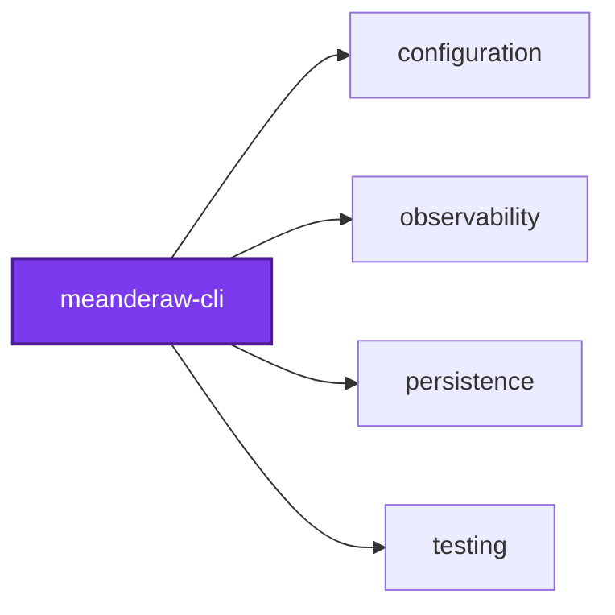
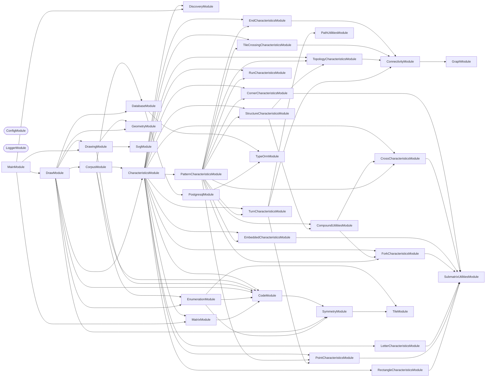

## 🕸️ Codependix

Dependency graphs exported by [codependix](https://github.com/Organizzolini/codebase/tree/main/projects/ic-suite/codependix/codependix-cli), regenerated by `nx run configuration:codependix:write`.

### Nx Neighborhood

<!-- codependix:start name="codependix-nx-projects" -->

<!-- codependix:end name="codependix-nx-projects" -->

### NestJS Module Graph

<!-- codependix:start name="codependix-nestjs-modules" -->


_Rounded modules are global: every module can inject them, so their edges are left out._
<!-- codependix:end name="codependix-nestjs-modules" -->

### File Imports

<!-- codependix:start name="codependix-file-imports" -->
```mermaid
graph LR
  file_configuration_callidescope_config_ts["configuration/callidescope.config.ts"]
  file_configuration_codependix_config_ts["configuration/codependix.config.ts"]
  file_configuration_codometer_config_ts["configuration/codometer.config.ts"]
  file_configuration_coinagerie_config_ts["configuration/coinagerie.config.ts"]
  file_configuration_eslint_config_ts["configuration/eslint.config.ts"]
  file_configuration_vitest_config_ts["configuration/vitest.config.ts"]
  file_migrations_1791160950069_migration_ts["migrations/1791160950069-migration.ts"]
  file_migrations_1791414023001_migration_ts["migrations/1791414023001-migration.ts"]
  file_src_meanderaw_cli_constants_ts["src/meanderaw-cli.constants.ts"]
  file_src_meanderaw_cli_main_end_to_end_test_ts["src/meanderaw-cli.main.end-to-end.test.ts"]
  file_src_meanderaw_cli_main_ts["src/meanderaw-cli.main.ts"]
  file_src_meanderaw_cli_main_unit_test_ts["src/meanderaw-cli.main.unit.test.ts"]
  file_src_meanderaw_cli_module_ts["src/meanderaw-cli.module.ts"]
  file_src_meanderaw_cli_repl_ts["src/meanderaw-cli.repl.ts"]
  file_src_modules_characteristics_characteristic_context_service_ts["src/modules/characteristics/characteristic-context.service.ts"]
  file_src_modules_characteristics_characteristic_context_service_unit_test_ts["src/modules/characteristics/characteristic-context.service.unit.test.ts"]
  file_src_modules_characteristics_characteristics_constants_ts["src/modules/characteristics/characteristics.constants.ts"]
  file_src_modules_characteristics_characteristics_module_ts["src/modules/characteristics/characteristics.module.ts"]
  file_src_modules_characteristics_characteristics_module_unit_test_ts["src/modules/characteristics/characteristics.module.unit.test.ts"]
  file_src_modules_characteristics_characteristics_service_integration_test_ts["src/modules/characteristics/characteristics.service.integration.test.ts"]
  file_src_modules_characteristics_characteristics_service_ts["src/modules/characteristics/characteristics.service.ts"]
  file_src_modules_characteristics_characteristics_service_unit_test_ts["src/modules/characteristics/characteristics.service.unit.test.ts"]
  file_src_modules_characteristics_characteristics_types_ts["src/modules/characteristics/characteristics.types.ts"]
  file_src_modules_characteristics_modules_compound_compound_utilities_module_ts["src/modules/characteristics/modules/compound/compound-utilities.module.ts"]
  file_src_modules_characteristics_modules_compound_compound_utilities_module_unit_test_ts["src/modules/characteristics/modules/compound/compound-utilities.module.unit.test.ts"]
  file_src_modules_characteristics_modules_compound_compound_utilities_service_ts["src/modules/characteristics/modules/compound/compound-utilities.service.ts"]
  file_src_modules_characteristics_modules_compound_compound_utilities_service_unit_test_ts["src/modules/characteristics/modules/compound/compound-utilities.service.unit.test.ts"]
  file_src_modules_characteristics_modules_compound_modules_pattern_modules_junctions_is_arcade_characteristic_service_ts["src/modules/characteristics/modules/compound/modules/pattern/modules/junctions/is-arcade-characteristic.service.ts"]
  file_src_modules_characteristics_modules_compound_modules_pattern_modules_junctions_is_arcade_characteristic_service_unit_test_ts["src/modules/characteristics/modules/compound/modules/pattern/modules/junctions/is-arcade-characteristic.service.unit.test.ts"]
  file_src_modules_characteristics_modules_compound_modules_pattern_modules_junctions_is_comb_characteristic_service_ts["src/modules/characteristics/modules/compound/modules/pattern/modules/junctions/is-comb-characteristic.service.ts"]
  file_src_modules_characteristics_modules_compound_modules_pattern_modules_junctions_is_comb_characteristic_service_unit_test_ts["src/modules/characteristics/modules/compound/modules/pattern/modules/junctions/is-comb-characteristic.service.unit.test.ts"]
  file_src_modules_characteristics_modules_compound_modules_pattern_modules_junctions_is_cross_characteristic_service_ts["src/modules/characteristics/modules/compound/modules/pattern/modules/junctions/is-cross-characteristic.service.ts"]
  file_src_modules_characteristics_modules_compound_modules_pattern_modules_junctions_is_cross_characteristic_service_unit_test_ts["src/modules/characteristics/modules/compound/modules/pattern/modules/junctions/is-cross-characteristic.service.unit.test.ts"]
  file_src_modules_characteristics_modules_compound_modules_pattern_modules_junctions_is_fork_characteristic_service_ts["src/modules/characteristics/modules/compound/modules/pattern/modules/junctions/is-fork-characteristic.service.ts"]
  file_src_modules_characteristics_modules_compound_modules_pattern_modules_junctions_is_fork_characteristic_service_unit_test_ts["src/modules/characteristics/modules/compound/modules/pattern/modules/junctions/is-fork-characteristic.service.unit.test.ts"]
  file_src_modules_characteristics_modules_compound_modules_pattern_modules_junctions_is_mesh_characteristic_service_ts["src/modules/characteristics/modules/compound/modules/pattern/modules/junctions/is-mesh-characteristic.service.ts"]
  file_src_modules_characteristics_modules_compound_modules_pattern_modules_junctions_is_mesh_characteristic_service_unit_test_ts["src/modules/characteristics/modules/compound/modules/pattern/modules/junctions/is-mesh-characteristic.service.unit.test.ts"]
  file_src_modules_characteristics_modules_compound_modules_pattern_modules_junctions_is_pure_tree_characteristic_service_ts["src/modules/characteristics/modules/compound/modules/pattern/modules/junctions/is-pure-tree-characteristic.service.ts"]
  file_src_modules_characteristics_modules_compound_modules_pattern_modules_junctions_is_pure_tree_characteristic_service_unit_test_ts["src/modules/characteristics/modules/compound/modules/pattern/modules/junctions/is-pure-tree-characteristic.service.unit.test.ts"]
  file_src_modules_characteristics_modules_compound_modules_pattern_modules_plain_strands_is_bars_characteristic_service_ts["src/modules/characteristics/modules/compound/modules/pattern/modules/plain-strands/is-bars-characteristic.service.ts"]
  file_src_modules_characteristics_modules_compound_modules_pattern_modules_plain_strands_is_bars_characteristic_service_unit_test_ts["src/modules/characteristics/modules/compound/modules/pattern/modules/plain-strands/is-bars-characteristic.service.unit.test.ts"]
  file_src_modules_characteristics_modules_compound_modules_pattern_modules_plain_strands_is_dots_characteristic_service_ts["src/modules/characteristics/modules/compound/modules/pattern/modules/plain-strands/is-dots-characteristic.service.ts"]
  file_src_modules_characteristics_modules_compound_modules_pattern_modules_plain_strands_is_dots_characteristic_service_unit_test_ts["src/modules/characteristics/modules/compound/modules/pattern/modules/plain-strands/is-dots-characteristic.service.unit.test.ts"]
  file_src_modules_characteristics_modules_compound_modules_pattern_modules_plain_strands_is_lines_characteristic_service_ts["src/modules/characteristics/modules/compound/modules/pattern/modules/plain-strands/is-lines-characteristic.service.ts"]
  file_src_modules_characteristics_modules_compound_modules_pattern_modules_plain_strands_is_lines_characteristic_service_unit_test_ts["src/modules/characteristics/modules/compound/modules/pattern/modules/plain-strands/is-lines-characteristic.service.unit.test.ts"]
  file_src_modules_characteristics_modules_compound_modules_pattern_modules_plain_strands_is_parallel_characteristic_service_ts["src/modules/characteristics/modules/compound/modules/pattern/modules/plain-strands/is-parallel-characteristic.service.ts"]
  file_src_modules_characteristics_modules_compound_modules_pattern_modules_plain_strands_is_parallel_characteristic_service_unit_test_ts["src/modules/characteristics/modules/compound/modules/pattern/modules/plain-strands/is-parallel-characteristic.service.unit.test.ts"]
  file_src_modules_characteristics_modules_compound_modules_pattern_modules_plain_strands_is_snake_characteristic_service_ts["src/modules/characteristics/modules/compound/modules/pattern/modules/plain-strands/is-snake-characteristic.service.ts"]
  file_src_modules_characteristics_modules_compound_modules_pattern_modules_plain_strands_is_snake_characteristic_service_unit_test_ts["src/modules/characteristics/modules/compound/modules/pattern/modules/plain-strands/is-snake-characteristic.service.unit.test.ts"]
  file_src_modules_characteristics_modules_compound_modules_pattern_modules_plain_strands_is_waterfalls_characteristic_service_ts["src/modules/characteristics/modules/compound/modules/pattern/modules/plain-strands/is-waterfalls-characteristic.service.ts"]
  file_src_modules_characteristics_modules_compound_modules_pattern_modules_plain_strands_is_waterfalls_characteristic_service_unit_test_ts["src/modules/characteristics/modules/compound/modules/pattern/modules/plain-strands/is-waterfalls-characteristic.service.unit.test.ts"]
  file_src_modules_characteristics_modules_compound_modules_pattern_modules_windings_is_boxes_characteristic_service_ts["src/modules/characteristics/modules/compound/modules/pattern/modules/windings/is-boxes-characteristic.service.ts"]
  file_src_modules_characteristics_modules_compound_modules_pattern_modules_windings_is_boxes_characteristic_service_unit_test_ts["src/modules/characteristics/modules/compound/modules/pattern/modules/windings/is-boxes-characteristic.service.unit.test.ts"]
  file_src_modules_characteristics_modules_compound_modules_pattern_modules_windings_is_chain_characteristic_service_ts["src/modules/characteristics/modules/compound/modules/pattern/modules/windings/is-chain-characteristic.service.ts"]
  file_src_modules_characteristics_modules_compound_modules_pattern_modules_windings_is_chain_characteristic_service_unit_test_ts["src/modules/characteristics/modules/compound/modules/pattern/modules/windings/is-chain-characteristic.service.unit.test.ts"]
  file_src_modules_characteristics_modules_compound_modules_pattern_modules_windings_is_clasps_characteristic_service_ts["src/modules/characteristics/modules/compound/modules/pattern/modules/windings/is-clasps-characteristic.service.ts"]
  file_src_modules_characteristics_modules_compound_modules_pattern_modules_windings_is_clasps_characteristic_service_unit_test_ts["src/modules/characteristics/modules/compound/modules/pattern/modules/windings/is-clasps-characteristic.service.unit.test.ts"]
  file_src_modules_characteristics_modules_compound_modules_pattern_modules_windings_is_double_chain_characteristic_service_ts["src/modules/characteristics/modules/compound/modules/pattern/modules/windings/is-double-chain-characteristic.service.ts"]
  file_src_modules_characteristics_modules_compound_modules_pattern_modules_windings_is_double_chain_characteristic_service_unit_test_ts["src/modules/characteristics/modules/compound/modules/pattern/modules/windings/is-double-chain-characteristic.service.unit.test.ts"]
  file_src_modules_characteristics_modules_compound_modules_pattern_modules_windings_is_swirl_characteristic_service_ts["src/modules/characteristics/modules/compound/modules/pattern/modules/windings/is-swirl-characteristic.service.ts"]
  file_src_modules_characteristics_modules_compound_modules_pattern_modules_windings_is_swirl_characteristic_service_unit_test_ts["src/modules/characteristics/modules/compound/modules/pattern/modules/windings/is-swirl-characteristic.service.unit.test.ts"]
  file_src_modules_characteristics_modules_compound_modules_pattern_modules_windings_is_whirl_characteristic_service_ts["src/modules/characteristics/modules/compound/modules/pattern/modules/windings/is-whirl-characteristic.service.ts"]
  file_src_modules_characteristics_modules_compound_modules_pattern_modules_windings_is_whirl_characteristic_service_unit_test_ts["src/modules/characteristics/modules/compound/modules/pattern/modules/windings/is-whirl-characteristic.service.unit.test.ts"]
  file_src_modules_characteristics_modules_compound_modules_pattern_pattern_characteristics_module_ts["src/modules/characteristics/modules/compound/modules/pattern/pattern-characteristics.module.ts"]
  file_src_modules_characteristics_modules_compound_modules_pattern_strand_utilities_service_ts["src/modules/characteristics/modules/compound/modules/pattern/strand-utilities.service.ts"]
  file_src_modules_characteristics_modules_compound_modules_pattern_strand_utilities_service_unit_test_ts["src/modules/characteristics/modules/compound/modules/pattern/strand-utilities.service.unit.test.ts"]
  file_src_modules_characteristics_modules_compound_modules_structure_is_closed_loop_characteristic_service_ts["src/modules/characteristics/modules/compound/modules/structure/is-closed-loop-characteristic.service.ts"]
  file_src_modules_characteristics_modules_compound_modules_structure_is_closed_loop_characteristic_service_unit_test_ts["src/modules/characteristics/modules/compound/modules/structure/is-closed-loop-characteristic.service.unit.test.ts"]
  file_src_modules_characteristics_modules_compound_modules_structure_is_single_arc_characteristic_service_ts["src/modules/characteristics/modules/compound/modules/structure/is-single-arc-characteristic.service.ts"]
  file_src_modules_characteristics_modules_compound_modules_structure_is_single_arc_characteristic_service_unit_test_ts["src/modules/characteristics/modules/compound/modules/structure/is-single-arc-characteristic.service.unit.test.ts"]
  file_src_modules_characteristics_modules_compound_modules_structure_structure_characteristics_module_ts["src/modules/characteristics/modules/compound/modules/structure/structure-characteristics.module.ts"]
  file_src_modules_characteristics_modules_connectivity_connectivity_module_ts["src/modules/characteristics/modules/connectivity/connectivity.module.ts"]
  file_src_modules_characteristics_modules_connectivity_connectivity_module_unit_test_ts["src/modules/characteristics/modules/connectivity/connectivity.module.unit.test.ts"]
  file_src_modules_characteristics_modules_connectivity_connectivity_service_ts["src/modules/characteristics/modules/connectivity/connectivity.service.ts"]
  file_src_modules_characteristics_modules_connectivity_connectivity_service_unit_test_ts["src/modules/characteristics/modules/connectivity/connectivity.service.unit.test.ts"]
  file_src_modules_characteristics_modules_connectivity_connectivity_types_ts["src/modules/characteristics/modules/connectivity/connectivity.types.ts"]
  file_src_modules_characteristics_modules_path_modules_end_end_characteristics_module_ts["src/modules/characteristics/modules/path/modules/end/end-characteristics.module.ts"]
  file_src_modules_characteristics_modules_path_modules_end_end_utilities_service_ts["src/modules/characteristics/modules/path/modules/end/end-utilities.service.ts"]
  file_src_modules_characteristics_modules_path_modules_end_end_utilities_service_unit_test_ts["src/modules/characteristics/modules/path/modules/end/end-utilities.service.unit.test.ts"]
  file_src_modules_characteristics_modules_path_modules_end_end_types_ts["src/modules/characteristics/modules/path/modules/end/end.types.ts"]
  file_src_modules_characteristics_modules_path_modules_end_ends_are_lattice_neighbors_characteristic_service_ts["src/modules/characteristics/modules/path/modules/end/ends-are-lattice-neighbors-characteristic.service.ts"]
  file_src_modules_characteristics_modules_path_modules_end_ends_are_lattice_neighbors_characteristic_service_unit_test_ts["src/modules/characteristics/modules/path/modules/end/ends-are-lattice-neighbors-characteristic.service.unit.test.ts"]
  file_src_modules_characteristics_modules_path_modules_end_ends_on_border_rules_characteristic_service_ts["src/modules/characteristics/modules/path/modules/end/ends-on-border-rules-characteristic.service.ts"]
  file_src_modules_characteristics_modules_path_modules_end_ends_on_border_rules_characteristic_service_unit_test_ts["src/modules/characteristics/modules/path/modules/end/ends-on-border-rules-characteristic.service.unit.test.ts"]
  file_src_modules_characteristics_modules_path_modules_tile_crossing_tile_crossing_characteristics_module_ts["src/modules/characteristics/modules/path/modules/tile-crossing/tile-crossing-characteristics.module.ts"]
  file_src_modules_characteristics_modules_path_modules_tile_crossing_tile_crossing_component_delta_count_characteristic_service_ts["src/modules/characteristics/modules/path/modules/tile-crossing/tile-crossing-component-delta-count-characteristic.service.ts"]
  file_src_modules_characteristics_modules_path_modules_tile_crossing_tile_crossing_component_delta_count_characteristic_service_unit_test_ts["src/modules/characteristics/modules/path/modules/tile-crossing/tile-crossing-component-delta-count-characteristic.service.unit.test.ts"]
  file_src_modules_characteristics_modules_path_modules_tile_crossing_tile_crossing_count_characteristic_service_ts["src/modules/characteristics/modules/path/modules/tile-crossing/tile-crossing-count-characteristic.service.ts"]
  file_src_modules_characteristics_modules_path_modules_tile_crossing_tile_crossing_count_characteristic_service_unit_test_ts["src/modules/characteristics/modules/path/modules/tile-crossing/tile-crossing-count-characteristic.service.unit.test.ts"]
  file_src_modules_characteristics_modules_path_modules_tile_crossing_tile_crossing_cycle_count_characteristic_service_ts["src/modules/characteristics/modules/path/modules/tile-crossing/tile-crossing-cycle-count-characteristic.service.ts"]
  file_src_modules_characteristics_modules_path_modules_tile_crossing_tile_crossing_cycle_count_characteristic_service_unit_test_ts["src/modules/characteristics/modules/path/modules/tile-crossing/tile-crossing-cycle-count-characteristic.service.unit.test.ts"]
  file_src_modules_characteristics_modules_path_modules_topology_betti_number_0_count_characteristic_service_ts["src/modules/characteristics/modules/path/modules/topology/betti-number-0-count-characteristic.service.ts"]
  file_src_modules_characteristics_modules_path_modules_topology_betti_number_0_count_characteristic_service_unit_test_ts["src/modules/characteristics/modules/path/modules/topology/betti-number-0-count-characteristic.service.unit.test.ts"]
  file_src_modules_characteristics_modules_path_modules_topology_betti_number_1_count_characteristic_service_ts["src/modules/characteristics/modules/path/modules/topology/betti-number-1-count-characteristic.service.ts"]
  file_src_modules_characteristics_modules_path_modules_topology_betti_number_1_count_characteristic_service_unit_test_ts["src/modules/characteristics/modules/path/modules/topology/betti-number-1-count-characteristic.service.unit.test.ts"]
  file_src_modules_characteristics_modules_path_modules_topology_free_end_count_characteristic_service_ts["src/modules/characteristics/modules/path/modules/topology/free-end-count-characteristic.service.ts"]
  file_src_modules_characteristics_modules_path_modules_topology_free_end_count_characteristic_service_unit_test_ts["src/modules/characteristics/modules/path/modules/topology/free-end-count-characteristic.service.unit.test.ts"]
  file_src_modules_characteristics_modules_path_modules_topology_topology_characteristics_module_ts["src/modules/characteristics/modules/path/modules/topology/topology-characteristics.module.ts"]
  file_src_modules_characteristics_modules_path_modules_turn_inflection_count_characteristic_service_ts["src/modules/characteristics/modules/path/modules/turn/inflection-count-characteristic.service.ts"]
  file_src_modules_characteristics_modules_path_modules_turn_inflection_count_characteristic_service_unit_test_ts["src/modules/characteristics/modules/path/modules/turn/inflection-count-characteristic.service.unit.test.ts"]
  file_src_modules_characteristics_modules_path_modules_turn_max_monotonic_turn_length_characteristic_service_ts["src/modules/characteristics/modules/path/modules/turn/max-monotonic-turn-length-characteristic.service.ts"]
  file_src_modules_characteristics_modules_path_modules_turn_max_monotonic_turn_length_characteristic_service_unit_test_ts["src/modules/characteristics/modules/path/modules/turn/max-monotonic-turn-length-characteristic.service.unit.test.ts"]
  file_src_modules_characteristics_modules_path_modules_turn_modules_border_touch_bottom_border_touch_count_characteristic_service_ts["src/modules/characteristics/modules/path/modules/turn/modules/border-touch/bottom-border-touch-count-characteristic.service.ts"]
  file_src_modules_characteristics_modules_path_modules_turn_modules_border_touch_bottom_border_touch_count_characteristic_service_unit_test_ts["src/modules/characteristics/modules/path/modules/turn/modules/border-touch/bottom-border-touch-count-characteristic.service.unit.test.ts"]
  file_src_modules_characteristics_modules_path_modules_turn_modules_border_touch_top_border_touch_count_characteristic_service_ts["src/modules/characteristics/modules/path/modules/turn/modules/border-touch/top-border-touch-count-characteristic.service.ts"]
  file_src_modules_characteristics_modules_path_modules_turn_modules_border_touch_top_border_touch_count_characteristic_service_unit_test_ts["src/modules/characteristics/modules/path/modules/turn/modules/border-touch/top-border-touch-count-characteristic.service.unit.test.ts"]
  file_src_modules_characteristics_modules_path_modules_turn_modules_tightest_turn_reverses_at_its_tightest_turn_characteristic_service_ts["src/modules/characteristics/modules/path/modules/turn/modules/tightest-turn/reverses-at-its-tightest-turn-characteristic.service.ts"]
  file_src_modules_characteristics_modules_path_modules_turn_modules_tightest_turn_reverses_at_its_tightest_turn_characteristic_service_unit_test_ts["src/modules/characteristics/modules/path/modules/turn/modules/tightest-turn/reverses-at-its-tightest-turn-characteristic.service.unit.test.ts"]
  file_src_modules_characteristics_modules_path_modules_turn_modules_tightest_turn_reverses_at_its_tightest_turn_types_ts["src/modules/characteristics/modules/path/modules/turn/modules/tightest-turn/reverses-at-its-tightest-turn.types.ts"]
  file_src_modules_characteristics_modules_path_modules_turn_modules_tightest_turn_tightest_turn_count_characteristic_service_ts["src/modules/characteristics/modules/path/modules/turn/modules/tightest-turn/tightest-turn-count-characteristic.service.ts"]
  file_src_modules_characteristics_modules_path_modules_turn_modules_tightest_turn_tightest_turn_count_characteristic_service_unit_test_ts["src/modules/characteristics/modules/path/modules/turn/modules/tightest-turn/tightest-turn-count-characteristic.service.unit.test.ts"]
  file_src_modules_characteristics_modules_path_modules_turn_total_turn_count_characteristic_service_ts["src/modules/characteristics/modules/path/modules/turn/total-turn-count-characteristic.service.ts"]
  file_src_modules_characteristics_modules_path_modules_turn_total_turn_count_characteristic_service_unit_test_ts["src/modules/characteristics/modules/path/modules/turn/total-turn-count-characteristic.service.unit.test.ts"]
  file_src_modules_characteristics_modules_path_modules_turn_turn_characteristics_module_ts["src/modules/characteristics/modules/path/modules/turn/turn-characteristics.module.ts"]
  file_src_modules_characteristics_modules_path_path_utilities_module_ts["src/modules/characteristics/modules/path/path-utilities.module.ts"]
  file_src_modules_characteristics_modules_path_path_utilities_module_unit_test_ts["src/modules/characteristics/modules/path/path-utilities.module.unit.test.ts"]
  file_src_modules_characteristics_modules_path_path_utilities_service_ts["src/modules/characteristics/modules/path/path-utilities.service.ts"]
  file_src_modules_characteristics_modules_path_path_utilities_service_unit_test_ts["src/modules/characteristics/modules/path/path-utilities.service.unit.test.ts"]
  file_src_modules_characteristics_modules_path_path_types_ts["src/modules/characteristics/modules/path/path.types.ts"]
  file_src_modules_characteristics_modules_submatrix_modules_corner_corner_characteristics_module_ts["src/modules/characteristics/modules/submatrix/modules/corner/corner-characteristics.module.ts"]
  file_src_modules_characteristics_modules_submatrix_modules_corner_corner_count_characteristic_service_ts["src/modules/characteristics/modules/submatrix/modules/corner/corner-count-characteristic.service.ts"]
  file_src_modules_characteristics_modules_submatrix_modules_corner_corner_count_characteristic_service_unit_test_ts["src/modules/characteristics/modules/submatrix/modules/corner/corner-count-characteristic.service.unit.test.ts"]
  file_src_modules_characteristics_modules_submatrix_modules_corner_north_east_corner_count_characteristic_service_ts["src/modules/characteristics/modules/submatrix/modules/corner/north-east-corner-count-characteristic.service.ts"]
  file_src_modules_characteristics_modules_submatrix_modules_corner_north_east_corner_count_characteristic_service_unit_test_ts["src/modules/characteristics/modules/submatrix/modules/corner/north-east-corner-count-characteristic.service.unit.test.ts"]
  file_src_modules_characteristics_modules_submatrix_modules_corner_north_west_corner_count_characteristic_service_ts["src/modules/characteristics/modules/submatrix/modules/corner/north-west-corner-count-characteristic.service.ts"]
  file_src_modules_characteristics_modules_submatrix_modules_corner_north_west_corner_count_characteristic_service_unit_test_ts["src/modules/characteristics/modules/submatrix/modules/corner/north-west-corner-count-characteristic.service.unit.test.ts"]
  file_src_modules_characteristics_modules_submatrix_modules_corner_south_east_corner_count_characteristic_service_ts["src/modules/characteristics/modules/submatrix/modules/corner/south-east-corner-count-characteristic.service.ts"]
  file_src_modules_characteristics_modules_submatrix_modules_corner_south_east_corner_count_characteristic_service_unit_test_ts["src/modules/characteristics/modules/submatrix/modules/corner/south-east-corner-count-characteristic.service.unit.test.ts"]
  file_src_modules_characteristics_modules_submatrix_modules_corner_south_west_corner_count_characteristic_service_ts["src/modules/characteristics/modules/submatrix/modules/corner/south-west-corner-count-characteristic.service.ts"]
  file_src_modules_characteristics_modules_submatrix_modules_corner_south_west_corner_count_characteristic_service_unit_test_ts["src/modules/characteristics/modules/submatrix/modules/corner/south-west-corner-count-characteristic.service.unit.test.ts"]
  file_src_modules_characteristics_modules_submatrix_modules_cross_cross_characteristics_module_ts["src/modules/characteristics/modules/submatrix/modules/cross/cross-characteristics.module.ts"]
  file_src_modules_characteristics_modules_submatrix_modules_cross_cross_count_characteristic_service_ts["src/modules/characteristics/modules/submatrix/modules/cross/cross-count-characteristic.service.ts"]
  file_src_modules_characteristics_modules_submatrix_modules_cross_cross_count_characteristic_service_unit_test_ts["src/modules/characteristics/modules/submatrix/modules/cross/cross-count-characteristic.service.unit.test.ts"]
  file_src_modules_characteristics_modules_submatrix_modules_embedded_embedded_characteristics_module_ts["src/modules/characteristics/modules/submatrix/modules/embedded/embedded-characteristics.module.ts"]
  file_src_modules_characteristics_modules_submatrix_modules_embedded_embedded_u_count_characteristic_service_ts["src/modules/characteristics/modules/submatrix/modules/embedded/embedded-u-count-characteristic.service.ts"]
  file_src_modules_characteristics_modules_submatrix_modules_embedded_embedded_u_count_characteristic_service_unit_test_ts["src/modules/characteristics/modules/submatrix/modules/embedded/embedded-u-count-characteristic.service.unit.test.ts"]
  file_src_modules_characteristics_modules_submatrix_modules_fork_east_fork_count_characteristic_service_ts["src/modules/characteristics/modules/submatrix/modules/fork/east-fork-count-characteristic.service.ts"]
  file_src_modules_characteristics_modules_submatrix_modules_fork_east_fork_count_characteristic_service_unit_test_ts["src/modules/characteristics/modules/submatrix/modules/fork/east-fork-count-characteristic.service.unit.test.ts"]
  file_src_modules_characteristics_modules_submatrix_modules_fork_fork_characteristics_module_ts["src/modules/characteristics/modules/submatrix/modules/fork/fork-characteristics.module.ts"]
  file_src_modules_characteristics_modules_submatrix_modules_fork_fork_count_characteristic_service_ts["src/modules/characteristics/modules/submatrix/modules/fork/fork-count-characteristic.service.ts"]
  file_src_modules_characteristics_modules_submatrix_modules_fork_fork_count_characteristic_service_unit_test_ts["src/modules/characteristics/modules/submatrix/modules/fork/fork-count-characteristic.service.unit.test.ts"]
  file_src_modules_characteristics_modules_submatrix_modules_fork_north_fork_count_characteristic_service_ts["src/modules/characteristics/modules/submatrix/modules/fork/north-fork-count-characteristic.service.ts"]
  file_src_modules_characteristics_modules_submatrix_modules_fork_north_fork_count_characteristic_service_unit_test_ts["src/modules/characteristics/modules/submatrix/modules/fork/north-fork-count-characteristic.service.unit.test.ts"]
  file_src_modules_characteristics_modules_submatrix_modules_fork_south_fork_count_characteristic_service_ts["src/modules/characteristics/modules/submatrix/modules/fork/south-fork-count-characteristic.service.ts"]
  file_src_modules_characteristics_modules_submatrix_modules_fork_south_fork_count_characteristic_service_unit_test_ts["src/modules/characteristics/modules/submatrix/modules/fork/south-fork-count-characteristic.service.unit.test.ts"]
  file_src_modules_characteristics_modules_submatrix_modules_fork_west_fork_count_characteristic_service_ts["src/modules/characteristics/modules/submatrix/modules/fork/west-fork-count-characteristic.service.ts"]
  file_src_modules_characteristics_modules_submatrix_modules_fork_west_fork_count_characteristic_service_unit_test_ts["src/modules/characteristics/modules/submatrix/modules/fork/west-fork-count-characteristic.service.unit.test.ts"]
  file_src_modules_characteristics_modules_submatrix_modules_letter_letter_characteristics_module_ts["src/modules/characteristics/modules/submatrix/modules/letter/letter-characteristics.module.ts"]
  file_src_modules_characteristics_modules_submatrix_modules_letter_letter_characteristics_module_unit_test_ts["src/modules/characteristics/modules/submatrix/modules/letter/letter-characteristics.module.unit.test.ts"]
  file_src_modules_characteristics_modules_submatrix_modules_letter_letter_utilities_service_ts["src/modules/characteristics/modules/submatrix/modules/letter/letter-utilities.service.ts"]
  file_src_modules_characteristics_modules_submatrix_modules_letter_letter_utilities_service_unit_test_ts["src/modules/characteristics/modules/submatrix/modules/letter/letter-utilities.service.unit.test.ts"]
  file_src_modules_characteristics_modules_submatrix_modules_letter_letter_constants_ts["src/modules/characteristics/modules/submatrix/modules/letter/letter.constants.ts"]
  file_src_modules_characteristics_modules_submatrix_modules_letter_letter_types_ts["src/modules/characteristics/modules/submatrix/modules/letter/letter.types.ts"]
  file_src_modules_characteristics_modules_submatrix_modules_letter_modules_arabic_ain_to_hah_ain_arabic_letter_characteristics_service_ts["src/modules/characteristics/modules/submatrix/modules/letter/modules/arabic-ain-to-hah/ain-arabic-letter-characteristics.service.ts"]
  file_src_modules_characteristics_modules_submatrix_modules_letter_modules_arabic_ain_to_hah_ain_arabic_letter_characteristics_service_unit_test_ts["src/modules/characteristics/modules/submatrix/modules/letter/modules/arabic-ain-to-hah/ain-arabic-letter-characteristics.service.unit.test.ts"]
  file_src_modules_characteristics_modules_submatrix_modules_letter_modules_arabic_ain_to_hah_alef_arabic_letter_characteristics_service_ts["src/modules/characteristics/modules/submatrix/modules/letter/modules/arabic-ain-to-hah/alef-arabic-letter-characteristics.service.ts"]
  file_src_modules_characteristics_modules_submatrix_modules_letter_modules_arabic_ain_to_hah_alef_arabic_letter_characteristics_service_unit_test_ts["src/modules/characteristics/modules/submatrix/modules/letter/modules/arabic-ain-to-hah/alef-arabic-letter-characteristics.service.unit.test.ts"]
  file_src_modules_characteristics_modules_submatrix_modules_letter_modules_arabic_ain_to_hah_beh_arabic_letter_characteristics_service_ts["src/modules/characteristics/modules/submatrix/modules/letter/modules/arabic-ain-to-hah/beh-arabic-letter-characteristics.service.ts"]
  file_src_modules_characteristics_modules_submatrix_modules_letter_modules_arabic_ain_to_hah_beh_arabic_letter_characteristics_service_unit_test_ts["src/modules/characteristics/modules/submatrix/modules/letter/modules/arabic-ain-to-hah/beh-arabic-letter-characteristics.service.unit.test.ts"]
  file_src_modules_characteristics_modules_submatrix_modules_letter_modules_arabic_ain_to_hah_dal_arabic_letter_characteristics_service_ts["src/modules/characteristics/modules/submatrix/modules/letter/modules/arabic-ain-to-hah/dal-arabic-letter-characteristics.service.ts"]
  file_src_modules_characteristics_modules_submatrix_modules_letter_modules_arabic_ain_to_hah_dal_arabic_letter_characteristics_service_unit_test_ts["src/modules/characteristics/modules/submatrix/modules/letter/modules/arabic-ain-to-hah/dal-arabic-letter-characteristics.service.unit.test.ts"]
  file_src_modules_characteristics_modules_submatrix_modules_letter_modules_arabic_ain_to_hah_feh_arabic_letter_characteristics_service_ts["src/modules/characteristics/modules/submatrix/modules/letter/modules/arabic-ain-to-hah/feh-arabic-letter-characteristics.service.ts"]
  file_src_modules_characteristics_modules_submatrix_modules_letter_modules_arabic_ain_to_hah_feh_arabic_letter_characteristics_service_unit_test_ts["src/modules/characteristics/modules/submatrix/modules/letter/modules/arabic-ain-to-hah/feh-arabic-letter-characteristics.service.unit.test.ts"]
  file_src_modules_characteristics_modules_submatrix_modules_letter_modules_arabic_ain_to_hah_hah_arabic_letter_characteristics_service_ts["src/modules/characteristics/modules/submatrix/modules/letter/modules/arabic-ain-to-hah/hah-arabic-letter-characteristics.service.ts"]
  file_src_modules_characteristics_modules_submatrix_modules_letter_modules_arabic_ain_to_hah_hah_arabic_letter_characteristics_service_unit_test_ts["src/modules/characteristics/modules/submatrix/modules/letter/modules/arabic-ain-to-hah/hah-arabic-letter-characteristics.service.unit.test.ts"]
  file_src_modules_characteristics_modules_submatrix_modules_letter_modules_arabic_heh_to_qaf_heh_arabic_letter_characteristics_service_ts["src/modules/characteristics/modules/submatrix/modules/letter/modules/arabic-heh-to-qaf/heh-arabic-letter-characteristics.service.ts"]
  file_src_modules_characteristics_modules_submatrix_modules_letter_modules_arabic_heh_to_qaf_heh_arabic_letter_characteristics_service_unit_test_ts["src/modules/characteristics/modules/submatrix/modules/letter/modules/arabic-heh-to-qaf/heh-arabic-letter-characteristics.service.unit.test.ts"]
  file_src_modules_characteristics_modules_submatrix_modules_letter_modules_arabic_heh_to_qaf_kaf_arabic_letter_characteristics_service_ts["src/modules/characteristics/modules/submatrix/modules/letter/modules/arabic-heh-to-qaf/kaf-arabic-letter-characteristics.service.ts"]
  file_src_modules_characteristics_modules_submatrix_modules_letter_modules_arabic_heh_to_qaf_kaf_arabic_letter_characteristics_service_unit_test_ts["src/modules/characteristics/modules/submatrix/modules/letter/modules/arabic-heh-to-qaf/kaf-arabic-letter-characteristics.service.unit.test.ts"]
  file_src_modules_characteristics_modules_submatrix_modules_letter_modules_arabic_heh_to_qaf_lam_arabic_letter_characteristics_service_ts["src/modules/characteristics/modules/submatrix/modules/letter/modules/arabic-heh-to-qaf/lam-arabic-letter-characteristics.service.ts"]
  file_src_modules_characteristics_modules_submatrix_modules_letter_modules_arabic_heh_to_qaf_lam_arabic_letter_characteristics_service_unit_test_ts["src/modules/characteristics/modules/submatrix/modules/letter/modules/arabic-heh-to-qaf/lam-arabic-letter-characteristics.service.unit.test.ts"]
  file_src_modules_characteristics_modules_submatrix_modules_letter_modules_arabic_heh_to_qaf_meem_arabic_letter_characteristics_service_ts["src/modules/characteristics/modules/submatrix/modules/letter/modules/arabic-heh-to-qaf/meem-arabic-letter-characteristics.service.ts"]
  file_src_modules_characteristics_modules_submatrix_modules_letter_modules_arabic_heh_to_qaf_meem_arabic_letter_characteristics_service_unit_test_ts["src/modules/characteristics/modules/submatrix/modules/letter/modules/arabic-heh-to-qaf/meem-arabic-letter-characteristics.service.unit.test.ts"]
  file_src_modules_characteristics_modules_submatrix_modules_letter_modules_arabic_heh_to_qaf_noon_arabic_letter_characteristics_service_ts["src/modules/characteristics/modules/submatrix/modules/letter/modules/arabic-heh-to-qaf/noon-arabic-letter-characteristics.service.ts"]
  file_src_modules_characteristics_modules_submatrix_modules_letter_modules_arabic_heh_to_qaf_noon_arabic_letter_characteristics_service_unit_test_ts["src/modules/characteristics/modules/submatrix/modules/letter/modules/arabic-heh-to-qaf/noon-arabic-letter-characteristics.service.unit.test.ts"]
  file_src_modules_characteristics_modules_submatrix_modules_letter_modules_arabic_heh_to_qaf_qaf_arabic_letter_characteristics_service_ts["src/modules/characteristics/modules/submatrix/modules/letter/modules/arabic-heh-to-qaf/qaf-arabic-letter-characteristics.service.ts"]
  file_src_modules_characteristics_modules_submatrix_modules_letter_modules_arabic_heh_to_qaf_qaf_arabic_letter_characteristics_service_unit_test_ts["src/modules/characteristics/modules/submatrix/modules/letter/modules/arabic-heh-to-qaf/qaf-arabic-letter-characteristics.service.unit.test.ts"]
  file_src_modules_characteristics_modules_submatrix_modules_letter_modules_arabic_reh_to_yeh_reh_arabic_letter_characteristics_service_ts["src/modules/characteristics/modules/submatrix/modules/letter/modules/arabic-reh-to-yeh/reh-arabic-letter-characteristics.service.ts"]
  file_src_modules_characteristics_modules_submatrix_modules_letter_modules_arabic_reh_to_yeh_reh_arabic_letter_characteristics_service_unit_test_ts["src/modules/characteristics/modules/submatrix/modules/letter/modules/arabic-reh-to-yeh/reh-arabic-letter-characteristics.service.unit.test.ts"]
  file_src_modules_characteristics_modules_submatrix_modules_letter_modules_arabic_reh_to_yeh_sad_arabic_letter_characteristics_service_ts["src/modules/characteristics/modules/submatrix/modules/letter/modules/arabic-reh-to-yeh/sad-arabic-letter-characteristics.service.ts"]
  file_src_modules_characteristics_modules_submatrix_modules_letter_modules_arabic_reh_to_yeh_sad_arabic_letter_characteristics_service_unit_test_ts["src/modules/characteristics/modules/submatrix/modules/letter/modules/arabic-reh-to-yeh/sad-arabic-letter-characteristics.service.unit.test.ts"]
  file_src_modules_characteristics_modules_submatrix_modules_letter_modules_arabic_reh_to_yeh_seen_arabic_letter_characteristics_service_ts["src/modules/characteristics/modules/submatrix/modules/letter/modules/arabic-reh-to-yeh/seen-arabic-letter-characteristics.service.ts"]
  file_src_modules_characteristics_modules_submatrix_modules_letter_modules_arabic_reh_to_yeh_seen_arabic_letter_characteristics_service_unit_test_ts["src/modules/characteristics/modules/submatrix/modules/letter/modules/arabic-reh-to-yeh/seen-arabic-letter-characteristics.service.unit.test.ts"]
  file_src_modules_characteristics_modules_submatrix_modules_letter_modules_arabic_reh_to_yeh_tah_arabic_letter_characteristics_service_ts["src/modules/characteristics/modules/submatrix/modules/letter/modules/arabic-reh-to-yeh/tah-arabic-letter-characteristics.service.ts"]
  file_src_modules_characteristics_modules_submatrix_modules_letter_modules_arabic_reh_to_yeh_tah_arabic_letter_characteristics_service_unit_test_ts["src/modules/characteristics/modules/submatrix/modules/letter/modules/arabic-reh-to-yeh/tah-arabic-letter-characteristics.service.unit.test.ts"]
  file_src_modules_characteristics_modules_submatrix_modules_letter_modules_arabic_reh_to_yeh_waw_arabic_letter_characteristics_service_ts["src/modules/characteristics/modules/submatrix/modules/letter/modules/arabic-reh-to-yeh/waw-arabic-letter-characteristics.service.ts"]
  file_src_modules_characteristics_modules_submatrix_modules_letter_modules_arabic_reh_to_yeh_waw_arabic_letter_characteristics_service_unit_test_ts["src/modules/characteristics/modules/submatrix/modules/letter/modules/arabic-reh-to-yeh/waw-arabic-letter-characteristics.service.unit.test.ts"]
  file_src_modules_characteristics_modules_submatrix_modules_letter_modules_arabic_reh_to_yeh_yeh_arabic_letter_characteristics_service_ts["src/modules/characteristics/modules/submatrix/modules/letter/modules/arabic-reh-to-yeh/yeh-arabic-letter-characteristics.service.ts"]
  file_src_modules_characteristics_modules_submatrix_modules_letter_modules_arabic_reh_to_yeh_yeh_arabic_letter_characteristics_service_unit_test_ts["src/modules/characteristics/modules/submatrix/modules/letter/modules/arabic-reh-to-yeh/yeh-arabic-letter-characteristics.service.unit.test.ts"]
  file_src_modules_characteristics_modules_submatrix_modules_letter_modules_greek_delta_to_omega_delta_greek_letter_characteristics_service_ts["src/modules/characteristics/modules/submatrix/modules/letter/modules/greek-delta-to-omega/delta-greek-letter-characteristics.service.ts"]
  file_src_modules_characteristics_modules_submatrix_modules_letter_modules_greek_delta_to_omega_delta_greek_letter_characteristics_service_unit_test_ts["src/modules/characteristics/modules/submatrix/modules/letter/modules/greek-delta-to-omega/delta-greek-letter-characteristics.service.unit.test.ts"]
  file_src_modules_characteristics_modules_submatrix_modules_letter_modules_greek_delta_to_omega_kappa_greek_letter_characteristics_service_ts["src/modules/characteristics/modules/submatrix/modules/letter/modules/greek-delta-to-omega/kappa-greek-letter-characteristics.service.ts"]
  file_src_modules_characteristics_modules_submatrix_modules_letter_modules_greek_delta_to_omega_kappa_greek_letter_characteristics_service_unit_test_ts["src/modules/characteristics/modules/submatrix/modules/letter/modules/greek-delta-to-omega/kappa-greek-letter-characteristics.service.unit.test.ts"]
  file_src_modules_characteristics_modules_submatrix_modules_letter_modules_greek_delta_to_omega_lambda_greek_letter_characteristics_service_ts["src/modules/characteristics/modules/submatrix/modules/letter/modules/greek-delta-to-omega/lambda-greek-letter-characteristics.service.ts"]
  file_src_modules_characteristics_modules_submatrix_modules_letter_modules_greek_delta_to_omega_lambda_greek_letter_characteristics_service_unit_test_ts["src/modules/characteristics/modules/submatrix/modules/letter/modules/greek-delta-to-omega/lambda-greek-letter-characteristics.service.unit.test.ts"]
  file_src_modules_characteristics_modules_submatrix_modules_letter_modules_greek_delta_to_omega_omega_greek_letter_characteristics_service_ts["src/modules/characteristics/modules/submatrix/modules/letter/modules/greek-delta-to-omega/omega-greek-letter-characteristics.service.ts"]
  file_src_modules_characteristics_modules_submatrix_modules_letter_modules_greek_delta_to_omega_omega_greek_letter_characteristics_service_unit_test_ts["src/modules/characteristics/modules/submatrix/modules/letter/modules/greek-delta-to-omega/omega-greek-letter-characteristics.service.unit.test.ts"]
  file_src_modules_characteristics_modules_submatrix_modules_letter_modules_greek_phi_to_sigma_phi_greek_letter_characteristics_service_ts["src/modules/characteristics/modules/submatrix/modules/letter/modules/greek-phi-to-sigma/phi-greek-letter-characteristics.service.ts"]
  file_src_modules_characteristics_modules_submatrix_modules_letter_modules_greek_phi_to_sigma_phi_greek_letter_characteristics_service_unit_test_ts["src/modules/characteristics/modules/submatrix/modules/letter/modules/greek-phi-to-sigma/phi-greek-letter-characteristics.service.unit.test.ts"]
  file_src_modules_characteristics_modules_submatrix_modules_letter_modules_greek_phi_to_sigma_psi_greek_letter_characteristics_service_ts["src/modules/characteristics/modules/submatrix/modules/letter/modules/greek-phi-to-sigma/psi-greek-letter-characteristics.service.ts"]
  file_src_modules_characteristics_modules_submatrix_modules_letter_modules_greek_phi_to_sigma_psi_greek_letter_characteristics_service_unit_test_ts["src/modules/characteristics/modules/submatrix/modules/letter/modules/greek-phi-to-sigma/psi-greek-letter-characteristics.service.unit.test.ts"]
  file_src_modules_characteristics_modules_submatrix_modules_letter_modules_greek_phi_to_sigma_rho_greek_letter_characteristics_service_ts["src/modules/characteristics/modules/submatrix/modules/letter/modules/greek-phi-to-sigma/rho-greek-letter-characteristics.service.ts"]
  file_src_modules_characteristics_modules_submatrix_modules_letter_modules_greek_phi_to_sigma_rho_greek_letter_characteristics_service_unit_test_ts["src/modules/characteristics/modules/submatrix/modules/letter/modules/greek-phi-to-sigma/rho-greek-letter-characteristics.service.unit.test.ts"]
  file_src_modules_characteristics_modules_submatrix_modules_letter_modules_greek_phi_to_sigma_sigma_greek_letter_characteristics_service_ts["src/modules/characteristics/modules/submatrix/modules/letter/modules/greek-phi-to-sigma/sigma-greek-letter-characteristics.service.ts"]
  file_src_modules_characteristics_modules_submatrix_modules_letter_modules_greek_phi_to_sigma_sigma_greek_letter_characteristics_service_unit_test_ts["src/modules/characteristics/modules/submatrix/modules/letter/modules/greek-phi-to-sigma/sigma-greek-letter-characteristics.service.unit.test.ts"]
  file_src_modules_characteristics_modules_submatrix_modules_letter_modules_hangul_kieuk_hangul_letter_characteristics_service_ts["src/modules/characteristics/modules/submatrix/modules/letter/modules/hangul/kieuk-hangul-letter-characteristics.service.ts"]
  file_src_modules_characteristics_modules_submatrix_modules_letter_modules_hangul_kieuk_hangul_letter_characteristics_service_unit_test_ts["src/modules/characteristics/modules/submatrix/modules/letter/modules/hangul/kieuk-hangul-letter-characteristics.service.unit.test.ts"]
  file_src_modules_characteristics_modules_submatrix_modules_letter_modules_hangul_pieup_hangul_letter_characteristics_service_ts["src/modules/characteristics/modules/submatrix/modules/letter/modules/hangul/pieup-hangul-letter-characteristics.service.ts"]
  file_src_modules_characteristics_modules_submatrix_modules_letter_modules_hangul_pieup_hangul_letter_characteristics_service_unit_test_ts["src/modules/characteristics/modules/submatrix/modules/letter/modules/hangul/pieup-hangul-letter-characteristics.service.unit.test.ts"]
  file_src_modules_characteristics_modules_submatrix_modules_letter_modules_hangul_ya_hangul_letter_characteristics_service_ts["src/modules/characteristics/modules/submatrix/modules/letter/modules/hangul/ya-hangul-letter-characteristics.service.ts"]
  file_src_modules_characteristics_modules_submatrix_modules_letter_modules_hangul_ya_hangul_letter_characteristics_service_unit_test_ts["src/modules/characteristics/modules/submatrix/modules/letter/modules/hangul/ya-hangul-letter-characteristics.service.unit.test.ts"]
  file_src_modules_characteristics_modules_submatrix_modules_letter_modules_hangul_yeo_hangul_letter_characteristics_service_ts["src/modules/characteristics/modules/submatrix/modules/letter/modules/hangul/yeo-hangul-letter-characteristics.service.ts"]
  file_src_modules_characteristics_modules_submatrix_modules_letter_modules_hangul_yeo_hangul_letter_characteristics_service_unit_test_ts["src/modules/characteristics/modules/submatrix/modules/letter/modules/hangul/yeo-hangul-letter-characteristics.service.unit.test.ts"]
  file_src_modules_characteristics_modules_submatrix_modules_letter_modules_hangul_yo_hangul_letter_characteristics_service_ts["src/modules/characteristics/modules/submatrix/modules/letter/modules/hangul/yo-hangul-letter-characteristics.service.ts"]
  file_src_modules_characteristics_modules_submatrix_modules_letter_modules_hangul_yo_hangul_letter_characteristics_service_unit_test_ts["src/modules/characteristics/modules/submatrix/modules/letter/modules/hangul/yo-hangul-letter-characteristics.service.unit.test.ts"]
  file_src_modules_characteristics_modules_submatrix_modules_letter_modules_hangul_yu_hangul_letter_characteristics_service_ts["src/modules/characteristics/modules/submatrix/modules/letter/modules/hangul/yu-hangul-letter-characteristics.service.ts"]
  file_src_modules_characteristics_modules_submatrix_modules_letter_modules_hangul_yu_hangul_letter_characteristics_service_unit_test_ts["src/modules/characteristics/modules/submatrix/modules/letter/modules/hangul/yu-hangul-letter-characteristics.service.unit.test.ts"]
  file_src_modules_characteristics_modules_submatrix_modules_letter_modules_hanzi_ao_to_shang_ao_hanzi_letter_characteristics_service_ts["src/modules/characteristics/modules/submatrix/modules/letter/modules/hanzi-ao-to-shang/ao-hanzi-letter-characteristics.service.ts"]
  file_src_modules_characteristics_modules_submatrix_modules_letter_modules_hanzi_ao_to_shang_ao_hanzi_letter_characteristics_service_unit_test_ts["src/modules/characteristics/modules/submatrix/modules/letter/modules/hanzi-ao-to-shang/ao-hanzi-letter-characteristics.service.unit.test.ts"]
  file_src_modules_characteristics_modules_submatrix_modules_letter_modules_hanzi_ao_to_shang_gan_hanzi_letter_characteristics_service_ts["src/modules/characteristics/modules/submatrix/modules/letter/modules/hanzi-ao-to-shang/gan-hanzi-letter-characteristics.service.ts"]
  file_src_modules_characteristics_modules_submatrix_modules_letter_modules_hanzi_ao_to_shang_gan_hanzi_letter_characteristics_service_unit_test_ts["src/modules/characteristics/modules/submatrix/modules/letter/modules/hanzi-ao-to-shang/gan-hanzi-letter-characteristics.service.unit.test.ts"]
  file_src_modules_characteristics_modules_submatrix_modules_letter_modules_hanzi_ao_to_shang_jia_hanzi_letter_characteristics_service_ts["src/modules/characteristics/modules/submatrix/modules/letter/modules/hanzi-ao-to-shang/jia-hanzi-letter-characteristics.service.ts"]
  file_src_modules_characteristics_modules_submatrix_modules_letter_modules_hanzi_ao_to_shang_jia_hanzi_letter_characteristics_service_unit_test_ts["src/modules/characteristics/modules/submatrix/modules/letter/modules/hanzi-ao-to-shang/jia-hanzi-letter-characteristics.service.unit.test.ts"]
  file_src_modules_characteristics_modules_submatrix_modules_letter_modules_hanzi_ao_to_shang_jing_hanzi_letter_characteristics_service_ts["src/modules/characteristics/modules/submatrix/modules/letter/modules/hanzi-ao-to-shang/jing-hanzi-letter-characteristics.service.ts"]
  file_src_modules_characteristics_modules_submatrix_modules_letter_modules_hanzi_ao_to_shang_jing_hanzi_letter_characteristics_service_unit_test_ts["src/modules/characteristics/modules/submatrix/modules/letter/modules/hanzi-ao-to-shang/jing-hanzi-letter-characteristics.service.unit.test.ts"]
  file_src_modules_characteristics_modules_submatrix_modules_letter_modules_hanzi_ao_to_shang_mu_hanzi_letter_characteristics_service_ts["src/modules/characteristics/modules/submatrix/modules/letter/modules/hanzi-ao-to-shang/mu-hanzi-letter-characteristics.service.ts"]
  file_src_modules_characteristics_modules_submatrix_modules_letter_modules_hanzi_ao_to_shang_mu_hanzi_letter_characteristics_service_unit_test_ts["src/modules/characteristics/modules/submatrix/modules/letter/modules/hanzi-ao-to-shang/mu-hanzi-letter-characteristics.service.unit.test.ts"]
  file_src_modules_characteristics_modules_submatrix_modules_letter_modules_hanzi_ao_to_shang_shang_hanzi_letter_characteristics_service_ts["src/modules/characteristics/modules/submatrix/modules/letter/modules/hanzi-ao-to-shang/shang-hanzi-letter-characteristics.service.ts"]
  file_src_modules_characteristics_modules_submatrix_modules_letter_modules_hanzi_ao_to_shang_shang_hanzi_letter_characteristics_service_unit_test_ts["src/modules/characteristics/modules/submatrix/modules/letter/modules/hanzi-ao-to-shang/shang-hanzi-letter-characteristics.service.unit.test.ts"]
  file_src_modules_characteristics_modules_submatrix_modules_letter_modules_hanzi_shen_to_you_shen_hanzi_letter_characteristics_service_ts["src/modules/characteristics/modules/submatrix/modules/letter/modules/hanzi-shen-to-you/shen-hanzi-letter-characteristics.service.ts"]
  file_src_modules_characteristics_modules_submatrix_modules_letter_modules_hanzi_shen_to_you_shen_hanzi_letter_characteristics_service_unit_test_ts["src/modules/characteristics/modules/submatrix/modules/letter/modules/hanzi-shen-to-you/shen-hanzi-letter-characteristics.service.unit.test.ts"]
  file_src_modules_characteristics_modules_submatrix_modules_letter_modules_hanzi_shen_to_you_tian_hanzi_letter_characteristics_service_ts["src/modules/characteristics/modules/submatrix/modules/letter/modules/hanzi-shen-to-you/tian-hanzi-letter-characteristics.service.ts"]
  file_src_modules_characteristics_modules_submatrix_modules_letter_modules_hanzi_shen_to_you_tian_hanzi_letter_characteristics_service_unit_test_ts["src/modules/characteristics/modules/submatrix/modules/letter/modules/hanzi-shen-to-you/tian-hanzi-letter-characteristics.service.unit.test.ts"]
  file_src_modules_characteristics_modules_submatrix_modules_letter_modules_hanzi_shen_to_you_tu_hanzi_letter_characteristics_service_ts["src/modules/characteristics/modules/submatrix/modules/letter/modules/hanzi-shen-to-you/tu-hanzi-letter-characteristics.service.ts"]
  file_src_modules_characteristics_modules_submatrix_modules_letter_modules_hanzi_shen_to_you_tu_hanzi_letter_characteristics_service_unit_test_ts["src/modules/characteristics/modules/submatrix/modules/letter/modules/hanzi-shen-to-you/tu-hanzi-letter-characteristics.service.unit.test.ts"]
  file_src_modules_characteristics_modules_submatrix_modules_letter_modules_hanzi_shen_to_you_tu_soil_hanzi_letter_characteristics_service_ts["src/modules/characteristics/modules/submatrix/modules/letter/modules/hanzi-shen-to-you/tu-soil-hanzi-letter-characteristics.service.ts"]
  file_src_modules_characteristics_modules_submatrix_modules_letter_modules_hanzi_shen_to_you_tu_soil_hanzi_letter_characteristics_service_unit_test_ts["src/modules/characteristics/modules/submatrix/modules/letter/modules/hanzi-shen-to-you/tu-soil-hanzi-letter-characteristics.service.unit.test.ts"]
  file_src_modules_characteristics_modules_submatrix_modules_letter_modules_hanzi_shen_to_you_wang_hanzi_letter_characteristics_service_ts["src/modules/characteristics/modules/submatrix/modules/letter/modules/hanzi-shen-to-you/wang-hanzi-letter-characteristics.service.ts"]
  file_src_modules_characteristics_modules_submatrix_modules_letter_modules_hanzi_shen_to_you_wang_hanzi_letter_characteristics_service_unit_test_ts["src/modules/characteristics/modules/submatrix/modules/letter/modules/hanzi-shen-to-you/wang-hanzi-letter-characteristics.service.unit.test.ts"]
  file_src_modules_characteristics_modules_submatrix_modules_letter_modules_hanzi_shen_to_you_you_hanzi_letter_characteristics_service_ts["src/modules/characteristics/modules/submatrix/modules/letter/modules/hanzi-shen-to-you/you-hanzi-letter-characteristics.service.ts"]
  file_src_modules_characteristics_modules_submatrix_modules_letter_modules_hanzi_shen_to_you_you_hanzi_letter_characteristics_service_unit_test_ts["src/modules/characteristics/modules/submatrix/modules/letter/modules/hanzi-shen-to-you/you-hanzi-letter-characteristics.service.unit.test.ts"]
  file_src_modules_characteristics_modules_submatrix_modules_letter_modules_hebrew_katakana_dalet_hebrew_letter_characteristics_service_ts["src/modules/characteristics/modules/submatrix/modules/letter/modules/hebrew-katakana/dalet-hebrew-letter-characteristics.service.ts"]
  file_src_modules_characteristics_modules_submatrix_modules_letter_modules_hebrew_katakana_dalet_hebrew_letter_characteristics_service_unit_test_ts["src/modules/characteristics/modules/submatrix/modules/letter/modules/hebrew-katakana/dalet-hebrew-letter-characteristics.service.unit.test.ts"]
  file_src_modules_characteristics_modules_submatrix_modules_letter_modules_hebrew_katakana_lamed_hebrew_letter_characteristics_service_ts["src/modules/characteristics/modules/submatrix/modules/letter/modules/hebrew-katakana/lamed-hebrew-letter-characteristics.service.ts"]
  file_src_modules_characteristics_modules_submatrix_modules_letter_modules_hebrew_katakana_lamed_hebrew_letter_characteristics_service_unit_test_ts["src/modules/characteristics/modules/submatrix/modules/letter/modules/hebrew-katakana/lamed-hebrew-letter-characteristics.service.unit.test.ts"]
  file_src_modules_characteristics_modules_submatrix_modules_letter_modules_hebrew_katakana_tav_hebrew_letter_characteristics_service_ts["src/modules/characteristics/modules/submatrix/modules/letter/modules/hebrew-katakana/tav-hebrew-letter-characteristics.service.ts"]
  file_src_modules_characteristics_modules_submatrix_modules_letter_modules_hebrew_katakana_tav_hebrew_letter_characteristics_service_unit_test_ts["src/modules/characteristics/modules/submatrix/modules/letter/modules/hebrew-katakana/tav-hebrew-letter-characteristics.service.unit.test.ts"]
  file_src_modules_characteristics_modules_submatrix_modules_letter_modules_hebrew_katakana_yu_katakana_letter_characteristics_service_ts["src/modules/characteristics/modules/submatrix/modules/letter/modules/hebrew-katakana/yu-katakana-letter-characteristics.service.ts"]
  file_src_modules_characteristics_modules_submatrix_modules_letter_modules_hebrew_katakana_yu_katakana_letter_characteristics_service_unit_test_ts["src/modules/characteristics/modules/submatrix/modules/letter/modules/hebrew-katakana/yu-katakana-letter-characteristics.service.unit.test.ts"]
  file_src_modules_characteristics_modules_submatrix_modules_letter_modules_latin_a_to_h_a_latin_letter_characteristics_service_ts["src/modules/characteristics/modules/submatrix/modules/letter/modules/latin-a-to-h/a-latin-letter-characteristics.service.ts"]
  file_src_modules_characteristics_modules_submatrix_modules_letter_modules_latin_a_to_h_a_latin_letter_characteristics_service_unit_test_ts["src/modules/characteristics/modules/submatrix/modules/letter/modules/latin-a-to-h/a-latin-letter-characteristics.service.unit.test.ts"]
  file_src_modules_characteristics_modules_submatrix_modules_letter_modules_latin_a_to_h_b_latin_letter_characteristics_service_ts["src/modules/characteristics/modules/submatrix/modules/letter/modules/latin-a-to-h/b-latin-letter-characteristics.service.ts"]
  file_src_modules_characteristics_modules_submatrix_modules_letter_modules_latin_a_to_h_b_latin_letter_characteristics_service_unit_test_ts["src/modules/characteristics/modules/submatrix/modules/letter/modules/latin-a-to-h/b-latin-letter-characteristics.service.unit.test.ts"]
  file_src_modules_characteristics_modules_submatrix_modules_letter_modules_latin_a_to_h_c_latin_letter_characteristics_service_ts["src/modules/characteristics/modules/submatrix/modules/letter/modules/latin-a-to-h/c-latin-letter-characteristics.service.ts"]
  file_src_modules_characteristics_modules_submatrix_modules_letter_modules_latin_a_to_h_c_latin_letter_characteristics_service_unit_test_ts["src/modules/characteristics/modules/submatrix/modules/letter/modules/latin-a-to-h/c-latin-letter-characteristics.service.unit.test.ts"]
  file_src_modules_characteristics_modules_submatrix_modules_letter_modules_latin_a_to_h_e_latin_letter_characteristics_service_ts["src/modules/characteristics/modules/submatrix/modules/letter/modules/latin-a-to-h/e-latin-letter-characteristics.service.ts"]
  file_src_modules_characteristics_modules_submatrix_modules_letter_modules_latin_a_to_h_e_latin_letter_characteristics_service_unit_test_ts["src/modules/characteristics/modules/submatrix/modules/letter/modules/latin-a-to-h/e-latin-letter-characteristics.service.unit.test.ts"]
  file_src_modules_characteristics_modules_submatrix_modules_letter_modules_latin_a_to_h_f_latin_letter_characteristics_service_ts["src/modules/characteristics/modules/submatrix/modules/letter/modules/latin-a-to-h/f-latin-letter-characteristics.service.ts"]
  file_src_modules_characteristics_modules_submatrix_modules_letter_modules_latin_a_to_h_f_latin_letter_characteristics_service_unit_test_ts["src/modules/characteristics/modules/submatrix/modules/letter/modules/latin-a-to-h/f-latin-letter-characteristics.service.unit.test.ts"]
  file_src_modules_characteristics_modules_submatrix_modules_letter_modules_latin_a_to_h_h_latin_letter_characteristics_service_ts["src/modules/characteristics/modules/submatrix/modules/letter/modules/latin-a-to-h/h-latin-letter-characteristics.service.ts"]
  file_src_modules_characteristics_modules_submatrix_modules_letter_modules_latin_a_to_h_h_latin_letter_characteristics_service_unit_test_ts["src/modules/characteristics/modules/submatrix/modules/letter/modules/latin-a-to-h/h-latin-letter-characteristics.service.unit.test.ts"]
  file_src_modules_characteristics_modules_submatrix_modules_letter_modules_latin_i_to_s_i_latin_letter_characteristics_service_ts["src/modules/characteristics/modules/submatrix/modules/letter/modules/latin-i-to-s/i-latin-letter-characteristics.service.ts"]
  file_src_modules_characteristics_modules_submatrix_modules_letter_modules_latin_i_to_s_i_latin_letter_characteristics_service_unit_test_ts["src/modules/characteristics/modules/submatrix/modules/letter/modules/latin-i-to-s/i-latin-letter-characteristics.service.unit.test.ts"]
  file_src_modules_characteristics_modules_submatrix_modules_letter_modules_latin_i_to_s_l_latin_letter_characteristics_service_ts["src/modules/characteristics/modules/submatrix/modules/letter/modules/latin-i-to-s/l-latin-letter-characteristics.service.ts"]
  file_src_modules_characteristics_modules_submatrix_modules_letter_modules_latin_i_to_s_l_latin_letter_characteristics_service_unit_test_ts["src/modules/characteristics/modules/submatrix/modules/letter/modules/latin-i-to-s/l-latin-letter-characteristics.service.unit.test.ts"]
  file_src_modules_characteristics_modules_submatrix_modules_letter_modules_latin_i_to_s_m_latin_letter_characteristics_service_ts["src/modules/characteristics/modules/submatrix/modules/letter/modules/latin-i-to-s/m-latin-letter-characteristics.service.ts"]
  file_src_modules_characteristics_modules_submatrix_modules_letter_modules_latin_i_to_s_m_latin_letter_characteristics_service_unit_test_ts["src/modules/characteristics/modules/submatrix/modules/letter/modules/latin-i-to-s/m-latin-letter-characteristics.service.unit.test.ts"]
  file_src_modules_characteristics_modules_submatrix_modules_letter_modules_latin_i_to_s_n_latin_letter_characteristics_service_ts["src/modules/characteristics/modules/submatrix/modules/letter/modules/latin-i-to-s/n-latin-letter-characteristics.service.ts"]
  file_src_modules_characteristics_modules_submatrix_modules_letter_modules_latin_i_to_s_n_latin_letter_characteristics_service_unit_test_ts["src/modules/characteristics/modules/submatrix/modules/letter/modules/latin-i-to-s/n-latin-letter-characteristics.service.unit.test.ts"]
  file_src_modules_characteristics_modules_submatrix_modules_letter_modules_latin_i_to_s_o_latin_letter_characteristics_service_ts["src/modules/characteristics/modules/submatrix/modules/letter/modules/latin-i-to-s/o-latin-letter-characteristics.service.ts"]
  file_src_modules_characteristics_modules_submatrix_modules_letter_modules_latin_i_to_s_o_latin_letter_characteristics_service_unit_test_ts["src/modules/characteristics/modules/submatrix/modules/letter/modules/latin-i-to-s/o-latin-letter-characteristics.service.unit.test.ts"]
  file_src_modules_characteristics_modules_submatrix_modules_letter_modules_latin_i_to_s_s_latin_letter_characteristics_service_ts["src/modules/characteristics/modules/submatrix/modules/letter/modules/latin-i-to-s/s-latin-letter-characteristics.service.ts"]
  file_src_modules_characteristics_modules_submatrix_modules_letter_modules_latin_i_to_s_s_latin_letter_characteristics_service_unit_test_ts["src/modules/characteristics/modules/submatrix/modules/letter/modules/latin-i-to-s/s-latin-letter-characteristics.service.unit.test.ts"]
  file_src_modules_characteristics_modules_submatrix_modules_letter_modules_latin_t_to_z_t_latin_letter_characteristics_service_ts["src/modules/characteristics/modules/submatrix/modules/letter/modules/latin-t-to-z/t-latin-letter-characteristics.service.ts"]
  file_src_modules_characteristics_modules_submatrix_modules_letter_modules_latin_t_to_z_t_latin_letter_characteristics_service_unit_test_ts["src/modules/characteristics/modules/submatrix/modules/letter/modules/latin-t-to-z/t-latin-letter-characteristics.service.unit.test.ts"]
  file_src_modules_characteristics_modules_submatrix_modules_letter_modules_latin_t_to_z_u_latin_letter_characteristics_service_ts["src/modules/characteristics/modules/submatrix/modules/letter/modules/latin-t-to-z/u-latin-letter-characteristics.service.ts"]
  file_src_modules_characteristics_modules_submatrix_modules_letter_modules_latin_t_to_z_u_latin_letter_characteristics_service_unit_test_ts["src/modules/characteristics/modules/submatrix/modules/letter/modules/latin-t-to-z/u-latin-letter-characteristics.service.unit.test.ts"]
  file_src_modules_characteristics_modules_submatrix_modules_letter_modules_latin_t_to_z_w_latin_letter_characteristics_service_ts["src/modules/characteristics/modules/submatrix/modules/letter/modules/latin-t-to-z/w-latin-letter-characteristics.service.ts"]
  file_src_modules_characteristics_modules_submatrix_modules_letter_modules_latin_t_to_z_w_latin_letter_characteristics_service_unit_test_ts["src/modules/characteristics/modules/submatrix/modules/letter/modules/latin-t-to-z/w-latin-letter-characteristics.service.unit.test.ts"]
  file_src_modules_characteristics_modules_submatrix_modules_letter_modules_latin_t_to_z_x_latin_letter_characteristics_service_ts["src/modules/characteristics/modules/submatrix/modules/letter/modules/latin-t-to-z/x-latin-letter-characteristics.service.ts"]
  file_src_modules_characteristics_modules_submatrix_modules_letter_modules_latin_t_to_z_x_latin_letter_characteristics_service_unit_test_ts["src/modules/characteristics/modules/submatrix/modules/letter/modules/latin-t-to-z/x-latin-letter-characteristics.service.unit.test.ts"]
  file_src_modules_characteristics_modules_submatrix_modules_letter_modules_latin_t_to_z_y_latin_letter_characteristics_service_ts["src/modules/characteristics/modules/submatrix/modules/letter/modules/latin-t-to-z/y-latin-letter-characteristics.service.ts"]
  file_src_modules_characteristics_modules_submatrix_modules_letter_modules_latin_t_to_z_y_latin_letter_characteristics_service_unit_test_ts["src/modules/characteristics/modules/submatrix/modules/letter/modules/latin-t-to-z/y-latin-letter-characteristics.service.unit.test.ts"]
  file_src_modules_characteristics_modules_submatrix_modules_letter_modules_latin_t_to_z_z_latin_letter_characteristics_service_ts["src/modules/characteristics/modules/submatrix/modules/letter/modules/latin-t-to-z/z-latin-letter-characteristics.service.ts"]
  file_src_modules_characteristics_modules_submatrix_modules_letter_modules_latin_t_to_z_z_latin_letter_characteristics_service_unit_test_ts["src/modules/characteristics/modules/submatrix/modules/letter/modules/latin-t-to-z/z-latin-letter-characteristics.service.unit.test.ts"]
  file_src_modules_characteristics_modules_submatrix_modules_point_modules_directional_edge_counts_east_edge_count_characteristic_service_ts["src/modules/characteristics/modules/submatrix/modules/point/modules/directional-edge-counts/east-edge-count-characteristic.service.ts"]
  file_src_modules_characteristics_modules_submatrix_modules_point_modules_directional_edge_counts_east_edge_count_characteristic_service_unit_test_ts["src/modules/characteristics/modules/submatrix/modules/point/modules/directional-edge-counts/east-edge-count-characteristic.service.unit.test.ts"]
  file_src_modules_characteristics_modules_submatrix_modules_point_modules_directional_edge_counts_north_edge_count_characteristic_service_ts["src/modules/characteristics/modules/submatrix/modules/point/modules/directional-edge-counts/north-edge-count-characteristic.service.ts"]
  file_src_modules_characteristics_modules_submatrix_modules_point_modules_directional_edge_counts_north_edge_count_characteristic_service_unit_test_ts["src/modules/characteristics/modules/submatrix/modules/point/modules/directional-edge-counts/north-edge-count-characteristic.service.unit.test.ts"]
  file_src_modules_characteristics_modules_submatrix_modules_point_modules_directional_edge_counts_south_edge_count_characteristic_service_ts["src/modules/characteristics/modules/submatrix/modules/point/modules/directional-edge-counts/south-edge-count-characteristic.service.ts"]
  file_src_modules_characteristics_modules_submatrix_modules_point_modules_directional_edge_counts_south_edge_count_characteristic_service_unit_test_ts["src/modules/characteristics/modules/submatrix/modules/point/modules/directional-edge-counts/south-edge-count-characteristic.service.unit.test.ts"]
  file_src_modules_characteristics_modules_submatrix_modules_point_modules_directional_edge_counts_west_edge_count_characteristic_service_ts["src/modules/characteristics/modules/submatrix/modules/point/modules/directional-edge-counts/west-edge-count-characteristic.service.ts"]
  file_src_modules_characteristics_modules_submatrix_modules_point_modules_directional_edge_counts_west_edge_count_characteristic_service_unit_test_ts["src/modules/characteristics/modules/submatrix/modules/point/modules/directional-edge-counts/west-edge-count-characteristic.service.unit.test.ts"]
  file_src_modules_characteristics_modules_submatrix_modules_point_modules_edge_counts_double_horizontal_edge_count_characteristic_service_ts["src/modules/characteristics/modules/submatrix/modules/point/modules/edge-counts/double-horizontal-edge-count-characteristic.service.ts"]
  file_src_modules_characteristics_modules_submatrix_modules_point_modules_edge_counts_double_horizontal_edge_count_characteristic_service_unit_test_ts["src/modules/characteristics/modules/submatrix/modules/point/modules/edge-counts/double-horizontal-edge-count-characteristic.service.unit.test.ts"]
  file_src_modules_characteristics_modules_submatrix_modules_point_modules_edge_counts_double_vertical_edge_count_characteristic_service_ts["src/modules/characteristics/modules/submatrix/modules/point/modules/edge-counts/double-vertical-edge-count-characteristic.service.ts"]
  file_src_modules_characteristics_modules_submatrix_modules_point_modules_edge_counts_double_vertical_edge_count_characteristic_service_unit_test_ts["src/modules/characteristics/modules/submatrix/modules/point/modules/edge-counts/double-vertical-edge-count-characteristic.service.unit.test.ts"]
  file_src_modules_characteristics_modules_submatrix_modules_point_modules_edge_counts_edge_count_characteristic_service_ts["src/modules/characteristics/modules/submatrix/modules/point/modules/edge-counts/edge-count-characteristic.service.ts"]
  file_src_modules_characteristics_modules_submatrix_modules_point_modules_edge_counts_edge_count_characteristic_service_unit_test_ts["src/modules/characteristics/modules/submatrix/modules/point/modules/edge-counts/edge-count-characteristic.service.unit.test.ts"]
  file_src_modules_characteristics_modules_submatrix_modules_point_modules_ink_counts_density_characteristic_service_ts["src/modules/characteristics/modules/submatrix/modules/point/modules/ink-counts/density-characteristic.service.ts"]
  file_src_modules_characteristics_modules_submatrix_modules_point_modules_ink_counts_density_characteristic_service_unit_test_ts["src/modules/characteristics/modules/submatrix/modules/point/modules/ink-counts/density-characteristic.service.unit.test.ts"]
  file_src_modules_characteristics_modules_submatrix_modules_point_modules_ink_counts_dot_count_characteristic_service_ts["src/modules/characteristics/modules/submatrix/modules/point/modules/ink-counts/dot-count-characteristic.service.ts"]
  file_src_modules_characteristics_modules_submatrix_modules_point_modules_ink_counts_dot_count_characteristic_service_unit_test_ts["src/modules/characteristics/modules/submatrix/modules/point/modules/ink-counts/dot-count-characteristic.service.unit.test.ts"]
  file_src_modules_characteristics_modules_submatrix_modules_point_modules_ink_counts_ink_point_count_characteristic_service_ts["src/modules/characteristics/modules/submatrix/modules/point/modules/ink-counts/ink-point-count-characteristic.service.ts"]
  file_src_modules_characteristics_modules_submatrix_modules_point_modules_ink_counts_ink_point_count_characteristic_service_unit_test_ts["src/modules/characteristics/modules/submatrix/modules/point/modules/ink-counts/ink-point-count-characteristic.service.unit.test.ts"]
  file_src_modules_characteristics_modules_submatrix_modules_point_point_characteristics_module_ts["src/modules/characteristics/modules/submatrix/modules/point/point-characteristics.module.ts"]
  file_src_modules_characteristics_modules_submatrix_modules_point_point_characteristics_module_unit_test_ts["src/modules/characteristics/modules/submatrix/modules/point/point-characteristics.module.unit.test.ts"]
  file_src_modules_characteristics_modules_submatrix_modules_point_point_utilities_service_ts["src/modules/characteristics/modules/submatrix/modules/point/point-utilities.service.ts"]
  file_src_modules_characteristics_modules_submatrix_modules_point_point_utilities_service_unit_test_ts["src/modules/characteristics/modules/submatrix/modules/point/point-utilities.service.unit.test.ts"]
  file_src_modules_characteristics_modules_submatrix_modules_rectangle_horizontal_rectangle_count_characteristic_service_ts["src/modules/characteristics/modules/submatrix/modules/rectangle/horizontal-rectangle-count-characteristic.service.ts"]
  file_src_modules_characteristics_modules_submatrix_modules_rectangle_horizontal_rectangle_count_characteristic_service_unit_test_ts["src/modules/characteristics/modules/submatrix/modules/rectangle/horizontal-rectangle-count-characteristic.service.unit.test.ts"]
  file_src_modules_characteristics_modules_submatrix_modules_rectangle_rectangle_characteristics_module_ts["src/modules/characteristics/modules/submatrix/modules/rectangle/rectangle-characteristics.module.ts"]
  file_src_modules_characteristics_modules_submatrix_modules_rectangle_rectangle_utilities_service_ts["src/modules/characteristics/modules/submatrix/modules/rectangle/rectangle-utilities.service.ts"]
  file_src_modules_characteristics_modules_submatrix_modules_rectangle_rectangle_utilities_service_unit_test_ts["src/modules/characteristics/modules/submatrix/modules/rectangle/rectangle-utilities.service.unit.test.ts"]
  file_src_modules_characteristics_modules_submatrix_modules_rectangle_vertical_rectangle_count_characteristic_service_ts["src/modules/characteristics/modules/submatrix/modules/rectangle/vertical-rectangle-count-characteristic.service.ts"]
  file_src_modules_characteristics_modules_submatrix_modules_rectangle_vertical_rectangle_count_characteristic_service_unit_test_ts["src/modules/characteristics/modules/submatrix/modules/rectangle/vertical-rectangle-count-characteristic.service.unit.test.ts"]
  file_src_modules_characteristics_modules_submatrix_modules_run_longest_horizontal_run_length_characteristic_service_ts["src/modules/characteristics/modules/submatrix/modules/run/longest-horizontal-run-length-characteristic.service.ts"]
  file_src_modules_characteristics_modules_submatrix_modules_run_longest_horizontal_run_length_characteristic_service_unit_test_ts["src/modules/characteristics/modules/submatrix/modules/run/longest-horizontal-run-length-characteristic.service.unit.test.ts"]
  file_src_modules_characteristics_modules_submatrix_modules_run_longest_vertical_run_length_characteristic_service_ts["src/modules/characteristics/modules/submatrix/modules/run/longest-vertical-run-length-characteristic.service.ts"]
  file_src_modules_characteristics_modules_submatrix_modules_run_longest_vertical_run_length_characteristic_service_unit_test_ts["src/modules/characteristics/modules/submatrix/modules/run/longest-vertical-run-length-characteristic.service.unit.test.ts"]
  file_src_modules_characteristics_modules_submatrix_modules_run_run_characteristics_module_ts["src/modules/characteristics/modules/submatrix/modules/run/run-characteristics.module.ts"]
  file_src_modules_characteristics_modules_submatrix_modules_run_run_utilities_service_ts["src/modules/characteristics/modules/submatrix/modules/run/run-utilities.service.ts"]
  file_src_modules_characteristics_modules_submatrix_modules_run_run_utilities_service_unit_test_ts["src/modules/characteristics/modules/submatrix/modules/run/run-utilities.service.unit.test.ts"]
  file_src_modules_characteristics_modules_submatrix_submatrix_utilities_module_ts["src/modules/characteristics/modules/submatrix/submatrix-utilities.module.ts"]
  file_src_modules_characteristics_modules_submatrix_submatrix_utilities_module_unit_test_ts["src/modules/characteristics/modules/submatrix/submatrix-utilities.module.unit.test.ts"]
  file_src_modules_characteristics_modules_submatrix_submatrix_utilities_service_ts["src/modules/characteristics/modules/submatrix/submatrix-utilities.service.ts"]
  file_src_modules_characteristics_modules_submatrix_submatrix_utilities_service_unit_test_ts["src/modules/characteristics/modules/submatrix/submatrix-utilities.service.unit.test.ts"]
  file_src_modules_characteristics_modules_submatrix_submatrix_types_ts["src/modules/characteristics/modules/submatrix/submatrix.types.ts"]
  file_src_modules_code_code_constants_ts["src/modules/code/code.constants.ts"]
  file_src_modules_code_code_module_ts["src/modules/code/code.module.ts"]
  file_src_modules_code_code_service_ts["src/modules/code/code.service.ts"]
  file_src_modules_code_code_service_unit_test_ts["src/modules/code/code.service.unit.test.ts"]
  file_src_modules_code_code_types_ts["src/modules/code/code.types.ts"]
  file_src_modules_corpus_corpus_constants_ts["src/modules/corpus/corpus.constants.ts"]
  file_src_modules_corpus_corpus_module_ts["src/modules/corpus/corpus.module.ts"]
  file_src_modules_corpus_corpus_service_ts["src/modules/corpus/corpus.service.ts"]
  file_src_modules_corpus_corpus_service_unit_test_ts["src/modules/corpus/corpus.service.unit.test.ts"]
  file_src_modules_corpus_corpus_types_ts["src/modules/corpus/corpus.types.ts"]
  file_src_modules_corpus_modules_historical_historical_corpus_1_constants_ts["src/modules/corpus/modules/historical/historical-corpus-1.constants.ts"]
  file_src_modules_corpus_modules_historical_historical_corpus_10_constants_ts["src/modules/corpus/modules/historical/historical-corpus-10.constants.ts"]
  file_src_modules_corpus_modules_historical_historical_corpus_11_constants_ts["src/modules/corpus/modules/historical/historical-corpus-11.constants.ts"]
  file_src_modules_corpus_modules_historical_historical_corpus_2_constants_ts["src/modules/corpus/modules/historical/historical-corpus-2.constants.ts"]
  file_src_modules_corpus_modules_historical_historical_corpus_3_constants_ts["src/modules/corpus/modules/historical/historical-corpus-3.constants.ts"]
  file_src_modules_corpus_modules_historical_historical_corpus_4_constants_ts["src/modules/corpus/modules/historical/historical-corpus-4.constants.ts"]
  file_src_modules_corpus_modules_historical_historical_corpus_5_constants_ts["src/modules/corpus/modules/historical/historical-corpus-5.constants.ts"]
  file_src_modules_corpus_modules_historical_historical_corpus_6_constants_ts["src/modules/corpus/modules/historical/historical-corpus-6.constants.ts"]
  file_src_modules_corpus_modules_historical_historical_corpus_7_constants_ts["src/modules/corpus/modules/historical/historical-corpus-7.constants.ts"]
  file_src_modules_corpus_modules_historical_historical_corpus_8_constants_ts["src/modules/corpus/modules/historical/historical-corpus-8.constants.ts"]
  file_src_modules_corpus_modules_historical_historical_corpus_9_constants_ts["src/modules/corpus/modules/historical/historical-corpus-9.constants.ts"]
  file_src_modules_corpus_modules_historical_historical_corpus_constants_ts["src/modules/corpus/modules/historical/historical-corpus.constants.ts"]
  file_src_modules_database_data_source_constants_ts["src/modules/database/data-source.constants.ts"]
  file_src_modules_database_database_patterns_service_integration_test_ts["src/modules/database/database-patterns.service.integration.test.ts"]
  file_src_modules_database_database_constants_ts["src/modules/database/database.constants.ts"]
  file_src_modules_database_database_module_integration_test_ts["src/modules/database/database.module.integration.test.ts"]
  file_src_modules_database_database_module_ts["src/modules/database/database.module.ts"]
  file_src_modules_database_database_service_integration_test_ts["src/modules/database/database.service.integration.test.ts"]
  file_src_modules_database_database_service_ts["src/modules/database/database.service.ts"]
  file_src_modules_database_database_service_unit_test_ts["src/modules/database/database.service.unit.test.ts"]
  file_src_modules_database_database_types_ts["src/modules/database/database.types.ts"]
  file_src_modules_database_meander_entity_ts["src/modules/database/meander.entity.ts"]
  file_src_modules_draw_draw_run_collision_command_integration_test_ts["src/modules/draw/draw-run-collision.command.integration.test.ts"]
  file_src_modules_draw_draw_run_regeneration_command_integration_test_ts["src/modules/draw/draw-run-regeneration.command.integration.test.ts"]
  file_src_modules_draw_draw_run_command_integration_test_ts["src/modules/draw/draw-run.command.integration.test.ts"]
  file_src_modules_draw_draw_command_integration_test_ts["src/modules/draw/draw.command.integration.test.ts"]
  file_src_modules_draw_draw_command_ts["src/modules/draw/draw.command.ts"]
  file_src_modules_draw_draw_command_unit_test_ts["src/modules/draw/draw.command.unit.test.ts"]
  file_src_modules_draw_draw_constants_ts["src/modules/draw/draw.constants.ts"]
  file_src_modules_draw_draw_module_ts["src/modules/draw/draw.module.ts"]
  file_src_modules_draw_draw_types_ts["src/modules/draw/draw.types.ts"]
  file_src_modules_draw_modules_enumeration_draw_code_service_ts["src/modules/draw/modules/enumeration/draw-code.service.ts"]
  file_src_modules_draw_modules_enumeration_draw_code_service_unit_test_ts["src/modules/draw/modules/enumeration/draw-code.service.unit.test.ts"]
  file_src_modules_draw_modules_enumeration_draw_enumeration_service_integration_test_ts["src/modules/draw/modules/enumeration/draw-enumeration.service.integration.test.ts"]
  file_src_modules_draw_modules_enumeration_draw_enumeration_service_ts["src/modules/draw/modules/enumeration/draw-enumeration.service.ts"]
  file_src_modules_draw_modules_enumeration_draw_enumeration_service_unit_test_ts["src/modules/draw/modules/enumeration/draw-enumeration.service.unit.test.ts"]
  file_src_modules_draw_modules_enumeration_draw_record_service_ts["src/modules/draw/modules/enumeration/draw-record.service.ts"]
  file_src_modules_draw_modules_enumeration_draw_record_service_unit_test_ts["src/modules/draw/modules/enumeration/draw-record.service.unit.test.ts"]
  file_src_modules_draw_modules_index_draw_index_constants_ts["src/modules/draw/modules/index/draw-index.constants.ts"]
  file_src_modules_draw_modules_index_draw_index_service_integration_test_ts["src/modules/draw/modules/index/draw-index.service.integration.test.ts"]
  file_src_modules_draw_modules_index_draw_index_service_ts["src/modules/draw/modules/index/draw-index.service.ts"]
  file_src_modules_draw_modules_index_draw_index_service_unit_test_ts["src/modules/draw/modules/index/draw-index.service.unit.test.ts"]
  file_src_modules_draw_modules_index_draw_index_types_ts["src/modules/draw/modules/index/draw-index.types.ts"]
  file_src_modules_draw_modules_pool_draw_pool_service_integration_test_ts["src/modules/draw/modules/pool/draw-pool.service.integration.test.ts"]
  file_src_modules_draw_modules_pool_draw_pool_service_ts["src/modules/draw/modules/pool/draw-pool.service.ts"]
  file_src_modules_draw_modules_pool_draw_pool_service_unit_test_ts["src/modules/draw/modules/pool/draw-pool.service.unit.test.ts"]
  file_src_modules_draw_modules_pool_draw_worker_module_ts["src/modules/draw/modules/pool/draw-worker.module.ts"]
  file_src_modules_draw_modules_pool_draw_worker_service_ts["src/modules/draw/modules/pool/draw-worker.service.ts"]
  file_src_modules_draw_modules_pool_draw_worker_service_unit_test_ts["src/modules/draw/modules/pool/draw-worker.service.unit.test.ts"]
  file_src_modules_drawing_drawing_constants_ts["src/modules/drawing/drawing.constants.ts"]
  file_src_modules_drawing_drawing_module_ts["src/modules/drawing/drawing.module.ts"]
  file_src_modules_drawing_drawing_service_ts["src/modules/drawing/drawing.service.ts"]
  file_src_modules_drawing_drawing_service_unit_test_ts["src/modules/drawing/drawing.service.unit.test.ts"]
  file_src_modules_drawing_drawing_types_ts["src/modules/drawing/drawing.types.ts"]
  file_src_modules_drawing_modules_svg_svg_constants_ts["src/modules/drawing/modules/svg/svg.constants.ts"]
  file_src_modules_drawing_modules_svg_svg_module_ts["src/modules/drawing/modules/svg/svg.module.ts"]
  file_src_modules_drawing_modules_svg_svg_service_ts["src/modules/drawing/modules/svg/svg.service.ts"]
  file_src_modules_drawing_modules_svg_svg_service_unit_test_ts["src/modules/drawing/modules/svg/svg.service.unit.test.ts"]
  file_src_modules_drawing_modules_svg_svg_types_ts["src/modules/drawing/modules/svg/svg.types.ts"]
  file_src_modules_enumeration_enumeration_constants_ts["src/modules/enumeration/enumeration.constants.ts"]
  file_src_modules_enumeration_enumeration_module_ts["src/modules/enumeration/enumeration.module.ts"]
  file_src_modules_enumeration_enumeration_service_ts["src/modules/enumeration/enumeration.service.ts"]
  file_src_modules_enumeration_enumeration_service_unit_test_ts["src/modules/enumeration/enumeration.service.unit.test.ts"]
  file_src_modules_enumeration_enumeration_types_ts["src/modules/enumeration/enumeration.types.ts"]
  file_src_modules_enumeration_tile_enumeration_service_ts["src/modules/enumeration/tile-enumeration.service.ts"]
  file_src_modules_enumeration_tile_enumeration_service_unit_test_ts["src/modules/enumeration/tile-enumeration.service.unit.test.ts"]
  file_src_modules_geometry_geometry_constants_ts["src/modules/geometry/geometry.constants.ts"]
  file_src_modules_geometry_geometry_module_ts["src/modules/geometry/geometry.module.ts"]
  file_src_modules_geometry_geometry_service_ts["src/modules/geometry/geometry.service.ts"]
  file_src_modules_geometry_geometry_service_unit_test_ts["src/modules/geometry/geometry.service.unit.test.ts"]
  file_src_modules_geometry_geometry_types_ts["src/modules/geometry/geometry.types.ts"]
  file_src_modules_geometry_modules_graph_graph_constants_ts["src/modules/geometry/modules/graph/graph.constants.ts"]
  file_src_modules_geometry_modules_graph_graph_module_ts["src/modules/geometry/modules/graph/graph.module.ts"]
  file_src_modules_geometry_modules_graph_graph_service_ts["src/modules/geometry/modules/graph/graph.service.ts"]
  file_src_modules_geometry_modules_graph_graph_service_unit_test_ts["src/modules/geometry/modules/graph/graph.service.unit.test.ts"]
  file_src_modules_geometry_modules_graph_graph_types_ts["src/modules/geometry/modules/graph/graph.types.ts"]
  file_src_modules_geometry_modules_matrix_matrix_constants_ts["src/modules/geometry/modules/matrix/matrix.constants.ts"]
  file_src_modules_geometry_modules_matrix_matrix_module_ts["src/modules/geometry/modules/matrix/matrix.module.ts"]
  file_src_modules_geometry_modules_matrix_matrix_service_ts["src/modules/geometry/modules/matrix/matrix.service.ts"]
  file_src_modules_geometry_modules_matrix_matrix_service_unit_test_ts["src/modules/geometry/modules/matrix/matrix.service.unit.test.ts"]
  file_src_modules_geometry_modules_matrix_matrix_types_ts["src/modules/geometry/modules/matrix/matrix.types.ts"]
  file_src_modules_geometry_modules_symmetry_symmetry_constants_ts["src/modules/geometry/modules/symmetry/symmetry.constants.ts"]
  file_src_modules_geometry_modules_symmetry_symmetry_module_ts["src/modules/geometry/modules/symmetry/symmetry.module.ts"]
  file_src_modules_geometry_modules_symmetry_symmetry_service_ts["src/modules/geometry/modules/symmetry/symmetry.service.ts"]
  file_src_modules_geometry_modules_symmetry_symmetry_service_unit_test_ts["src/modules/geometry/modules/symmetry/symmetry.service.unit.test.ts"]
  file_src_modules_geometry_modules_symmetry_symmetry_types_ts["src/modules/geometry/modules/symmetry/symmetry.types.ts"]
  file_src_modules_geometry_modules_tile_tile_constants_ts["src/modules/geometry/modules/tile/tile.constants.ts"]
  file_src_modules_geometry_modules_tile_tile_module_ts["src/modules/geometry/modules/tile/tile.module.ts"]
  file_src_modules_geometry_modules_tile_tile_service_ts["src/modules/geometry/modules/tile/tile.service.ts"]
  file_src_modules_geometry_modules_tile_tile_service_unit_test_ts["src/modules/geometry/modules/tile/tile.service.unit.test.ts"]
  file_src_modules_geometry_modules_tile_tile_types_ts["src/modules/geometry/modules/tile/tile.types.ts"]
  file_src_worker_ts["src/worker.ts"]
  file_src_worker_unit_test_ts["src/worker.unit.test.ts"]
  file_testing_draw_run_budget_ts["testing/draw-run-budget.ts"]
  file_testing_draw_run_ts["testing/draw-run.ts"]
  file_testing_legacy_characteristics_ts["testing/legacy-characteristics.ts"]
  file_testing_letters_ts["testing/letters.ts"]
  file_testing_meanders_ts["testing/meanders.ts"]
  file_testing_path_data_ts["testing/path-data.ts"]
  file_testing_tiles_ts["testing/tiles.ts"]
  file_src_meanderaw_cli_constants_ts --> file_src_modules_enumeration_enumeration_constants_ts
  file_src_meanderaw_cli_main_end_to_end_test_ts --> file_src_meanderaw_cli_constants_ts
  file_src_meanderaw_cli_main_ts --> file_src_meanderaw_cli_module_ts
  file_src_meanderaw_cli_main_unit_test_ts --> file_src_meanderaw_cli_module_ts
  file_src_meanderaw_cli_module_ts --> file_src_meanderaw_cli_constants_ts
  file_src_meanderaw_cli_module_ts --> file_src_modules_draw_draw_module_ts
  file_src_meanderaw_cli_module_ts --> file_src_modules_drawing_drawing_module_ts
  file_src_meanderaw_cli_module_ts --> file_src_modules_geometry_modules_matrix_matrix_module_ts
  file_src_meanderaw_cli_repl_ts --> file_src_meanderaw_cli_module_ts
  file_src_modules_characteristics_characteristic_context_service_ts --> file_src_modules_characteristics_characteristics_types_ts
  file_src_modules_characteristics_characteristic_context_service_ts --> file_src_modules_code_code_service_ts
  file_src_modules_characteristics_characteristic_context_service_ts --> file_src_modules_code_code_types_ts
  file_src_modules_characteristics_characteristic_context_service_ts --> file_src_modules_geometry_modules_matrix_matrix_service_ts
  file_src_modules_characteristics_characteristic_context_service_unit_test_ts --> file_src_modules_characteristics_characteristic_context_service_ts
  file_src_modules_characteristics_characteristic_context_service_unit_test_ts --> file_src_modules_code_code_module_ts
  file_src_modules_characteristics_characteristic_context_service_unit_test_ts --> file_src_modules_geometry_modules_matrix_matrix_module_ts
  file_src_modules_characteristics_characteristics_constants_ts --> file_src_modules_characteristics_modules_submatrix_modules_letter_letter_constants_ts
  file_src_modules_characteristics_characteristics_module_ts --> file_src_modules_characteristics_characteristic_context_service_ts
  file_src_modules_characteristics_characteristics_module_ts --> file_src_modules_characteristics_characteristics_service_ts
  file_src_modules_characteristics_characteristics_module_ts --> file_src_modules_characteristics_modules_compound_modules_pattern_pattern_characteristics_module_ts
  file_src_modules_characteristics_characteristics_module_ts --> file_src_modules_characteristics_modules_compound_modules_structure_structure_characteristics_module_ts
  file_src_modules_characteristics_characteristics_module_ts --> file_src_modules_characteristics_modules_path_modules_end_end_characteristics_module_ts
  file_src_modules_characteristics_characteristics_module_ts --> file_src_modules_characteristics_modules_path_modules_tile_crossing_tile_crossing_characteristics_module_ts
  file_src_modules_characteristics_characteristics_module_ts --> file_src_modules_characteristics_modules_path_modules_topology_topology_characteristics_module_ts
  file_src_modules_characteristics_characteristics_module_ts --> file_src_modules_characteristics_modules_path_modules_turn_turn_characteristics_module_ts
  file_src_modules_characteristics_characteristics_module_ts --> file_src_modules_characteristics_modules_submatrix_modules_corner_corner_characteristics_module_ts
  file_src_modules_characteristics_characteristics_module_ts --> file_src_modules_characteristics_modules_submatrix_modules_cross_cross_characteristics_module_ts
  file_src_modules_characteristics_characteristics_module_ts --> file_src_modules_characteristics_modules_submatrix_modules_embedded_embedded_characteristics_module_ts
  file_src_modules_characteristics_characteristics_module_ts --> file_src_modules_characteristics_modules_submatrix_modules_fork_fork_characteristics_module_ts
  file_src_modules_characteristics_characteristics_module_ts --> file_src_modules_characteristics_modules_submatrix_modules_letter_letter_characteristics_module_ts
  file_src_modules_characteristics_characteristics_module_ts --> file_src_modules_characteristics_modules_submatrix_modules_point_point_characteristics_module_ts
  file_src_modules_characteristics_characteristics_module_ts --> file_src_modules_characteristics_modules_submatrix_modules_rectangle_rectangle_characteristics_module_ts
  file_src_modules_characteristics_characteristics_module_ts --> file_src_modules_characteristics_modules_submatrix_modules_run_run_characteristics_module_ts
  file_src_modules_characteristics_characteristics_module_ts --> file_src_modules_code_code_module_ts
  file_src_modules_characteristics_characteristics_module_ts --> file_src_modules_geometry_modules_matrix_matrix_module_ts
  file_src_modules_characteristics_characteristics_module_unit_test_ts --> file_src_modules_characteristics_characteristic_context_service_ts
  file_src_modules_characteristics_characteristics_module_unit_test_ts --> file_src_modules_characteristics_characteristics_constants_ts
  file_src_modules_characteristics_characteristics_module_unit_test_ts --> file_src_modules_characteristics_characteristics_module_ts
  file_src_modules_characteristics_characteristics_module_unit_test_ts --> file_src_modules_characteristics_characteristics_types_ts
  file_src_modules_characteristics_characteristics_module_unit_test_ts --> file_src_modules_characteristics_modules_compound_modules_pattern_modules_junctions_is_arcade_characteristic_service_ts
  file_src_modules_characteristics_characteristics_module_unit_test_ts --> file_src_modules_characteristics_modules_compound_modules_pattern_modules_junctions_is_comb_characteristic_service_ts
  file_src_modules_characteristics_characteristics_module_unit_test_ts --> file_src_modules_characteristics_modules_compound_modules_pattern_modules_junctions_is_cross_characteristic_service_ts
  file_src_modules_characteristics_characteristics_module_unit_test_ts --> file_src_modules_characteristics_modules_compound_modules_pattern_modules_junctions_is_fork_characteristic_service_ts
  file_src_modules_characteristics_characteristics_module_unit_test_ts --> file_src_modules_characteristics_modules_compound_modules_pattern_modules_junctions_is_mesh_characteristic_service_ts
  file_src_modules_characteristics_characteristics_module_unit_test_ts --> file_src_modules_characteristics_modules_compound_modules_pattern_modules_junctions_is_pure_tree_characteristic_service_ts
  file_src_modules_characteristics_characteristics_module_unit_test_ts --> file_src_modules_characteristics_modules_compound_modules_pattern_modules_plain_strands_is_bars_characteristic_service_ts
  file_src_modules_characteristics_characteristics_module_unit_test_ts --> file_src_modules_characteristics_modules_compound_modules_pattern_modules_plain_strands_is_dots_characteristic_service_ts
  file_src_modules_characteristics_characteristics_module_unit_test_ts --> file_src_modules_characteristics_modules_compound_modules_pattern_modules_plain_strands_is_lines_characteristic_service_ts
  file_src_modules_characteristics_characteristics_module_unit_test_ts --> file_src_modules_characteristics_modules_compound_modules_pattern_modules_plain_strands_is_parallel_characteristic_service_ts
  file_src_modules_characteristics_characteristics_module_unit_test_ts --> file_src_modules_characteristics_modules_compound_modules_pattern_modules_plain_strands_is_snake_characteristic_service_ts
  file_src_modules_characteristics_characteristics_module_unit_test_ts --> file_src_modules_characteristics_modules_compound_modules_pattern_modules_plain_strands_is_waterfalls_characteristic_service_ts
  file_src_modules_characteristics_characteristics_module_unit_test_ts --> file_src_modules_characteristics_modules_compound_modules_pattern_modules_windings_is_boxes_characteristic_service_ts
  file_src_modules_characteristics_characteristics_module_unit_test_ts --> file_src_modules_characteristics_modules_compound_modules_pattern_modules_windings_is_chain_characteristic_service_ts
  file_src_modules_characteristics_characteristics_module_unit_test_ts --> file_src_modules_characteristics_modules_compound_modules_pattern_modules_windings_is_clasps_characteristic_service_ts
  file_src_modules_characteristics_characteristics_module_unit_test_ts --> file_src_modules_characteristics_modules_compound_modules_pattern_modules_windings_is_double_chain_characteristic_service_ts
  file_src_modules_characteristics_characteristics_module_unit_test_ts --> file_src_modules_characteristics_modules_compound_modules_pattern_modules_windings_is_swirl_characteristic_service_ts
  file_src_modules_characteristics_characteristics_module_unit_test_ts --> file_src_modules_characteristics_modules_compound_modules_pattern_modules_windings_is_whirl_characteristic_service_ts
  file_src_modules_characteristics_characteristics_module_unit_test_ts --> file_src_modules_characteristics_modules_compound_modules_structure_is_closed_loop_characteristic_service_ts
  file_src_modules_characteristics_characteristics_module_unit_test_ts --> file_src_modules_characteristics_modules_compound_modules_structure_is_single_arc_characteristic_service_ts
  file_src_modules_characteristics_characteristics_module_unit_test_ts --> file_src_modules_characteristics_modules_path_modules_end_ends_are_lattice_neighbors_characteristic_service_ts
  file_src_modules_characteristics_characteristics_module_unit_test_ts --> file_src_modules_characteristics_modules_path_modules_end_ends_on_border_rules_characteristic_service_ts
  file_src_modules_characteristics_characteristics_module_unit_test_ts --> file_src_modules_characteristics_modules_path_modules_tile_crossing_tile_crossing_component_delta_count_characteristic_service_ts
  file_src_modules_characteristics_characteristics_module_unit_test_ts --> file_src_modules_characteristics_modules_path_modules_tile_crossing_tile_crossing_count_characteristic_service_ts
  file_src_modules_characteristics_characteristics_module_unit_test_ts --> file_src_modules_characteristics_modules_path_modules_tile_crossing_tile_crossing_cycle_count_characteristic_service_ts
  file_src_modules_characteristics_characteristics_module_unit_test_ts --> file_src_modules_characteristics_modules_path_modules_topology_betti_number_0_count_characteristic_service_ts
  file_src_modules_characteristics_characteristics_module_unit_test_ts --> file_src_modules_characteristics_modules_path_modules_topology_betti_number_1_count_characteristic_service_ts
  file_src_modules_characteristics_characteristics_module_unit_test_ts --> file_src_modules_characteristics_modules_path_modules_topology_free_end_count_characteristic_service_ts
  file_src_modules_characteristics_characteristics_module_unit_test_ts --> file_src_modules_characteristics_modules_path_modules_turn_inflection_count_characteristic_service_ts
  file_src_modules_characteristics_characteristics_module_unit_test_ts --> file_src_modules_characteristics_modules_path_modules_turn_max_monotonic_turn_length_characteristic_service_ts
  file_src_modules_characteristics_characteristics_module_unit_test_ts --> file_src_modules_characteristics_modules_path_modules_turn_modules_border_touch_bottom_border_touch_count_characteristic_service_ts
  file_src_modules_characteristics_characteristics_module_unit_test_ts --> file_src_modules_characteristics_modules_path_modules_turn_modules_border_touch_top_border_touch_count_characteristic_service_ts
  file_src_modules_characteristics_characteristics_module_unit_test_ts --> file_src_modules_characteristics_modules_path_modules_turn_modules_tightest_turn_reverses_at_its_tightest_turn_characteristic_service_ts
  file_src_modules_characteristics_characteristics_module_unit_test_ts --> file_src_modules_characteristics_modules_path_modules_turn_modules_tightest_turn_tightest_turn_count_characteristic_service_ts
  file_src_modules_characteristics_characteristics_module_unit_test_ts --> file_src_modules_characteristics_modules_path_modules_turn_total_turn_count_characteristic_service_ts
  file_src_modules_characteristics_characteristics_module_unit_test_ts --> file_src_modules_characteristics_modules_submatrix_modules_corner_corner_count_characteristic_service_ts
  file_src_modules_characteristics_characteristics_module_unit_test_ts --> file_src_modules_characteristics_modules_submatrix_modules_corner_north_east_corner_count_characteristic_service_ts
  file_src_modules_characteristics_characteristics_module_unit_test_ts --> file_src_modules_characteristics_modules_submatrix_modules_corner_north_west_corner_count_characteristic_service_ts
  file_src_modules_characteristics_characteristics_module_unit_test_ts --> file_src_modules_characteristics_modules_submatrix_modules_corner_south_east_corner_count_characteristic_service_ts
  file_src_modules_characteristics_characteristics_module_unit_test_ts --> file_src_modules_characteristics_modules_submatrix_modules_corner_south_west_corner_count_characteristic_service_ts
  file_src_modules_characteristics_characteristics_module_unit_test_ts --> file_src_modules_characteristics_modules_submatrix_modules_cross_cross_count_characteristic_service_ts
  file_src_modules_characteristics_characteristics_module_unit_test_ts --> file_src_modules_characteristics_modules_submatrix_modules_embedded_embedded_u_count_characteristic_service_ts
  file_src_modules_characteristics_characteristics_module_unit_test_ts --> file_src_modules_characteristics_modules_submatrix_modules_fork_east_fork_count_characteristic_service_ts
  file_src_modules_characteristics_characteristics_module_unit_test_ts --> file_src_modules_characteristics_modules_submatrix_modules_fork_fork_count_characteristic_service_ts
  file_src_modules_characteristics_characteristics_module_unit_test_ts --> file_src_modules_characteristics_modules_submatrix_modules_fork_north_fork_count_characteristic_service_ts
  file_src_modules_characteristics_characteristics_module_unit_test_ts --> file_src_modules_characteristics_modules_submatrix_modules_fork_south_fork_count_characteristic_service_ts
  file_src_modules_characteristics_characteristics_module_unit_test_ts --> file_src_modules_characteristics_modules_submatrix_modules_fork_west_fork_count_characteristic_service_ts
  file_src_modules_characteristics_characteristics_module_unit_test_ts --> file_src_modules_characteristics_modules_submatrix_modules_letter_letter_characteristics_module_ts
  file_src_modules_characteristics_characteristics_module_unit_test_ts --> file_src_modules_characteristics_modules_submatrix_modules_letter_letter_constants_ts
  file_src_modules_characteristics_characteristics_module_unit_test_ts --> file_src_modules_characteristics_modules_submatrix_modules_point_modules_directional_edge_counts_east_edge_count_characteristic_service_ts
  file_src_modules_characteristics_characteristics_module_unit_test_ts --> file_src_modules_characteristics_modules_submatrix_modules_point_modules_directional_edge_counts_north_edge_count_characteristic_service_ts
  file_src_modules_characteristics_characteristics_module_unit_test_ts --> file_src_modules_characteristics_modules_submatrix_modules_point_modules_directional_edge_counts_south_edge_count_characteristic_service_ts
  file_src_modules_characteristics_characteristics_module_unit_test_ts --> file_src_modules_characteristics_modules_submatrix_modules_point_modules_directional_edge_counts_west_edge_count_characteristic_service_ts
  file_src_modules_characteristics_characteristics_module_unit_test_ts --> file_src_modules_characteristics_modules_submatrix_modules_point_modules_edge_counts_double_horizontal_edge_count_characteristic_service_ts
  file_src_modules_characteristics_characteristics_module_unit_test_ts --> file_src_modules_characteristics_modules_submatrix_modules_point_modules_edge_counts_double_vertical_edge_count_characteristic_service_ts
  file_src_modules_characteristics_characteristics_module_unit_test_ts --> file_src_modules_characteristics_modules_submatrix_modules_point_modules_edge_counts_edge_count_characteristic_service_ts
  file_src_modules_characteristics_characteristics_module_unit_test_ts --> file_src_modules_characteristics_modules_submatrix_modules_point_modules_ink_counts_density_characteristic_service_ts
  file_src_modules_characteristics_characteristics_module_unit_test_ts --> file_src_modules_characteristics_modules_submatrix_modules_point_modules_ink_counts_dot_count_characteristic_service_ts
  file_src_modules_characteristics_characteristics_module_unit_test_ts --> file_src_modules_characteristics_modules_submatrix_modules_point_modules_ink_counts_ink_point_count_characteristic_service_ts
  file_src_modules_characteristics_characteristics_module_unit_test_ts --> file_src_modules_characteristics_modules_submatrix_modules_rectangle_horizontal_rectangle_count_characteristic_service_ts
  file_src_modules_characteristics_characteristics_module_unit_test_ts --> file_src_modules_characteristics_modules_submatrix_modules_rectangle_vertical_rectangle_count_characteristic_service_ts
  file_src_modules_characteristics_characteristics_module_unit_test_ts --> file_src_modules_characteristics_modules_submatrix_modules_run_longest_horizontal_run_length_characteristic_service_ts
  file_src_modules_characteristics_characteristics_module_unit_test_ts --> file_src_modules_characteristics_modules_submatrix_modules_run_longest_vertical_run_length_characteristic_service_ts
  file_src_modules_characteristics_characteristics_module_unit_test_ts --> file_src_modules_code_code_module_ts
  file_src_modules_characteristics_characteristics_module_unit_test_ts --> file_src_modules_geometry_modules_matrix_matrix_module_ts
  file_src_modules_characteristics_characteristics_service_integration_test_ts --> file_src_modules_characteristics_characteristic_context_service_ts
  file_src_modules_characteristics_characteristics_service_integration_test_ts --> file_src_modules_characteristics_characteristics_constants_ts
  file_src_modules_characteristics_characteristics_service_integration_test_ts --> file_src_modules_characteristics_characteristics_module_ts
  file_src_modules_characteristics_characteristics_service_integration_test_ts --> file_src_modules_characteristics_characteristics_service_ts
  file_src_modules_characteristics_characteristics_service_integration_test_ts --> file_src_modules_characteristics_characteristics_types_ts
  file_src_modules_characteristics_characteristics_service_integration_test_ts --> file_src_modules_code_code_module_ts
  file_src_modules_characteristics_characteristics_service_integration_test_ts --> file_src_modules_code_code_service_ts
  file_src_modules_characteristics_characteristics_service_integration_test_ts --> file_src_modules_corpus_modules_historical_historical_corpus_constants_ts
  file_src_modules_characteristics_characteristics_service_integration_test_ts --> file_src_modules_geometry_modules_matrix_matrix_module_ts
  file_src_modules_characteristics_characteristics_service_integration_test_ts --> file_testing_legacy_characteristics_ts
  file_src_modules_characteristics_characteristics_service_integration_test_ts --> file_testing_meanders_ts
  file_src_modules_characteristics_characteristics_service_ts --> file_src_modules_characteristics_characteristic_context_service_ts
  file_src_modules_characteristics_characteristics_service_ts --> file_src_modules_characteristics_characteristics_constants_ts
  file_src_modules_characteristics_characteristics_service_ts --> file_src_modules_characteristics_characteristics_types_ts
  file_src_modules_characteristics_characteristics_service_ts --> file_src_modules_characteristics_modules_path_modules_tile_crossing_tile_crossing_component_delta_count_characteristic_service_ts
  file_src_modules_characteristics_characteristics_service_ts --> file_src_modules_code_code_service_ts
  file_src_modules_characteristics_characteristics_service_ts --> file_src_modules_code_code_types_ts
  file_src_modules_characteristics_characteristics_service_unit_test_ts --> file_src_modules_characteristics_characteristic_context_service_ts
  file_src_modules_characteristics_characteristics_service_unit_test_ts --> file_src_modules_characteristics_characteristics_constants_ts
  file_src_modules_characteristics_characteristics_service_unit_test_ts --> file_src_modules_characteristics_characteristics_service_ts
  file_src_modules_characteristics_characteristics_service_unit_test_ts --> file_src_modules_characteristics_modules_path_modules_tile_crossing_tile_crossing_component_delta_count_characteristic_service_ts
  file_src_modules_characteristics_characteristics_service_unit_test_ts --> file_src_modules_code_code_module_ts
  file_src_modules_characteristics_characteristics_service_unit_test_ts --> file_src_modules_geometry_modules_matrix_matrix_module_ts
  file_src_modules_characteristics_characteristics_types_ts --> file_src_modules_characteristics_characteristics_constants_ts
  file_src_modules_characteristics_characteristics_types_ts --> file_src_modules_code_code_types_ts
  file_src_modules_characteristics_characteristics_types_ts --> file_src_modules_geometry_modules_matrix_matrix_types_ts
  file_src_modules_characteristics_modules_compound_compound_utilities_module_ts --> file_src_modules_characteristics_modules_compound_compound_utilities_service_ts
  file_src_modules_characteristics_modules_compound_compound_utilities_module_ts --> file_src_modules_characteristics_modules_submatrix_modules_cross_cross_characteristics_module_ts
  file_src_modules_characteristics_modules_compound_compound_utilities_module_ts --> file_src_modules_characteristics_modules_submatrix_modules_fork_fork_characteristics_module_ts
  file_src_modules_characteristics_modules_compound_compound_utilities_module_unit_test_ts --> file_src_modules_characteristics_characteristic_context_service_ts
  file_src_modules_characteristics_modules_compound_compound_utilities_module_unit_test_ts --> file_src_modules_characteristics_characteristics_module_ts
  file_src_modules_characteristics_modules_compound_compound_utilities_module_unit_test_ts --> file_src_modules_characteristics_modules_compound_compound_utilities_module_ts
  file_src_modules_characteristics_modules_compound_compound_utilities_module_unit_test_ts --> file_src_modules_characteristics_modules_compound_compound_utilities_service_ts
  file_src_modules_characteristics_modules_compound_compound_utilities_module_unit_test_ts --> file_src_modules_code_code_module_ts
  file_src_modules_characteristics_modules_compound_compound_utilities_module_unit_test_ts --> file_src_modules_geometry_modules_matrix_matrix_module_ts
  file_src_modules_characteristics_modules_compound_compound_utilities_service_ts --> file_src_modules_characteristics_characteristics_types_ts
  file_src_modules_characteristics_modules_compound_compound_utilities_service_ts --> file_src_modules_characteristics_modules_submatrix_modules_cross_cross_count_characteristic_service_ts
  file_src_modules_characteristics_modules_compound_compound_utilities_service_ts --> file_src_modules_characteristics_modules_submatrix_modules_fork_fork_count_characteristic_service_ts
  file_src_modules_characteristics_modules_compound_compound_utilities_service_unit_test_ts --> file_src_modules_characteristics_characteristics_types_ts
  file_src_modules_characteristics_modules_compound_compound_utilities_service_unit_test_ts --> file_src_modules_characteristics_modules_compound_compound_utilities_service_ts
  file_src_modules_characteristics_modules_compound_compound_utilities_service_unit_test_ts --> file_src_modules_characteristics_modules_submatrix_modules_cross_cross_count_characteristic_service_ts
  file_src_modules_characteristics_modules_compound_compound_utilities_service_unit_test_ts --> file_src_modules_characteristics_modules_submatrix_modules_fork_fork_count_characteristic_service_ts
  file_src_modules_characteristics_modules_compound_modules_pattern_modules_junctions_is_arcade_characteristic_service_ts --> file_src_modules_characteristics_characteristics_types_ts
  file_src_modules_characteristics_modules_compound_modules_pattern_modules_junctions_is_arcade_characteristic_service_ts --> file_src_modules_characteristics_modules_path_modules_topology_betti_number_1_count_characteristic_service_ts
  file_src_modules_characteristics_modules_compound_modules_pattern_modules_junctions_is_arcade_characteristic_service_ts --> file_src_modules_characteristics_modules_path_modules_topology_free_end_count_characteristic_service_ts
  file_src_modules_characteristics_modules_compound_modules_pattern_modules_junctions_is_arcade_characteristic_service_ts --> file_src_modules_characteristics_modules_submatrix_modules_cross_cross_count_characteristic_service_ts
  file_src_modules_characteristics_modules_compound_modules_pattern_modules_junctions_is_arcade_characteristic_service_ts --> file_src_modules_characteristics_modules_submatrix_modules_fork_fork_count_characteristic_service_ts
  file_src_modules_characteristics_modules_compound_modules_pattern_modules_junctions_is_arcade_characteristic_service_ts --> file_src_modules_characteristics_modules_submatrix_modules_point_modules_ink_counts_dot_count_characteristic_service_ts
  file_src_modules_characteristics_modules_compound_modules_pattern_modules_junctions_is_arcade_characteristic_service_ts --> file_src_modules_characteristics_modules_submatrix_modules_run_longest_vertical_run_length_characteristic_service_ts
  file_src_modules_characteristics_modules_compound_modules_pattern_modules_junctions_is_arcade_characteristic_service_unit_test_ts --> file_src_modules_characteristics_characteristic_context_service_ts
  file_src_modules_characteristics_modules_compound_modules_pattern_modules_junctions_is_arcade_characteristic_service_unit_test_ts --> file_src_modules_characteristics_characteristics_types_ts
  file_src_modules_characteristics_modules_compound_modules_pattern_modules_junctions_is_arcade_characteristic_service_unit_test_ts --> file_src_modules_characteristics_modules_compound_modules_pattern_modules_junctions_is_arcade_characteristic_service_ts
  file_src_modules_characteristics_modules_compound_modules_pattern_modules_junctions_is_arcade_characteristic_service_unit_test_ts --> file_src_modules_characteristics_modules_compound_modules_pattern_pattern_characteristics_module_ts
  file_src_modules_characteristics_modules_compound_modules_pattern_modules_junctions_is_arcade_characteristic_service_unit_test_ts --> file_src_modules_characteristics_modules_path_modules_topology_betti_number_1_count_characteristic_service_ts
  file_src_modules_characteristics_modules_compound_modules_pattern_modules_junctions_is_arcade_characteristic_service_unit_test_ts --> file_src_modules_characteristics_modules_path_modules_topology_free_end_count_characteristic_service_ts
  file_src_modules_characteristics_modules_compound_modules_pattern_modules_junctions_is_arcade_characteristic_service_unit_test_ts --> file_src_modules_characteristics_modules_submatrix_modules_cross_cross_count_characteristic_service_ts
  file_src_modules_characteristics_modules_compound_modules_pattern_modules_junctions_is_arcade_characteristic_service_unit_test_ts --> file_src_modules_characteristics_modules_submatrix_modules_fork_fork_count_characteristic_service_ts
  file_src_modules_characteristics_modules_compound_modules_pattern_modules_junctions_is_arcade_characteristic_service_unit_test_ts --> file_src_modules_characteristics_modules_submatrix_modules_point_modules_ink_counts_dot_count_characteristic_service_ts
  file_src_modules_characteristics_modules_compound_modules_pattern_modules_junctions_is_arcade_characteristic_service_unit_test_ts --> file_src_modules_characteristics_modules_submatrix_modules_run_longest_vertical_run_length_characteristic_service_ts
  file_src_modules_characteristics_modules_compound_modules_pattern_modules_junctions_is_arcade_characteristic_service_unit_test_ts --> file_src_modules_code_code_module_ts
  file_src_modules_characteristics_modules_compound_modules_pattern_modules_junctions_is_arcade_characteristic_service_unit_test_ts --> file_src_modules_geometry_modules_matrix_matrix_module_ts
  file_src_modules_characteristics_modules_compound_modules_pattern_modules_junctions_is_comb_characteristic_service_ts --> file_src_modules_characteristics_characteristics_types_ts
  file_src_modules_characteristics_modules_compound_modules_pattern_modules_junctions_is_comb_characteristic_service_ts --> file_src_modules_characteristics_modules_path_modules_topology_betti_number_0_count_characteristic_service_ts
  file_src_modules_characteristics_modules_compound_modules_pattern_modules_junctions_is_comb_characteristic_service_ts --> file_src_modules_characteristics_modules_path_modules_topology_betti_number_1_count_characteristic_service_ts
  file_src_modules_characteristics_modules_compound_modules_pattern_modules_junctions_is_comb_characteristic_service_ts --> file_src_modules_characteristics_modules_path_modules_turn_total_turn_count_characteristic_service_ts
  file_src_modules_characteristics_modules_compound_modules_pattern_modules_junctions_is_comb_characteristic_service_ts --> file_src_modules_characteristics_modules_submatrix_modules_cross_cross_count_characteristic_service_ts
  file_src_modules_characteristics_modules_compound_modules_pattern_modules_junctions_is_comb_characteristic_service_ts --> file_src_modules_characteristics_modules_submatrix_modules_fork_fork_count_characteristic_service_ts
  file_src_modules_characteristics_modules_compound_modules_pattern_modules_junctions_is_comb_characteristic_service_unit_test_ts --> file_src_modules_characteristics_characteristic_context_service_ts
  file_src_modules_characteristics_modules_compound_modules_pattern_modules_junctions_is_comb_characteristic_service_unit_test_ts --> file_src_modules_characteristics_characteristics_types_ts
  file_src_modules_characteristics_modules_compound_modules_pattern_modules_junctions_is_comb_characteristic_service_unit_test_ts --> file_src_modules_characteristics_modules_compound_modules_pattern_modules_junctions_is_comb_characteristic_service_ts
  file_src_modules_characteristics_modules_compound_modules_pattern_modules_junctions_is_comb_characteristic_service_unit_test_ts --> file_src_modules_characteristics_modules_compound_modules_pattern_pattern_characteristics_module_ts
  file_src_modules_characteristics_modules_compound_modules_pattern_modules_junctions_is_comb_characteristic_service_unit_test_ts --> file_src_modules_characteristics_modules_path_modules_topology_betti_number_0_count_characteristic_service_ts
  file_src_modules_characteristics_modules_compound_modules_pattern_modules_junctions_is_comb_characteristic_service_unit_test_ts --> file_src_modules_characteristics_modules_path_modules_topology_betti_number_1_count_characteristic_service_ts
  file_src_modules_characteristics_modules_compound_modules_pattern_modules_junctions_is_comb_characteristic_service_unit_test_ts --> file_src_modules_characteristics_modules_path_modules_turn_total_turn_count_characteristic_service_ts
  file_src_modules_characteristics_modules_compound_modules_pattern_modules_junctions_is_comb_characteristic_service_unit_test_ts --> file_src_modules_characteristics_modules_submatrix_modules_cross_cross_count_characteristic_service_ts
  file_src_modules_characteristics_modules_compound_modules_pattern_modules_junctions_is_comb_characteristic_service_unit_test_ts --> file_src_modules_characteristics_modules_submatrix_modules_fork_fork_count_characteristic_service_ts
  file_src_modules_characteristics_modules_compound_modules_pattern_modules_junctions_is_comb_characteristic_service_unit_test_ts --> file_src_modules_code_code_module_ts
  file_src_modules_characteristics_modules_compound_modules_pattern_modules_junctions_is_comb_characteristic_service_unit_test_ts --> file_src_modules_geometry_modules_matrix_matrix_module_ts
  file_src_modules_characteristics_modules_compound_modules_pattern_modules_junctions_is_cross_characteristic_service_ts --> file_src_modules_characteristics_characteristics_types_ts
  file_src_modules_characteristics_modules_compound_modules_pattern_modules_junctions_is_cross_characteristic_service_ts --> file_src_modules_characteristics_modules_path_modules_topology_free_end_count_characteristic_service_ts
  file_src_modules_characteristics_modules_compound_modules_pattern_modules_junctions_is_cross_characteristic_service_ts --> file_src_modules_characteristics_modules_submatrix_modules_cross_cross_count_characteristic_service_ts
  file_src_modules_characteristics_modules_compound_modules_pattern_modules_junctions_is_cross_characteristic_service_ts --> file_src_modules_characteristics_modules_submatrix_modules_fork_fork_count_characteristic_service_ts
  file_src_modules_characteristics_modules_compound_modules_pattern_modules_junctions_is_cross_characteristic_service_ts --> file_src_modules_characteristics_modules_submatrix_modules_point_modules_ink_counts_dot_count_characteristic_service_ts
  file_src_modules_characteristics_modules_compound_modules_pattern_modules_junctions_is_cross_characteristic_service_unit_test_ts --> file_src_modules_characteristics_characteristic_context_service_ts
  file_src_modules_characteristics_modules_compound_modules_pattern_modules_junctions_is_cross_characteristic_service_unit_test_ts --> file_src_modules_characteristics_characteristics_types_ts
  file_src_modules_characteristics_modules_compound_modules_pattern_modules_junctions_is_cross_characteristic_service_unit_test_ts --> file_src_modules_characteristics_modules_compound_modules_pattern_modules_junctions_is_cross_characteristic_service_ts
  file_src_modules_characteristics_modules_compound_modules_pattern_modules_junctions_is_cross_characteristic_service_unit_test_ts --> file_src_modules_characteristics_modules_compound_modules_pattern_pattern_characteristics_module_ts
  file_src_modules_characteristics_modules_compound_modules_pattern_modules_junctions_is_cross_characteristic_service_unit_test_ts --> file_src_modules_characteristics_modules_path_modules_topology_free_end_count_characteristic_service_ts
  file_src_modules_characteristics_modules_compound_modules_pattern_modules_junctions_is_cross_characteristic_service_unit_test_ts --> file_src_modules_characteristics_modules_submatrix_modules_cross_cross_count_characteristic_service_ts
  file_src_modules_characteristics_modules_compound_modules_pattern_modules_junctions_is_cross_characteristic_service_unit_test_ts --> file_src_modules_characteristics_modules_submatrix_modules_fork_fork_count_characteristic_service_ts
  file_src_modules_characteristics_modules_compound_modules_pattern_modules_junctions_is_cross_characteristic_service_unit_test_ts --> file_src_modules_characteristics_modules_submatrix_modules_point_modules_ink_counts_dot_count_characteristic_service_ts
  file_src_modules_characteristics_modules_compound_modules_pattern_modules_junctions_is_cross_characteristic_service_unit_test_ts --> file_src_modules_code_code_module_ts
  file_src_modules_characteristics_modules_compound_modules_pattern_modules_junctions_is_cross_characteristic_service_unit_test_ts --> file_src_modules_geometry_modules_matrix_matrix_module_ts
  file_src_modules_characteristics_modules_compound_modules_pattern_modules_junctions_is_fork_characteristic_service_ts --> file_src_modules_characteristics_characteristics_types_ts
  file_src_modules_characteristics_modules_compound_modules_pattern_modules_junctions_is_fork_characteristic_service_ts --> file_src_modules_characteristics_modules_compound_modules_pattern_modules_junctions_is_comb_characteristic_service_ts
  file_src_modules_characteristics_modules_compound_modules_pattern_modules_junctions_is_fork_characteristic_service_ts --> file_src_modules_characteristics_modules_path_modules_topology_betti_number_0_count_characteristic_service_ts
  file_src_modules_characteristics_modules_compound_modules_pattern_modules_junctions_is_fork_characteristic_service_ts --> file_src_modules_characteristics_modules_path_modules_topology_betti_number_1_count_characteristic_service_ts
  file_src_modules_characteristics_modules_compound_modules_pattern_modules_junctions_is_fork_characteristic_service_ts --> file_src_modules_characteristics_modules_path_modules_topology_free_end_count_characteristic_service_ts
  file_src_modules_characteristics_modules_compound_modules_pattern_modules_junctions_is_fork_characteristic_service_ts --> file_src_modules_characteristics_modules_submatrix_modules_cross_cross_count_characteristic_service_ts
  file_src_modules_characteristics_modules_compound_modules_pattern_modules_junctions_is_fork_characteristic_service_ts --> file_src_modules_characteristics_modules_submatrix_modules_fork_fork_count_characteristic_service_ts
  file_src_modules_characteristics_modules_compound_modules_pattern_modules_junctions_is_fork_characteristic_service_ts --> file_src_modules_characteristics_modules_submatrix_modules_point_modules_ink_counts_dot_count_characteristic_service_ts
  file_src_modules_characteristics_modules_compound_modules_pattern_modules_junctions_is_fork_characteristic_service_unit_test_ts --> file_src_modules_characteristics_characteristic_context_service_ts
  file_src_modules_characteristics_modules_compound_modules_pattern_modules_junctions_is_fork_characteristic_service_unit_test_ts --> file_src_modules_characteristics_characteristics_types_ts
  file_src_modules_characteristics_modules_compound_modules_pattern_modules_junctions_is_fork_characteristic_service_unit_test_ts --> file_src_modules_characteristics_modules_compound_modules_pattern_modules_junctions_is_comb_characteristic_service_ts
  file_src_modules_characteristics_modules_compound_modules_pattern_modules_junctions_is_fork_characteristic_service_unit_test_ts --> file_src_modules_characteristics_modules_compound_modules_pattern_modules_junctions_is_fork_characteristic_service_ts
  file_src_modules_characteristics_modules_compound_modules_pattern_modules_junctions_is_fork_characteristic_service_unit_test_ts --> file_src_modules_characteristics_modules_compound_modules_pattern_pattern_characteristics_module_ts
  file_src_modules_characteristics_modules_compound_modules_pattern_modules_junctions_is_fork_characteristic_service_unit_test_ts --> file_src_modules_characteristics_modules_path_modules_topology_betti_number_0_count_characteristic_service_ts
  file_src_modules_characteristics_modules_compound_modules_pattern_modules_junctions_is_fork_characteristic_service_unit_test_ts --> file_src_modules_characteristics_modules_path_modules_topology_betti_number_1_count_characteristic_service_ts
  file_src_modules_characteristics_modules_compound_modules_pattern_modules_junctions_is_fork_characteristic_service_unit_test_ts --> file_src_modules_characteristics_modules_path_modules_topology_free_end_count_characteristic_service_ts
  file_src_modules_characteristics_modules_compound_modules_pattern_modules_junctions_is_fork_characteristic_service_unit_test_ts --> file_src_modules_characteristics_modules_submatrix_modules_cross_cross_count_characteristic_service_ts
  file_src_modules_characteristics_modules_compound_modules_pattern_modules_junctions_is_fork_characteristic_service_unit_test_ts --> file_src_modules_characteristics_modules_submatrix_modules_fork_fork_count_characteristic_service_ts
  file_src_modules_characteristics_modules_compound_modules_pattern_modules_junctions_is_fork_characteristic_service_unit_test_ts --> file_src_modules_characteristics_modules_submatrix_modules_point_modules_ink_counts_dot_count_characteristic_service_ts
  file_src_modules_characteristics_modules_compound_modules_pattern_modules_junctions_is_fork_characteristic_service_unit_test_ts --> file_src_modules_code_code_module_ts
  file_src_modules_characteristics_modules_compound_modules_pattern_modules_junctions_is_fork_characteristic_service_unit_test_ts --> file_src_modules_geometry_modules_matrix_matrix_module_ts
  file_src_modules_characteristics_modules_compound_modules_pattern_modules_junctions_is_mesh_characteristic_service_ts --> file_src_modules_characteristics_characteristics_types_ts
  file_src_modules_characteristics_modules_compound_modules_pattern_modules_junctions_is_mesh_characteristic_service_ts --> file_src_modules_characteristics_modules_path_modules_tile_crossing_tile_crossing_count_characteristic_service_ts
  file_src_modules_characteristics_modules_compound_modules_pattern_modules_junctions_is_mesh_characteristic_service_ts --> file_src_modules_characteristics_modules_path_modules_topology_free_end_count_characteristic_service_ts
  file_src_modules_characteristics_modules_compound_modules_pattern_modules_junctions_is_mesh_characteristic_service_ts --> file_src_modules_characteristics_modules_submatrix_modules_corner_corner_count_characteristic_service_ts
  file_src_modules_characteristics_modules_compound_modules_pattern_modules_junctions_is_mesh_characteristic_service_ts --> file_src_modules_characteristics_modules_submatrix_modules_cross_cross_count_characteristic_service_ts
  file_src_modules_characteristics_modules_compound_modules_pattern_modules_junctions_is_mesh_characteristic_service_ts --> file_src_modules_characteristics_modules_submatrix_modules_point_modules_ink_counts_dot_count_characteristic_service_ts
  file_src_modules_characteristics_modules_compound_modules_pattern_modules_junctions_is_mesh_characteristic_service_ts --> file_src_modules_characteristics_modules_submatrix_modules_run_longest_vertical_run_length_characteristic_service_ts
  file_src_modules_characteristics_modules_compound_modules_pattern_modules_junctions_is_mesh_characteristic_service_unit_test_ts --> file_src_modules_characteristics_characteristic_context_service_ts
  file_src_modules_characteristics_modules_compound_modules_pattern_modules_junctions_is_mesh_characteristic_service_unit_test_ts --> file_src_modules_characteristics_characteristics_types_ts
  file_src_modules_characteristics_modules_compound_modules_pattern_modules_junctions_is_mesh_characteristic_service_unit_test_ts --> file_src_modules_characteristics_modules_compound_modules_pattern_modules_junctions_is_mesh_characteristic_service_ts
  file_src_modules_characteristics_modules_compound_modules_pattern_modules_junctions_is_mesh_characteristic_service_unit_test_ts --> file_src_modules_characteristics_modules_compound_modules_pattern_pattern_characteristics_module_ts
  file_src_modules_characteristics_modules_compound_modules_pattern_modules_junctions_is_mesh_characteristic_service_unit_test_ts --> file_src_modules_characteristics_modules_path_modules_tile_crossing_tile_crossing_count_characteristic_service_ts
  file_src_modules_characteristics_modules_compound_modules_pattern_modules_junctions_is_mesh_characteristic_service_unit_test_ts --> file_src_modules_characteristics_modules_path_modules_topology_free_end_count_characteristic_service_ts
  file_src_modules_characteristics_modules_compound_modules_pattern_modules_junctions_is_mesh_characteristic_service_unit_test_ts --> file_src_modules_characteristics_modules_submatrix_modules_corner_corner_count_characteristic_service_ts
  file_src_modules_characteristics_modules_compound_modules_pattern_modules_junctions_is_mesh_characteristic_service_unit_test_ts --> file_src_modules_characteristics_modules_submatrix_modules_cross_cross_count_characteristic_service_ts
  file_src_modules_characteristics_modules_compound_modules_pattern_modules_junctions_is_mesh_characteristic_service_unit_test_ts --> file_src_modules_characteristics_modules_submatrix_modules_point_modules_ink_counts_dot_count_characteristic_service_ts
  file_src_modules_characteristics_modules_compound_modules_pattern_modules_junctions_is_mesh_characteristic_service_unit_test_ts --> file_src_modules_characteristics_modules_submatrix_modules_run_longest_vertical_run_length_characteristic_service_ts
  file_src_modules_characteristics_modules_compound_modules_pattern_modules_junctions_is_mesh_characteristic_service_unit_test_ts --> file_src_modules_code_code_module_ts
  file_src_modules_characteristics_modules_compound_modules_pattern_modules_junctions_is_mesh_characteristic_service_unit_test_ts --> file_src_modules_geometry_modules_matrix_matrix_module_ts
  file_src_modules_characteristics_modules_compound_modules_pattern_modules_junctions_is_pure_tree_characteristic_service_ts --> file_src_modules_characteristics_characteristics_types_ts
  file_src_modules_characteristics_modules_compound_modules_pattern_modules_junctions_is_pure_tree_characteristic_service_ts --> file_src_modules_characteristics_modules_compound_modules_pattern_modules_junctions_is_arcade_characteristic_service_ts
  file_src_modules_characteristics_modules_compound_modules_pattern_modules_junctions_is_pure_tree_characteristic_service_ts --> file_src_modules_characteristics_modules_compound_modules_pattern_modules_junctions_is_comb_characteristic_service_ts
  file_src_modules_characteristics_modules_compound_modules_pattern_modules_junctions_is_pure_tree_characteristic_service_ts --> file_src_modules_characteristics_modules_path_modules_topology_betti_number_0_count_characteristic_service_ts
  file_src_modules_characteristics_modules_compound_modules_pattern_modules_junctions_is_pure_tree_characteristic_service_ts --> file_src_modules_characteristics_modules_path_modules_topology_betti_number_1_count_characteristic_service_ts
  file_src_modules_characteristics_modules_compound_modules_pattern_modules_junctions_is_pure_tree_characteristic_service_ts --> file_src_modules_characteristics_modules_submatrix_modules_cross_cross_count_characteristic_service_ts
  file_src_modules_characteristics_modules_compound_modules_pattern_modules_junctions_is_pure_tree_characteristic_service_ts --> file_src_modules_characteristics_modules_submatrix_modules_fork_fork_count_characteristic_service_ts
  file_src_modules_characteristics_modules_compound_modules_pattern_modules_junctions_is_pure_tree_characteristic_service_ts --> file_src_modules_characteristics_modules_submatrix_modules_point_modules_ink_counts_dot_count_characteristic_service_ts
  file_src_modules_characteristics_modules_compound_modules_pattern_modules_junctions_is_pure_tree_characteristic_service_unit_test_ts --> file_src_modules_characteristics_characteristic_context_service_ts
  file_src_modules_characteristics_modules_compound_modules_pattern_modules_junctions_is_pure_tree_characteristic_service_unit_test_ts --> file_src_modules_characteristics_characteristics_types_ts
  file_src_modules_characteristics_modules_compound_modules_pattern_modules_junctions_is_pure_tree_characteristic_service_unit_test_ts --> file_src_modules_characteristics_modules_compound_modules_pattern_modules_junctions_is_arcade_characteristic_service_ts
  file_src_modules_characteristics_modules_compound_modules_pattern_modules_junctions_is_pure_tree_characteristic_service_unit_test_ts --> file_src_modules_characteristics_modules_compound_modules_pattern_modules_junctions_is_comb_characteristic_service_ts
  file_src_modules_characteristics_modules_compound_modules_pattern_modules_junctions_is_pure_tree_characteristic_service_unit_test_ts --> file_src_modules_characteristics_modules_compound_modules_pattern_modules_junctions_is_pure_tree_characteristic_service_ts
  file_src_modules_characteristics_modules_compound_modules_pattern_modules_junctions_is_pure_tree_characteristic_service_unit_test_ts --> file_src_modules_characteristics_modules_compound_modules_pattern_pattern_characteristics_module_ts
  file_src_modules_characteristics_modules_compound_modules_pattern_modules_junctions_is_pure_tree_characteristic_service_unit_test_ts --> file_src_modules_characteristics_modules_path_modules_topology_betti_number_0_count_characteristic_service_ts
  file_src_modules_characteristics_modules_compound_modules_pattern_modules_junctions_is_pure_tree_characteristic_service_unit_test_ts --> file_src_modules_characteristics_modules_path_modules_topology_betti_number_1_count_characteristic_service_ts
  file_src_modules_characteristics_modules_compound_modules_pattern_modules_junctions_is_pure_tree_characteristic_service_unit_test_ts --> file_src_modules_characteristics_modules_submatrix_modules_cross_cross_count_characteristic_service_ts
  file_src_modules_characteristics_modules_compound_modules_pattern_modules_junctions_is_pure_tree_characteristic_service_unit_test_ts --> file_src_modules_characteristics_modules_submatrix_modules_fork_fork_count_characteristic_service_ts
  file_src_modules_characteristics_modules_compound_modules_pattern_modules_junctions_is_pure_tree_characteristic_service_unit_test_ts --> file_src_modules_characteristics_modules_submatrix_modules_point_modules_ink_counts_dot_count_characteristic_service_ts
  file_src_modules_characteristics_modules_compound_modules_pattern_modules_junctions_is_pure_tree_characteristic_service_unit_test_ts --> file_src_modules_code_code_module_ts
  file_src_modules_characteristics_modules_compound_modules_pattern_modules_junctions_is_pure_tree_characteristic_service_unit_test_ts --> file_src_modules_geometry_modules_matrix_matrix_module_ts
  file_src_modules_characteristics_modules_compound_modules_pattern_modules_plain_strands_is_bars_characteristic_service_ts --> file_src_modules_characteristics_characteristics_types_ts
  file_src_modules_characteristics_modules_compound_modules_pattern_modules_plain_strands_is_bars_characteristic_service_ts --> file_src_modules_characteristics_modules_submatrix_modules_point_modules_directional_edge_counts_east_edge_count_characteristic_service_ts
  file_src_modules_characteristics_modules_compound_modules_pattern_modules_plain_strands_is_bars_characteristic_service_ts --> file_src_modules_characteristics_modules_submatrix_modules_point_modules_edge_counts_edge_count_characteristic_service_ts
  file_src_modules_characteristics_modules_compound_modules_pattern_modules_plain_strands_is_bars_characteristic_service_ts --> file_src_modules_characteristics_modules_submatrix_modules_point_modules_ink_counts_dot_count_characteristic_service_ts
  file_src_modules_characteristics_modules_compound_modules_pattern_modules_plain_strands_is_bars_characteristic_service_ts --> file_src_modules_characteristics_modules_submatrix_modules_run_longest_vertical_run_length_characteristic_service_ts
  file_src_modules_characteristics_modules_compound_modules_pattern_modules_plain_strands_is_bars_characteristic_service_unit_test_ts --> file_src_modules_characteristics_characteristic_context_service_ts
  file_src_modules_characteristics_modules_compound_modules_pattern_modules_plain_strands_is_bars_characteristic_service_unit_test_ts --> file_src_modules_characteristics_characteristics_types_ts
  file_src_modules_characteristics_modules_compound_modules_pattern_modules_plain_strands_is_bars_characteristic_service_unit_test_ts --> file_src_modules_characteristics_modules_compound_modules_pattern_modules_plain_strands_is_bars_characteristic_service_ts
  file_src_modules_characteristics_modules_compound_modules_pattern_modules_plain_strands_is_bars_characteristic_service_unit_test_ts --> file_src_modules_characteristics_modules_compound_modules_pattern_pattern_characteristics_module_ts
  file_src_modules_characteristics_modules_compound_modules_pattern_modules_plain_strands_is_bars_characteristic_service_unit_test_ts --> file_src_modules_characteristics_modules_submatrix_modules_point_modules_directional_edge_counts_east_edge_count_characteristic_service_ts
  file_src_modules_characteristics_modules_compound_modules_pattern_modules_plain_strands_is_bars_characteristic_service_unit_test_ts --> file_src_modules_characteristics_modules_submatrix_modules_point_modules_edge_counts_edge_count_characteristic_service_ts
  file_src_modules_characteristics_modules_compound_modules_pattern_modules_plain_strands_is_bars_characteristic_service_unit_test_ts --> file_src_modules_characteristics_modules_submatrix_modules_point_modules_ink_counts_dot_count_characteristic_service_ts
  file_src_modules_characteristics_modules_compound_modules_pattern_modules_plain_strands_is_bars_characteristic_service_unit_test_ts --> file_src_modules_characteristics_modules_submatrix_modules_run_longest_vertical_run_length_characteristic_service_ts
  file_src_modules_characteristics_modules_compound_modules_pattern_modules_plain_strands_is_bars_characteristic_service_unit_test_ts --> file_src_modules_code_code_module_ts
  file_src_modules_characteristics_modules_compound_modules_pattern_modules_plain_strands_is_bars_characteristic_service_unit_test_ts --> file_src_modules_geometry_modules_matrix_matrix_module_ts
  file_src_modules_characteristics_modules_compound_modules_pattern_modules_plain_strands_is_dots_characteristic_service_ts --> file_src_modules_characteristics_characteristics_types_ts
  file_src_modules_characteristics_modules_compound_modules_pattern_modules_plain_strands_is_dots_characteristic_service_ts --> file_src_modules_characteristics_modules_submatrix_modules_point_modules_ink_counts_ink_point_count_characteristic_service_ts
  file_src_modules_characteristics_modules_compound_modules_pattern_modules_plain_strands_is_dots_characteristic_service_unit_test_ts --> file_src_modules_characteristics_characteristic_context_service_ts
  file_src_modules_characteristics_modules_compound_modules_pattern_modules_plain_strands_is_dots_characteristic_service_unit_test_ts --> file_src_modules_characteristics_characteristics_types_ts
  file_src_modules_characteristics_modules_compound_modules_pattern_modules_plain_strands_is_dots_characteristic_service_unit_test_ts --> file_src_modules_characteristics_modules_compound_modules_pattern_modules_plain_strands_is_dots_characteristic_service_ts
  file_src_modules_characteristics_modules_compound_modules_pattern_modules_plain_strands_is_dots_characteristic_service_unit_test_ts --> file_src_modules_characteristics_modules_compound_modules_pattern_pattern_characteristics_module_ts
  file_src_modules_characteristics_modules_compound_modules_pattern_modules_plain_strands_is_dots_characteristic_service_unit_test_ts --> file_src_modules_characteristics_modules_submatrix_modules_point_modules_ink_counts_ink_point_count_characteristic_service_ts
  file_src_modules_characteristics_modules_compound_modules_pattern_modules_plain_strands_is_dots_characteristic_service_unit_test_ts --> file_src_modules_code_code_module_ts
  file_src_modules_characteristics_modules_compound_modules_pattern_modules_plain_strands_is_dots_characteristic_service_unit_test_ts --> file_src_modules_geometry_modules_matrix_matrix_module_ts
  file_src_modules_characteristics_modules_compound_modules_pattern_modules_plain_strands_is_lines_characteristic_service_ts --> file_src_modules_characteristics_characteristics_types_ts
  file_src_modules_characteristics_modules_compound_modules_pattern_modules_plain_strands_is_lines_characteristic_service_ts --> file_src_modules_characteristics_modules_path_modules_topology_betti_number_1_count_characteristic_service_ts
  file_src_modules_characteristics_modules_compound_modules_pattern_modules_plain_strands_is_lines_characteristic_service_ts --> file_src_modules_characteristics_modules_submatrix_modules_point_modules_directional_edge_counts_north_edge_count_characteristic_service_ts
  file_src_modules_characteristics_modules_compound_modules_pattern_modules_plain_strands_is_lines_characteristic_service_unit_test_ts --> file_src_modules_characteristics_characteristic_context_service_ts
  file_src_modules_characteristics_modules_compound_modules_pattern_modules_plain_strands_is_lines_characteristic_service_unit_test_ts --> file_src_modules_characteristics_characteristics_types_ts
  file_src_modules_characteristics_modules_compound_modules_pattern_modules_plain_strands_is_lines_characteristic_service_unit_test_ts --> file_src_modules_characteristics_modules_compound_modules_pattern_modules_plain_strands_is_lines_characteristic_service_ts
  file_src_modules_characteristics_modules_compound_modules_pattern_modules_plain_strands_is_lines_characteristic_service_unit_test_ts --> file_src_modules_characteristics_modules_compound_modules_pattern_pattern_characteristics_module_ts
  file_src_modules_characteristics_modules_compound_modules_pattern_modules_plain_strands_is_lines_characteristic_service_unit_test_ts --> file_src_modules_characteristics_modules_path_modules_topology_betti_number_1_count_characteristic_service_ts
  file_src_modules_characteristics_modules_compound_modules_pattern_modules_plain_strands_is_lines_characteristic_service_unit_test_ts --> file_src_modules_characteristics_modules_submatrix_modules_point_modules_directional_edge_counts_north_edge_count_characteristic_service_ts
  file_src_modules_characteristics_modules_compound_modules_pattern_modules_plain_strands_is_lines_characteristic_service_unit_test_ts --> file_src_modules_code_code_module_ts
  file_src_modules_characteristics_modules_compound_modules_pattern_modules_plain_strands_is_lines_characteristic_service_unit_test_ts --> file_src_modules_geometry_modules_matrix_matrix_module_ts
  file_src_modules_characteristics_modules_compound_modules_pattern_modules_plain_strands_is_parallel_characteristic_service_ts --> file_src_modules_characteristics_characteristics_types_ts
  file_src_modules_characteristics_modules_compound_modules_pattern_modules_plain_strands_is_parallel_characteristic_service_ts --> file_src_modules_characteristics_modules_compound_compound_utilities_service_ts
  file_src_modules_characteristics_modules_compound_modules_pattern_modules_plain_strands_is_parallel_characteristic_service_ts --> file_src_modules_characteristics_modules_path_modules_turn_max_monotonic_turn_length_characteristic_service_ts
  file_src_modules_characteristics_modules_compound_modules_pattern_modules_plain_strands_is_parallel_characteristic_service_ts --> file_src_modules_characteristics_modules_submatrix_modules_point_modules_edge_counts_edge_count_characteristic_service_ts
  file_src_modules_characteristics_modules_compound_modules_pattern_modules_plain_strands_is_parallel_characteristic_service_ts --> file_src_modules_characteristics_modules_submatrix_modules_point_modules_ink_counts_dot_count_characteristic_service_ts
  file_src_modules_characteristics_modules_compound_modules_pattern_modules_plain_strands_is_parallel_characteristic_service_unit_test_ts --> file_src_modules_characteristics_characteristic_context_service_ts
  file_src_modules_characteristics_modules_compound_modules_pattern_modules_plain_strands_is_parallel_characteristic_service_unit_test_ts --> file_src_modules_characteristics_characteristics_types_ts
  file_src_modules_characteristics_modules_compound_modules_pattern_modules_plain_strands_is_parallel_characteristic_service_unit_test_ts --> file_src_modules_characteristics_modules_compound_compound_utilities_service_ts
  file_src_modules_characteristics_modules_compound_modules_pattern_modules_plain_strands_is_parallel_characteristic_service_unit_test_ts --> file_src_modules_characteristics_modules_compound_modules_pattern_modules_plain_strands_is_parallel_characteristic_service_ts
  file_src_modules_characteristics_modules_compound_modules_pattern_modules_plain_strands_is_parallel_characteristic_service_unit_test_ts --> file_src_modules_characteristics_modules_compound_modules_pattern_pattern_characteristics_module_ts
  file_src_modules_characteristics_modules_compound_modules_pattern_modules_plain_strands_is_parallel_characteristic_service_unit_test_ts --> file_src_modules_characteristics_modules_path_modules_turn_max_monotonic_turn_length_characteristic_service_ts
  file_src_modules_characteristics_modules_compound_modules_pattern_modules_plain_strands_is_parallel_characteristic_service_unit_test_ts --> file_src_modules_characteristics_modules_submatrix_modules_cross_cross_count_characteristic_service_ts
  file_src_modules_characteristics_modules_compound_modules_pattern_modules_plain_strands_is_parallel_characteristic_service_unit_test_ts --> file_src_modules_characteristics_modules_submatrix_modules_fork_fork_count_characteristic_service_ts
  file_src_modules_characteristics_modules_compound_modules_pattern_modules_plain_strands_is_parallel_characteristic_service_unit_test_ts --> file_src_modules_characteristics_modules_submatrix_modules_point_modules_edge_counts_edge_count_characteristic_service_ts
  file_src_modules_characteristics_modules_compound_modules_pattern_modules_plain_strands_is_parallel_characteristic_service_unit_test_ts --> file_src_modules_characteristics_modules_submatrix_modules_point_modules_ink_counts_dot_count_characteristic_service_ts
  file_src_modules_characteristics_modules_compound_modules_pattern_modules_plain_strands_is_parallel_characteristic_service_unit_test_ts --> file_src_modules_code_code_module_ts
  file_src_modules_characteristics_modules_compound_modules_pattern_modules_plain_strands_is_parallel_characteristic_service_unit_test_ts --> file_src_modules_geometry_modules_matrix_matrix_module_ts
  file_src_modules_characteristics_modules_compound_modules_pattern_modules_plain_strands_is_snake_characteristic_service_ts --> file_src_modules_characteristics_characteristics_types_ts
  file_src_modules_characteristics_modules_compound_modules_pattern_modules_plain_strands_is_snake_characteristic_service_ts --> file_src_modules_characteristics_modules_compound_modules_structure_is_closed_loop_characteristic_service_ts
  file_src_modules_characteristics_modules_compound_modules_pattern_modules_plain_strands_is_snake_characteristic_service_ts --> file_src_modules_characteristics_modules_submatrix_modules_point_modules_edge_counts_double_horizontal_edge_count_characteristic_service_ts
  file_src_modules_characteristics_modules_compound_modules_pattern_modules_plain_strands_is_snake_characteristic_service_unit_test_ts --> file_src_modules_characteristics_characteristic_context_service_ts
  file_src_modules_characteristics_modules_compound_modules_pattern_modules_plain_strands_is_snake_characteristic_service_unit_test_ts --> file_src_modules_characteristics_characteristics_types_ts
  file_src_modules_characteristics_modules_compound_modules_pattern_modules_plain_strands_is_snake_characteristic_service_unit_test_ts --> file_src_modules_characteristics_modules_compound_modules_pattern_modules_plain_strands_is_snake_characteristic_service_ts
  file_src_modules_characteristics_modules_compound_modules_pattern_modules_plain_strands_is_snake_characteristic_service_unit_test_ts --> file_src_modules_characteristics_modules_compound_modules_pattern_pattern_characteristics_module_ts
  file_src_modules_characteristics_modules_compound_modules_pattern_modules_plain_strands_is_snake_characteristic_service_unit_test_ts --> file_src_modules_characteristics_modules_compound_modules_structure_is_closed_loop_characteristic_service_ts
  file_src_modules_characteristics_modules_compound_modules_pattern_modules_plain_strands_is_snake_characteristic_service_unit_test_ts --> file_src_modules_characteristics_modules_submatrix_modules_point_modules_edge_counts_double_horizontal_edge_count_characteristic_service_ts
  file_src_modules_characteristics_modules_compound_modules_pattern_modules_plain_strands_is_snake_characteristic_service_unit_test_ts --> file_src_modules_code_code_module_ts
  file_src_modules_characteristics_modules_compound_modules_pattern_modules_plain_strands_is_snake_characteristic_service_unit_test_ts --> file_src_modules_geometry_modules_matrix_matrix_module_ts
  file_src_modules_characteristics_modules_compound_modules_pattern_modules_plain_strands_is_waterfalls_characteristic_service_ts --> file_src_modules_characteristics_characteristics_types_ts
  file_src_modules_characteristics_modules_compound_modules_pattern_modules_plain_strands_is_waterfalls_characteristic_service_ts --> file_src_modules_characteristics_modules_compound_modules_structure_is_single_arc_characteristic_service_ts
  file_src_modules_characteristics_modules_compound_modules_pattern_modules_plain_strands_is_waterfalls_characteristic_service_ts --> file_src_modules_characteristics_modules_path_modules_turn_max_monotonic_turn_length_characteristic_service_ts
  file_src_modules_characteristics_modules_compound_modules_pattern_modules_plain_strands_is_waterfalls_characteristic_service_unit_test_ts --> file_src_modules_characteristics_characteristic_context_service_ts
  file_src_modules_characteristics_modules_compound_modules_pattern_modules_plain_strands_is_waterfalls_characteristic_service_unit_test_ts --> file_src_modules_characteristics_characteristics_types_ts
  file_src_modules_characteristics_modules_compound_modules_pattern_modules_plain_strands_is_waterfalls_characteristic_service_unit_test_ts --> file_src_modules_characteristics_modules_compound_modules_pattern_modules_plain_strands_is_waterfalls_characteristic_service_ts
  file_src_modules_characteristics_modules_compound_modules_pattern_modules_plain_strands_is_waterfalls_characteristic_service_unit_test_ts --> file_src_modules_characteristics_modules_compound_modules_pattern_pattern_characteristics_module_ts
  file_src_modules_characteristics_modules_compound_modules_pattern_modules_plain_strands_is_waterfalls_characteristic_service_unit_test_ts --> file_src_modules_characteristics_modules_compound_modules_structure_is_single_arc_characteristic_service_ts
  file_src_modules_characteristics_modules_compound_modules_pattern_modules_plain_strands_is_waterfalls_characteristic_service_unit_test_ts --> file_src_modules_characteristics_modules_path_modules_turn_max_monotonic_turn_length_characteristic_service_ts
  file_src_modules_characteristics_modules_compound_modules_pattern_modules_plain_strands_is_waterfalls_characteristic_service_unit_test_ts --> file_src_modules_code_code_module_ts
  file_src_modules_characteristics_modules_compound_modules_pattern_modules_plain_strands_is_waterfalls_characteristic_service_unit_test_ts --> file_src_modules_geometry_modules_matrix_matrix_module_ts
  file_src_modules_characteristics_modules_compound_modules_pattern_modules_windings_is_boxes_characteristic_service_ts --> file_src_modules_characteristics_characteristics_types_ts
  file_src_modules_characteristics_modules_compound_modules_pattern_modules_windings_is_boxes_characteristic_service_ts --> file_src_modules_characteristics_modules_path_modules_topology_betti_number_0_count_characteristic_service_ts
  file_src_modules_characteristics_modules_compound_modules_pattern_modules_windings_is_boxes_characteristic_service_ts --> file_src_modules_characteristics_modules_path_modules_turn_inflection_count_characteristic_service_ts
  file_src_modules_characteristics_modules_compound_modules_pattern_modules_windings_is_boxes_characteristic_service_ts --> file_src_modules_characteristics_modules_path_modules_turn_max_monotonic_turn_length_characteristic_service_ts
  file_src_modules_characteristics_modules_compound_modules_pattern_modules_windings_is_boxes_characteristic_service_ts --> file_src_modules_characteristics_modules_path_modules_turn_modules_tightest_turn_tightest_turn_count_characteristic_service_ts
  file_src_modules_characteristics_modules_compound_modules_pattern_modules_windings_is_boxes_characteristic_service_unit_test_ts --> file_src_modules_characteristics_characteristic_context_service_ts
  file_src_modules_characteristics_modules_compound_modules_pattern_modules_windings_is_boxes_characteristic_service_unit_test_ts --> file_src_modules_characteristics_characteristics_types_ts
  file_src_modules_characteristics_modules_compound_modules_pattern_modules_windings_is_boxes_characteristic_service_unit_test_ts --> file_src_modules_characteristics_modules_compound_modules_pattern_modules_windings_is_boxes_characteristic_service_ts
  file_src_modules_characteristics_modules_compound_modules_pattern_modules_windings_is_boxes_characteristic_service_unit_test_ts --> file_src_modules_characteristics_modules_compound_modules_pattern_pattern_characteristics_module_ts
  file_src_modules_characteristics_modules_compound_modules_pattern_modules_windings_is_boxes_characteristic_service_unit_test_ts --> file_src_modules_characteristics_modules_path_modules_topology_betti_number_0_count_characteristic_service_ts
  file_src_modules_characteristics_modules_compound_modules_pattern_modules_windings_is_boxes_characteristic_service_unit_test_ts --> file_src_modules_characteristics_modules_path_modules_turn_inflection_count_characteristic_service_ts
  file_src_modules_characteristics_modules_compound_modules_pattern_modules_windings_is_boxes_characteristic_service_unit_test_ts --> file_src_modules_characteristics_modules_path_modules_turn_max_monotonic_turn_length_characteristic_service_ts
  file_src_modules_characteristics_modules_compound_modules_pattern_modules_windings_is_boxes_characteristic_service_unit_test_ts --> file_src_modules_characteristics_modules_path_modules_turn_modules_tightest_turn_tightest_turn_count_characteristic_service_ts
  file_src_modules_characteristics_modules_compound_modules_pattern_modules_windings_is_boxes_characteristic_service_unit_test_ts --> file_src_modules_code_code_module_ts
  file_src_modules_characteristics_modules_compound_modules_pattern_modules_windings_is_boxes_characteristic_service_unit_test_ts --> file_src_modules_geometry_modules_matrix_matrix_module_ts
  file_src_modules_characteristics_modules_compound_modules_pattern_modules_windings_is_chain_characteristic_service_ts --> file_src_modules_characteristics_characteristics_types_ts
  file_src_modules_characteristics_modules_compound_modules_pattern_modules_windings_is_chain_characteristic_service_ts --> file_src_modules_characteristics_modules_path_modules_tile_crossing_tile_crossing_component_delta_count_characteristic_service_ts
  file_src_modules_characteristics_modules_compound_modules_pattern_modules_windings_is_chain_characteristic_service_ts --> file_src_modules_characteristics_modules_path_modules_turn_max_monotonic_turn_length_characteristic_service_ts
  file_src_modules_characteristics_modules_compound_modules_pattern_modules_windings_is_chain_characteristic_service_ts --> file_src_modules_characteristics_modules_path_modules_turn_modules_tightest_turn_tightest_turn_count_characteristic_service_ts
  file_src_modules_characteristics_modules_compound_modules_pattern_modules_windings_is_chain_characteristic_service_unit_test_ts --> file_src_modules_characteristics_characteristic_context_service_ts
  file_src_modules_characteristics_modules_compound_modules_pattern_modules_windings_is_chain_characteristic_service_unit_test_ts --> file_src_modules_characteristics_characteristics_types_ts
  file_src_modules_characteristics_modules_compound_modules_pattern_modules_windings_is_chain_characteristic_service_unit_test_ts --> file_src_modules_characteristics_modules_compound_modules_pattern_modules_windings_is_chain_characteristic_service_ts
  file_src_modules_characteristics_modules_compound_modules_pattern_modules_windings_is_chain_characteristic_service_unit_test_ts --> file_src_modules_characteristics_modules_compound_modules_pattern_pattern_characteristics_module_ts
  file_src_modules_characteristics_modules_compound_modules_pattern_modules_windings_is_chain_characteristic_service_unit_test_ts --> file_src_modules_characteristics_modules_path_modules_tile_crossing_tile_crossing_component_delta_count_characteristic_service_ts
  file_src_modules_characteristics_modules_compound_modules_pattern_modules_windings_is_chain_characteristic_service_unit_test_ts --> file_src_modules_characteristics_modules_path_modules_turn_max_monotonic_turn_length_characteristic_service_ts
  file_src_modules_characteristics_modules_compound_modules_pattern_modules_windings_is_chain_characteristic_service_unit_test_ts --> file_src_modules_characteristics_modules_path_modules_turn_modules_tightest_turn_tightest_turn_count_characteristic_service_ts
  file_src_modules_characteristics_modules_compound_modules_pattern_modules_windings_is_chain_characteristic_service_unit_test_ts --> file_src_modules_code_code_module_ts
  file_src_modules_characteristics_modules_compound_modules_pattern_modules_windings_is_chain_characteristic_service_unit_test_ts --> file_src_modules_geometry_modules_matrix_matrix_module_ts
  file_src_modules_characteristics_modules_compound_modules_pattern_modules_windings_is_clasps_characteristic_service_ts --> file_src_modules_characteristics_characteristics_types_ts
  file_src_modules_characteristics_modules_compound_modules_pattern_modules_windings_is_clasps_characteristic_service_ts --> file_src_modules_characteristics_modules_compound_compound_utilities_service_ts
  file_src_modules_characteristics_modules_compound_modules_pattern_modules_windings_is_clasps_characteristic_service_ts --> file_src_modules_characteristics_modules_path_modules_end_ends_are_lattice_neighbors_characteristic_service_ts
  file_src_modules_characteristics_modules_compound_modules_pattern_modules_windings_is_clasps_characteristic_service_ts --> file_src_modules_characteristics_modules_path_modules_turn_max_monotonic_turn_length_characteristic_service_ts
  file_src_modules_characteristics_modules_compound_modules_pattern_modules_windings_is_clasps_characteristic_service_ts --> file_src_modules_characteristics_modules_path_modules_turn_modules_tightest_turn_reverses_at_its_tightest_turn_characteristic_service_ts
  file_src_modules_characteristics_modules_compound_modules_pattern_modules_windings_is_clasps_characteristic_service_ts --> file_src_modules_characteristics_modules_submatrix_modules_run_longest_horizontal_run_length_characteristic_service_ts
  file_src_modules_characteristics_modules_compound_modules_pattern_modules_windings_is_clasps_characteristic_service_unit_test_ts --> file_src_modules_characteristics_characteristic_context_service_ts
  file_src_modules_characteristics_modules_compound_modules_pattern_modules_windings_is_clasps_characteristic_service_unit_test_ts --> file_src_modules_characteristics_characteristics_types_ts
  file_src_modules_characteristics_modules_compound_modules_pattern_modules_windings_is_clasps_characteristic_service_unit_test_ts --> file_src_modules_characteristics_modules_compound_compound_utilities_service_ts
  file_src_modules_characteristics_modules_compound_modules_pattern_modules_windings_is_clasps_characteristic_service_unit_test_ts --> file_src_modules_characteristics_modules_compound_modules_pattern_modules_windings_is_clasps_characteristic_service_ts
  file_src_modules_characteristics_modules_compound_modules_pattern_modules_windings_is_clasps_characteristic_service_unit_test_ts --> file_src_modules_characteristics_modules_compound_modules_pattern_pattern_characteristics_module_ts
  file_src_modules_characteristics_modules_compound_modules_pattern_modules_windings_is_clasps_characteristic_service_unit_test_ts --> file_src_modules_characteristics_modules_path_modules_end_ends_are_lattice_neighbors_characteristic_service_ts
  file_src_modules_characteristics_modules_compound_modules_pattern_modules_windings_is_clasps_characteristic_service_unit_test_ts --> file_src_modules_characteristics_modules_path_modules_turn_max_monotonic_turn_length_characteristic_service_ts
  file_src_modules_characteristics_modules_compound_modules_pattern_modules_windings_is_clasps_characteristic_service_unit_test_ts --> file_src_modules_characteristics_modules_path_modules_turn_modules_tightest_turn_reverses_at_its_tightest_turn_characteristic_service_ts
  file_src_modules_characteristics_modules_compound_modules_pattern_modules_windings_is_clasps_characteristic_service_unit_test_ts --> file_src_modules_characteristics_modules_submatrix_modules_cross_cross_count_characteristic_service_ts
  file_src_modules_characteristics_modules_compound_modules_pattern_modules_windings_is_clasps_characteristic_service_unit_test_ts --> file_src_modules_characteristics_modules_submatrix_modules_fork_fork_count_characteristic_service_ts
  file_src_modules_characteristics_modules_compound_modules_pattern_modules_windings_is_clasps_characteristic_service_unit_test_ts --> file_src_modules_characteristics_modules_submatrix_modules_run_longest_horizontal_run_length_characteristic_service_ts
  file_src_modules_characteristics_modules_compound_modules_pattern_modules_windings_is_clasps_characteristic_service_unit_test_ts --> file_src_modules_code_code_module_ts
  file_src_modules_characteristics_modules_compound_modules_pattern_modules_windings_is_clasps_characteristic_service_unit_test_ts --> file_src_modules_geometry_modules_matrix_matrix_module_ts
  file_src_modules_characteristics_modules_compound_modules_pattern_modules_windings_is_double_chain_characteristic_service_ts --> file_src_modules_characteristics_characteristics_types_ts
  file_src_modules_characteristics_modules_compound_modules_pattern_modules_windings_is_double_chain_characteristic_service_ts --> file_src_modules_characteristics_modules_compound_compound_utilities_service_ts
  file_src_modules_characteristics_modules_compound_modules_pattern_modules_windings_is_double_chain_characteristic_service_ts --> file_src_modules_characteristics_modules_compound_modules_pattern_strand_utilities_service_ts
  file_src_modules_characteristics_modules_compound_modules_pattern_modules_windings_is_double_chain_characteristic_service_ts --> file_src_modules_characteristics_modules_path_modules_topology_betti_number_1_count_characteristic_service_ts
  file_src_modules_characteristics_modules_compound_modules_pattern_modules_windings_is_double_chain_characteristic_service_ts --> file_src_modules_characteristics_modules_submatrix_modules_run_longest_horizontal_run_length_characteristic_service_ts
  file_src_modules_characteristics_modules_compound_modules_pattern_modules_windings_is_double_chain_characteristic_service_ts --> file_src_modules_characteristics_modules_submatrix_modules_run_longest_vertical_run_length_characteristic_service_ts
  file_src_modules_characteristics_modules_compound_modules_pattern_modules_windings_is_double_chain_characteristic_service_unit_test_ts --> file_src_modules_characteristics_characteristic_context_service_ts
  file_src_modules_characteristics_modules_compound_modules_pattern_modules_windings_is_double_chain_characteristic_service_unit_test_ts --> file_src_modules_characteristics_characteristics_types_ts
  file_src_modules_characteristics_modules_compound_modules_pattern_modules_windings_is_double_chain_characteristic_service_unit_test_ts --> file_src_modules_characteristics_modules_compound_compound_utilities_service_ts
  file_src_modules_characteristics_modules_compound_modules_pattern_modules_windings_is_double_chain_characteristic_service_unit_test_ts --> file_src_modules_characteristics_modules_compound_modules_pattern_modules_windings_is_double_chain_characteristic_service_ts
  file_src_modules_characteristics_modules_compound_modules_pattern_modules_windings_is_double_chain_characteristic_service_unit_test_ts --> file_src_modules_characteristics_modules_compound_modules_pattern_pattern_characteristics_module_ts
  file_src_modules_characteristics_modules_compound_modules_pattern_modules_windings_is_double_chain_characteristic_service_unit_test_ts --> file_src_modules_characteristics_modules_compound_modules_pattern_strand_utilities_service_ts
  file_src_modules_characteristics_modules_compound_modules_pattern_modules_windings_is_double_chain_characteristic_service_unit_test_ts --> file_src_modules_characteristics_modules_path_modules_topology_betti_number_1_count_characteristic_service_ts
  file_src_modules_characteristics_modules_compound_modules_pattern_modules_windings_is_double_chain_characteristic_service_unit_test_ts --> file_src_modules_characteristics_modules_submatrix_modules_cross_cross_count_characteristic_service_ts
  file_src_modules_characteristics_modules_compound_modules_pattern_modules_windings_is_double_chain_characteristic_service_unit_test_ts --> file_src_modules_characteristics_modules_submatrix_modules_fork_fork_count_characteristic_service_ts
  file_src_modules_characteristics_modules_compound_modules_pattern_modules_windings_is_double_chain_characteristic_service_unit_test_ts --> file_src_modules_characteristics_modules_submatrix_modules_run_longest_horizontal_run_length_characteristic_service_ts
  file_src_modules_characteristics_modules_compound_modules_pattern_modules_windings_is_double_chain_characteristic_service_unit_test_ts --> file_src_modules_characteristics_modules_submatrix_modules_run_longest_vertical_run_length_characteristic_service_ts
  file_src_modules_characteristics_modules_compound_modules_pattern_modules_windings_is_double_chain_characteristic_service_unit_test_ts --> file_src_modules_code_code_module_ts
  file_src_modules_characteristics_modules_compound_modules_pattern_modules_windings_is_double_chain_characteristic_service_unit_test_ts --> file_src_modules_geometry_modules_matrix_matrix_module_ts
  file_src_modules_characteristics_modules_compound_modules_pattern_modules_windings_is_swirl_characteristic_service_ts --> file_src_modules_characteristics_characteristics_types_ts
  file_src_modules_characteristics_modules_compound_modules_pattern_modules_windings_is_swirl_characteristic_service_ts --> file_src_modules_characteristics_modules_compound_compound_utilities_service_ts
  file_src_modules_characteristics_modules_compound_modules_pattern_modules_windings_is_swirl_characteristic_service_ts --> file_src_modules_characteristics_modules_path_modules_topology_betti_number_1_count_characteristic_service_ts
  file_src_modules_characteristics_modules_compound_modules_pattern_modules_windings_is_swirl_characteristic_service_ts --> file_src_modules_characteristics_modules_path_modules_topology_free_end_count_characteristic_service_ts
  file_src_modules_characteristics_modules_compound_modules_pattern_modules_windings_is_swirl_characteristic_service_ts --> file_src_modules_characteristics_modules_path_modules_turn_max_monotonic_turn_length_characteristic_service_ts
  file_src_modules_characteristics_modules_compound_modules_pattern_modules_windings_is_swirl_characteristic_service_ts --> file_src_modules_characteristics_modules_path_modules_turn_modules_tightest_turn_tightest_turn_count_characteristic_service_ts
  file_src_modules_characteristics_modules_compound_modules_pattern_modules_windings_is_swirl_characteristic_service_unit_test_ts --> file_src_modules_characteristics_characteristic_context_service_ts
  file_src_modules_characteristics_modules_compound_modules_pattern_modules_windings_is_swirl_characteristic_service_unit_test_ts --> file_src_modules_characteristics_characteristics_types_ts
  file_src_modules_characteristics_modules_compound_modules_pattern_modules_windings_is_swirl_characteristic_service_unit_test_ts --> file_src_modules_characteristics_modules_compound_compound_utilities_service_ts
  file_src_modules_characteristics_modules_compound_modules_pattern_modules_windings_is_swirl_characteristic_service_unit_test_ts --> file_src_modules_characteristics_modules_compound_modules_pattern_modules_windings_is_swirl_characteristic_service_ts
  file_src_modules_characteristics_modules_compound_modules_pattern_modules_windings_is_swirl_characteristic_service_unit_test_ts --> file_src_modules_characteristics_modules_compound_modules_pattern_pattern_characteristics_module_ts
  file_src_modules_characteristics_modules_compound_modules_pattern_modules_windings_is_swirl_characteristic_service_unit_test_ts --> file_src_modules_characteristics_modules_path_modules_topology_betti_number_1_count_characteristic_service_ts
  file_src_modules_characteristics_modules_compound_modules_pattern_modules_windings_is_swirl_characteristic_service_unit_test_ts --> file_src_modules_characteristics_modules_path_modules_topology_free_end_count_characteristic_service_ts
  file_src_modules_characteristics_modules_compound_modules_pattern_modules_windings_is_swirl_characteristic_service_unit_test_ts --> file_src_modules_characteristics_modules_path_modules_turn_max_monotonic_turn_length_characteristic_service_ts
  file_src_modules_characteristics_modules_compound_modules_pattern_modules_windings_is_swirl_characteristic_service_unit_test_ts --> file_src_modules_characteristics_modules_path_modules_turn_modules_tightest_turn_tightest_turn_count_characteristic_service_ts
  file_src_modules_characteristics_modules_compound_modules_pattern_modules_windings_is_swirl_characteristic_service_unit_test_ts --> file_src_modules_characteristics_modules_submatrix_modules_cross_cross_count_characteristic_service_ts
  file_src_modules_characteristics_modules_compound_modules_pattern_modules_windings_is_swirl_characteristic_service_unit_test_ts --> file_src_modules_characteristics_modules_submatrix_modules_fork_fork_count_characteristic_service_ts
  file_src_modules_characteristics_modules_compound_modules_pattern_modules_windings_is_swirl_characteristic_service_unit_test_ts --> file_src_modules_code_code_module_ts
  file_src_modules_characteristics_modules_compound_modules_pattern_modules_windings_is_swirl_characteristic_service_unit_test_ts --> file_src_modules_geometry_modules_matrix_matrix_module_ts
  file_src_modules_characteristics_modules_compound_modules_pattern_modules_windings_is_whirl_characteristic_service_ts --> file_src_modules_characteristics_characteristics_types_ts
  file_src_modules_characteristics_modules_compound_modules_pattern_modules_windings_is_whirl_characteristic_service_ts --> file_src_modules_characteristics_modules_compound_compound_utilities_service_ts
  file_src_modules_characteristics_modules_compound_modules_pattern_modules_windings_is_whirl_characteristic_service_ts --> file_src_modules_characteristics_modules_path_modules_topology_betti_number_0_count_characteristic_service_ts
  file_src_modules_characteristics_modules_compound_modules_pattern_modules_windings_is_whirl_characteristic_service_ts --> file_src_modules_characteristics_modules_path_modules_topology_betti_number_1_count_characteristic_service_ts
  file_src_modules_characteristics_modules_compound_modules_pattern_modules_windings_is_whirl_characteristic_service_ts --> file_src_modules_characteristics_modules_path_modules_topology_free_end_count_characteristic_service_ts
  file_src_modules_characteristics_modules_compound_modules_pattern_modules_windings_is_whirl_characteristic_service_ts --> file_src_modules_characteristics_modules_path_modules_turn_inflection_count_characteristic_service_ts
  file_src_modules_characteristics_modules_compound_modules_pattern_modules_windings_is_whirl_characteristic_service_ts --> file_src_modules_characteristics_modules_path_modules_turn_max_monotonic_turn_length_characteristic_service_ts
  file_src_modules_characteristics_modules_compound_modules_pattern_modules_windings_is_whirl_characteristic_service_ts --> file_src_modules_characteristics_modules_path_modules_turn_total_turn_count_characteristic_service_ts
  file_src_modules_characteristics_modules_compound_modules_pattern_modules_windings_is_whirl_characteristic_service_ts --> file_src_modules_characteristics_modules_submatrix_modules_point_modules_ink_counts_dot_count_characteristic_service_ts
  file_src_modules_characteristics_modules_compound_modules_pattern_modules_windings_is_whirl_characteristic_service_ts --> file_src_modules_characteristics_modules_submatrix_modules_run_longest_horizontal_run_length_characteristic_service_ts
  file_src_modules_characteristics_modules_compound_modules_pattern_modules_windings_is_whirl_characteristic_service_unit_test_ts --> file_src_modules_characteristics_characteristic_context_service_ts
  file_src_modules_characteristics_modules_compound_modules_pattern_modules_windings_is_whirl_characteristic_service_unit_test_ts --> file_src_modules_characteristics_characteristics_types_ts
  file_src_modules_characteristics_modules_compound_modules_pattern_modules_windings_is_whirl_characteristic_service_unit_test_ts --> file_src_modules_characteristics_modules_compound_compound_utilities_service_ts
  file_src_modules_characteristics_modules_compound_modules_pattern_modules_windings_is_whirl_characteristic_service_unit_test_ts --> file_src_modules_characteristics_modules_compound_modules_pattern_modules_windings_is_whirl_characteristic_service_ts
  file_src_modules_characteristics_modules_compound_modules_pattern_modules_windings_is_whirl_characteristic_service_unit_test_ts --> file_src_modules_characteristics_modules_compound_modules_pattern_pattern_characteristics_module_ts
  file_src_modules_characteristics_modules_compound_modules_pattern_modules_windings_is_whirl_characteristic_service_unit_test_ts --> file_src_modules_characteristics_modules_path_modules_topology_betti_number_0_count_characteristic_service_ts
  file_src_modules_characteristics_modules_compound_modules_pattern_modules_windings_is_whirl_characteristic_service_unit_test_ts --> file_src_modules_characteristics_modules_path_modules_topology_betti_number_1_count_characteristic_service_ts
  file_src_modules_characteristics_modules_compound_modules_pattern_modules_windings_is_whirl_characteristic_service_unit_test_ts --> file_src_modules_characteristics_modules_path_modules_topology_free_end_count_characteristic_service_ts
  file_src_modules_characteristics_modules_compound_modules_pattern_modules_windings_is_whirl_characteristic_service_unit_test_ts --> file_src_modules_characteristics_modules_path_modules_turn_inflection_count_characteristic_service_ts
  file_src_modules_characteristics_modules_compound_modules_pattern_modules_windings_is_whirl_characteristic_service_unit_test_ts --> file_src_modules_characteristics_modules_path_modules_turn_max_monotonic_turn_length_characteristic_service_ts
  file_src_modules_characteristics_modules_compound_modules_pattern_modules_windings_is_whirl_characteristic_service_unit_test_ts --> file_src_modules_characteristics_modules_path_modules_turn_total_turn_count_characteristic_service_ts
  file_src_modules_characteristics_modules_compound_modules_pattern_modules_windings_is_whirl_characteristic_service_unit_test_ts --> file_src_modules_characteristics_modules_submatrix_modules_cross_cross_count_characteristic_service_ts
  file_src_modules_characteristics_modules_compound_modules_pattern_modules_windings_is_whirl_characteristic_service_unit_test_ts --> file_src_modules_characteristics_modules_submatrix_modules_fork_fork_count_characteristic_service_ts
  file_src_modules_characteristics_modules_compound_modules_pattern_modules_windings_is_whirl_characteristic_service_unit_test_ts --> file_src_modules_characteristics_modules_submatrix_modules_point_modules_ink_counts_dot_count_characteristic_service_ts
  file_src_modules_characteristics_modules_compound_modules_pattern_modules_windings_is_whirl_characteristic_service_unit_test_ts --> file_src_modules_characteristics_modules_submatrix_modules_run_longest_horizontal_run_length_characteristic_service_ts
  file_src_modules_characteristics_modules_compound_modules_pattern_modules_windings_is_whirl_characteristic_service_unit_test_ts --> file_src_modules_code_code_module_ts
  file_src_modules_characteristics_modules_compound_modules_pattern_modules_windings_is_whirl_characteristic_service_unit_test_ts --> file_src_modules_geometry_modules_matrix_matrix_module_ts
  file_src_modules_characteristics_modules_compound_modules_pattern_pattern_characteristics_module_ts --> file_src_modules_characteristics_modules_compound_compound_utilities_module_ts
  file_src_modules_characteristics_modules_compound_modules_pattern_pattern_characteristics_module_ts --> file_src_modules_characteristics_modules_compound_modules_pattern_modules_junctions_is_arcade_characteristic_service_ts
  file_src_modules_characteristics_modules_compound_modules_pattern_pattern_characteristics_module_ts --> file_src_modules_characteristics_modules_compound_modules_pattern_modules_junctions_is_comb_characteristic_service_ts
  file_src_modules_characteristics_modules_compound_modules_pattern_pattern_characteristics_module_ts --> file_src_modules_characteristics_modules_compound_modules_pattern_modules_junctions_is_cross_characteristic_service_ts
  file_src_modules_characteristics_modules_compound_modules_pattern_pattern_characteristics_module_ts --> file_src_modules_characteristics_modules_compound_modules_pattern_modules_junctions_is_fork_characteristic_service_ts
  file_src_modules_characteristics_modules_compound_modules_pattern_pattern_characteristics_module_ts --> file_src_modules_characteristics_modules_compound_modules_pattern_modules_junctions_is_mesh_characteristic_service_ts
  file_src_modules_characteristics_modules_compound_modules_pattern_pattern_characteristics_module_ts --> file_src_modules_characteristics_modules_compound_modules_pattern_modules_junctions_is_pure_tree_characteristic_service_ts
  file_src_modules_characteristics_modules_compound_modules_pattern_pattern_characteristics_module_ts --> file_src_modules_characteristics_modules_compound_modules_pattern_modules_plain_strands_is_bars_characteristic_service_ts
  file_src_modules_characteristics_modules_compound_modules_pattern_pattern_characteristics_module_ts --> file_src_modules_characteristics_modules_compound_modules_pattern_modules_plain_strands_is_dots_characteristic_service_ts
  file_src_modules_characteristics_modules_compound_modules_pattern_pattern_characteristics_module_ts --> file_src_modules_characteristics_modules_compound_modules_pattern_modules_plain_strands_is_lines_characteristic_service_ts
  file_src_modules_characteristics_modules_compound_modules_pattern_pattern_characteristics_module_ts --> file_src_modules_characteristics_modules_compound_modules_pattern_modules_plain_strands_is_parallel_characteristic_service_ts
  file_src_modules_characteristics_modules_compound_modules_pattern_pattern_characteristics_module_ts --> file_src_modules_characteristics_modules_compound_modules_pattern_modules_plain_strands_is_snake_characteristic_service_ts
  file_src_modules_characteristics_modules_compound_modules_pattern_pattern_characteristics_module_ts --> file_src_modules_characteristics_modules_compound_modules_pattern_modules_plain_strands_is_waterfalls_characteristic_service_ts
  file_src_modules_characteristics_modules_compound_modules_pattern_pattern_characteristics_module_ts --> file_src_modules_characteristics_modules_compound_modules_pattern_modules_windings_is_boxes_characteristic_service_ts
  file_src_modules_characteristics_modules_compound_modules_pattern_pattern_characteristics_module_ts --> file_src_modules_characteristics_modules_compound_modules_pattern_modules_windings_is_chain_characteristic_service_ts
  file_src_modules_characteristics_modules_compound_modules_pattern_pattern_characteristics_module_ts --> file_src_modules_characteristics_modules_compound_modules_pattern_modules_windings_is_clasps_characteristic_service_ts
  file_src_modules_characteristics_modules_compound_modules_pattern_pattern_characteristics_module_ts --> file_src_modules_characteristics_modules_compound_modules_pattern_modules_windings_is_double_chain_characteristic_service_ts
  file_src_modules_characteristics_modules_compound_modules_pattern_pattern_characteristics_module_ts --> file_src_modules_characteristics_modules_compound_modules_pattern_modules_windings_is_swirl_characteristic_service_ts
  file_src_modules_characteristics_modules_compound_modules_pattern_pattern_characteristics_module_ts --> file_src_modules_characteristics_modules_compound_modules_pattern_modules_windings_is_whirl_characteristic_service_ts
  file_src_modules_characteristics_modules_compound_modules_pattern_pattern_characteristics_module_ts --> file_src_modules_characteristics_modules_compound_modules_pattern_strand_utilities_service_ts
  file_src_modules_characteristics_modules_compound_modules_pattern_pattern_characteristics_module_ts --> file_src_modules_characteristics_modules_compound_modules_structure_structure_characteristics_module_ts
  file_src_modules_characteristics_modules_compound_modules_pattern_pattern_characteristics_module_ts --> file_src_modules_characteristics_modules_path_modules_end_end_characteristics_module_ts
  file_src_modules_characteristics_modules_compound_modules_pattern_pattern_characteristics_module_ts --> file_src_modules_characteristics_modules_path_modules_tile_crossing_tile_crossing_characteristics_module_ts
  file_src_modules_characteristics_modules_compound_modules_pattern_pattern_characteristics_module_ts --> file_src_modules_characteristics_modules_path_modules_topology_topology_characteristics_module_ts
  file_src_modules_characteristics_modules_compound_modules_pattern_pattern_characteristics_module_ts --> file_src_modules_characteristics_modules_path_modules_turn_turn_characteristics_module_ts
  file_src_modules_characteristics_modules_compound_modules_pattern_pattern_characteristics_module_ts --> file_src_modules_characteristics_modules_submatrix_modules_corner_corner_characteristics_module_ts
  file_src_modules_characteristics_modules_compound_modules_pattern_pattern_characteristics_module_ts --> file_src_modules_characteristics_modules_submatrix_modules_cross_cross_characteristics_module_ts
  file_src_modules_characteristics_modules_compound_modules_pattern_pattern_characteristics_module_ts --> file_src_modules_characteristics_modules_submatrix_modules_embedded_embedded_characteristics_module_ts
  file_src_modules_characteristics_modules_compound_modules_pattern_pattern_characteristics_module_ts --> file_src_modules_characteristics_modules_submatrix_modules_fork_fork_characteristics_module_ts
  file_src_modules_characteristics_modules_compound_modules_pattern_pattern_characteristics_module_ts --> file_src_modules_characteristics_modules_submatrix_modules_point_point_characteristics_module_ts
  file_src_modules_characteristics_modules_compound_modules_pattern_pattern_characteristics_module_ts --> file_src_modules_characteristics_modules_submatrix_modules_run_run_characteristics_module_ts
  file_src_modules_characteristics_modules_compound_modules_pattern_strand_utilities_service_ts --> file_src_modules_characteristics_characteristics_types_ts
  file_src_modules_characteristics_modules_compound_modules_pattern_strand_utilities_service_ts --> file_src_modules_characteristics_modules_path_modules_end_ends_on_border_rules_characteristic_service_ts
  file_src_modules_characteristics_modules_compound_modules_pattern_strand_utilities_service_ts --> file_src_modules_characteristics_modules_path_modules_tile_crossing_tile_crossing_count_characteristic_service_ts
  file_src_modules_characteristics_modules_compound_modules_pattern_strand_utilities_service_ts --> file_src_modules_characteristics_modules_path_modules_topology_betti_number_0_count_characteristic_service_ts
  file_src_modules_characteristics_modules_compound_modules_pattern_strand_utilities_service_ts --> file_src_modules_characteristics_modules_path_modules_topology_free_end_count_characteristic_service_ts
  file_src_modules_characteristics_modules_compound_modules_pattern_strand_utilities_service_ts --> file_src_modules_characteristics_modules_path_modules_turn_modules_tightest_turn_reverses_at_its_tightest_turn_characteristic_service_ts
  file_src_modules_characteristics_modules_compound_modules_pattern_strand_utilities_service_ts --> file_src_modules_characteristics_modules_submatrix_modules_point_modules_ink_counts_density_characteristic_service_ts
  file_src_modules_characteristics_modules_compound_modules_pattern_strand_utilities_service_ts --> file_src_modules_characteristics_modules_submatrix_modules_point_modules_ink_counts_dot_count_characteristic_service_ts
  file_src_modules_characteristics_modules_compound_modules_pattern_strand_utilities_service_unit_test_ts --> file_src_modules_characteristics_characteristics_types_ts
  file_src_modules_characteristics_modules_compound_modules_pattern_strand_utilities_service_unit_test_ts --> file_src_modules_characteristics_modules_compound_modules_pattern_strand_utilities_service_ts
  file_src_modules_characteristics_modules_compound_modules_pattern_strand_utilities_service_unit_test_ts --> file_src_modules_characteristics_modules_path_modules_end_ends_on_border_rules_characteristic_service_ts
  file_src_modules_characteristics_modules_compound_modules_pattern_strand_utilities_service_unit_test_ts --> file_src_modules_characteristics_modules_path_modules_tile_crossing_tile_crossing_count_characteristic_service_ts
  file_src_modules_characteristics_modules_compound_modules_pattern_strand_utilities_service_unit_test_ts --> file_src_modules_characteristics_modules_path_modules_topology_betti_number_0_count_characteristic_service_ts
  file_src_modules_characteristics_modules_compound_modules_pattern_strand_utilities_service_unit_test_ts --> file_src_modules_characteristics_modules_path_modules_topology_free_end_count_characteristic_service_ts
  file_src_modules_characteristics_modules_compound_modules_pattern_strand_utilities_service_unit_test_ts --> file_src_modules_characteristics_modules_path_modules_turn_modules_tightest_turn_reverses_at_its_tightest_turn_characteristic_service_ts
  file_src_modules_characteristics_modules_compound_modules_pattern_strand_utilities_service_unit_test_ts --> file_src_modules_characteristics_modules_submatrix_modules_point_modules_ink_counts_density_characteristic_service_ts
  file_src_modules_characteristics_modules_compound_modules_pattern_strand_utilities_service_unit_test_ts --> file_src_modules_characteristics_modules_submatrix_modules_point_modules_ink_counts_dot_count_characteristic_service_ts
  file_src_modules_characteristics_modules_compound_modules_structure_is_closed_loop_characteristic_service_ts --> file_src_modules_characteristics_characteristics_types_ts
  file_src_modules_characteristics_modules_compound_modules_structure_is_closed_loop_characteristic_service_ts --> file_src_modules_characteristics_modules_compound_compound_utilities_service_ts
  file_src_modules_characteristics_modules_compound_modules_structure_is_closed_loop_characteristic_service_ts --> file_src_modules_characteristics_modules_path_modules_topology_betti_number_0_count_characteristic_service_ts
  file_src_modules_characteristics_modules_compound_modules_structure_is_closed_loop_characteristic_service_ts --> file_src_modules_characteristics_modules_path_modules_topology_betti_number_1_count_characteristic_service_ts
  file_src_modules_characteristics_modules_compound_modules_structure_is_closed_loop_characteristic_service_ts --> file_src_modules_characteristics_modules_path_modules_topology_free_end_count_characteristic_service_ts
  file_src_modules_characteristics_modules_compound_modules_structure_is_closed_loop_characteristic_service_unit_test_ts --> file_src_modules_characteristics_characteristic_context_service_ts
  file_src_modules_characteristics_modules_compound_modules_structure_is_closed_loop_characteristic_service_unit_test_ts --> file_src_modules_characteristics_characteristics_types_ts
  file_src_modules_characteristics_modules_compound_modules_structure_is_closed_loop_characteristic_service_unit_test_ts --> file_src_modules_characteristics_modules_compound_compound_utilities_service_ts
  file_src_modules_characteristics_modules_compound_modules_structure_is_closed_loop_characteristic_service_unit_test_ts --> file_src_modules_characteristics_modules_compound_modules_structure_is_closed_loop_characteristic_service_ts
  file_src_modules_characteristics_modules_compound_modules_structure_is_closed_loop_characteristic_service_unit_test_ts --> file_src_modules_characteristics_modules_compound_modules_structure_structure_characteristics_module_ts
  file_src_modules_characteristics_modules_compound_modules_structure_is_closed_loop_characteristic_service_unit_test_ts --> file_src_modules_characteristics_modules_path_modules_topology_betti_number_0_count_characteristic_service_ts
  file_src_modules_characteristics_modules_compound_modules_structure_is_closed_loop_characteristic_service_unit_test_ts --> file_src_modules_characteristics_modules_path_modules_topology_betti_number_1_count_characteristic_service_ts
  file_src_modules_characteristics_modules_compound_modules_structure_is_closed_loop_characteristic_service_unit_test_ts --> file_src_modules_characteristics_modules_path_modules_topology_free_end_count_characteristic_service_ts
  file_src_modules_characteristics_modules_compound_modules_structure_is_closed_loop_characteristic_service_unit_test_ts --> file_src_modules_characteristics_modules_submatrix_modules_cross_cross_count_characteristic_service_ts
  file_src_modules_characteristics_modules_compound_modules_structure_is_closed_loop_characteristic_service_unit_test_ts --> file_src_modules_characteristics_modules_submatrix_modules_fork_fork_count_characteristic_service_ts
  file_src_modules_characteristics_modules_compound_modules_structure_is_closed_loop_characteristic_service_unit_test_ts --> file_src_modules_code_code_module_ts
  file_src_modules_characteristics_modules_compound_modules_structure_is_closed_loop_characteristic_service_unit_test_ts --> file_src_modules_geometry_modules_matrix_matrix_module_ts
  file_src_modules_characteristics_modules_compound_modules_structure_is_single_arc_characteristic_service_ts --> file_src_modules_characteristics_characteristics_types_ts
  file_src_modules_characteristics_modules_compound_modules_structure_is_single_arc_characteristic_service_ts --> file_src_modules_characteristics_modules_compound_compound_utilities_service_ts
  file_src_modules_characteristics_modules_compound_modules_structure_is_single_arc_characteristic_service_ts --> file_src_modules_characteristics_modules_path_modules_topology_betti_number_0_count_characteristic_service_ts
  file_src_modules_characteristics_modules_compound_modules_structure_is_single_arc_characteristic_service_ts --> file_src_modules_characteristics_modules_path_modules_topology_betti_number_1_count_characteristic_service_ts
  file_src_modules_characteristics_modules_compound_modules_structure_is_single_arc_characteristic_service_ts --> file_src_modules_characteristics_modules_path_modules_topology_free_end_count_characteristic_service_ts
  file_src_modules_characteristics_modules_compound_modules_structure_is_single_arc_characteristic_service_unit_test_ts --> file_src_modules_characteristics_characteristic_context_service_ts
  file_src_modules_characteristics_modules_compound_modules_structure_is_single_arc_characteristic_service_unit_test_ts --> file_src_modules_characteristics_characteristics_types_ts
  file_src_modules_characteristics_modules_compound_modules_structure_is_single_arc_characteristic_service_unit_test_ts --> file_src_modules_characteristics_modules_compound_compound_utilities_service_ts
  file_src_modules_characteristics_modules_compound_modules_structure_is_single_arc_characteristic_service_unit_test_ts --> file_src_modules_characteristics_modules_compound_modules_structure_is_single_arc_characteristic_service_ts
  file_src_modules_characteristics_modules_compound_modules_structure_is_single_arc_characteristic_service_unit_test_ts --> file_src_modules_characteristics_modules_compound_modules_structure_structure_characteristics_module_ts
  file_src_modules_characteristics_modules_compound_modules_structure_is_single_arc_characteristic_service_unit_test_ts --> file_src_modules_characteristics_modules_path_modules_topology_betti_number_0_count_characteristic_service_ts
  file_src_modules_characteristics_modules_compound_modules_structure_is_single_arc_characteristic_service_unit_test_ts --> file_src_modules_characteristics_modules_path_modules_topology_betti_number_1_count_characteristic_service_ts
  file_src_modules_characteristics_modules_compound_modules_structure_is_single_arc_characteristic_service_unit_test_ts --> file_src_modules_characteristics_modules_path_modules_topology_free_end_count_characteristic_service_ts
  file_src_modules_characteristics_modules_compound_modules_structure_is_single_arc_characteristic_service_unit_test_ts --> file_src_modules_characteristics_modules_submatrix_modules_cross_cross_count_characteristic_service_ts
  file_src_modules_characteristics_modules_compound_modules_structure_is_single_arc_characteristic_service_unit_test_ts --> file_src_modules_characteristics_modules_submatrix_modules_fork_fork_count_characteristic_service_ts
  file_src_modules_characteristics_modules_compound_modules_structure_is_single_arc_characteristic_service_unit_test_ts --> file_src_modules_code_code_module_ts
  file_src_modules_characteristics_modules_compound_modules_structure_is_single_arc_characteristic_service_unit_test_ts --> file_src_modules_geometry_modules_matrix_matrix_module_ts
  file_src_modules_characteristics_modules_compound_modules_structure_structure_characteristics_module_ts --> file_src_modules_characteristics_modules_compound_compound_utilities_module_ts
  file_src_modules_characteristics_modules_compound_modules_structure_structure_characteristics_module_ts --> file_src_modules_characteristics_modules_compound_modules_structure_is_closed_loop_characteristic_service_ts
  file_src_modules_characteristics_modules_compound_modules_structure_structure_characteristics_module_ts --> file_src_modules_characteristics_modules_compound_modules_structure_is_single_arc_characteristic_service_ts
  file_src_modules_characteristics_modules_compound_modules_structure_structure_characteristics_module_ts --> file_src_modules_characteristics_modules_path_modules_topology_topology_characteristics_module_ts
  file_src_modules_characteristics_modules_connectivity_connectivity_module_ts --> file_src_modules_characteristics_modules_connectivity_connectivity_service_ts
  file_src_modules_characteristics_modules_connectivity_connectivity_module_ts --> file_src_modules_geometry_modules_graph_graph_module_ts
  file_src_modules_characteristics_modules_connectivity_connectivity_module_unit_test_ts --> file_src_modules_characteristics_characteristic_context_service_ts
  file_src_modules_characteristics_modules_connectivity_connectivity_module_unit_test_ts --> file_src_modules_characteristics_characteristics_module_ts
  file_src_modules_characteristics_modules_connectivity_connectivity_module_unit_test_ts --> file_src_modules_characteristics_modules_connectivity_connectivity_module_ts
  file_src_modules_characteristics_modules_connectivity_connectivity_module_unit_test_ts --> file_src_modules_characteristics_modules_connectivity_connectivity_service_ts
  file_src_modules_characteristics_modules_connectivity_connectivity_module_unit_test_ts --> file_src_modules_code_code_module_ts
  file_src_modules_characteristics_modules_connectivity_connectivity_module_unit_test_ts --> file_src_modules_geometry_modules_matrix_matrix_module_ts
  file_src_modules_characteristics_modules_connectivity_connectivity_service_ts --> file_src_modules_characteristics_modules_connectivity_connectivity_types_ts
  file_src_modules_characteristics_modules_connectivity_connectivity_service_ts --> file_src_modules_geometry_modules_graph_graph_service_ts
  file_src_modules_characteristics_modules_connectivity_connectivity_service_ts --> file_src_modules_geometry_modules_graph_graph_types_ts
  file_src_modules_characteristics_modules_connectivity_connectivity_service_ts --> file_src_modules_geometry_modules_matrix_matrix_constants_ts
  file_src_modules_characteristics_modules_connectivity_connectivity_service_ts --> file_src_modules_geometry_modules_matrix_matrix_types_ts
  file_src_modules_characteristics_modules_connectivity_connectivity_service_unit_test_ts --> file_src_modules_characteristics_modules_connectivity_connectivity_service_ts
  file_src_modules_characteristics_modules_connectivity_connectivity_service_unit_test_ts --> file_src_modules_code_code_service_ts
  file_src_modules_characteristics_modules_connectivity_connectivity_service_unit_test_ts --> file_src_modules_geometry_modules_graph_graph_service_ts
  file_src_modules_characteristics_modules_connectivity_connectivity_service_unit_test_ts --> file_src_modules_geometry_modules_matrix_matrix_service_ts
  file_src_modules_characteristics_modules_connectivity_connectivity_service_unit_test_ts --> file_src_modules_geometry_modules_symmetry_symmetry_service_ts
  file_src_modules_characteristics_modules_connectivity_connectivity_service_unit_test_ts --> file_src_modules_geometry_modules_tile_tile_service_ts
  file_src_modules_characteristics_modules_path_modules_end_end_characteristics_module_ts --> file_src_modules_characteristics_modules_connectivity_connectivity_module_ts
  file_src_modules_characteristics_modules_path_modules_end_end_characteristics_module_ts --> file_src_modules_characteristics_modules_path_modules_end_end_utilities_service_ts
  file_src_modules_characteristics_modules_path_modules_end_end_characteristics_module_ts --> file_src_modules_characteristics_modules_path_modules_end_ends_are_lattice_neighbors_characteristic_service_ts
  file_src_modules_characteristics_modules_path_modules_end_end_characteristics_module_ts --> file_src_modules_characteristics_modules_path_modules_end_ends_on_border_rules_characteristic_service_ts
  file_src_modules_characteristics_modules_path_modules_end_end_utilities_service_ts --> file_src_modules_characteristics_modules_connectivity_connectivity_types_ts
  file_src_modules_characteristics_modules_path_modules_end_end_utilities_service_ts --> file_src_modules_characteristics_modules_path_modules_end_end_types_ts
  file_src_modules_characteristics_modules_path_modules_end_end_utilities_service_unit_test_ts --> file_src_modules_characteristics_modules_path_modules_end_end_utilities_service_ts
  file_src_modules_characteristics_modules_path_modules_end_ends_are_lattice_neighbors_characteristic_service_ts --> file_src_modules_characteristics_characteristics_types_ts
  file_src_modules_characteristics_modules_path_modules_end_ends_are_lattice_neighbors_characteristic_service_ts --> file_src_modules_characteristics_modules_connectivity_connectivity_service_ts
  file_src_modules_characteristics_modules_path_modules_end_ends_are_lattice_neighbors_characteristic_service_ts --> file_src_modules_characteristics_modules_path_modules_end_end_utilities_service_ts
  file_src_modules_characteristics_modules_path_modules_end_ends_are_lattice_neighbors_characteristic_service_unit_test_ts --> file_src_modules_characteristics_characteristic_context_service_ts
  file_src_modules_characteristics_modules_path_modules_end_ends_are_lattice_neighbors_characteristic_service_unit_test_ts --> file_src_modules_characteristics_modules_connectivity_connectivity_service_ts
  file_src_modules_characteristics_modules_path_modules_end_ends_are_lattice_neighbors_characteristic_service_unit_test_ts --> file_src_modules_characteristics_modules_path_modules_end_end_utilities_service_ts
  file_src_modules_characteristics_modules_path_modules_end_ends_are_lattice_neighbors_characteristic_service_unit_test_ts --> file_src_modules_characteristics_modules_path_modules_end_ends_are_lattice_neighbors_characteristic_service_ts
  file_src_modules_characteristics_modules_path_modules_end_ends_are_lattice_neighbors_characteristic_service_unit_test_ts --> file_src_modules_code_code_module_ts
  file_src_modules_characteristics_modules_path_modules_end_ends_are_lattice_neighbors_characteristic_service_unit_test_ts --> file_src_modules_geometry_modules_graph_graph_module_ts
  file_src_modules_characteristics_modules_path_modules_end_ends_are_lattice_neighbors_characteristic_service_unit_test_ts --> file_src_modules_geometry_modules_matrix_matrix_module_ts
  file_src_modules_characteristics_modules_path_modules_end_ends_on_border_rules_characteristic_service_ts --> file_src_modules_characteristics_characteristics_types_ts
  file_src_modules_characteristics_modules_path_modules_end_ends_on_border_rules_characteristic_service_ts --> file_src_modules_characteristics_modules_connectivity_connectivity_service_ts
  file_src_modules_characteristics_modules_path_modules_end_ends_on_border_rules_characteristic_service_ts --> file_src_modules_characteristics_modules_path_modules_end_end_utilities_service_ts
  file_src_modules_characteristics_modules_path_modules_end_ends_on_border_rules_characteristic_service_unit_test_ts --> file_src_modules_characteristics_characteristic_context_service_ts
  file_src_modules_characteristics_modules_path_modules_end_ends_on_border_rules_characteristic_service_unit_test_ts --> file_src_modules_characteristics_modules_connectivity_connectivity_service_ts
  file_src_modules_characteristics_modules_path_modules_end_ends_on_border_rules_characteristic_service_unit_test_ts --> file_src_modules_characteristics_modules_path_modules_end_end_utilities_service_ts
  file_src_modules_characteristics_modules_path_modules_end_ends_on_border_rules_characteristic_service_unit_test_ts --> file_src_modules_characteristics_modules_path_modules_end_ends_on_border_rules_characteristic_service_ts
  file_src_modules_characteristics_modules_path_modules_end_ends_on_border_rules_characteristic_service_unit_test_ts --> file_src_modules_code_code_module_ts
  file_src_modules_characteristics_modules_path_modules_end_ends_on_border_rules_characteristic_service_unit_test_ts --> file_src_modules_geometry_modules_graph_graph_module_ts
  file_src_modules_characteristics_modules_path_modules_end_ends_on_border_rules_characteristic_service_unit_test_ts --> file_src_modules_geometry_modules_matrix_matrix_module_ts
  file_src_modules_characteristics_modules_path_modules_tile_crossing_tile_crossing_characteristics_module_ts --> file_src_modules_characteristics_modules_connectivity_connectivity_module_ts
  file_src_modules_characteristics_modules_path_modules_tile_crossing_tile_crossing_characteristics_module_ts --> file_src_modules_characteristics_modules_path_modules_tile_crossing_tile_crossing_component_delta_count_characteristic_service_ts
  file_src_modules_characteristics_modules_path_modules_tile_crossing_tile_crossing_characteristics_module_ts --> file_src_modules_characteristics_modules_path_modules_tile_crossing_tile_crossing_count_characteristic_service_ts
  file_src_modules_characteristics_modules_path_modules_tile_crossing_tile_crossing_characteristics_module_ts --> file_src_modules_characteristics_modules_path_modules_tile_crossing_tile_crossing_cycle_count_characteristic_service_ts
  file_src_modules_characteristics_modules_path_modules_tile_crossing_tile_crossing_component_delta_count_characteristic_service_ts --> file_src_modules_characteristics_characteristics_types_ts
  file_src_modules_characteristics_modules_path_modules_tile_crossing_tile_crossing_component_delta_count_characteristic_service_ts --> file_src_modules_characteristics_modules_connectivity_connectivity_service_ts
  file_src_modules_characteristics_modules_path_modules_tile_crossing_tile_crossing_component_delta_count_characteristic_service_unit_test_ts --> file_src_modules_characteristics_characteristic_context_service_ts
  file_src_modules_characteristics_modules_path_modules_tile_crossing_tile_crossing_component_delta_count_characteristic_service_unit_test_ts --> file_src_modules_characteristics_modules_connectivity_connectivity_service_ts
  file_src_modules_characteristics_modules_path_modules_tile_crossing_tile_crossing_component_delta_count_characteristic_service_unit_test_ts --> file_src_modules_characteristics_modules_path_modules_tile_crossing_tile_crossing_component_delta_count_characteristic_service_ts
  file_src_modules_characteristics_modules_path_modules_tile_crossing_tile_crossing_component_delta_count_characteristic_service_unit_test_ts --> file_src_modules_code_code_module_ts
  file_src_modules_characteristics_modules_path_modules_tile_crossing_tile_crossing_component_delta_count_characteristic_service_unit_test_ts --> file_src_modules_geometry_modules_graph_graph_module_ts
  file_src_modules_characteristics_modules_path_modules_tile_crossing_tile_crossing_component_delta_count_characteristic_service_unit_test_ts --> file_src_modules_geometry_modules_matrix_matrix_module_ts
  file_src_modules_characteristics_modules_path_modules_tile_crossing_tile_crossing_count_characteristic_service_ts --> file_src_modules_characteristics_characteristics_types_ts
  file_src_modules_characteristics_modules_path_modules_tile_crossing_tile_crossing_count_characteristic_service_ts --> file_src_modules_characteristics_modules_connectivity_connectivity_service_ts
  file_src_modules_characteristics_modules_path_modules_tile_crossing_tile_crossing_count_characteristic_service_unit_test_ts --> file_src_modules_characteristics_characteristic_context_service_ts
  file_src_modules_characteristics_modules_path_modules_tile_crossing_tile_crossing_count_characteristic_service_unit_test_ts --> file_src_modules_characteristics_modules_connectivity_connectivity_service_ts
  file_src_modules_characteristics_modules_path_modules_tile_crossing_tile_crossing_count_characteristic_service_unit_test_ts --> file_src_modules_characteristics_modules_path_modules_tile_crossing_tile_crossing_count_characteristic_service_ts
  file_src_modules_characteristics_modules_path_modules_tile_crossing_tile_crossing_count_characteristic_service_unit_test_ts --> file_src_modules_code_code_module_ts
  file_src_modules_characteristics_modules_path_modules_tile_crossing_tile_crossing_count_characteristic_service_unit_test_ts --> file_src_modules_geometry_modules_graph_graph_module_ts
  file_src_modules_characteristics_modules_path_modules_tile_crossing_tile_crossing_count_characteristic_service_unit_test_ts --> file_src_modules_geometry_modules_matrix_matrix_module_ts
  file_src_modules_characteristics_modules_path_modules_tile_crossing_tile_crossing_cycle_count_characteristic_service_ts --> file_src_modules_characteristics_characteristics_types_ts
  file_src_modules_characteristics_modules_path_modules_tile_crossing_tile_crossing_cycle_count_characteristic_service_ts --> file_src_modules_characteristics_modules_connectivity_connectivity_service_ts
  file_src_modules_characteristics_modules_path_modules_tile_crossing_tile_crossing_cycle_count_characteristic_service_unit_test_ts --> file_src_modules_characteristics_characteristic_context_service_ts
  file_src_modules_characteristics_modules_path_modules_tile_crossing_tile_crossing_cycle_count_characteristic_service_unit_test_ts --> file_src_modules_characteristics_modules_connectivity_connectivity_service_ts
  file_src_modules_characteristics_modules_path_modules_tile_crossing_tile_crossing_cycle_count_characteristic_service_unit_test_ts --> file_src_modules_characteristics_modules_path_modules_tile_crossing_tile_crossing_cycle_count_characteristic_service_ts
  file_src_modules_characteristics_modules_path_modules_tile_crossing_tile_crossing_cycle_count_characteristic_service_unit_test_ts --> file_src_modules_code_code_module_ts
  file_src_modules_characteristics_modules_path_modules_tile_crossing_tile_crossing_cycle_count_characteristic_service_unit_test_ts --> file_src_modules_geometry_modules_graph_graph_module_ts
  file_src_modules_characteristics_modules_path_modules_tile_crossing_tile_crossing_cycle_count_characteristic_service_unit_test_ts --> file_src_modules_geometry_modules_matrix_matrix_module_ts
  file_src_modules_characteristics_modules_path_modules_topology_betti_number_0_count_characteristic_service_ts --> file_src_modules_characteristics_characteristics_types_ts
  file_src_modules_characteristics_modules_path_modules_topology_betti_number_0_count_characteristic_service_ts --> file_src_modules_characteristics_modules_connectivity_connectivity_service_ts
  file_src_modules_characteristics_modules_path_modules_topology_betti_number_0_count_characteristic_service_unit_test_ts --> file_src_modules_characteristics_characteristic_context_service_ts
  file_src_modules_characteristics_modules_path_modules_topology_betti_number_0_count_characteristic_service_unit_test_ts --> file_src_modules_characteristics_modules_connectivity_connectivity_service_ts
  file_src_modules_characteristics_modules_path_modules_topology_betti_number_0_count_characteristic_service_unit_test_ts --> file_src_modules_characteristics_modules_path_modules_topology_betti_number_0_count_characteristic_service_ts
  file_src_modules_characteristics_modules_path_modules_topology_betti_number_0_count_characteristic_service_unit_test_ts --> file_src_modules_code_code_module_ts
  file_src_modules_characteristics_modules_path_modules_topology_betti_number_0_count_characteristic_service_unit_test_ts --> file_src_modules_geometry_modules_graph_graph_module_ts
  file_src_modules_characteristics_modules_path_modules_topology_betti_number_0_count_characteristic_service_unit_test_ts --> file_src_modules_geometry_modules_matrix_matrix_module_ts
  file_src_modules_characteristics_modules_path_modules_topology_betti_number_1_count_characteristic_service_ts --> file_src_modules_characteristics_characteristics_types_ts
  file_src_modules_characteristics_modules_path_modules_topology_betti_number_1_count_characteristic_service_ts --> file_src_modules_characteristics_modules_connectivity_connectivity_service_ts
  file_src_modules_characteristics_modules_path_modules_topology_betti_number_1_count_characteristic_service_unit_test_ts --> file_src_modules_characteristics_characteristic_context_service_ts
  file_src_modules_characteristics_modules_path_modules_topology_betti_number_1_count_characteristic_service_unit_test_ts --> file_src_modules_characteristics_modules_connectivity_connectivity_service_ts
  file_src_modules_characteristics_modules_path_modules_topology_betti_number_1_count_characteristic_service_unit_test_ts --> file_src_modules_characteristics_modules_path_modules_topology_betti_number_1_count_characteristic_service_ts
  file_src_modules_characteristics_modules_path_modules_topology_betti_number_1_count_characteristic_service_unit_test_ts --> file_src_modules_code_code_module_ts
  file_src_modules_characteristics_modules_path_modules_topology_betti_number_1_count_characteristic_service_unit_test_ts --> file_src_modules_geometry_modules_graph_graph_module_ts
  file_src_modules_characteristics_modules_path_modules_topology_betti_number_1_count_characteristic_service_unit_test_ts --> file_src_modules_geometry_modules_matrix_matrix_module_ts
  file_src_modules_characteristics_modules_path_modules_topology_free_end_count_characteristic_service_ts --> file_src_modules_characteristics_characteristics_types_ts
  file_src_modules_characteristics_modules_path_modules_topology_free_end_count_characteristic_service_ts --> file_src_modules_characteristics_modules_connectivity_connectivity_service_ts
  file_src_modules_characteristics_modules_path_modules_topology_free_end_count_characteristic_service_unit_test_ts --> file_src_modules_characteristics_characteristic_context_service_ts
  file_src_modules_characteristics_modules_path_modules_topology_free_end_count_characteristic_service_unit_test_ts --> file_src_modules_characteristics_modules_connectivity_connectivity_service_ts
  file_src_modules_characteristics_modules_path_modules_topology_free_end_count_characteristic_service_unit_test_ts --> file_src_modules_characteristics_modules_path_modules_topology_free_end_count_characteristic_service_ts
  file_src_modules_characteristics_modules_path_modules_topology_free_end_count_characteristic_service_unit_test_ts --> file_src_modules_code_code_module_ts
  file_src_modules_characteristics_modules_path_modules_topology_free_end_count_characteristic_service_unit_test_ts --> file_src_modules_geometry_modules_graph_graph_module_ts
  file_src_modules_characteristics_modules_path_modules_topology_free_end_count_characteristic_service_unit_test_ts --> file_src_modules_geometry_modules_matrix_matrix_module_ts
  file_src_modules_characteristics_modules_path_modules_topology_topology_characteristics_module_ts --> file_src_modules_characteristics_modules_connectivity_connectivity_module_ts
  file_src_modules_characteristics_modules_path_modules_topology_topology_characteristics_module_ts --> file_src_modules_characteristics_modules_path_modules_topology_betti_number_0_count_characteristic_service_ts
  file_src_modules_characteristics_modules_path_modules_topology_topology_characteristics_module_ts --> file_src_modules_characteristics_modules_path_modules_topology_betti_number_1_count_characteristic_service_ts
  file_src_modules_characteristics_modules_path_modules_topology_topology_characteristics_module_ts --> file_src_modules_characteristics_modules_path_modules_topology_free_end_count_characteristic_service_ts
  file_src_modules_characteristics_modules_path_modules_turn_inflection_count_characteristic_service_ts --> file_src_modules_characteristics_characteristics_types_ts
  file_src_modules_characteristics_modules_path_modules_turn_inflection_count_characteristic_service_ts --> file_src_modules_characteristics_modules_connectivity_connectivity_service_ts
  file_src_modules_characteristics_modules_path_modules_turn_inflection_count_characteristic_service_ts --> file_src_modules_characteristics_modules_path_path_utilities_service_ts
  file_src_modules_characteristics_modules_path_modules_turn_inflection_count_characteristic_service_unit_test_ts --> file_src_modules_characteristics_characteristic_context_service_ts
  file_src_modules_characteristics_modules_path_modules_turn_inflection_count_characteristic_service_unit_test_ts --> file_src_modules_characteristics_modules_connectivity_connectivity_service_ts
  file_src_modules_characteristics_modules_path_modules_turn_inflection_count_characteristic_service_unit_test_ts --> file_src_modules_characteristics_modules_path_modules_turn_inflection_count_characteristic_service_ts
  file_src_modules_characteristics_modules_path_modules_turn_inflection_count_characteristic_service_unit_test_ts --> file_src_modules_characteristics_modules_path_path_utilities_service_ts
  file_src_modules_characteristics_modules_path_modules_turn_inflection_count_characteristic_service_unit_test_ts --> file_src_modules_code_code_module_ts
  file_src_modules_characteristics_modules_path_modules_turn_inflection_count_characteristic_service_unit_test_ts --> file_src_modules_geometry_modules_graph_graph_module_ts
  file_src_modules_characteristics_modules_path_modules_turn_inflection_count_characteristic_service_unit_test_ts --> file_src_modules_geometry_modules_matrix_matrix_module_ts
  file_src_modules_characteristics_modules_path_modules_turn_max_monotonic_turn_length_characteristic_service_ts --> file_src_modules_characteristics_characteristics_types_ts
  file_src_modules_characteristics_modules_path_modules_turn_max_monotonic_turn_length_characteristic_service_ts --> file_src_modules_characteristics_modules_connectivity_connectivity_service_ts
  file_src_modules_characteristics_modules_path_modules_turn_max_monotonic_turn_length_characteristic_service_ts --> file_src_modules_characteristics_modules_path_path_utilities_service_ts
  file_src_modules_characteristics_modules_path_modules_turn_max_monotonic_turn_length_characteristic_service_unit_test_ts --> file_src_modules_characteristics_characteristic_context_service_ts
  file_src_modules_characteristics_modules_path_modules_turn_max_monotonic_turn_length_characteristic_service_unit_test_ts --> file_src_modules_characteristics_modules_connectivity_connectivity_service_ts
  file_src_modules_characteristics_modules_path_modules_turn_max_monotonic_turn_length_characteristic_service_unit_test_ts --> file_src_modules_characteristics_modules_path_modules_turn_max_monotonic_turn_length_characteristic_service_ts
  file_src_modules_characteristics_modules_path_modules_turn_max_monotonic_turn_length_characteristic_service_unit_test_ts --> file_src_modules_characteristics_modules_path_path_utilities_service_ts
  file_src_modules_characteristics_modules_path_modules_turn_max_monotonic_turn_length_characteristic_service_unit_test_ts --> file_src_modules_code_code_module_ts
  file_src_modules_characteristics_modules_path_modules_turn_max_monotonic_turn_length_characteristic_service_unit_test_ts --> file_src_modules_geometry_modules_graph_graph_module_ts
  file_src_modules_characteristics_modules_path_modules_turn_max_monotonic_turn_length_characteristic_service_unit_test_ts --> file_src_modules_geometry_modules_matrix_matrix_module_ts
  file_src_modules_characteristics_modules_path_modules_turn_modules_border_touch_bottom_border_touch_count_characteristic_service_ts --> file_src_modules_characteristics_characteristics_types_ts
  file_src_modules_characteristics_modules_path_modules_turn_modules_border_touch_bottom_border_touch_count_characteristic_service_ts --> file_src_modules_characteristics_modules_connectivity_connectivity_service_ts
  file_src_modules_characteristics_modules_path_modules_turn_modules_border_touch_bottom_border_touch_count_characteristic_service_ts --> file_src_modules_characteristics_modules_path_path_utilities_service_ts
  file_src_modules_characteristics_modules_path_modules_turn_modules_border_touch_bottom_border_touch_count_characteristic_service_unit_test_ts --> file_src_modules_characteristics_characteristic_context_service_ts
  file_src_modules_characteristics_modules_path_modules_turn_modules_border_touch_bottom_border_touch_count_characteristic_service_unit_test_ts --> file_src_modules_characteristics_modules_connectivity_connectivity_service_ts
  file_src_modules_characteristics_modules_path_modules_turn_modules_border_touch_bottom_border_touch_count_characteristic_service_unit_test_ts --> file_src_modules_characteristics_modules_path_modules_turn_modules_border_touch_bottom_border_touch_count_characteristic_service_ts
  file_src_modules_characteristics_modules_path_modules_turn_modules_border_touch_bottom_border_touch_count_characteristic_service_unit_test_ts --> file_src_modules_characteristics_modules_path_path_utilities_service_ts
  file_src_modules_characteristics_modules_path_modules_turn_modules_border_touch_bottom_border_touch_count_characteristic_service_unit_test_ts --> file_src_modules_code_code_module_ts
  file_src_modules_characteristics_modules_path_modules_turn_modules_border_touch_bottom_border_touch_count_characteristic_service_unit_test_ts --> file_src_modules_geometry_modules_graph_graph_module_ts
  file_src_modules_characteristics_modules_path_modules_turn_modules_border_touch_bottom_border_touch_count_characteristic_service_unit_test_ts --> file_src_modules_geometry_modules_matrix_matrix_module_ts
  file_src_modules_characteristics_modules_path_modules_turn_modules_border_touch_top_border_touch_count_characteristic_service_ts --> file_src_modules_characteristics_characteristics_types_ts
  file_src_modules_characteristics_modules_path_modules_turn_modules_border_touch_top_border_touch_count_characteristic_service_ts --> file_src_modules_characteristics_modules_connectivity_connectivity_service_ts
  file_src_modules_characteristics_modules_path_modules_turn_modules_border_touch_top_border_touch_count_characteristic_service_ts --> file_src_modules_characteristics_modules_path_path_utilities_service_ts
  file_src_modules_characteristics_modules_path_modules_turn_modules_border_touch_top_border_touch_count_characteristic_service_unit_test_ts --> file_src_modules_characteristics_characteristic_context_service_ts
  file_src_modules_characteristics_modules_path_modules_turn_modules_border_touch_top_border_touch_count_characteristic_service_unit_test_ts --> file_src_modules_characteristics_modules_connectivity_connectivity_service_ts
  file_src_modules_characteristics_modules_path_modules_turn_modules_border_touch_top_border_touch_count_characteristic_service_unit_test_ts --> file_src_modules_characteristics_modules_path_modules_turn_modules_border_touch_top_border_touch_count_characteristic_service_ts
  file_src_modules_characteristics_modules_path_modules_turn_modules_border_touch_top_border_touch_count_characteristic_service_unit_test_ts --> file_src_modules_characteristics_modules_path_path_utilities_service_ts
  file_src_modules_characteristics_modules_path_modules_turn_modules_border_touch_top_border_touch_count_characteristic_service_unit_test_ts --> file_src_modules_code_code_module_ts
  file_src_modules_characteristics_modules_path_modules_turn_modules_border_touch_top_border_touch_count_characteristic_service_unit_test_ts --> file_src_modules_geometry_modules_graph_graph_module_ts
  file_src_modules_characteristics_modules_path_modules_turn_modules_border_touch_top_border_touch_count_characteristic_service_unit_test_ts --> file_src_modules_geometry_modules_matrix_matrix_module_ts
  file_src_modules_characteristics_modules_path_modules_turn_modules_tightest_turn_reverses_at_its_tightest_turn_characteristic_service_ts --> file_src_modules_characteristics_characteristics_types_ts
  file_src_modules_characteristics_modules_path_modules_turn_modules_tightest_turn_reverses_at_its_tightest_turn_characteristic_service_ts --> file_src_modules_characteristics_modules_connectivity_connectivity_service_ts
  file_src_modules_characteristics_modules_path_modules_turn_modules_tightest_turn_reverses_at_its_tightest_turn_characteristic_service_ts --> file_src_modules_characteristics_modules_connectivity_connectivity_types_ts
  file_src_modules_characteristics_modules_path_modules_turn_modules_tightest_turn_reverses_at_its_tightest_turn_characteristic_service_ts --> file_src_modules_characteristics_modules_path_modules_turn_modules_tightest_turn_reverses_at_its_tightest_turn_types_ts
  file_src_modules_characteristics_modules_path_modules_turn_modules_tightest_turn_reverses_at_its_tightest_turn_characteristic_service_ts --> file_src_modules_characteristics_modules_submatrix_modules_point_point_utilities_service_ts
  file_src_modules_characteristics_modules_path_modules_turn_modules_tightest_turn_reverses_at_its_tightest_turn_characteristic_service_ts --> file_src_modules_geometry_modules_matrix_matrix_types_ts
  file_src_modules_characteristics_modules_path_modules_turn_modules_tightest_turn_reverses_at_its_tightest_turn_characteristic_service_unit_test_ts --> file_src_modules_characteristics_characteristic_context_service_ts
  file_src_modules_characteristics_modules_path_modules_turn_modules_tightest_turn_reverses_at_its_tightest_turn_characteristic_service_unit_test_ts --> file_src_modules_characteristics_modules_connectivity_connectivity_service_ts
  file_src_modules_characteristics_modules_path_modules_turn_modules_tightest_turn_reverses_at_its_tightest_turn_characteristic_service_unit_test_ts --> file_src_modules_characteristics_modules_path_modules_turn_modules_tightest_turn_reverses_at_its_tightest_turn_characteristic_service_ts
  file_src_modules_characteristics_modules_path_modules_turn_modules_tightest_turn_reverses_at_its_tightest_turn_characteristic_service_unit_test_ts --> file_src_modules_characteristics_modules_submatrix_modules_point_point_utilities_service_ts
  file_src_modules_characteristics_modules_path_modules_turn_modules_tightest_turn_reverses_at_its_tightest_turn_characteristic_service_unit_test_ts --> file_src_modules_code_code_module_ts
  file_src_modules_characteristics_modules_path_modules_turn_modules_tightest_turn_reverses_at_its_tightest_turn_characteristic_service_unit_test_ts --> file_src_modules_geometry_modules_graph_graph_module_ts
  file_src_modules_characteristics_modules_path_modules_turn_modules_tightest_turn_reverses_at_its_tightest_turn_characteristic_service_unit_test_ts --> file_src_modules_geometry_modules_matrix_matrix_module_ts
  file_src_modules_characteristics_modules_path_modules_turn_modules_tightest_turn_tightest_turn_count_characteristic_service_ts --> file_src_modules_characteristics_characteristics_types_ts
  file_src_modules_characteristics_modules_path_modules_turn_modules_tightest_turn_tightest_turn_count_characteristic_service_ts --> file_src_modules_characteristics_modules_connectivity_connectivity_service_ts
  file_src_modules_characteristics_modules_path_modules_turn_modules_tightest_turn_tightest_turn_count_characteristic_service_ts --> file_src_modules_characteristics_modules_path_path_utilities_service_ts
  file_src_modules_characteristics_modules_path_modules_turn_modules_tightest_turn_tightest_turn_count_characteristic_service_unit_test_ts --> file_src_modules_characteristics_characteristic_context_service_ts
  file_src_modules_characteristics_modules_path_modules_turn_modules_tightest_turn_tightest_turn_count_characteristic_service_unit_test_ts --> file_src_modules_characteristics_modules_connectivity_connectivity_service_ts
  file_src_modules_characteristics_modules_path_modules_turn_modules_tightest_turn_tightest_turn_count_characteristic_service_unit_test_ts --> file_src_modules_characteristics_modules_path_modules_turn_modules_tightest_turn_tightest_turn_count_characteristic_service_ts
  file_src_modules_characteristics_modules_path_modules_turn_modules_tightest_turn_tightest_turn_count_characteristic_service_unit_test_ts --> file_src_modules_characteristics_modules_path_path_utilities_service_ts
  file_src_modules_characteristics_modules_path_modules_turn_modules_tightest_turn_tightest_turn_count_characteristic_service_unit_test_ts --> file_src_modules_code_code_module_ts
  file_src_modules_characteristics_modules_path_modules_turn_modules_tightest_turn_tightest_turn_count_characteristic_service_unit_test_ts --> file_src_modules_geometry_modules_graph_graph_module_ts
  file_src_modules_characteristics_modules_path_modules_turn_modules_tightest_turn_tightest_turn_count_characteristic_service_unit_test_ts --> file_src_modules_geometry_modules_matrix_matrix_module_ts
  file_src_modules_characteristics_modules_path_modules_turn_total_turn_count_characteristic_service_ts --> file_src_modules_characteristics_characteristics_types_ts
  file_src_modules_characteristics_modules_path_modules_turn_total_turn_count_characteristic_service_ts --> file_src_modules_characteristics_modules_connectivity_connectivity_service_ts
  file_src_modules_characteristics_modules_path_modules_turn_total_turn_count_characteristic_service_ts --> file_src_modules_characteristics_modules_path_path_utilities_service_ts
  file_src_modules_characteristics_modules_path_modules_turn_total_turn_count_characteristic_service_unit_test_ts --> file_src_modules_characteristics_characteristic_context_service_ts
  file_src_modules_characteristics_modules_path_modules_turn_total_turn_count_characteristic_service_unit_test_ts --> file_src_modules_characteristics_modules_connectivity_connectivity_service_ts
  file_src_modules_characteristics_modules_path_modules_turn_total_turn_count_characteristic_service_unit_test_ts --> file_src_modules_characteristics_modules_path_modules_turn_total_turn_count_characteristic_service_ts
  file_src_modules_characteristics_modules_path_modules_turn_total_turn_count_characteristic_service_unit_test_ts --> file_src_modules_characteristics_modules_path_path_utilities_service_ts
  file_src_modules_characteristics_modules_path_modules_turn_total_turn_count_characteristic_service_unit_test_ts --> file_src_modules_code_code_module_ts
  file_src_modules_characteristics_modules_path_modules_turn_total_turn_count_characteristic_service_unit_test_ts --> file_src_modules_geometry_modules_graph_graph_module_ts
  file_src_modules_characteristics_modules_path_modules_turn_total_turn_count_characteristic_service_unit_test_ts --> file_src_modules_geometry_modules_matrix_matrix_module_ts
  file_src_modules_characteristics_modules_path_modules_turn_turn_characteristics_module_ts --> file_src_modules_characteristics_modules_connectivity_connectivity_module_ts
  file_src_modules_characteristics_modules_path_modules_turn_turn_characteristics_module_ts --> file_src_modules_characteristics_modules_path_modules_turn_inflection_count_characteristic_service_ts
  file_src_modules_characteristics_modules_path_modules_turn_turn_characteristics_module_ts --> file_src_modules_characteristics_modules_path_modules_turn_max_monotonic_turn_length_characteristic_service_ts
  file_src_modules_characteristics_modules_path_modules_turn_turn_characteristics_module_ts --> file_src_modules_characteristics_modules_path_modules_turn_modules_border_touch_bottom_border_touch_count_characteristic_service_ts
  file_src_modules_characteristics_modules_path_modules_turn_turn_characteristics_module_ts --> file_src_modules_characteristics_modules_path_modules_turn_modules_border_touch_top_border_touch_count_characteristic_service_ts
  file_src_modules_characteristics_modules_path_modules_turn_turn_characteristics_module_ts --> file_src_modules_characteristics_modules_path_modules_turn_modules_tightest_turn_reverses_at_its_tightest_turn_characteristic_service_ts
  file_src_modules_characteristics_modules_path_modules_turn_turn_characteristics_module_ts --> file_src_modules_characteristics_modules_path_modules_turn_modules_tightest_turn_tightest_turn_count_characteristic_service_ts
  file_src_modules_characteristics_modules_path_modules_turn_turn_characteristics_module_ts --> file_src_modules_characteristics_modules_path_modules_turn_total_turn_count_characteristic_service_ts
  file_src_modules_characteristics_modules_path_modules_turn_turn_characteristics_module_ts --> file_src_modules_characteristics_modules_path_path_utilities_module_ts
  file_src_modules_characteristics_modules_path_modules_turn_turn_characteristics_module_ts --> file_src_modules_characteristics_modules_submatrix_modules_point_point_characteristics_module_ts
  file_src_modules_characteristics_modules_path_path_utilities_module_ts --> file_src_modules_characteristics_modules_path_path_utilities_service_ts
  file_src_modules_characteristics_modules_path_path_utilities_module_unit_test_ts --> file_src_modules_characteristics_characteristic_context_service_ts
  file_src_modules_characteristics_modules_path_path_utilities_module_unit_test_ts --> file_src_modules_characteristics_characteristics_module_ts
  file_src_modules_characteristics_modules_path_path_utilities_module_unit_test_ts --> file_src_modules_characteristics_modules_path_path_utilities_module_ts
  file_src_modules_characteristics_modules_path_path_utilities_module_unit_test_ts --> file_src_modules_characteristics_modules_path_path_utilities_service_ts
  file_src_modules_characteristics_modules_path_path_utilities_module_unit_test_ts --> file_src_modules_code_code_module_ts
  file_src_modules_characteristics_modules_path_path_utilities_module_unit_test_ts --> file_src_modules_geometry_modules_matrix_matrix_module_ts
  file_src_modules_characteristics_modules_path_path_utilities_service_ts --> file_src_modules_characteristics_modules_connectivity_connectivity_types_ts
  file_src_modules_characteristics_modules_path_path_utilities_service_ts --> file_src_modules_characteristics_modules_path_path_types_ts
  file_src_modules_characteristics_modules_path_path_utilities_service_unit_test_ts --> file_src_modules_characteristics_modules_path_path_utilities_service_ts
  file_src_modules_characteristics_modules_submatrix_modules_corner_corner_characteristics_module_ts --> file_src_modules_characteristics_modules_submatrix_modules_corner_corner_count_characteristic_service_ts
  file_src_modules_characteristics_modules_submatrix_modules_corner_corner_characteristics_module_ts --> file_src_modules_characteristics_modules_submatrix_modules_corner_north_east_corner_count_characteristic_service_ts
  file_src_modules_characteristics_modules_submatrix_modules_corner_corner_characteristics_module_ts --> file_src_modules_characteristics_modules_submatrix_modules_corner_north_west_corner_count_characteristic_service_ts
  file_src_modules_characteristics_modules_submatrix_modules_corner_corner_characteristics_module_ts --> file_src_modules_characteristics_modules_submatrix_modules_corner_south_east_corner_count_characteristic_service_ts
  file_src_modules_characteristics_modules_submatrix_modules_corner_corner_characteristics_module_ts --> file_src_modules_characteristics_modules_submatrix_modules_corner_south_west_corner_count_characteristic_service_ts
  file_src_modules_characteristics_modules_submatrix_modules_corner_corner_characteristics_module_ts --> file_src_modules_characteristics_modules_submatrix_submatrix_utilities_module_ts
  file_src_modules_characteristics_modules_submatrix_modules_corner_corner_count_characteristic_service_ts --> file_src_modules_characteristics_characteristics_types_ts
  file_src_modules_characteristics_modules_submatrix_modules_corner_corner_count_characteristic_service_ts --> file_src_modules_characteristics_modules_submatrix_modules_corner_north_east_corner_count_characteristic_service_ts
  file_src_modules_characteristics_modules_submatrix_modules_corner_corner_count_characteristic_service_ts --> file_src_modules_characteristics_modules_submatrix_modules_corner_north_west_corner_count_characteristic_service_ts
  file_src_modules_characteristics_modules_submatrix_modules_corner_corner_count_characteristic_service_ts --> file_src_modules_characteristics_modules_submatrix_modules_corner_south_east_corner_count_characteristic_service_ts
  file_src_modules_characteristics_modules_submatrix_modules_corner_corner_count_characteristic_service_ts --> file_src_modules_characteristics_modules_submatrix_modules_corner_south_west_corner_count_characteristic_service_ts
  file_src_modules_characteristics_modules_submatrix_modules_corner_corner_count_characteristic_service_unit_test_ts --> file_src_modules_characteristics_characteristic_context_service_ts
  file_src_modules_characteristics_modules_submatrix_modules_corner_corner_count_characteristic_service_unit_test_ts --> file_src_modules_characteristics_characteristics_types_ts
  file_src_modules_characteristics_modules_submatrix_modules_corner_corner_count_characteristic_service_unit_test_ts --> file_src_modules_characteristics_modules_submatrix_modules_corner_corner_count_characteristic_service_ts
  file_src_modules_characteristics_modules_submatrix_modules_corner_corner_count_characteristic_service_unit_test_ts --> file_src_modules_characteristics_modules_submatrix_modules_corner_north_east_corner_count_characteristic_service_ts
  file_src_modules_characteristics_modules_submatrix_modules_corner_corner_count_characteristic_service_unit_test_ts --> file_src_modules_characteristics_modules_submatrix_modules_corner_north_west_corner_count_characteristic_service_ts
  file_src_modules_characteristics_modules_submatrix_modules_corner_corner_count_characteristic_service_unit_test_ts --> file_src_modules_characteristics_modules_submatrix_modules_corner_south_east_corner_count_characteristic_service_ts
  file_src_modules_characteristics_modules_submatrix_modules_corner_corner_count_characteristic_service_unit_test_ts --> file_src_modules_characteristics_modules_submatrix_modules_corner_south_west_corner_count_characteristic_service_ts
  file_src_modules_characteristics_modules_submatrix_modules_corner_corner_count_characteristic_service_unit_test_ts --> file_src_modules_characteristics_modules_submatrix_submatrix_utilities_service_ts
  file_src_modules_characteristics_modules_submatrix_modules_corner_corner_count_characteristic_service_unit_test_ts --> file_src_modules_code_code_module_ts
  file_src_modules_characteristics_modules_submatrix_modules_corner_corner_count_characteristic_service_unit_test_ts --> file_src_modules_geometry_modules_matrix_matrix_module_ts
  file_src_modules_characteristics_modules_submatrix_modules_corner_north_east_corner_count_characteristic_service_ts --> file_src_modules_characteristics_characteristics_types_ts
  file_src_modules_characteristics_modules_submatrix_modules_corner_north_east_corner_count_characteristic_service_ts --> file_src_modules_characteristics_modules_submatrix_submatrix_utilities_service_ts
  file_src_modules_characteristics_modules_submatrix_modules_corner_north_east_corner_count_characteristic_service_unit_test_ts --> file_src_modules_characteristics_characteristic_context_service_ts
  file_src_modules_characteristics_modules_submatrix_modules_corner_north_east_corner_count_characteristic_service_unit_test_ts --> file_src_modules_characteristics_modules_submatrix_modules_corner_north_east_corner_count_characteristic_service_ts
  file_src_modules_characteristics_modules_submatrix_modules_corner_north_east_corner_count_characteristic_service_unit_test_ts --> file_src_modules_characteristics_modules_submatrix_submatrix_utilities_service_ts
  file_src_modules_characteristics_modules_submatrix_modules_corner_north_east_corner_count_characteristic_service_unit_test_ts --> file_src_modules_code_code_module_ts
  file_src_modules_characteristics_modules_submatrix_modules_corner_north_east_corner_count_characteristic_service_unit_test_ts --> file_src_modules_geometry_modules_matrix_matrix_module_ts
  file_src_modules_characteristics_modules_submatrix_modules_corner_north_west_corner_count_characteristic_service_ts --> file_src_modules_characteristics_characteristics_types_ts
  file_src_modules_characteristics_modules_submatrix_modules_corner_north_west_corner_count_characteristic_service_ts --> file_src_modules_characteristics_modules_submatrix_submatrix_utilities_service_ts
  file_src_modules_characteristics_modules_submatrix_modules_corner_north_west_corner_count_characteristic_service_unit_test_ts --> file_src_modules_characteristics_characteristic_context_service_ts
  file_src_modules_characteristics_modules_submatrix_modules_corner_north_west_corner_count_characteristic_service_unit_test_ts --> file_src_modules_characteristics_modules_submatrix_modules_corner_north_west_corner_count_characteristic_service_ts
  file_src_modules_characteristics_modules_submatrix_modules_corner_north_west_corner_count_characteristic_service_unit_test_ts --> file_src_modules_characteristics_modules_submatrix_submatrix_utilities_service_ts
  file_src_modules_characteristics_modules_submatrix_modules_corner_north_west_corner_count_characteristic_service_unit_test_ts --> file_src_modules_code_code_module_ts
  file_src_modules_characteristics_modules_submatrix_modules_corner_north_west_corner_count_characteristic_service_unit_test_ts --> file_src_modules_geometry_modules_matrix_matrix_module_ts
  file_src_modules_characteristics_modules_submatrix_modules_corner_south_east_corner_count_characteristic_service_ts --> file_src_modules_characteristics_characteristics_types_ts
  file_src_modules_characteristics_modules_submatrix_modules_corner_south_east_corner_count_characteristic_service_ts --> file_src_modules_characteristics_modules_submatrix_submatrix_utilities_service_ts
  file_src_modules_characteristics_modules_submatrix_modules_corner_south_east_corner_count_characteristic_service_unit_test_ts --> file_src_modules_characteristics_characteristic_context_service_ts
  file_src_modules_characteristics_modules_submatrix_modules_corner_south_east_corner_count_characteristic_service_unit_test_ts --> file_src_modules_characteristics_modules_submatrix_modules_corner_south_east_corner_count_characteristic_service_ts
  file_src_modules_characteristics_modules_submatrix_modules_corner_south_east_corner_count_characteristic_service_unit_test_ts --> file_src_modules_characteristics_modules_submatrix_submatrix_utilities_service_ts
  file_src_modules_characteristics_modules_submatrix_modules_corner_south_east_corner_count_characteristic_service_unit_test_ts --> file_src_modules_code_code_module_ts
  file_src_modules_characteristics_modules_submatrix_modules_corner_south_east_corner_count_characteristic_service_unit_test_ts --> file_src_modules_geometry_modules_matrix_matrix_module_ts
  file_src_modules_characteristics_modules_submatrix_modules_corner_south_west_corner_count_characteristic_service_ts --> file_src_modules_characteristics_characteristics_types_ts
  file_src_modules_characteristics_modules_submatrix_modules_corner_south_west_corner_count_characteristic_service_ts --> file_src_modules_characteristics_modules_submatrix_submatrix_utilities_service_ts
  file_src_modules_characteristics_modules_submatrix_modules_corner_south_west_corner_count_characteristic_service_unit_test_ts --> file_src_modules_characteristics_characteristic_context_service_ts
  file_src_modules_characteristics_modules_submatrix_modules_corner_south_west_corner_count_characteristic_service_unit_test_ts --> file_src_modules_characteristics_modules_submatrix_modules_corner_south_west_corner_count_characteristic_service_ts
  file_src_modules_characteristics_modules_submatrix_modules_corner_south_west_corner_count_characteristic_service_unit_test_ts --> file_src_modules_characteristics_modules_submatrix_submatrix_utilities_service_ts
  file_src_modules_characteristics_modules_submatrix_modules_corner_south_west_corner_count_characteristic_service_unit_test_ts --> file_src_modules_code_code_module_ts
  file_src_modules_characteristics_modules_submatrix_modules_corner_south_west_corner_count_characteristic_service_unit_test_ts --> file_src_modules_geometry_modules_matrix_matrix_module_ts
  file_src_modules_characteristics_modules_submatrix_modules_cross_cross_characteristics_module_ts --> file_src_modules_characteristics_modules_submatrix_modules_cross_cross_count_characteristic_service_ts
  file_src_modules_characteristics_modules_submatrix_modules_cross_cross_characteristics_module_ts --> file_src_modules_characteristics_modules_submatrix_submatrix_utilities_module_ts
  file_src_modules_characteristics_modules_submatrix_modules_cross_cross_count_characteristic_service_ts --> file_src_modules_characteristics_characteristics_types_ts
  file_src_modules_characteristics_modules_submatrix_modules_cross_cross_count_characteristic_service_ts --> file_src_modules_characteristics_modules_submatrix_submatrix_utilities_service_ts
  file_src_modules_characteristics_modules_submatrix_modules_cross_cross_count_characteristic_service_unit_test_ts --> file_src_modules_characteristics_characteristic_context_service_ts
  file_src_modules_characteristics_modules_submatrix_modules_cross_cross_count_characteristic_service_unit_test_ts --> file_src_modules_characteristics_modules_submatrix_modules_cross_cross_count_characteristic_service_ts
  file_src_modules_characteristics_modules_submatrix_modules_cross_cross_count_characteristic_service_unit_test_ts --> file_src_modules_characteristics_modules_submatrix_submatrix_utilities_service_ts
  file_src_modules_characteristics_modules_submatrix_modules_cross_cross_count_characteristic_service_unit_test_ts --> file_src_modules_code_code_module_ts
  file_src_modules_characteristics_modules_submatrix_modules_cross_cross_count_characteristic_service_unit_test_ts --> file_src_modules_geometry_modules_matrix_matrix_module_ts
  file_src_modules_characteristics_modules_submatrix_modules_embedded_embedded_characteristics_module_ts --> file_src_modules_characteristics_modules_submatrix_modules_embedded_embedded_u_count_characteristic_service_ts
  file_src_modules_characteristics_modules_submatrix_modules_embedded_embedded_characteristics_module_ts --> file_src_modules_characteristics_modules_submatrix_submatrix_utilities_module_ts
  file_src_modules_characteristics_modules_submatrix_modules_embedded_embedded_u_count_characteristic_service_ts --> file_src_modules_characteristics_characteristics_types_ts
  file_src_modules_characteristics_modules_submatrix_modules_embedded_embedded_u_count_characteristic_service_ts --> file_src_modules_characteristics_modules_submatrix_submatrix_utilities_service_ts
  file_src_modules_characteristics_modules_submatrix_modules_embedded_embedded_u_count_characteristic_service_ts --> file_src_modules_geometry_modules_matrix_matrix_types_ts
  file_src_modules_characteristics_modules_submatrix_modules_embedded_embedded_u_count_characteristic_service_unit_test_ts --> file_src_modules_characteristics_characteristic_context_service_ts
  file_src_modules_characteristics_modules_submatrix_modules_embedded_embedded_u_count_characteristic_service_unit_test_ts --> file_src_modules_characteristics_modules_submatrix_modules_embedded_embedded_u_count_characteristic_service_ts
  file_src_modules_characteristics_modules_submatrix_modules_embedded_embedded_u_count_characteristic_service_unit_test_ts --> file_src_modules_characteristics_modules_submatrix_submatrix_utilities_service_ts
  file_src_modules_characteristics_modules_submatrix_modules_embedded_embedded_u_count_characteristic_service_unit_test_ts --> file_src_modules_code_code_module_ts
  file_src_modules_characteristics_modules_submatrix_modules_embedded_embedded_u_count_characteristic_service_unit_test_ts --> file_src_modules_geometry_modules_matrix_matrix_module_ts
  file_src_modules_characteristics_modules_submatrix_modules_fork_east_fork_count_characteristic_service_ts --> file_src_modules_characteristics_characteristics_types_ts
  file_src_modules_characteristics_modules_submatrix_modules_fork_east_fork_count_characteristic_service_ts --> file_src_modules_characteristics_modules_submatrix_submatrix_utilities_service_ts
  file_src_modules_characteristics_modules_submatrix_modules_fork_east_fork_count_characteristic_service_unit_test_ts --> file_src_modules_characteristics_characteristic_context_service_ts
  file_src_modules_characteristics_modules_submatrix_modules_fork_east_fork_count_characteristic_service_unit_test_ts --> file_src_modules_characteristics_modules_submatrix_modules_fork_east_fork_count_characteristic_service_ts
  file_src_modules_characteristics_modules_submatrix_modules_fork_east_fork_count_characteristic_service_unit_test_ts --> file_src_modules_characteristics_modules_submatrix_submatrix_utilities_service_ts
  file_src_modules_characteristics_modules_submatrix_modules_fork_east_fork_count_characteristic_service_unit_test_ts --> file_src_modules_code_code_module_ts
  file_src_modules_characteristics_modules_submatrix_modules_fork_east_fork_count_characteristic_service_unit_test_ts --> file_src_modules_geometry_modules_matrix_matrix_module_ts
  file_src_modules_characteristics_modules_submatrix_modules_fork_fork_characteristics_module_ts --> file_src_modules_characteristics_modules_submatrix_modules_fork_east_fork_count_characteristic_service_ts
  file_src_modules_characteristics_modules_submatrix_modules_fork_fork_characteristics_module_ts --> file_src_modules_characteristics_modules_submatrix_modules_fork_fork_count_characteristic_service_ts
  file_src_modules_characteristics_modules_submatrix_modules_fork_fork_characteristics_module_ts --> file_src_modules_characteristics_modules_submatrix_modules_fork_north_fork_count_characteristic_service_ts
  file_src_modules_characteristics_modules_submatrix_modules_fork_fork_characteristics_module_ts --> file_src_modules_characteristics_modules_submatrix_modules_fork_south_fork_count_characteristic_service_ts
  file_src_modules_characteristics_modules_submatrix_modules_fork_fork_characteristics_module_ts --> file_src_modules_characteristics_modules_submatrix_modules_fork_west_fork_count_characteristic_service_ts
  file_src_modules_characteristics_modules_submatrix_modules_fork_fork_characteristics_module_ts --> file_src_modules_characteristics_modules_submatrix_submatrix_utilities_module_ts
  file_src_modules_characteristics_modules_submatrix_modules_fork_fork_count_characteristic_service_ts --> file_src_modules_characteristics_characteristics_types_ts
  file_src_modules_characteristics_modules_submatrix_modules_fork_fork_count_characteristic_service_ts --> file_src_modules_characteristics_modules_submatrix_modules_fork_east_fork_count_characteristic_service_ts
  file_src_modules_characteristics_modules_submatrix_modules_fork_fork_count_characteristic_service_ts --> file_src_modules_characteristics_modules_submatrix_modules_fork_north_fork_count_characteristic_service_ts
  file_src_modules_characteristics_modules_submatrix_modules_fork_fork_count_characteristic_service_ts --> file_src_modules_characteristics_modules_submatrix_modules_fork_south_fork_count_characteristic_service_ts
  file_src_modules_characteristics_modules_submatrix_modules_fork_fork_count_characteristic_service_ts --> file_src_modules_characteristics_modules_submatrix_modules_fork_west_fork_count_characteristic_service_ts
  file_src_modules_characteristics_modules_submatrix_modules_fork_fork_count_characteristic_service_unit_test_ts --> file_src_modules_characteristics_characteristic_context_service_ts
  file_src_modules_characteristics_modules_submatrix_modules_fork_fork_count_characteristic_service_unit_test_ts --> file_src_modules_characteristics_characteristics_types_ts
  file_src_modules_characteristics_modules_submatrix_modules_fork_fork_count_characteristic_service_unit_test_ts --> file_src_modules_characteristics_modules_submatrix_modules_fork_east_fork_count_characteristic_service_ts
  file_src_modules_characteristics_modules_submatrix_modules_fork_fork_count_characteristic_service_unit_test_ts --> file_src_modules_characteristics_modules_submatrix_modules_fork_fork_count_characteristic_service_ts
  file_src_modules_characteristics_modules_submatrix_modules_fork_fork_count_characteristic_service_unit_test_ts --> file_src_modules_characteristics_modules_submatrix_modules_fork_north_fork_count_characteristic_service_ts
  file_src_modules_characteristics_modules_submatrix_modules_fork_fork_count_characteristic_service_unit_test_ts --> file_src_modules_characteristics_modules_submatrix_modules_fork_south_fork_count_characteristic_service_ts
  file_src_modules_characteristics_modules_submatrix_modules_fork_fork_count_characteristic_service_unit_test_ts --> file_src_modules_characteristics_modules_submatrix_modules_fork_west_fork_count_characteristic_service_ts
  file_src_modules_characteristics_modules_submatrix_modules_fork_fork_count_characteristic_service_unit_test_ts --> file_src_modules_characteristics_modules_submatrix_submatrix_utilities_service_ts
  file_src_modules_characteristics_modules_submatrix_modules_fork_fork_count_characteristic_service_unit_test_ts --> file_src_modules_code_code_module_ts
  file_src_modules_characteristics_modules_submatrix_modules_fork_fork_count_characteristic_service_unit_test_ts --> file_src_modules_geometry_modules_matrix_matrix_module_ts
  file_src_modules_characteristics_modules_submatrix_modules_fork_north_fork_count_characteristic_service_ts --> file_src_modules_characteristics_characteristics_types_ts
  file_src_modules_characteristics_modules_submatrix_modules_fork_north_fork_count_characteristic_service_ts --> file_src_modules_characteristics_modules_submatrix_submatrix_utilities_service_ts
  file_src_modules_characteristics_modules_submatrix_modules_fork_north_fork_count_characteristic_service_unit_test_ts --> file_src_modules_characteristics_characteristic_context_service_ts
  file_src_modules_characteristics_modules_submatrix_modules_fork_north_fork_count_characteristic_service_unit_test_ts --> file_src_modules_characteristics_modules_submatrix_modules_fork_north_fork_count_characteristic_service_ts
  file_src_modules_characteristics_modules_submatrix_modules_fork_north_fork_count_characteristic_service_unit_test_ts --> file_src_modules_characteristics_modules_submatrix_submatrix_utilities_service_ts
  file_src_modules_characteristics_modules_submatrix_modules_fork_north_fork_count_characteristic_service_unit_test_ts --> file_src_modules_code_code_module_ts
  file_src_modules_characteristics_modules_submatrix_modules_fork_north_fork_count_characteristic_service_unit_test_ts --> file_src_modules_geometry_modules_matrix_matrix_module_ts
  file_src_modules_characteristics_modules_submatrix_modules_fork_south_fork_count_characteristic_service_ts --> file_src_modules_characteristics_characteristics_types_ts
  file_src_modules_characteristics_modules_submatrix_modules_fork_south_fork_count_characteristic_service_ts --> file_src_modules_characteristics_modules_submatrix_submatrix_utilities_service_ts
  file_src_modules_characteristics_modules_submatrix_modules_fork_south_fork_count_characteristic_service_unit_test_ts --> file_src_modules_characteristics_characteristic_context_service_ts
  file_src_modules_characteristics_modules_submatrix_modules_fork_south_fork_count_characteristic_service_unit_test_ts --> file_src_modules_characteristics_modules_submatrix_modules_fork_south_fork_count_characteristic_service_ts
  file_src_modules_characteristics_modules_submatrix_modules_fork_south_fork_count_characteristic_service_unit_test_ts --> file_src_modules_characteristics_modules_submatrix_submatrix_utilities_service_ts
  file_src_modules_characteristics_modules_submatrix_modules_fork_south_fork_count_characteristic_service_unit_test_ts --> file_src_modules_code_code_module_ts
  file_src_modules_characteristics_modules_submatrix_modules_fork_south_fork_count_characteristic_service_unit_test_ts --> file_src_modules_geometry_modules_matrix_matrix_module_ts
  file_src_modules_characteristics_modules_submatrix_modules_fork_west_fork_count_characteristic_service_ts --> file_src_modules_characteristics_characteristics_types_ts
  file_src_modules_characteristics_modules_submatrix_modules_fork_west_fork_count_characteristic_service_ts --> file_src_modules_characteristics_modules_submatrix_submatrix_utilities_service_ts
  file_src_modules_characteristics_modules_submatrix_modules_fork_west_fork_count_characteristic_service_unit_test_ts --> file_src_modules_characteristics_characteristic_context_service_ts
  file_src_modules_characteristics_modules_submatrix_modules_fork_west_fork_count_characteristic_service_unit_test_ts --> file_src_modules_characteristics_modules_submatrix_modules_fork_west_fork_count_characteristic_service_ts
  file_src_modules_characteristics_modules_submatrix_modules_fork_west_fork_count_characteristic_service_unit_test_ts --> file_src_modules_characteristics_modules_submatrix_submatrix_utilities_service_ts
  file_src_modules_characteristics_modules_submatrix_modules_fork_west_fork_count_characteristic_service_unit_test_ts --> file_src_modules_code_code_module_ts
  file_src_modules_characteristics_modules_submatrix_modules_fork_west_fork_count_characteristic_service_unit_test_ts --> file_src_modules_geometry_modules_matrix_matrix_module_ts
  file_src_modules_characteristics_modules_submatrix_modules_letter_letter_characteristics_module_ts --> file_src_modules_characteristics_modules_submatrix_modules_letter_letter_utilities_service_ts
  file_src_modules_characteristics_modules_submatrix_modules_letter_letter_characteristics_module_ts --> file_src_modules_characteristics_modules_submatrix_modules_letter_modules_arabic_ain_to_hah_ain_arabic_letter_characteristics_service_ts
  file_src_modules_characteristics_modules_submatrix_modules_letter_letter_characteristics_module_ts --> file_src_modules_characteristics_modules_submatrix_modules_letter_modules_arabic_ain_to_hah_alef_arabic_letter_characteristics_service_ts
  file_src_modules_characteristics_modules_submatrix_modules_letter_letter_characteristics_module_ts --> file_src_modules_characteristics_modules_submatrix_modules_letter_modules_arabic_ain_to_hah_beh_arabic_letter_characteristics_service_ts
  file_src_modules_characteristics_modules_submatrix_modules_letter_letter_characteristics_module_ts --> file_src_modules_characteristics_modules_submatrix_modules_letter_modules_arabic_ain_to_hah_dal_arabic_letter_characteristics_service_ts
  file_src_modules_characteristics_modules_submatrix_modules_letter_letter_characteristics_module_ts --> file_src_modules_characteristics_modules_submatrix_modules_letter_modules_arabic_ain_to_hah_feh_arabic_letter_characteristics_service_ts
  file_src_modules_characteristics_modules_submatrix_modules_letter_letter_characteristics_module_ts --> file_src_modules_characteristics_modules_submatrix_modules_letter_modules_arabic_ain_to_hah_hah_arabic_letter_characteristics_service_ts
  file_src_modules_characteristics_modules_submatrix_modules_letter_letter_characteristics_module_ts --> file_src_modules_characteristics_modules_submatrix_modules_letter_modules_arabic_heh_to_qaf_heh_arabic_letter_characteristics_service_ts
  file_src_modules_characteristics_modules_submatrix_modules_letter_letter_characteristics_module_ts --> file_src_modules_characteristics_modules_submatrix_modules_letter_modules_arabic_heh_to_qaf_kaf_arabic_letter_characteristics_service_ts
  file_src_modules_characteristics_modules_submatrix_modules_letter_letter_characteristics_module_ts --> file_src_modules_characteristics_modules_submatrix_modules_letter_modules_arabic_heh_to_qaf_lam_arabic_letter_characteristics_service_ts
  file_src_modules_characteristics_modules_submatrix_modules_letter_letter_characteristics_module_ts --> file_src_modules_characteristics_modules_submatrix_modules_letter_modules_arabic_heh_to_qaf_meem_arabic_letter_characteristics_service_ts
  file_src_modules_characteristics_modules_submatrix_modules_letter_letter_characteristics_module_ts --> file_src_modules_characteristics_modules_submatrix_modules_letter_modules_arabic_heh_to_qaf_noon_arabic_letter_characteristics_service_ts
  file_src_modules_characteristics_modules_submatrix_modules_letter_letter_characteristics_module_ts --> file_src_modules_characteristics_modules_submatrix_modules_letter_modules_arabic_heh_to_qaf_qaf_arabic_letter_characteristics_service_ts
  file_src_modules_characteristics_modules_submatrix_modules_letter_letter_characteristics_module_ts --> file_src_modules_characteristics_modules_submatrix_modules_letter_modules_arabic_reh_to_yeh_reh_arabic_letter_characteristics_service_ts
  file_src_modules_characteristics_modules_submatrix_modules_letter_letter_characteristics_module_ts --> file_src_modules_characteristics_modules_submatrix_modules_letter_modules_arabic_reh_to_yeh_sad_arabic_letter_characteristics_service_ts
  file_src_modules_characteristics_modules_submatrix_modules_letter_letter_characteristics_module_ts --> file_src_modules_characteristics_modules_submatrix_modules_letter_modules_arabic_reh_to_yeh_seen_arabic_letter_characteristics_service_ts
  file_src_modules_characteristics_modules_submatrix_modules_letter_letter_characteristics_module_ts --> file_src_modules_characteristics_modules_submatrix_modules_letter_modules_arabic_reh_to_yeh_tah_arabic_letter_characteristics_service_ts
  file_src_modules_characteristics_modules_submatrix_modules_letter_letter_characteristics_module_ts --> file_src_modules_characteristics_modules_submatrix_modules_letter_modules_arabic_reh_to_yeh_waw_arabic_letter_characteristics_service_ts
  file_src_modules_characteristics_modules_submatrix_modules_letter_letter_characteristics_module_ts --> file_src_modules_characteristics_modules_submatrix_modules_letter_modules_arabic_reh_to_yeh_yeh_arabic_letter_characteristics_service_ts
  file_src_modules_characteristics_modules_submatrix_modules_letter_letter_characteristics_module_ts --> file_src_modules_characteristics_modules_submatrix_modules_letter_modules_greek_delta_to_omega_delta_greek_letter_characteristics_service_ts
  file_src_modules_characteristics_modules_submatrix_modules_letter_letter_characteristics_module_ts --> file_src_modules_characteristics_modules_submatrix_modules_letter_modules_greek_delta_to_omega_kappa_greek_letter_characteristics_service_ts
  file_src_modules_characteristics_modules_submatrix_modules_letter_letter_characteristics_module_ts --> file_src_modules_characteristics_modules_submatrix_modules_letter_modules_greek_delta_to_omega_lambda_greek_letter_characteristics_service_ts
  file_src_modules_characteristics_modules_submatrix_modules_letter_letter_characteristics_module_ts --> file_src_modules_characteristics_modules_submatrix_modules_letter_modules_greek_delta_to_omega_omega_greek_letter_characteristics_service_ts
  file_src_modules_characteristics_modules_submatrix_modules_letter_letter_characteristics_module_ts --> file_src_modules_characteristics_modules_submatrix_modules_letter_modules_greek_phi_to_sigma_phi_greek_letter_characteristics_service_ts
  file_src_modules_characteristics_modules_submatrix_modules_letter_letter_characteristics_module_ts --> file_src_modules_characteristics_modules_submatrix_modules_letter_modules_greek_phi_to_sigma_psi_greek_letter_characteristics_service_ts
  file_src_modules_characteristics_modules_submatrix_modules_letter_letter_characteristics_module_ts --> file_src_modules_characteristics_modules_submatrix_modules_letter_modules_greek_phi_to_sigma_rho_greek_letter_characteristics_service_ts
  file_src_modules_characteristics_modules_submatrix_modules_letter_letter_characteristics_module_ts --> file_src_modules_characteristics_modules_submatrix_modules_letter_modules_greek_phi_to_sigma_sigma_greek_letter_characteristics_service_ts
  file_src_modules_characteristics_modules_submatrix_modules_letter_letter_characteristics_module_ts --> file_src_modules_characteristics_modules_submatrix_modules_letter_modules_hangul_kieuk_hangul_letter_characteristics_service_ts
  file_src_modules_characteristics_modules_submatrix_modules_letter_letter_characteristics_module_ts --> file_src_modules_characteristics_modules_submatrix_modules_letter_modules_hangul_pieup_hangul_letter_characteristics_service_ts
  file_src_modules_characteristics_modules_submatrix_modules_letter_letter_characteristics_module_ts --> file_src_modules_characteristics_modules_submatrix_modules_letter_modules_hangul_ya_hangul_letter_characteristics_service_ts
  file_src_modules_characteristics_modules_submatrix_modules_letter_letter_characteristics_module_ts --> file_src_modules_characteristics_modules_submatrix_modules_letter_modules_hangul_yeo_hangul_letter_characteristics_service_ts
  file_src_modules_characteristics_modules_submatrix_modules_letter_letter_characteristics_module_ts --> file_src_modules_characteristics_modules_submatrix_modules_letter_modules_hangul_yo_hangul_letter_characteristics_service_ts
  file_src_modules_characteristics_modules_submatrix_modules_letter_letter_characteristics_module_ts --> file_src_modules_characteristics_modules_submatrix_modules_letter_modules_hangul_yu_hangul_letter_characteristics_service_ts
  file_src_modules_characteristics_modules_submatrix_modules_letter_letter_characteristics_module_ts --> file_src_modules_characteristics_modules_submatrix_modules_letter_modules_hanzi_ao_to_shang_ao_hanzi_letter_characteristics_service_ts
  file_src_modules_characteristics_modules_submatrix_modules_letter_letter_characteristics_module_ts --> file_src_modules_characteristics_modules_submatrix_modules_letter_modules_hanzi_ao_to_shang_gan_hanzi_letter_characteristics_service_ts
  file_src_modules_characteristics_modules_submatrix_modules_letter_letter_characteristics_module_ts --> file_src_modules_characteristics_modules_submatrix_modules_letter_modules_hanzi_ao_to_shang_jia_hanzi_letter_characteristics_service_ts
  file_src_modules_characteristics_modules_submatrix_modules_letter_letter_characteristics_module_ts --> file_src_modules_characteristics_modules_submatrix_modules_letter_modules_hanzi_ao_to_shang_jing_hanzi_letter_characteristics_service_ts
  file_src_modules_characteristics_modules_submatrix_modules_letter_letter_characteristics_module_ts --> file_src_modules_characteristics_modules_submatrix_modules_letter_modules_hanzi_ao_to_shang_mu_hanzi_letter_characteristics_service_ts
  file_src_modules_characteristics_modules_submatrix_modules_letter_letter_characteristics_module_ts --> file_src_modules_characteristics_modules_submatrix_modules_letter_modules_hanzi_ao_to_shang_shang_hanzi_letter_characteristics_service_ts
  file_src_modules_characteristics_modules_submatrix_modules_letter_letter_characteristics_module_ts --> file_src_modules_characteristics_modules_submatrix_modules_letter_modules_hanzi_shen_to_you_shen_hanzi_letter_characteristics_service_ts
  file_src_modules_characteristics_modules_submatrix_modules_letter_letter_characteristics_module_ts --> file_src_modules_characteristics_modules_submatrix_modules_letter_modules_hanzi_shen_to_you_tian_hanzi_letter_characteristics_service_ts
  file_src_modules_characteristics_modules_submatrix_modules_letter_letter_characteristics_module_ts --> file_src_modules_characteristics_modules_submatrix_modules_letter_modules_hanzi_shen_to_you_tu_hanzi_letter_characteristics_service_ts
  file_src_modules_characteristics_modules_submatrix_modules_letter_letter_characteristics_module_ts --> file_src_modules_characteristics_modules_submatrix_modules_letter_modules_hanzi_shen_to_you_tu_soil_hanzi_letter_characteristics_service_ts
  file_src_modules_characteristics_modules_submatrix_modules_letter_letter_characteristics_module_ts --> file_src_modules_characteristics_modules_submatrix_modules_letter_modules_hanzi_shen_to_you_wang_hanzi_letter_characteristics_service_ts
  file_src_modules_characteristics_modules_submatrix_modules_letter_letter_characteristics_module_ts --> file_src_modules_characteristics_modules_submatrix_modules_letter_modules_hanzi_shen_to_you_you_hanzi_letter_characteristics_service_ts
  file_src_modules_characteristics_modules_submatrix_modules_letter_letter_characteristics_module_ts --> file_src_modules_characteristics_modules_submatrix_modules_letter_modules_hebrew_katakana_dalet_hebrew_letter_characteristics_service_ts
  file_src_modules_characteristics_modules_submatrix_modules_letter_letter_characteristics_module_ts --> file_src_modules_characteristics_modules_submatrix_modules_letter_modules_hebrew_katakana_lamed_hebrew_letter_characteristics_service_ts
  file_src_modules_characteristics_modules_submatrix_modules_letter_letter_characteristics_module_ts --> file_src_modules_characteristics_modules_submatrix_modules_letter_modules_hebrew_katakana_tav_hebrew_letter_characteristics_service_ts
  file_src_modules_characteristics_modules_submatrix_modules_letter_letter_characteristics_module_ts --> file_src_modules_characteristics_modules_submatrix_modules_letter_modules_hebrew_katakana_yu_katakana_letter_characteristics_service_ts
  file_src_modules_characteristics_modules_submatrix_modules_letter_letter_characteristics_module_ts --> file_src_modules_characteristics_modules_submatrix_modules_letter_modules_latin_a_to_h_a_latin_letter_characteristics_service_ts
  file_src_modules_characteristics_modules_submatrix_modules_letter_letter_characteristics_module_ts --> file_src_modules_characteristics_modules_submatrix_modules_letter_modules_latin_a_to_h_b_latin_letter_characteristics_service_ts
  file_src_modules_characteristics_modules_submatrix_modules_letter_letter_characteristics_module_ts --> file_src_modules_characteristics_modules_submatrix_modules_letter_modules_latin_a_to_h_c_latin_letter_characteristics_service_ts
  file_src_modules_characteristics_modules_submatrix_modules_letter_letter_characteristics_module_ts --> file_src_modules_characteristics_modules_submatrix_modules_letter_modules_latin_a_to_h_e_latin_letter_characteristics_service_ts
  file_src_modules_characteristics_modules_submatrix_modules_letter_letter_characteristics_module_ts --> file_src_modules_characteristics_modules_submatrix_modules_letter_modules_latin_a_to_h_f_latin_letter_characteristics_service_ts
  file_src_modules_characteristics_modules_submatrix_modules_letter_letter_characteristics_module_ts --> file_src_modules_characteristics_modules_submatrix_modules_letter_modules_latin_a_to_h_h_latin_letter_characteristics_service_ts
  file_src_modules_characteristics_modules_submatrix_modules_letter_letter_characteristics_module_ts --> file_src_modules_characteristics_modules_submatrix_modules_letter_modules_latin_i_to_s_i_latin_letter_characteristics_service_ts
  file_src_modules_characteristics_modules_submatrix_modules_letter_letter_characteristics_module_ts --> file_src_modules_characteristics_modules_submatrix_modules_letter_modules_latin_i_to_s_l_latin_letter_characteristics_service_ts
  file_src_modules_characteristics_modules_submatrix_modules_letter_letter_characteristics_module_ts --> file_src_modules_characteristics_modules_submatrix_modules_letter_modules_latin_i_to_s_m_latin_letter_characteristics_service_ts
  file_src_modules_characteristics_modules_submatrix_modules_letter_letter_characteristics_module_ts --> file_src_modules_characteristics_modules_submatrix_modules_letter_modules_latin_i_to_s_n_latin_letter_characteristics_service_ts
  file_src_modules_characteristics_modules_submatrix_modules_letter_letter_characteristics_module_ts --> file_src_modules_characteristics_modules_submatrix_modules_letter_modules_latin_i_to_s_o_latin_letter_characteristics_service_ts
  file_src_modules_characteristics_modules_submatrix_modules_letter_letter_characteristics_module_ts --> file_src_modules_characteristics_modules_submatrix_modules_letter_modules_latin_i_to_s_s_latin_letter_characteristics_service_ts
  file_src_modules_characteristics_modules_submatrix_modules_letter_letter_characteristics_module_ts --> file_src_modules_characteristics_modules_submatrix_modules_letter_modules_latin_t_to_z_t_latin_letter_characteristics_service_ts
  file_src_modules_characteristics_modules_submatrix_modules_letter_letter_characteristics_module_ts --> file_src_modules_characteristics_modules_submatrix_modules_letter_modules_latin_t_to_z_u_latin_letter_characteristics_service_ts
  file_src_modules_characteristics_modules_submatrix_modules_letter_letter_characteristics_module_ts --> file_src_modules_characteristics_modules_submatrix_modules_letter_modules_latin_t_to_z_w_latin_letter_characteristics_service_ts
  file_src_modules_characteristics_modules_submatrix_modules_letter_letter_characteristics_module_ts --> file_src_modules_characteristics_modules_submatrix_modules_letter_modules_latin_t_to_z_x_latin_letter_characteristics_service_ts
  file_src_modules_characteristics_modules_submatrix_modules_letter_letter_characteristics_module_ts --> file_src_modules_characteristics_modules_submatrix_modules_letter_modules_latin_t_to_z_y_latin_letter_characteristics_service_ts
  file_src_modules_characteristics_modules_submatrix_modules_letter_letter_characteristics_module_ts --> file_src_modules_characteristics_modules_submatrix_modules_letter_modules_latin_t_to_z_z_latin_letter_characteristics_service_ts
  file_src_modules_characteristics_modules_submatrix_modules_letter_letter_characteristics_module_ts --> file_src_modules_characteristics_modules_submatrix_submatrix_utilities_module_ts
  file_src_modules_characteristics_modules_submatrix_modules_letter_letter_characteristics_module_unit_test_ts --> file_src_modules_characteristics_characteristics_types_ts
  file_src_modules_characteristics_modules_submatrix_modules_letter_letter_characteristics_module_unit_test_ts --> file_src_modules_characteristics_modules_submatrix_modules_letter_letter_characteristics_module_ts
  file_src_modules_characteristics_modules_submatrix_modules_letter_letter_characteristics_module_unit_test_ts --> file_src_modules_characteristics_modules_submatrix_modules_letter_letter_utilities_service_ts
  file_src_modules_characteristics_modules_submatrix_modules_letter_letter_characteristics_module_unit_test_ts --> file_src_modules_characteristics_modules_submatrix_modules_letter_letter_constants_ts
  file_src_modules_characteristics_modules_submatrix_modules_letter_letter_characteristics_module_unit_test_ts --> file_src_modules_characteristics_modules_submatrix_modules_letter_letter_types_ts
  file_src_modules_characteristics_modules_submatrix_modules_letter_letter_characteristics_module_unit_test_ts --> file_src_modules_characteristics_modules_submatrix_modules_letter_modules_arabic_ain_to_hah_ain_arabic_letter_characteristics_service_ts
  file_src_modules_characteristics_modules_submatrix_modules_letter_letter_characteristics_module_unit_test_ts --> file_src_modules_characteristics_modules_submatrix_modules_letter_modules_arabic_ain_to_hah_alef_arabic_letter_characteristics_service_ts
  file_src_modules_characteristics_modules_submatrix_modules_letter_letter_characteristics_module_unit_test_ts --> file_src_modules_characteristics_modules_submatrix_modules_letter_modules_arabic_ain_to_hah_beh_arabic_letter_characteristics_service_ts
  file_src_modules_characteristics_modules_submatrix_modules_letter_letter_characteristics_module_unit_test_ts --> file_src_modules_characteristics_modules_submatrix_modules_letter_modules_arabic_ain_to_hah_dal_arabic_letter_characteristics_service_ts
  file_src_modules_characteristics_modules_submatrix_modules_letter_letter_characteristics_module_unit_test_ts --> file_src_modules_characteristics_modules_submatrix_modules_letter_modules_arabic_ain_to_hah_feh_arabic_letter_characteristics_service_ts
  file_src_modules_characteristics_modules_submatrix_modules_letter_letter_characteristics_module_unit_test_ts --> file_src_modules_characteristics_modules_submatrix_modules_letter_modules_arabic_ain_to_hah_hah_arabic_letter_characteristics_service_ts
  file_src_modules_characteristics_modules_submatrix_modules_letter_letter_characteristics_module_unit_test_ts --> file_src_modules_characteristics_modules_submatrix_modules_letter_modules_arabic_heh_to_qaf_heh_arabic_letter_characteristics_service_ts
  file_src_modules_characteristics_modules_submatrix_modules_letter_letter_characteristics_module_unit_test_ts --> file_src_modules_characteristics_modules_submatrix_modules_letter_modules_arabic_heh_to_qaf_kaf_arabic_letter_characteristics_service_ts
  file_src_modules_characteristics_modules_submatrix_modules_letter_letter_characteristics_module_unit_test_ts --> file_src_modules_characteristics_modules_submatrix_modules_letter_modules_arabic_heh_to_qaf_lam_arabic_letter_characteristics_service_ts
  file_src_modules_characteristics_modules_submatrix_modules_letter_letter_characteristics_module_unit_test_ts --> file_src_modules_characteristics_modules_submatrix_modules_letter_modules_arabic_heh_to_qaf_meem_arabic_letter_characteristics_service_ts
  file_src_modules_characteristics_modules_submatrix_modules_letter_letter_characteristics_module_unit_test_ts --> file_src_modules_characteristics_modules_submatrix_modules_letter_modules_arabic_heh_to_qaf_noon_arabic_letter_characteristics_service_ts
  file_src_modules_characteristics_modules_submatrix_modules_letter_letter_characteristics_module_unit_test_ts --> file_src_modules_characteristics_modules_submatrix_modules_letter_modules_arabic_heh_to_qaf_qaf_arabic_letter_characteristics_service_ts
  file_src_modules_characteristics_modules_submatrix_modules_letter_letter_characteristics_module_unit_test_ts --> file_src_modules_characteristics_modules_submatrix_modules_letter_modules_arabic_reh_to_yeh_reh_arabic_letter_characteristics_service_ts
  file_src_modules_characteristics_modules_submatrix_modules_letter_letter_characteristics_module_unit_test_ts --> file_src_modules_characteristics_modules_submatrix_modules_letter_modules_arabic_reh_to_yeh_sad_arabic_letter_characteristics_service_ts
  file_src_modules_characteristics_modules_submatrix_modules_letter_letter_characteristics_module_unit_test_ts --> file_src_modules_characteristics_modules_submatrix_modules_letter_modules_arabic_reh_to_yeh_seen_arabic_letter_characteristics_service_ts
  file_src_modules_characteristics_modules_submatrix_modules_letter_letter_characteristics_module_unit_test_ts --> file_src_modules_characteristics_modules_submatrix_modules_letter_modules_arabic_reh_to_yeh_tah_arabic_letter_characteristics_service_ts
  file_src_modules_characteristics_modules_submatrix_modules_letter_letter_characteristics_module_unit_test_ts --> file_src_modules_characteristics_modules_submatrix_modules_letter_modules_arabic_reh_to_yeh_waw_arabic_letter_characteristics_service_ts
  file_src_modules_characteristics_modules_submatrix_modules_letter_letter_characteristics_module_unit_test_ts --> file_src_modules_characteristics_modules_submatrix_modules_letter_modules_arabic_reh_to_yeh_yeh_arabic_letter_characteristics_service_ts
  file_src_modules_characteristics_modules_submatrix_modules_letter_letter_characteristics_module_unit_test_ts --> file_src_modules_characteristics_modules_submatrix_modules_letter_modules_greek_delta_to_omega_delta_greek_letter_characteristics_service_ts
  file_src_modules_characteristics_modules_submatrix_modules_letter_letter_characteristics_module_unit_test_ts --> file_src_modules_characteristics_modules_submatrix_modules_letter_modules_greek_delta_to_omega_kappa_greek_letter_characteristics_service_ts
  file_src_modules_characteristics_modules_submatrix_modules_letter_letter_characteristics_module_unit_test_ts --> file_src_modules_characteristics_modules_submatrix_modules_letter_modules_greek_delta_to_omega_lambda_greek_letter_characteristics_service_ts
  file_src_modules_characteristics_modules_submatrix_modules_letter_letter_characteristics_module_unit_test_ts --> file_src_modules_characteristics_modules_submatrix_modules_letter_modules_greek_delta_to_omega_omega_greek_letter_characteristics_service_ts
  file_src_modules_characteristics_modules_submatrix_modules_letter_letter_characteristics_module_unit_test_ts --> file_src_modules_characteristics_modules_submatrix_modules_letter_modules_greek_phi_to_sigma_phi_greek_letter_characteristics_service_ts
  file_src_modules_characteristics_modules_submatrix_modules_letter_letter_characteristics_module_unit_test_ts --> file_src_modules_characteristics_modules_submatrix_modules_letter_modules_greek_phi_to_sigma_psi_greek_letter_characteristics_service_ts
  file_src_modules_characteristics_modules_submatrix_modules_letter_letter_characteristics_module_unit_test_ts --> file_src_modules_characteristics_modules_submatrix_modules_letter_modules_greek_phi_to_sigma_rho_greek_letter_characteristics_service_ts
  file_src_modules_characteristics_modules_submatrix_modules_letter_letter_characteristics_module_unit_test_ts --> file_src_modules_characteristics_modules_submatrix_modules_letter_modules_greek_phi_to_sigma_sigma_greek_letter_characteristics_service_ts
  file_src_modules_characteristics_modules_submatrix_modules_letter_letter_characteristics_module_unit_test_ts --> file_src_modules_characteristics_modules_submatrix_modules_letter_modules_hangul_kieuk_hangul_letter_characteristics_service_ts
  file_src_modules_characteristics_modules_submatrix_modules_letter_letter_characteristics_module_unit_test_ts --> file_src_modules_characteristics_modules_submatrix_modules_letter_modules_hangul_pieup_hangul_letter_characteristics_service_ts
  file_src_modules_characteristics_modules_submatrix_modules_letter_letter_characteristics_module_unit_test_ts --> file_src_modules_characteristics_modules_submatrix_modules_letter_modules_hangul_ya_hangul_letter_characteristics_service_ts
  file_src_modules_characteristics_modules_submatrix_modules_letter_letter_characteristics_module_unit_test_ts --> file_src_modules_characteristics_modules_submatrix_modules_letter_modules_hangul_yeo_hangul_letter_characteristics_service_ts
  file_src_modules_characteristics_modules_submatrix_modules_letter_letter_characteristics_module_unit_test_ts --> file_src_modules_characteristics_modules_submatrix_modules_letter_modules_hangul_yo_hangul_letter_characteristics_service_ts
  file_src_modules_characteristics_modules_submatrix_modules_letter_letter_characteristics_module_unit_test_ts --> file_src_modules_characteristics_modules_submatrix_modules_letter_modules_hangul_yu_hangul_letter_characteristics_service_ts
  file_src_modules_characteristics_modules_submatrix_modules_letter_letter_characteristics_module_unit_test_ts --> file_src_modules_characteristics_modules_submatrix_modules_letter_modules_hanzi_ao_to_shang_ao_hanzi_letter_characteristics_service_ts
  file_src_modules_characteristics_modules_submatrix_modules_letter_letter_characteristics_module_unit_test_ts --> file_src_modules_characteristics_modules_submatrix_modules_letter_modules_hanzi_ao_to_shang_gan_hanzi_letter_characteristics_service_ts
  file_src_modules_characteristics_modules_submatrix_modules_letter_letter_characteristics_module_unit_test_ts --> file_src_modules_characteristics_modules_submatrix_modules_letter_modules_hanzi_ao_to_shang_jia_hanzi_letter_characteristics_service_ts
  file_src_modules_characteristics_modules_submatrix_modules_letter_letter_characteristics_module_unit_test_ts --> file_src_modules_characteristics_modules_submatrix_modules_letter_modules_hanzi_ao_to_shang_jing_hanzi_letter_characteristics_service_ts
  file_src_modules_characteristics_modules_submatrix_modules_letter_letter_characteristics_module_unit_test_ts --> file_src_modules_characteristics_modules_submatrix_modules_letter_modules_hanzi_ao_to_shang_mu_hanzi_letter_characteristics_service_ts
  file_src_modules_characteristics_modules_submatrix_modules_letter_letter_characteristics_module_unit_test_ts --> file_src_modules_characteristics_modules_submatrix_modules_letter_modules_hanzi_ao_to_shang_shang_hanzi_letter_characteristics_service_ts
  file_src_modules_characteristics_modules_submatrix_modules_letter_letter_characteristics_module_unit_test_ts --> file_src_modules_characteristics_modules_submatrix_modules_letter_modules_hanzi_shen_to_you_shen_hanzi_letter_characteristics_service_ts
  file_src_modules_characteristics_modules_submatrix_modules_letter_letter_characteristics_module_unit_test_ts --> file_src_modules_characteristics_modules_submatrix_modules_letter_modules_hanzi_shen_to_you_tian_hanzi_letter_characteristics_service_ts
  file_src_modules_characteristics_modules_submatrix_modules_letter_letter_characteristics_module_unit_test_ts --> file_src_modules_characteristics_modules_submatrix_modules_letter_modules_hanzi_shen_to_you_tu_hanzi_letter_characteristics_service_ts
  file_src_modules_characteristics_modules_submatrix_modules_letter_letter_characteristics_module_unit_test_ts --> file_src_modules_characteristics_modules_submatrix_modules_letter_modules_hanzi_shen_to_you_tu_soil_hanzi_letter_characteristics_service_ts
  file_src_modules_characteristics_modules_submatrix_modules_letter_letter_characteristics_module_unit_test_ts --> file_src_modules_characteristics_modules_submatrix_modules_letter_modules_hanzi_shen_to_you_wang_hanzi_letter_characteristics_service_ts
  file_src_modules_characteristics_modules_submatrix_modules_letter_letter_characteristics_module_unit_test_ts --> file_src_modules_characteristics_modules_submatrix_modules_letter_modules_hanzi_shen_to_you_you_hanzi_letter_characteristics_service_ts
  file_src_modules_characteristics_modules_submatrix_modules_letter_letter_characteristics_module_unit_test_ts --> file_src_modules_characteristics_modules_submatrix_modules_letter_modules_hebrew_katakana_dalet_hebrew_letter_characteristics_service_ts
  file_src_modules_characteristics_modules_submatrix_modules_letter_letter_characteristics_module_unit_test_ts --> file_src_modules_characteristics_modules_submatrix_modules_letter_modules_hebrew_katakana_lamed_hebrew_letter_characteristics_service_ts
  file_src_modules_characteristics_modules_submatrix_modules_letter_letter_characteristics_module_unit_test_ts --> file_src_modules_characteristics_modules_submatrix_modules_letter_modules_hebrew_katakana_tav_hebrew_letter_characteristics_service_ts
  file_src_modules_characteristics_modules_submatrix_modules_letter_letter_characteristics_module_unit_test_ts --> file_src_modules_characteristics_modules_submatrix_modules_letter_modules_hebrew_katakana_yu_katakana_letter_characteristics_service_ts
  file_src_modules_characteristics_modules_submatrix_modules_letter_letter_characteristics_module_unit_test_ts --> file_src_modules_characteristics_modules_submatrix_modules_letter_modules_latin_a_to_h_a_latin_letter_characteristics_service_ts
  file_src_modules_characteristics_modules_submatrix_modules_letter_letter_characteristics_module_unit_test_ts --> file_src_modules_characteristics_modules_submatrix_modules_letter_modules_latin_a_to_h_b_latin_letter_characteristics_service_ts
  file_src_modules_characteristics_modules_submatrix_modules_letter_letter_characteristics_module_unit_test_ts --> file_src_modules_characteristics_modules_submatrix_modules_letter_modules_latin_a_to_h_c_latin_letter_characteristics_service_ts
  file_src_modules_characteristics_modules_submatrix_modules_letter_letter_characteristics_module_unit_test_ts --> file_src_modules_characteristics_modules_submatrix_modules_letter_modules_latin_a_to_h_e_latin_letter_characteristics_service_ts
  file_src_modules_characteristics_modules_submatrix_modules_letter_letter_characteristics_module_unit_test_ts --> file_src_modules_characteristics_modules_submatrix_modules_letter_modules_latin_a_to_h_f_latin_letter_characteristics_service_ts
  file_src_modules_characteristics_modules_submatrix_modules_letter_letter_characteristics_module_unit_test_ts --> file_src_modules_characteristics_modules_submatrix_modules_letter_modules_latin_a_to_h_h_latin_letter_characteristics_service_ts
  file_src_modules_characteristics_modules_submatrix_modules_letter_letter_characteristics_module_unit_test_ts --> file_src_modules_characteristics_modules_submatrix_modules_letter_modules_latin_i_to_s_i_latin_letter_characteristics_service_ts
  file_src_modules_characteristics_modules_submatrix_modules_letter_letter_characteristics_module_unit_test_ts --> file_src_modules_characteristics_modules_submatrix_modules_letter_modules_latin_i_to_s_l_latin_letter_characteristics_service_ts
  file_src_modules_characteristics_modules_submatrix_modules_letter_letter_characteristics_module_unit_test_ts --> file_src_modules_characteristics_modules_submatrix_modules_letter_modules_latin_i_to_s_m_latin_letter_characteristics_service_ts
  file_src_modules_characteristics_modules_submatrix_modules_letter_letter_characteristics_module_unit_test_ts --> file_src_modules_characteristics_modules_submatrix_modules_letter_modules_latin_i_to_s_n_latin_letter_characteristics_service_ts
  file_src_modules_characteristics_modules_submatrix_modules_letter_letter_characteristics_module_unit_test_ts --> file_src_modules_characteristics_modules_submatrix_modules_letter_modules_latin_i_to_s_o_latin_letter_characteristics_service_ts
  file_src_modules_characteristics_modules_submatrix_modules_letter_letter_characteristics_module_unit_test_ts --> file_src_modules_characteristics_modules_submatrix_modules_letter_modules_latin_i_to_s_s_latin_letter_characteristics_service_ts
  file_src_modules_characteristics_modules_submatrix_modules_letter_letter_characteristics_module_unit_test_ts --> file_src_modules_characteristics_modules_submatrix_modules_letter_modules_latin_t_to_z_t_latin_letter_characteristics_service_ts
  file_src_modules_characteristics_modules_submatrix_modules_letter_letter_characteristics_module_unit_test_ts --> file_src_modules_characteristics_modules_submatrix_modules_letter_modules_latin_t_to_z_u_latin_letter_characteristics_service_ts
  file_src_modules_characteristics_modules_submatrix_modules_letter_letter_characteristics_module_unit_test_ts --> file_src_modules_characteristics_modules_submatrix_modules_letter_modules_latin_t_to_z_w_latin_letter_characteristics_service_ts
  file_src_modules_characteristics_modules_submatrix_modules_letter_letter_characteristics_module_unit_test_ts --> file_src_modules_characteristics_modules_submatrix_modules_letter_modules_latin_t_to_z_x_latin_letter_characteristics_service_ts
  file_src_modules_characteristics_modules_submatrix_modules_letter_letter_characteristics_module_unit_test_ts --> file_src_modules_characteristics_modules_submatrix_modules_letter_modules_latin_t_to_z_y_latin_letter_characteristics_service_ts
  file_src_modules_characteristics_modules_submatrix_modules_letter_letter_characteristics_module_unit_test_ts --> file_src_modules_characteristics_modules_submatrix_modules_letter_modules_latin_t_to_z_z_latin_letter_characteristics_service_ts
  file_src_modules_characteristics_modules_submatrix_modules_letter_letter_characteristics_module_unit_test_ts --> file_src_modules_characteristics_modules_submatrix_submatrix_utilities_service_ts
  file_src_modules_characteristics_modules_submatrix_modules_letter_letter_utilities_service_ts --> file_src_modules_characteristics_characteristics_types_ts
  file_src_modules_characteristics_modules_submatrix_modules_letter_letter_utilities_service_ts --> file_src_modules_characteristics_modules_submatrix_modules_letter_letter_constants_ts
  file_src_modules_characteristics_modules_submatrix_modules_letter_letter_utilities_service_ts --> file_src_modules_characteristics_modules_submatrix_modules_letter_letter_types_ts
  file_src_modules_characteristics_modules_submatrix_modules_letter_letter_utilities_service_ts --> file_src_modules_characteristics_modules_submatrix_submatrix_utilities_service_ts
  file_src_modules_characteristics_modules_submatrix_modules_letter_letter_utilities_service_ts --> file_src_modules_geometry_modules_matrix_matrix_types_ts
  file_src_modules_characteristics_modules_submatrix_modules_letter_letter_utilities_service_unit_test_ts --> file_src_modules_characteristics_characteristic_context_service_ts
  file_src_modules_characteristics_modules_submatrix_modules_letter_letter_utilities_service_unit_test_ts --> file_src_modules_characteristics_characteristics_types_ts
  file_src_modules_characteristics_modules_submatrix_modules_letter_letter_utilities_service_unit_test_ts --> file_src_modules_characteristics_modules_submatrix_modules_letter_letter_characteristics_module_ts
  file_src_modules_characteristics_modules_submatrix_modules_letter_letter_utilities_service_unit_test_ts --> file_src_modules_characteristics_modules_submatrix_modules_letter_letter_utilities_service_ts
  file_src_modules_characteristics_modules_submatrix_modules_letter_letter_utilities_service_unit_test_ts --> file_src_modules_characteristics_modules_submatrix_modules_letter_letter_constants_ts
  file_src_modules_characteristics_modules_submatrix_modules_letter_letter_utilities_service_unit_test_ts --> file_src_modules_characteristics_modules_submatrix_modules_letter_letter_types_ts
  file_src_modules_characteristics_modules_submatrix_modules_letter_letter_utilities_service_unit_test_ts --> file_src_modules_characteristics_modules_submatrix_submatrix_utilities_service_ts
  file_src_modules_characteristics_modules_submatrix_modules_letter_letter_utilities_service_unit_test_ts --> file_src_modules_code_code_module_ts
  file_src_modules_characteristics_modules_submatrix_modules_letter_letter_utilities_service_unit_test_ts --> file_src_modules_geometry_modules_matrix_matrix_module_ts
  file_src_modules_characteristics_modules_submatrix_modules_letter_letter_types_ts --> file_src_modules_characteristics_characteristics_types_ts
  file_src_modules_characteristics_modules_submatrix_modules_letter_letter_types_ts --> file_src_modules_characteristics_modules_submatrix_modules_letter_letter_constants_ts
  file_src_modules_characteristics_modules_submatrix_modules_letter_modules_arabic_ain_to_hah_ain_arabic_letter_characteristics_service_ts --> file_src_modules_characteristics_characteristics_types_ts
  file_src_modules_characteristics_modules_submatrix_modules_letter_modules_arabic_ain_to_hah_ain_arabic_letter_characteristics_service_ts --> file_src_modules_characteristics_modules_submatrix_modules_letter_letter_utilities_service_ts
  file_src_modules_characteristics_modules_submatrix_modules_letter_modules_arabic_ain_to_hah_ain_arabic_letter_characteristics_service_unit_test_ts --> file_src_modules_characteristics_modules_submatrix_modules_letter_letter_constants_ts
  file_src_modules_characteristics_modules_submatrix_modules_letter_modules_arabic_ain_to_hah_ain_arabic_letter_characteristics_service_unit_test_ts --> file_src_modules_characteristics_modules_submatrix_modules_letter_modules_arabic_ain_to_hah_ain_arabic_letter_characteristics_service_ts
  file_src_modules_characteristics_modules_submatrix_modules_letter_modules_arabic_ain_to_hah_ain_arabic_letter_characteristics_service_unit_test_ts --> file_testing_letters_ts
  file_src_modules_characteristics_modules_submatrix_modules_letter_modules_arabic_ain_to_hah_alef_arabic_letter_characteristics_service_ts --> file_src_modules_characteristics_characteristics_types_ts
  file_src_modules_characteristics_modules_submatrix_modules_letter_modules_arabic_ain_to_hah_alef_arabic_letter_characteristics_service_ts --> file_src_modules_characteristics_modules_submatrix_modules_letter_letter_utilities_service_ts
  file_src_modules_characteristics_modules_submatrix_modules_letter_modules_arabic_ain_to_hah_alef_arabic_letter_characteristics_service_unit_test_ts --> file_src_modules_characteristics_modules_submatrix_modules_letter_letter_constants_ts
  file_src_modules_characteristics_modules_submatrix_modules_letter_modules_arabic_ain_to_hah_alef_arabic_letter_characteristics_service_unit_test_ts --> file_src_modules_characteristics_modules_submatrix_modules_letter_modules_arabic_ain_to_hah_alef_arabic_letter_characteristics_service_ts
  file_src_modules_characteristics_modules_submatrix_modules_letter_modules_arabic_ain_to_hah_alef_arabic_letter_characteristics_service_unit_test_ts --> file_testing_letters_ts
  file_src_modules_characteristics_modules_submatrix_modules_letter_modules_arabic_ain_to_hah_beh_arabic_letter_characteristics_service_ts --> file_src_modules_characteristics_characteristics_types_ts
  file_src_modules_characteristics_modules_submatrix_modules_letter_modules_arabic_ain_to_hah_beh_arabic_letter_characteristics_service_ts --> file_src_modules_characteristics_modules_submatrix_modules_letter_letter_utilities_service_ts
  file_src_modules_characteristics_modules_submatrix_modules_letter_modules_arabic_ain_to_hah_beh_arabic_letter_characteristics_service_unit_test_ts --> file_src_modules_characteristics_modules_submatrix_modules_letter_letter_constants_ts
  file_src_modules_characteristics_modules_submatrix_modules_letter_modules_arabic_ain_to_hah_beh_arabic_letter_characteristics_service_unit_test_ts --> file_src_modules_characteristics_modules_submatrix_modules_letter_modules_arabic_ain_to_hah_beh_arabic_letter_characteristics_service_ts
  file_src_modules_characteristics_modules_submatrix_modules_letter_modules_arabic_ain_to_hah_beh_arabic_letter_characteristics_service_unit_test_ts --> file_testing_letters_ts
  file_src_modules_characteristics_modules_submatrix_modules_letter_modules_arabic_ain_to_hah_dal_arabic_letter_characteristics_service_ts --> file_src_modules_characteristics_characteristics_types_ts
  file_src_modules_characteristics_modules_submatrix_modules_letter_modules_arabic_ain_to_hah_dal_arabic_letter_characteristics_service_ts --> file_src_modules_characteristics_modules_submatrix_modules_letter_letter_utilities_service_ts
  file_src_modules_characteristics_modules_submatrix_modules_letter_modules_arabic_ain_to_hah_dal_arabic_letter_characteristics_service_unit_test_ts --> file_src_modules_characteristics_modules_submatrix_modules_letter_letter_constants_ts
  file_src_modules_characteristics_modules_submatrix_modules_letter_modules_arabic_ain_to_hah_dal_arabic_letter_characteristics_service_unit_test_ts --> file_src_modules_characteristics_modules_submatrix_modules_letter_modules_arabic_ain_to_hah_dal_arabic_letter_characteristics_service_ts
  file_src_modules_characteristics_modules_submatrix_modules_letter_modules_arabic_ain_to_hah_dal_arabic_letter_characteristics_service_unit_test_ts --> file_testing_letters_ts
  file_src_modules_characteristics_modules_submatrix_modules_letter_modules_arabic_ain_to_hah_feh_arabic_letter_characteristics_service_ts --> file_src_modules_characteristics_characteristics_types_ts
  file_src_modules_characteristics_modules_submatrix_modules_letter_modules_arabic_ain_to_hah_feh_arabic_letter_characteristics_service_ts --> file_src_modules_characteristics_modules_submatrix_modules_letter_letter_utilities_service_ts
  file_src_modules_characteristics_modules_submatrix_modules_letter_modules_arabic_ain_to_hah_feh_arabic_letter_characteristics_service_unit_test_ts --> file_src_modules_characteristics_modules_submatrix_modules_letter_letter_constants_ts
  file_src_modules_characteristics_modules_submatrix_modules_letter_modules_arabic_ain_to_hah_feh_arabic_letter_characteristics_service_unit_test_ts --> file_src_modules_characteristics_modules_submatrix_modules_letter_modules_arabic_ain_to_hah_feh_arabic_letter_characteristics_service_ts
  file_src_modules_characteristics_modules_submatrix_modules_letter_modules_arabic_ain_to_hah_feh_arabic_letter_characteristics_service_unit_test_ts --> file_testing_letters_ts
  file_src_modules_characteristics_modules_submatrix_modules_letter_modules_arabic_ain_to_hah_hah_arabic_letter_characteristics_service_ts --> file_src_modules_characteristics_characteristics_types_ts
  file_src_modules_characteristics_modules_submatrix_modules_letter_modules_arabic_ain_to_hah_hah_arabic_letter_characteristics_service_ts --> file_src_modules_characteristics_modules_submatrix_modules_letter_letter_utilities_service_ts
  file_src_modules_characteristics_modules_submatrix_modules_letter_modules_arabic_ain_to_hah_hah_arabic_letter_characteristics_service_unit_test_ts --> file_src_modules_characteristics_modules_submatrix_modules_letter_letter_constants_ts
  file_src_modules_characteristics_modules_submatrix_modules_letter_modules_arabic_ain_to_hah_hah_arabic_letter_characteristics_service_unit_test_ts --> file_src_modules_characteristics_modules_submatrix_modules_letter_modules_arabic_ain_to_hah_hah_arabic_letter_characteristics_service_ts
  file_src_modules_characteristics_modules_submatrix_modules_letter_modules_arabic_ain_to_hah_hah_arabic_letter_characteristics_service_unit_test_ts --> file_testing_letters_ts
  file_src_modules_characteristics_modules_submatrix_modules_letter_modules_arabic_heh_to_qaf_heh_arabic_letter_characteristics_service_ts --> file_src_modules_characteristics_characteristics_types_ts
  file_src_modules_characteristics_modules_submatrix_modules_letter_modules_arabic_heh_to_qaf_heh_arabic_letter_characteristics_service_ts --> file_src_modules_characteristics_modules_submatrix_modules_letter_letter_utilities_service_ts
  file_src_modules_characteristics_modules_submatrix_modules_letter_modules_arabic_heh_to_qaf_heh_arabic_letter_characteristics_service_unit_test_ts --> file_src_modules_characteristics_modules_submatrix_modules_letter_letter_constants_ts
  file_src_modules_characteristics_modules_submatrix_modules_letter_modules_arabic_heh_to_qaf_heh_arabic_letter_characteristics_service_unit_test_ts --> file_src_modules_characteristics_modules_submatrix_modules_letter_modules_arabic_heh_to_qaf_heh_arabic_letter_characteristics_service_ts
  file_src_modules_characteristics_modules_submatrix_modules_letter_modules_arabic_heh_to_qaf_heh_arabic_letter_characteristics_service_unit_test_ts --> file_testing_letters_ts
  file_src_modules_characteristics_modules_submatrix_modules_letter_modules_arabic_heh_to_qaf_kaf_arabic_letter_characteristics_service_ts --> file_src_modules_characteristics_characteristics_types_ts
  file_src_modules_characteristics_modules_submatrix_modules_letter_modules_arabic_heh_to_qaf_kaf_arabic_letter_characteristics_service_ts --> file_src_modules_characteristics_modules_submatrix_modules_letter_letter_utilities_service_ts
  file_src_modules_characteristics_modules_submatrix_modules_letter_modules_arabic_heh_to_qaf_kaf_arabic_letter_characteristics_service_unit_test_ts --> file_src_modules_characteristics_modules_submatrix_modules_letter_letter_constants_ts
  file_src_modules_characteristics_modules_submatrix_modules_letter_modules_arabic_heh_to_qaf_kaf_arabic_letter_characteristics_service_unit_test_ts --> file_src_modules_characteristics_modules_submatrix_modules_letter_modules_arabic_heh_to_qaf_kaf_arabic_letter_characteristics_service_ts
  file_src_modules_characteristics_modules_submatrix_modules_letter_modules_arabic_heh_to_qaf_kaf_arabic_letter_characteristics_service_unit_test_ts --> file_testing_letters_ts
  file_src_modules_characteristics_modules_submatrix_modules_letter_modules_arabic_heh_to_qaf_lam_arabic_letter_characteristics_service_ts --> file_src_modules_characteristics_characteristics_types_ts
  file_src_modules_characteristics_modules_submatrix_modules_letter_modules_arabic_heh_to_qaf_lam_arabic_letter_characteristics_service_ts --> file_src_modules_characteristics_modules_submatrix_modules_letter_letter_utilities_service_ts
  file_src_modules_characteristics_modules_submatrix_modules_letter_modules_arabic_heh_to_qaf_lam_arabic_letter_characteristics_service_unit_test_ts --> file_src_modules_characteristics_modules_submatrix_modules_letter_letter_constants_ts
  file_src_modules_characteristics_modules_submatrix_modules_letter_modules_arabic_heh_to_qaf_lam_arabic_letter_characteristics_service_unit_test_ts --> file_src_modules_characteristics_modules_submatrix_modules_letter_modules_arabic_heh_to_qaf_lam_arabic_letter_characteristics_service_ts
  file_src_modules_characteristics_modules_submatrix_modules_letter_modules_arabic_heh_to_qaf_lam_arabic_letter_characteristics_service_unit_test_ts --> file_testing_letters_ts
  file_src_modules_characteristics_modules_submatrix_modules_letter_modules_arabic_heh_to_qaf_meem_arabic_letter_characteristics_service_ts --> file_src_modules_characteristics_characteristics_types_ts
  file_src_modules_characteristics_modules_submatrix_modules_letter_modules_arabic_heh_to_qaf_meem_arabic_letter_characteristics_service_ts --> file_src_modules_characteristics_modules_submatrix_modules_letter_letter_utilities_service_ts
  file_src_modules_characteristics_modules_submatrix_modules_letter_modules_arabic_heh_to_qaf_meem_arabic_letter_characteristics_service_unit_test_ts --> file_src_modules_characteristics_modules_submatrix_modules_letter_letter_constants_ts
  file_src_modules_characteristics_modules_submatrix_modules_letter_modules_arabic_heh_to_qaf_meem_arabic_letter_characteristics_service_unit_test_ts --> file_src_modules_characteristics_modules_submatrix_modules_letter_modules_arabic_heh_to_qaf_meem_arabic_letter_characteristics_service_ts
  file_src_modules_characteristics_modules_submatrix_modules_letter_modules_arabic_heh_to_qaf_meem_arabic_letter_characteristics_service_unit_test_ts --> file_testing_letters_ts
  file_src_modules_characteristics_modules_submatrix_modules_letter_modules_arabic_heh_to_qaf_noon_arabic_letter_characteristics_service_ts --> file_src_modules_characteristics_characteristics_types_ts
  file_src_modules_characteristics_modules_submatrix_modules_letter_modules_arabic_heh_to_qaf_noon_arabic_letter_characteristics_service_ts --> file_src_modules_characteristics_modules_submatrix_modules_letter_letter_utilities_service_ts
  file_src_modules_characteristics_modules_submatrix_modules_letter_modules_arabic_heh_to_qaf_noon_arabic_letter_characteristics_service_unit_test_ts --> file_src_modules_characteristics_modules_submatrix_modules_letter_letter_constants_ts
  file_src_modules_characteristics_modules_submatrix_modules_letter_modules_arabic_heh_to_qaf_noon_arabic_letter_characteristics_service_unit_test_ts --> file_src_modules_characteristics_modules_submatrix_modules_letter_modules_arabic_heh_to_qaf_noon_arabic_letter_characteristics_service_ts
  file_src_modules_characteristics_modules_submatrix_modules_letter_modules_arabic_heh_to_qaf_noon_arabic_letter_characteristics_service_unit_test_ts --> file_testing_letters_ts
  file_src_modules_characteristics_modules_submatrix_modules_letter_modules_arabic_heh_to_qaf_qaf_arabic_letter_characteristics_service_ts --> file_src_modules_characteristics_characteristics_types_ts
  file_src_modules_characteristics_modules_submatrix_modules_letter_modules_arabic_heh_to_qaf_qaf_arabic_letter_characteristics_service_ts --> file_src_modules_characteristics_modules_submatrix_modules_letter_letter_utilities_service_ts
  file_src_modules_characteristics_modules_submatrix_modules_letter_modules_arabic_heh_to_qaf_qaf_arabic_letter_characteristics_service_unit_test_ts --> file_src_modules_characteristics_modules_submatrix_modules_letter_letter_constants_ts
  file_src_modules_characteristics_modules_submatrix_modules_letter_modules_arabic_heh_to_qaf_qaf_arabic_letter_characteristics_service_unit_test_ts --> file_src_modules_characteristics_modules_submatrix_modules_letter_modules_arabic_heh_to_qaf_qaf_arabic_letter_characteristics_service_ts
  file_src_modules_characteristics_modules_submatrix_modules_letter_modules_arabic_heh_to_qaf_qaf_arabic_letter_characteristics_service_unit_test_ts --> file_testing_letters_ts
  file_src_modules_characteristics_modules_submatrix_modules_letter_modules_arabic_reh_to_yeh_reh_arabic_letter_characteristics_service_ts --> file_src_modules_characteristics_characteristics_types_ts
  file_src_modules_characteristics_modules_submatrix_modules_letter_modules_arabic_reh_to_yeh_reh_arabic_letter_characteristics_service_ts --> file_src_modules_characteristics_modules_submatrix_modules_letter_letter_utilities_service_ts
  file_src_modules_characteristics_modules_submatrix_modules_letter_modules_arabic_reh_to_yeh_reh_arabic_letter_characteristics_service_unit_test_ts --> file_src_modules_characteristics_modules_submatrix_modules_letter_letter_constants_ts
  file_src_modules_characteristics_modules_submatrix_modules_letter_modules_arabic_reh_to_yeh_reh_arabic_letter_characteristics_service_unit_test_ts --> file_src_modules_characteristics_modules_submatrix_modules_letter_modules_arabic_reh_to_yeh_reh_arabic_letter_characteristics_service_ts
  file_src_modules_characteristics_modules_submatrix_modules_letter_modules_arabic_reh_to_yeh_reh_arabic_letter_characteristics_service_unit_test_ts --> file_testing_letters_ts
  file_src_modules_characteristics_modules_submatrix_modules_letter_modules_arabic_reh_to_yeh_sad_arabic_letter_characteristics_service_ts --> file_src_modules_characteristics_characteristics_types_ts
  file_src_modules_characteristics_modules_submatrix_modules_letter_modules_arabic_reh_to_yeh_sad_arabic_letter_characteristics_service_ts --> file_src_modules_characteristics_modules_submatrix_modules_letter_letter_utilities_service_ts
  file_src_modules_characteristics_modules_submatrix_modules_letter_modules_arabic_reh_to_yeh_sad_arabic_letter_characteristics_service_unit_test_ts --> file_src_modules_characteristics_modules_submatrix_modules_letter_letter_constants_ts
  file_src_modules_characteristics_modules_submatrix_modules_letter_modules_arabic_reh_to_yeh_sad_arabic_letter_characteristics_service_unit_test_ts --> file_src_modules_characteristics_modules_submatrix_modules_letter_modules_arabic_reh_to_yeh_sad_arabic_letter_characteristics_service_ts
  file_src_modules_characteristics_modules_submatrix_modules_letter_modules_arabic_reh_to_yeh_sad_arabic_letter_characteristics_service_unit_test_ts --> file_testing_letters_ts
  file_src_modules_characteristics_modules_submatrix_modules_letter_modules_arabic_reh_to_yeh_seen_arabic_letter_characteristics_service_ts --> file_src_modules_characteristics_characteristics_types_ts
  file_src_modules_characteristics_modules_submatrix_modules_letter_modules_arabic_reh_to_yeh_seen_arabic_letter_characteristics_service_ts --> file_src_modules_characteristics_modules_submatrix_modules_letter_letter_utilities_service_ts
  file_src_modules_characteristics_modules_submatrix_modules_letter_modules_arabic_reh_to_yeh_seen_arabic_letter_characteristics_service_unit_test_ts --> file_src_modules_characteristics_modules_submatrix_modules_letter_letter_constants_ts
  file_src_modules_characteristics_modules_submatrix_modules_letter_modules_arabic_reh_to_yeh_seen_arabic_letter_characteristics_service_unit_test_ts --> file_src_modules_characteristics_modules_submatrix_modules_letter_modules_arabic_reh_to_yeh_seen_arabic_letter_characteristics_service_ts
  file_src_modules_characteristics_modules_submatrix_modules_letter_modules_arabic_reh_to_yeh_seen_arabic_letter_characteristics_service_unit_test_ts --> file_testing_letters_ts
  file_src_modules_characteristics_modules_submatrix_modules_letter_modules_arabic_reh_to_yeh_tah_arabic_letter_characteristics_service_ts --> file_src_modules_characteristics_characteristics_types_ts
  file_src_modules_characteristics_modules_submatrix_modules_letter_modules_arabic_reh_to_yeh_tah_arabic_letter_characteristics_service_ts --> file_src_modules_characteristics_modules_submatrix_modules_letter_letter_utilities_service_ts
  file_src_modules_characteristics_modules_submatrix_modules_letter_modules_arabic_reh_to_yeh_tah_arabic_letter_characteristics_service_unit_test_ts --> file_src_modules_characteristics_modules_submatrix_modules_letter_letter_constants_ts
  file_src_modules_characteristics_modules_submatrix_modules_letter_modules_arabic_reh_to_yeh_tah_arabic_letter_characteristics_service_unit_test_ts --> file_src_modules_characteristics_modules_submatrix_modules_letter_modules_arabic_reh_to_yeh_tah_arabic_letter_characteristics_service_ts
  file_src_modules_characteristics_modules_submatrix_modules_letter_modules_arabic_reh_to_yeh_tah_arabic_letter_characteristics_service_unit_test_ts --> file_testing_letters_ts
  file_src_modules_characteristics_modules_submatrix_modules_letter_modules_arabic_reh_to_yeh_waw_arabic_letter_characteristics_service_ts --> file_src_modules_characteristics_characteristics_types_ts
  file_src_modules_characteristics_modules_submatrix_modules_letter_modules_arabic_reh_to_yeh_waw_arabic_letter_characteristics_service_ts --> file_src_modules_characteristics_modules_submatrix_modules_letter_letter_utilities_service_ts
  file_src_modules_characteristics_modules_submatrix_modules_letter_modules_arabic_reh_to_yeh_waw_arabic_letter_characteristics_service_unit_test_ts --> file_src_modules_characteristics_modules_submatrix_modules_letter_letter_constants_ts
  file_src_modules_characteristics_modules_submatrix_modules_letter_modules_arabic_reh_to_yeh_waw_arabic_letter_characteristics_service_unit_test_ts --> file_src_modules_characteristics_modules_submatrix_modules_letter_modules_arabic_reh_to_yeh_waw_arabic_letter_characteristics_service_ts
  file_src_modules_characteristics_modules_submatrix_modules_letter_modules_arabic_reh_to_yeh_waw_arabic_letter_characteristics_service_unit_test_ts --> file_testing_letters_ts
  file_src_modules_characteristics_modules_submatrix_modules_letter_modules_arabic_reh_to_yeh_yeh_arabic_letter_characteristics_service_ts --> file_src_modules_characteristics_characteristics_types_ts
  file_src_modules_characteristics_modules_submatrix_modules_letter_modules_arabic_reh_to_yeh_yeh_arabic_letter_characteristics_service_ts --> file_src_modules_characteristics_modules_submatrix_modules_letter_letter_utilities_service_ts
  file_src_modules_characteristics_modules_submatrix_modules_letter_modules_arabic_reh_to_yeh_yeh_arabic_letter_characteristics_service_unit_test_ts --> file_src_modules_characteristics_modules_submatrix_modules_letter_letter_constants_ts
  file_src_modules_characteristics_modules_submatrix_modules_letter_modules_arabic_reh_to_yeh_yeh_arabic_letter_characteristics_service_unit_test_ts --> file_src_modules_characteristics_modules_submatrix_modules_letter_modules_arabic_reh_to_yeh_yeh_arabic_letter_characteristics_service_ts
  file_src_modules_characteristics_modules_submatrix_modules_letter_modules_arabic_reh_to_yeh_yeh_arabic_letter_characteristics_service_unit_test_ts --> file_testing_letters_ts
  file_src_modules_characteristics_modules_submatrix_modules_letter_modules_greek_delta_to_omega_delta_greek_letter_characteristics_service_ts --> file_src_modules_characteristics_characteristics_types_ts
  file_src_modules_characteristics_modules_submatrix_modules_letter_modules_greek_delta_to_omega_delta_greek_letter_characteristics_service_ts --> file_src_modules_characteristics_modules_submatrix_modules_letter_letter_utilities_service_ts
  file_src_modules_characteristics_modules_submatrix_modules_letter_modules_greek_delta_to_omega_delta_greek_letter_characteristics_service_unit_test_ts --> file_src_modules_characteristics_modules_submatrix_modules_letter_letter_constants_ts
  file_src_modules_characteristics_modules_submatrix_modules_letter_modules_greek_delta_to_omega_delta_greek_letter_characteristics_service_unit_test_ts --> file_src_modules_characteristics_modules_submatrix_modules_letter_modules_greek_delta_to_omega_delta_greek_letter_characteristics_service_ts
  file_src_modules_characteristics_modules_submatrix_modules_letter_modules_greek_delta_to_omega_delta_greek_letter_characteristics_service_unit_test_ts --> file_testing_letters_ts
  file_src_modules_characteristics_modules_submatrix_modules_letter_modules_greek_delta_to_omega_kappa_greek_letter_characteristics_service_ts --> file_src_modules_characteristics_characteristics_types_ts
  file_src_modules_characteristics_modules_submatrix_modules_letter_modules_greek_delta_to_omega_kappa_greek_letter_characteristics_service_ts --> file_src_modules_characteristics_modules_submatrix_modules_letter_letter_utilities_service_ts
  file_src_modules_characteristics_modules_submatrix_modules_letter_modules_greek_delta_to_omega_kappa_greek_letter_characteristics_service_unit_test_ts --> file_src_modules_characteristics_modules_submatrix_modules_letter_letter_constants_ts
  file_src_modules_characteristics_modules_submatrix_modules_letter_modules_greek_delta_to_omega_kappa_greek_letter_characteristics_service_unit_test_ts --> file_src_modules_characteristics_modules_submatrix_modules_letter_modules_greek_delta_to_omega_kappa_greek_letter_characteristics_service_ts
  file_src_modules_characteristics_modules_submatrix_modules_letter_modules_greek_delta_to_omega_kappa_greek_letter_characteristics_service_unit_test_ts --> file_testing_letters_ts
  file_src_modules_characteristics_modules_submatrix_modules_letter_modules_greek_delta_to_omega_lambda_greek_letter_characteristics_service_ts --> file_src_modules_characteristics_characteristics_types_ts
  file_src_modules_characteristics_modules_submatrix_modules_letter_modules_greek_delta_to_omega_lambda_greek_letter_characteristics_service_ts --> file_src_modules_characteristics_modules_submatrix_modules_letter_letter_utilities_service_ts
  file_src_modules_characteristics_modules_submatrix_modules_letter_modules_greek_delta_to_omega_lambda_greek_letter_characteristics_service_unit_test_ts --> file_src_modules_characteristics_modules_submatrix_modules_letter_letter_constants_ts
  file_src_modules_characteristics_modules_submatrix_modules_letter_modules_greek_delta_to_omega_lambda_greek_letter_characteristics_service_unit_test_ts --> file_src_modules_characteristics_modules_submatrix_modules_letter_modules_greek_delta_to_omega_lambda_greek_letter_characteristics_service_ts
  file_src_modules_characteristics_modules_submatrix_modules_letter_modules_greek_delta_to_omega_lambda_greek_letter_characteristics_service_unit_test_ts --> file_testing_letters_ts
  file_src_modules_characteristics_modules_submatrix_modules_letter_modules_greek_delta_to_omega_omega_greek_letter_characteristics_service_ts --> file_src_modules_characteristics_characteristics_types_ts
  file_src_modules_characteristics_modules_submatrix_modules_letter_modules_greek_delta_to_omega_omega_greek_letter_characteristics_service_ts --> file_src_modules_characteristics_modules_submatrix_modules_letter_letter_utilities_service_ts
  file_src_modules_characteristics_modules_submatrix_modules_letter_modules_greek_delta_to_omega_omega_greek_letter_characteristics_service_unit_test_ts --> file_src_modules_characteristics_modules_submatrix_modules_letter_letter_constants_ts
  file_src_modules_characteristics_modules_submatrix_modules_letter_modules_greek_delta_to_omega_omega_greek_letter_characteristics_service_unit_test_ts --> file_src_modules_characteristics_modules_submatrix_modules_letter_modules_greek_delta_to_omega_omega_greek_letter_characteristics_service_ts
  file_src_modules_characteristics_modules_submatrix_modules_letter_modules_greek_delta_to_omega_omega_greek_letter_characteristics_service_unit_test_ts --> file_testing_letters_ts
  file_src_modules_characteristics_modules_submatrix_modules_letter_modules_greek_phi_to_sigma_phi_greek_letter_characteristics_service_ts --> file_src_modules_characteristics_characteristics_types_ts
  file_src_modules_characteristics_modules_submatrix_modules_letter_modules_greek_phi_to_sigma_phi_greek_letter_characteristics_service_ts --> file_src_modules_characteristics_modules_submatrix_modules_letter_letter_utilities_service_ts
  file_src_modules_characteristics_modules_submatrix_modules_letter_modules_greek_phi_to_sigma_phi_greek_letter_characteristics_service_unit_test_ts --> file_src_modules_characteristics_modules_submatrix_modules_letter_letter_constants_ts
  file_src_modules_characteristics_modules_submatrix_modules_letter_modules_greek_phi_to_sigma_phi_greek_letter_characteristics_service_unit_test_ts --> file_src_modules_characteristics_modules_submatrix_modules_letter_modules_greek_phi_to_sigma_phi_greek_letter_characteristics_service_ts
  file_src_modules_characteristics_modules_submatrix_modules_letter_modules_greek_phi_to_sigma_phi_greek_letter_characteristics_service_unit_test_ts --> file_testing_letters_ts
  file_src_modules_characteristics_modules_submatrix_modules_letter_modules_greek_phi_to_sigma_psi_greek_letter_characteristics_service_ts --> file_src_modules_characteristics_characteristics_types_ts
  file_src_modules_characteristics_modules_submatrix_modules_letter_modules_greek_phi_to_sigma_psi_greek_letter_characteristics_service_ts --> file_src_modules_characteristics_modules_submatrix_modules_letter_letter_utilities_service_ts
  file_src_modules_characteristics_modules_submatrix_modules_letter_modules_greek_phi_to_sigma_psi_greek_letter_characteristics_service_unit_test_ts --> file_src_modules_characteristics_modules_submatrix_modules_letter_letter_constants_ts
  file_src_modules_characteristics_modules_submatrix_modules_letter_modules_greek_phi_to_sigma_psi_greek_letter_characteristics_service_unit_test_ts --> file_src_modules_characteristics_modules_submatrix_modules_letter_modules_greek_phi_to_sigma_psi_greek_letter_characteristics_service_ts
  file_src_modules_characteristics_modules_submatrix_modules_letter_modules_greek_phi_to_sigma_psi_greek_letter_characteristics_service_unit_test_ts --> file_testing_letters_ts
  file_src_modules_characteristics_modules_submatrix_modules_letter_modules_greek_phi_to_sigma_rho_greek_letter_characteristics_service_ts --> file_src_modules_characteristics_characteristics_types_ts
  file_src_modules_characteristics_modules_submatrix_modules_letter_modules_greek_phi_to_sigma_rho_greek_letter_characteristics_service_ts --> file_src_modules_characteristics_modules_submatrix_modules_letter_letter_utilities_service_ts
  file_src_modules_characteristics_modules_submatrix_modules_letter_modules_greek_phi_to_sigma_rho_greek_letter_characteristics_service_unit_test_ts --> file_src_modules_characteristics_modules_submatrix_modules_letter_letter_constants_ts
  file_src_modules_characteristics_modules_submatrix_modules_letter_modules_greek_phi_to_sigma_rho_greek_letter_characteristics_service_unit_test_ts --> file_src_modules_characteristics_modules_submatrix_modules_letter_modules_greek_phi_to_sigma_rho_greek_letter_characteristics_service_ts
  file_src_modules_characteristics_modules_submatrix_modules_letter_modules_greek_phi_to_sigma_rho_greek_letter_characteristics_service_unit_test_ts --> file_testing_letters_ts
  file_src_modules_characteristics_modules_submatrix_modules_letter_modules_greek_phi_to_sigma_sigma_greek_letter_characteristics_service_ts --> file_src_modules_characteristics_characteristics_types_ts
  file_src_modules_characteristics_modules_submatrix_modules_letter_modules_greek_phi_to_sigma_sigma_greek_letter_characteristics_service_ts --> file_src_modules_characteristics_modules_submatrix_modules_letter_letter_utilities_service_ts
  file_src_modules_characteristics_modules_submatrix_modules_letter_modules_greek_phi_to_sigma_sigma_greek_letter_characteristics_service_unit_test_ts --> file_src_modules_characteristics_modules_submatrix_modules_letter_letter_constants_ts
  file_src_modules_characteristics_modules_submatrix_modules_letter_modules_greek_phi_to_sigma_sigma_greek_letter_characteristics_service_unit_test_ts --> file_src_modules_characteristics_modules_submatrix_modules_letter_modules_greek_phi_to_sigma_sigma_greek_letter_characteristics_service_ts
  file_src_modules_characteristics_modules_submatrix_modules_letter_modules_greek_phi_to_sigma_sigma_greek_letter_characteristics_service_unit_test_ts --> file_testing_letters_ts
  file_src_modules_characteristics_modules_submatrix_modules_letter_modules_hangul_kieuk_hangul_letter_characteristics_service_ts --> file_src_modules_characteristics_characteristics_types_ts
  file_src_modules_characteristics_modules_submatrix_modules_letter_modules_hangul_kieuk_hangul_letter_characteristics_service_ts --> file_src_modules_characteristics_modules_submatrix_modules_letter_letter_utilities_service_ts
  file_src_modules_characteristics_modules_submatrix_modules_letter_modules_hangul_kieuk_hangul_letter_characteristics_service_unit_test_ts --> file_src_modules_characteristics_modules_submatrix_modules_letter_letter_constants_ts
  file_src_modules_characteristics_modules_submatrix_modules_letter_modules_hangul_kieuk_hangul_letter_characteristics_service_unit_test_ts --> file_src_modules_characteristics_modules_submatrix_modules_letter_modules_hangul_kieuk_hangul_letter_characteristics_service_ts
  file_src_modules_characteristics_modules_submatrix_modules_letter_modules_hangul_kieuk_hangul_letter_characteristics_service_unit_test_ts --> file_testing_letters_ts
  file_src_modules_characteristics_modules_submatrix_modules_letter_modules_hangul_pieup_hangul_letter_characteristics_service_ts --> file_src_modules_characteristics_characteristics_types_ts
  file_src_modules_characteristics_modules_submatrix_modules_letter_modules_hangul_pieup_hangul_letter_characteristics_service_ts --> file_src_modules_characteristics_modules_submatrix_modules_letter_letter_utilities_service_ts
  file_src_modules_characteristics_modules_submatrix_modules_letter_modules_hangul_pieup_hangul_letter_characteristics_service_unit_test_ts --> file_src_modules_characteristics_modules_submatrix_modules_letter_letter_constants_ts
  file_src_modules_characteristics_modules_submatrix_modules_letter_modules_hangul_pieup_hangul_letter_characteristics_service_unit_test_ts --> file_src_modules_characteristics_modules_submatrix_modules_letter_modules_hangul_pieup_hangul_letter_characteristics_service_ts
  file_src_modules_characteristics_modules_submatrix_modules_letter_modules_hangul_pieup_hangul_letter_characteristics_service_unit_test_ts --> file_testing_letters_ts
  file_src_modules_characteristics_modules_submatrix_modules_letter_modules_hangul_ya_hangul_letter_characteristics_service_ts --> file_src_modules_characteristics_characteristics_types_ts
  file_src_modules_characteristics_modules_submatrix_modules_letter_modules_hangul_ya_hangul_letter_characteristics_service_ts --> file_src_modules_characteristics_modules_submatrix_modules_letter_letter_utilities_service_ts
  file_src_modules_characteristics_modules_submatrix_modules_letter_modules_hangul_ya_hangul_letter_characteristics_service_unit_test_ts --> file_src_modules_characteristics_modules_submatrix_modules_letter_letter_constants_ts
  file_src_modules_characteristics_modules_submatrix_modules_letter_modules_hangul_ya_hangul_letter_characteristics_service_unit_test_ts --> file_src_modules_characteristics_modules_submatrix_modules_letter_modules_hangul_ya_hangul_letter_characteristics_service_ts
  file_src_modules_characteristics_modules_submatrix_modules_letter_modules_hangul_ya_hangul_letter_characteristics_service_unit_test_ts --> file_testing_letters_ts
  file_src_modules_characteristics_modules_submatrix_modules_letter_modules_hangul_yeo_hangul_letter_characteristics_service_ts --> file_src_modules_characteristics_characteristics_types_ts
  file_src_modules_characteristics_modules_submatrix_modules_letter_modules_hangul_yeo_hangul_letter_characteristics_service_ts --> file_src_modules_characteristics_modules_submatrix_modules_letter_letter_utilities_service_ts
  file_src_modules_characteristics_modules_submatrix_modules_letter_modules_hangul_yeo_hangul_letter_characteristics_service_unit_test_ts --> file_src_modules_characteristics_modules_submatrix_modules_letter_letter_constants_ts
  file_src_modules_characteristics_modules_submatrix_modules_letter_modules_hangul_yeo_hangul_letter_characteristics_service_unit_test_ts --> file_src_modules_characteristics_modules_submatrix_modules_letter_modules_hangul_yeo_hangul_letter_characteristics_service_ts
  file_src_modules_characteristics_modules_submatrix_modules_letter_modules_hangul_yeo_hangul_letter_characteristics_service_unit_test_ts --> file_testing_letters_ts
  file_src_modules_characteristics_modules_submatrix_modules_letter_modules_hangul_yo_hangul_letter_characteristics_service_ts --> file_src_modules_characteristics_characteristics_types_ts
  file_src_modules_characteristics_modules_submatrix_modules_letter_modules_hangul_yo_hangul_letter_characteristics_service_ts --> file_src_modules_characteristics_modules_submatrix_modules_letter_letter_utilities_service_ts
  file_src_modules_characteristics_modules_submatrix_modules_letter_modules_hangul_yo_hangul_letter_characteristics_service_unit_test_ts --> file_src_modules_characteristics_modules_submatrix_modules_letter_letter_constants_ts
  file_src_modules_characteristics_modules_submatrix_modules_letter_modules_hangul_yo_hangul_letter_characteristics_service_unit_test_ts --> file_src_modules_characteristics_modules_submatrix_modules_letter_modules_hangul_yo_hangul_letter_characteristics_service_ts
  file_src_modules_characteristics_modules_submatrix_modules_letter_modules_hangul_yo_hangul_letter_characteristics_service_unit_test_ts --> file_testing_letters_ts
  file_src_modules_characteristics_modules_submatrix_modules_letter_modules_hangul_yu_hangul_letter_characteristics_service_ts --> file_src_modules_characteristics_characteristics_types_ts
  file_src_modules_characteristics_modules_submatrix_modules_letter_modules_hangul_yu_hangul_letter_characteristics_service_ts --> file_src_modules_characteristics_modules_submatrix_modules_letter_letter_utilities_service_ts
  file_src_modules_characteristics_modules_submatrix_modules_letter_modules_hangul_yu_hangul_letter_characteristics_service_unit_test_ts --> file_src_modules_characteristics_modules_submatrix_modules_letter_letter_constants_ts
  file_src_modules_characteristics_modules_submatrix_modules_letter_modules_hangul_yu_hangul_letter_characteristics_service_unit_test_ts --> file_src_modules_characteristics_modules_submatrix_modules_letter_modules_hangul_yu_hangul_letter_characteristics_service_ts
  file_src_modules_characteristics_modules_submatrix_modules_letter_modules_hangul_yu_hangul_letter_characteristics_service_unit_test_ts --> file_testing_letters_ts
  file_src_modules_characteristics_modules_submatrix_modules_letter_modules_hanzi_ao_to_shang_ao_hanzi_letter_characteristics_service_ts --> file_src_modules_characteristics_characteristics_types_ts
  file_src_modules_characteristics_modules_submatrix_modules_letter_modules_hanzi_ao_to_shang_ao_hanzi_letter_characteristics_service_ts --> file_src_modules_characteristics_modules_submatrix_modules_letter_letter_utilities_service_ts
  file_src_modules_characteristics_modules_submatrix_modules_letter_modules_hanzi_ao_to_shang_ao_hanzi_letter_characteristics_service_unit_test_ts --> file_src_modules_characteristics_modules_submatrix_modules_letter_letter_constants_ts
  file_src_modules_characteristics_modules_submatrix_modules_letter_modules_hanzi_ao_to_shang_ao_hanzi_letter_characteristics_service_unit_test_ts --> file_src_modules_characteristics_modules_submatrix_modules_letter_modules_hanzi_ao_to_shang_ao_hanzi_letter_characteristics_service_ts
  file_src_modules_characteristics_modules_submatrix_modules_letter_modules_hanzi_ao_to_shang_ao_hanzi_letter_characteristics_service_unit_test_ts --> file_testing_letters_ts
  file_src_modules_characteristics_modules_submatrix_modules_letter_modules_hanzi_ao_to_shang_gan_hanzi_letter_characteristics_service_ts --> file_src_modules_characteristics_characteristics_types_ts
  file_src_modules_characteristics_modules_submatrix_modules_letter_modules_hanzi_ao_to_shang_gan_hanzi_letter_characteristics_service_ts --> file_src_modules_characteristics_modules_submatrix_modules_letter_letter_utilities_service_ts
  file_src_modules_characteristics_modules_submatrix_modules_letter_modules_hanzi_ao_to_shang_gan_hanzi_letter_characteristics_service_unit_test_ts --> file_src_modules_characteristics_modules_submatrix_modules_letter_letter_constants_ts
  file_src_modules_characteristics_modules_submatrix_modules_letter_modules_hanzi_ao_to_shang_gan_hanzi_letter_characteristics_service_unit_test_ts --> file_src_modules_characteristics_modules_submatrix_modules_letter_modules_hanzi_ao_to_shang_gan_hanzi_letter_characteristics_service_ts
  file_src_modules_characteristics_modules_submatrix_modules_letter_modules_hanzi_ao_to_shang_gan_hanzi_letter_characteristics_service_unit_test_ts --> file_testing_letters_ts
  file_src_modules_characteristics_modules_submatrix_modules_letter_modules_hanzi_ao_to_shang_jia_hanzi_letter_characteristics_service_ts --> file_src_modules_characteristics_characteristics_types_ts
  file_src_modules_characteristics_modules_submatrix_modules_letter_modules_hanzi_ao_to_shang_jia_hanzi_letter_characteristics_service_ts --> file_src_modules_characteristics_modules_submatrix_modules_letter_letter_utilities_service_ts
  file_src_modules_characteristics_modules_submatrix_modules_letter_modules_hanzi_ao_to_shang_jia_hanzi_letter_characteristics_service_unit_test_ts --> file_src_modules_characteristics_modules_submatrix_modules_letter_letter_constants_ts
  file_src_modules_characteristics_modules_submatrix_modules_letter_modules_hanzi_ao_to_shang_jia_hanzi_letter_characteristics_service_unit_test_ts --> file_src_modules_characteristics_modules_submatrix_modules_letter_modules_hanzi_ao_to_shang_jia_hanzi_letter_characteristics_service_ts
  file_src_modules_characteristics_modules_submatrix_modules_letter_modules_hanzi_ao_to_shang_jia_hanzi_letter_characteristics_service_unit_test_ts --> file_testing_letters_ts
  file_src_modules_characteristics_modules_submatrix_modules_letter_modules_hanzi_ao_to_shang_jing_hanzi_letter_characteristics_service_ts --> file_src_modules_characteristics_characteristics_types_ts
  file_src_modules_characteristics_modules_submatrix_modules_letter_modules_hanzi_ao_to_shang_jing_hanzi_letter_characteristics_service_ts --> file_src_modules_characteristics_modules_submatrix_modules_letter_letter_utilities_service_ts
  file_src_modules_characteristics_modules_submatrix_modules_letter_modules_hanzi_ao_to_shang_jing_hanzi_letter_characteristics_service_unit_test_ts --> file_src_modules_characteristics_modules_submatrix_modules_letter_letter_constants_ts
  file_src_modules_characteristics_modules_submatrix_modules_letter_modules_hanzi_ao_to_shang_jing_hanzi_letter_characteristics_service_unit_test_ts --> file_src_modules_characteristics_modules_submatrix_modules_letter_modules_hanzi_ao_to_shang_jing_hanzi_letter_characteristics_service_ts
  file_src_modules_characteristics_modules_submatrix_modules_letter_modules_hanzi_ao_to_shang_jing_hanzi_letter_characteristics_service_unit_test_ts --> file_testing_letters_ts
  file_src_modules_characteristics_modules_submatrix_modules_letter_modules_hanzi_ao_to_shang_mu_hanzi_letter_characteristics_service_ts --> file_src_modules_characteristics_characteristics_types_ts
  file_src_modules_characteristics_modules_submatrix_modules_letter_modules_hanzi_ao_to_shang_mu_hanzi_letter_characteristics_service_ts --> file_src_modules_characteristics_modules_submatrix_modules_letter_letter_utilities_service_ts
  file_src_modules_characteristics_modules_submatrix_modules_letter_modules_hanzi_ao_to_shang_mu_hanzi_letter_characteristics_service_unit_test_ts --> file_src_modules_characteristics_modules_submatrix_modules_letter_letter_constants_ts
  file_src_modules_characteristics_modules_submatrix_modules_letter_modules_hanzi_ao_to_shang_mu_hanzi_letter_characteristics_service_unit_test_ts --> file_src_modules_characteristics_modules_submatrix_modules_letter_modules_hanzi_ao_to_shang_mu_hanzi_letter_characteristics_service_ts
  file_src_modules_characteristics_modules_submatrix_modules_letter_modules_hanzi_ao_to_shang_mu_hanzi_letter_characteristics_service_unit_test_ts --> file_testing_letters_ts
  file_src_modules_characteristics_modules_submatrix_modules_letter_modules_hanzi_ao_to_shang_shang_hanzi_letter_characteristics_service_ts --> file_src_modules_characteristics_characteristics_types_ts
  file_src_modules_characteristics_modules_submatrix_modules_letter_modules_hanzi_ao_to_shang_shang_hanzi_letter_characteristics_service_ts --> file_src_modules_characteristics_modules_submatrix_modules_letter_letter_utilities_service_ts
  file_src_modules_characteristics_modules_submatrix_modules_letter_modules_hanzi_ao_to_shang_shang_hanzi_letter_characteristics_service_unit_test_ts --> file_src_modules_characteristics_modules_submatrix_modules_letter_letter_constants_ts
  file_src_modules_characteristics_modules_submatrix_modules_letter_modules_hanzi_ao_to_shang_shang_hanzi_letter_characteristics_service_unit_test_ts --> file_src_modules_characteristics_modules_submatrix_modules_letter_modules_hanzi_ao_to_shang_shang_hanzi_letter_characteristics_service_ts
  file_src_modules_characteristics_modules_submatrix_modules_letter_modules_hanzi_ao_to_shang_shang_hanzi_letter_characteristics_service_unit_test_ts --> file_testing_letters_ts
  file_src_modules_characteristics_modules_submatrix_modules_letter_modules_hanzi_shen_to_you_shen_hanzi_letter_characteristics_service_ts --> file_src_modules_characteristics_characteristics_types_ts
  file_src_modules_characteristics_modules_submatrix_modules_letter_modules_hanzi_shen_to_you_shen_hanzi_letter_characteristics_service_ts --> file_src_modules_characteristics_modules_submatrix_modules_letter_letter_utilities_service_ts
  file_src_modules_characteristics_modules_submatrix_modules_letter_modules_hanzi_shen_to_you_shen_hanzi_letter_characteristics_service_unit_test_ts --> file_src_modules_characteristics_modules_submatrix_modules_letter_letter_constants_ts
  file_src_modules_characteristics_modules_submatrix_modules_letter_modules_hanzi_shen_to_you_shen_hanzi_letter_characteristics_service_unit_test_ts --> file_src_modules_characteristics_modules_submatrix_modules_letter_modules_hanzi_shen_to_you_shen_hanzi_letter_characteristics_service_ts
  file_src_modules_characteristics_modules_submatrix_modules_letter_modules_hanzi_shen_to_you_shen_hanzi_letter_characteristics_service_unit_test_ts --> file_testing_letters_ts
  file_src_modules_characteristics_modules_submatrix_modules_letter_modules_hanzi_shen_to_you_tian_hanzi_letter_characteristics_service_ts --> file_src_modules_characteristics_characteristics_types_ts
  file_src_modules_characteristics_modules_submatrix_modules_letter_modules_hanzi_shen_to_you_tian_hanzi_letter_characteristics_service_ts --> file_src_modules_characteristics_modules_submatrix_modules_letter_letter_utilities_service_ts
  file_src_modules_characteristics_modules_submatrix_modules_letter_modules_hanzi_shen_to_you_tian_hanzi_letter_characteristics_service_unit_test_ts --> file_src_modules_characteristics_modules_submatrix_modules_letter_letter_constants_ts
  file_src_modules_characteristics_modules_submatrix_modules_letter_modules_hanzi_shen_to_you_tian_hanzi_letter_characteristics_service_unit_test_ts --> file_src_modules_characteristics_modules_submatrix_modules_letter_modules_hanzi_shen_to_you_tian_hanzi_letter_characteristics_service_ts
  file_src_modules_characteristics_modules_submatrix_modules_letter_modules_hanzi_shen_to_you_tian_hanzi_letter_characteristics_service_unit_test_ts --> file_testing_letters_ts
  file_src_modules_characteristics_modules_submatrix_modules_letter_modules_hanzi_shen_to_you_tu_hanzi_letter_characteristics_service_ts --> file_src_modules_characteristics_characteristics_types_ts
  file_src_modules_characteristics_modules_submatrix_modules_letter_modules_hanzi_shen_to_you_tu_hanzi_letter_characteristics_service_ts --> file_src_modules_characteristics_modules_submatrix_modules_letter_letter_utilities_service_ts
  file_src_modules_characteristics_modules_submatrix_modules_letter_modules_hanzi_shen_to_you_tu_hanzi_letter_characteristics_service_unit_test_ts --> file_src_modules_characteristics_modules_submatrix_modules_letter_letter_constants_ts
  file_src_modules_characteristics_modules_submatrix_modules_letter_modules_hanzi_shen_to_you_tu_hanzi_letter_characteristics_service_unit_test_ts --> file_src_modules_characteristics_modules_submatrix_modules_letter_modules_hanzi_shen_to_you_tu_hanzi_letter_characteristics_service_ts
  file_src_modules_characteristics_modules_submatrix_modules_letter_modules_hanzi_shen_to_you_tu_hanzi_letter_characteristics_service_unit_test_ts --> file_testing_letters_ts
  file_src_modules_characteristics_modules_submatrix_modules_letter_modules_hanzi_shen_to_you_tu_soil_hanzi_letter_characteristics_service_ts --> file_src_modules_characteristics_characteristics_types_ts
  file_src_modules_characteristics_modules_submatrix_modules_letter_modules_hanzi_shen_to_you_tu_soil_hanzi_letter_characteristics_service_ts --> file_src_modules_characteristics_modules_submatrix_modules_letter_letter_utilities_service_ts
  file_src_modules_characteristics_modules_submatrix_modules_letter_modules_hanzi_shen_to_you_tu_soil_hanzi_letter_characteristics_service_unit_test_ts --> file_src_modules_characteristics_modules_submatrix_modules_letter_letter_constants_ts
  file_src_modules_characteristics_modules_submatrix_modules_letter_modules_hanzi_shen_to_you_tu_soil_hanzi_letter_characteristics_service_unit_test_ts --> file_src_modules_characteristics_modules_submatrix_modules_letter_modules_hanzi_shen_to_you_tu_soil_hanzi_letter_characteristics_service_ts
  file_src_modules_characteristics_modules_submatrix_modules_letter_modules_hanzi_shen_to_you_tu_soil_hanzi_letter_characteristics_service_unit_test_ts --> file_testing_letters_ts
  file_src_modules_characteristics_modules_submatrix_modules_letter_modules_hanzi_shen_to_you_wang_hanzi_letter_characteristics_service_ts --> file_src_modules_characteristics_characteristics_types_ts
  file_src_modules_characteristics_modules_submatrix_modules_letter_modules_hanzi_shen_to_you_wang_hanzi_letter_characteristics_service_ts --> file_src_modules_characteristics_modules_submatrix_modules_letter_letter_utilities_service_ts
  file_src_modules_characteristics_modules_submatrix_modules_letter_modules_hanzi_shen_to_you_wang_hanzi_letter_characteristics_service_unit_test_ts --> file_src_modules_characteristics_modules_submatrix_modules_letter_letter_constants_ts
  file_src_modules_characteristics_modules_submatrix_modules_letter_modules_hanzi_shen_to_you_wang_hanzi_letter_characteristics_service_unit_test_ts --> file_src_modules_characteristics_modules_submatrix_modules_letter_modules_hanzi_shen_to_you_wang_hanzi_letter_characteristics_service_ts
  file_src_modules_characteristics_modules_submatrix_modules_letter_modules_hanzi_shen_to_you_wang_hanzi_letter_characteristics_service_unit_test_ts --> file_testing_letters_ts
  file_src_modules_characteristics_modules_submatrix_modules_letter_modules_hanzi_shen_to_you_you_hanzi_letter_characteristics_service_ts --> file_src_modules_characteristics_characteristics_types_ts
  file_src_modules_characteristics_modules_submatrix_modules_letter_modules_hanzi_shen_to_you_you_hanzi_letter_characteristics_service_ts --> file_src_modules_characteristics_modules_submatrix_modules_letter_letter_utilities_service_ts
  file_src_modules_characteristics_modules_submatrix_modules_letter_modules_hanzi_shen_to_you_you_hanzi_letter_characteristics_service_unit_test_ts --> file_src_modules_characteristics_modules_submatrix_modules_letter_letter_constants_ts
  file_src_modules_characteristics_modules_submatrix_modules_letter_modules_hanzi_shen_to_you_you_hanzi_letter_characteristics_service_unit_test_ts --> file_src_modules_characteristics_modules_submatrix_modules_letter_modules_hanzi_shen_to_you_you_hanzi_letter_characteristics_service_ts
  file_src_modules_characteristics_modules_submatrix_modules_letter_modules_hanzi_shen_to_you_you_hanzi_letter_characteristics_service_unit_test_ts --> file_testing_letters_ts
  file_src_modules_characteristics_modules_submatrix_modules_letter_modules_hebrew_katakana_dalet_hebrew_letter_characteristics_service_ts --> file_src_modules_characteristics_characteristics_types_ts
  file_src_modules_characteristics_modules_submatrix_modules_letter_modules_hebrew_katakana_dalet_hebrew_letter_characteristics_service_ts --> file_src_modules_characteristics_modules_submatrix_modules_letter_letter_utilities_service_ts
  file_src_modules_characteristics_modules_submatrix_modules_letter_modules_hebrew_katakana_dalet_hebrew_letter_characteristics_service_unit_test_ts --> file_src_modules_characteristics_modules_submatrix_modules_letter_letter_constants_ts
  file_src_modules_characteristics_modules_submatrix_modules_letter_modules_hebrew_katakana_dalet_hebrew_letter_characteristics_service_unit_test_ts --> file_src_modules_characteristics_modules_submatrix_modules_letter_modules_hebrew_katakana_dalet_hebrew_letter_characteristics_service_ts
  file_src_modules_characteristics_modules_submatrix_modules_letter_modules_hebrew_katakana_dalet_hebrew_letter_characteristics_service_unit_test_ts --> file_testing_letters_ts
  file_src_modules_characteristics_modules_submatrix_modules_letter_modules_hebrew_katakana_lamed_hebrew_letter_characteristics_service_ts --> file_src_modules_characteristics_characteristics_types_ts
  file_src_modules_characteristics_modules_submatrix_modules_letter_modules_hebrew_katakana_lamed_hebrew_letter_characteristics_service_ts --> file_src_modules_characteristics_modules_submatrix_modules_letter_letter_utilities_service_ts
  file_src_modules_characteristics_modules_submatrix_modules_letter_modules_hebrew_katakana_lamed_hebrew_letter_characteristics_service_unit_test_ts --> file_src_modules_characteristics_modules_submatrix_modules_letter_letter_constants_ts
  file_src_modules_characteristics_modules_submatrix_modules_letter_modules_hebrew_katakana_lamed_hebrew_letter_characteristics_service_unit_test_ts --> file_src_modules_characteristics_modules_submatrix_modules_letter_modules_hebrew_katakana_lamed_hebrew_letter_characteristics_service_ts
  file_src_modules_characteristics_modules_submatrix_modules_letter_modules_hebrew_katakana_lamed_hebrew_letter_characteristics_service_unit_test_ts --> file_testing_letters_ts
  file_src_modules_characteristics_modules_submatrix_modules_letter_modules_hebrew_katakana_tav_hebrew_letter_characteristics_service_ts --> file_src_modules_characteristics_characteristics_types_ts
  file_src_modules_characteristics_modules_submatrix_modules_letter_modules_hebrew_katakana_tav_hebrew_letter_characteristics_service_ts --> file_src_modules_characteristics_modules_submatrix_modules_letter_letter_utilities_service_ts
  file_src_modules_characteristics_modules_submatrix_modules_letter_modules_hebrew_katakana_tav_hebrew_letter_characteristics_service_unit_test_ts --> file_src_modules_characteristics_modules_submatrix_modules_letter_letter_constants_ts
  file_src_modules_characteristics_modules_submatrix_modules_letter_modules_hebrew_katakana_tav_hebrew_letter_characteristics_service_unit_test_ts --> file_src_modules_characteristics_modules_submatrix_modules_letter_modules_hebrew_katakana_tav_hebrew_letter_characteristics_service_ts
  file_src_modules_characteristics_modules_submatrix_modules_letter_modules_hebrew_katakana_tav_hebrew_letter_characteristics_service_unit_test_ts --> file_testing_letters_ts
  file_src_modules_characteristics_modules_submatrix_modules_letter_modules_hebrew_katakana_yu_katakana_letter_characteristics_service_ts --> file_src_modules_characteristics_characteristics_types_ts
  file_src_modules_characteristics_modules_submatrix_modules_letter_modules_hebrew_katakana_yu_katakana_letter_characteristics_service_ts --> file_src_modules_characteristics_modules_submatrix_modules_letter_letter_utilities_service_ts
  file_src_modules_characteristics_modules_submatrix_modules_letter_modules_hebrew_katakana_yu_katakana_letter_characteristics_service_unit_test_ts --> file_src_modules_characteristics_modules_submatrix_modules_letter_letter_constants_ts
  file_src_modules_characteristics_modules_submatrix_modules_letter_modules_hebrew_katakana_yu_katakana_letter_characteristics_service_unit_test_ts --> file_src_modules_characteristics_modules_submatrix_modules_letter_modules_hebrew_katakana_yu_katakana_letter_characteristics_service_ts
  file_src_modules_characteristics_modules_submatrix_modules_letter_modules_hebrew_katakana_yu_katakana_letter_characteristics_service_unit_test_ts --> file_testing_letters_ts
  file_src_modules_characteristics_modules_submatrix_modules_letter_modules_latin_a_to_h_a_latin_letter_characteristics_service_ts --> file_src_modules_characteristics_characteristics_types_ts
  file_src_modules_characteristics_modules_submatrix_modules_letter_modules_latin_a_to_h_a_latin_letter_characteristics_service_ts --> file_src_modules_characteristics_modules_submatrix_modules_letter_letter_utilities_service_ts
  file_src_modules_characteristics_modules_submatrix_modules_letter_modules_latin_a_to_h_a_latin_letter_characteristics_service_unit_test_ts --> file_src_modules_characteristics_modules_submatrix_modules_letter_letter_constants_ts
  file_src_modules_characteristics_modules_submatrix_modules_letter_modules_latin_a_to_h_a_latin_letter_characteristics_service_unit_test_ts --> file_src_modules_characteristics_modules_submatrix_modules_letter_modules_latin_a_to_h_a_latin_letter_characteristics_service_ts
  file_src_modules_characteristics_modules_submatrix_modules_letter_modules_latin_a_to_h_a_latin_letter_characteristics_service_unit_test_ts --> file_testing_letters_ts
  file_src_modules_characteristics_modules_submatrix_modules_letter_modules_latin_a_to_h_b_latin_letter_characteristics_service_ts --> file_src_modules_characteristics_characteristics_types_ts
  file_src_modules_characteristics_modules_submatrix_modules_letter_modules_latin_a_to_h_b_latin_letter_characteristics_service_ts --> file_src_modules_characteristics_modules_submatrix_modules_letter_letter_utilities_service_ts
  file_src_modules_characteristics_modules_submatrix_modules_letter_modules_latin_a_to_h_b_latin_letter_characteristics_service_unit_test_ts --> file_src_modules_characteristics_modules_submatrix_modules_letter_letter_constants_ts
  file_src_modules_characteristics_modules_submatrix_modules_letter_modules_latin_a_to_h_b_latin_letter_characteristics_service_unit_test_ts --> file_src_modules_characteristics_modules_submatrix_modules_letter_modules_latin_a_to_h_b_latin_letter_characteristics_service_ts
  file_src_modules_characteristics_modules_submatrix_modules_letter_modules_latin_a_to_h_b_latin_letter_characteristics_service_unit_test_ts --> file_testing_letters_ts
  file_src_modules_characteristics_modules_submatrix_modules_letter_modules_latin_a_to_h_c_latin_letter_characteristics_service_ts --> file_src_modules_characteristics_characteristics_types_ts
  file_src_modules_characteristics_modules_submatrix_modules_letter_modules_latin_a_to_h_c_latin_letter_characteristics_service_ts --> file_src_modules_characteristics_modules_submatrix_modules_letter_letter_utilities_service_ts
  file_src_modules_characteristics_modules_submatrix_modules_letter_modules_latin_a_to_h_c_latin_letter_characteristics_service_unit_test_ts --> file_src_modules_characteristics_modules_submatrix_modules_letter_letter_constants_ts
  file_src_modules_characteristics_modules_submatrix_modules_letter_modules_latin_a_to_h_c_latin_letter_characteristics_service_unit_test_ts --> file_src_modules_characteristics_modules_submatrix_modules_letter_modules_latin_a_to_h_c_latin_letter_characteristics_service_ts
  file_src_modules_characteristics_modules_submatrix_modules_letter_modules_latin_a_to_h_c_latin_letter_characteristics_service_unit_test_ts --> file_testing_letters_ts
  file_src_modules_characteristics_modules_submatrix_modules_letter_modules_latin_a_to_h_e_latin_letter_characteristics_service_ts --> file_src_modules_characteristics_characteristics_types_ts
  file_src_modules_characteristics_modules_submatrix_modules_letter_modules_latin_a_to_h_e_latin_letter_characteristics_service_ts --> file_src_modules_characteristics_modules_submatrix_modules_letter_letter_utilities_service_ts
  file_src_modules_characteristics_modules_submatrix_modules_letter_modules_latin_a_to_h_e_latin_letter_characteristics_service_unit_test_ts --> file_src_modules_characteristics_modules_submatrix_modules_letter_letter_constants_ts
  file_src_modules_characteristics_modules_submatrix_modules_letter_modules_latin_a_to_h_e_latin_letter_characteristics_service_unit_test_ts --> file_src_modules_characteristics_modules_submatrix_modules_letter_modules_latin_a_to_h_e_latin_letter_characteristics_service_ts
  file_src_modules_characteristics_modules_submatrix_modules_letter_modules_latin_a_to_h_e_latin_letter_characteristics_service_unit_test_ts --> file_testing_letters_ts
  file_src_modules_characteristics_modules_submatrix_modules_letter_modules_latin_a_to_h_f_latin_letter_characteristics_service_ts --> file_src_modules_characteristics_characteristics_types_ts
  file_src_modules_characteristics_modules_submatrix_modules_letter_modules_latin_a_to_h_f_latin_letter_characteristics_service_ts --> file_src_modules_characteristics_modules_submatrix_modules_letter_letter_utilities_service_ts
  file_src_modules_characteristics_modules_submatrix_modules_letter_modules_latin_a_to_h_f_latin_letter_characteristics_service_unit_test_ts --> file_src_modules_characteristics_modules_submatrix_modules_letter_letter_constants_ts
  file_src_modules_characteristics_modules_submatrix_modules_letter_modules_latin_a_to_h_f_latin_letter_characteristics_service_unit_test_ts --> file_src_modules_characteristics_modules_submatrix_modules_letter_modules_latin_a_to_h_f_latin_letter_characteristics_service_ts
  file_src_modules_characteristics_modules_submatrix_modules_letter_modules_latin_a_to_h_f_latin_letter_characteristics_service_unit_test_ts --> file_testing_letters_ts
  file_src_modules_characteristics_modules_submatrix_modules_letter_modules_latin_a_to_h_h_latin_letter_characteristics_service_ts --> file_src_modules_characteristics_characteristics_types_ts
  file_src_modules_characteristics_modules_submatrix_modules_letter_modules_latin_a_to_h_h_latin_letter_characteristics_service_ts --> file_src_modules_characteristics_modules_submatrix_modules_letter_letter_utilities_service_ts
  file_src_modules_characteristics_modules_submatrix_modules_letter_modules_latin_a_to_h_h_latin_letter_characteristics_service_unit_test_ts --> file_src_modules_characteristics_modules_submatrix_modules_letter_letter_constants_ts
  file_src_modules_characteristics_modules_submatrix_modules_letter_modules_latin_a_to_h_h_latin_letter_characteristics_service_unit_test_ts --> file_src_modules_characteristics_modules_submatrix_modules_letter_modules_latin_a_to_h_h_latin_letter_characteristics_service_ts
  file_src_modules_characteristics_modules_submatrix_modules_letter_modules_latin_a_to_h_h_latin_letter_characteristics_service_unit_test_ts --> file_testing_letters_ts
  file_src_modules_characteristics_modules_submatrix_modules_letter_modules_latin_i_to_s_i_latin_letter_characteristics_service_ts --> file_src_modules_characteristics_characteristics_types_ts
  file_src_modules_characteristics_modules_submatrix_modules_letter_modules_latin_i_to_s_i_latin_letter_characteristics_service_ts --> file_src_modules_characteristics_modules_submatrix_modules_letter_letter_utilities_service_ts
  file_src_modules_characteristics_modules_submatrix_modules_letter_modules_latin_i_to_s_i_latin_letter_characteristics_service_unit_test_ts --> file_src_modules_characteristics_modules_submatrix_modules_letter_letter_constants_ts
  file_src_modules_characteristics_modules_submatrix_modules_letter_modules_latin_i_to_s_i_latin_letter_characteristics_service_unit_test_ts --> file_src_modules_characteristics_modules_submatrix_modules_letter_modules_latin_i_to_s_i_latin_letter_characteristics_service_ts
  file_src_modules_characteristics_modules_submatrix_modules_letter_modules_latin_i_to_s_i_latin_letter_characteristics_service_unit_test_ts --> file_testing_letters_ts
  file_src_modules_characteristics_modules_submatrix_modules_letter_modules_latin_i_to_s_l_latin_letter_characteristics_service_ts --> file_src_modules_characteristics_characteristics_types_ts
  file_src_modules_characteristics_modules_submatrix_modules_letter_modules_latin_i_to_s_l_latin_letter_characteristics_service_ts --> file_src_modules_characteristics_modules_submatrix_modules_letter_letter_utilities_service_ts
  file_src_modules_characteristics_modules_submatrix_modules_letter_modules_latin_i_to_s_l_latin_letter_characteristics_service_unit_test_ts --> file_src_modules_characteristics_modules_submatrix_modules_letter_letter_constants_ts
  file_src_modules_characteristics_modules_submatrix_modules_letter_modules_latin_i_to_s_l_latin_letter_characteristics_service_unit_test_ts --> file_src_modules_characteristics_modules_submatrix_modules_letter_modules_latin_i_to_s_l_latin_letter_characteristics_service_ts
  file_src_modules_characteristics_modules_submatrix_modules_letter_modules_latin_i_to_s_l_latin_letter_characteristics_service_unit_test_ts --> file_testing_letters_ts
  file_src_modules_characteristics_modules_submatrix_modules_letter_modules_latin_i_to_s_m_latin_letter_characteristics_service_ts --> file_src_modules_characteristics_characteristics_types_ts
  file_src_modules_characteristics_modules_submatrix_modules_letter_modules_latin_i_to_s_m_latin_letter_characteristics_service_ts --> file_src_modules_characteristics_modules_submatrix_modules_letter_letter_utilities_service_ts
  file_src_modules_characteristics_modules_submatrix_modules_letter_modules_latin_i_to_s_m_latin_letter_characteristics_service_unit_test_ts --> file_src_modules_characteristics_modules_submatrix_modules_letter_letter_constants_ts
  file_src_modules_characteristics_modules_submatrix_modules_letter_modules_latin_i_to_s_m_latin_letter_characteristics_service_unit_test_ts --> file_src_modules_characteristics_modules_submatrix_modules_letter_modules_latin_i_to_s_m_latin_letter_characteristics_service_ts
  file_src_modules_characteristics_modules_submatrix_modules_letter_modules_latin_i_to_s_m_latin_letter_characteristics_service_unit_test_ts --> file_testing_letters_ts
  file_src_modules_characteristics_modules_submatrix_modules_letter_modules_latin_i_to_s_n_latin_letter_characteristics_service_ts --> file_src_modules_characteristics_characteristics_types_ts
  file_src_modules_characteristics_modules_submatrix_modules_letter_modules_latin_i_to_s_n_latin_letter_characteristics_service_ts --> file_src_modules_characteristics_modules_submatrix_modules_letter_letter_utilities_service_ts
  file_src_modules_characteristics_modules_submatrix_modules_letter_modules_latin_i_to_s_n_latin_letter_characteristics_service_unit_test_ts --> file_src_modules_characteristics_modules_submatrix_modules_letter_letter_constants_ts
  file_src_modules_characteristics_modules_submatrix_modules_letter_modules_latin_i_to_s_n_latin_letter_characteristics_service_unit_test_ts --> file_src_modules_characteristics_modules_submatrix_modules_letter_modules_latin_i_to_s_n_latin_letter_characteristics_service_ts
  file_src_modules_characteristics_modules_submatrix_modules_letter_modules_latin_i_to_s_n_latin_letter_characteristics_service_unit_test_ts --> file_testing_letters_ts
  file_src_modules_characteristics_modules_submatrix_modules_letter_modules_latin_i_to_s_o_latin_letter_characteristics_service_ts --> file_src_modules_characteristics_characteristics_types_ts
  file_src_modules_characteristics_modules_submatrix_modules_letter_modules_latin_i_to_s_o_latin_letter_characteristics_service_ts --> file_src_modules_characteristics_modules_submatrix_modules_letter_letter_utilities_service_ts
  file_src_modules_characteristics_modules_submatrix_modules_letter_modules_latin_i_to_s_o_latin_letter_characteristics_service_unit_test_ts --> file_src_modules_characteristics_modules_submatrix_modules_letter_letter_constants_ts
  file_src_modules_characteristics_modules_submatrix_modules_letter_modules_latin_i_to_s_o_latin_letter_characteristics_service_unit_test_ts --> file_src_modules_characteristics_modules_submatrix_modules_letter_modules_latin_i_to_s_o_latin_letter_characteristics_service_ts
  file_src_modules_characteristics_modules_submatrix_modules_letter_modules_latin_i_to_s_o_latin_letter_characteristics_service_unit_test_ts --> file_testing_letters_ts
  file_src_modules_characteristics_modules_submatrix_modules_letter_modules_latin_i_to_s_s_latin_letter_characteristics_service_ts --> file_src_modules_characteristics_characteristics_types_ts
  file_src_modules_characteristics_modules_submatrix_modules_letter_modules_latin_i_to_s_s_latin_letter_characteristics_service_ts --> file_src_modules_characteristics_modules_submatrix_modules_letter_letter_utilities_service_ts
  file_src_modules_characteristics_modules_submatrix_modules_letter_modules_latin_i_to_s_s_latin_letter_characteristics_service_unit_test_ts --> file_src_modules_characteristics_modules_submatrix_modules_letter_letter_constants_ts
  file_src_modules_characteristics_modules_submatrix_modules_letter_modules_latin_i_to_s_s_latin_letter_characteristics_service_unit_test_ts --> file_src_modules_characteristics_modules_submatrix_modules_letter_modules_latin_i_to_s_s_latin_letter_characteristics_service_ts
  file_src_modules_characteristics_modules_submatrix_modules_letter_modules_latin_i_to_s_s_latin_letter_characteristics_service_unit_test_ts --> file_testing_letters_ts
  file_src_modules_characteristics_modules_submatrix_modules_letter_modules_latin_t_to_z_t_latin_letter_characteristics_service_ts --> file_src_modules_characteristics_characteristics_types_ts
  file_src_modules_characteristics_modules_submatrix_modules_letter_modules_latin_t_to_z_t_latin_letter_characteristics_service_ts --> file_src_modules_characteristics_modules_submatrix_modules_letter_letter_utilities_service_ts
  file_src_modules_characteristics_modules_submatrix_modules_letter_modules_latin_t_to_z_t_latin_letter_characteristics_service_unit_test_ts --> file_src_modules_characteristics_modules_submatrix_modules_letter_letter_constants_ts
  file_src_modules_characteristics_modules_submatrix_modules_letter_modules_latin_t_to_z_t_latin_letter_characteristics_service_unit_test_ts --> file_src_modules_characteristics_modules_submatrix_modules_letter_modules_latin_t_to_z_t_latin_letter_characteristics_service_ts
  file_src_modules_characteristics_modules_submatrix_modules_letter_modules_latin_t_to_z_t_latin_letter_characteristics_service_unit_test_ts --> file_testing_letters_ts
  file_src_modules_characteristics_modules_submatrix_modules_letter_modules_latin_t_to_z_u_latin_letter_characteristics_service_ts --> file_src_modules_characteristics_characteristics_types_ts
  file_src_modules_characteristics_modules_submatrix_modules_letter_modules_latin_t_to_z_u_latin_letter_characteristics_service_ts --> file_src_modules_characteristics_modules_submatrix_modules_letter_letter_utilities_service_ts
  file_src_modules_characteristics_modules_submatrix_modules_letter_modules_latin_t_to_z_u_latin_letter_characteristics_service_unit_test_ts --> file_src_modules_characteristics_modules_submatrix_modules_letter_letter_constants_ts
  file_src_modules_characteristics_modules_submatrix_modules_letter_modules_latin_t_to_z_u_latin_letter_characteristics_service_unit_test_ts --> file_src_modules_characteristics_modules_submatrix_modules_letter_modules_latin_t_to_z_u_latin_letter_characteristics_service_ts
  file_src_modules_characteristics_modules_submatrix_modules_letter_modules_latin_t_to_z_u_latin_letter_characteristics_service_unit_test_ts --> file_testing_letters_ts
  file_src_modules_characteristics_modules_submatrix_modules_letter_modules_latin_t_to_z_w_latin_letter_characteristics_service_ts --> file_src_modules_characteristics_characteristics_types_ts
  file_src_modules_characteristics_modules_submatrix_modules_letter_modules_latin_t_to_z_w_latin_letter_characteristics_service_ts --> file_src_modules_characteristics_modules_submatrix_modules_letter_letter_utilities_service_ts
  file_src_modules_characteristics_modules_submatrix_modules_letter_modules_latin_t_to_z_w_latin_letter_characteristics_service_unit_test_ts --> file_src_modules_characteristics_modules_submatrix_modules_letter_letter_constants_ts
  file_src_modules_characteristics_modules_submatrix_modules_letter_modules_latin_t_to_z_w_latin_letter_characteristics_service_unit_test_ts --> file_src_modules_characteristics_modules_submatrix_modules_letter_modules_latin_t_to_z_w_latin_letter_characteristics_service_ts
  file_src_modules_characteristics_modules_submatrix_modules_letter_modules_latin_t_to_z_w_latin_letter_characteristics_service_unit_test_ts --> file_testing_letters_ts
  file_src_modules_characteristics_modules_submatrix_modules_letter_modules_latin_t_to_z_x_latin_letter_characteristics_service_ts --> file_src_modules_characteristics_characteristics_types_ts
  file_src_modules_characteristics_modules_submatrix_modules_letter_modules_latin_t_to_z_x_latin_letter_characteristics_service_ts --> file_src_modules_characteristics_modules_submatrix_modules_letter_letter_utilities_service_ts
  file_src_modules_characteristics_modules_submatrix_modules_letter_modules_latin_t_to_z_x_latin_letter_characteristics_service_unit_test_ts --> file_src_modules_characteristics_modules_submatrix_modules_letter_letter_constants_ts
  file_src_modules_characteristics_modules_submatrix_modules_letter_modules_latin_t_to_z_x_latin_letter_characteristics_service_unit_test_ts --> file_src_modules_characteristics_modules_submatrix_modules_letter_modules_latin_t_to_z_x_latin_letter_characteristics_service_ts
  file_src_modules_characteristics_modules_submatrix_modules_letter_modules_latin_t_to_z_x_latin_letter_characteristics_service_unit_test_ts --> file_testing_letters_ts
  file_src_modules_characteristics_modules_submatrix_modules_letter_modules_latin_t_to_z_y_latin_letter_characteristics_service_ts --> file_src_modules_characteristics_characteristics_types_ts
  file_src_modules_characteristics_modules_submatrix_modules_letter_modules_latin_t_to_z_y_latin_letter_characteristics_service_ts --> file_src_modules_characteristics_modules_submatrix_modules_letter_letter_utilities_service_ts
  file_src_modules_characteristics_modules_submatrix_modules_letter_modules_latin_t_to_z_y_latin_letter_characteristics_service_unit_test_ts --> file_src_modules_characteristics_modules_submatrix_modules_letter_letter_constants_ts
  file_src_modules_characteristics_modules_submatrix_modules_letter_modules_latin_t_to_z_y_latin_letter_characteristics_service_unit_test_ts --> file_src_modules_characteristics_modules_submatrix_modules_letter_modules_latin_t_to_z_y_latin_letter_characteristics_service_ts
  file_src_modules_characteristics_modules_submatrix_modules_letter_modules_latin_t_to_z_y_latin_letter_characteristics_service_unit_test_ts --> file_testing_letters_ts
  file_src_modules_characteristics_modules_submatrix_modules_letter_modules_latin_t_to_z_z_latin_letter_characteristics_service_ts --> file_src_modules_characteristics_characteristics_types_ts
  file_src_modules_characteristics_modules_submatrix_modules_letter_modules_latin_t_to_z_z_latin_letter_characteristics_service_ts --> file_src_modules_characteristics_modules_submatrix_modules_letter_letter_utilities_service_ts
  file_src_modules_characteristics_modules_submatrix_modules_letter_modules_latin_t_to_z_z_latin_letter_characteristics_service_unit_test_ts --> file_src_modules_characteristics_modules_submatrix_modules_letter_letter_constants_ts
  file_src_modules_characteristics_modules_submatrix_modules_letter_modules_latin_t_to_z_z_latin_letter_characteristics_service_unit_test_ts --> file_src_modules_characteristics_modules_submatrix_modules_letter_modules_latin_t_to_z_z_latin_letter_characteristics_service_ts
  file_src_modules_characteristics_modules_submatrix_modules_letter_modules_latin_t_to_z_z_latin_letter_characteristics_service_unit_test_ts --> file_testing_letters_ts
  file_src_modules_characteristics_modules_submatrix_modules_point_modules_directional_edge_counts_east_edge_count_characteristic_service_ts --> file_src_modules_characteristics_characteristics_types_ts
  file_src_modules_characteristics_modules_submatrix_modules_point_modules_directional_edge_counts_east_edge_count_characteristic_service_ts --> file_src_modules_characteristics_modules_submatrix_submatrix_utilities_service_ts
  file_src_modules_characteristics_modules_submatrix_modules_point_modules_directional_edge_counts_east_edge_count_characteristic_service_unit_test_ts --> file_src_modules_characteristics_characteristic_context_service_ts
  file_src_modules_characteristics_modules_submatrix_modules_point_modules_directional_edge_counts_east_edge_count_characteristic_service_unit_test_ts --> file_src_modules_characteristics_modules_submatrix_modules_point_modules_directional_edge_counts_east_edge_count_characteristic_service_ts
  file_src_modules_characteristics_modules_submatrix_modules_point_modules_directional_edge_counts_east_edge_count_characteristic_service_unit_test_ts --> file_src_modules_characteristics_modules_submatrix_submatrix_utilities_service_ts
  file_src_modules_characteristics_modules_submatrix_modules_point_modules_directional_edge_counts_east_edge_count_characteristic_service_unit_test_ts --> file_src_modules_code_code_module_ts
  file_src_modules_characteristics_modules_submatrix_modules_point_modules_directional_edge_counts_east_edge_count_characteristic_service_unit_test_ts --> file_src_modules_geometry_modules_matrix_matrix_module_ts
  file_src_modules_characteristics_modules_submatrix_modules_point_modules_directional_edge_counts_north_edge_count_characteristic_service_ts --> file_src_modules_characteristics_characteristics_types_ts
  file_src_modules_characteristics_modules_submatrix_modules_point_modules_directional_edge_counts_north_edge_count_characteristic_service_ts --> file_src_modules_characteristics_modules_submatrix_submatrix_utilities_service_ts
  file_src_modules_characteristics_modules_submatrix_modules_point_modules_directional_edge_counts_north_edge_count_characteristic_service_unit_test_ts --> file_src_modules_characteristics_characteristic_context_service_ts
  file_src_modules_characteristics_modules_submatrix_modules_point_modules_directional_edge_counts_north_edge_count_characteristic_service_unit_test_ts --> file_src_modules_characteristics_modules_submatrix_modules_point_modules_directional_edge_counts_north_edge_count_characteristic_service_ts
  file_src_modules_characteristics_modules_submatrix_modules_point_modules_directional_edge_counts_north_edge_count_characteristic_service_unit_test_ts --> file_src_modules_characteristics_modules_submatrix_submatrix_utilities_service_ts
  file_src_modules_characteristics_modules_submatrix_modules_point_modules_directional_edge_counts_north_edge_count_characteristic_service_unit_test_ts --> file_src_modules_code_code_module_ts
  file_src_modules_characteristics_modules_submatrix_modules_point_modules_directional_edge_counts_north_edge_count_characteristic_service_unit_test_ts --> file_src_modules_geometry_modules_matrix_matrix_module_ts
  file_src_modules_characteristics_modules_submatrix_modules_point_modules_directional_edge_counts_south_edge_count_characteristic_service_ts --> file_src_modules_characteristics_characteristics_types_ts
  file_src_modules_characteristics_modules_submatrix_modules_point_modules_directional_edge_counts_south_edge_count_characteristic_service_ts --> file_src_modules_characteristics_modules_submatrix_submatrix_utilities_service_ts
  file_src_modules_characteristics_modules_submatrix_modules_point_modules_directional_edge_counts_south_edge_count_characteristic_service_unit_test_ts --> file_src_modules_characteristics_characteristic_context_service_ts
  file_src_modules_characteristics_modules_submatrix_modules_point_modules_directional_edge_counts_south_edge_count_characteristic_service_unit_test_ts --> file_src_modules_characteristics_modules_submatrix_modules_point_modules_directional_edge_counts_south_edge_count_characteristic_service_ts
  file_src_modules_characteristics_modules_submatrix_modules_point_modules_directional_edge_counts_south_edge_count_characteristic_service_unit_test_ts --> file_src_modules_characteristics_modules_submatrix_submatrix_utilities_service_ts
  file_src_modules_characteristics_modules_submatrix_modules_point_modules_directional_edge_counts_south_edge_count_characteristic_service_unit_test_ts --> file_src_modules_code_code_module_ts
  file_src_modules_characteristics_modules_submatrix_modules_point_modules_directional_edge_counts_south_edge_count_characteristic_service_unit_test_ts --> file_src_modules_geometry_modules_matrix_matrix_module_ts
  file_src_modules_characteristics_modules_submatrix_modules_point_modules_directional_edge_counts_west_edge_count_characteristic_service_ts --> file_src_modules_characteristics_characteristics_types_ts
  file_src_modules_characteristics_modules_submatrix_modules_point_modules_directional_edge_counts_west_edge_count_characteristic_service_ts --> file_src_modules_characteristics_modules_submatrix_submatrix_utilities_service_ts
  file_src_modules_characteristics_modules_submatrix_modules_point_modules_directional_edge_counts_west_edge_count_characteristic_service_unit_test_ts --> file_src_modules_characteristics_characteristic_context_service_ts
  file_src_modules_characteristics_modules_submatrix_modules_point_modules_directional_edge_counts_west_edge_count_characteristic_service_unit_test_ts --> file_src_modules_characteristics_modules_submatrix_modules_point_modules_directional_edge_counts_west_edge_count_characteristic_service_ts
  file_src_modules_characteristics_modules_submatrix_modules_point_modules_directional_edge_counts_west_edge_count_characteristic_service_unit_test_ts --> file_src_modules_characteristics_modules_submatrix_submatrix_utilities_service_ts
  file_src_modules_characteristics_modules_submatrix_modules_point_modules_directional_edge_counts_west_edge_count_characteristic_service_unit_test_ts --> file_src_modules_code_code_module_ts
  file_src_modules_characteristics_modules_submatrix_modules_point_modules_directional_edge_counts_west_edge_count_characteristic_service_unit_test_ts --> file_src_modules_geometry_modules_matrix_matrix_module_ts
  file_src_modules_characteristics_modules_submatrix_modules_point_modules_edge_counts_double_horizontal_edge_count_characteristic_service_ts --> file_src_modules_characteristics_characteristics_types_ts
  file_src_modules_characteristics_modules_submatrix_modules_point_modules_edge_counts_double_horizontal_edge_count_characteristic_service_ts --> file_src_modules_characteristics_modules_submatrix_submatrix_utilities_service_ts
  file_src_modules_characteristics_modules_submatrix_modules_point_modules_edge_counts_double_horizontal_edge_count_characteristic_service_unit_test_ts --> file_src_modules_characteristics_characteristic_context_service_ts
  file_src_modules_characteristics_modules_submatrix_modules_point_modules_edge_counts_double_horizontal_edge_count_characteristic_service_unit_test_ts --> file_src_modules_characteristics_modules_submatrix_modules_point_modules_edge_counts_double_horizontal_edge_count_characteristic_service_ts
  file_src_modules_characteristics_modules_submatrix_modules_point_modules_edge_counts_double_horizontal_edge_count_characteristic_service_unit_test_ts --> file_src_modules_characteristics_modules_submatrix_submatrix_utilities_service_ts
  file_src_modules_characteristics_modules_submatrix_modules_point_modules_edge_counts_double_horizontal_edge_count_characteristic_service_unit_test_ts --> file_src_modules_code_code_module_ts
  file_src_modules_characteristics_modules_submatrix_modules_point_modules_edge_counts_double_horizontal_edge_count_characteristic_service_unit_test_ts --> file_src_modules_geometry_modules_matrix_matrix_module_ts
  file_src_modules_characteristics_modules_submatrix_modules_point_modules_edge_counts_double_vertical_edge_count_characteristic_service_ts --> file_src_modules_characteristics_characteristics_types_ts
  file_src_modules_characteristics_modules_submatrix_modules_point_modules_edge_counts_double_vertical_edge_count_characteristic_service_ts --> file_src_modules_characteristics_modules_submatrix_submatrix_utilities_service_ts
  file_src_modules_characteristics_modules_submatrix_modules_point_modules_edge_counts_double_vertical_edge_count_characteristic_service_unit_test_ts --> file_src_modules_characteristics_characteristic_context_service_ts
  file_src_modules_characteristics_modules_submatrix_modules_point_modules_edge_counts_double_vertical_edge_count_characteristic_service_unit_test_ts --> file_src_modules_characteristics_modules_submatrix_modules_point_modules_edge_counts_double_vertical_edge_count_characteristic_service_ts
  file_src_modules_characteristics_modules_submatrix_modules_point_modules_edge_counts_double_vertical_edge_count_characteristic_service_unit_test_ts --> file_src_modules_characteristics_modules_submatrix_submatrix_utilities_service_ts
  file_src_modules_characteristics_modules_submatrix_modules_point_modules_edge_counts_double_vertical_edge_count_characteristic_service_unit_test_ts --> file_src_modules_code_code_module_ts
  file_src_modules_characteristics_modules_submatrix_modules_point_modules_edge_counts_double_vertical_edge_count_characteristic_service_unit_test_ts --> file_src_modules_geometry_modules_matrix_matrix_module_ts
  file_src_modules_characteristics_modules_submatrix_modules_point_modules_edge_counts_edge_count_characteristic_service_ts --> file_src_modules_characteristics_characteristics_types_ts
  file_src_modules_characteristics_modules_submatrix_modules_point_modules_edge_counts_edge_count_characteristic_service_ts --> file_src_modules_characteristics_modules_submatrix_modules_point_point_utilities_service_ts
  file_src_modules_characteristics_modules_submatrix_modules_point_modules_edge_counts_edge_count_characteristic_service_unit_test_ts --> file_src_modules_characteristics_characteristic_context_service_ts
  file_src_modules_characteristics_modules_submatrix_modules_point_modules_edge_counts_edge_count_characteristic_service_unit_test_ts --> file_src_modules_characteristics_modules_submatrix_modules_point_modules_edge_counts_edge_count_characteristic_service_ts
  file_src_modules_characteristics_modules_submatrix_modules_point_modules_edge_counts_edge_count_characteristic_service_unit_test_ts --> file_src_modules_characteristics_modules_submatrix_modules_point_point_utilities_service_ts
  file_src_modules_characteristics_modules_submatrix_modules_point_modules_edge_counts_edge_count_characteristic_service_unit_test_ts --> file_src_modules_code_code_module_ts
  file_src_modules_characteristics_modules_submatrix_modules_point_modules_edge_counts_edge_count_characteristic_service_unit_test_ts --> file_src_modules_geometry_modules_matrix_matrix_module_ts
  file_src_modules_characteristics_modules_submatrix_modules_point_modules_ink_counts_density_characteristic_service_ts --> file_src_modules_characteristics_characteristics_types_ts
  file_src_modules_characteristics_modules_submatrix_modules_point_modules_ink_counts_density_characteristic_service_ts --> file_src_modules_characteristics_modules_submatrix_modules_point_modules_ink_counts_ink_point_count_characteristic_service_ts
  file_src_modules_characteristics_modules_submatrix_modules_point_modules_ink_counts_density_characteristic_service_unit_test_ts --> file_src_modules_characteristics_characteristic_context_service_ts
  file_src_modules_characteristics_modules_submatrix_modules_point_modules_ink_counts_density_characteristic_service_unit_test_ts --> file_src_modules_characteristics_characteristics_types_ts
  file_src_modules_characteristics_modules_submatrix_modules_point_modules_ink_counts_density_characteristic_service_unit_test_ts --> file_src_modules_characteristics_modules_submatrix_modules_point_modules_ink_counts_density_characteristic_service_ts
  file_src_modules_characteristics_modules_submatrix_modules_point_modules_ink_counts_density_characteristic_service_unit_test_ts --> file_src_modules_characteristics_modules_submatrix_modules_point_modules_ink_counts_ink_point_count_characteristic_service_ts
  file_src_modules_characteristics_modules_submatrix_modules_point_modules_ink_counts_density_characteristic_service_unit_test_ts --> file_src_modules_characteristics_modules_submatrix_modules_point_point_utilities_service_ts
  file_src_modules_characteristics_modules_submatrix_modules_point_modules_ink_counts_density_characteristic_service_unit_test_ts --> file_src_modules_code_code_module_ts
  file_src_modules_characteristics_modules_submatrix_modules_point_modules_ink_counts_density_characteristic_service_unit_test_ts --> file_src_modules_geometry_modules_matrix_matrix_module_ts
  file_src_modules_characteristics_modules_submatrix_modules_point_modules_ink_counts_dot_count_characteristic_service_ts --> file_src_modules_characteristics_characteristics_types_ts
  file_src_modules_characteristics_modules_submatrix_modules_point_modules_ink_counts_dot_count_characteristic_service_ts --> file_src_modules_characteristics_modules_submatrix_submatrix_utilities_service_ts
  file_src_modules_characteristics_modules_submatrix_modules_point_modules_ink_counts_dot_count_characteristic_service_unit_test_ts --> file_src_modules_characteristics_characteristic_context_service_ts
  file_src_modules_characteristics_modules_submatrix_modules_point_modules_ink_counts_dot_count_characteristic_service_unit_test_ts --> file_src_modules_characteristics_modules_submatrix_modules_point_modules_ink_counts_dot_count_characteristic_service_ts
  file_src_modules_characteristics_modules_submatrix_modules_point_modules_ink_counts_dot_count_characteristic_service_unit_test_ts --> file_src_modules_characteristics_modules_submatrix_submatrix_utilities_service_ts
  file_src_modules_characteristics_modules_submatrix_modules_point_modules_ink_counts_dot_count_characteristic_service_unit_test_ts --> file_src_modules_code_code_module_ts
  file_src_modules_characteristics_modules_submatrix_modules_point_modules_ink_counts_dot_count_characteristic_service_unit_test_ts --> file_src_modules_geometry_modules_matrix_matrix_module_ts
  file_src_modules_characteristics_modules_submatrix_modules_point_modules_ink_counts_ink_point_count_characteristic_service_ts --> file_src_modules_characteristics_characteristics_types_ts
  file_src_modules_characteristics_modules_submatrix_modules_point_modules_ink_counts_ink_point_count_characteristic_service_ts --> file_src_modules_characteristics_modules_submatrix_modules_point_point_utilities_service_ts
  file_src_modules_characteristics_modules_submatrix_modules_point_modules_ink_counts_ink_point_count_characteristic_service_unit_test_ts --> file_src_modules_characteristics_characteristic_context_service_ts
  file_src_modules_characteristics_modules_submatrix_modules_point_modules_ink_counts_ink_point_count_characteristic_service_unit_test_ts --> file_src_modules_characteristics_modules_submatrix_modules_point_modules_ink_counts_ink_point_count_characteristic_service_ts
  file_src_modules_characteristics_modules_submatrix_modules_point_modules_ink_counts_ink_point_count_characteristic_service_unit_test_ts --> file_src_modules_characteristics_modules_submatrix_modules_point_point_utilities_service_ts
  file_src_modules_characteristics_modules_submatrix_modules_point_modules_ink_counts_ink_point_count_characteristic_service_unit_test_ts --> file_src_modules_code_code_module_ts
  file_src_modules_characteristics_modules_submatrix_modules_point_modules_ink_counts_ink_point_count_characteristic_service_unit_test_ts --> file_src_modules_geometry_modules_matrix_matrix_module_ts
  file_src_modules_characteristics_modules_submatrix_modules_point_point_characteristics_module_ts --> file_src_modules_characteristics_modules_submatrix_modules_point_modules_directional_edge_counts_east_edge_count_characteristic_service_ts
  file_src_modules_characteristics_modules_submatrix_modules_point_point_characteristics_module_ts --> file_src_modules_characteristics_modules_submatrix_modules_point_modules_directional_edge_counts_north_edge_count_characteristic_service_ts
  file_src_modules_characteristics_modules_submatrix_modules_point_point_characteristics_module_ts --> file_src_modules_characteristics_modules_submatrix_modules_point_modules_directional_edge_counts_south_edge_count_characteristic_service_ts
  file_src_modules_characteristics_modules_submatrix_modules_point_point_characteristics_module_ts --> file_src_modules_characteristics_modules_submatrix_modules_point_modules_directional_edge_counts_west_edge_count_characteristic_service_ts
  file_src_modules_characteristics_modules_submatrix_modules_point_point_characteristics_module_ts --> file_src_modules_characteristics_modules_submatrix_modules_point_modules_edge_counts_double_horizontal_edge_count_characteristic_service_ts
  file_src_modules_characteristics_modules_submatrix_modules_point_point_characteristics_module_ts --> file_src_modules_characteristics_modules_submatrix_modules_point_modules_edge_counts_double_vertical_edge_count_characteristic_service_ts
  file_src_modules_characteristics_modules_submatrix_modules_point_point_characteristics_module_ts --> file_src_modules_characteristics_modules_submatrix_modules_point_modules_edge_counts_edge_count_characteristic_service_ts
  file_src_modules_characteristics_modules_submatrix_modules_point_point_characteristics_module_ts --> file_src_modules_characteristics_modules_submatrix_modules_point_modules_ink_counts_density_characteristic_service_ts
  file_src_modules_characteristics_modules_submatrix_modules_point_point_characteristics_module_ts --> file_src_modules_characteristics_modules_submatrix_modules_point_modules_ink_counts_dot_count_characteristic_service_ts
  file_src_modules_characteristics_modules_submatrix_modules_point_point_characteristics_module_ts --> file_src_modules_characteristics_modules_submatrix_modules_point_modules_ink_counts_ink_point_count_characteristic_service_ts
  file_src_modules_characteristics_modules_submatrix_modules_point_point_characteristics_module_ts --> file_src_modules_characteristics_modules_submatrix_modules_point_point_utilities_service_ts
  file_src_modules_characteristics_modules_submatrix_modules_point_point_characteristics_module_ts --> file_src_modules_characteristics_modules_submatrix_submatrix_utilities_module_ts
  file_src_modules_characteristics_modules_submatrix_modules_point_point_characteristics_module_unit_test_ts --> file_src_modules_characteristics_characteristic_context_service_ts
  file_src_modules_characteristics_modules_submatrix_modules_point_point_characteristics_module_unit_test_ts --> file_src_modules_characteristics_characteristics_types_ts
  file_src_modules_characteristics_modules_submatrix_modules_point_point_characteristics_module_unit_test_ts --> file_src_modules_characteristics_modules_submatrix_modules_point_modules_directional_edge_counts_east_edge_count_characteristic_service_ts
  file_src_modules_characteristics_modules_submatrix_modules_point_point_characteristics_module_unit_test_ts --> file_src_modules_characteristics_modules_submatrix_modules_point_modules_directional_edge_counts_north_edge_count_characteristic_service_ts
  file_src_modules_characteristics_modules_submatrix_modules_point_point_characteristics_module_unit_test_ts --> file_src_modules_characteristics_modules_submatrix_modules_point_modules_directional_edge_counts_south_edge_count_characteristic_service_ts
  file_src_modules_characteristics_modules_submatrix_modules_point_point_characteristics_module_unit_test_ts --> file_src_modules_characteristics_modules_submatrix_modules_point_modules_directional_edge_counts_west_edge_count_characteristic_service_ts
  file_src_modules_characteristics_modules_submatrix_modules_point_point_characteristics_module_unit_test_ts --> file_src_modules_characteristics_modules_submatrix_modules_point_modules_edge_counts_edge_count_characteristic_service_ts
  file_src_modules_characteristics_modules_submatrix_modules_point_point_characteristics_module_unit_test_ts --> file_src_modules_characteristics_modules_submatrix_modules_point_point_characteristics_module_ts
  file_src_modules_characteristics_modules_submatrix_modules_point_point_characteristics_module_unit_test_ts --> file_src_modules_code_code_module_ts
  file_src_modules_characteristics_modules_submatrix_modules_point_point_characteristics_module_unit_test_ts --> file_src_modules_geometry_modules_matrix_matrix_module_ts
  file_src_modules_characteristics_modules_submatrix_modules_point_point_utilities_service_ts --> file_src_modules_geometry_modules_matrix_matrix_types_ts
  file_src_modules_characteristics_modules_submatrix_modules_point_point_utilities_service_unit_test_ts --> file_src_modules_characteristics_modules_submatrix_modules_point_point_utilities_service_ts
  file_src_modules_characteristics_modules_submatrix_modules_rectangle_horizontal_rectangle_count_characteristic_service_ts --> file_src_modules_characteristics_characteristics_types_ts
  file_src_modules_characteristics_modules_submatrix_modules_rectangle_horizontal_rectangle_count_characteristic_service_ts --> file_src_modules_characteristics_modules_submatrix_modules_rectangle_rectangle_utilities_service_ts
  file_src_modules_characteristics_modules_submatrix_modules_rectangle_horizontal_rectangle_count_characteristic_service_unit_test_ts --> file_src_modules_characteristics_characteristic_context_service_ts
  file_src_modules_characteristics_modules_submatrix_modules_rectangle_horizontal_rectangle_count_characteristic_service_unit_test_ts --> file_src_modules_characteristics_modules_submatrix_modules_rectangle_horizontal_rectangle_count_characteristic_service_ts
  file_src_modules_characteristics_modules_submatrix_modules_rectangle_horizontal_rectangle_count_characteristic_service_unit_test_ts --> file_src_modules_characteristics_modules_submatrix_modules_rectangle_rectangle_utilities_service_ts
  file_src_modules_characteristics_modules_submatrix_modules_rectangle_horizontal_rectangle_count_characteristic_service_unit_test_ts --> file_src_modules_characteristics_modules_submatrix_submatrix_utilities_service_ts
  file_src_modules_characteristics_modules_submatrix_modules_rectangle_horizontal_rectangle_count_characteristic_service_unit_test_ts --> file_src_modules_code_code_module_ts
  file_src_modules_characteristics_modules_submatrix_modules_rectangle_horizontal_rectangle_count_characteristic_service_unit_test_ts --> file_src_modules_geometry_modules_matrix_matrix_module_ts
  file_src_modules_characteristics_modules_submatrix_modules_rectangle_rectangle_characteristics_module_ts --> file_src_modules_characteristics_modules_submatrix_modules_rectangle_horizontal_rectangle_count_characteristic_service_ts
  file_src_modules_characteristics_modules_submatrix_modules_rectangle_rectangle_characteristics_module_ts --> file_src_modules_characteristics_modules_submatrix_modules_rectangle_rectangle_utilities_service_ts
  file_src_modules_characteristics_modules_submatrix_modules_rectangle_rectangle_characteristics_module_ts --> file_src_modules_characteristics_modules_submatrix_modules_rectangle_vertical_rectangle_count_characteristic_service_ts
  file_src_modules_characteristics_modules_submatrix_modules_rectangle_rectangle_characteristics_module_ts --> file_src_modules_characteristics_modules_submatrix_submatrix_utilities_module_ts
  file_src_modules_characteristics_modules_submatrix_modules_rectangle_rectangle_utilities_service_ts --> file_src_modules_characteristics_modules_submatrix_submatrix_utilities_service_ts
  file_src_modules_characteristics_modules_submatrix_modules_rectangle_rectangle_utilities_service_ts --> file_src_modules_characteristics_modules_submatrix_submatrix_types_ts
  file_src_modules_characteristics_modules_submatrix_modules_rectangle_rectangle_utilities_service_ts --> file_src_modules_geometry_modules_matrix_matrix_types_ts
  file_src_modules_characteristics_modules_submatrix_modules_rectangle_rectangle_utilities_service_unit_test_ts --> file_src_modules_characteristics_modules_submatrix_modules_rectangle_rectangle_utilities_service_ts
  file_src_modules_characteristics_modules_submatrix_modules_rectangle_rectangle_utilities_service_unit_test_ts --> file_src_modules_characteristics_modules_submatrix_submatrix_utilities_service_ts
  file_src_modules_characteristics_modules_submatrix_modules_rectangle_rectangle_utilities_service_unit_test_ts --> file_src_modules_geometry_modules_matrix_matrix_types_ts
  file_src_modules_characteristics_modules_submatrix_modules_rectangle_vertical_rectangle_count_characteristic_service_ts --> file_src_modules_characteristics_characteristics_types_ts
  file_src_modules_characteristics_modules_submatrix_modules_rectangle_vertical_rectangle_count_characteristic_service_ts --> file_src_modules_characteristics_modules_submatrix_modules_rectangle_rectangle_utilities_service_ts
  file_src_modules_characteristics_modules_submatrix_modules_rectangle_vertical_rectangle_count_characteristic_service_unit_test_ts --> file_src_modules_characteristics_characteristic_context_service_ts
  file_src_modules_characteristics_modules_submatrix_modules_rectangle_vertical_rectangle_count_characteristic_service_unit_test_ts --> file_src_modules_characteristics_modules_submatrix_modules_rectangle_rectangle_utilities_service_ts
  file_src_modules_characteristics_modules_submatrix_modules_rectangle_vertical_rectangle_count_characteristic_service_unit_test_ts --> file_src_modules_characteristics_modules_submatrix_modules_rectangle_vertical_rectangle_count_characteristic_service_ts
  file_src_modules_characteristics_modules_submatrix_modules_rectangle_vertical_rectangle_count_characteristic_service_unit_test_ts --> file_src_modules_characteristics_modules_submatrix_submatrix_utilities_service_ts
  file_src_modules_characteristics_modules_submatrix_modules_rectangle_vertical_rectangle_count_characteristic_service_unit_test_ts --> file_src_modules_code_code_module_ts
  file_src_modules_characteristics_modules_submatrix_modules_rectangle_vertical_rectangle_count_characteristic_service_unit_test_ts --> file_src_modules_geometry_modules_matrix_matrix_module_ts
  file_src_modules_characteristics_modules_submatrix_modules_run_longest_horizontal_run_length_characteristic_service_ts --> file_src_modules_characteristics_characteristics_types_ts
  file_src_modules_characteristics_modules_submatrix_modules_run_longest_horizontal_run_length_characteristic_service_ts --> file_src_modules_characteristics_modules_submatrix_modules_run_run_utilities_service_ts
  file_src_modules_characteristics_modules_submatrix_modules_run_longest_horizontal_run_length_characteristic_service_unit_test_ts --> file_src_modules_characteristics_characteristic_context_service_ts
  file_src_modules_characteristics_modules_submatrix_modules_run_longest_horizontal_run_length_characteristic_service_unit_test_ts --> file_src_modules_characteristics_modules_submatrix_modules_run_longest_horizontal_run_length_characteristic_service_ts
  file_src_modules_characteristics_modules_submatrix_modules_run_longest_horizontal_run_length_characteristic_service_unit_test_ts --> file_src_modules_characteristics_modules_submatrix_modules_run_run_utilities_service_ts
  file_src_modules_characteristics_modules_submatrix_modules_run_longest_horizontal_run_length_characteristic_service_unit_test_ts --> file_src_modules_code_code_module_ts
  file_src_modules_characteristics_modules_submatrix_modules_run_longest_horizontal_run_length_characteristic_service_unit_test_ts --> file_src_modules_geometry_modules_matrix_matrix_module_ts
  file_src_modules_characteristics_modules_submatrix_modules_run_longest_vertical_run_length_characteristic_service_ts --> file_src_modules_characteristics_characteristics_types_ts
  file_src_modules_characteristics_modules_submatrix_modules_run_longest_vertical_run_length_characteristic_service_ts --> file_src_modules_characteristics_modules_submatrix_modules_run_run_utilities_service_ts
  file_src_modules_characteristics_modules_submatrix_modules_run_longest_vertical_run_length_characteristic_service_unit_test_ts --> file_src_modules_characteristics_characteristic_context_service_ts
  file_src_modules_characteristics_modules_submatrix_modules_run_longest_vertical_run_length_characteristic_service_unit_test_ts --> file_src_modules_characteristics_modules_submatrix_modules_run_longest_vertical_run_length_characteristic_service_ts
  file_src_modules_characteristics_modules_submatrix_modules_run_longest_vertical_run_length_characteristic_service_unit_test_ts --> file_src_modules_characteristics_modules_submatrix_modules_run_run_utilities_service_ts
  file_src_modules_characteristics_modules_submatrix_modules_run_longest_vertical_run_length_characteristic_service_unit_test_ts --> file_src_modules_code_code_module_ts
  file_src_modules_characteristics_modules_submatrix_modules_run_longest_vertical_run_length_characteristic_service_unit_test_ts --> file_src_modules_geometry_modules_matrix_matrix_module_ts
  file_src_modules_characteristics_modules_submatrix_modules_run_run_characteristics_module_ts --> file_src_modules_characteristics_modules_submatrix_modules_run_longest_horizontal_run_length_characteristic_service_ts
  file_src_modules_characteristics_modules_submatrix_modules_run_run_characteristics_module_ts --> file_src_modules_characteristics_modules_submatrix_modules_run_longest_vertical_run_length_characteristic_service_ts
  file_src_modules_characteristics_modules_submatrix_modules_run_run_characteristics_module_ts --> file_src_modules_characteristics_modules_submatrix_modules_run_run_utilities_service_ts
  file_src_modules_characteristics_modules_submatrix_modules_run_run_utilities_service_ts --> file_src_modules_geometry_modules_matrix_matrix_constants_ts
  file_src_modules_characteristics_modules_submatrix_modules_run_run_utilities_service_ts --> file_src_modules_geometry_modules_matrix_matrix_types_ts
  file_src_modules_characteristics_modules_submatrix_modules_run_run_utilities_service_unit_test_ts --> file_src_modules_characteristics_modules_submatrix_modules_run_run_utilities_service_ts
  file_src_modules_characteristics_modules_submatrix_modules_run_run_utilities_service_unit_test_ts --> file_src_modules_code_code_module_ts
  file_src_modules_characteristics_modules_submatrix_modules_run_run_utilities_service_unit_test_ts --> file_src_modules_geometry_modules_matrix_matrix_module_ts
  file_src_modules_characteristics_modules_submatrix_modules_run_run_utilities_service_unit_test_ts --> file_src_modules_geometry_modules_matrix_matrix_service_ts
  file_src_modules_characteristics_modules_submatrix_submatrix_utilities_module_ts --> file_src_modules_characteristics_modules_submatrix_submatrix_utilities_service_ts
  file_src_modules_characteristics_modules_submatrix_submatrix_utilities_module_unit_test_ts --> file_src_modules_characteristics_characteristic_context_service_ts
  file_src_modules_characteristics_modules_submatrix_submatrix_utilities_module_unit_test_ts --> file_src_modules_characteristics_characteristics_module_ts
  file_src_modules_characteristics_modules_submatrix_submatrix_utilities_module_unit_test_ts --> file_src_modules_characteristics_modules_submatrix_submatrix_utilities_module_ts
  file_src_modules_characteristics_modules_submatrix_submatrix_utilities_module_unit_test_ts --> file_src_modules_characteristics_modules_submatrix_submatrix_utilities_service_ts
  file_src_modules_characteristics_modules_submatrix_submatrix_utilities_module_unit_test_ts --> file_src_modules_code_code_module_ts
  file_src_modules_characteristics_modules_submatrix_submatrix_utilities_module_unit_test_ts --> file_src_modules_geometry_modules_matrix_matrix_module_ts
  file_src_modules_characteristics_modules_submatrix_submatrix_utilities_service_ts --> file_src_modules_characteristics_characteristics_types_ts
  file_src_modules_characteristics_modules_submatrix_submatrix_utilities_service_ts --> file_src_modules_characteristics_modules_submatrix_submatrix_types_ts
  file_src_modules_characteristics_modules_submatrix_submatrix_utilities_service_ts --> file_src_modules_geometry_modules_matrix_matrix_types_ts
  file_src_modules_characteristics_modules_submatrix_submatrix_utilities_service_unit_test_ts --> file_src_modules_characteristics_modules_submatrix_submatrix_utilities_service_ts
  file_src_modules_characteristics_modules_submatrix_submatrix_utilities_service_unit_test_ts --> file_src_modules_geometry_modules_matrix_matrix_types_ts
  file_src_modules_code_code_module_ts --> file_src_modules_code_code_service_ts
  file_src_modules_code_code_module_ts --> file_src_modules_geometry_modules_symmetry_symmetry_module_ts
  file_src_modules_code_code_service_ts --> file_src_modules_code_code_constants_ts
  file_src_modules_code_code_service_ts --> file_src_modules_code_code_types_ts
  file_src_modules_code_code_service_ts --> file_src_modules_geometry_modules_symmetry_symmetry_service_ts
  file_src_modules_code_code_service_ts --> file_src_modules_geometry_modules_tile_tile_types_ts
  file_src_modules_code_code_service_unit_test_ts --> file_src_modules_code_code_constants_ts
  file_src_modules_code_code_service_unit_test_ts --> file_src_modules_code_code_service_ts
  file_src_modules_code_code_service_unit_test_ts --> file_src_modules_geometry_modules_symmetry_symmetry_service_ts
  file_src_modules_code_code_service_unit_test_ts --> file_src_modules_geometry_modules_tile_tile_service_ts
  file_src_modules_code_code_service_unit_test_ts --> file_src_modules_geometry_modules_tile_tile_types_ts
  file_src_modules_code_code_service_unit_test_ts --> file_testing_tiles_ts
  file_src_modules_corpus_corpus_module_ts --> file_src_modules_characteristics_characteristics_module_ts
  file_src_modules_corpus_corpus_module_ts --> file_src_modules_code_code_module_ts
  file_src_modules_corpus_corpus_module_ts --> file_src_modules_corpus_corpus_service_ts
  file_src_modules_corpus_corpus_module_ts --> file_src_modules_database_database_module_ts
  file_src_modules_corpus_corpus_module_ts --> file_src_modules_enumeration_enumeration_module_ts
  file_src_modules_corpus_corpus_service_ts --> file_src_modules_characteristics_characteristics_service_ts
  file_src_modules_corpus_corpus_service_ts --> file_src_modules_code_code_service_ts
  file_src_modules_corpus_corpus_service_ts --> file_src_modules_corpus_corpus_constants_ts
  file_src_modules_corpus_corpus_service_ts --> file_src_modules_corpus_corpus_types_ts
  file_src_modules_corpus_corpus_service_ts --> file_src_modules_database_database_service_ts
  file_src_modules_corpus_corpus_service_ts --> file_src_modules_database_meander_entity_ts
  file_src_modules_corpus_corpus_service_ts --> file_src_modules_enumeration_enumeration_constants_ts
  file_src_modules_corpus_corpus_service_ts --> file_src_modules_enumeration_tile_enumeration_service_ts
  file_src_modules_corpus_corpus_service_unit_test_ts --> file_src_modules_characteristics_characteristics_service_ts
  file_src_modules_corpus_corpus_service_unit_test_ts --> file_src_modules_code_code_service_ts
  file_src_modules_corpus_corpus_service_unit_test_ts --> file_src_modules_corpus_corpus_constants_ts
  file_src_modules_corpus_corpus_service_unit_test_ts --> file_src_modules_corpus_corpus_service_ts
  file_src_modules_corpus_corpus_service_unit_test_ts --> file_src_modules_corpus_corpus_types_ts
  file_src_modules_corpus_corpus_service_unit_test_ts --> file_src_modules_database_database_service_ts
  file_src_modules_corpus_corpus_service_unit_test_ts --> file_src_modules_database_meander_entity_ts
  file_src_modules_corpus_corpus_service_unit_test_ts --> file_src_modules_enumeration_tile_enumeration_service_ts
  file_src_modules_corpus_corpus_service_unit_test_ts --> file_src_modules_geometry_modules_tile_tile_types_ts
  file_src_modules_corpus_corpus_service_unit_test_ts --> file_testing_meanders_ts
  file_src_modules_corpus_modules_historical_historical_corpus_1_constants_ts --> file_src_modules_corpus_corpus_types_ts
  file_src_modules_corpus_modules_historical_historical_corpus_10_constants_ts --> file_src_modules_corpus_corpus_types_ts
  file_src_modules_corpus_modules_historical_historical_corpus_11_constants_ts --> file_src_modules_corpus_corpus_types_ts
  file_src_modules_corpus_modules_historical_historical_corpus_2_constants_ts --> file_src_modules_corpus_corpus_types_ts
  file_src_modules_corpus_modules_historical_historical_corpus_3_constants_ts --> file_src_modules_corpus_corpus_types_ts
  file_src_modules_corpus_modules_historical_historical_corpus_4_constants_ts --> file_src_modules_corpus_corpus_types_ts
  file_src_modules_corpus_modules_historical_historical_corpus_5_constants_ts --> file_src_modules_corpus_corpus_types_ts
  file_src_modules_corpus_modules_historical_historical_corpus_6_constants_ts --> file_src_modules_corpus_corpus_types_ts
  file_src_modules_corpus_modules_historical_historical_corpus_7_constants_ts --> file_src_modules_corpus_corpus_types_ts
  file_src_modules_corpus_modules_historical_historical_corpus_8_constants_ts --> file_src_modules_corpus_corpus_types_ts
  file_src_modules_corpus_modules_historical_historical_corpus_9_constants_ts --> file_src_modules_corpus_corpus_types_ts
  file_src_modules_corpus_modules_historical_historical_corpus_constants_ts --> file_src_modules_corpus_corpus_types_ts
  file_src_modules_corpus_modules_historical_historical_corpus_constants_ts --> file_src_modules_corpus_modules_historical_historical_corpus_1_constants_ts
  file_src_modules_corpus_modules_historical_historical_corpus_constants_ts --> file_src_modules_corpus_modules_historical_historical_corpus_10_constants_ts
  file_src_modules_corpus_modules_historical_historical_corpus_constants_ts --> file_src_modules_corpus_modules_historical_historical_corpus_11_constants_ts
  file_src_modules_corpus_modules_historical_historical_corpus_constants_ts --> file_src_modules_corpus_modules_historical_historical_corpus_2_constants_ts
  file_src_modules_corpus_modules_historical_historical_corpus_constants_ts --> file_src_modules_corpus_modules_historical_historical_corpus_3_constants_ts
  file_src_modules_corpus_modules_historical_historical_corpus_constants_ts --> file_src_modules_corpus_modules_historical_historical_corpus_4_constants_ts
  file_src_modules_corpus_modules_historical_historical_corpus_constants_ts --> file_src_modules_corpus_modules_historical_historical_corpus_5_constants_ts
  file_src_modules_corpus_modules_historical_historical_corpus_constants_ts --> file_src_modules_corpus_modules_historical_historical_corpus_6_constants_ts
  file_src_modules_corpus_modules_historical_historical_corpus_constants_ts --> file_src_modules_corpus_modules_historical_historical_corpus_7_constants_ts
  file_src_modules_corpus_modules_historical_historical_corpus_constants_ts --> file_src_modules_corpus_modules_historical_historical_corpus_8_constants_ts
  file_src_modules_corpus_modules_historical_historical_corpus_constants_ts --> file_src_modules_corpus_modules_historical_historical_corpus_9_constants_ts
  file_src_modules_database_data_source_constants_ts --> file_src_modules_database_meander_entity_ts
  file_src_modules_database_database_patterns_service_integration_test_ts --> file_migrations_1791160950069_migration_ts
  file_src_modules_database_database_patterns_service_integration_test_ts --> file_migrations_1791414023001_migration_ts
  file_src_modules_database_database_patterns_service_integration_test_ts --> file_src_modules_database_database_module_ts
  file_src_modules_database_database_patterns_service_integration_test_ts --> file_src_modules_database_database_service_ts
  file_src_modules_database_database_patterns_service_integration_test_ts --> file_src_modules_database_meander_entity_ts
  file_src_modules_database_database_patterns_service_integration_test_ts --> file_testing_meanders_ts
  file_src_modules_database_database_module_integration_test_ts --> file_migrations_1791160950069_migration_ts
  file_src_modules_database_database_module_integration_test_ts --> file_migrations_1791414023001_migration_ts
  file_src_modules_database_database_module_integration_test_ts --> file_src_meanderaw_cli_constants_ts
  file_src_modules_database_database_module_integration_test_ts --> file_src_modules_database_database_module_ts
  file_src_modules_database_database_module_integration_test_ts --> file_src_modules_database_database_service_ts
  file_src_modules_database_database_module_integration_test_ts --> file_src_modules_database_meander_entity_ts
  file_src_modules_database_database_module_integration_test_ts --> file_testing_meanders_ts
  file_src_modules_database_database_module_ts --> file_src_modules_database_database_service_ts
  file_src_modules_database_database_module_ts --> file_src_modules_database_meander_entity_ts
  file_src_modules_database_database_service_integration_test_ts --> file_migrations_1791160950069_migration_ts
  file_src_modules_database_database_service_integration_test_ts --> file_migrations_1791414023001_migration_ts
  file_src_modules_database_database_service_integration_test_ts --> file_src_modules_characteristics_characteristics_constants_ts
  file_src_modules_database_database_service_integration_test_ts --> file_src_modules_database_database_constants_ts
  file_src_modules_database_database_service_integration_test_ts --> file_src_modules_database_database_module_ts
  file_src_modules_database_database_service_integration_test_ts --> file_src_modules_database_database_service_ts
  file_src_modules_database_database_service_integration_test_ts --> file_src_modules_database_database_types_ts
  file_src_modules_database_database_service_integration_test_ts --> file_src_modules_database_meander_entity_ts
  file_src_modules_database_database_service_integration_test_ts --> file_testing_meanders_ts
  file_src_modules_database_database_service_ts --> file_src_modules_characteristics_characteristics_types_ts
  file_src_modules_database_database_service_ts --> file_src_modules_database_database_constants_ts
  file_src_modules_database_database_service_ts --> file_src_modules_database_database_types_ts
  file_src_modules_database_database_service_ts --> file_src_modules_database_meander_entity_ts
  file_src_modules_database_database_service_unit_test_ts --> file_src_modules_database_database_service_ts
  file_src_modules_database_database_service_unit_test_ts --> file_src_modules_database_database_types_ts
  file_src_modules_database_database_service_unit_test_ts --> file_src_modules_database_meander_entity_ts
  file_src_modules_database_database_service_unit_test_ts --> file_testing_meanders_ts
  file_src_modules_database_database_types_ts --> file_src_modules_characteristics_characteristics_types_ts
  file_src_modules_database_database_types_ts --> file_src_modules_database_meander_entity_ts
  file_src_modules_database_meander_entity_ts --> file_src_modules_characteristics_characteristics_types_ts
  file_src_modules_database_meander_entity_ts --> file_src_modules_database_database_constants_ts
  file_src_modules_draw_draw_run_collision_command_integration_test_ts --> file_src_modules_corpus_modules_historical_historical_corpus_constants_ts
  file_src_modules_draw_draw_run_collision_command_integration_test_ts --> file_src_modules_draw_modules_enumeration_draw_code_service_ts
  file_src_modules_draw_draw_run_collision_command_integration_test_ts --> file_testing_draw_run_ts
  file_src_modules_draw_draw_run_collision_command_integration_test_ts --> file_testing_meanders_ts
  file_src_modules_draw_draw_run_regeneration_command_integration_test_ts --> file_src_modules_database_meander_entity_ts
  file_src_modules_draw_draw_run_regeneration_command_integration_test_ts --> file_src_modules_draw_modules_enumeration_draw_code_service_ts
  file_src_modules_draw_draw_run_regeneration_command_integration_test_ts --> file_testing_draw_run_ts
  file_src_modules_draw_draw_run_command_integration_test_ts --> file_src_modules_corpus_modules_historical_historical_corpus_constants_ts
  file_src_modules_draw_draw_run_command_integration_test_ts --> file_src_modules_draw_modules_enumeration_draw_code_service_ts
  file_src_modules_draw_draw_run_command_integration_test_ts --> file_testing_draw_run_ts
  file_src_modules_draw_draw_command_integration_test_ts --> file_migrations_1791160950069_migration_ts
  file_src_modules_draw_draw_command_integration_test_ts --> file_migrations_1791414023001_migration_ts
  file_src_modules_draw_draw_command_integration_test_ts --> file_src_modules_characteristics_characteristics_module_ts
  file_src_modules_draw_draw_command_integration_test_ts --> file_src_modules_code_code_module_ts
  file_src_modules_draw_draw_command_integration_test_ts --> file_src_modules_corpus_corpus_service_ts
  file_src_modules_draw_draw_command_integration_test_ts --> file_src_modules_database_database_module_ts
  file_src_modules_draw_draw_command_integration_test_ts --> file_src_modules_database_meander_entity_ts
  file_src_modules_draw_draw_command_integration_test_ts --> file_src_modules_draw_draw_command_ts
  file_src_modules_draw_draw_command_integration_test_ts --> file_src_modules_draw_modules_enumeration_draw_code_service_ts
  file_src_modules_draw_draw_command_integration_test_ts --> file_src_modules_draw_modules_enumeration_draw_enumeration_service_ts
  file_src_modules_draw_draw_command_integration_test_ts --> file_src_modules_draw_modules_enumeration_draw_record_service_ts
  file_src_modules_draw_draw_command_integration_test_ts --> file_src_modules_draw_modules_index_draw_index_service_ts
  file_src_modules_draw_draw_command_integration_test_ts --> file_src_modules_drawing_drawing_module_ts
  file_src_modules_draw_draw_command_integration_test_ts --> file_src_modules_drawing_modules_svg_svg_service_ts
  file_src_modules_draw_draw_command_integration_test_ts --> file_src_modules_geometry_geometry_service_ts
  file_src_modules_draw_draw_command_integration_test_ts --> file_src_modules_geometry_modules_graph_graph_service_ts
  file_src_modules_draw_draw_command_integration_test_ts --> file_src_modules_geometry_modules_matrix_matrix_module_ts
  file_src_modules_draw_draw_command_integration_test_ts --> file_src_modules_geometry_modules_tile_tile_service_ts
  file_src_modules_draw_draw_command_ts --> file_src_modules_code_code_constants_ts
  file_src_modules_draw_draw_command_ts --> file_src_modules_corpus_corpus_service_ts
  file_src_modules_draw_draw_command_ts --> file_src_modules_corpus_modules_historical_historical_corpus_constants_ts
  file_src_modules_draw_draw_command_ts --> file_src_modules_database_database_service_ts
  file_src_modules_draw_draw_command_ts --> file_src_modules_draw_draw_constants_ts
  file_src_modules_draw_draw_command_ts --> file_src_modules_draw_draw_types_ts
  file_src_modules_draw_draw_command_ts --> file_src_modules_draw_modules_enumeration_draw_code_service_ts
  file_src_modules_draw_draw_command_ts --> file_src_modules_draw_modules_enumeration_draw_enumeration_service_ts
  file_src_modules_draw_draw_command_ts --> file_src_modules_draw_modules_index_draw_index_service_ts
  file_src_modules_draw_draw_command_unit_test_ts --> file_src_modules_corpus_corpus_service_ts
  file_src_modules_draw_draw_command_unit_test_ts --> file_src_modules_database_database_service_ts
  file_src_modules_draw_draw_command_unit_test_ts --> file_src_modules_database_meander_entity_ts
  file_src_modules_draw_draw_command_unit_test_ts --> file_src_modules_draw_draw_command_ts
  file_src_modules_draw_draw_command_unit_test_ts --> file_src_modules_draw_modules_enumeration_draw_code_service_ts
  file_src_modules_draw_draw_command_unit_test_ts --> file_src_modules_draw_modules_enumeration_draw_enumeration_service_ts
  file_src_modules_draw_draw_command_unit_test_ts --> file_src_modules_draw_modules_index_draw_index_service_ts
  file_src_modules_draw_draw_command_unit_test_ts --> file_src_modules_draw_modules_index_draw_index_types_ts
  file_src_modules_draw_draw_module_ts --> file_src_modules_characteristics_characteristics_module_ts
  file_src_modules_draw_draw_module_ts --> file_src_modules_code_code_module_ts
  file_src_modules_draw_draw_module_ts --> file_src_modules_corpus_corpus_module_ts
  file_src_modules_draw_draw_module_ts --> file_src_modules_database_database_module_ts
  file_src_modules_draw_draw_module_ts --> file_src_modules_draw_draw_command_ts
  file_src_modules_draw_draw_module_ts --> file_src_modules_draw_modules_enumeration_draw_code_service_ts
  file_src_modules_draw_draw_module_ts --> file_src_modules_draw_modules_enumeration_draw_enumeration_service_ts
  file_src_modules_draw_draw_module_ts --> file_src_modules_draw_modules_enumeration_draw_record_service_ts
  file_src_modules_draw_draw_module_ts --> file_src_modules_draw_modules_index_draw_index_service_ts
  file_src_modules_draw_draw_module_ts --> file_src_modules_draw_modules_pool_draw_pool_service_ts
  file_src_modules_draw_draw_module_ts --> file_src_modules_draw_modules_pool_draw_worker_service_ts
  file_src_modules_draw_draw_module_ts --> file_src_modules_drawing_drawing_module_ts
  file_src_modules_draw_draw_module_ts --> file_src_modules_enumeration_enumeration_module_ts
  file_src_modules_draw_draw_module_ts --> file_src_modules_geometry_geometry_module_ts
  file_src_modules_draw_draw_module_ts --> file_src_modules_geometry_modules_symmetry_symmetry_module_ts
  file_src_modules_draw_draw_types_ts --> file_src_modules_database_database_types_ts
  file_src_modules_draw_modules_enumeration_draw_code_service_ts --> file_src_modules_database_database_service_ts
  file_src_modules_draw_modules_enumeration_draw_code_service_ts --> file_src_modules_database_meander_entity_ts
  file_src_modules_draw_modules_enumeration_draw_code_service_ts --> file_src_modules_draw_draw_types_ts
  file_src_modules_draw_modules_enumeration_draw_code_service_ts --> file_src_modules_draw_modules_enumeration_draw_record_service_ts
  file_src_modules_draw_modules_enumeration_draw_code_service_unit_test_ts --> file_src_modules_database_database_service_ts
  file_src_modules_draw_modules_enumeration_draw_code_service_unit_test_ts --> file_src_modules_database_database_types_ts
  file_src_modules_draw_modules_enumeration_draw_code_service_unit_test_ts --> file_src_modules_database_meander_entity_ts
  file_src_modules_draw_modules_enumeration_draw_code_service_unit_test_ts --> file_src_modules_draw_modules_enumeration_draw_code_service_ts
  file_src_modules_draw_modules_enumeration_draw_code_service_unit_test_ts --> file_src_modules_draw_modules_enumeration_draw_record_service_ts
  file_src_modules_draw_modules_enumeration_draw_enumeration_service_integration_test_ts --> file_migrations_1791160950069_migration_ts
  file_src_modules_draw_modules_enumeration_draw_enumeration_service_integration_test_ts --> file_migrations_1791414023001_migration_ts
  file_src_modules_draw_modules_enumeration_draw_enumeration_service_integration_test_ts --> file_src_meanderaw_cli_constants_ts
  file_src_modules_draw_modules_enumeration_draw_enumeration_service_integration_test_ts --> file_src_modules_characteristics_characteristics_module_ts
  file_src_modules_draw_modules_enumeration_draw_enumeration_service_integration_test_ts --> file_src_modules_code_code_service_ts
  file_src_modules_draw_modules_enumeration_draw_enumeration_service_integration_test_ts --> file_src_modules_database_database_module_ts
  file_src_modules_draw_modules_enumeration_draw_enumeration_service_integration_test_ts --> file_src_modules_database_meander_entity_ts
  file_src_modules_draw_modules_enumeration_draw_enumeration_service_integration_test_ts --> file_src_modules_draw_modules_enumeration_draw_enumeration_service_ts
  file_src_modules_draw_modules_enumeration_draw_enumeration_service_integration_test_ts --> file_src_modules_draw_modules_enumeration_draw_record_service_ts
  file_src_modules_draw_modules_enumeration_draw_enumeration_service_integration_test_ts --> file_src_modules_draw_modules_pool_draw_pool_service_ts
  file_src_modules_draw_modules_enumeration_draw_enumeration_service_integration_test_ts --> file_src_modules_draw_modules_pool_draw_worker_service_ts
  file_src_modules_draw_modules_enumeration_draw_enumeration_service_integration_test_ts --> file_src_modules_drawing_drawing_service_ts
  file_src_modules_draw_modules_enumeration_draw_enumeration_service_integration_test_ts --> file_src_modules_drawing_modules_svg_svg_service_ts
  file_src_modules_draw_modules_enumeration_draw_enumeration_service_integration_test_ts --> file_src_modules_enumeration_enumeration_service_ts
  file_src_modules_draw_modules_enumeration_draw_enumeration_service_integration_test_ts --> file_src_modules_enumeration_enumeration_types_ts
  file_src_modules_draw_modules_enumeration_draw_enumeration_service_integration_test_ts --> file_src_modules_enumeration_tile_enumeration_service_ts
  file_src_modules_draw_modules_enumeration_draw_enumeration_service_integration_test_ts --> file_src_modules_geometry_geometry_service_ts
  file_src_modules_draw_modules_enumeration_draw_enumeration_service_integration_test_ts --> file_src_modules_geometry_modules_graph_graph_service_ts
  file_src_modules_draw_modules_enumeration_draw_enumeration_service_integration_test_ts --> file_src_modules_geometry_modules_matrix_matrix_service_ts
  file_src_modules_draw_modules_enumeration_draw_enumeration_service_integration_test_ts --> file_src_modules_geometry_modules_symmetry_symmetry_service_ts
  file_src_modules_draw_modules_enumeration_draw_enumeration_service_integration_test_ts --> file_src_modules_geometry_modules_tile_tile_service_ts
  file_src_modules_draw_modules_enumeration_draw_enumeration_service_integration_test_ts --> file_testing_draw_run_budget_ts
  file_src_modules_draw_modules_enumeration_draw_enumeration_service_ts --> file_src_modules_database_database_service_ts
  file_src_modules_draw_modules_enumeration_draw_enumeration_service_ts --> file_src_modules_database_database_types_ts
  file_src_modules_draw_modules_enumeration_draw_enumeration_service_ts --> file_src_modules_draw_modules_pool_draw_pool_service_ts
  file_src_modules_draw_modules_enumeration_draw_enumeration_service_ts --> file_src_modules_enumeration_enumeration_service_ts
  file_src_modules_draw_modules_enumeration_draw_enumeration_service_unit_test_ts --> file_src_modules_database_database_service_ts
  file_src_modules_draw_modules_enumeration_draw_enumeration_service_unit_test_ts --> file_src_modules_database_database_types_ts
  file_src_modules_draw_modules_enumeration_draw_enumeration_service_unit_test_ts --> file_src_modules_draw_modules_enumeration_draw_enumeration_service_ts
  file_src_modules_draw_modules_enumeration_draw_enumeration_service_unit_test_ts --> file_src_modules_draw_modules_pool_draw_pool_service_ts
  file_src_modules_draw_modules_enumeration_draw_enumeration_service_unit_test_ts --> file_src_modules_enumeration_enumeration_service_ts
  file_src_modules_draw_modules_enumeration_draw_record_service_ts --> file_src_modules_characteristics_characteristics_service_ts
  file_src_modules_draw_modules_enumeration_draw_record_service_ts --> file_src_modules_code_code_service_ts
  file_src_modules_draw_modules_enumeration_draw_record_service_ts --> file_src_modules_code_code_types_ts
  file_src_modules_draw_modules_enumeration_draw_record_service_ts --> file_src_modules_database_database_types_ts
  file_src_modules_draw_modules_enumeration_draw_record_service_unit_test_ts --> file_src_modules_characteristics_characteristics_constants_ts
  file_src_modules_draw_modules_enumeration_draw_record_service_unit_test_ts --> file_src_modules_characteristics_characteristics_module_ts
  file_src_modules_draw_modules_enumeration_draw_record_service_unit_test_ts --> file_src_modules_characteristics_characteristics_service_ts
  file_src_modules_draw_modules_enumeration_draw_record_service_unit_test_ts --> file_src_modules_code_code_module_ts
  file_src_modules_draw_modules_enumeration_draw_record_service_unit_test_ts --> file_src_modules_code_code_service_ts
  file_src_modules_draw_modules_enumeration_draw_record_service_unit_test_ts --> file_src_modules_draw_modules_enumeration_draw_record_service_ts
  file_src_modules_draw_modules_enumeration_draw_record_service_unit_test_ts --> file_src_modules_drawing_drawing_module_ts
  file_src_modules_draw_modules_index_draw_index_service_integration_test_ts --> file_migrations_1791160950069_migration_ts
  file_src_modules_draw_modules_index_draw_index_service_integration_test_ts --> file_migrations_1791414023001_migration_ts
  file_src_modules_draw_modules_index_draw_index_service_integration_test_ts --> file_src_modules_code_code_service_ts
  file_src_modules_draw_modules_index_draw_index_service_integration_test_ts --> file_src_modules_database_database_module_ts
  file_src_modules_draw_modules_index_draw_index_service_integration_test_ts --> file_src_modules_database_database_types_ts
  file_src_modules_draw_modules_index_draw_index_service_integration_test_ts --> file_src_modules_database_meander_entity_ts
  file_src_modules_draw_modules_index_draw_index_service_integration_test_ts --> file_src_modules_draw_modules_index_draw_index_service_ts
  file_src_modules_draw_modules_index_draw_index_service_integration_test_ts --> file_src_modules_drawing_drawing_service_ts
  file_src_modules_draw_modules_index_draw_index_service_integration_test_ts --> file_src_modules_drawing_modules_svg_svg_service_ts
  file_src_modules_draw_modules_index_draw_index_service_integration_test_ts --> file_src_modules_geometry_geometry_service_ts
  file_src_modules_draw_modules_index_draw_index_service_integration_test_ts --> file_src_modules_geometry_modules_symmetry_symmetry_service_ts
  file_src_modules_draw_modules_index_draw_index_service_integration_test_ts --> file_src_modules_geometry_modules_tile_tile_service_ts
  file_src_modules_draw_modules_index_draw_index_service_integration_test_ts --> file_testing_meanders_ts
  file_src_modules_draw_modules_index_draw_index_service_ts --> file_src_modules_characteristics_characteristics_constants_ts
  file_src_modules_draw_modules_index_draw_index_service_ts --> file_src_modules_characteristics_characteristics_types_ts
  file_src_modules_draw_modules_index_draw_index_service_ts --> file_src_modules_code_code_service_ts
  file_src_modules_draw_modules_index_draw_index_service_ts --> file_src_modules_database_database_service_ts
  file_src_modules_draw_modules_index_draw_index_service_ts --> file_src_modules_database_database_types_ts
  file_src_modules_draw_modules_index_draw_index_service_ts --> file_src_modules_database_meander_entity_ts
  file_src_modules_draw_modules_index_draw_index_service_ts --> file_src_modules_draw_modules_index_draw_index_constants_ts
  file_src_modules_draw_modules_index_draw_index_service_ts --> file_src_modules_draw_modules_index_draw_index_types_ts
  file_src_modules_draw_modules_index_draw_index_service_ts --> file_src_modules_drawing_drawing_service_ts
  file_src_modules_draw_modules_index_draw_index_service_ts --> file_src_modules_geometry_geometry_service_ts
  file_src_modules_draw_modules_index_draw_index_service_unit_test_ts --> file_src_modules_characteristics_characteristics_constants_ts
  file_src_modules_draw_modules_index_draw_index_service_unit_test_ts --> file_src_modules_code_code_service_ts
  file_src_modules_draw_modules_index_draw_index_service_unit_test_ts --> file_src_modules_database_database_service_ts
  file_src_modules_draw_modules_index_draw_index_service_unit_test_ts --> file_src_modules_database_meander_entity_ts
  file_src_modules_draw_modules_index_draw_index_service_unit_test_ts --> file_src_modules_draw_modules_index_draw_index_service_ts
  file_src_modules_draw_modules_index_draw_index_service_unit_test_ts --> file_src_modules_draw_modules_index_draw_index_types_ts
  file_src_modules_draw_modules_index_draw_index_service_unit_test_ts --> file_src_modules_drawing_drawing_service_ts
  file_src_modules_draw_modules_index_draw_index_service_unit_test_ts --> file_src_modules_geometry_geometry_service_ts
  file_src_modules_draw_modules_index_draw_index_service_unit_test_ts --> file_testing_meanders_ts
  file_src_modules_draw_modules_index_draw_index_types_ts --> file_src_modules_characteristics_characteristics_types_ts
  file_src_modules_draw_modules_index_draw_index_types_ts --> file_src_modules_database_database_types_ts
  file_src_modules_draw_modules_index_draw_index_types_ts --> file_src_modules_database_meander_entity_ts
  file_src_modules_draw_modules_pool_draw_pool_service_integration_test_ts --> file_src_meanderaw_cli_constants_ts
  file_src_modules_draw_modules_pool_draw_pool_service_integration_test_ts --> file_src_modules_characteristics_characteristics_module_ts
  file_src_modules_draw_modules_pool_draw_pool_service_integration_test_ts --> file_src_modules_code_code_module_ts
  file_src_modules_draw_modules_pool_draw_pool_service_integration_test_ts --> file_src_modules_database_database_types_ts
  file_src_modules_draw_modules_pool_draw_pool_service_integration_test_ts --> file_src_modules_draw_modules_enumeration_draw_record_service_ts
  file_src_modules_draw_modules_pool_draw_pool_service_integration_test_ts --> file_src_modules_draw_modules_pool_draw_pool_service_ts
  file_src_modules_draw_modules_pool_draw_pool_service_integration_test_ts --> file_src_modules_draw_modules_pool_draw_worker_service_ts
  file_src_modules_draw_modules_pool_draw_pool_service_integration_test_ts --> file_src_modules_drawing_drawing_module_ts
  file_src_modules_draw_modules_pool_draw_pool_service_integration_test_ts --> file_src_modules_enumeration_enumeration_module_ts
  file_src_modules_draw_modules_pool_draw_pool_service_integration_test_ts --> file_src_modules_geometry_modules_symmetry_symmetry_module_ts
  file_src_modules_draw_modules_pool_draw_pool_service_ts --> file_src_modules_database_database_types_ts
  file_src_modules_draw_modules_pool_draw_pool_service_ts --> file_src_modules_draw_draw_constants_ts
  file_src_modules_draw_modules_pool_draw_pool_service_ts --> file_src_modules_draw_draw_types_ts
  file_src_modules_draw_modules_pool_draw_pool_service_ts --> file_src_modules_draw_modules_pool_draw_worker_service_ts
  file_src_modules_draw_modules_pool_draw_pool_service_ts --> file_src_modules_enumeration_enumeration_types_ts
  file_src_modules_draw_modules_pool_draw_pool_service_ts --> file_src_modules_enumeration_tile_enumeration_service_ts
  file_src_modules_draw_modules_pool_draw_pool_service_unit_test_ts --> file_src_modules_database_database_types_ts
  file_src_modules_draw_modules_pool_draw_pool_service_unit_test_ts --> file_src_modules_draw_draw_constants_ts
  file_src_modules_draw_modules_pool_draw_pool_service_unit_test_ts --> file_src_modules_draw_draw_types_ts
  file_src_modules_draw_modules_pool_draw_pool_service_unit_test_ts --> file_src_modules_draw_modules_pool_draw_pool_service_ts
  file_src_modules_draw_modules_pool_draw_pool_service_unit_test_ts --> file_src_modules_draw_modules_pool_draw_worker_service_ts
  file_src_modules_draw_modules_pool_draw_pool_service_unit_test_ts --> file_src_modules_enumeration_tile_enumeration_service_ts
  file_src_modules_draw_modules_pool_draw_worker_module_ts --> file_src_meanderaw_cli_constants_ts
  file_src_modules_draw_modules_pool_draw_worker_module_ts --> file_src_modules_characteristics_characteristics_module_ts
  file_src_modules_draw_modules_pool_draw_worker_module_ts --> file_src_modules_code_code_module_ts
  file_src_modules_draw_modules_pool_draw_worker_module_ts --> file_src_modules_draw_modules_enumeration_draw_record_service_ts
  file_src_modules_draw_modules_pool_draw_worker_module_ts --> file_src_modules_draw_modules_pool_draw_worker_service_ts
  file_src_modules_draw_modules_pool_draw_worker_module_ts --> file_src_modules_drawing_drawing_module_ts
  file_src_modules_draw_modules_pool_draw_worker_module_ts --> file_src_modules_enumeration_enumeration_module_ts
  file_src_modules_draw_modules_pool_draw_worker_module_ts --> file_src_modules_geometry_modules_symmetry_symmetry_module_ts
  file_src_modules_draw_modules_pool_draw_worker_service_ts --> file_src_modules_code_code_service_ts
  file_src_modules_draw_modules_pool_draw_worker_service_ts --> file_src_modules_database_database_types_ts
  file_src_modules_draw_modules_pool_draw_worker_service_ts --> file_src_modules_draw_modules_enumeration_draw_record_service_ts
  file_src_modules_draw_modules_pool_draw_worker_service_ts --> file_src_modules_enumeration_tile_enumeration_service_ts
  file_src_modules_draw_modules_pool_draw_worker_service_ts --> file_src_modules_geometry_modules_symmetry_symmetry_service_ts
  file_src_modules_draw_modules_pool_draw_worker_service_unit_test_ts --> file_src_modules_code_code_service_ts
  file_src_modules_draw_modules_pool_draw_worker_service_unit_test_ts --> file_src_modules_database_database_types_ts
  file_src_modules_draw_modules_pool_draw_worker_service_unit_test_ts --> file_src_modules_draw_modules_enumeration_draw_record_service_ts
  file_src_modules_draw_modules_pool_draw_worker_service_unit_test_ts --> file_src_modules_draw_modules_pool_draw_worker_service_ts
  file_src_modules_draw_modules_pool_draw_worker_service_unit_test_ts --> file_src_modules_enumeration_tile_enumeration_service_ts
  file_src_modules_draw_modules_pool_draw_worker_service_unit_test_ts --> file_src_modules_geometry_modules_symmetry_symmetry_service_ts
  file_src_modules_draw_modules_pool_draw_worker_service_unit_test_ts --> file_testing_tiles_ts
  file_src_modules_drawing_drawing_module_ts --> file_src_modules_code_code_module_ts
  file_src_modules_drawing_drawing_module_ts --> file_src_modules_drawing_drawing_service_ts
  file_src_modules_drawing_drawing_module_ts --> file_src_modules_drawing_modules_svg_svg_module_ts
  file_src_modules_drawing_drawing_module_ts --> file_src_modules_geometry_geometry_module_ts
  file_src_modules_drawing_drawing_service_ts --> file_src_modules_code_code_service_ts
  file_src_modules_drawing_drawing_service_ts --> file_src_modules_code_code_types_ts
  file_src_modules_drawing_drawing_service_ts --> file_src_modules_drawing_drawing_types_ts
  file_src_modules_drawing_drawing_service_ts --> file_src_modules_drawing_modules_svg_svg_service_ts
  file_src_modules_drawing_drawing_service_ts --> file_src_modules_geometry_geometry_service_ts
  file_src_modules_drawing_drawing_service_ts --> file_src_modules_geometry_geometry_types_ts
  file_src_modules_drawing_drawing_service_ts --> file_src_modules_geometry_modules_tile_tile_types_ts
  file_src_modules_drawing_drawing_service_unit_test_ts --> file_src_modules_code_code_service_ts
  file_src_modules_drawing_drawing_service_unit_test_ts --> file_src_modules_code_code_types_ts
  file_src_modules_drawing_drawing_service_unit_test_ts --> file_src_modules_drawing_drawing_service_ts
  file_src_modules_drawing_drawing_service_unit_test_ts --> file_src_modules_drawing_modules_svg_svg_service_ts
  file_src_modules_drawing_drawing_service_unit_test_ts --> file_src_modules_geometry_geometry_service_ts
  file_src_modules_drawing_drawing_service_unit_test_ts --> file_src_modules_geometry_modules_symmetry_symmetry_service_ts
  file_src_modules_drawing_drawing_service_unit_test_ts --> file_src_modules_geometry_modules_tile_tile_service_ts
  file_src_modules_drawing_modules_svg_svg_module_ts --> file_src_modules_drawing_modules_svg_svg_service_ts
  file_src_modules_drawing_modules_svg_svg_service_ts --> file_src_modules_drawing_modules_svg_svg_constants_ts
  file_src_modules_drawing_modules_svg_svg_service_ts --> file_src_modules_drawing_modules_svg_svg_types_ts
  file_src_modules_drawing_modules_svg_svg_service_unit_test_ts --> file_src_modules_drawing_modules_svg_svg_service_ts
  file_src_modules_enumeration_enumeration_module_ts --> file_src_modules_code_code_module_ts
  file_src_modules_enumeration_enumeration_module_ts --> file_src_modules_enumeration_enumeration_service_ts
  file_src_modules_enumeration_enumeration_module_ts --> file_src_modules_enumeration_tile_enumeration_service_ts
  file_src_modules_enumeration_enumeration_module_ts --> file_src_modules_geometry_modules_symmetry_symmetry_module_ts
  file_src_modules_enumeration_enumeration_module_ts --> file_src_modules_geometry_modules_tile_tile_module_ts
  file_src_modules_enumeration_enumeration_service_ts --> file_src_modules_code_code_service_ts
  file_src_modules_enumeration_enumeration_service_ts --> file_src_modules_database_database_types_ts
  file_src_modules_enumeration_enumeration_service_ts --> file_src_modules_enumeration_enumeration_constants_ts
  file_src_modules_enumeration_enumeration_service_ts --> file_src_modules_enumeration_enumeration_types_ts
  file_src_modules_enumeration_enumeration_service_ts --> file_src_modules_enumeration_tile_enumeration_service_ts
  file_src_modules_enumeration_enumeration_service_unit_test_ts --> file_src_meanderaw_cli_constants_ts
  file_src_modules_enumeration_enumeration_service_unit_test_ts --> file_src_modules_code_code_service_ts
  file_src_modules_enumeration_enumeration_service_unit_test_ts --> file_src_modules_enumeration_enumeration_service_ts
  file_src_modules_enumeration_enumeration_service_unit_test_ts --> file_src_modules_enumeration_enumeration_types_ts
  file_src_modules_enumeration_enumeration_service_unit_test_ts --> file_src_modules_enumeration_tile_enumeration_service_ts
  file_src_modules_enumeration_enumeration_service_unit_test_ts --> file_src_modules_geometry_modules_symmetry_symmetry_service_ts
  file_src_modules_enumeration_enumeration_service_unit_test_ts --> file_src_modules_geometry_modules_tile_tile_service_ts
  file_src_modules_enumeration_enumeration_types_ts --> file_src_meanderaw_cli_constants_ts
  file_src_modules_enumeration_tile_enumeration_service_ts --> file_src_modules_enumeration_enumeration_constants_ts
  file_src_modules_enumeration_tile_enumeration_service_ts --> file_src_modules_enumeration_enumeration_types_ts
  file_src_modules_enumeration_tile_enumeration_service_ts --> file_src_modules_geometry_modules_symmetry_symmetry_service_ts
  file_src_modules_enumeration_tile_enumeration_service_ts --> file_src_modules_geometry_modules_tile_tile_service_ts
  file_src_modules_enumeration_tile_enumeration_service_ts --> file_src_modules_geometry_modules_tile_tile_types_ts
  file_src_modules_enumeration_tile_enumeration_service_unit_test_ts --> file_src_meanderaw_cli_constants_ts
  file_src_modules_enumeration_tile_enumeration_service_unit_test_ts --> file_src_modules_code_code_service_ts
  file_src_modules_enumeration_tile_enumeration_service_unit_test_ts --> file_src_modules_enumeration_enumeration_constants_ts
  file_src_modules_enumeration_tile_enumeration_service_unit_test_ts --> file_src_modules_enumeration_enumeration_types_ts
  file_src_modules_enumeration_tile_enumeration_service_unit_test_ts --> file_src_modules_enumeration_tile_enumeration_service_ts
  file_src_modules_enumeration_tile_enumeration_service_unit_test_ts --> file_src_modules_geometry_modules_symmetry_symmetry_service_ts
  file_src_modules_enumeration_tile_enumeration_service_unit_test_ts --> file_src_modules_geometry_modules_tile_tile_service_ts
  file_src_modules_geometry_geometry_module_ts --> file_src_modules_geometry_geometry_service_ts
  file_src_modules_geometry_geometry_service_ts --> file_src_modules_geometry_geometry_constants_ts
  file_src_modules_geometry_geometry_service_ts --> file_src_modules_geometry_geometry_types_ts
  file_src_modules_geometry_geometry_service_unit_test_ts --> file_src_modules_geometry_geometry_service_ts
  file_src_modules_geometry_modules_graph_graph_module_ts --> file_src_modules_geometry_modules_graph_graph_service_ts
  file_src_modules_geometry_modules_graph_graph_service_ts --> file_src_modules_geometry_modules_graph_graph_types_ts
  file_src_modules_geometry_modules_graph_graph_service_unit_test_ts --> file_src_modules_geometry_modules_graph_graph_service_ts
  file_src_modules_geometry_modules_graph_graph_service_unit_test_ts --> file_src_modules_geometry_modules_graph_graph_types_ts
  file_src_modules_geometry_modules_matrix_matrix_constants_ts --> file_src_modules_geometry_modules_matrix_matrix_types_ts
  file_src_modules_geometry_modules_matrix_matrix_module_ts --> file_src_modules_code_code_module_ts
  file_src_modules_geometry_modules_matrix_matrix_module_ts --> file_src_modules_geometry_modules_matrix_matrix_service_ts
  file_src_modules_geometry_modules_matrix_matrix_service_ts --> file_src_modules_code_code_service_ts
  file_src_modules_geometry_modules_matrix_matrix_service_ts --> file_src_modules_code_code_types_ts
  file_src_modules_geometry_modules_matrix_matrix_service_ts --> file_src_modules_geometry_modules_matrix_matrix_constants_ts
  file_src_modules_geometry_modules_matrix_matrix_service_ts --> file_src_modules_geometry_modules_matrix_matrix_types_ts
  file_src_modules_geometry_modules_matrix_matrix_service_unit_test_ts --> file_src_modules_code_code_service_ts
  file_src_modules_geometry_modules_matrix_matrix_service_unit_test_ts --> file_src_modules_geometry_modules_matrix_matrix_constants_ts
  file_src_modules_geometry_modules_matrix_matrix_service_unit_test_ts --> file_src_modules_geometry_modules_matrix_matrix_service_ts
  file_src_modules_geometry_modules_matrix_matrix_service_unit_test_ts --> file_src_modules_geometry_modules_symmetry_symmetry_service_ts
  file_src_modules_geometry_modules_matrix_matrix_service_unit_test_ts --> file_src_modules_geometry_modules_tile_tile_service_ts
  file_src_modules_geometry_modules_symmetry_symmetry_module_ts --> file_src_modules_geometry_modules_symmetry_symmetry_service_ts
  file_src_modules_geometry_modules_symmetry_symmetry_module_ts --> file_src_modules_geometry_modules_tile_tile_module_ts
  file_src_modules_geometry_modules_symmetry_symmetry_service_ts --> file_src_modules_geometry_modules_symmetry_symmetry_types_ts
  file_src_modules_geometry_modules_symmetry_symmetry_service_ts --> file_src_modules_geometry_modules_tile_tile_service_ts
  file_src_modules_geometry_modules_symmetry_symmetry_service_ts --> file_src_modules_geometry_modules_tile_tile_types_ts
  file_src_modules_geometry_modules_symmetry_symmetry_service_unit_test_ts --> file_src_modules_geometry_modules_symmetry_symmetry_service_ts
  file_src_modules_geometry_modules_symmetry_symmetry_service_unit_test_ts --> file_src_modules_geometry_modules_tile_tile_service_ts
  file_src_modules_geometry_modules_symmetry_symmetry_service_unit_test_ts --> file_testing_tiles_ts
  file_src_modules_geometry_modules_tile_tile_module_ts --> file_src_modules_geometry_modules_tile_tile_service_ts
  file_src_modules_geometry_modules_tile_tile_service_ts --> file_src_modules_geometry_modules_tile_tile_constants_ts
  file_src_modules_geometry_modules_tile_tile_service_ts --> file_src_modules_geometry_modules_tile_tile_types_ts
  file_src_modules_geometry_modules_tile_tile_service_unit_test_ts --> file_src_modules_geometry_modules_tile_tile_constants_ts
  file_src_modules_geometry_modules_tile_tile_service_unit_test_ts --> file_src_modules_geometry_modules_tile_tile_service_ts
  file_src_modules_geometry_modules_tile_tile_service_unit_test_ts --> file_src_modules_geometry_modules_tile_tile_types_ts
  file_src_modules_geometry_modules_tile_tile_service_unit_test_ts --> file_testing_tiles_ts
  file_src_worker_ts --> file_src_modules_draw_draw_types_ts
  file_src_worker_ts --> file_src_modules_draw_modules_pool_draw_worker_module_ts
  file_src_worker_ts --> file_src_modules_draw_modules_pool_draw_worker_service_ts
  file_src_worker_unit_test_ts --> file_src_modules_database_database_types_ts
  file_src_worker_unit_test_ts --> file_src_modules_draw_draw_types_ts
  file_testing_draw_run_ts --> file_migrations_1791160950069_migration_ts
  file_testing_draw_run_ts --> file_migrations_1791414023001_migration_ts
  file_testing_draw_run_ts --> file_src_meanderaw_cli_constants_ts
  file_testing_draw_run_ts --> file_src_modules_characteristics_characteristics_module_ts
  file_testing_draw_run_ts --> file_src_modules_code_code_module_ts
  file_testing_draw_run_ts --> file_src_modules_corpus_corpus_service_ts
  file_testing_draw_run_ts --> file_src_modules_database_database_module_ts
  file_testing_draw_run_ts --> file_src_modules_database_meander_entity_ts
  file_testing_draw_run_ts --> file_src_modules_draw_draw_command_ts
  file_testing_draw_run_ts --> file_src_modules_draw_modules_enumeration_draw_enumeration_service_ts
  file_testing_draw_run_ts --> file_src_modules_draw_modules_enumeration_draw_record_service_ts
  file_testing_draw_run_ts --> file_src_modules_draw_modules_index_draw_index_service_ts
  file_testing_draw_run_ts --> file_src_modules_draw_modules_pool_draw_pool_service_ts
  file_testing_draw_run_ts --> file_src_modules_draw_modules_pool_draw_worker_service_ts
  file_testing_draw_run_ts --> file_src_modules_drawing_drawing_module_ts
  file_testing_draw_run_ts --> file_src_modules_enumeration_enumeration_module_ts
  file_testing_draw_run_ts --> file_src_modules_enumeration_enumeration_service_ts
  file_testing_draw_run_ts --> file_src_modules_geometry_geometry_module_ts
  file_testing_draw_run_ts --> file_src_modules_geometry_modules_symmetry_symmetry_module_ts
  file_testing_draw_run_ts --> file_testing_draw_run_budget_ts
  file_testing_letters_ts --> file_src_modules_characteristics_characteristic_context_service_ts
  file_testing_letters_ts --> file_src_modules_characteristics_characteristics_types_ts
  file_testing_letters_ts --> file_src_modules_characteristics_modules_submatrix_modules_letter_letter_utilities_service_ts
  file_testing_letters_ts --> file_src_modules_characteristics_modules_submatrix_modules_letter_letter_constants_ts
  file_testing_letters_ts --> file_src_modules_characteristics_modules_submatrix_modules_letter_letter_types_ts
  file_testing_letters_ts --> file_src_modules_characteristics_modules_submatrix_submatrix_utilities_service_ts
  file_testing_letters_ts --> file_src_modules_code_code_module_ts
  file_testing_letters_ts --> file_src_modules_geometry_modules_matrix_matrix_module_ts
  file_testing_meanders_ts --> file_src_modules_characteristics_characteristics_constants_ts
  file_testing_meanders_ts --> file_src_modules_characteristics_characteristics_types_ts
  file_testing_meanders_ts --> file_src_modules_code_code_types_ts
  file_testing_meanders_ts --> file_src_modules_database_database_types_ts
  file_testing_tiles_ts --> file_src_modules_geometry_modules_tile_tile_service_ts
  file_testing_tiles_ts --> file_src_modules_geometry_modules_tile_tile_types_ts
```
<!-- codependix:end name="codependix-file-imports" -->
