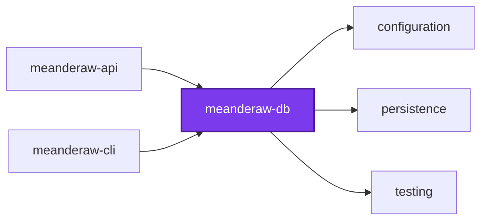

## 🕸️ Codependix

Dependency graphs exported by [codependix](https://github.com/Organizzolini/codebase/tree/main/projects/ic-suite/codependix/codependix-cli), regenerated by `nx run configuration:codependix:write`.

### Nx Neighborhood

<!-- codependix:start name="codependix-nx-projects" -->

<!-- codependix:end name="codependix-nx-projects" -->

### NestJS Module Graph

<!-- codependix:start name="codependix-nestjs-modules" -->

<!-- codependix:end name="codependix-nestjs-modules" -->

### File Imports

<!-- codependix:start name="codependix-file-imports" -->
```mermaid
graph LR
  file_configuration_callidescope_config_ts["configuration/callidescope.config.ts"]
  file_configuration_codependix_config_ts["configuration/codependix.config.ts"]
  file_configuration_codometer_config_ts["configuration/codometer.config.ts"]
  file_configuration_coinagerie_config_ts["configuration/coinagerie.config.ts"]
  file_configuration_eslint_config_ts["configuration/eslint.config.ts"]
  file_configuration_vite_config_ts["configuration/vite.config.ts"]
  file_configuration_vitest_config_ts["configuration/vitest.config.ts"]
  file_migrations_1791160950069_migration_ts["migrations/1791160950069-migration.ts"]
  file_migrations_1791414023001_migration_ts["migrations/1791414023001-migration.ts"]
  file_migrations_1794630084904_migration_ts["migrations/1794630084904-migration.ts"]
  file_migrations_1794700000000_migration_ts["migrations/1794700000000-migration.ts"]
  file_migrations_1794800000000_migration_ts["migrations/1794800000000-migration.ts"]
  file_migrations_1794900000000_migration_ts["migrations/1794900000000-migration.ts"]
  file_migrations_1795000000000_migration_ts["migrations/1795000000000-migration.ts"]
  file_src_index_ts["src/index.ts"]
  file_src_modules_meanderaw_database_data_source_constants_ts["src/modules/meanderaw-database/data-source.constants.ts"]
  file_src_modules_meanderaw_database_meanderaw_database_migrations_module_integration_test_ts["src/modules/meanderaw-database/meanderaw-database-migrations.module.integration.test.ts"]
  file_src_modules_meanderaw_database_meanderaw_database_patterns_service_integration_test_ts["src/modules/meanderaw-database/meanderaw-database-patterns.service.integration.test.ts"]
  file_src_modules_meanderaw_database_meanderaw_database_constants_ts["src/modules/meanderaw-database/meanderaw-database.constants.ts"]
  file_src_modules_meanderaw_database_meanderaw_database_constants_unit_test_ts["src/modules/meanderaw-database/meanderaw-database.constants.unit.test.ts"]
  file_src_modules_meanderaw_database_meanderaw_database_module_integration_test_ts["src/modules/meanderaw-database/meanderaw-database.module.integration.test.ts"]
  file_src_modules_meanderaw_database_meanderaw_database_module_ts["src/modules/meanderaw-database/meanderaw-database.module.ts"]
  file_src_modules_meanderaw_database_meanderaw_database_service_integration_test_ts["src/modules/meanderaw-database/meanderaw-database.service.integration.test.ts"]
  file_src_modules_meanderaw_database_meanderaw_database_service_ts["src/modules/meanderaw-database/meanderaw-database.service.ts"]
  file_src_modules_meanderaw_database_meanderaw_database_service_unit_test_ts["src/modules/meanderaw-database/meanderaw-database.service.unit.test.ts"]
  file_src_modules_meanderaw_database_meanderaw_database_types_ts["src/modules/meanderaw-database/meanderaw-database.types.ts"]
  file_src_modules_meanderaw_database_modules_aggregate_aggregate_marker_entity_ts["src/modules/meanderaw-database/modules/aggregate/aggregate-marker.entity.ts"]
  file_src_modules_meanderaw_database_modules_aggregate_characteristic_pair_count_entity_ts["src/modules/meanderaw-database/modules/aggregate/characteristic-pair-count.entity.ts"]
  file_src_modules_meanderaw_database_modules_aggregate_characteristic_shape_count_entity_ts["src/modules/meanderaw-database/modules/aggregate/characteristic-shape-count.entity.ts"]
  file_src_modules_meanderaw_database_modules_aggregate_characteristic_value_count_entity_ts["src/modules/meanderaw-database/modules/aggregate/characteristic-value-count.entity.ts"]
  file_src_modules_meanderaw_database_modules_aggregate_meanderaw_database_aggregates_service_integration_test_ts["src/modules/meanderaw-database/modules/aggregate/meanderaw-database-aggregates.service.integration.test.ts"]
  file_src_modules_meanderaw_database_modules_aggregate_meanderaw_database_aggregates_service_ts["src/modules/meanderaw-database/modules/aggregate/meanderaw-database-aggregates.service.ts"]
  file_src_modules_meanderaw_database_modules_aggregate_meanderaw_database_aggregates_service_unit_test_ts["src/modules/meanderaw-database/modules/aggregate/meanderaw-database-aggregates.service.unit.test.ts"]
  file_src_modules_meanderaw_database_modules_aggregate_shape_count_entity_ts["src/modules/meanderaw-database/modules/aggregate/shape-count.entity.ts"]
  file_src_modules_meanderaw_database_modules_characteristic_characteristic_entity_ts["src/modules/meanderaw-database/modules/characteristic/characteristic.entity.ts"]
  file_src_modules_meanderaw_database_modules_characteristic_meander_characteristic_entity_ts["src/modules/meanderaw-database/modules/characteristic/meander-characteristic.entity.ts"]
  file_src_modules_meanderaw_database_modules_meander_meander_entity_ts["src/modules/meanderaw-database/modules/meander/meander.entity.ts"]
  file_testing_characteristics_ts["testing/characteristics.ts"]
  file_testing_meanders_ts["testing/meanders.ts"]
  file_testing_mocks_ts["testing/mocks.ts"]
  file_testing_setup_ts["testing/setup.ts"]
  file_src_modules_meanderaw_database_data_source_constants_ts --> file_migrations_1791160950069_migration_ts
  file_src_modules_meanderaw_database_data_source_constants_ts --> file_migrations_1791414023001_migration_ts
  file_src_modules_meanderaw_database_data_source_constants_ts --> file_migrations_1794630084904_migration_ts
  file_src_modules_meanderaw_database_data_source_constants_ts --> file_migrations_1794700000000_migration_ts
  file_src_modules_meanderaw_database_data_source_constants_ts --> file_migrations_1794800000000_migration_ts
  file_src_modules_meanderaw_database_data_source_constants_ts --> file_migrations_1794900000000_migration_ts
  file_src_modules_meanderaw_database_data_source_constants_ts --> file_migrations_1795000000000_migration_ts
  file_src_modules_meanderaw_database_data_source_constants_ts --> file_src_modules_meanderaw_database_meanderaw_database_constants_ts
  file_src_modules_meanderaw_database_data_source_constants_ts --> file_src_modules_meanderaw_database_modules_aggregate_aggregate_marker_entity_ts
  file_src_modules_meanderaw_database_data_source_constants_ts --> file_src_modules_meanderaw_database_modules_aggregate_characteristic_pair_count_entity_ts
  file_src_modules_meanderaw_database_data_source_constants_ts --> file_src_modules_meanderaw_database_modules_aggregate_characteristic_shape_count_entity_ts
  file_src_modules_meanderaw_database_data_source_constants_ts --> file_src_modules_meanderaw_database_modules_aggregate_characteristic_value_count_entity_ts
  file_src_modules_meanderaw_database_data_source_constants_ts --> file_src_modules_meanderaw_database_modules_aggregate_shape_count_entity_ts
  file_src_modules_meanderaw_database_data_source_constants_ts --> file_src_modules_meanderaw_database_modules_characteristic_characteristic_entity_ts
  file_src_modules_meanderaw_database_data_source_constants_ts --> file_src_modules_meanderaw_database_modules_characteristic_meander_characteristic_entity_ts
  file_src_modules_meanderaw_database_data_source_constants_ts --> file_src_modules_meanderaw_database_modules_meander_meander_entity_ts
  file_src_modules_meanderaw_database_meanderaw_database_migrations_module_integration_test_ts --> file_src_modules_meanderaw_database_data_source_constants_ts
  file_src_modules_meanderaw_database_meanderaw_database_migrations_module_integration_test_ts --> file_src_modules_meanderaw_database_meanderaw_database_module_ts
  file_src_modules_meanderaw_database_meanderaw_database_patterns_service_integration_test_ts --> file_src_modules_meanderaw_database_data_source_constants_ts
  file_src_modules_meanderaw_database_meanderaw_database_patterns_service_integration_test_ts --> file_src_modules_meanderaw_database_meanderaw_database_module_ts
  file_src_modules_meanderaw_database_meanderaw_database_patterns_service_integration_test_ts --> file_src_modules_meanderaw_database_meanderaw_database_service_ts
  file_src_modules_meanderaw_database_meanderaw_database_patterns_service_integration_test_ts --> file_src_modules_meanderaw_database_modules_meander_meander_entity_ts
  file_src_modules_meanderaw_database_meanderaw_database_patterns_service_integration_test_ts --> file_testing_characteristics_ts
  file_src_modules_meanderaw_database_meanderaw_database_patterns_service_integration_test_ts --> file_testing_meanders_ts
  file_src_modules_meanderaw_database_meanderaw_database_constants_unit_test_ts --> file_src_modules_meanderaw_database_meanderaw_database_constants_ts
  file_src_modules_meanderaw_database_meanderaw_database_module_integration_test_ts --> file_src_modules_meanderaw_database_data_source_constants_ts
  file_src_modules_meanderaw_database_meanderaw_database_module_integration_test_ts --> file_src_modules_meanderaw_database_meanderaw_database_module_ts
  file_src_modules_meanderaw_database_meanderaw_database_module_integration_test_ts --> file_src_modules_meanderaw_database_meanderaw_database_service_ts
  file_src_modules_meanderaw_database_meanderaw_database_module_integration_test_ts --> file_src_modules_meanderaw_database_modules_meander_meander_entity_ts
  file_src_modules_meanderaw_database_meanderaw_database_module_integration_test_ts --> file_testing_meanders_ts
  file_src_modules_meanderaw_database_meanderaw_database_module_ts --> file_src_modules_meanderaw_database_data_source_constants_ts
  file_src_modules_meanderaw_database_meanderaw_database_module_ts --> file_src_modules_meanderaw_database_meanderaw_database_constants_ts
  file_src_modules_meanderaw_database_meanderaw_database_module_ts --> file_src_modules_meanderaw_database_meanderaw_database_service_ts
  file_src_modules_meanderaw_database_meanderaw_database_module_ts --> file_src_modules_meanderaw_database_modules_aggregate_meanderaw_database_aggregates_service_ts
  file_src_modules_meanderaw_database_meanderaw_database_service_integration_test_ts --> file_src_modules_meanderaw_database_data_source_constants_ts
  file_src_modules_meanderaw_database_meanderaw_database_service_integration_test_ts --> file_src_modules_meanderaw_database_meanderaw_database_constants_ts
  file_src_modules_meanderaw_database_meanderaw_database_service_integration_test_ts --> file_src_modules_meanderaw_database_meanderaw_database_module_ts
  file_src_modules_meanderaw_database_meanderaw_database_service_integration_test_ts --> file_src_modules_meanderaw_database_meanderaw_database_service_ts
  file_src_modules_meanderaw_database_meanderaw_database_service_integration_test_ts --> file_src_modules_meanderaw_database_meanderaw_database_types_ts
  file_src_modules_meanderaw_database_meanderaw_database_service_integration_test_ts --> file_src_modules_meanderaw_database_modules_characteristic_characteristic_entity_ts
  file_src_modules_meanderaw_database_meanderaw_database_service_integration_test_ts --> file_src_modules_meanderaw_database_modules_meander_meander_entity_ts
  file_src_modules_meanderaw_database_meanderaw_database_service_integration_test_ts --> file_testing_characteristics_ts
  file_src_modules_meanderaw_database_meanderaw_database_service_integration_test_ts --> file_testing_meanders_ts
  file_src_modules_meanderaw_database_meanderaw_database_service_ts --> file_src_modules_meanderaw_database_meanderaw_database_constants_ts
  file_src_modules_meanderaw_database_meanderaw_database_service_ts --> file_src_modules_meanderaw_database_meanderaw_database_types_ts
  file_src_modules_meanderaw_database_meanderaw_database_service_ts --> file_src_modules_meanderaw_database_modules_aggregate_aggregate_marker_entity_ts
  file_src_modules_meanderaw_database_meanderaw_database_service_ts --> file_src_modules_meanderaw_database_modules_characteristic_characteristic_entity_ts
  file_src_modules_meanderaw_database_meanderaw_database_service_ts --> file_src_modules_meanderaw_database_modules_characteristic_meander_characteristic_entity_ts
  file_src_modules_meanderaw_database_meanderaw_database_service_ts --> file_src_modules_meanderaw_database_modules_meander_meander_entity_ts
  file_src_modules_meanderaw_database_meanderaw_database_service_unit_test_ts --> file_src_modules_meanderaw_database_meanderaw_database_service_ts
  file_src_modules_meanderaw_database_meanderaw_database_service_unit_test_ts --> file_src_modules_meanderaw_database_meanderaw_database_types_ts
  file_src_modules_meanderaw_database_meanderaw_database_service_unit_test_ts --> file_src_modules_meanderaw_database_modules_characteristic_characteristic_entity_ts
  file_src_modules_meanderaw_database_meanderaw_database_service_unit_test_ts --> file_src_modules_meanderaw_database_modules_meander_meander_entity_ts
  file_src_modules_meanderaw_database_meanderaw_database_service_unit_test_ts --> file_testing_meanders_ts
  file_src_modules_meanderaw_database_meanderaw_database_types_ts --> file_src_modules_meanderaw_database_modules_characteristic_characteristic_entity_ts
  file_src_modules_meanderaw_database_meanderaw_database_types_ts --> file_src_modules_meanderaw_database_modules_meander_meander_entity_ts
  file_src_modules_meanderaw_database_modules_aggregate_aggregate_marker_entity_ts --> file_src_modules_meanderaw_database_meanderaw_database_constants_ts
  file_src_modules_meanderaw_database_modules_aggregate_characteristic_pair_count_entity_ts --> file_src_modules_meanderaw_database_meanderaw_database_constants_ts
  file_src_modules_meanderaw_database_modules_aggregate_characteristic_shape_count_entity_ts --> file_src_modules_meanderaw_database_meanderaw_database_constants_ts
  file_src_modules_meanderaw_database_modules_aggregate_characteristic_value_count_entity_ts --> file_src_modules_meanderaw_database_meanderaw_database_constants_ts
  file_src_modules_meanderaw_database_modules_aggregate_meanderaw_database_aggregates_service_integration_test_ts --> file_src_modules_meanderaw_database_data_source_constants_ts
  file_src_modules_meanderaw_database_modules_aggregate_meanderaw_database_aggregates_service_integration_test_ts --> file_src_modules_meanderaw_database_meanderaw_database_module_ts
  file_src_modules_meanderaw_database_modules_aggregate_meanderaw_database_aggregates_service_integration_test_ts --> file_src_modules_meanderaw_database_meanderaw_database_service_ts
  file_src_modules_meanderaw_database_modules_aggregate_meanderaw_database_aggregates_service_integration_test_ts --> file_src_modules_meanderaw_database_modules_aggregate_meanderaw_database_aggregates_service_ts
  file_src_modules_meanderaw_database_modules_aggregate_meanderaw_database_aggregates_service_integration_test_ts --> file_src_modules_meanderaw_database_modules_meander_meander_entity_ts
  file_src_modules_meanderaw_database_modules_aggregate_meanderaw_database_aggregates_service_integration_test_ts --> file_testing_characteristics_ts
  file_src_modules_meanderaw_database_modules_aggregate_meanderaw_database_aggregates_service_integration_test_ts --> file_testing_meanders_ts
  file_src_modules_meanderaw_database_modules_aggregate_meanderaw_database_aggregates_service_ts --> file_src_modules_meanderaw_database_modules_aggregate_aggregate_marker_entity_ts
  file_src_modules_meanderaw_database_modules_aggregate_meanderaw_database_aggregates_service_ts --> file_src_modules_meanderaw_database_modules_aggregate_characteristic_pair_count_entity_ts
  file_src_modules_meanderaw_database_modules_aggregate_meanderaw_database_aggregates_service_ts --> file_src_modules_meanderaw_database_modules_aggregate_characteristic_shape_count_entity_ts
  file_src_modules_meanderaw_database_modules_aggregate_meanderaw_database_aggregates_service_ts --> file_src_modules_meanderaw_database_modules_aggregate_characteristic_value_count_entity_ts
  file_src_modules_meanderaw_database_modules_aggregate_meanderaw_database_aggregates_service_ts --> file_src_modules_meanderaw_database_modules_aggregate_shape_count_entity_ts
  file_src_modules_meanderaw_database_modules_aggregate_meanderaw_database_aggregates_service_ts --> file_src_modules_meanderaw_database_modules_characteristic_characteristic_entity_ts
  file_src_modules_meanderaw_database_modules_aggregate_meanderaw_database_aggregates_service_ts --> file_src_modules_meanderaw_database_modules_characteristic_meander_characteristic_entity_ts
  file_src_modules_meanderaw_database_modules_aggregate_meanderaw_database_aggregates_service_ts --> file_src_modules_meanderaw_database_modules_meander_meander_entity_ts
  file_src_modules_meanderaw_database_modules_aggregate_meanderaw_database_aggregates_service_unit_test_ts --> file_src_modules_meanderaw_database_modules_aggregate_meanderaw_database_aggregates_service_ts
  file_src_modules_meanderaw_database_modules_aggregate_shape_count_entity_ts --> file_src_modules_meanderaw_database_meanderaw_database_constants_ts
  file_src_modules_meanderaw_database_modules_characteristic_characteristic_entity_ts --> file_src_modules_meanderaw_database_meanderaw_database_constants_ts
  file_src_modules_meanderaw_database_modules_characteristic_meander_characteristic_entity_ts --> file_src_modules_meanderaw_database_modules_characteristic_characteristic_entity_ts
  file_src_modules_meanderaw_database_modules_characteristic_meander_characteristic_entity_ts --> file_src_modules_meanderaw_database_modules_meander_meander_entity_ts
  file_src_modules_meanderaw_database_modules_meander_meander_entity_ts --> file_src_modules_meanderaw_database_meanderaw_database_constants_ts
  file_testing_characteristics_ts --> file_src_modules_meanderaw_database_meanderaw_database_types_ts
  file_testing_meanders_ts --> file_src_modules_meanderaw_database_meanderaw_database_types_ts
```
<!-- codependix:end name="codependix-file-imports" -->
