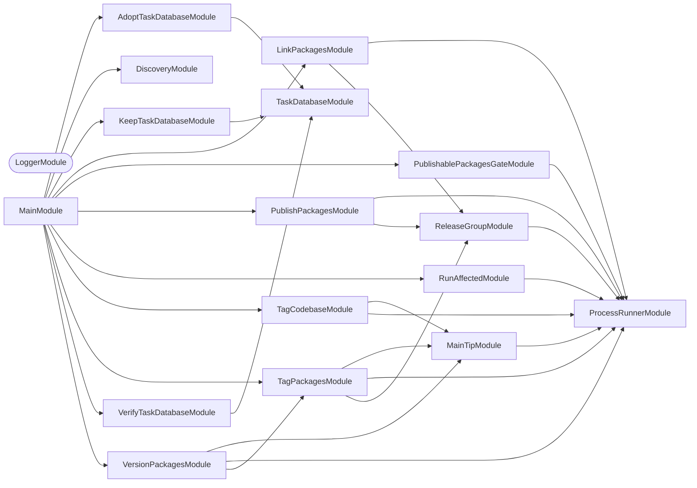

Commands that run in CI: `run-affected` (Nx affected runs over a change set
corrected for spelling files and conformetry templates),
`publishable-packages-gate` (runs the publishable-packages check only when an
ic-suite package is affected), `bound-base-to-push` (a push's Nx base), the Nx
cache steps `import-pr-task-cache`, `merge-task-cache`, `verify-task-database`,
`adopt-task-database`, and `keep-task-database`, and the
release steps `version-packages`, `tag-codebase`, `tag-packages`,
`publish-packages`, and `link-packages`. See
[AGENTS.md](AGENTS.md).

## Start

```bash
nx run publication:start
```

## Test

```bash
nx run publication:vitest
```

## 👔 Conformetry

This project was generated from the [nestjs-command-project](../../projects/configuration/conformetry-templates/nestjs-command-project) conformetry template.

<!-- callidescope:start -->

## 🔭 Callidescope

Call stacks traced through `projects/publication`, deepest first. Each frame shows what it takes, what it returns, and what its documentation says.

| Measure | Value |
| --- | --- |
| Callables | 156 |
| Files | 74 |
| Calls traced | 207 |
| Call stacks | 10 |
| Deepest stack | 6 |
| Stacks through recursion | 0 |
| Unfollowable calls | 11 |

### Limits

What this project is judged against, as declared in its own `callidescope.config.ts`.

| Limit | Value |
| --- | --- |
| `maximumDepth` | 6 |
| `maximumBreadth` | 8 |

### Call stacks (depth)

**1. `LinkPackagesCommand.run`** — depth ≥ 6 · decorated-method

```text
🚀 LinkPackagesCommand.run(): Promise<void> [projects/publication/src/modules/link-packages/link-packages.command.ts:46]
   ↳ Links the release group, and exits with the outcome.
  └─> LinkPackagesService.run(): Promise<number> [projects/publication/src/modules/link-packages/link-packages.service.ts:241]
     ↳ Records every published release-group version that has no record yet, and lists the ones this run published in a…
    └─> LinkPackagesService.runInParallel(…)(root: string): Promise<ParallelOutcome> [projects/publication/src/modules/link-packages/link-packages.service.ts:273]
      └─> LinkPackagesService.linkPackage(root: string, context: LinkContext): Promise<ParallelOutcome> [projects/publication/src/modules/link-packages/link-packages.service.ts:144]
         ↳ Links the package in the given directory: a version this run published is added to the attestation subjects, a version…
        └─> ReleaseGroupService.specifier(root: string): string [projects/publication/src/modules/release-group/release-group.service.ts:267]
           ↳ Names the package in the given directory as `<name>@<version>`.
          └─> ReleaseGroupService.readManifest(root: string): PackageManifest [projects/publication/src/modules/release-group/release-group.service.ts:196]
             ↳ Reads the name and version of the package in the given directory.
```

**2. `PublishPackagesCommand.run`** — depth ≥ 6 · decorated-method

```text
🚀 PublishPackagesCommand.run(): Promise<void> [projects/publication/src/modules/publish-packages/publish-packages.command.ts:47]
   ↳ Publishes and mirrors the release group, and exits with the outcome.
  └─> PublishPackagesService.run(): Promise<number> [projects/publication/src/modules/publish-packages/publish-packages.service.ts:318]
     ↳ Publishes the release group to npm, then mirrors it to GitHub Packages.
    └─> PublishPackagesService.runInParallel(…)(root: string): Promise<ParallelOutcome> [projects/publication/src/modules/publish-packages/publish-packages.service.ts:334]
      └─> PublishPackagesService.mirrorPackage(root: string, context: MirrorContext): Promise<ParallelOutcome> [projects/publication/src/modules/publish-packages/publish-packages.service.ts:62]
         ↳ Mirrors the package in the given directory to GitHub Packages, unless that version is there already.
        └─> PublishPackagesService.packRenamed(root: string, mirror: string, context: MirrorContext): Promise<CapturedProcess> [projects/publication/src/modules/publish-packages/publish-packages.service.ts:116]
           ↳ Packs a package exactly as npm got it, unpacks it, and renames it into the mirror's scope, dropping its…
          └─> ProcessRunnerService.captureAsync(executable: string, args: readonly string[]): Promise<CapturedProcess> [projects/publication/src/modules/process-runner/process-runner.service.ts:63]
             ↳ Runs a command without blocking, so several can run at once, and returns what it printed once it ends.
```

**3. `VersionPackagesCommand.run`** — depth 6 · decorated-method

```text
🚀 VersionPackagesCommand.run(): Promise<void> [projects/publication/src/modules/version-packages/version-packages.command.ts:45]
   ↳ Versions the release group, and exits with the outcome.
  └─> VersionPackagesService.run(): Promise<number> [projects/publication/src/modules/version-packages/version-packages.service.ts:117]
     ↳ Points the remote at the release token, pushes any tags an earlier run left missing, and versions the release group.
    └─> TagPackagesService.run(): Promise<number> [projects/publication/src/modules/tag-packages/tag-packages.service.ts:285]
       ↳ Commits any leftover versions, then tags and pushes every newly versioned package.
      └─> TagPackagesService.commitLeftoverVersions(): LeftoverOutcome [projects/publication/src/modules/tag-packages/tag-packages.service.ts:68]
         ↳ Commits and pushes any versions semantic-release left uncommitted.
        └─> TagPackagesService.mustStream(executable: string, args: readonly string[]): void [projects/publication/src/modules/tag-packages/tag-packages.service.ts:127]
           ↳ Streams a command, failing the step when it fails.
          └─> ProcessRunnerService.stream(executable: string, args: readonly string[], input?: string): number [projects/publication/src/modules/process-runner/process-runner.service.ts:105]
             ↳ Runs a command with this process's own output streams, so its output appears as it would from the shell step that used…
```

<details>
<summary>7 more call stacks</summary>

**4. `AdoptTaskDatabaseCommand.run`** — depth 5 · decorated-method

```text
🚀 AdoptTaskDatabaseCommand.run(): Promise<void> [projects/publication/src/modules/adopt-task-database/adopt-task-database.command.ts:42]
   ↳ Runs the step and prints what it reports.
  └─> TaskDatabaseService.adopt(): TaskDatabaseReport [projects/publication/src/modules/task-database/task-database.service.ts:200]
     ↳ Renames the newest restored database to this machine's id, and discards the rest.
    └─> TaskDatabaseService.planAdoption(databases: readonly string[]): AdoptionPlan [projects/publication/src/modules/task-database/task-database.service.ts:118]
       ↳ Decides what adopting would do, or why it should do nothing.
      └─> TaskDatabaseService.readMachineId(): string [projects/publication/src/modules/task-database/task-database.service.ts:159]
         ↳ This machine's id, from the first readable, non-empty id file.
        └─> TaskDatabaseService.filter(…)(file: string): boolean [projects/publication/src/modules/task-database/task-database.service.ts:163]
```

**5. `RunAffectedCommand.run`** — depth 5 · decorated-method

```text
🚀 RunAffectedCommand.run(): Promise<void> [projects/publication/src/modules/run-affected/run-affected.command.ts:61]
   ↳ Plans the affected run, reports what it corrected, and runs it.
  └─> RunAffectedService.plan(): RunAffectedOutcome [projects/publication/src/modules/run-affected/run-affected.service.ts:237]
     ↳ Works out the `nx affected` run this environment asks for.
    └─> RunAffectedService.findCorrections(inputs: RunAffectedInputs): RunAffectedCorrections | RunAffectedFailure [projects/publication/src/modules/run-affected/run-affected.service.ts:90]
       ↳ Picks out the files that mislead Nx for this target, listing the change set only when the target asks for a correction.
      └─> RunAffectedService.listChangedFiles(base: string, head: string): RunAffectedFailure | string[] [projects/publication/src/modules/run-affected/run-affected.service.ts:131]
         ↳ Lists the files changed between two revisions, or why that failed.
        └─> ProcessRunnerService.capture(executable: string, args: readonly string[]): CapturedProcess [projects/publication/src/modules/process-runner/process-runner.service.ts:41]
           ↳ Runs a command to completion and returns what it printed.
```

**6. `TagPackagesCommand.run`** — depth 5 · decorated-method

```text
🚀 TagPackagesCommand.run(): Promise<void> [projects/publication/src/modules/tag-packages/tag-packages.command.ts:46]
   ↳ Commits leftover versions, tags, and pushes, and exits with the outcome.
  └─> TagPackagesService.run(): Promise<number> [projects/publication/src/modules/tag-packages/tag-packages.service.ts:285]
     ↳ Commits any leftover versions, then tags and pushes every newly versioned package.
    └─> TagPackagesService.commitLeftoverVersions(): LeftoverOutcome [projects/publication/src/modules/tag-packages/tag-packages.service.ts:68]
       ↳ Commits and pushes any versions semantic-release left uncommitted.
      └─> TagPackagesService.mustStream(executable: string, args: readonly string[]): void [projects/publication/src/modules/tag-packages/tag-packages.service.ts:127]
         ↳ Streams a command, failing the step when it fails.
        └─> ProcessRunnerService.stream(executable: string, args: readonly string[], input?: string): number [projects/publication/src/modules/process-runner/process-runner.service.ts:105]
           ↳ Runs a command with this process's own output streams, so its output appears as it would from the shell step that used…
```

**7. `VerifyTaskDatabaseCommand.run`** — depth 5 · decorated-method

```text
🚀 VerifyTaskDatabaseCommand.run(): Promise<void> [projects/publication/src/modules/verify-task-database/verify-task-database.command.ts:39]
   ↳ Runs the step and prints what it reports.
  └─> TaskDatabaseService.verify(): TaskDatabaseReport [projects/publication/src/modules/task-database/task-database.service.ts:262]
     ↳ Discards every database that fails `PRAGMA integrity_check`.
    └─> TaskDatabaseService.integrityOf(database: string): string [projects/publication/src/modules/task-database/task-database.service.ts:81]
       ↳ Answers what SQLite itself says of a database: `ok` for a sound one, the problems found for a damaged one, or why it…
      └─> TaskDatabaseService.query(database: string, sql: string): string[] [projects/publication/src/modules/task-database/task-database.service.ts:145]
         ↳ Runs one query, and returns the first column of every row as text.
        └─> TaskDatabaseService.map(…)(row: Record<string, SQLOutputValue>): string [projects/publication/src/modules/task-database/task-database.service.ts:152]
```

**8. `KeepTaskDatabaseCommand.run`** — depth 4 · decorated-method

```text
🚀 KeepTaskDatabaseCommand.run(): Promise<void> [projects/publication/src/modules/keep-task-database/keep-task-database.command.ts:41]
   ↳ Runs the step and prints what it reports.
  └─> TaskDatabaseService.keep(): TaskDatabaseReport [projects/publication/src/modules/task-database/task-database.service.ts:232]
     ↳ Keeps only the newest database, warning when there was more than one. `adopt` renames the restored database to this…
    └─> TaskDatabaseService.list(): string[] [projects/publication/src/modules/task-database/task-database.service.ts:90]
       ↳ Lists every task database, in name order, and nothing when there is none.
      └─> TaskDatabaseService.directory(): string [projects/publication/src/modules/task-database/task-database.service.ts:55]
         ↳ Where Nx keeps the database, honouring the override Nx itself reads.
```

**9. `TagCodebaseCommand.run`** — depth 4 · decorated-method

```text
🚀 TagCodebaseCommand.run(): Promise<void> [projects/publication/src/modules/tag-codebase/tag-codebase.command.ts:44]
   ↳ Releases the codebase, and exits with the outcome.
  └─> TagCodebaseService.run(): number [projects/publication/src/modules/tag-codebase/tag-codebase.service.ts:49]
     ↳ Runs semantic-release, or steps aside when `main` has moved.
    └─> MainTipService.head(): string [projects/publication/src/modules/main-tip/main-tip.service.ts:73]
       ↳ Prints the commit checked out.
      └─> requireSuccess(result: CapturedProcess, commandLine: string): string [projects/publication/src/modules/process-runner/process-runner.utilities.ts:21]
         ↳ Returns what a finished process printed, or fails the way `set -e` failed the shell scripts these commands replace: at…
```

**10. `PublishablePackagesGateCommand.run`** — depth 3 · decorated-method

```text
🚀 PublishablePackagesGateCommand.run(): Promise<void> [projects/publication/src/modules/publishable-packages-gate/publishable-packages-gate.command.ts:49]
   ↳ Decides whether the check is affected, then runs it whole or skips it.
  └─> PublishablePackagesGateService.decide(): PublishablePackagesGateOutcome [projects/publication/src/modules/publishable-packages-gate/publishable-packages-gate.service.ts:47]
     ↳ Asks Nx which gated projects the change between `NX_BASE` and `NX_HEAD` affects.
    └─> ProcessRunnerService.capture(executable: string, args: readonly string[]): CapturedProcess [projects/publication/src/modules/process-runner/process-runner.service.ts:41]
       ↳ Runs a command to completion and returns what it printed.
```

</details>

### Breadth

| Callable | Breadth | Calls directly | Location |
| --- | --- | --- | --- |
| `LinkPackagesService.linkPackage` | 8 | `ReleaseGroupService.specifier`, `LinkPackagesService.tarballDigest`, `ReleaseGroupService.isOnNpm`, `rehearsalMessage`, `LinkPackagesService.hasStorageRecord`, `alreadyLinkedMessage`, `LinkPackagesService.createStorageRecord`, `linkingMessage` | `projects/publication/src/modules/link-packages/link-packages.service.ts:144` |
| `LinkPackagesService.run` | 8 | `LinkPackagesService.readInputs`, `LinkPackagesService.map(…)`, `ReleaseGroupService.readGroup`, `LinkPackagesService.filter(…)`, `ReleaseGroupService.npmRegistry`, `ReleaseGroupService.isRehearsal`, `LinkPackagesService.runInParallel(…)`, `ReleaseGroupService.runInParallel` | `projects/publication/src/modules/link-packages/link-packages.service.ts:241` |
| `PublishPackagesService.run` | 8 | `PublishPackagesService.readInputs`, `PublishPackagesService.map(…)`, `ReleaseGroupService.readGroup`, `PublishPackagesService.refuseUnsealedRehearsal`, `PublishPackagesService.publishToNpm`, `PublishPackagesService.prepareMirrors`, `PublishPackagesService.runInParallel(…)`, `ReleaseGroupService.runInParallel` | `projects/publication/src/modules/publish-packages/publish-packages.service.ts:318` |

<details>
<summary>67 more callables</summary>

| Callable | Breadth | Calls directly | Location |
| --- | --- | --- | --- |
| `TagPackagesService.commitLeftoverVersions` | 7 | `TagPackagesService.mustStream`, `TagPackagesService.versionedFiles`, `ProcessRunnerService.capture`, `MainTipService.head`, `ProcessRunnerService.stream`, `MainTipService.hasMovedFrom`, `MainTipService.stepAsideFrom` | `projects/publication/src/modules/tag-packages/tag-packages.service.ts:68` |
| `TagPackagesService.run` | 7 | `TagPackagesService.commitLeftoverVersions`, `ReleaseGroupService.readGroup`, `TagPackagesService.tagBaselines`, `TagPackagesService.tagNewVersions`, `pushingMessage`, `TagPackagesService.map(…)`, `TagPackagesService.pushWithRetries` | `projects/publication/src/modules/tag-packages/tag-packages.service.ts:285` |
| `TaskDatabaseService.adopt` | 6 | `TaskDatabaseService.list`, `TaskDatabaseService.planAdoption`, `TaskDatabaseService.discardOthers`, `TaskDatabaseService.rename`, `adoptedMessage`, `TaskDatabaseService.countCachedResults` | `projects/publication/src/modules/task-database/task-database.service.ts:200` |
| `PublishPackagesService.publishToNpm` | 6 | `ReleaseGroupService.npmRegistry`, `authenticationLine`, `ProcessRunnerService.stream`, `PublishPackagesService.flatMap(…)`, `ReleaseGroupService.isRehearsal`, `PublishPackagesService.map(…)` | `projects/publication/src/modules/publish-packages/publish-packages.service.ts:201` |
| `VersionPackagesService.run` | 6 | `VersionPackagesService.pointRemoteAtToken`, `MainTipService.head`, `MainTipService.hasMovedFrom`, `MainTipService.stepAsideFrom`, `TagPackagesService.run`, `VersionPackagesService.releaseWithoutConfiguration` | `projects/publication/src/modules/version-packages/version-packages.service.ts:117` |
| `TaskDatabaseService.keep` | 5 | `TaskDatabaseService.list`, `TaskDatabaseService.newest`, `TaskDatabaseService.discardOthers`, `duplicateMessage`, `TaskDatabaseService.map(…)` | `projects/publication/src/modules/task-database/task-database.service.ts:232` |
| `PublishPackagesService.mirrorPackage` | 5 | `ReleaseGroupService.readManifest`, `ProcessRunnerService.captureAsync`, `alreadyMirroredMessage`, `PublishPackagesService.packRenamed`, `mirroringMessage` | `projects/publication/src/modules/publish-packages/publish-packages.service.ts:62` |
| `RunAffectedCommand.run` | 5 | `RunAffectedService.plan`, `RunAffectedCommand.report`, `spellingFilesHeading`, `templateFilesHeading`, `RunAffectedService.execute` | `projects/publication/src/modules/run-affected/run-affected.command.ts:61` |
| `TagPackagesService.tagBaselines` | 5 | `ReleaseGroupService.readManifest`, `requireSuccess`, `ProcessRunnerService.capture`, `TagPackagesService.createTag`, `TagPackagesService.parentOfAddition` | `projects/publication/src/modules/tag-packages/tag-packages.service.ts:213` |
| `TaskDatabaseService.planAdoption` | 4 | `TaskDatabaseService.readMachineId`, `TaskDatabaseService.newest`, `noSchemaMessage`, `TaskDatabaseService.directory` | `projects/publication/src/modules/task-database/task-database.service.ts:118` |
| `TaskDatabaseService.verify` | 4 | `TaskDatabaseService.list`, `TaskDatabaseService.integrityOf`, `corruptMessage`, `TaskDatabaseService.discard` | `projects/publication/src/modules/task-database/task-database.service.ts:262` |
| `PublishPackagesService.refuseUnsealedRehearsal` | 4 | `ReleaseGroupService.isRehearsal`, `ReleaseGroupService.readManifest`, `ReleaseGroupService.npmRegistry`, `unsealedMessage` | `projects/publication/src/modules/publish-packages/publish-packages.service.ts:282` |
| `RunAffectedService.findCorrections` | 4 | `RunAffectedService.listChangedFiles`, `RunAffectedService.pattern`, `RunAffectedService.filter(…)`, `RunAffectedService.filter(…)` | `projects/publication/src/modules/run-affected/run-affected.service.ts:90` |
| `RunAffectedService.plan` | 4 | `RunAffectedService.readInputs`, `RunAffectedService.findCorrections`, `RunAffectedService.correctedPlan`, `RunAffectedService.revisionsPlan` | `projects/publication/src/modules/run-affected/run-affected.service.ts:237` |
| `TagCodebaseService.run` | 4 | `MainTipService.head`, `MainTipService.hasMovedFrom`, `MainTipService.stepAsideFrom`, `ProcessRunnerService.stream` | `projects/publication/src/modules/tag-codebase/tag-codebase.service.ts:49` |
| `TagPackagesService.parentOfAddition` | 4 | `TagPackagesService.findLast(…)`, `requireSuccess`, `ProcessRunnerService.capture`, `noBaselineMessage` | `projects/publication/src/modules/tag-packages/tag-packages.service.ts:138` |
| `TagPackagesService.pushWithRetries` | 4 | `TagPackagesService.retryDelay`, `ProcessRunnerService.stream`, `retryingMessage`, `TagPackagesService.anonymous` | `projects/publication/src/modules/tag-packages/tag-packages.service.ts:169` |
| `VersionPackagesService.pointRemoteAtToken` | 4 | `requireVariable`, `requireSuccess`, `ProcessRunnerService.capture`, `authenticatedRemote` | `projects/publication/src/modules/version-packages/version-packages.service.ts:65` |
| `TaskDatabaseService.list` | 3 | `TaskDatabaseService.directory`, `TaskDatabaseService.map(…)`, `TaskDatabaseService.filter(…)` | `projects/publication/src/modules/task-database/task-database.service.ts:90` |
| `ReleaseGroupService.membersFrom` | 3 | `requireSuccess`, `ProcessRunnerService.capture`, `ReleaseGroupService.map(…)` | `projects/publication/src/modules/release-group/release-group.service.ts:68` |
| `ReleaseGroupService.map(…)` | 3 | `ReleaseGroupService.acquire`, `ReleaseGroupService.settle`, `ReleaseGroupService.release` | `projects/publication/src/modules/release-group/release-group.service.ts:237` |
| `PublishablePackagesGateCommand.run` | 3 | `PublishablePackagesGateService.decide`, `affectedMessage`, `PublishablePackagesGateService.execute` | `projects/publication/src/modules/publishable-packages-gate/publishable-packages-gate.command.ts:49` |
| `MainTipService.stepAsideFrom` | 3 | `requireVariable`, `ProcessRunnerService.capture`, `superseded` | `projects/publication/src/modules/main-tip/main-tip.service.ts:86` |
| `TagPackagesService.tagNewVersions` | 3 | `ReleaseGroupService.readManifest`, `ProcessRunnerService.capture`, `TagPackagesService.createTag` | `projects/publication/src/modules/tag-packages/tag-packages.service.ts:243` |
| `ReleaseGroupService.isOnNpm` | 2 | `ProcessRunnerService.captureAsync`, `ReleaseGroupService.npmRegistry` | `projects/publication/src/modules/release-group/release-group.service.ts:120` |
| `ReleaseGroupService.readGroup` | 2 | `ReleaseGroupService.membersFrom`, `describeError` | `projects/publication/src/modules/release-group/release-group.service.ts:169` |
| `LinkPackagesService.createStorageRecord` | 2 | `LinkPackagesService.parse`, `ProcessRunnerService.captureAsync` | `projects/publication/src/modules/link-packages/link-packages.service.ts:69` |
| `LinkPackagesService.hasStorageRecord` | 2 | `ProcessRunnerService.captureAsync`, `LinkPackagesService.some(…)` | `projects/publication/src/modules/link-packages/link-packages.service.ts:119` |
| `LinkPackagesService.tarballDigest` | 2 | `LinkPackagesService.parse`, `ProcessRunnerService.captureAsync` | `projects/publication/src/modules/link-packages/link-packages.service.ts:204` |
| `LinkPackagesCommand.run` | 2 | `LinkPackagesService.run`, `describeError` | `projects/publication/src/modules/link-packages/link-packages.command.ts:46` |
| `PublishPackagesCommand.run` | 2 | `PublishPackagesService.run`, `describeError` | `projects/publication/src/modules/publish-packages/publish-packages.command.ts:47` |
| `RunAffectedService.listChangedFiles` | 2 | `ProcessRunnerService.capture`, `RunAffectedService.filter(…)` | `projects/publication/src/modules/run-affected/run-affected.service.ts:131` |
| `MainTipService.head` | 2 | `requireSuccess`, `ProcessRunnerService.capture` | `projects/publication/src/modules/main-tip/main-tip.service.ts:73` |
| `TagCodebaseCommand.run` | 2 | `TagCodebaseService.run`, `describeError` | `projects/publication/src/modules/tag-codebase/tag-codebase.command.ts:44` |
| `TagPackagesCommand.run` | 2 | `TagPackagesService.run`, `describeError` | `projects/publication/src/modules/tag-packages/tag-packages.command.ts:46` |
| `VersionPackagesCommand.run` | 2 | `VersionPackagesService.run`, `describeError` | `projects/publication/src/modules/version-packages/version-packages.command.ts:45` |
| `TaskDatabaseService.countCachedResults` | 1 | `TaskDatabaseService.query` | `projects/publication/src/modules/task-database/task-database.service.ts:46` |
| `TaskDatabaseService.discardOthers` | 1 | `TaskDatabaseService.discard` | `projects/publication/src/modules/task-database/task-database.service.ts:69` |
| `TaskDatabaseService.integrityOf` | 1 | `TaskDatabaseService.query` | `projects/publication/src/modules/task-database/task-database.service.ts:81` |
| `TaskDatabaseService.newest` | 1 | `TaskDatabaseService.reduce(…)` | `projects/publication/src/modules/task-database/task-database.service.ts:110` |
| `TaskDatabaseService.query` | 1 | `TaskDatabaseService.map(…)` | `projects/publication/src/modules/task-database/task-database.service.ts:145` |
| `TaskDatabaseService.readMachineId` | 1 | `TaskDatabaseService.filter(…)` | `projects/publication/src/modules/task-database/task-database.service.ts:159` |
| `AdoptTaskDatabaseCommand.run` | 1 | `TaskDatabaseService.adopt` | `projects/publication/src/modules/adopt-task-database/adopt-task-database.command.ts:42` |
| `KeepTaskDatabaseCommand.run` | 1 | `TaskDatabaseService.keep` | `projects/publication/src/modules/keep-task-database/keep-task-database.command.ts:41` |
| `ReleaseGroupService.settle` | 1 | `describeError` | `projects/publication/src/modules/release-group/release-group.service.ts:49` |
| `ReleaseGroupService.isRehearsal` | 1 | `ReleaseGroupService.npmRegistry` | `projects/publication/src/modules/release-group/release-group.service.ts:138` |
| `ReleaseGroupService.runInParallel` | 1 | `ReleaseGroupService.map(…)` | `projects/publication/src/modules/release-group/release-group.service.ts:211` |
| `ReleaseGroupService.acquire` | 1 | `ReleaseGroupService.anonymous` | `projects/publication/src/modules/release-group/release-group.service.ts:217` |
| `ReleaseGroupService.specifier` | 1 | `ReleaseGroupService.readManifest` | `projects/publication/src/modules/release-group/release-group.service.ts:267` |
| `LinkPackagesService.readInputs` | 1 | `LinkPackagesService.read` | `projects/publication/src/modules/link-packages/link-packages.service.ts:185` |
| `LinkPackagesService.read` | 1 | `requireVariable` | `projects/publication/src/modules/link-packages/link-packages.service.ts:186` |
| `LinkPackagesService.runInParallel(…)` | 1 | `LinkPackagesService.linkPackage` | `projects/publication/src/modules/link-packages/link-packages.service.ts:273` |
| `PublishPackagesService.packRenamed` | 1 | `ProcessRunnerService.captureAsync` | `projects/publication/src/modules/publish-packages/publish-packages.service.ts:116` |
| `PublishPackagesService.prepareMirrors` | 1 | `authenticationLine` | `projects/publication/src/modules/publish-packages/publish-packages.service.ts:172` |
| `PublishPackagesService.readInputs` | 1 | `requireVariable` | `projects/publication/src/modules/publish-packages/publish-packages.service.ts:247` |
| `PublishPackagesService.runInParallel(…)` | 1 | `PublishPackagesService.mirrorPackage` | `projects/publication/src/modules/publish-packages/publish-packages.service.ts:334` |
| `PublishablePackagesGateService.decide` | 1 | `ProcessRunnerService.capture` | `projects/publication/src/modules/publishable-packages-gate/publishable-packages-gate.service.ts:47` |
| `PublishablePackagesGateService.execute` | 1 | `ProcessRunnerService.stream` | `projects/publication/src/modules/publishable-packages-gate/publishable-packages-gate.service.ts:92` |
| `RunAffectedService.correctedPlan` | 1 | `RunAffectedService.filter(…)` | `projects/publication/src/modules/run-affected/run-affected.service.ts:59` |
| `RunAffectedService.readInputs` | 1 | `RunAffectedService.filter(…)` | `projects/publication/src/modules/run-affected/run-affected.service.ts:174` |
| `RunAffectedService.execute` | 1 | `ProcessRunnerService.stream` | `projects/publication/src/modules/run-affected/run-affected.service.ts:228` |
| `MainTipService.hasMovedFrom` | 1 | `ProcessRunnerService.capture` | `projects/publication/src/modules/main-tip/main-tip.service.ts:51` |
| `TagPackagesService.createTag` | 1 | `ProcessRunnerService.stream` | `projects/publication/src/modules/tag-packages/tag-packages.service.ts:110` |
| `TagPackagesService.mustStream` | 1 | `ProcessRunnerService.stream` | `projects/publication/src/modules/tag-packages/tag-packages.service.ts:127` |
| `TagPackagesService.versionedFiles` | 1 | `TagPackagesService.flatMap(…)` | `projects/publication/src/modules/tag-packages/tag-packages.service.ts:270` |
| `VerifyTaskDatabaseCommand.run` | 1 | `TaskDatabaseService.verify` | `projects/publication/src/modules/verify-task-database/verify-task-database.command.ts:39` |
| `VersionPackagesService.releaseWithoutConfiguration` | 1 | `ProcessRunnerService.stream` | `projects/publication/src/modules/version-packages/version-packages.service.ts:90` |

</details>
<!-- callidescope:end -->

## 🕸️ Codependix

Dependency graphs exported by [codependix](https://github.com/Organizzolini/codebase/tree/main/projects/ic-suite/codependix/codependix-cli), regenerated by `nx run configuration:codependix:write`.

### Nx Neighborhood

<!-- codependix:start name="codependix-nx-projects" -->

<!-- codependix:end name="codependix-nx-projects" -->

### NestJS Module Graph

<!-- codependix:start name="codependix-nestjs-modules" -->


_Rounded modules are global: every module can inject them, so their edges are left out._
<!-- codependix:end name="codependix-nestjs-modules" -->

### File Imports

<!-- codependix:start name="codependix-file-imports" -->
```mermaid
graph LR
  file_callidescope_config_ts["callidescope.config.ts"]
  file_codependix_config_ts["codependix.config.ts"]
  file_codometer_config_ts["codometer.config.ts"]
  file_eslint_config_ts["eslint.config.ts"]
  file_src_modules_adopt_task_database_adopt_task_database_command_ts["src/modules/adopt-task-database/adopt-task-database.command.ts"]
  file_src_modules_adopt_task_database_adopt_task_database_command_unit_test_ts["src/modules/adopt-task-database/adopt-task-database.command.unit.test.ts"]
  file_src_modules_adopt_task_database_adopt_task_database_constants_ts["src/modules/adopt-task-database/adopt-task-database.constants.ts"]
  file_src_modules_adopt_task_database_adopt_task_database_module_ts["src/modules/adopt-task-database/adopt-task-database.module.ts"]
  file_src_modules_adopt_task_database_adopt_task_database_module_unit_test_ts["src/modules/adopt-task-database/adopt-task-database.module.unit.test.ts"]
  file_src_modules_adopt_task_database_adopt_task_database_types_ts["src/modules/adopt-task-database/adopt-task-database.types.ts"]
  file_src_modules_keep_task_database_keep_task_database_command_ts["src/modules/keep-task-database/keep-task-database.command.ts"]
  file_src_modules_keep_task_database_keep_task_database_command_unit_test_ts["src/modules/keep-task-database/keep-task-database.command.unit.test.ts"]
  file_src_modules_keep_task_database_keep_task_database_constants_ts["src/modules/keep-task-database/keep-task-database.constants.ts"]
  file_src_modules_keep_task_database_keep_task_database_module_ts["src/modules/keep-task-database/keep-task-database.module.ts"]
  file_src_modules_keep_task_database_keep_task_database_module_unit_test_ts["src/modules/keep-task-database/keep-task-database.module.unit.test.ts"]
  file_src_modules_keep_task_database_keep_task_database_types_ts["src/modules/keep-task-database/keep-task-database.types.ts"]
  file_src_modules_link_packages_link_packages_command_ts["src/modules/link-packages/link-packages.command.ts"]
  file_src_modules_link_packages_link_packages_command_unit_test_ts["src/modules/link-packages/link-packages.command.unit.test.ts"]
  file_src_modules_link_packages_link_packages_constants_ts["src/modules/link-packages/link-packages.constants.ts"]
  file_src_modules_link_packages_link_packages_module_ts["src/modules/link-packages/link-packages.module.ts"]
  file_src_modules_link_packages_link_packages_module_unit_test_ts["src/modules/link-packages/link-packages.module.unit.test.ts"]
  file_src_modules_link_packages_link_packages_service_ts["src/modules/link-packages/link-packages.service.ts"]
  file_src_modules_link_packages_link_packages_service_unit_test_ts["src/modules/link-packages/link-packages.service.unit.test.ts"]
  file_src_modules_link_packages_link_packages_types_ts["src/modules/link-packages/link-packages.types.ts"]
  file_src_modules_main_tip_main_tip_constants_ts["src/modules/main-tip/main-tip.constants.ts"]
  file_src_modules_main_tip_main_tip_module_ts["src/modules/main-tip/main-tip.module.ts"]
  file_src_modules_main_tip_main_tip_module_unit_test_ts["src/modules/main-tip/main-tip.module.unit.test.ts"]
  file_src_modules_main_tip_main_tip_service_ts["src/modules/main-tip/main-tip.service.ts"]
  file_src_modules_main_tip_main_tip_service_unit_test_ts["src/modules/main-tip/main-tip.service.unit.test.ts"]
  file_src_modules_main_tip_main_tip_types_ts["src/modules/main-tip/main-tip.types.ts"]
  file_src_modules_process_runner_process_runner_constants_ts["src/modules/process-runner/process-runner.constants.ts"]
  file_src_modules_process_runner_process_runner_module_ts["src/modules/process-runner/process-runner.module.ts"]
  file_src_modules_process_runner_process_runner_module_unit_test_ts["src/modules/process-runner/process-runner.module.unit.test.ts"]
  file_src_modules_process_runner_process_runner_service_integration_test_ts["src/modules/process-runner/process-runner.service.integration.test.ts"]
  file_src_modules_process_runner_process_runner_service_ts["src/modules/process-runner/process-runner.service.ts"]
  file_src_modules_process_runner_process_runner_service_unit_test_ts["src/modules/process-runner/process-runner.service.unit.test.ts"]
  file_src_modules_process_runner_process_runner_types_ts["src/modules/process-runner/process-runner.types.ts"]
  file_src_modules_process_runner_process_runner_utilities_ts["src/modules/process-runner/process-runner.utilities.ts"]
  file_src_modules_process_runner_process_runner_utilities_unit_test_ts["src/modules/process-runner/process-runner.utilities.unit.test.ts"]
  file_src_modules_publish_packages_publish_packages_command_ts["src/modules/publish-packages/publish-packages.command.ts"]
  file_src_modules_publish_packages_publish_packages_command_unit_test_ts["src/modules/publish-packages/publish-packages.command.unit.test.ts"]
  file_src_modules_publish_packages_publish_packages_constants_ts["src/modules/publish-packages/publish-packages.constants.ts"]
  file_src_modules_publish_packages_publish_packages_module_ts["src/modules/publish-packages/publish-packages.module.ts"]
  file_src_modules_publish_packages_publish_packages_module_unit_test_ts["src/modules/publish-packages/publish-packages.module.unit.test.ts"]
  file_src_modules_publish_packages_publish_packages_service_ts["src/modules/publish-packages/publish-packages.service.ts"]
  file_src_modules_publish_packages_publish_packages_service_unit_test_ts["src/modules/publish-packages/publish-packages.service.unit.test.ts"]
  file_src_modules_publish_packages_publish_packages_types_ts["src/modules/publish-packages/publish-packages.types.ts"]
  file_src_modules_publishable_packages_gate_publishable_packages_gate_command_ts["src/modules/publishable-packages-gate/publishable-packages-gate.command.ts"]
  file_src_modules_publishable_packages_gate_publishable_packages_gate_command_unit_test_ts["src/modules/publishable-packages-gate/publishable-packages-gate.command.unit.test.ts"]
  file_src_modules_publishable_packages_gate_publishable_packages_gate_constants_ts["src/modules/publishable-packages-gate/publishable-packages-gate.constants.ts"]
  file_src_modules_publishable_packages_gate_publishable_packages_gate_module_ts["src/modules/publishable-packages-gate/publishable-packages-gate.module.ts"]
  file_src_modules_publishable_packages_gate_publishable_packages_gate_module_unit_test_ts["src/modules/publishable-packages-gate/publishable-packages-gate.module.unit.test.ts"]
  file_src_modules_publishable_packages_gate_publishable_packages_gate_service_ts["src/modules/publishable-packages-gate/publishable-packages-gate.service.ts"]
  file_src_modules_publishable_packages_gate_publishable_packages_gate_service_unit_test_ts["src/modules/publishable-packages-gate/publishable-packages-gate.service.unit.test.ts"]
  file_src_modules_publishable_packages_gate_publishable_packages_gate_types_ts["src/modules/publishable-packages-gate/publishable-packages-gate.types.ts"]
  file_src_modules_release_group_release_group_constants_ts["src/modules/release-group/release-group.constants.ts"]
  file_src_modules_release_group_release_group_module_ts["src/modules/release-group/release-group.module.ts"]
  file_src_modules_release_group_release_group_module_unit_test_ts["src/modules/release-group/release-group.module.unit.test.ts"]
  file_src_modules_release_group_release_group_service_ts["src/modules/release-group/release-group.service.ts"]
  file_src_modules_release_group_release_group_service_unit_test_ts["src/modules/release-group/release-group.service.unit.test.ts"]
  file_src_modules_release_group_release_group_types_ts["src/modules/release-group/release-group.types.ts"]
  file_src_modules_run_affected_run_affected_command_ts["src/modules/run-affected/run-affected.command.ts"]
  file_src_modules_run_affected_run_affected_command_unit_test_ts["src/modules/run-affected/run-affected.command.unit.test.ts"]
  file_src_modules_run_affected_run_affected_constants_ts["src/modules/run-affected/run-affected.constants.ts"]
  file_src_modules_run_affected_run_affected_module_ts["src/modules/run-affected/run-affected.module.ts"]
  file_src_modules_run_affected_run_affected_module_unit_test_ts["src/modules/run-affected/run-affected.module.unit.test.ts"]
  file_src_modules_run_affected_run_affected_service_ts["src/modules/run-affected/run-affected.service.ts"]
  file_src_modules_run_affected_run_affected_service_unit_test_ts["src/modules/run-affected/run-affected.service.unit.test.ts"]
  file_src_modules_run_affected_run_affected_types_ts["src/modules/run-affected/run-affected.types.ts"]
  file_src_modules_tag_codebase_tag_codebase_command_ts["src/modules/tag-codebase/tag-codebase.command.ts"]
  file_src_modules_tag_codebase_tag_codebase_command_unit_test_ts["src/modules/tag-codebase/tag-codebase.command.unit.test.ts"]
  file_src_modules_tag_codebase_tag_codebase_constants_ts["src/modules/tag-codebase/tag-codebase.constants.ts"]
  file_src_modules_tag_codebase_tag_codebase_module_ts["src/modules/tag-codebase/tag-codebase.module.ts"]
  file_src_modules_tag_codebase_tag_codebase_module_unit_test_ts["src/modules/tag-codebase/tag-codebase.module.unit.test.ts"]
  file_src_modules_tag_codebase_tag_codebase_service_ts["src/modules/tag-codebase/tag-codebase.service.ts"]
  file_src_modules_tag_codebase_tag_codebase_service_unit_test_ts["src/modules/tag-codebase/tag-codebase.service.unit.test.ts"]
  file_src_modules_tag_codebase_tag_codebase_types_ts["src/modules/tag-codebase/tag-codebase.types.ts"]
  file_src_modules_tag_packages_tag_packages_command_ts["src/modules/tag-packages/tag-packages.command.ts"]
  file_src_modules_tag_packages_tag_packages_command_unit_test_ts["src/modules/tag-packages/tag-packages.command.unit.test.ts"]
  file_src_modules_tag_packages_tag_packages_constants_ts["src/modules/tag-packages/tag-packages.constants.ts"]
  file_src_modules_tag_packages_tag_packages_module_ts["src/modules/tag-packages/tag-packages.module.ts"]
  file_src_modules_tag_packages_tag_packages_module_unit_test_ts["src/modules/tag-packages/tag-packages.module.unit.test.ts"]
  file_src_modules_tag_packages_tag_packages_service_ts["src/modules/tag-packages/tag-packages.service.ts"]
  file_src_modules_tag_packages_tag_packages_service_unit_test_ts["src/modules/tag-packages/tag-packages.service.unit.test.ts"]
  file_src_modules_tag_packages_tag_packages_types_ts["src/modules/tag-packages/tag-packages.types.ts"]
  file_src_modules_task_database_task_database_constants_ts["src/modules/task-database/task-database.constants.ts"]
  file_src_modules_task_database_task_database_module_ts["src/modules/task-database/task-database.module.ts"]
  file_src_modules_task_database_task_database_module_unit_test_ts["src/modules/task-database/task-database.module.unit.test.ts"]
  file_src_modules_task_database_task_database_service_ts["src/modules/task-database/task-database.service.ts"]
  file_src_modules_task_database_task_database_service_unit_test_ts["src/modules/task-database/task-database.service.unit.test.ts"]
  file_src_modules_task_database_task_database_types_ts["src/modules/task-database/task-database.types.ts"]
  file_src_modules_verify_task_database_verify_task_database_command_ts["src/modules/verify-task-database/verify-task-database.command.ts"]
  file_src_modules_verify_task_database_verify_task_database_command_unit_test_ts["src/modules/verify-task-database/verify-task-database.command.unit.test.ts"]
  file_src_modules_verify_task_database_verify_task_database_constants_ts["src/modules/verify-task-database/verify-task-database.constants.ts"]
  file_src_modules_verify_task_database_verify_task_database_module_ts["src/modules/verify-task-database/verify-task-database.module.ts"]
  file_src_modules_verify_task_database_verify_task_database_module_unit_test_ts["src/modules/verify-task-database/verify-task-database.module.unit.test.ts"]
  file_src_modules_verify_task_database_verify_task_database_types_ts["src/modules/verify-task-database/verify-task-database.types.ts"]
  file_src_modules_version_packages_version_packages_command_ts["src/modules/version-packages/version-packages.command.ts"]
  file_src_modules_version_packages_version_packages_command_unit_test_ts["src/modules/version-packages/version-packages.command.unit.test.ts"]
  file_src_modules_version_packages_version_packages_constants_ts["src/modules/version-packages/version-packages.constants.ts"]
  file_src_modules_version_packages_version_packages_module_ts["src/modules/version-packages/version-packages.module.ts"]
  file_src_modules_version_packages_version_packages_module_unit_test_ts["src/modules/version-packages/version-packages.module.unit.test.ts"]
  file_src_modules_version_packages_version_packages_service_ts["src/modules/version-packages/version-packages.service.ts"]
  file_src_modules_version_packages_version_packages_service_unit_test_ts["src/modules/version-packages/version-packages.service.unit.test.ts"]
  file_src_modules_version_packages_version_packages_types_ts["src/modules/version-packages/version-packages.types.ts"]
  file_src_publication_constants_ts["src/publication.constants.ts"]
  file_src_publication_main_end_to_end_test_ts["src/publication.main.end-to-end.test.ts"]
  file_src_publication_main_ts["src/publication.main.ts"]
  file_src_publication_main_unit_test_ts["src/publication.main.unit.test.ts"]
  file_src_publication_module_ts["src/publication.module.ts"]
  file_src_publication_repl_ts["src/publication.repl.ts"]
  file_src_publication_repl_unit_test_ts["src/publication.repl.unit.test.ts"]
  file_src_publication_types_ts["src/publication.types.ts"]
  file_testing_mocks_ts["testing/mocks.ts"]
  file_testing_setup_ts["testing/setup.ts"]
  file_vitest_config_ts["vitest.config.ts"]
  file_src_modules_adopt_task_database_adopt_task_database_command_ts --> file_src_modules_task_database_task_database_service_ts
  file_src_modules_adopt_task_database_adopt_task_database_command_unit_test_ts --> file_src_modules_adopt_task_database_adopt_task_database_command_ts
  file_src_modules_adopt_task_database_adopt_task_database_command_unit_test_ts --> file_src_modules_task_database_task_database_service_ts
  file_src_modules_adopt_task_database_adopt_task_database_command_unit_test_ts --> file_testing_mocks_ts
  file_src_modules_adopt_task_database_adopt_task_database_module_ts --> file_src_modules_adopt_task_database_adopt_task_database_command_ts
  file_src_modules_adopt_task_database_adopt_task_database_module_ts --> file_src_modules_task_database_task_database_module_ts
  file_src_modules_adopt_task_database_adopt_task_database_module_unit_test_ts --> file_src_modules_adopt_task_database_adopt_task_database_command_ts
  file_src_modules_adopt_task_database_adopt_task_database_module_unit_test_ts --> file_src_modules_adopt_task_database_adopt_task_database_module_ts
  file_src_modules_adopt_task_database_adopt_task_database_module_unit_test_ts --> file_src_modules_task_database_task_database_module_ts
  file_src_modules_keep_task_database_keep_task_database_command_ts --> file_src_modules_task_database_task_database_service_ts
  file_src_modules_keep_task_database_keep_task_database_command_unit_test_ts --> file_src_modules_keep_task_database_keep_task_database_command_ts
  file_src_modules_keep_task_database_keep_task_database_command_unit_test_ts --> file_src_modules_task_database_task_database_service_ts
  file_src_modules_keep_task_database_keep_task_database_command_unit_test_ts --> file_testing_mocks_ts
  file_src_modules_keep_task_database_keep_task_database_module_ts --> file_src_modules_keep_task_database_keep_task_database_command_ts
  file_src_modules_keep_task_database_keep_task_database_module_ts --> file_src_modules_task_database_task_database_module_ts
  file_src_modules_keep_task_database_keep_task_database_module_unit_test_ts --> file_src_modules_keep_task_database_keep_task_database_command_ts
  file_src_modules_keep_task_database_keep_task_database_module_unit_test_ts --> file_src_modules_keep_task_database_keep_task_database_module_ts
  file_src_modules_keep_task_database_keep_task_database_module_unit_test_ts --> file_src_modules_task_database_task_database_module_ts
  file_src_modules_link_packages_link_packages_command_ts --> file_src_modules_link_packages_link_packages_service_ts
  file_src_modules_link_packages_link_packages_command_ts --> file_src_modules_process_runner_process_runner_utilities_ts
  file_src_modules_link_packages_link_packages_command_unit_test_ts --> file_src_modules_link_packages_link_packages_command_ts
  file_src_modules_link_packages_link_packages_command_unit_test_ts --> file_src_modules_link_packages_link_packages_service_ts
  file_src_modules_link_packages_link_packages_command_unit_test_ts --> file_src_modules_process_runner_process_runner_service_ts
  file_src_modules_link_packages_link_packages_command_unit_test_ts --> file_src_modules_process_runner_process_runner_types_ts
  file_src_modules_link_packages_link_packages_command_unit_test_ts --> file_src_modules_release_group_release_group_service_ts
  file_src_modules_link_packages_link_packages_command_unit_test_ts --> file_testing_mocks_ts
  file_src_modules_link_packages_link_packages_module_ts --> file_src_modules_link_packages_link_packages_command_ts
  file_src_modules_link_packages_link_packages_module_ts --> file_src_modules_link_packages_link_packages_service_ts
  file_src_modules_link_packages_link_packages_module_ts --> file_src_modules_process_runner_process_runner_module_ts
  file_src_modules_link_packages_link_packages_module_ts --> file_src_modules_release_group_release_group_module_ts
  file_src_modules_link_packages_link_packages_module_unit_test_ts --> file_src_modules_link_packages_link_packages_command_ts
  file_src_modules_link_packages_link_packages_module_unit_test_ts --> file_src_modules_link_packages_link_packages_module_ts
  file_src_modules_link_packages_link_packages_module_unit_test_ts --> file_src_modules_link_packages_link_packages_service_ts
  file_src_modules_link_packages_link_packages_module_unit_test_ts --> file_src_modules_process_runner_process_runner_module_ts
  file_src_modules_link_packages_link_packages_module_unit_test_ts --> file_src_modules_release_group_release_group_module_ts
  file_src_modules_link_packages_link_packages_service_ts --> file_src_modules_link_packages_link_packages_constants_ts
  file_src_modules_link_packages_link_packages_service_ts --> file_src_modules_link_packages_link_packages_types_ts
  file_src_modules_link_packages_link_packages_service_ts --> file_src_modules_process_runner_process_runner_service_ts
  file_src_modules_link_packages_link_packages_service_ts --> file_src_modules_process_runner_process_runner_types_ts
  file_src_modules_link_packages_link_packages_service_ts --> file_src_modules_process_runner_process_runner_utilities_ts
  file_src_modules_link_packages_link_packages_service_ts --> file_src_modules_release_group_release_group_constants_ts
  file_src_modules_link_packages_link_packages_service_ts --> file_src_modules_release_group_release_group_service_ts
  file_src_modules_link_packages_link_packages_service_ts --> file_src_modules_release_group_release_group_types_ts
  file_src_modules_link_packages_link_packages_service_ts --> file_src_publication_types_ts
  file_src_modules_link_packages_link_packages_service_unit_test_ts --> file_src_modules_link_packages_link_packages_service_ts
  file_src_modules_link_packages_link_packages_service_unit_test_ts --> file_src_modules_process_runner_process_runner_service_ts
  file_src_modules_link_packages_link_packages_service_unit_test_ts --> file_src_modules_release_group_release_group_service_ts
  file_src_modules_main_tip_main_tip_module_ts --> file_src_modules_main_tip_main_tip_service_ts
  file_src_modules_main_tip_main_tip_module_ts --> file_src_modules_process_runner_process_runner_module_ts
  file_src_modules_main_tip_main_tip_module_unit_test_ts --> file_src_modules_main_tip_main_tip_module_ts
  file_src_modules_main_tip_main_tip_module_unit_test_ts --> file_src_modules_main_tip_main_tip_service_ts
  file_src_modules_main_tip_main_tip_module_unit_test_ts --> file_src_modules_process_runner_process_runner_module_ts
  file_src_modules_main_tip_main_tip_service_ts --> file_src_modules_main_tip_main_tip_constants_ts
  file_src_modules_main_tip_main_tip_service_ts --> file_src_modules_process_runner_process_runner_service_ts
  file_src_modules_main_tip_main_tip_service_ts --> file_src_modules_process_runner_process_runner_utilities_ts
  file_src_modules_main_tip_main_tip_service_ts --> file_src_publication_types_ts
  file_src_modules_main_tip_main_tip_service_unit_test_ts --> file_src_modules_main_tip_main_tip_service_ts
  file_src_modules_main_tip_main_tip_service_unit_test_ts --> file_src_modules_process_runner_process_runner_service_ts
  file_src_modules_main_tip_main_tip_service_unit_test_ts --> file_src_modules_process_runner_process_runner_types_ts
  file_src_modules_main_tip_main_tip_service_unit_test_ts --> file_testing_mocks_ts
  file_src_modules_process_runner_process_runner_module_ts --> file_src_modules_process_runner_process_runner_service_ts
  file_src_modules_process_runner_process_runner_module_unit_test_ts --> file_src_modules_process_runner_process_runner_module_ts
  file_src_modules_process_runner_process_runner_module_unit_test_ts --> file_src_modules_process_runner_process_runner_service_ts
  file_src_modules_process_runner_process_runner_service_integration_test_ts --> file_src_modules_process_runner_process_runner_service_ts
  file_src_modules_process_runner_process_runner_service_ts --> file_src_modules_process_runner_process_runner_constants_ts
  file_src_modules_process_runner_process_runner_service_ts --> file_src_modules_process_runner_process_runner_types_ts
  file_src_modules_process_runner_process_runner_service_unit_test_ts --> file_src_modules_process_runner_process_runner_service_ts
  file_src_modules_process_runner_process_runner_utilities_ts --> file_src_modules_process_runner_process_runner_types_ts
  file_src_modules_process_runner_process_runner_utilities_unit_test_ts --> file_src_modules_process_runner_process_runner_utilities_ts
  file_src_modules_publish_packages_publish_packages_command_ts --> file_src_modules_process_runner_process_runner_utilities_ts
  file_src_modules_publish_packages_publish_packages_command_ts --> file_src_modules_publish_packages_publish_packages_service_ts
  file_src_modules_publish_packages_publish_packages_command_unit_test_ts --> file_src_modules_process_runner_process_runner_service_ts
  file_src_modules_publish_packages_publish_packages_command_unit_test_ts --> file_src_modules_process_runner_process_runner_types_ts
  file_src_modules_publish_packages_publish_packages_command_unit_test_ts --> file_src_modules_publish_packages_publish_packages_command_ts
  file_src_modules_publish_packages_publish_packages_command_unit_test_ts --> file_src_modules_publish_packages_publish_packages_service_ts
  file_src_modules_publish_packages_publish_packages_command_unit_test_ts --> file_src_modules_release_group_release_group_service_ts
  file_src_modules_publish_packages_publish_packages_command_unit_test_ts --> file_testing_mocks_ts
  file_src_modules_publish_packages_publish_packages_module_ts --> file_src_modules_process_runner_process_runner_module_ts
  file_src_modules_publish_packages_publish_packages_module_ts --> file_src_modules_publish_packages_publish_packages_command_ts
  file_src_modules_publish_packages_publish_packages_module_ts --> file_src_modules_publish_packages_publish_packages_service_ts
  file_src_modules_publish_packages_publish_packages_module_ts --> file_src_modules_release_group_release_group_module_ts
  file_src_modules_publish_packages_publish_packages_module_unit_test_ts --> file_src_modules_process_runner_process_runner_module_ts
  file_src_modules_publish_packages_publish_packages_module_unit_test_ts --> file_src_modules_publish_packages_publish_packages_command_ts
  file_src_modules_publish_packages_publish_packages_module_unit_test_ts --> file_src_modules_publish_packages_publish_packages_module_ts
  file_src_modules_publish_packages_publish_packages_module_unit_test_ts --> file_src_modules_publish_packages_publish_packages_service_ts
  file_src_modules_publish_packages_publish_packages_module_unit_test_ts --> file_src_modules_release_group_release_group_module_ts
  file_src_modules_publish_packages_publish_packages_service_ts --> file_src_modules_process_runner_process_runner_service_ts
  file_src_modules_publish_packages_publish_packages_service_ts --> file_src_modules_process_runner_process_runner_types_ts
  file_src_modules_publish_packages_publish_packages_service_ts --> file_src_modules_process_runner_process_runner_utilities_ts
  file_src_modules_publish_packages_publish_packages_service_ts --> file_src_modules_publish_packages_publish_packages_constants_ts
  file_src_modules_publish_packages_publish_packages_service_ts --> file_src_modules_publish_packages_publish_packages_types_ts
  file_src_modules_publish_packages_publish_packages_service_ts --> file_src_modules_release_group_release_group_constants_ts
  file_src_modules_publish_packages_publish_packages_service_ts --> file_src_modules_release_group_release_group_service_ts
  file_src_modules_publish_packages_publish_packages_service_ts --> file_src_modules_release_group_release_group_types_ts
  file_src_modules_publish_packages_publish_packages_service_ts --> file_src_publication_types_ts
  file_src_modules_publish_packages_publish_packages_service_unit_test_ts --> file_src_modules_process_runner_process_runner_service_ts
  file_src_modules_publish_packages_publish_packages_service_unit_test_ts --> file_src_modules_publish_packages_publish_packages_service_ts
  file_src_modules_publish_packages_publish_packages_service_unit_test_ts --> file_src_modules_release_group_release_group_service_ts
  file_src_modules_publishable_packages_gate_publishable_packages_gate_command_ts --> file_src_modules_publishable_packages_gate_publishable_packages_gate_constants_ts
  file_src_modules_publishable_packages_gate_publishable_packages_gate_command_ts --> file_src_modules_publishable_packages_gate_publishable_packages_gate_service_ts
  file_src_modules_publishable_packages_gate_publishable_packages_gate_command_unit_test_ts --> file_src_modules_process_runner_process_runner_service_ts
  file_src_modules_publishable_packages_gate_publishable_packages_gate_command_unit_test_ts --> file_src_modules_process_runner_process_runner_types_ts
  file_src_modules_publishable_packages_gate_publishable_packages_gate_command_unit_test_ts --> file_src_modules_publishable_packages_gate_publishable_packages_gate_command_ts
  file_src_modules_publishable_packages_gate_publishable_packages_gate_command_unit_test_ts --> file_src_modules_publishable_packages_gate_publishable_packages_gate_service_ts
  file_src_modules_publishable_packages_gate_publishable_packages_gate_command_unit_test_ts --> file_testing_mocks_ts
  file_src_modules_publishable_packages_gate_publishable_packages_gate_module_ts --> file_src_modules_process_runner_process_runner_module_ts
  file_src_modules_publishable_packages_gate_publishable_packages_gate_module_ts --> file_src_modules_publishable_packages_gate_publishable_packages_gate_command_ts
  file_src_modules_publishable_packages_gate_publishable_packages_gate_module_ts --> file_src_modules_publishable_packages_gate_publishable_packages_gate_service_ts
  file_src_modules_publishable_packages_gate_publishable_packages_gate_module_unit_test_ts --> file_src_modules_process_runner_process_runner_module_ts
  file_src_modules_publishable_packages_gate_publishable_packages_gate_module_unit_test_ts --> file_src_modules_publishable_packages_gate_publishable_packages_gate_command_ts
  file_src_modules_publishable_packages_gate_publishable_packages_gate_module_unit_test_ts --> file_src_modules_publishable_packages_gate_publishable_packages_gate_module_ts
  file_src_modules_publishable_packages_gate_publishable_packages_gate_module_unit_test_ts --> file_src_modules_publishable_packages_gate_publishable_packages_gate_service_ts
  file_src_modules_publishable_packages_gate_publishable_packages_gate_service_ts --> file_src_modules_process_runner_process_runner_service_ts
  file_src_modules_publishable_packages_gate_publishable_packages_gate_service_ts --> file_src_modules_publishable_packages_gate_publishable_packages_gate_constants_ts
  file_src_modules_publishable_packages_gate_publishable_packages_gate_service_ts --> file_src_modules_publishable_packages_gate_publishable_packages_gate_types_ts
  file_src_modules_publishable_packages_gate_publishable_packages_gate_service_ts --> file_src_publication_types_ts
  file_src_modules_publishable_packages_gate_publishable_packages_gate_service_unit_test_ts --> file_src_modules_process_runner_process_runner_service_ts
  file_src_modules_publishable_packages_gate_publishable_packages_gate_service_unit_test_ts --> file_src_modules_publishable_packages_gate_publishable_packages_gate_service_ts
  file_src_modules_release_group_release_group_module_ts --> file_src_modules_process_runner_process_runner_module_ts
  file_src_modules_release_group_release_group_module_ts --> file_src_modules_release_group_release_group_service_ts
  file_src_modules_release_group_release_group_module_unit_test_ts --> file_src_modules_process_runner_process_runner_module_ts
  file_src_modules_release_group_release_group_module_unit_test_ts --> file_src_modules_release_group_release_group_module_ts
  file_src_modules_release_group_release_group_module_unit_test_ts --> file_src_modules_release_group_release_group_service_ts
  file_src_modules_release_group_release_group_service_ts --> file_src_modules_process_runner_process_runner_service_ts
  file_src_modules_release_group_release_group_service_ts --> file_src_modules_process_runner_process_runner_utilities_ts
  file_src_modules_release_group_release_group_service_ts --> file_src_modules_release_group_release_group_constants_ts
  file_src_modules_release_group_release_group_service_ts --> file_src_modules_release_group_release_group_types_ts
  file_src_modules_release_group_release_group_service_ts --> file_src_publication_types_ts
  file_src_modules_release_group_release_group_service_unit_test_ts --> file_src_modules_process_runner_process_runner_service_ts
  file_src_modules_release_group_release_group_service_unit_test_ts --> file_src_modules_process_runner_process_runner_types_ts
  file_src_modules_release_group_release_group_service_unit_test_ts --> file_src_modules_release_group_release_group_service_ts
  file_src_modules_release_group_release_group_service_unit_test_ts --> file_src_modules_release_group_release_group_types_ts
  file_src_modules_release_group_release_group_service_unit_test_ts --> file_testing_mocks_ts
  file_src_modules_run_affected_run_affected_command_ts --> file_src_modules_run_affected_run_affected_constants_ts
  file_src_modules_run_affected_run_affected_command_ts --> file_src_modules_run_affected_run_affected_service_ts
  file_src_modules_run_affected_run_affected_command_unit_test_ts --> file_src_modules_process_runner_process_runner_service_ts
  file_src_modules_run_affected_run_affected_command_unit_test_ts --> file_src_modules_process_runner_process_runner_types_ts
  file_src_modules_run_affected_run_affected_command_unit_test_ts --> file_src_modules_run_affected_run_affected_command_ts
  file_src_modules_run_affected_run_affected_command_unit_test_ts --> file_src_modules_run_affected_run_affected_service_ts
  file_src_modules_run_affected_run_affected_command_unit_test_ts --> file_testing_mocks_ts
  file_src_modules_run_affected_run_affected_module_ts --> file_src_modules_process_runner_process_runner_module_ts
  file_src_modules_run_affected_run_affected_module_ts --> file_src_modules_run_affected_run_affected_command_ts
  file_src_modules_run_affected_run_affected_module_ts --> file_src_modules_run_affected_run_affected_service_ts
  file_src_modules_run_affected_run_affected_module_unit_test_ts --> file_src_modules_process_runner_process_runner_module_ts
  file_src_modules_run_affected_run_affected_module_unit_test_ts --> file_src_modules_run_affected_run_affected_command_ts
  file_src_modules_run_affected_run_affected_module_unit_test_ts --> file_src_modules_run_affected_run_affected_module_ts
  file_src_modules_run_affected_run_affected_module_unit_test_ts --> file_src_modules_run_affected_run_affected_service_ts
  file_src_modules_run_affected_run_affected_service_ts --> file_src_modules_process_runner_process_runner_service_ts
  file_src_modules_run_affected_run_affected_service_ts --> file_src_modules_run_affected_run_affected_constants_ts
  file_src_modules_run_affected_run_affected_service_ts --> file_src_modules_run_affected_run_affected_types_ts
  file_src_modules_run_affected_run_affected_service_ts --> file_src_publication_types_ts
  file_src_modules_run_affected_run_affected_service_unit_test_ts --> file_src_modules_process_runner_process_runner_service_ts
  file_src_modules_run_affected_run_affected_service_unit_test_ts --> file_src_modules_run_affected_run_affected_service_ts
  file_src_modules_tag_codebase_tag_codebase_command_ts --> file_src_modules_process_runner_process_runner_utilities_ts
  file_src_modules_tag_codebase_tag_codebase_command_ts --> file_src_modules_tag_codebase_tag_codebase_service_ts
  file_src_modules_tag_codebase_tag_codebase_command_unit_test_ts --> file_src_modules_main_tip_main_tip_service_ts
  file_src_modules_tag_codebase_tag_codebase_command_unit_test_ts --> file_src_modules_process_runner_process_runner_service_ts
  file_src_modules_tag_codebase_tag_codebase_command_unit_test_ts --> file_src_modules_process_runner_process_runner_types_ts
  file_src_modules_tag_codebase_tag_codebase_command_unit_test_ts --> file_src_modules_tag_codebase_tag_codebase_command_ts
  file_src_modules_tag_codebase_tag_codebase_command_unit_test_ts --> file_src_modules_tag_codebase_tag_codebase_service_ts
  file_src_modules_tag_codebase_tag_codebase_command_unit_test_ts --> file_testing_mocks_ts
  file_src_modules_tag_codebase_tag_codebase_module_ts --> file_src_modules_main_tip_main_tip_module_ts
  file_src_modules_tag_codebase_tag_codebase_module_ts --> file_src_modules_process_runner_process_runner_module_ts
  file_src_modules_tag_codebase_tag_codebase_module_ts --> file_src_modules_tag_codebase_tag_codebase_command_ts
  file_src_modules_tag_codebase_tag_codebase_module_ts --> file_src_modules_tag_codebase_tag_codebase_service_ts
  file_src_modules_tag_codebase_tag_codebase_module_unit_test_ts --> file_src_modules_main_tip_main_tip_module_ts
  file_src_modules_tag_codebase_tag_codebase_module_unit_test_ts --> file_src_modules_process_runner_process_runner_module_ts
  file_src_modules_tag_codebase_tag_codebase_module_unit_test_ts --> file_src_modules_tag_codebase_tag_codebase_command_ts
  file_src_modules_tag_codebase_tag_codebase_module_unit_test_ts --> file_src_modules_tag_codebase_tag_codebase_module_ts
  file_src_modules_tag_codebase_tag_codebase_module_unit_test_ts --> file_src_modules_tag_codebase_tag_codebase_service_ts
  file_src_modules_tag_codebase_tag_codebase_service_ts --> file_src_modules_main_tip_main_tip_service_ts
  file_src_modules_tag_codebase_tag_codebase_service_ts --> file_src_modules_process_runner_process_runner_service_ts
  file_src_modules_tag_codebase_tag_codebase_service_ts --> file_src_modules_tag_codebase_tag_codebase_constants_ts
  file_src_modules_tag_codebase_tag_codebase_service_unit_test_ts --> file_src_modules_main_tip_main_tip_service_ts
  file_src_modules_tag_codebase_tag_codebase_service_unit_test_ts --> file_src_modules_process_runner_process_runner_service_ts
  file_src_modules_tag_codebase_tag_codebase_service_unit_test_ts --> file_src_modules_tag_codebase_tag_codebase_service_ts
  file_src_modules_tag_packages_tag_packages_command_ts --> file_src_modules_process_runner_process_runner_utilities_ts
  file_src_modules_tag_packages_tag_packages_command_ts --> file_src_modules_tag_packages_tag_packages_service_ts
  file_src_modules_tag_packages_tag_packages_command_unit_test_ts --> file_src_modules_main_tip_main_tip_service_ts
  file_src_modules_tag_packages_tag_packages_command_unit_test_ts --> file_src_modules_process_runner_process_runner_service_ts
  file_src_modules_tag_packages_tag_packages_command_unit_test_ts --> file_src_modules_process_runner_process_runner_types_ts
  file_src_modules_tag_packages_tag_packages_command_unit_test_ts --> file_src_modules_release_group_release_group_service_ts
  file_src_modules_tag_packages_tag_packages_command_unit_test_ts --> file_src_modules_tag_packages_tag_packages_command_ts
  file_src_modules_tag_packages_tag_packages_command_unit_test_ts --> file_src_modules_tag_packages_tag_packages_service_ts
  file_src_modules_tag_packages_tag_packages_command_unit_test_ts --> file_testing_mocks_ts
  file_src_modules_tag_packages_tag_packages_module_ts --> file_src_modules_main_tip_main_tip_module_ts
  file_src_modules_tag_packages_tag_packages_module_ts --> file_src_modules_process_runner_process_runner_module_ts
  file_src_modules_tag_packages_tag_packages_module_ts --> file_src_modules_release_group_release_group_module_ts
  file_src_modules_tag_packages_tag_packages_module_ts --> file_src_modules_tag_packages_tag_packages_command_ts
  file_src_modules_tag_packages_tag_packages_module_ts --> file_src_modules_tag_packages_tag_packages_service_ts
  file_src_modules_tag_packages_tag_packages_module_unit_test_ts --> file_src_modules_main_tip_main_tip_module_ts
  file_src_modules_tag_packages_tag_packages_module_unit_test_ts --> file_src_modules_process_runner_process_runner_module_ts
  file_src_modules_tag_packages_tag_packages_module_unit_test_ts --> file_src_modules_release_group_release_group_module_ts
  file_src_modules_tag_packages_tag_packages_module_unit_test_ts --> file_src_modules_tag_packages_tag_packages_command_ts
  file_src_modules_tag_packages_tag_packages_module_unit_test_ts --> file_src_modules_tag_packages_tag_packages_module_ts
  file_src_modules_tag_packages_tag_packages_module_unit_test_ts --> file_src_modules_tag_packages_tag_packages_service_ts
  file_src_modules_tag_packages_tag_packages_service_ts --> file_src_modules_main_tip_main_tip_service_ts
  file_src_modules_tag_packages_tag_packages_service_ts --> file_src_modules_process_runner_process_runner_service_ts
  file_src_modules_tag_packages_tag_packages_service_ts --> file_src_modules_process_runner_process_runner_utilities_ts
  file_src_modules_tag_packages_tag_packages_service_ts --> file_src_modules_release_group_release_group_service_ts
  file_src_modules_tag_packages_tag_packages_service_ts --> file_src_modules_release_group_release_group_types_ts
  file_src_modules_tag_packages_tag_packages_service_ts --> file_src_modules_tag_packages_tag_packages_constants_ts
  file_src_modules_tag_packages_tag_packages_service_ts --> file_src_modules_tag_packages_tag_packages_types_ts
  file_src_modules_tag_packages_tag_packages_service_ts --> file_src_publication_types_ts
  file_src_modules_tag_packages_tag_packages_service_unit_test_ts --> file_src_modules_main_tip_main_tip_service_ts
  file_src_modules_tag_packages_tag_packages_service_unit_test_ts --> file_src_modules_process_runner_process_runner_service_ts
  file_src_modules_tag_packages_tag_packages_service_unit_test_ts --> file_src_modules_release_group_release_group_service_ts
  file_src_modules_tag_packages_tag_packages_service_unit_test_ts --> file_src_modules_tag_packages_tag_packages_service_ts
  file_src_modules_task_database_task_database_module_ts --> file_src_modules_task_database_task_database_service_ts
  file_src_modules_task_database_task_database_module_unit_test_ts --> file_src_modules_task_database_task_database_module_ts
  file_src_modules_task_database_task_database_module_unit_test_ts --> file_src_modules_task_database_task_database_service_ts
  file_src_modules_task_database_task_database_service_ts --> file_src_modules_task_database_task_database_constants_ts
  file_src_modules_task_database_task_database_service_ts --> file_src_modules_task_database_task_database_types_ts
  file_src_modules_task_database_task_database_service_ts --> file_src_publication_types_ts
  file_src_modules_task_database_task_database_service_unit_test_ts --> file_src_modules_task_database_task_database_service_ts
  file_src_modules_verify_task_database_verify_task_database_command_ts --> file_src_modules_task_database_task_database_service_ts
  file_src_modules_verify_task_database_verify_task_database_command_unit_test_ts --> file_src_modules_task_database_task_database_service_ts
  file_src_modules_verify_task_database_verify_task_database_command_unit_test_ts --> file_src_modules_verify_task_database_verify_task_database_command_ts
  file_src_modules_verify_task_database_verify_task_database_command_unit_test_ts --> file_testing_mocks_ts
  file_src_modules_verify_task_database_verify_task_database_module_ts --> file_src_modules_task_database_task_database_module_ts
  file_src_modules_verify_task_database_verify_task_database_module_ts --> file_src_modules_verify_task_database_verify_task_database_command_ts
  file_src_modules_verify_task_database_verify_task_database_module_unit_test_ts --> file_src_modules_task_database_task_database_module_ts
  file_src_modules_verify_task_database_verify_task_database_module_unit_test_ts --> file_src_modules_verify_task_database_verify_task_database_command_ts
  file_src_modules_verify_task_database_verify_task_database_module_unit_test_ts --> file_src_modules_verify_task_database_verify_task_database_module_ts
  file_src_modules_version_packages_version_packages_command_ts --> file_src_modules_process_runner_process_runner_utilities_ts
  file_src_modules_version_packages_version_packages_command_ts --> file_src_modules_version_packages_version_packages_service_ts
  file_src_modules_version_packages_version_packages_command_unit_test_ts --> file_src_modules_main_tip_main_tip_service_ts
  file_src_modules_version_packages_version_packages_command_unit_test_ts --> file_src_modules_process_runner_process_runner_service_ts
  file_src_modules_version_packages_version_packages_command_unit_test_ts --> file_src_modules_process_runner_process_runner_types_ts
  file_src_modules_version_packages_version_packages_command_unit_test_ts --> file_src_modules_release_group_release_group_service_ts
  file_src_modules_version_packages_version_packages_command_unit_test_ts --> file_src_modules_tag_packages_tag_packages_service_ts
  file_src_modules_version_packages_version_packages_command_unit_test_ts --> file_src_modules_version_packages_version_packages_command_ts
  file_src_modules_version_packages_version_packages_command_unit_test_ts --> file_src_modules_version_packages_version_packages_service_ts
  file_src_modules_version_packages_version_packages_command_unit_test_ts --> file_testing_mocks_ts
  file_src_modules_version_packages_version_packages_module_ts --> file_src_modules_main_tip_main_tip_module_ts
  file_src_modules_version_packages_version_packages_module_ts --> file_src_modules_process_runner_process_runner_module_ts
  file_src_modules_version_packages_version_packages_module_ts --> file_src_modules_tag_packages_tag_packages_module_ts
  file_src_modules_version_packages_version_packages_module_ts --> file_src_modules_version_packages_version_packages_command_ts
  file_src_modules_version_packages_version_packages_module_ts --> file_src_modules_version_packages_version_packages_service_ts
  file_src_modules_version_packages_version_packages_module_unit_test_ts --> file_src_modules_main_tip_main_tip_module_ts
  file_src_modules_version_packages_version_packages_module_unit_test_ts --> file_src_modules_process_runner_process_runner_module_ts
  file_src_modules_version_packages_version_packages_module_unit_test_ts --> file_src_modules_tag_packages_tag_packages_module_ts
  file_src_modules_version_packages_version_packages_module_unit_test_ts --> file_src_modules_version_packages_version_packages_command_ts
  file_src_modules_version_packages_version_packages_module_unit_test_ts --> file_src_modules_version_packages_version_packages_module_ts
  file_src_modules_version_packages_version_packages_module_unit_test_ts --> file_src_modules_version_packages_version_packages_service_ts
  file_src_modules_version_packages_version_packages_service_ts --> file_src_modules_main_tip_main_tip_service_ts
  file_src_modules_version_packages_version_packages_service_ts --> file_src_modules_process_runner_process_runner_service_ts
  file_src_modules_version_packages_version_packages_service_ts --> file_src_modules_process_runner_process_runner_utilities_ts
  file_src_modules_version_packages_version_packages_service_ts --> file_src_modules_tag_packages_tag_packages_service_ts
  file_src_modules_version_packages_version_packages_service_ts --> file_src_modules_version_packages_version_packages_constants_ts
  file_src_modules_version_packages_version_packages_service_ts --> file_src_publication_types_ts
  file_src_modules_version_packages_version_packages_service_unit_test_ts --> file_src_modules_main_tip_main_tip_service_ts
  file_src_modules_version_packages_version_packages_service_unit_test_ts --> file_src_modules_process_runner_process_runner_service_ts
  file_src_modules_version_packages_version_packages_service_unit_test_ts --> file_src_modules_tag_packages_tag_packages_service_ts
  file_src_modules_version_packages_version_packages_service_unit_test_ts --> file_src_modules_version_packages_version_packages_service_ts
  file_src_publication_main_end_to_end_test_ts --> file_src_publication_constants_ts
  file_src_publication_main_ts --> file_src_publication_module_ts
  file_src_publication_main_unit_test_ts --> file_src_modules_link_packages_link_packages_module_ts
  file_src_publication_main_unit_test_ts --> file_src_modules_publish_packages_publish_packages_module_ts
  file_src_publication_main_unit_test_ts --> file_src_modules_publishable_packages_gate_publishable_packages_gate_module_ts
  file_src_publication_main_unit_test_ts --> file_src_modules_run_affected_run_affected_module_ts
  file_src_publication_main_unit_test_ts --> file_src_modules_tag_codebase_tag_codebase_module_ts
  file_src_publication_main_unit_test_ts --> file_src_modules_tag_packages_tag_packages_module_ts
  file_src_publication_main_unit_test_ts --> file_src_modules_version_packages_version_packages_module_ts
  file_src_publication_module_ts --> file_src_modules_adopt_task_database_adopt_task_database_module_ts
  file_src_publication_module_ts --> file_src_modules_keep_task_database_keep_task_database_module_ts
  file_src_publication_module_ts --> file_src_modules_link_packages_link_packages_module_ts
  file_src_publication_module_ts --> file_src_modules_publish_packages_publish_packages_module_ts
  file_src_publication_module_ts --> file_src_modules_publishable_packages_gate_publishable_packages_gate_module_ts
  file_src_publication_module_ts --> file_src_modules_run_affected_run_affected_module_ts
  file_src_publication_module_ts --> file_src_modules_tag_codebase_tag_codebase_module_ts
  file_src_publication_module_ts --> file_src_modules_tag_packages_tag_packages_module_ts
  file_src_publication_module_ts --> file_src_modules_verify_task_database_verify_task_database_module_ts
  file_src_publication_module_ts --> file_src_modules_version_packages_version_packages_module_ts
  file_src_publication_module_ts --> file_src_publication_constants_ts
  file_src_publication_repl_ts --> file_src_publication_module_ts
  file_src_publication_types_ts --> file_src_publication_constants_ts
  file_testing_mocks_ts --> file_src_modules_process_runner_process_runner_service_ts
  file_testing_mocks_ts --> file_src_modules_process_runner_process_runner_types_ts
```
<!-- codependix:end name="codependix-file-imports" -->

<!-- codometer:start -->

## ⏲️ Codometer

### Project


### TypeScript


### JavaScript


### Python


### JSON


### YAML


### TOML


### Shell


### SQL


### HCL


### CSS


### Conventions


### Jupyter


### Markdown


<!-- codometer:end -->
