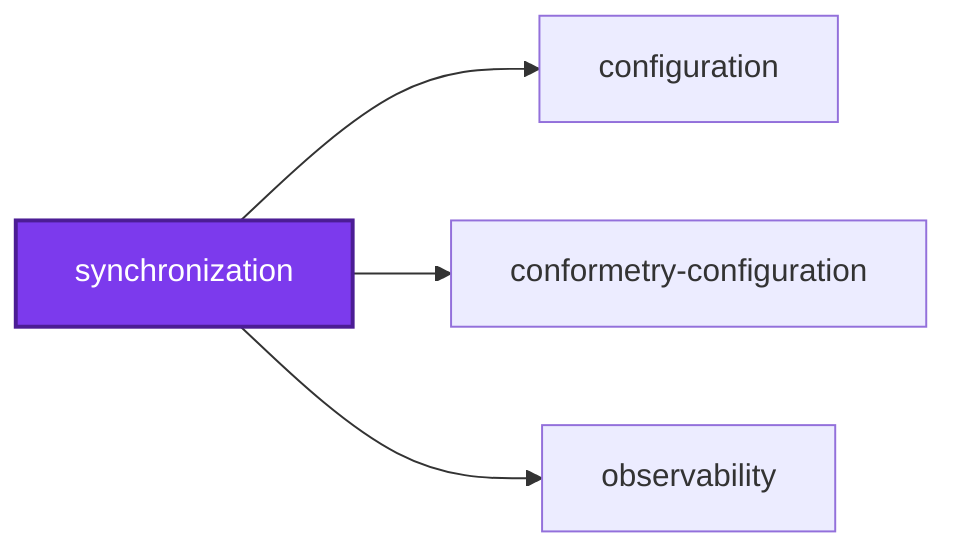
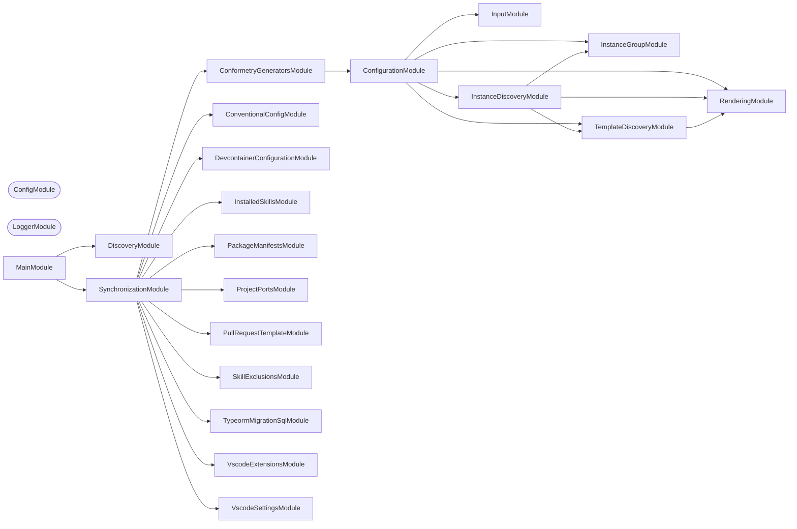

## 🕸️ Codependix

Dependency graphs exported by [codependix](https://github.com/Organizzolini/codebase/tree/main/projects/ic-suite/codependix/codependix-cli), regenerated by `nx run configuration:codependix:write`.

### Nx Neighborhood

<!-- codependix:start name="codependix-nx-projects" -->

<!-- codependix:end name="codependix-nx-projects" -->

### NestJS Module Graph

<!-- codependix:start name="codependix-nestjs-modules" -->


_Rounded modules are global: every module can inject them, so their edges are left out._
<!-- codependix:end name="codependix-nestjs-modules" -->

### File Imports

<!-- codependix:start name="codependix-file-imports" -->
```mermaid
graph LR
  file_callidescope_config_ts["callidescope.config.ts"]
  file_codependix_config_ts["codependix.config.ts"]
  file_codometer_config_ts["codometer.config.ts"]
  file_coinagerie_config_ts["coinagerie.config.ts"]
  file_eslint_config_ts["eslint.config.ts"]
  file_src_modules_conformetry_generators_conformetry_generators_command_ts["src/modules/conformetry-generators/conformetry-generators.command.ts"]
  file_src_modules_conformetry_generators_conformetry_generators_command_unit_test_ts["src/modules/conformetry-generators/conformetry-generators.command.unit.test.ts"]
  file_src_modules_conformetry_generators_conformetry_generators_constants_ts["src/modules/conformetry-generators/conformetry-generators.constants.ts"]
  file_src_modules_conformetry_generators_conformetry_generators_module_ts["src/modules/conformetry-generators/conformetry-generators.module.ts"]
  file_src_modules_conformetry_generators_conformetry_generators_types_ts["src/modules/conformetry-generators/conformetry-generators.types.ts"]
  file_src_modules_conventional_config_conventional_config_io_service_ts["src/modules/conventional-config/conventional-config-io.service.ts"]
  file_src_modules_conventional_config_conventional_config_io_service_unit_test_ts["src/modules/conventional-config/conventional-config-io.service.unit.test.ts"]
  file_src_modules_conventional_config_conventional_config_validators_service_ts["src/modules/conventional-config/conventional-config-validators.service.ts"]
  file_src_modules_conventional_config_conventional_config_validators_service_unit_test_ts["src/modules/conventional-config/conventional-config-validators.service.unit.test.ts"]
  file_src_modules_conventional_config_conventional_config_command_ts["src/modules/conventional-config/conventional-config.command.ts"]
  file_src_modules_conventional_config_conventional_config_command_unit_test_ts["src/modules/conventional-config/conventional-config.command.unit.test.ts"]
  file_src_modules_conventional_config_conventional_config_constants_integration_test_ts["src/modules/conventional-config/conventional-config.constants.integration.test.ts"]
  file_src_modules_conventional_config_conventional_config_constants_ts["src/modules/conventional-config/conventional-config.constants.ts"]
  file_src_modules_conventional_config_conventional_config_module_ts["src/modules/conventional-config/conventional-config.module.ts"]
  file_src_modules_conventional_config_conventional_config_service_ts["src/modules/conventional-config/conventional-config.service.ts"]
  file_src_modules_conventional_config_conventional_config_service_unit_test_ts["src/modules/conventional-config/conventional-config.service.unit.test.ts"]
  file_src_modules_conventional_config_conventional_config_types_ts["src/modules/conventional-config/conventional-config.types.ts"]
  file_src_modules_devcontainer_configuration_devcontainer_configuration_command_ts["src/modules/devcontainer-configuration/devcontainer-configuration.command.ts"]
  file_src_modules_devcontainer_configuration_devcontainer_configuration_command_unit_test_ts["src/modules/devcontainer-configuration/devcontainer-configuration.command.unit.test.ts"]
  file_src_modules_devcontainer_configuration_devcontainer_configuration_constants_ts["src/modules/devcontainer-configuration/devcontainer-configuration.constants.ts"]
  file_src_modules_devcontainer_configuration_devcontainer_configuration_module_ts["src/modules/devcontainer-configuration/devcontainer-configuration.module.ts"]
  file_src_modules_devcontainer_configuration_devcontainer_configuration_types_ts["src/modules/devcontainer-configuration/devcontainer-configuration.types.ts"]
  file_src_modules_installed_skills_installed_skills_fixtures_utilities_ts["src/modules/installed-skills/installed-skills-fixtures.utilities.ts"]
  file_src_modules_installed_skills_installed_skills_process_service_ts["src/modules/installed-skills/installed-skills-process.service.ts"]
  file_src_modules_installed_skills_installed_skills_process_service_unit_test_ts["src/modules/installed-skills/installed-skills-process.service.unit.test.ts"]
  file_src_modules_installed_skills_installed_skills_command_ts["src/modules/installed-skills/installed-skills.command.ts"]
  file_src_modules_installed_skills_installed_skills_command_unit_test_ts["src/modules/installed-skills/installed-skills.command.unit.test.ts"]
  file_src_modules_installed_skills_installed_skills_constants_ts["src/modules/installed-skills/installed-skills.constants.ts"]
  file_src_modules_installed_skills_installed_skills_module_ts["src/modules/installed-skills/installed-skills.module.ts"]
  file_src_modules_installed_skills_installed_skills_service_ts["src/modules/installed-skills/installed-skills.service.ts"]
  file_src_modules_installed_skills_installed_skills_service_unit_test_ts["src/modules/installed-skills/installed-skills.service.unit.test.ts"]
  file_src_modules_installed_skills_installed_skills_types_ts["src/modules/installed-skills/installed-skills.types.ts"]
  file_src_modules_package_manifests_package_manifests_command_ts["src/modules/package-manifests/package-manifests.command.ts"]
  file_src_modules_package_manifests_package_manifests_command_unit_test_ts["src/modules/package-manifests/package-manifests.command.unit.test.ts"]
  file_src_modules_package_manifests_package_manifests_constants_ts["src/modules/package-manifests/package-manifests.constants.ts"]
  file_src_modules_package_manifests_package_manifests_module_ts["src/modules/package-manifests/package-manifests.module.ts"]
  file_src_modules_package_manifests_package_manifests_service_ts["src/modules/package-manifests/package-manifests.service.ts"]
  file_src_modules_package_manifests_package_manifests_service_unit_test_ts["src/modules/package-manifests/package-manifests.service.unit.test.ts"]
  file_src_modules_package_manifests_package_manifests_types_ts["src/modules/package-manifests/package-manifests.types.ts"]
  file_src_modules_project_ports_project_ports_command_ts["src/modules/project-ports/project-ports.command.ts"]
  file_src_modules_project_ports_project_ports_command_unit_test_ts["src/modules/project-ports/project-ports.command.unit.test.ts"]
  file_src_modules_project_ports_project_ports_constants_ts["src/modules/project-ports/project-ports.constants.ts"]
  file_src_modules_project_ports_project_ports_module_ts["src/modules/project-ports/project-ports.module.ts"]
  file_src_modules_project_ports_project_ports_service_ts["src/modules/project-ports/project-ports.service.ts"]
  file_src_modules_project_ports_project_ports_service_unit_test_ts["src/modules/project-ports/project-ports.service.unit.test.ts"]
  file_src_modules_project_ports_project_ports_types_ts["src/modules/project-ports/project-ports.types.ts"]
  file_src_modules_pull_request_template_pull_request_template_command_ts["src/modules/pull-request-template/pull-request-template.command.ts"]
  file_src_modules_pull_request_template_pull_request_template_command_unit_test_ts["src/modules/pull-request-template/pull-request-template.command.unit.test.ts"]
  file_src_modules_pull_request_template_pull_request_template_constants_ts["src/modules/pull-request-template/pull-request-template.constants.ts"]
  file_src_modules_pull_request_template_pull_request_template_module_ts["src/modules/pull-request-template/pull-request-template.module.ts"]
  file_src_modules_pull_request_template_pull_request_template_types_ts["src/modules/pull-request-template/pull-request-template.types.ts"]
  file_src_modules_skill_exclusions_skill_exclusions_command_ts["src/modules/skill-exclusions/skill-exclusions.command.ts"]
  file_src_modules_skill_exclusions_skill_exclusions_command_unit_test_ts["src/modules/skill-exclusions/skill-exclusions.command.unit.test.ts"]
  file_src_modules_skill_exclusions_skill_exclusions_constants_ts["src/modules/skill-exclusions/skill-exclusions.constants.ts"]
  file_src_modules_skill_exclusions_skill_exclusions_module_ts["src/modules/skill-exclusions/skill-exclusions.module.ts"]
  file_src_modules_skill_exclusions_skill_exclusions_types_ts["src/modules/skill-exclusions/skill-exclusions.types.ts"]
  file_src_modules_synchronization_synchronization_markers_service_ts["src/modules/synchronization/synchronization-markers.service.ts"]
  file_src_modules_synchronization_synchronization_markers_service_unit_test_ts["src/modules/synchronization/synchronization-markers.service.unit.test.ts"]
  file_src_modules_synchronization_synchronization_command_ts["src/modules/synchronization/synchronization.command.ts"]
  file_src_modules_synchronization_synchronization_command_unit_test_ts["src/modules/synchronization/synchronization.command.unit.test.ts"]
  file_src_modules_synchronization_synchronization_constants_ts["src/modules/synchronization/synchronization.constants.ts"]
  file_src_modules_synchronization_synchronization_module_ts["src/modules/synchronization/synchronization.module.ts"]
  file_src_modules_synchronization_synchronization_module_unit_test_ts["src/modules/synchronization/synchronization.module.unit.test.ts"]
  file_src_modules_synchronization_synchronization_service_ts["src/modules/synchronization/synchronization.service.ts"]
  file_src_modules_synchronization_synchronization_service_unit_test_ts["src/modules/synchronization/synchronization.service.unit.test.ts"]
  file_src_modules_synchronization_synchronization_types_ts["src/modules/synchronization/synchronization.types.ts"]
  file_src_modules_typeorm_migration_sql_typeorm_migration_sql_extractor_service_ts["src/modules/typeorm-migration-sql/typeorm-migration-sql-extractor.service.ts"]
  file_src_modules_typeorm_migration_sql_typeorm_migration_sql_extractor_service_unit_test_ts["src/modules/typeorm-migration-sql/typeorm-migration-sql-extractor.service.unit.test.ts"]
  file_src_modules_typeorm_migration_sql_typeorm_migration_sql_command_ts["src/modules/typeorm-migration-sql/typeorm-migration-sql.command.ts"]
  file_src_modules_typeorm_migration_sql_typeorm_migration_sql_command_unit_test_ts["src/modules/typeorm-migration-sql/typeorm-migration-sql.command.unit.test.ts"]
  file_src_modules_typeorm_migration_sql_typeorm_migration_sql_constants_ts["src/modules/typeorm-migration-sql/typeorm-migration-sql.constants.ts"]
  file_src_modules_typeorm_migration_sql_typeorm_migration_sql_module_ts["src/modules/typeorm-migration-sql/typeorm-migration-sql.module.ts"]
  file_src_modules_typeorm_migration_sql_typeorm_migration_sql_types_ts["src/modules/typeorm-migration-sql/typeorm-migration-sql.types.ts"]
  file_src_modules_vscode_extensions_vscode_extensions_command_ts["src/modules/vscode-extensions/vscode-extensions.command.ts"]
  file_src_modules_vscode_extensions_vscode_extensions_command_unit_test_ts["src/modules/vscode-extensions/vscode-extensions.command.unit.test.ts"]
  file_src_modules_vscode_extensions_vscode_extensions_constants_ts["src/modules/vscode-extensions/vscode-extensions.constants.ts"]
  file_src_modules_vscode_extensions_vscode_extensions_module_ts["src/modules/vscode-extensions/vscode-extensions.module.ts"]
  file_src_modules_vscode_extensions_vscode_extensions_types_ts["src/modules/vscode-extensions/vscode-extensions.types.ts"]
  file_src_modules_vscode_settings_vscode_settings_command_ts["src/modules/vscode-settings/vscode-settings.command.ts"]
  file_src_modules_vscode_settings_vscode_settings_command_unit_test_ts["src/modules/vscode-settings/vscode-settings.command.unit.test.ts"]
  file_src_modules_vscode_settings_vscode_settings_constants_ts["src/modules/vscode-settings/vscode-settings.constants.ts"]
  file_src_modules_vscode_settings_vscode_settings_module_ts["src/modules/vscode-settings/vscode-settings.module.ts"]
  file_src_modules_vscode_settings_vscode_settings_types_ts["src/modules/vscode-settings/vscode-settings.types.ts"]
  file_src_synchronization_constants_ts["src/synchronization.constants.ts"]
  file_src_synchronization_main_end_to_end_test_ts["src/synchronization.main.end-to-end.test.ts"]
  file_src_synchronization_main_ts["src/synchronization.main.ts"]
  file_src_synchronization_main_unit_test_ts["src/synchronization.main.unit.test.ts"]
  file_src_synchronization_module_ts["src/synchronization.module.ts"]
  file_src_synchronization_repl_ts["src/synchronization.repl.ts"]
  file_src_synchronization_repl_unit_test_ts["src/synchronization.repl.unit.test.ts"]
  file_testing_mocks_ts["testing/mocks.ts"]
  file_testing_setup_ts["testing/setup.ts"]
  file_vitest_config_ts["vitest.config.ts"]
  file_src_modules_conformetry_generators_conformetry_generators_command_ts --> file_src_modules_conformetry_generators_conformetry_generators_types_ts
  file_src_modules_conformetry_generators_conformetry_generators_command_ts --> file_src_modules_synchronization_synchronization_service_ts
  file_src_modules_conformetry_generators_conformetry_generators_command_ts --> file_src_modules_synchronization_synchronization_types_ts
  file_src_modules_conformetry_generators_conformetry_generators_command_unit_test_ts --> file_src_modules_conformetry_generators_conformetry_generators_command_ts
  file_src_modules_conformetry_generators_conformetry_generators_command_unit_test_ts --> file_src_modules_synchronization_synchronization_service_ts
  file_src_modules_conformetry_generators_conformetry_generators_command_unit_test_ts --> file_testing_mocks_ts
  file_src_modules_conformetry_generators_conformetry_generators_module_ts --> file_src_modules_conformetry_generators_conformetry_generators_command_ts
  file_src_modules_conformetry_generators_conformetry_generators_module_ts --> file_src_modules_synchronization_synchronization_service_ts
  file_src_modules_conventional_config_conventional_config_io_service_ts --> file_src_modules_conventional_config_conventional_config_constants_ts
  file_src_modules_conventional_config_conventional_config_io_service_ts --> file_src_modules_conventional_config_conventional_config_types_ts
  file_src_modules_conventional_config_conventional_config_io_service_unit_test_ts --> file_src_modules_conventional_config_conventional_config_io_service_ts
  file_src_modules_conventional_config_conventional_config_io_service_unit_test_ts --> file_src_modules_conventional_config_conventional_config_types_ts
  file_src_modules_conventional_config_conventional_config_validators_service_ts --> file_src_modules_conventional_config_conventional_config_io_service_ts
  file_src_modules_conventional_config_conventional_config_validators_service_ts --> file_src_modules_conventional_config_conventional_config_constants_ts
  file_src_modules_conventional_config_conventional_config_validators_service_ts --> file_src_modules_conventional_config_conventional_config_types_ts
  file_src_modules_conventional_config_conventional_config_validators_service_unit_test_ts --> file_src_modules_conventional_config_conventional_config_io_service_ts
  file_src_modules_conventional_config_conventional_config_validators_service_unit_test_ts --> file_src_modules_conventional_config_conventional_config_validators_service_ts
  file_src_modules_conventional_config_conventional_config_validators_service_unit_test_ts --> file_src_modules_conventional_config_conventional_config_types_ts
  file_src_modules_conventional_config_conventional_config_command_ts --> file_src_modules_conventional_config_conventional_config_service_ts
  file_src_modules_conventional_config_conventional_config_command_ts --> file_src_modules_synchronization_synchronization_service_ts
  file_src_modules_conventional_config_conventional_config_command_ts --> file_src_modules_synchronization_synchronization_types_ts
  file_src_modules_conventional_config_conventional_config_command_unit_test_ts --> file_src_modules_conventional_config_conventional_config_command_ts
  file_src_modules_conventional_config_conventional_config_command_unit_test_ts --> file_src_modules_conventional_config_conventional_config_service_ts
  file_src_modules_conventional_config_conventional_config_command_unit_test_ts --> file_src_modules_synchronization_synchronization_service_ts
  file_src_modules_conventional_config_conventional_config_command_unit_test_ts --> file_testing_mocks_ts
  file_src_modules_conventional_config_conventional_config_constants_integration_test_ts --> file_src_modules_conventional_config_conventional_config_constants_ts
  file_src_modules_conventional_config_conventional_config_module_ts --> file_src_modules_conventional_config_conventional_config_io_service_ts
  file_src_modules_conventional_config_conventional_config_module_ts --> file_src_modules_conventional_config_conventional_config_validators_service_ts
  file_src_modules_conventional_config_conventional_config_module_ts --> file_src_modules_conventional_config_conventional_config_command_ts
  file_src_modules_conventional_config_conventional_config_module_ts --> file_src_modules_conventional_config_conventional_config_service_ts
  file_src_modules_conventional_config_conventional_config_module_ts --> file_src_modules_synchronization_synchronization_service_ts
  file_src_modules_conventional_config_conventional_config_service_ts --> file_src_modules_conventional_config_conventional_config_io_service_ts
  file_src_modules_conventional_config_conventional_config_service_ts --> file_src_modules_conventional_config_conventional_config_validators_service_ts
  file_src_modules_conventional_config_conventional_config_service_ts --> file_src_modules_conventional_config_conventional_config_constants_ts
  file_src_modules_conventional_config_conventional_config_service_ts --> file_src_modules_conventional_config_conventional_config_types_ts
  file_src_modules_conventional_config_conventional_config_service_unit_test_ts --> file_src_modules_conventional_config_conventional_config_io_service_ts
  file_src_modules_conventional_config_conventional_config_service_unit_test_ts --> file_src_modules_conventional_config_conventional_config_validators_service_ts
  file_src_modules_conventional_config_conventional_config_service_unit_test_ts --> file_src_modules_conventional_config_conventional_config_constants_ts
  file_src_modules_conventional_config_conventional_config_service_unit_test_ts --> file_src_modules_conventional_config_conventional_config_service_ts
  file_src_modules_conventional_config_conventional_config_service_unit_test_ts --> file_src_modules_conventional_config_conventional_config_types_ts
  file_src_modules_devcontainer_configuration_devcontainer_configuration_command_ts --> file_src_modules_devcontainer_configuration_devcontainer_configuration_constants_ts
  file_src_modules_devcontainer_configuration_devcontainer_configuration_command_ts --> file_src_modules_devcontainer_configuration_devcontainer_configuration_types_ts
  file_src_modules_devcontainer_configuration_devcontainer_configuration_command_ts --> file_src_modules_synchronization_synchronization_service_ts
  file_src_modules_devcontainer_configuration_devcontainer_configuration_command_ts --> file_src_modules_synchronization_synchronization_types_ts
  file_src_modules_devcontainer_configuration_devcontainer_configuration_command_unit_test_ts --> file_src_modules_devcontainer_configuration_devcontainer_configuration_command_ts
  file_src_modules_devcontainer_configuration_devcontainer_configuration_command_unit_test_ts --> file_src_modules_synchronization_synchronization_service_ts
  file_src_modules_devcontainer_configuration_devcontainer_configuration_command_unit_test_ts --> file_testing_mocks_ts
  file_src_modules_devcontainer_configuration_devcontainer_configuration_module_ts --> file_src_modules_devcontainer_configuration_devcontainer_configuration_command_ts
  file_src_modules_devcontainer_configuration_devcontainer_configuration_module_ts --> file_src_modules_synchronization_synchronization_service_ts
  file_src_modules_installed_skills_installed_skills_fixtures_utilities_ts --> file_src_modules_installed_skills_installed_skills_types_ts
  file_src_modules_installed_skills_installed_skills_process_service_ts --> file_src_modules_installed_skills_installed_skills_types_ts
  file_src_modules_installed_skills_installed_skills_process_service_unit_test_ts --> file_src_modules_installed_skills_installed_skills_process_service_ts
  file_src_modules_installed_skills_installed_skills_command_ts --> file_src_modules_installed_skills_installed_skills_constants_ts
  file_src_modules_installed_skills_installed_skills_command_ts --> file_src_modules_installed_skills_installed_skills_service_ts
  file_src_modules_installed_skills_installed_skills_command_ts --> file_src_modules_synchronization_synchronization_service_ts
  file_src_modules_installed_skills_installed_skills_command_ts --> file_src_modules_synchronization_synchronization_types_ts
  file_src_modules_installed_skills_installed_skills_command_unit_test_ts --> file_src_modules_installed_skills_installed_skills_fixtures_utilities_ts
  file_src_modules_installed_skills_installed_skills_command_unit_test_ts --> file_src_modules_installed_skills_installed_skills_process_service_ts
  file_src_modules_installed_skills_installed_skills_command_unit_test_ts --> file_src_modules_installed_skills_installed_skills_command_ts
  file_src_modules_installed_skills_installed_skills_command_unit_test_ts --> file_src_modules_installed_skills_installed_skills_service_ts
  file_src_modules_installed_skills_installed_skills_command_unit_test_ts --> file_src_modules_installed_skills_installed_skills_types_ts
  file_src_modules_installed_skills_installed_skills_command_unit_test_ts --> file_src_modules_synchronization_synchronization_service_ts
  file_src_modules_installed_skills_installed_skills_command_unit_test_ts --> file_testing_mocks_ts
  file_src_modules_installed_skills_installed_skills_module_ts --> file_src_modules_installed_skills_installed_skills_process_service_ts
  file_src_modules_installed_skills_installed_skills_module_ts --> file_src_modules_installed_skills_installed_skills_command_ts
  file_src_modules_installed_skills_installed_skills_module_ts --> file_src_modules_installed_skills_installed_skills_service_ts
  file_src_modules_installed_skills_installed_skills_module_ts --> file_src_modules_synchronization_synchronization_service_ts
  file_src_modules_installed_skills_installed_skills_service_ts --> file_src_modules_installed_skills_installed_skills_process_service_ts
  file_src_modules_installed_skills_installed_skills_service_ts --> file_src_modules_installed_skills_installed_skills_constants_ts
  file_src_modules_installed_skills_installed_skills_service_ts --> file_src_modules_installed_skills_installed_skills_types_ts
  file_src_modules_installed_skills_installed_skills_service_unit_test_ts --> file_src_modules_installed_skills_installed_skills_process_service_ts
  file_src_modules_installed_skills_installed_skills_service_unit_test_ts --> file_src_modules_installed_skills_installed_skills_service_ts
  file_src_modules_package_manifests_package_manifests_command_ts --> file_src_modules_package_manifests_package_manifests_service_ts
  file_src_modules_package_manifests_package_manifests_command_ts --> file_src_modules_synchronization_synchronization_service_ts
  file_src_modules_package_manifests_package_manifests_command_ts --> file_src_modules_synchronization_synchronization_types_ts
  file_src_modules_package_manifests_package_manifests_command_unit_test_ts --> file_src_modules_package_manifests_package_manifests_command_ts
  file_src_modules_package_manifests_package_manifests_command_unit_test_ts --> file_src_modules_package_manifests_package_manifests_service_ts
  file_src_modules_package_manifests_package_manifests_command_unit_test_ts --> file_src_modules_package_manifests_package_manifests_types_ts
  file_src_modules_package_manifests_package_manifests_command_unit_test_ts --> file_src_modules_synchronization_synchronization_service_ts
  file_src_modules_package_manifests_package_manifests_command_unit_test_ts --> file_testing_mocks_ts
  file_src_modules_package_manifests_package_manifests_module_ts --> file_src_modules_package_manifests_package_manifests_command_ts
  file_src_modules_package_manifests_package_manifests_module_ts --> file_src_modules_package_manifests_package_manifests_service_ts
  file_src_modules_package_manifests_package_manifests_module_ts --> file_src_modules_synchronization_synchronization_service_ts
  file_src_modules_package_manifests_package_manifests_service_ts --> file_src_modules_package_manifests_package_manifests_constants_ts
  file_src_modules_package_manifests_package_manifests_service_ts --> file_src_modules_package_manifests_package_manifests_types_ts
  file_src_modules_package_manifests_package_manifests_service_unit_test_ts --> file_src_modules_package_manifests_package_manifests_constants_ts
  file_src_modules_package_manifests_package_manifests_service_unit_test_ts --> file_src_modules_package_manifests_package_manifests_service_ts
  file_src_modules_package_manifests_package_manifests_service_unit_test_ts --> file_src_modules_package_manifests_package_manifests_types_ts
  file_src_modules_package_manifests_package_manifests_types_ts --> file_src_modules_package_manifests_package_manifests_constants_ts
  file_src_modules_project_ports_project_ports_command_ts --> file_src_modules_project_ports_project_ports_constants_ts
  file_src_modules_project_ports_project_ports_command_ts --> file_src_modules_project_ports_project_ports_service_ts
  file_src_modules_project_ports_project_ports_command_ts --> file_src_modules_project_ports_project_ports_types_ts
  file_src_modules_project_ports_project_ports_command_ts --> file_src_modules_synchronization_synchronization_service_ts
  file_src_modules_project_ports_project_ports_command_ts --> file_src_modules_synchronization_synchronization_types_ts
  file_src_modules_project_ports_project_ports_command_unit_test_ts --> file_src_modules_project_ports_project_ports_command_ts
  file_src_modules_project_ports_project_ports_command_unit_test_ts --> file_src_modules_project_ports_project_ports_service_ts
  file_src_modules_project_ports_project_ports_command_unit_test_ts --> file_src_modules_synchronization_synchronization_service_ts
  file_src_modules_project_ports_project_ports_command_unit_test_ts --> file_testing_mocks_ts
  file_src_modules_project_ports_project_ports_constants_ts --> file_src_modules_project_ports_project_ports_types_ts
  file_src_modules_project_ports_project_ports_module_ts --> file_src_modules_project_ports_project_ports_command_ts
  file_src_modules_project_ports_project_ports_module_ts --> file_src_modules_project_ports_project_ports_service_ts
  file_src_modules_project_ports_project_ports_module_ts --> file_src_modules_synchronization_synchronization_service_ts
  file_src_modules_project_ports_project_ports_service_ts --> file_src_modules_project_ports_project_ports_constants_ts
  file_src_modules_project_ports_project_ports_service_unit_test_ts --> file_src_modules_project_ports_project_ports_service_ts
  file_src_modules_pull_request_template_pull_request_template_command_ts --> file_src_modules_pull_request_template_pull_request_template_constants_ts
  file_src_modules_pull_request_template_pull_request_template_command_ts --> file_src_modules_synchronization_synchronization_service_ts
  file_src_modules_pull_request_template_pull_request_template_command_ts --> file_src_modules_synchronization_synchronization_types_ts
  file_src_modules_pull_request_template_pull_request_template_command_unit_test_ts --> file_src_modules_pull_request_template_pull_request_template_command_ts
  file_src_modules_pull_request_template_pull_request_template_command_unit_test_ts --> file_src_modules_pull_request_template_pull_request_template_constants_ts
  file_src_modules_pull_request_template_pull_request_template_command_unit_test_ts --> file_src_modules_synchronization_synchronization_service_ts
  file_src_modules_pull_request_template_pull_request_template_command_unit_test_ts --> file_testing_mocks_ts
  file_src_modules_pull_request_template_pull_request_template_module_ts --> file_src_modules_pull_request_template_pull_request_template_command_ts
  file_src_modules_pull_request_template_pull_request_template_module_ts --> file_src_modules_synchronization_synchronization_service_ts
  file_src_modules_skill_exclusions_skill_exclusions_command_ts --> file_src_modules_skill_exclusions_skill_exclusions_constants_ts
  file_src_modules_skill_exclusions_skill_exclusions_command_ts --> file_src_modules_skill_exclusions_skill_exclusions_types_ts
  file_src_modules_skill_exclusions_skill_exclusions_command_ts --> file_src_modules_synchronization_synchronization_service_ts
  file_src_modules_skill_exclusions_skill_exclusions_command_ts --> file_src_modules_synchronization_synchronization_types_ts
  file_src_modules_skill_exclusions_skill_exclusions_command_unit_test_ts --> file_src_modules_skill_exclusions_skill_exclusions_command_ts
  file_src_modules_skill_exclusions_skill_exclusions_command_unit_test_ts --> file_src_modules_skill_exclusions_skill_exclusions_constants_ts
  file_src_modules_skill_exclusions_skill_exclusions_command_unit_test_ts --> file_src_modules_skill_exclusions_skill_exclusions_types_ts
  file_src_modules_skill_exclusions_skill_exclusions_command_unit_test_ts --> file_src_modules_synchronization_synchronization_service_ts
  file_src_modules_skill_exclusions_skill_exclusions_command_unit_test_ts --> file_testing_mocks_ts
  file_src_modules_skill_exclusions_skill_exclusions_constants_ts --> file_src_modules_skill_exclusions_skill_exclusions_types_ts
  file_src_modules_skill_exclusions_skill_exclusions_module_ts --> file_src_modules_skill_exclusions_skill_exclusions_command_ts
  file_src_modules_skill_exclusions_skill_exclusions_module_ts --> file_src_modules_synchronization_synchronization_service_ts
  file_src_modules_synchronization_synchronization_markers_service_unit_test_ts --> file_src_modules_synchronization_synchronization_markers_service_ts
  file_src_modules_synchronization_synchronization_command_ts --> file_src_modules_conformetry_generators_conformetry_generators_command_ts
  file_src_modules_synchronization_synchronization_command_ts --> file_src_modules_conventional_config_conventional_config_command_ts
  file_src_modules_synchronization_synchronization_command_ts --> file_src_modules_devcontainer_configuration_devcontainer_configuration_command_ts
  file_src_modules_synchronization_synchronization_command_ts --> file_src_modules_installed_skills_installed_skills_command_ts
  file_src_modules_synchronization_synchronization_command_ts --> file_src_modules_package_manifests_package_manifests_command_ts
  file_src_modules_synchronization_synchronization_command_ts --> file_src_modules_pull_request_template_pull_request_template_command_ts
  file_src_modules_synchronization_synchronization_command_ts --> file_src_modules_skill_exclusions_skill_exclusions_command_ts
  file_src_modules_synchronization_synchronization_command_ts --> file_src_modules_synchronization_synchronization_service_ts
  file_src_modules_synchronization_synchronization_command_ts --> file_src_modules_synchronization_synchronization_types_ts
  file_src_modules_synchronization_synchronization_command_ts --> file_src_modules_typeorm_migration_sql_typeorm_migration_sql_command_ts
  file_src_modules_synchronization_synchronization_command_ts --> file_src_modules_vscode_extensions_vscode_extensions_command_ts
  file_src_modules_synchronization_synchronization_command_unit_test_ts --> file_src_modules_conformetry_generators_conformetry_generators_command_ts
  file_src_modules_synchronization_synchronization_command_unit_test_ts --> file_src_modules_conventional_config_conventional_config_command_ts
  file_src_modules_synchronization_synchronization_command_unit_test_ts --> file_src_modules_devcontainer_configuration_devcontainer_configuration_command_ts
  file_src_modules_synchronization_synchronization_command_unit_test_ts --> file_src_modules_installed_skills_installed_skills_command_ts
  file_src_modules_synchronization_synchronization_command_unit_test_ts --> file_src_modules_package_manifests_package_manifests_command_ts
  file_src_modules_synchronization_synchronization_command_unit_test_ts --> file_src_modules_pull_request_template_pull_request_template_command_ts
  file_src_modules_synchronization_synchronization_command_unit_test_ts --> file_src_modules_skill_exclusions_skill_exclusions_command_ts
  file_src_modules_synchronization_synchronization_command_unit_test_ts --> file_src_modules_synchronization_synchronization_command_ts
  file_src_modules_synchronization_synchronization_command_unit_test_ts --> file_src_modules_synchronization_synchronization_service_ts
  file_src_modules_synchronization_synchronization_command_unit_test_ts --> file_src_modules_synchronization_synchronization_types_ts
  file_src_modules_synchronization_synchronization_command_unit_test_ts --> file_src_modules_typeorm_migration_sql_typeorm_migration_sql_command_ts
  file_src_modules_synchronization_synchronization_command_unit_test_ts --> file_src_modules_vscode_extensions_vscode_extensions_command_ts
  file_src_modules_synchronization_synchronization_command_unit_test_ts --> file_testing_mocks_ts
  file_src_modules_synchronization_synchronization_module_ts --> file_src_modules_conformetry_generators_conformetry_generators_module_ts
  file_src_modules_synchronization_synchronization_module_ts --> file_src_modules_conventional_config_conventional_config_module_ts
  file_src_modules_synchronization_synchronization_module_ts --> file_src_modules_devcontainer_configuration_devcontainer_configuration_module_ts
  file_src_modules_synchronization_synchronization_module_ts --> file_src_modules_installed_skills_installed_skills_module_ts
  file_src_modules_synchronization_synchronization_module_ts --> file_src_modules_package_manifests_package_manifests_module_ts
  file_src_modules_synchronization_synchronization_module_ts --> file_src_modules_project_ports_project_ports_module_ts
  file_src_modules_synchronization_synchronization_module_ts --> file_src_modules_pull_request_template_pull_request_template_module_ts
  file_src_modules_synchronization_synchronization_module_ts --> file_src_modules_skill_exclusions_skill_exclusions_module_ts
  file_src_modules_synchronization_synchronization_module_ts --> file_src_modules_synchronization_synchronization_command_ts
  file_src_modules_synchronization_synchronization_module_ts --> file_src_modules_synchronization_synchronization_service_ts
  file_src_modules_synchronization_synchronization_module_ts --> file_src_modules_typeorm_migration_sql_typeorm_migration_sql_module_ts
  file_src_modules_synchronization_synchronization_module_ts --> file_src_modules_vscode_extensions_vscode_extensions_module_ts
  file_src_modules_synchronization_synchronization_module_ts --> file_src_modules_vscode_settings_vscode_settings_module_ts
  file_src_modules_synchronization_synchronization_module_unit_test_ts --> file_src_modules_conformetry_generators_conformetry_generators_module_ts
  file_src_modules_synchronization_synchronization_module_unit_test_ts --> file_src_modules_conventional_config_conventional_config_module_ts
  file_src_modules_synchronization_synchronization_module_unit_test_ts --> file_src_modules_devcontainer_configuration_devcontainer_configuration_module_ts
  file_src_modules_synchronization_synchronization_module_unit_test_ts --> file_src_modules_installed_skills_installed_skills_module_ts
  file_src_modules_synchronization_synchronization_module_unit_test_ts --> file_src_modules_project_ports_project_ports_module_ts
  file_src_modules_synchronization_synchronization_module_unit_test_ts --> file_src_modules_pull_request_template_pull_request_template_module_ts
  file_src_modules_synchronization_synchronization_module_unit_test_ts --> file_src_modules_skill_exclusions_skill_exclusions_module_ts
  file_src_modules_synchronization_synchronization_module_unit_test_ts --> file_src_modules_synchronization_synchronization_command_ts
  file_src_modules_synchronization_synchronization_module_unit_test_ts --> file_src_modules_synchronization_synchronization_module_ts
  file_src_modules_synchronization_synchronization_module_unit_test_ts --> file_src_modules_synchronization_synchronization_service_ts
  file_src_modules_synchronization_synchronization_module_unit_test_ts --> file_src_modules_typeorm_migration_sql_typeorm_migration_sql_module_ts
  file_src_modules_synchronization_synchronization_module_unit_test_ts --> file_src_modules_vscode_extensions_vscode_extensions_module_ts
  file_src_modules_synchronization_synchronization_module_unit_test_ts --> file_src_modules_vscode_settings_vscode_settings_module_ts
  file_src_modules_synchronization_synchronization_service_ts --> file_src_modules_synchronization_synchronization_types_ts
  file_src_modules_synchronization_synchronization_service_unit_test_ts --> file_src_modules_synchronization_synchronization_service_ts
  file_src_modules_typeorm_migration_sql_typeorm_migration_sql_extractor_service_ts --> file_src_modules_synchronization_synchronization_types_ts
  file_src_modules_typeorm_migration_sql_typeorm_migration_sql_extractor_service_ts --> file_src_modules_typeorm_migration_sql_typeorm_migration_sql_constants_ts
  file_src_modules_typeorm_migration_sql_typeorm_migration_sql_extractor_service_ts --> file_src_modules_typeorm_migration_sql_typeorm_migration_sql_types_ts
  file_src_modules_typeorm_migration_sql_typeorm_migration_sql_extractor_service_unit_test_ts --> file_src_modules_typeorm_migration_sql_typeorm_migration_sql_extractor_service_ts
  file_src_modules_typeorm_migration_sql_typeorm_migration_sql_command_ts --> file_src_modules_synchronization_synchronization_service_ts
  file_src_modules_typeorm_migration_sql_typeorm_migration_sql_command_ts --> file_src_modules_synchronization_synchronization_types_ts
  file_src_modules_typeorm_migration_sql_typeorm_migration_sql_command_ts --> file_src_modules_typeorm_migration_sql_typeorm_migration_sql_extractor_service_ts
  file_src_modules_typeorm_migration_sql_typeorm_migration_sql_command_ts --> file_src_modules_typeorm_migration_sql_typeorm_migration_sql_types_ts
  file_src_modules_typeorm_migration_sql_typeorm_migration_sql_command_unit_test_ts --> file_src_modules_synchronization_synchronization_service_ts
  file_src_modules_typeorm_migration_sql_typeorm_migration_sql_command_unit_test_ts --> file_src_modules_typeorm_migration_sql_typeorm_migration_sql_extractor_service_ts
  file_src_modules_typeorm_migration_sql_typeorm_migration_sql_command_unit_test_ts --> file_src_modules_typeorm_migration_sql_typeorm_migration_sql_command_ts
  file_src_modules_typeorm_migration_sql_typeorm_migration_sql_command_unit_test_ts --> file_testing_mocks_ts
  file_src_modules_typeorm_migration_sql_typeorm_migration_sql_module_ts --> file_src_modules_synchronization_synchronization_service_ts
  file_src_modules_typeorm_migration_sql_typeorm_migration_sql_module_ts --> file_src_modules_typeorm_migration_sql_typeorm_migration_sql_extractor_service_ts
  file_src_modules_typeorm_migration_sql_typeorm_migration_sql_module_ts --> file_src_modules_typeorm_migration_sql_typeorm_migration_sql_command_ts
  file_src_modules_vscode_extensions_vscode_extensions_command_ts --> file_src_modules_synchronization_synchronization_service_ts
  file_src_modules_vscode_extensions_vscode_extensions_command_ts --> file_src_modules_synchronization_synchronization_types_ts
  file_src_modules_vscode_extensions_vscode_extensions_command_ts --> file_src_modules_vscode_extensions_vscode_extensions_constants_ts
  file_src_modules_vscode_extensions_vscode_extensions_command_ts --> file_src_modules_vscode_extensions_vscode_extensions_types_ts
  file_src_modules_vscode_extensions_vscode_extensions_command_unit_test_ts --> file_src_modules_synchronization_synchronization_service_ts
  file_src_modules_vscode_extensions_vscode_extensions_command_unit_test_ts --> file_src_modules_vscode_extensions_vscode_extensions_command_ts
  file_src_modules_vscode_extensions_vscode_extensions_command_unit_test_ts --> file_src_modules_vscode_extensions_vscode_extensions_constants_ts
  file_src_modules_vscode_extensions_vscode_extensions_command_unit_test_ts --> file_testing_mocks_ts
  file_src_modules_vscode_extensions_vscode_extensions_module_ts --> file_src_modules_synchronization_synchronization_service_ts
  file_src_modules_vscode_extensions_vscode_extensions_module_ts --> file_src_modules_vscode_extensions_vscode_extensions_command_ts
  file_src_modules_vscode_settings_vscode_settings_command_ts --> file_src_modules_synchronization_synchronization_service_ts
  file_src_modules_vscode_settings_vscode_settings_command_ts --> file_src_modules_synchronization_synchronization_types_ts
  file_src_modules_vscode_settings_vscode_settings_command_ts --> file_src_modules_vscode_settings_vscode_settings_constants_ts
  file_src_modules_vscode_settings_vscode_settings_command_ts --> file_src_modules_vscode_settings_vscode_settings_types_ts
  file_src_modules_vscode_settings_vscode_settings_command_unit_test_ts --> file_src_modules_synchronization_synchronization_service_ts
  file_src_modules_vscode_settings_vscode_settings_command_unit_test_ts --> file_src_modules_vscode_settings_vscode_settings_command_ts
  file_src_modules_vscode_settings_vscode_settings_command_unit_test_ts --> file_src_modules_vscode_settings_vscode_settings_constants_ts
  file_src_modules_vscode_settings_vscode_settings_command_unit_test_ts --> file_testing_mocks_ts
  file_src_modules_vscode_settings_vscode_settings_module_ts --> file_src_modules_synchronization_synchronization_service_ts
  file_src_modules_vscode_settings_vscode_settings_module_ts --> file_src_modules_vscode_settings_vscode_settings_command_ts
  file_src_synchronization_main_end_to_end_test_ts --> file_src_synchronization_constants_ts
  file_src_synchronization_main_ts --> file_src_synchronization_module_ts
  file_src_synchronization_main_unit_test_ts --> file_src_modules_synchronization_synchronization_module_ts
  file_src_synchronization_module_ts --> file_src_modules_synchronization_synchronization_module_ts
  file_src_synchronization_module_ts --> file_src_synchronization_constants_ts
  file_src_synchronization_repl_ts --> file_src_synchronization_module_ts
  file_src_synchronization_repl_unit_test_ts --> file_src_modules_synchronization_synchronization_module_ts
```
<!-- codependix:end name="codependix-file-imports" -->
