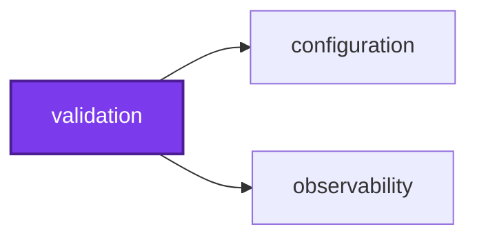
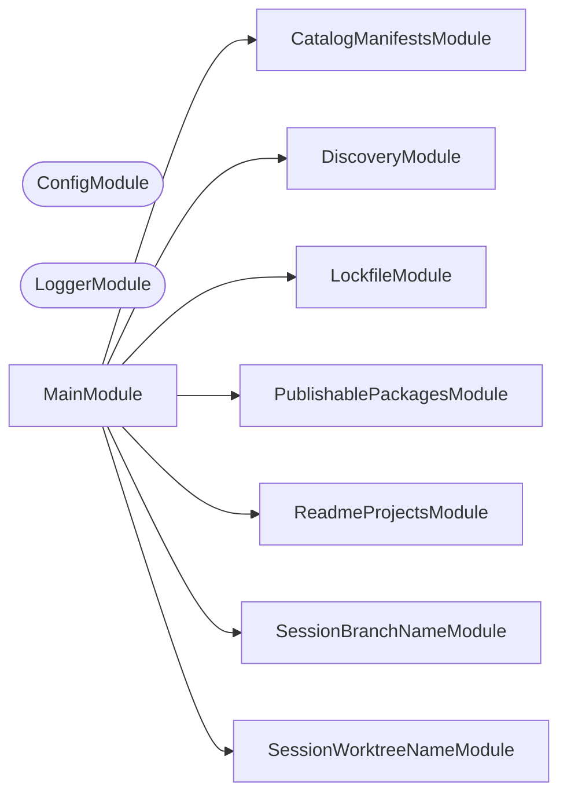

# ✅ Validation

**Answer whether something conforms, and say what to do when it does not.**

Some checks have only one side. There is nothing to write back: a pull request
title either agrees with its labels or it does not, a manifest either pins
`catalog:` or it does not. This is the NestJS CLI that runs those checks,
collects every failure rather than the first, and prints the command that fixes
each one.

```bash
nx run validation:start:pull-request-metadata     # labels and assignees against the title
nx run validation:start:pull-request-body         # the four headings, each section's shape and length, and no unfilled template comment
nx run validation:start:catalog-manifests         # catalog:/workspace:* in every manifest
nx run validation:start:lockfile                  # pnpm-lock.yaml against the manifests
nx run validation:start:session-branch-name       # the checked-out branch against the naming convention
nx run validation:start:session-worktree-name     # the linked worktree's directory name and gitignore status
nx run validation:verify-publishable-packages     # pack ic-suite, install the tarballs, run the plugins
```

It is the one-sided counterpart to
[synchronization](../synchronization/README.md): that tool reconciles a
`check` against a `write`, this one has no `write` to offer.

## Why it lives here

A check belongs here when it has a `check` and no `write`, and when it already
depends on Node. Both halves matter.

The first half is the boundary against
[synchronization](../synchronization/README.md), whose whole contract is
`check`/`write` reconciliation. A check that cannot write has nothing to put on
the other side of that contract, so modelling it as a synchronization would mean
a `write` mode that either lies or refuses.

The second half is the boundary against `scripts/git/`. Moving a check into this
CLI makes it depend on a healthy `node_modules`, which is fine for a check that
already ran Node and fatal for one that did not. That is why the signing and
authentication checks stay in shell — see [AGENTS.md](AGENTS.md).

## Checks

| Check | Answers |
| ----- | ------- |
| `pull-request-metadata` | Do a pull request's labels and assignees agree with its title? |
| `pull-request-body` | Does a pull request description carry all four headings, each section non-empty, in its shape, and within its word limit, with no template comment left unfilled? |
| `catalog-manifests` | Does every workspace manifest pin externals as `catalog:` and internals as `workspace:*`? |
| `lockfile` | Is `pnpm-lock.yaml` in sync with the manifests? |
| `publishable-packages` | Do the packed ic-suite packages work when installed by someone else? |
| `session-branch-name` | Does the checked-out branch follow `<type>/<scope>-<description>`? |
| `session-worktree-name` | Is the linked worktree named in kebab-case, and gitignored inside the main checkout? |

### `pull-request-metadata`

Checks five things about a pull request, all against its own title: exactly one
`type:*` label equal to the title's type, exactly the `scope:*` labels named by
the title's scopes, no `do-not-merge` label, at least one assignee, and exactly
one `source:*` label declaring who opened it.

Two input modes. Given a pull request number it reads the metadata live through
`gh pr view`, which is the local mode. Given none it reads
`PULL_REQUEST_TITLE`, `PULL_REQUEST_LABELS`, `PULL_REQUEST_ASSIGNEES`, and
`PULL_REQUEST_NUMBER` from the environment, which is the workflow mode: a pure
function of its inputs, needing no network, no token, and no write permission.

The title's scope group is matched as optional even though the convention
requires one. commitlint rejects a title with no scope first, so in a workflow
run this check never sees one; run by hand ahead of any title check it still
has to say something useful, and one collected failure naming the missing scope
is more useful than a parse error.

### `pull-request-body`

Checks that all four template headings are present, that each section contains
actual content, and that no `<!-- … -->` prompt from
[.github/PULL_REQUEST_TEMPLATE.md](../../.github/PULL_REQUEST_TEMPLATE.md)
survives unfilled. The comments are read from the template at runtime rather
than listed here, so adding a prompt to the template starts it being checked
with no code change.

Each section is also parsed as CommonMark and held to one shape, with Summary
and Details capped in words as `wc -w` counts them:

| Section    | Holds                                           | Word limit |
| ---------- | ----------------------------------------------- | ---------- |
| 🌰 Summary | Only one paragraph                              | 48         |
| 📝 Details | Only a bulleted list, one marker throughout     | 512        |
| 🧪 Testing | Only an ordered list, whose items may hold code | —          |
| 🔗 Related | A `-` list first, then anything                 | —          |

Blocks that are nothing but comments are ignored. Details takes `-`, `*`, or
`+` so long as one marker is used throughout, as markdownlint's MD004 does.
Related is open-ended after its list so that an attribution line or any other
trailer can close the description. The limits sit near the 75th percentile of
past Summaries, to keep one readable at a glance, and between the 90th and 95th
of past Details.
The shapes and limits live in `SECTION_RULES`, not the template.

### `catalog-manifests`

Every external dependency in every workspace manifest must be `catalog:`, and
every internal one `workspace:*`. Both directions are checked in every
dependency section, and every violation is named at once.

### `lockfile`

Runs `pnpm install --frozen-lockfile --lockfile-only` and reports whether the
manifests and the lockfile still agree. The only check here that shells out to
something else, for the reason the manifest check does not: what "in sync" means
is pnpm's answer, not one worth reimplementing. `--lockfile-only` means it never
writes `node_modules`, so it cannot re-link packages under the tasks the
pre-commit hook runs beside it.

### `session-branch-name`

The branch-name session hook, `scripts/git/validate-session-branch-name.sh`,
is a shim over this command. It reads the pattern and the error text from
[validate-branch-name.config.cjs](../../validate-branch-name.config.cjs), the
file the pre-push hook enforces, so the two never disagree. A compliant
branch, a detached HEAD, and a directory outside a repository all print
nothing and exit 0. Anything else prints the configured error — the format,
every valid type and scope — then the directive to invoke the rename-branch
skill, and exits 1.

Its standard output is only that context, never a log line, because the hook
hands it to the agent word for word; which JSON shape it travels in is the
hook emitter's business, not this command's.

### `session-worktree-name`

The worktree-name session hook, `scripts/git/validate-session-worktree-name.sh`,
is a shim over this command, run from the root of the checkout the hook lives
in. Only a linked worktree is judged: the main checkout, a submodule, a
directory outside a repository, and a machine without `git` all print nothing
and exit 0. A linked worktree must have a lowercase kebab-case directory name,
and one inside the main checkout must be gitignored there, so that its
contents are never committed. Every problem is printed at once, then the
directive to invoke the using-git-worktrees skill, with exit 1.

This check used to need nothing but `git`. As a command it needs a healthy
`node_modules` too, a cost accepted for one way of writing session checks;
the hook says to run `pnpm install` when that is what stops it.

### `publishable-packages`

Installs every publishable ic-suite package from the tarball `pnpm pack` wrote,
into a throwaway consumer, and uses it the way a user would: each package's
import typechecks under the consumer's own TypeScript, each command line runs
`--help`, the project graph builds with `@callidescope/nx`, `@codependix/nx`,
and `@conformetry/nx` registered, the conformetry generator writes an instance,
and one inferred target per plugin passes a healthy fixture and fails a broken
one with the message only a gate that ran would print. Run it through
`verify-publishable-packages`, which packs first.

**Where the consumer lives is the whole check.** One beneath this workspace
resolves this workspace's `node_modules`, so an executor path into `./src`, an
unshipped schema, or a loader resolved from the wrong root all pass there and
fail for every real user. The consumer is created under
`PUBLISHABLE_PACKAGES_CONSUMER_ROOT`, or the system temporary directory, and
the check refuses either when it, or any directory above it, holds a
`package.json`, `node_modules`, or `pnpm-workspace.yaml`. CI points it at
`$RUNNER_TEMP`.

It never publishes: no command it runs writes to a registry. Every command
runs without a shell, without this workspace's `PATH` entries, Nx variables,
or registry tokens, and with an empty user `.npmrc`. As a tripwire against a
publish added here later, a command carrying `publish`, `release`, `login`,
`dist-tag`, an `nx-release-publish` target, or a similar npm subcommand is
refused before it starts.

## Start

```bash
nx run validation:start
```

## Test

```bash
nx run validation:vitest
```

## 👔 Conformetry

This project was generated from the [nestjs-command-project](../configuration/conformetry-templates/nestjs-command-project) conformetry template.

<!-- callidescope:start -->

## 🔭 Callidescope

Call stacks traced through `validation`, deepest first. Each frame shows what it takes, what it returns, and what its documentation says.

| Measure | Value |
| --- | --- |
| Callables | 96 |
| Files | 46 |
| Calls traced | 89 |
| Call stacks | 6 |
| Deepest stack | 8 |
| Stacks through recursion | 0 |
| Unfollowable calls | 6 |

### Limits

What this project is judged against, as declared in its own `callidescope.config.ts`.

| Limit | Value |
| --- | --- |
| `maximumDepth` | 8 |
| `maximumBreadth` | 9 |

### Call stacks (depth)

**1. `PublishablePackagesCommand.run`** — depth 8 · decorated-method

```text
🚀 PublishablePackagesCommand.run(): Promise<void> [validation/src/modules/publishable-packages/publishable-packages.command.ts:46]
   ↳ Executes the publishable package tarball verification and exits 0 on success, 1 on failure.
  └─> PublishablePackagesService.verifyPublishablePackages(workspaceRoot: string): PublishablePackagesVerificationResult [validation/src/modules/publishable-packages/publishable-packages.service.ts:178]
     ↳ Installs every packed publishable package into a consumer outside the workspace and exercises it: each package's import…
    └─> PublishablePackagesChecksService.verifyConsumer(…): string[] [validation/src/modules/publishable-packages/publishable-packages-checks.service.ts:238]
       ↳ Runs every check against an installed consumer.
      └─> PublishablePackagesChecksService.verifyBinaries(…): string[] [validation/src/modules/publishable-packages/publishable-packages-checks.service.ts:62]
         ↳ Runs each command line's `--help`, which loads its whole command tree.
        └─> PublishablePackagesChecksService.flatMap(…)(this: undefined, binary: string): string[] [validation/src/modules/publishable-packages/publishable-packages-checks.service.ts:70]
          └─> PublishablePackagesChecksService.runBinary(…): ConsumerCommandResult [validation/src/modules/publishable-packages/publishable-packages-checks.service.ts:49]
             ↳ Runs one of the consumer's installed executables.
            └─> PublishablePackagesProcessService.run(context: ConsumerContext, command: ConsumerCommand): ConsumerCommandResult [validation/src/modules/publishable-packages/publishable-packages-process.service.ts:85]
               ↳ Runs one command in the consumer's directory and returns what it printed.
              └─> PublishablePackagesProcessService.createEnvironment(context: ConsumerContext): NodeJS.ProcessEnv [validation/src/modules/publishable-packages/publishable-packages-process.service.ts:47]
                 ↳ Builds the environment a consumer command runs under.
```

**2. `CatalogManifestsCommand.run`** — depth 5 · decorated-method

```text
🚀 CatalogManifestsCommand.run(): Promise<void> [validation/src/modules/catalog-manifests/catalog-manifests.command.ts:44]
   ↳ Checks every workspace manifest and exits 0 or 1 on the verdict.
  └─> CatalogManifestsCommand.flatMap(…)(this: undefined, manifestPath: string): string[] [validation/src/modules/catalog-manifests/catalog-manifests.command.ts:50]
    └─> CatalogManifestsService.validateManifestDependencies(manifestPath: string, manifest: PackageManifest): string[] [validation/src/modules/catalog-manifests/catalog-manifests.service.ts:130]
       ↳ Every mis-pinned dependency in one manifest, in every section.
      └─> CatalogManifestsService.isInternalWorkspaceDependency(dependencyName: string): boolean [validation/src/modules/catalog-manifests/catalog-manifests.service.ts:96]
         ↳ Whether this dependency names one of this workspace's own packages.
        └─> CatalogManifestsService.some(…)(scope: string): boolean [validation/src/modules/catalog-manifests/catalog-manifests.service.ts:97]
```

**3. `SessionWorktreeNameCommand.run`** — depth 5 · decorated-method

```text
🚀 SessionWorktreeNameCommand.run(): Promise<void> [validation/src/modules/session-worktree-name/session-worktree-name.command.ts:51]
   ↳ Judges the worktree, printing the report and setting exit code 1 when it breaks the convention.
  └─> SessionWorktreeNameService.findViolations(): string[] [validation/src/modules/session-worktree-name/session-worktree-name.service.ts:95]
     ↳ Every way the current worktree breaks the convention: a directory name that is not lowercase kebab-case, then, for one…
    └─> SessionWorktreeNameService.findLinkedWorktree(): LinkedWorktree | undefined [validation/src/modules/session-worktree-name/session-worktree-name.service.ts:44]
       ↳ The linked worktree the current directory is the root of, or undefined when it is not one.
      └─> SessionWorktreeNameService.readGit(args: readonly string[]): string [validation/src/modules/session-worktree-name/session-worktree-name.service.ts:82]
         ↳ What `git` printed, trimmed, or an empty string when it failed.
        └─> SessionWorktreeNameGitService.run(args: readonly string[]): GitResult [validation/src/modules/session-worktree-name/session-worktree-name-git.service.ts:33]
           ↳ Runs `git` with these arguments in the current working directory.
```

<details>
<summary>3 more call stacks</summary>

**4. `SessionBranchNameCommand.run`** — depth 4 · decorated-method

```text
🚀 SessionBranchNameCommand.run(): Promise<void> [validation/src/modules/session-branch-name/session-branch-name.command.ts:50]
   ↳ Judges the branch, printing the report and setting exit code 1 when it breaks the convention.
  └─> SessionBranchNameService.judgeCurrentBranch(): SessionBranchNameResult [validation/src/modules/session-branch-name/session-branch-name.service.ts:50]
     ↳ Whether the checked-out branch follows the convention, if there is one.
    └─> SessionBranchNameService.readCurrentBranch(): string [validation/src/modules/session-branch-name/session-branch-name.service.ts:41]
       ↳ The checked-out branch, or an empty string when there is none to ask about.
      └─> SessionBranchNameGitService.run(args: readonly string[]): GitResult [validation/src/modules/session-branch-name/session-branch-name-git.service.ts:33]
         ↳ Runs `git` with these arguments in the current working directory.
```

**5. `LockfileCommand.run`** — depth 3 · decorated-method

```text
🚀 LockfileCommand.run(): Promise<void> [validation/src/modules/lockfile/lockfile.command.ts:50]
   ↳ Checks the lockfile and exits 0 or 1 on pnpm's verdict.
  └─> LockfileService.checkLockfile(): FrozenInstallResult [validation/src/modules/lockfile/lockfile.service.ts:60]
     ↳ Runs `pnpm install --frozen-lockfile --lockfile-only`, wherever pnpm is.
    └─> LockfileService.runFrozenInstall(packageManagerPath: string): FrozenInstallResult [validation/src/modules/lockfile/lockfile.service.ts:33]
       ↳ Runs one candidate pnpm, merging both of its streams.
```

**6. `ReadmeProjectsCommand.run`** — depth 3 · decorated-method

```text
🚀 ReadmeProjectsCommand.run(): Promise<void> [validation/src/modules/readme-projects/readme-projects.command.ts:43]
   ↳ Checks every workspace project and exits 0 or 1 on the verdict.
  └─> ReadmeProjectsService.resolveWorkspaceProjectPaths(workspaceRoot: string): string[] [validation/src/modules/readme-projects/readme-projects.service.ts:115]
     ↳ Every workspace project's scope-relative path, e.g. `projects/common/observability`.
    └─> ReadmeProjectsService.findRootProjectPaths(workspaceRoot: string): string[] [validation/src/modules/readme-projects/readme-projects.service.ts:78]
       ↳ Every project that sits directly in the workspace root, such as `validation`: a non-hidden directory with its own…
```

</details>

### Breadth

| Callable | Breadth | Calls directly | Location |
| --- | --- | --- | --- |
| `PublishablePackagesService.verifyPublishablePackages` | 8 | `PublishablePackagesService.resolvePublishablePackages`, `PublishablePackagesService.filter(…)`, `PublishablePackagesService.findMissingTarballs`, `formatMissingTarballsMessage`, `PublishablePackagesConsumerService.createConsumer`, `PublishablePackagesConsumerService.installConsumer`, `PublishablePackagesChecksService.verifyConsumer`, `PublishablePackagesConsumerService.removeConsumer` | `validation/src/modules/publishable-packages/publishable-packages.service.ts:178` |
| `PublishablePackagesChecksService.verifyConsumer` | 5 | `PublishablePackagesChecksService.verifyTypecheck`, `PublishablePackagesChecksService.verifyBinaries`, `PublishablePackagesChecksService.verifyProjectGraph`, `PublishablePackagesChecksService.verifyGenerator`, `PublishablePackagesChecksService.verifyPluginTarget` | `validation/src/modules/publishable-packages/publishable-packages-checks.service.ts:238` |
| `PublishablePackagesConsumerService.createConsumer` | 4 | `PublishablePackagesConsumerService.createTypecheckFiles`, `PublishablePackagesConsumerService.createManifest`, `PublishablePackagesConsumerService.createWorkspaceConfiguration`, `PublishablePackagesConsumerService.writeFiles` | `validation/src/modules/publishable-packages/publishable-packages-consumer.service.ts:187` |

<details>
<summary>37 more callables</summary>

| Callable | Breadth | Calls directly | Location |
| --- | --- | --- | --- |
| `SessionWorktreeNameService.findViolations` | 4 | `SessionWorktreeNameService.findLinkedWorktree`, `describeInvalidName`, `SessionWorktreeNameService.isIgnored`, `describeUnignoredWorktree` | `validation/src/modules/session-worktree-name/session-worktree-name.service.ts:95` |
| `PublishablePackagesChecksService.verifyProjectGraph` | 3 | `PublishablePackagesChecksService.runBinary`, `PublishablePackagesChecksService.every(…)`, `formatCommandFailure` | `validation/src/modules/publishable-packages/publishable-packages-checks.service.ts:179` |
| `PublishablePackagesConsumerService.createManifest` | 3 | `PublishablePackagesConsumerService.resolveTarballs`, `PublishablePackagesConsumerService.map(…)`, `PublishablePackagesConsumerService.readManifest` | `validation/src/modules/publishable-packages/publishable-packages-consumer.service.ts:61` |
| `PublishablePackagesConsumerService.createWorkspaceConfiguration` | 3 | `PublishablePackagesConsumerService.map(…)`, `PublishablePackagesConsumerService.map(…)`, `PublishablePackagesConsumerService.resolveTarballs` | `validation/src/modules/publishable-packages/publishable-packages-consumer.service.ts:105` |
| `ReadmeProjectsCommand.run` | 3 | `ReadmeProjectsService.resolveWorkspaceProjectPaths`, `ReadmeProjectsService.readRootReadme`, `ReadmeProjectsService.findUndocumentedProjectPaths` | `validation/src/modules/readme-projects/readme-projects.command.ts:43` |
| `CatalogManifestsService.resolveWorkspaceManifestPaths` | 2 | `CatalogManifestsService.findRootManifestPaths`, `CatalogManifestsService.findManifestPaths` | `validation/src/modules/catalog-manifests/catalog-manifests.service.ts:110` |
| `CatalogManifestsCommand.run` | 2 | `CatalogManifestsService.resolveWorkspaceManifestPaths`, `CatalogManifestsCommand.flatMap(…)` | `validation/src/modules/catalog-manifests/catalog-manifests.command.ts:44` |
| `CatalogManifestsCommand.flatMap(…)` | 2 | `CatalogManifestsService.validateManifestDependencies`, `CatalogManifestsService.readManifest` | `validation/src/modules/catalog-manifests/catalog-manifests.command.ts:50` |
| `PublishablePackagesProcessService.run` | 2 | `PublishablePackagesProcessService.createEnvironment`, `PublishablePackagesProcessService.filter(…)` | `validation/src/modules/publishable-packages/publishable-packages-process.service.ts:85` |
| `PublishablePackagesChecksService.verifyBinaries` | 2 | `PublishablePackagesChecksService.flatMap(…)`, `PublishablePackagesChecksService.flatMap(…)` | `validation/src/modules/publishable-packages/publishable-packages-checks.service.ts:62` |
| `PublishablePackagesChecksService.flatMap(…)` | 2 | `PublishablePackagesChecksService.runBinary`, `formatCommandFailure` | `validation/src/modules/publishable-packages/publishable-packages-checks.service.ts:70` |
| `PublishablePackagesChecksService.verifyGenerator` | 2 | `PublishablePackagesChecksService.runBinary`, `formatCommandFailure` | `validation/src/modules/publishable-packages/publishable-packages-checks.service.ts:86` |
| `PublishablePackagesChecksService.verifyPluginTarget` | 2 | `PublishablePackagesChecksService.runBinary`, `formatCommandFailure` | `validation/src/modules/publishable-packages/publishable-packages-checks.service.ts:138` |
| `PublishablePackagesChecksService.verifyTypecheck` | 2 | `PublishablePackagesProcessService.run`, `formatCommandFailure` | `validation/src/modules/publishable-packages/publishable-packages-checks.service.ts:205` |
| `PublishablePackagesConsumerService.installConsumer` | 2 | `PublishablePackagesProcessService.run`, `formatCommandFailure` | `validation/src/modules/publishable-packages/publishable-packages-consumer.service.ts:219` |
| `PublishablePackagesService.findMissingTarballs` | 2 | `PublishablePackagesService.filter(…)`, `PublishablePackagesService.map(…)` | `validation/src/modules/publishable-packages/publishable-packages.service.ts:46` |
| `PublishablePackagesService.resolvePublishablePackages` | 2 | `PublishablePackagesService.resolveFamilyPackages`, `PublishablePackagesService.toSorted(…)` | `validation/src/modules/publishable-packages/publishable-packages.service.ts:138` |
| `PublishablePackagesCommand.run` | 2 | `PublishablePackagesService.verifyPublishablePackages`, `formatPublishablePackagesSuccessMessage` | `validation/src/modules/publishable-packages/publishable-packages.command.ts:46` |
| `ReadmeProjectsService.resolveWorkspaceProjectPaths` | 2 | `ReadmeProjectsService.findRootProjectPaths`, `ReadmeProjectsService.findProjectPaths` | `validation/src/modules/readme-projects/readme-projects.service.ts:115` |
| `SessionBranchNameService.judgeCurrentBranch` | 2 | `SessionBranchNameService.readCurrentBranch`, `SessionBranchNameService.readBranchNameRules` | `validation/src/modules/session-branch-name/session-branch-name.service.ts:50` |
| `CatalogManifestsService.isInternalWorkspaceDependency` | 1 | `CatalogManifestsService.some(…)` | `validation/src/modules/catalog-manifests/catalog-manifests.service.ts:96` |
| `CatalogManifestsService.validateManifestDependencies` | 1 | `CatalogManifestsService.isInternalWorkspaceDependency` | `validation/src/modules/catalog-manifests/catalog-manifests.service.ts:130` |
| `LockfileService.checkLockfile` | 1 | `LockfileService.runFrozenInstall` | `validation/src/modules/lockfile/lockfile.service.ts:60` |
| `LockfileCommand.run` | 1 | `LockfileService.checkLockfile` | `validation/src/modules/lockfile/lockfile.command.ts:50` |
| `PublishablePackagesChecksService.runBinary` | 1 | `PublishablePackagesProcessService.run` | `validation/src/modules/publishable-packages/publishable-packages-checks.service.ts:49` |
| `PublishablePackagesConsumerService.map(…)` | 1 | `PublishablePackagesConsumerService.readToolVersion` | `validation/src/modules/publishable-packages/publishable-packages-consumer.service.ts:63` |
| `PublishablePackagesConsumerService.createTypecheckFiles` | 1 | `PublishablePackagesConsumerService.map(…)` | `validation/src/modules/publishable-packages/publishable-packages-consumer.service.ts:83` |
| `PublishablePackagesConsumerService.readToolVersion` | 1 | `PublishablePackagesConsumerService.readManifest` | `validation/src/modules/publishable-packages/publishable-packages-consumer.service.ts:140` |
| `PublishablePackagesConsumerService.resolveTarballs` | 1 | `PublishablePackagesConsumerService.map(…)` | `validation/src/modules/publishable-packages/publishable-packages-consumer.service.ts:156` |
| `PublishablePackagesService.resolveFamilyPackages` | 1 | `PublishablePackagesService.parsePackageCandidate` | `validation/src/modules/publishable-packages/publishable-packages.service.ts:112` |
| `ReadmeProjectsService.findUndocumentedProjectPaths` | 1 | `ReadmeProjectsService.filter(…)` | `validation/src/modules/readme-projects/readme-projects.service.ts:100` |
| `SessionBranchNameService.readCurrentBranch` | 1 | `SessionBranchNameGitService.run` | `validation/src/modules/session-branch-name/session-branch-name.service.ts:41` |
| `SessionBranchNameCommand.run` | 1 | `SessionBranchNameService.judgeCurrentBranch` | `validation/src/modules/session-branch-name/session-branch-name.command.ts:50` |
| `SessionWorktreeNameService.findLinkedWorktree` | 1 | `SessionWorktreeNameService.readGit` | `validation/src/modules/session-worktree-name/session-worktree-name.service.ts:44` |
| `SessionWorktreeNameService.isIgnored` | 1 | `SessionWorktreeNameGitService.run` | `validation/src/modules/session-worktree-name/session-worktree-name.service.ts:69` |
| `SessionWorktreeNameService.readGit` | 1 | `SessionWorktreeNameGitService.run` | `validation/src/modules/session-worktree-name/session-worktree-name.service.ts:82` |
| `SessionWorktreeNameCommand.run` | 1 | `SessionWorktreeNameService.findViolations` | `validation/src/modules/session-worktree-name/session-worktree-name.command.ts:51` |

</details>
<!-- callidescope:end -->

## 🕸️ Codependix

Dependency graphs exported by [codependix](https://github.com/Organizzolini/codebase/tree/main/projects/ic-suite/codependix/codependix-cli), regenerated by `nx run configuration:codependix:write`.

### Nx Neighborhood

<!-- codependix:start name="codependix-nx-projects" -->

<!-- codependix:end name="codependix-nx-projects" -->

### NestJS Module Graph

<!-- codependix:start name="codependix-nestjs-modules" -->


_Rounded modules are global: every module can inject them, so their edges are left out._
<!-- codependix:end name="codependix-nestjs-modules" -->

### File Imports

<!-- codependix:start name="codependix-file-imports" -->
```mermaid
graph LR
  file_callidescope_config_ts["callidescope.config.ts"]
  file_codependix_config_ts["codependix.config.ts"]
  file_codometer_config_ts["codometer.config.ts"]
  file_eslint_config_ts["eslint.config.ts"]
  file_src_modules_catalog_manifests_catalog_manifests_command_ts["src/modules/catalog-manifests/catalog-manifests.command.ts"]
  file_src_modules_catalog_manifests_catalog_manifests_command_unit_test_ts["src/modules/catalog-manifests/catalog-manifests.command.unit.test.ts"]
  file_src_modules_catalog_manifests_catalog_manifests_constants_ts["src/modules/catalog-manifests/catalog-manifests.constants.ts"]
  file_src_modules_catalog_manifests_catalog_manifests_module_ts["src/modules/catalog-manifests/catalog-manifests.module.ts"]
  file_src_modules_catalog_manifests_catalog_manifests_module_unit_test_ts["src/modules/catalog-manifests/catalog-manifests.module.unit.test.ts"]
  file_src_modules_catalog_manifests_catalog_manifests_service_ts["src/modules/catalog-manifests/catalog-manifests.service.ts"]
  file_src_modules_catalog_manifests_catalog_manifests_service_unit_test_ts["src/modules/catalog-manifests/catalog-manifests.service.unit.test.ts"]
  file_src_modules_catalog_manifests_catalog_manifests_types_ts["src/modules/catalog-manifests/catalog-manifests.types.ts"]
  file_src_modules_lockfile_lockfile_command_ts["src/modules/lockfile/lockfile.command.ts"]
  file_src_modules_lockfile_lockfile_command_unit_test_ts["src/modules/lockfile/lockfile.command.unit.test.ts"]
  file_src_modules_lockfile_lockfile_constants_ts["src/modules/lockfile/lockfile.constants.ts"]
  file_src_modules_lockfile_lockfile_module_ts["src/modules/lockfile/lockfile.module.ts"]
  file_src_modules_lockfile_lockfile_module_unit_test_ts["src/modules/lockfile/lockfile.module.unit.test.ts"]
  file_src_modules_lockfile_lockfile_service_ts["src/modules/lockfile/lockfile.service.ts"]
  file_src_modules_lockfile_lockfile_service_unit_test_ts["src/modules/lockfile/lockfile.service.unit.test.ts"]
  file_src_modules_lockfile_lockfile_types_ts["src/modules/lockfile/lockfile.types.ts"]
  file_src_modules_publishable_packages_publishable_packages_checks_service_ts["src/modules/publishable-packages/publishable-packages-checks.service.ts"]
  file_src_modules_publishable_packages_publishable_packages_checks_service_unit_test_ts["src/modules/publishable-packages/publishable-packages-checks.service.unit.test.ts"]
  file_src_modules_publishable_packages_publishable_packages_consumer_constants_ts["src/modules/publishable-packages/publishable-packages-consumer.constants.ts"]
  file_src_modules_publishable_packages_publishable_packages_consumer_service_ts["src/modules/publishable-packages/publishable-packages-consumer.service.ts"]
  file_src_modules_publishable_packages_publishable_packages_consumer_service_unit_test_ts["src/modules/publishable-packages/publishable-packages-consumer.service.unit.test.ts"]
  file_src_modules_publishable_packages_publishable_packages_fixtures_constants_ts["src/modules/publishable-packages/publishable-packages-fixtures.constants.ts"]
  file_src_modules_publishable_packages_publishable_packages_process_service_ts["src/modules/publishable-packages/publishable-packages-process.service.ts"]
  file_src_modules_publishable_packages_publishable_packages_process_service_unit_test_ts["src/modules/publishable-packages/publishable-packages-process.service.unit.test.ts"]
  file_src_modules_publishable_packages_publishable_packages_command_ts["src/modules/publishable-packages/publishable-packages.command.ts"]
  file_src_modules_publishable_packages_publishable_packages_command_unit_test_ts["src/modules/publishable-packages/publishable-packages.command.unit.test.ts"]
  file_src_modules_publishable_packages_publishable_packages_constants_ts["src/modules/publishable-packages/publishable-packages.constants.ts"]
  file_src_modules_publishable_packages_publishable_packages_module_ts["src/modules/publishable-packages/publishable-packages.module.ts"]
  file_src_modules_publishable_packages_publishable_packages_module_unit_test_ts["src/modules/publishable-packages/publishable-packages.module.unit.test.ts"]
  file_src_modules_publishable_packages_publishable_packages_service_ts["src/modules/publishable-packages/publishable-packages.service.ts"]
  file_src_modules_publishable_packages_publishable_packages_service_unit_test_ts["src/modules/publishable-packages/publishable-packages.service.unit.test.ts"]
  file_src_modules_publishable_packages_publishable_packages_types_ts["src/modules/publishable-packages/publishable-packages.types.ts"]
  file_src_modules_readme_projects_readme_projects_command_ts["src/modules/readme-projects/readme-projects.command.ts"]
  file_src_modules_readme_projects_readme_projects_command_unit_test_ts["src/modules/readme-projects/readme-projects.command.unit.test.ts"]
  file_src_modules_readme_projects_readme_projects_constants_ts["src/modules/readme-projects/readme-projects.constants.ts"]
  file_src_modules_readme_projects_readme_projects_module_ts["src/modules/readme-projects/readme-projects.module.ts"]
  file_src_modules_readme_projects_readme_projects_module_unit_test_ts["src/modules/readme-projects/readme-projects.module.unit.test.ts"]
  file_src_modules_readme_projects_readme_projects_service_ts["src/modules/readme-projects/readme-projects.service.ts"]
  file_src_modules_readme_projects_readme_projects_service_unit_test_ts["src/modules/readme-projects/readme-projects.service.unit.test.ts"]
  file_src_modules_readme_projects_readme_projects_types_ts["src/modules/readme-projects/readme-projects.types.ts"]
  file_src_modules_session_branch_name_session_branch_name_git_service_ts["src/modules/session-branch-name/session-branch-name-git.service.ts"]
  file_src_modules_session_branch_name_session_branch_name_git_service_unit_test_ts["src/modules/session-branch-name/session-branch-name-git.service.unit.test.ts"]
  file_src_modules_session_branch_name_session_branch_name_command_ts["src/modules/session-branch-name/session-branch-name.command.ts"]
  file_src_modules_session_branch_name_session_branch_name_command_unit_test_ts["src/modules/session-branch-name/session-branch-name.command.unit.test.ts"]
  file_src_modules_session_branch_name_session_branch_name_constants_ts["src/modules/session-branch-name/session-branch-name.constants.ts"]
  file_src_modules_session_branch_name_session_branch_name_module_ts["src/modules/session-branch-name/session-branch-name.module.ts"]
  file_src_modules_session_branch_name_session_branch_name_module_unit_test_ts["src/modules/session-branch-name/session-branch-name.module.unit.test.ts"]
  file_src_modules_session_branch_name_session_branch_name_service_ts["src/modules/session-branch-name/session-branch-name.service.ts"]
  file_src_modules_session_branch_name_session_branch_name_service_unit_test_ts["src/modules/session-branch-name/session-branch-name.service.unit.test.ts"]
  file_src_modules_session_branch_name_session_branch_name_types_ts["src/modules/session-branch-name/session-branch-name.types.ts"]
  file_src_modules_session_worktree_name_session_worktree_name_git_service_ts["src/modules/session-worktree-name/session-worktree-name-git.service.ts"]
  file_src_modules_session_worktree_name_session_worktree_name_git_service_unit_test_ts["src/modules/session-worktree-name/session-worktree-name-git.service.unit.test.ts"]
  file_src_modules_session_worktree_name_session_worktree_name_command_ts["src/modules/session-worktree-name/session-worktree-name.command.ts"]
  file_src_modules_session_worktree_name_session_worktree_name_command_unit_test_ts["src/modules/session-worktree-name/session-worktree-name.command.unit.test.ts"]
  file_src_modules_session_worktree_name_session_worktree_name_constants_ts["src/modules/session-worktree-name/session-worktree-name.constants.ts"]
  file_src_modules_session_worktree_name_session_worktree_name_module_ts["src/modules/session-worktree-name/session-worktree-name.module.ts"]
  file_src_modules_session_worktree_name_session_worktree_name_module_unit_test_ts["src/modules/session-worktree-name/session-worktree-name.module.unit.test.ts"]
  file_src_modules_session_worktree_name_session_worktree_name_service_ts["src/modules/session-worktree-name/session-worktree-name.service.ts"]
  file_src_modules_session_worktree_name_session_worktree_name_service_unit_test_ts["src/modules/session-worktree-name/session-worktree-name.service.unit.test.ts"]
  file_src_modules_session_worktree_name_session_worktree_name_types_ts["src/modules/session-worktree-name/session-worktree-name.types.ts"]
  file_src_validation_constants_ts["src/validation.constants.ts"]
  file_src_validation_main_end_to_end_test_ts["src/validation.main.end-to-end.test.ts"]
  file_src_validation_main_ts["src/validation.main.ts"]
  file_src_validation_main_unit_test_ts["src/validation.main.unit.test.ts"]
  file_src_validation_module_ts["src/validation.module.ts"]
  file_src_validation_repl_ts["src/validation.repl.ts"]
  file_src_validation_repl_unit_test_ts["src/validation.repl.unit.test.ts"]
  file_testing_mocks_ts["testing/mocks.ts"]
  file_testing_setup_ts["testing/setup.ts"]
  file_vitest_config_ts["vitest.config.ts"]
  file_src_modules_catalog_manifests_catalog_manifests_command_ts --> file_src_modules_catalog_manifests_catalog_manifests_service_ts
  file_src_modules_catalog_manifests_catalog_manifests_command_unit_test_ts --> file_src_modules_catalog_manifests_catalog_manifests_command_ts
  file_src_modules_catalog_manifests_catalog_manifests_command_unit_test_ts --> file_src_modules_catalog_manifests_catalog_manifests_service_ts
  file_src_modules_catalog_manifests_catalog_manifests_command_unit_test_ts --> file_testing_mocks_ts
  file_src_modules_catalog_manifests_catalog_manifests_constants_ts --> file_src_modules_catalog_manifests_catalog_manifests_types_ts
  file_src_modules_catalog_manifests_catalog_manifests_module_ts --> file_src_modules_catalog_manifests_catalog_manifests_command_ts
  file_src_modules_catalog_manifests_catalog_manifests_module_ts --> file_src_modules_catalog_manifests_catalog_manifests_service_ts
  file_src_modules_catalog_manifests_catalog_manifests_module_unit_test_ts --> file_src_modules_catalog_manifests_catalog_manifests_command_ts
  file_src_modules_catalog_manifests_catalog_manifests_module_unit_test_ts --> file_src_modules_catalog_manifests_catalog_manifests_module_ts
  file_src_modules_catalog_manifests_catalog_manifests_module_unit_test_ts --> file_src_modules_catalog_manifests_catalog_manifests_service_ts
  file_src_modules_catalog_manifests_catalog_manifests_service_ts --> file_src_modules_catalog_manifests_catalog_manifests_constants_ts
  file_src_modules_catalog_manifests_catalog_manifests_service_ts --> file_src_modules_catalog_manifests_catalog_manifests_types_ts
  file_src_modules_catalog_manifests_catalog_manifests_service_unit_test_ts --> file_src_modules_catalog_manifests_catalog_manifests_service_ts
  file_src_modules_catalog_manifests_catalog_manifests_service_unit_test_ts --> file_src_modules_catalog_manifests_catalog_manifests_types_ts
  file_src_modules_lockfile_lockfile_command_ts --> file_src_modules_lockfile_lockfile_constants_ts
  file_src_modules_lockfile_lockfile_command_ts --> file_src_modules_lockfile_lockfile_service_ts
  file_src_modules_lockfile_lockfile_command_unit_test_ts --> file_src_modules_lockfile_lockfile_command_ts
  file_src_modules_lockfile_lockfile_command_unit_test_ts --> file_src_modules_lockfile_lockfile_service_ts
  file_src_modules_lockfile_lockfile_command_unit_test_ts --> file_testing_mocks_ts
  file_src_modules_lockfile_lockfile_module_ts --> file_src_modules_lockfile_lockfile_command_ts
  file_src_modules_lockfile_lockfile_module_ts --> file_src_modules_lockfile_lockfile_service_ts
  file_src_modules_lockfile_lockfile_module_unit_test_ts --> file_src_modules_lockfile_lockfile_command_ts
  file_src_modules_lockfile_lockfile_module_unit_test_ts --> file_src_modules_lockfile_lockfile_module_ts
  file_src_modules_lockfile_lockfile_module_unit_test_ts --> file_src_modules_lockfile_lockfile_service_ts
  file_src_modules_lockfile_lockfile_service_ts --> file_src_modules_lockfile_lockfile_constants_ts
  file_src_modules_lockfile_lockfile_service_ts --> file_src_modules_lockfile_lockfile_types_ts
  file_src_modules_lockfile_lockfile_service_unit_test_ts --> file_src_modules_lockfile_lockfile_constants_ts
  file_src_modules_lockfile_lockfile_service_unit_test_ts --> file_src_modules_lockfile_lockfile_service_ts
  file_src_modules_publishable_packages_publishable_packages_checks_service_ts --> file_src_modules_publishable_packages_publishable_packages_consumer_constants_ts
  file_src_modules_publishable_packages_publishable_packages_checks_service_ts --> file_src_modules_publishable_packages_publishable_packages_process_service_ts
  file_src_modules_publishable_packages_publishable_packages_checks_service_ts --> file_src_modules_publishable_packages_publishable_packages_types_ts
  file_src_modules_publishable_packages_publishable_packages_checks_service_unit_test_ts --> file_src_modules_publishable_packages_publishable_packages_checks_service_ts
  file_src_modules_publishable_packages_publishable_packages_checks_service_unit_test_ts --> file_src_modules_publishable_packages_publishable_packages_consumer_constants_ts
  file_src_modules_publishable_packages_publishable_packages_checks_service_unit_test_ts --> file_src_modules_publishable_packages_publishable_packages_process_service_ts
  file_src_modules_publishable_packages_publishable_packages_checks_service_unit_test_ts --> file_src_modules_publishable_packages_publishable_packages_types_ts
  file_src_modules_publishable_packages_publishable_packages_consumer_constants_ts --> file_src_modules_publishable_packages_publishable_packages_types_ts
  file_src_modules_publishable_packages_publishable_packages_consumer_service_ts --> file_src_modules_publishable_packages_publishable_packages_consumer_constants_ts
  file_src_modules_publishable_packages_publishable_packages_consumer_service_ts --> file_src_modules_publishable_packages_publishable_packages_fixtures_constants_ts
  file_src_modules_publishable_packages_publishable_packages_consumer_service_ts --> file_src_modules_publishable_packages_publishable_packages_process_service_ts
  file_src_modules_publishable_packages_publishable_packages_consumer_service_ts --> file_src_modules_publishable_packages_publishable_packages_types_ts
  file_src_modules_publishable_packages_publishable_packages_consumer_service_unit_test_ts --> file_src_modules_publishable_packages_publishable_packages_consumer_constants_ts
  file_src_modules_publishable_packages_publishable_packages_consumer_service_unit_test_ts --> file_src_modules_publishable_packages_publishable_packages_consumer_service_ts
  file_src_modules_publishable_packages_publishable_packages_consumer_service_unit_test_ts --> file_src_modules_publishable_packages_publishable_packages_process_service_ts
  file_src_modules_publishable_packages_publishable_packages_consumer_service_unit_test_ts --> file_src_modules_publishable_packages_publishable_packages_types_ts
  file_src_modules_publishable_packages_publishable_packages_process_service_ts --> file_src_modules_publishable_packages_publishable_packages_consumer_constants_ts
  file_src_modules_publishable_packages_publishable_packages_process_service_ts --> file_src_modules_publishable_packages_publishable_packages_types_ts
  file_src_modules_publishable_packages_publishable_packages_process_service_unit_test_ts --> file_src_modules_publishable_packages_publishable_packages_process_service_ts
  file_src_modules_publishable_packages_publishable_packages_process_service_unit_test_ts --> file_src_modules_publishable_packages_publishable_packages_types_ts
  file_src_modules_publishable_packages_publishable_packages_command_ts --> file_src_modules_publishable_packages_publishable_packages_constants_ts
  file_src_modules_publishable_packages_publishable_packages_command_ts --> file_src_modules_publishable_packages_publishable_packages_service_ts
  file_src_modules_publishable_packages_publishable_packages_command_ts --> file_src_modules_publishable_packages_publishable_packages_types_ts
  file_src_modules_publishable_packages_publishable_packages_command_unit_test_ts --> file_src_modules_publishable_packages_publishable_packages_command_ts
  file_src_modules_publishable_packages_publishable_packages_command_unit_test_ts --> file_src_modules_publishable_packages_publishable_packages_constants_ts
  file_src_modules_publishable_packages_publishable_packages_command_unit_test_ts --> file_src_modules_publishable_packages_publishable_packages_service_ts
  file_src_modules_publishable_packages_publishable_packages_command_unit_test_ts --> file_testing_mocks_ts
  file_src_modules_publishable_packages_publishable_packages_module_ts --> file_src_modules_publishable_packages_publishable_packages_checks_service_ts
  file_src_modules_publishable_packages_publishable_packages_module_ts --> file_src_modules_publishable_packages_publishable_packages_consumer_service_ts
  file_src_modules_publishable_packages_publishable_packages_module_ts --> file_src_modules_publishable_packages_publishable_packages_process_service_ts
  file_src_modules_publishable_packages_publishable_packages_module_ts --> file_src_modules_publishable_packages_publishable_packages_command_ts
  file_src_modules_publishable_packages_publishable_packages_module_ts --> file_src_modules_publishable_packages_publishable_packages_service_ts
  file_src_modules_publishable_packages_publishable_packages_module_unit_test_ts --> file_src_modules_publishable_packages_publishable_packages_command_ts
  file_src_modules_publishable_packages_publishable_packages_module_unit_test_ts --> file_src_modules_publishable_packages_publishable_packages_module_ts
  file_src_modules_publishable_packages_publishable_packages_module_unit_test_ts --> file_src_modules_publishable_packages_publishable_packages_service_ts
  file_src_modules_publishable_packages_publishable_packages_service_ts --> file_src_modules_publishable_packages_publishable_packages_checks_service_ts
  file_src_modules_publishable_packages_publishable_packages_service_ts --> file_src_modules_publishable_packages_publishable_packages_consumer_service_ts
  file_src_modules_publishable_packages_publishable_packages_service_ts --> file_src_modules_publishable_packages_publishable_packages_constants_ts
  file_src_modules_publishable_packages_publishable_packages_service_ts --> file_src_modules_publishable_packages_publishable_packages_types_ts
  file_src_modules_publishable_packages_publishable_packages_service_unit_test_ts --> file_src_modules_publishable_packages_publishable_packages_checks_service_ts
  file_src_modules_publishable_packages_publishable_packages_service_unit_test_ts --> file_src_modules_publishable_packages_publishable_packages_consumer_service_ts
  file_src_modules_publishable_packages_publishable_packages_service_unit_test_ts --> file_src_modules_publishable_packages_publishable_packages_constants_ts
  file_src_modules_publishable_packages_publishable_packages_service_unit_test_ts --> file_src_modules_publishable_packages_publishable_packages_service_ts
  file_src_modules_readme_projects_readme_projects_command_ts --> file_src_modules_readme_projects_readme_projects_service_ts
  file_src_modules_readme_projects_readme_projects_command_unit_test_ts --> file_src_modules_readme_projects_readme_projects_command_ts
  file_src_modules_readme_projects_readme_projects_command_unit_test_ts --> file_src_modules_readme_projects_readme_projects_service_ts
  file_src_modules_readme_projects_readme_projects_command_unit_test_ts --> file_testing_mocks_ts
  file_src_modules_readme_projects_readme_projects_module_ts --> file_src_modules_readme_projects_readme_projects_command_ts
  file_src_modules_readme_projects_readme_projects_module_ts --> file_src_modules_readme_projects_readme_projects_service_ts
  file_src_modules_readme_projects_readme_projects_module_unit_test_ts --> file_src_modules_readme_projects_readme_projects_command_ts
  file_src_modules_readme_projects_readme_projects_module_unit_test_ts --> file_src_modules_readme_projects_readme_projects_module_ts
  file_src_modules_readme_projects_readme_projects_module_unit_test_ts --> file_src_modules_readme_projects_readme_projects_service_ts
  file_src_modules_readme_projects_readme_projects_service_ts --> file_src_modules_readme_projects_readme_projects_constants_ts
  file_src_modules_readme_projects_readme_projects_service_unit_test_ts --> file_src_modules_readme_projects_readme_projects_service_ts
  file_src_modules_session_branch_name_session_branch_name_git_service_ts --> file_src_modules_session_branch_name_session_branch_name_types_ts
  file_src_modules_session_branch_name_session_branch_name_git_service_unit_test_ts --> file_src_modules_session_branch_name_session_branch_name_git_service_ts
  file_src_modules_session_branch_name_session_branch_name_command_ts --> file_src_modules_session_branch_name_session_branch_name_constants_ts
  file_src_modules_session_branch_name_session_branch_name_command_ts --> file_src_modules_session_branch_name_session_branch_name_service_ts
  file_src_modules_session_branch_name_session_branch_name_command_unit_test_ts --> file_src_modules_session_branch_name_session_branch_name_git_service_ts
  file_src_modules_session_branch_name_session_branch_name_command_unit_test_ts --> file_src_modules_session_branch_name_session_branch_name_command_ts
  file_src_modules_session_branch_name_session_branch_name_command_unit_test_ts --> file_src_modules_session_branch_name_session_branch_name_service_ts
  file_src_modules_session_branch_name_session_branch_name_command_unit_test_ts --> file_src_modules_session_branch_name_session_branch_name_types_ts
  file_src_modules_session_branch_name_session_branch_name_module_ts --> file_src_modules_session_branch_name_session_branch_name_git_service_ts
  file_src_modules_session_branch_name_session_branch_name_module_ts --> file_src_modules_session_branch_name_session_branch_name_command_ts
  file_src_modules_session_branch_name_session_branch_name_module_ts --> file_src_modules_session_branch_name_session_branch_name_service_ts
  file_src_modules_session_branch_name_session_branch_name_module_unit_test_ts --> file_src_modules_session_branch_name_session_branch_name_git_service_ts
  file_src_modules_session_branch_name_session_branch_name_module_unit_test_ts --> file_src_modules_session_branch_name_session_branch_name_command_ts
  file_src_modules_session_branch_name_session_branch_name_module_unit_test_ts --> file_src_modules_session_branch_name_session_branch_name_module_ts
  file_src_modules_session_branch_name_session_branch_name_module_unit_test_ts --> file_src_modules_session_branch_name_session_branch_name_service_ts
  file_src_modules_session_branch_name_session_branch_name_service_ts --> file_src_modules_session_branch_name_session_branch_name_git_service_ts
  file_src_modules_session_branch_name_session_branch_name_service_ts --> file_src_modules_session_branch_name_session_branch_name_constants_ts
  file_src_modules_session_branch_name_session_branch_name_service_ts --> file_src_modules_session_branch_name_session_branch_name_types_ts
  file_src_modules_session_branch_name_session_branch_name_service_unit_test_ts --> file_src_modules_session_branch_name_session_branch_name_git_service_ts
  file_src_modules_session_branch_name_session_branch_name_service_unit_test_ts --> file_src_modules_session_branch_name_session_branch_name_service_ts
  file_src_modules_session_worktree_name_session_worktree_name_git_service_ts --> file_src_modules_session_worktree_name_session_worktree_name_types_ts
  file_src_modules_session_worktree_name_session_worktree_name_git_service_unit_test_ts --> file_src_modules_session_worktree_name_session_worktree_name_git_service_ts
  file_src_modules_session_worktree_name_session_worktree_name_command_ts --> file_src_modules_session_worktree_name_session_worktree_name_constants_ts
  file_src_modules_session_worktree_name_session_worktree_name_command_ts --> file_src_modules_session_worktree_name_session_worktree_name_service_ts
  file_src_modules_session_worktree_name_session_worktree_name_command_unit_test_ts --> file_src_modules_session_worktree_name_session_worktree_name_git_service_ts
  file_src_modules_session_worktree_name_session_worktree_name_command_unit_test_ts --> file_src_modules_session_worktree_name_session_worktree_name_command_ts
  file_src_modules_session_worktree_name_session_worktree_name_command_unit_test_ts --> file_src_modules_session_worktree_name_session_worktree_name_service_ts
  file_src_modules_session_worktree_name_session_worktree_name_command_unit_test_ts --> file_src_modules_session_worktree_name_session_worktree_name_types_ts
  file_src_modules_session_worktree_name_session_worktree_name_module_ts --> file_src_modules_session_worktree_name_session_worktree_name_git_service_ts
  file_src_modules_session_worktree_name_session_worktree_name_module_ts --> file_src_modules_session_worktree_name_session_worktree_name_command_ts
  file_src_modules_session_worktree_name_session_worktree_name_module_ts --> file_src_modules_session_worktree_name_session_worktree_name_service_ts
  file_src_modules_session_worktree_name_session_worktree_name_module_unit_test_ts --> file_src_modules_session_worktree_name_session_worktree_name_git_service_ts
  file_src_modules_session_worktree_name_session_worktree_name_module_unit_test_ts --> file_src_modules_session_worktree_name_session_worktree_name_command_ts
  file_src_modules_session_worktree_name_session_worktree_name_module_unit_test_ts --> file_src_modules_session_worktree_name_session_worktree_name_module_ts
  file_src_modules_session_worktree_name_session_worktree_name_module_unit_test_ts --> file_src_modules_session_worktree_name_session_worktree_name_service_ts
  file_src_modules_session_worktree_name_session_worktree_name_service_ts --> file_src_modules_session_worktree_name_session_worktree_name_git_service_ts
  file_src_modules_session_worktree_name_session_worktree_name_service_ts --> file_src_modules_session_worktree_name_session_worktree_name_constants_ts
  file_src_modules_session_worktree_name_session_worktree_name_service_ts --> file_src_modules_session_worktree_name_session_worktree_name_types_ts
  file_src_modules_session_worktree_name_session_worktree_name_service_unit_test_ts --> file_src_modules_session_worktree_name_session_worktree_name_git_service_ts
  file_src_modules_session_worktree_name_session_worktree_name_service_unit_test_ts --> file_src_modules_session_worktree_name_session_worktree_name_service_ts
  file_src_validation_main_end_to_end_test_ts --> file_src_validation_constants_ts
  file_src_validation_main_ts --> file_src_validation_module_ts
  file_src_validation_main_unit_test_ts --> file_src_modules_catalog_manifests_catalog_manifests_module_ts
  file_src_validation_main_unit_test_ts --> file_src_modules_lockfile_lockfile_module_ts
  file_src_validation_main_unit_test_ts --> file_src_modules_publishable_packages_publishable_packages_module_ts
  file_src_validation_main_unit_test_ts --> file_src_modules_readme_projects_readme_projects_module_ts
  file_src_validation_main_unit_test_ts --> file_src_modules_session_branch_name_session_branch_name_module_ts
  file_src_validation_main_unit_test_ts --> file_src_modules_session_worktree_name_session_worktree_name_module_ts
  file_src_validation_module_ts --> file_src_modules_catalog_manifests_catalog_manifests_module_ts
  file_src_validation_module_ts --> file_src_modules_lockfile_lockfile_module_ts
  file_src_validation_module_ts --> file_src_modules_publishable_packages_publishable_packages_module_ts
  file_src_validation_module_ts --> file_src_modules_readme_projects_readme_projects_module_ts
  file_src_validation_module_ts --> file_src_modules_session_branch_name_session_branch_name_module_ts
  file_src_validation_module_ts --> file_src_modules_session_worktree_name_session_worktree_name_module_ts
  file_src_validation_module_ts --> file_src_validation_constants_ts
  file_src_validation_repl_ts --> file_src_validation_module_ts
```
<!-- codependix:end name="codependix-file-imports" -->

<!-- codometer:start -->

## ⏲️ Codometer

### Project


### TypeScript


### JavaScript


### Python


### JSON


### YAML


### TOML


### Shell


### SQL


### HCL


### CSS


### Conventions


### Jupyter


### Markdown


<!-- codometer:end -->
