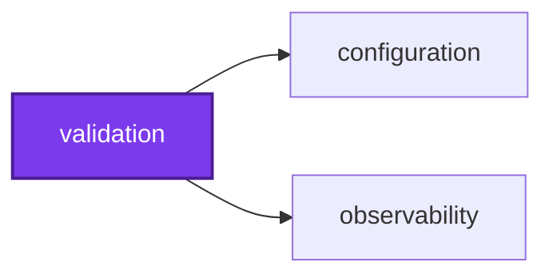
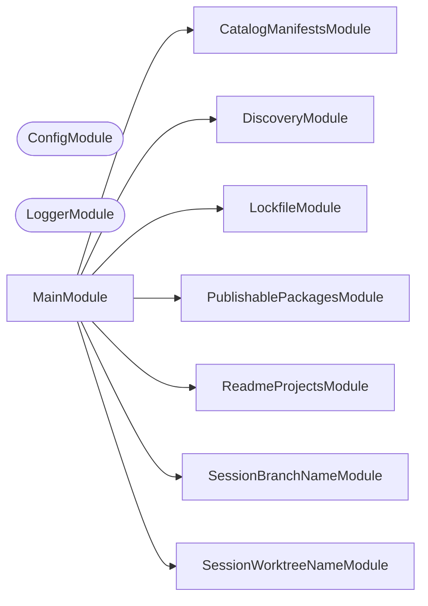

## 🕸️ Codependix

Dependency graphs exported by [codependix](https://github.com/Organizzolini/codebase/tree/main/projects/ic-suite/codependix/codependix-cli), regenerated by `nx run configuration:codependix:write`.

### Nx Neighborhood

<!-- codependix:start name="codependix-nx-projects" -->

<!-- codependix:end name="codependix-nx-projects" -->

### NestJS Module Graph

<!-- codependix:start name="codependix-nestjs-modules" -->


_Rounded modules are global: every module can inject them, so their edges are left out._
<!-- codependix:end name="codependix-nestjs-modules" -->

### File Imports

<!-- codependix:start name="codependix-file-imports" -->
```mermaid
graph LR
  file_callidescope_config_ts["callidescope.config.ts"]
  file_codependix_config_ts["codependix.config.ts"]
  file_codometer_config_ts["codometer.config.ts"]
  file_coinagerie_config_ts["coinagerie.config.ts"]
  file_eslint_config_ts["eslint.config.ts"]
  file_src_modules_catalog_manifests_catalog_manifests_command_ts["src/modules/catalog-manifests/catalog-manifests.command.ts"]
  file_src_modules_catalog_manifests_catalog_manifests_command_unit_test_ts["src/modules/catalog-manifests/catalog-manifests.command.unit.test.ts"]
  file_src_modules_catalog_manifests_catalog_manifests_constants_ts["src/modules/catalog-manifests/catalog-manifests.constants.ts"]
  file_src_modules_catalog_manifests_catalog_manifests_module_ts["src/modules/catalog-manifests/catalog-manifests.module.ts"]
  file_src_modules_catalog_manifests_catalog_manifests_module_unit_test_ts["src/modules/catalog-manifests/catalog-manifests.module.unit.test.ts"]
  file_src_modules_catalog_manifests_catalog_manifests_service_ts["src/modules/catalog-manifests/catalog-manifests.service.ts"]
  file_src_modules_catalog_manifests_catalog_manifests_service_unit_test_ts["src/modules/catalog-manifests/catalog-manifests.service.unit.test.ts"]
  file_src_modules_catalog_manifests_catalog_manifests_types_ts["src/modules/catalog-manifests/catalog-manifests.types.ts"]
  file_src_modules_lockfile_lockfile_command_ts["src/modules/lockfile/lockfile.command.ts"]
  file_src_modules_lockfile_lockfile_command_unit_test_ts["src/modules/lockfile/lockfile.command.unit.test.ts"]
  file_src_modules_lockfile_lockfile_constants_ts["src/modules/lockfile/lockfile.constants.ts"]
  file_src_modules_lockfile_lockfile_module_ts["src/modules/lockfile/lockfile.module.ts"]
  file_src_modules_lockfile_lockfile_module_unit_test_ts["src/modules/lockfile/lockfile.module.unit.test.ts"]
  file_src_modules_lockfile_lockfile_service_ts["src/modules/lockfile/lockfile.service.ts"]
  file_src_modules_lockfile_lockfile_service_unit_test_ts["src/modules/lockfile/lockfile.service.unit.test.ts"]
  file_src_modules_lockfile_lockfile_types_ts["src/modules/lockfile/lockfile.types.ts"]
  file_src_modules_publishable_packages_publishable_packages_checks_service_ts["src/modules/publishable-packages/publishable-packages-checks.service.ts"]
  file_src_modules_publishable_packages_publishable_packages_checks_service_unit_test_ts["src/modules/publishable-packages/publishable-packages-checks.service.unit.test.ts"]
  file_src_modules_publishable_packages_publishable_packages_consumer_constants_ts["src/modules/publishable-packages/publishable-packages-consumer.constants.ts"]
  file_src_modules_publishable_packages_publishable_packages_consumer_service_ts["src/modules/publishable-packages/publishable-packages-consumer.service.ts"]
  file_src_modules_publishable_packages_publishable_packages_consumer_service_unit_test_ts["src/modules/publishable-packages/publishable-packages-consumer.service.unit.test.ts"]
  file_src_modules_publishable_packages_publishable_packages_fixtures_constants_ts["src/modules/publishable-packages/publishable-packages-fixtures.constants.ts"]
  file_src_modules_publishable_packages_publishable_packages_process_service_ts["src/modules/publishable-packages/publishable-packages-process.service.ts"]
  file_src_modules_publishable_packages_publishable_packages_process_service_unit_test_ts["src/modules/publishable-packages/publishable-packages-process.service.unit.test.ts"]
  file_src_modules_publishable_packages_publishable_packages_command_ts["src/modules/publishable-packages/publishable-packages.command.ts"]
  file_src_modules_publishable_packages_publishable_packages_command_unit_test_ts["src/modules/publishable-packages/publishable-packages.command.unit.test.ts"]
  file_src_modules_publishable_packages_publishable_packages_constants_ts["src/modules/publishable-packages/publishable-packages.constants.ts"]
  file_src_modules_publishable_packages_publishable_packages_module_ts["src/modules/publishable-packages/publishable-packages.module.ts"]
  file_src_modules_publishable_packages_publishable_packages_module_unit_test_ts["src/modules/publishable-packages/publishable-packages.module.unit.test.ts"]
  file_src_modules_publishable_packages_publishable_packages_service_ts["src/modules/publishable-packages/publishable-packages.service.ts"]
  file_src_modules_publishable_packages_publishable_packages_service_unit_test_ts["src/modules/publishable-packages/publishable-packages.service.unit.test.ts"]
  file_src_modules_publishable_packages_publishable_packages_types_ts["src/modules/publishable-packages/publishable-packages.types.ts"]
  file_src_modules_readme_projects_readme_projects_command_ts["src/modules/readme-projects/readme-projects.command.ts"]
  file_src_modules_readme_projects_readme_projects_command_unit_test_ts["src/modules/readme-projects/readme-projects.command.unit.test.ts"]
  file_src_modules_readme_projects_readme_projects_constants_ts["src/modules/readme-projects/readme-projects.constants.ts"]
  file_src_modules_readme_projects_readme_projects_module_ts["src/modules/readme-projects/readme-projects.module.ts"]
  file_src_modules_readme_projects_readme_projects_module_unit_test_ts["src/modules/readme-projects/readme-projects.module.unit.test.ts"]
  file_src_modules_readme_projects_readme_projects_service_ts["src/modules/readme-projects/readme-projects.service.ts"]
  file_src_modules_readme_projects_readme_projects_service_unit_test_ts["src/modules/readme-projects/readme-projects.service.unit.test.ts"]
  file_src_modules_readme_projects_readme_projects_types_ts["src/modules/readme-projects/readme-projects.types.ts"]
  file_src_modules_session_branch_name_session_branch_name_git_service_ts["src/modules/session-branch-name/session-branch-name-git.service.ts"]
  file_src_modules_session_branch_name_session_branch_name_git_service_unit_test_ts["src/modules/session-branch-name/session-branch-name-git.service.unit.test.ts"]
  file_src_modules_session_branch_name_session_branch_name_command_ts["src/modules/session-branch-name/session-branch-name.command.ts"]
  file_src_modules_session_branch_name_session_branch_name_command_unit_test_ts["src/modules/session-branch-name/session-branch-name.command.unit.test.ts"]
  file_src_modules_session_branch_name_session_branch_name_constants_ts["src/modules/session-branch-name/session-branch-name.constants.ts"]
  file_src_modules_session_branch_name_session_branch_name_module_ts["src/modules/session-branch-name/session-branch-name.module.ts"]
  file_src_modules_session_branch_name_session_branch_name_module_unit_test_ts["src/modules/session-branch-name/session-branch-name.module.unit.test.ts"]
  file_src_modules_session_branch_name_session_branch_name_service_ts["src/modules/session-branch-name/session-branch-name.service.ts"]
  file_src_modules_session_branch_name_session_branch_name_service_unit_test_ts["src/modules/session-branch-name/session-branch-name.service.unit.test.ts"]
  file_src_modules_session_branch_name_session_branch_name_types_ts["src/modules/session-branch-name/session-branch-name.types.ts"]
  file_src_modules_session_worktree_name_session_worktree_name_git_service_ts["src/modules/session-worktree-name/session-worktree-name-git.service.ts"]
  file_src_modules_session_worktree_name_session_worktree_name_git_service_unit_test_ts["src/modules/session-worktree-name/session-worktree-name-git.service.unit.test.ts"]
  file_src_modules_session_worktree_name_session_worktree_name_command_ts["src/modules/session-worktree-name/session-worktree-name.command.ts"]
  file_src_modules_session_worktree_name_session_worktree_name_command_unit_test_ts["src/modules/session-worktree-name/session-worktree-name.command.unit.test.ts"]
  file_src_modules_session_worktree_name_session_worktree_name_constants_ts["src/modules/session-worktree-name/session-worktree-name.constants.ts"]
  file_src_modules_session_worktree_name_session_worktree_name_module_ts["src/modules/session-worktree-name/session-worktree-name.module.ts"]
  file_src_modules_session_worktree_name_session_worktree_name_module_unit_test_ts["src/modules/session-worktree-name/session-worktree-name.module.unit.test.ts"]
  file_src_modules_session_worktree_name_session_worktree_name_service_ts["src/modules/session-worktree-name/session-worktree-name.service.ts"]
  file_src_modules_session_worktree_name_session_worktree_name_service_unit_test_ts["src/modules/session-worktree-name/session-worktree-name.service.unit.test.ts"]
  file_src_modules_session_worktree_name_session_worktree_name_types_ts["src/modules/session-worktree-name/session-worktree-name.types.ts"]
  file_src_validation_constants_ts["src/validation.constants.ts"]
  file_src_validation_main_end_to_end_test_ts["src/validation.main.end-to-end.test.ts"]
  file_src_validation_main_ts["src/validation.main.ts"]
  file_src_validation_main_unit_test_ts["src/validation.main.unit.test.ts"]
  file_src_validation_module_ts["src/validation.module.ts"]
  file_src_validation_repl_ts["src/validation.repl.ts"]
  file_src_validation_repl_unit_test_ts["src/validation.repl.unit.test.ts"]
  file_testing_mocks_ts["testing/mocks.ts"]
  file_testing_setup_ts["testing/setup.ts"]
  file_vitest_config_ts["vitest.config.ts"]
  file_src_modules_catalog_manifests_catalog_manifests_command_ts --> file_src_modules_catalog_manifests_catalog_manifests_service_ts
  file_src_modules_catalog_manifests_catalog_manifests_command_unit_test_ts --> file_src_modules_catalog_manifests_catalog_manifests_command_ts
  file_src_modules_catalog_manifests_catalog_manifests_command_unit_test_ts --> file_src_modules_catalog_manifests_catalog_manifests_service_ts
  file_src_modules_catalog_manifests_catalog_manifests_command_unit_test_ts --> file_testing_mocks_ts
  file_src_modules_catalog_manifests_catalog_manifests_constants_ts --> file_src_modules_catalog_manifests_catalog_manifests_types_ts
  file_src_modules_catalog_manifests_catalog_manifests_module_ts --> file_src_modules_catalog_manifests_catalog_manifests_command_ts
  file_src_modules_catalog_manifests_catalog_manifests_module_ts --> file_src_modules_catalog_manifests_catalog_manifests_service_ts
  file_src_modules_catalog_manifests_catalog_manifests_module_unit_test_ts --> file_src_modules_catalog_manifests_catalog_manifests_command_ts
  file_src_modules_catalog_manifests_catalog_manifests_module_unit_test_ts --> file_src_modules_catalog_manifests_catalog_manifests_module_ts
  file_src_modules_catalog_manifests_catalog_manifests_module_unit_test_ts --> file_src_modules_catalog_manifests_catalog_manifests_service_ts
  file_src_modules_catalog_manifests_catalog_manifests_service_ts --> file_src_modules_catalog_manifests_catalog_manifests_constants_ts
  file_src_modules_catalog_manifests_catalog_manifests_service_ts --> file_src_modules_catalog_manifests_catalog_manifests_types_ts
  file_src_modules_catalog_manifests_catalog_manifests_service_unit_test_ts --> file_src_modules_catalog_manifests_catalog_manifests_service_ts
  file_src_modules_catalog_manifests_catalog_manifests_service_unit_test_ts --> file_src_modules_catalog_manifests_catalog_manifests_types_ts
  file_src_modules_lockfile_lockfile_command_ts --> file_src_modules_lockfile_lockfile_constants_ts
  file_src_modules_lockfile_lockfile_command_ts --> file_src_modules_lockfile_lockfile_service_ts
  file_src_modules_lockfile_lockfile_command_unit_test_ts --> file_src_modules_lockfile_lockfile_command_ts
  file_src_modules_lockfile_lockfile_command_unit_test_ts --> file_src_modules_lockfile_lockfile_service_ts
  file_src_modules_lockfile_lockfile_command_unit_test_ts --> file_testing_mocks_ts
  file_src_modules_lockfile_lockfile_module_ts --> file_src_modules_lockfile_lockfile_command_ts
  file_src_modules_lockfile_lockfile_module_ts --> file_src_modules_lockfile_lockfile_service_ts
  file_src_modules_lockfile_lockfile_module_unit_test_ts --> file_src_modules_lockfile_lockfile_command_ts
  file_src_modules_lockfile_lockfile_module_unit_test_ts --> file_src_modules_lockfile_lockfile_module_ts
  file_src_modules_lockfile_lockfile_module_unit_test_ts --> file_src_modules_lockfile_lockfile_service_ts
  file_src_modules_lockfile_lockfile_service_ts --> file_src_modules_lockfile_lockfile_constants_ts
  file_src_modules_lockfile_lockfile_service_ts --> file_src_modules_lockfile_lockfile_types_ts
  file_src_modules_lockfile_lockfile_service_unit_test_ts --> file_src_modules_lockfile_lockfile_constants_ts
  file_src_modules_lockfile_lockfile_service_unit_test_ts --> file_src_modules_lockfile_lockfile_service_ts
  file_src_modules_publishable_packages_publishable_packages_checks_service_ts --> file_src_modules_publishable_packages_publishable_packages_consumer_constants_ts
  file_src_modules_publishable_packages_publishable_packages_checks_service_ts --> file_src_modules_publishable_packages_publishable_packages_process_service_ts
  file_src_modules_publishable_packages_publishable_packages_checks_service_ts --> file_src_modules_publishable_packages_publishable_packages_types_ts
  file_src_modules_publishable_packages_publishable_packages_checks_service_unit_test_ts --> file_src_modules_publishable_packages_publishable_packages_checks_service_ts
  file_src_modules_publishable_packages_publishable_packages_checks_service_unit_test_ts --> file_src_modules_publishable_packages_publishable_packages_consumer_constants_ts
  file_src_modules_publishable_packages_publishable_packages_checks_service_unit_test_ts --> file_src_modules_publishable_packages_publishable_packages_process_service_ts
  file_src_modules_publishable_packages_publishable_packages_checks_service_unit_test_ts --> file_src_modules_publishable_packages_publishable_packages_types_ts
  file_src_modules_publishable_packages_publishable_packages_consumer_constants_ts --> file_src_modules_publishable_packages_publishable_packages_types_ts
  file_src_modules_publishable_packages_publishable_packages_consumer_service_ts --> file_src_modules_publishable_packages_publishable_packages_consumer_constants_ts
  file_src_modules_publishable_packages_publishable_packages_consumer_service_ts --> file_src_modules_publishable_packages_publishable_packages_fixtures_constants_ts
  file_src_modules_publishable_packages_publishable_packages_consumer_service_ts --> file_src_modules_publishable_packages_publishable_packages_process_service_ts
  file_src_modules_publishable_packages_publishable_packages_consumer_service_ts --> file_src_modules_publishable_packages_publishable_packages_types_ts
  file_src_modules_publishable_packages_publishable_packages_consumer_service_unit_test_ts --> file_src_modules_publishable_packages_publishable_packages_consumer_constants_ts
  file_src_modules_publishable_packages_publishable_packages_consumer_service_unit_test_ts --> file_src_modules_publishable_packages_publishable_packages_consumer_service_ts
  file_src_modules_publishable_packages_publishable_packages_consumer_service_unit_test_ts --> file_src_modules_publishable_packages_publishable_packages_process_service_ts
  file_src_modules_publishable_packages_publishable_packages_consumer_service_unit_test_ts --> file_src_modules_publishable_packages_publishable_packages_types_ts
  file_src_modules_publishable_packages_publishable_packages_process_service_ts --> file_src_modules_publishable_packages_publishable_packages_consumer_constants_ts
  file_src_modules_publishable_packages_publishable_packages_process_service_ts --> file_src_modules_publishable_packages_publishable_packages_types_ts
  file_src_modules_publishable_packages_publishable_packages_process_service_unit_test_ts --> file_src_modules_publishable_packages_publishable_packages_process_service_ts
  file_src_modules_publishable_packages_publishable_packages_process_service_unit_test_ts --> file_src_modules_publishable_packages_publishable_packages_types_ts
  file_src_modules_publishable_packages_publishable_packages_command_ts --> file_src_modules_publishable_packages_publishable_packages_constants_ts
  file_src_modules_publishable_packages_publishable_packages_command_ts --> file_src_modules_publishable_packages_publishable_packages_service_ts
  file_src_modules_publishable_packages_publishable_packages_command_ts --> file_src_modules_publishable_packages_publishable_packages_types_ts
  file_src_modules_publishable_packages_publishable_packages_command_unit_test_ts --> file_src_modules_publishable_packages_publishable_packages_command_ts
  file_src_modules_publishable_packages_publishable_packages_command_unit_test_ts --> file_src_modules_publishable_packages_publishable_packages_constants_ts
  file_src_modules_publishable_packages_publishable_packages_command_unit_test_ts --> file_src_modules_publishable_packages_publishable_packages_service_ts
  file_src_modules_publishable_packages_publishable_packages_command_unit_test_ts --> file_testing_mocks_ts
  file_src_modules_publishable_packages_publishable_packages_module_ts --> file_src_modules_publishable_packages_publishable_packages_checks_service_ts
  file_src_modules_publishable_packages_publishable_packages_module_ts --> file_src_modules_publishable_packages_publishable_packages_consumer_service_ts
  file_src_modules_publishable_packages_publishable_packages_module_ts --> file_src_modules_publishable_packages_publishable_packages_process_service_ts
  file_src_modules_publishable_packages_publishable_packages_module_ts --> file_src_modules_publishable_packages_publishable_packages_command_ts
  file_src_modules_publishable_packages_publishable_packages_module_ts --> file_src_modules_publishable_packages_publishable_packages_service_ts
  file_src_modules_publishable_packages_publishable_packages_module_unit_test_ts --> file_src_modules_publishable_packages_publishable_packages_command_ts
  file_src_modules_publishable_packages_publishable_packages_module_unit_test_ts --> file_src_modules_publishable_packages_publishable_packages_module_ts
  file_src_modules_publishable_packages_publishable_packages_module_unit_test_ts --> file_src_modules_publishable_packages_publishable_packages_service_ts
  file_src_modules_publishable_packages_publishable_packages_service_ts --> file_src_modules_publishable_packages_publishable_packages_checks_service_ts
  file_src_modules_publishable_packages_publishable_packages_service_ts --> file_src_modules_publishable_packages_publishable_packages_consumer_service_ts
  file_src_modules_publishable_packages_publishable_packages_service_ts --> file_src_modules_publishable_packages_publishable_packages_constants_ts
  file_src_modules_publishable_packages_publishable_packages_service_ts --> file_src_modules_publishable_packages_publishable_packages_types_ts
  file_src_modules_publishable_packages_publishable_packages_service_unit_test_ts --> file_src_modules_publishable_packages_publishable_packages_checks_service_ts
  file_src_modules_publishable_packages_publishable_packages_service_unit_test_ts --> file_src_modules_publishable_packages_publishable_packages_consumer_service_ts
  file_src_modules_publishable_packages_publishable_packages_service_unit_test_ts --> file_src_modules_publishable_packages_publishable_packages_constants_ts
  file_src_modules_publishable_packages_publishable_packages_service_unit_test_ts --> file_src_modules_publishable_packages_publishable_packages_service_ts
  file_src_modules_readme_projects_readme_projects_command_ts --> file_src_modules_readme_projects_readme_projects_service_ts
  file_src_modules_readme_projects_readme_projects_command_unit_test_ts --> file_src_modules_readme_projects_readme_projects_command_ts
  file_src_modules_readme_projects_readme_projects_command_unit_test_ts --> file_src_modules_readme_projects_readme_projects_service_ts
  file_src_modules_readme_projects_readme_projects_command_unit_test_ts --> file_testing_mocks_ts
  file_src_modules_readme_projects_readme_projects_module_ts --> file_src_modules_readme_projects_readme_projects_command_ts
  file_src_modules_readme_projects_readme_projects_module_ts --> file_src_modules_readme_projects_readme_projects_service_ts
  file_src_modules_readme_projects_readme_projects_module_unit_test_ts --> file_src_modules_readme_projects_readme_projects_command_ts
  file_src_modules_readme_projects_readme_projects_module_unit_test_ts --> file_src_modules_readme_projects_readme_projects_module_ts
  file_src_modules_readme_projects_readme_projects_module_unit_test_ts --> file_src_modules_readme_projects_readme_projects_service_ts
  file_src_modules_readme_projects_readme_projects_service_ts --> file_src_modules_readme_projects_readme_projects_constants_ts
  file_src_modules_readme_projects_readme_projects_service_unit_test_ts --> file_src_modules_readme_projects_readme_projects_service_ts
  file_src_modules_session_branch_name_session_branch_name_git_service_ts --> file_src_modules_session_branch_name_session_branch_name_types_ts
  file_src_modules_session_branch_name_session_branch_name_git_service_unit_test_ts --> file_src_modules_session_branch_name_session_branch_name_git_service_ts
  file_src_modules_session_branch_name_session_branch_name_command_ts --> file_src_modules_session_branch_name_session_branch_name_constants_ts
  file_src_modules_session_branch_name_session_branch_name_command_ts --> file_src_modules_session_branch_name_session_branch_name_service_ts
  file_src_modules_session_branch_name_session_branch_name_command_unit_test_ts --> file_src_modules_session_branch_name_session_branch_name_git_service_ts
  file_src_modules_session_branch_name_session_branch_name_command_unit_test_ts --> file_src_modules_session_branch_name_session_branch_name_command_ts
  file_src_modules_session_branch_name_session_branch_name_command_unit_test_ts --> file_src_modules_session_branch_name_session_branch_name_service_ts
  file_src_modules_session_branch_name_session_branch_name_command_unit_test_ts --> file_src_modules_session_branch_name_session_branch_name_types_ts
  file_src_modules_session_branch_name_session_branch_name_module_ts --> file_src_modules_session_branch_name_session_branch_name_git_service_ts
  file_src_modules_session_branch_name_session_branch_name_module_ts --> file_src_modules_session_branch_name_session_branch_name_command_ts
  file_src_modules_session_branch_name_session_branch_name_module_ts --> file_src_modules_session_branch_name_session_branch_name_service_ts
  file_src_modules_session_branch_name_session_branch_name_module_unit_test_ts --> file_src_modules_session_branch_name_session_branch_name_git_service_ts
  file_src_modules_session_branch_name_session_branch_name_module_unit_test_ts --> file_src_modules_session_branch_name_session_branch_name_command_ts
  file_src_modules_session_branch_name_session_branch_name_module_unit_test_ts --> file_src_modules_session_branch_name_session_branch_name_module_ts
  file_src_modules_session_branch_name_session_branch_name_module_unit_test_ts --> file_src_modules_session_branch_name_session_branch_name_service_ts
  file_src_modules_session_branch_name_session_branch_name_service_ts --> file_src_modules_session_branch_name_session_branch_name_git_service_ts
  file_src_modules_session_branch_name_session_branch_name_service_ts --> file_src_modules_session_branch_name_session_branch_name_constants_ts
  file_src_modules_session_branch_name_session_branch_name_service_ts --> file_src_modules_session_branch_name_session_branch_name_types_ts
  file_src_modules_session_branch_name_session_branch_name_service_unit_test_ts --> file_src_modules_session_branch_name_session_branch_name_git_service_ts
  file_src_modules_session_branch_name_session_branch_name_service_unit_test_ts --> file_src_modules_session_branch_name_session_branch_name_service_ts
  file_src_modules_session_worktree_name_session_worktree_name_git_service_ts --> file_src_modules_session_worktree_name_session_worktree_name_types_ts
  file_src_modules_session_worktree_name_session_worktree_name_git_service_unit_test_ts --> file_src_modules_session_worktree_name_session_worktree_name_git_service_ts
  file_src_modules_session_worktree_name_session_worktree_name_command_ts --> file_src_modules_session_worktree_name_session_worktree_name_constants_ts
  file_src_modules_session_worktree_name_session_worktree_name_command_ts --> file_src_modules_session_worktree_name_session_worktree_name_service_ts
  file_src_modules_session_worktree_name_session_worktree_name_command_unit_test_ts --> file_src_modules_session_worktree_name_session_worktree_name_git_service_ts
  file_src_modules_session_worktree_name_session_worktree_name_command_unit_test_ts --> file_src_modules_session_worktree_name_session_worktree_name_command_ts
  file_src_modules_session_worktree_name_session_worktree_name_command_unit_test_ts --> file_src_modules_session_worktree_name_session_worktree_name_service_ts
  file_src_modules_session_worktree_name_session_worktree_name_command_unit_test_ts --> file_src_modules_session_worktree_name_session_worktree_name_types_ts
  file_src_modules_session_worktree_name_session_worktree_name_module_ts --> file_src_modules_session_worktree_name_session_worktree_name_git_service_ts
  file_src_modules_session_worktree_name_session_worktree_name_module_ts --> file_src_modules_session_worktree_name_session_worktree_name_command_ts
  file_src_modules_session_worktree_name_session_worktree_name_module_ts --> file_src_modules_session_worktree_name_session_worktree_name_service_ts
  file_src_modules_session_worktree_name_session_worktree_name_module_unit_test_ts --> file_src_modules_session_worktree_name_session_worktree_name_git_service_ts
  file_src_modules_session_worktree_name_session_worktree_name_module_unit_test_ts --> file_src_modules_session_worktree_name_session_worktree_name_command_ts
  file_src_modules_session_worktree_name_session_worktree_name_module_unit_test_ts --> file_src_modules_session_worktree_name_session_worktree_name_module_ts
  file_src_modules_session_worktree_name_session_worktree_name_module_unit_test_ts --> file_src_modules_session_worktree_name_session_worktree_name_service_ts
  file_src_modules_session_worktree_name_session_worktree_name_service_ts --> file_src_modules_session_worktree_name_session_worktree_name_git_service_ts
  file_src_modules_session_worktree_name_session_worktree_name_service_ts --> file_src_modules_session_worktree_name_session_worktree_name_constants_ts
  file_src_modules_session_worktree_name_session_worktree_name_service_ts --> file_src_modules_session_worktree_name_session_worktree_name_types_ts
  file_src_modules_session_worktree_name_session_worktree_name_service_unit_test_ts --> file_src_modules_session_worktree_name_session_worktree_name_git_service_ts
  file_src_modules_session_worktree_name_session_worktree_name_service_unit_test_ts --> file_src_modules_session_worktree_name_session_worktree_name_service_ts
  file_src_validation_main_end_to_end_test_ts --> file_src_validation_constants_ts
  file_src_validation_main_ts --> file_src_validation_module_ts
  file_src_validation_main_unit_test_ts --> file_src_modules_catalog_manifests_catalog_manifests_module_ts
  file_src_validation_main_unit_test_ts --> file_src_modules_lockfile_lockfile_module_ts
  file_src_validation_main_unit_test_ts --> file_src_modules_publishable_packages_publishable_packages_module_ts
  file_src_validation_main_unit_test_ts --> file_src_modules_readme_projects_readme_projects_module_ts
  file_src_validation_main_unit_test_ts --> file_src_modules_session_branch_name_session_branch_name_module_ts
  file_src_validation_main_unit_test_ts --> file_src_modules_session_worktree_name_session_worktree_name_module_ts
  file_src_validation_module_ts --> file_src_modules_catalog_manifests_catalog_manifests_module_ts
  file_src_validation_module_ts --> file_src_modules_lockfile_lockfile_module_ts
  file_src_validation_module_ts --> file_src_modules_publishable_packages_publishable_packages_module_ts
  file_src_validation_module_ts --> file_src_modules_readme_projects_readme_projects_module_ts
  file_src_validation_module_ts --> file_src_modules_session_branch_name_session_branch_name_module_ts
  file_src_validation_module_ts --> file_src_modules_session_worktree_name_session_worktree_name_module_ts
  file_src_validation_module_ts --> file_src_validation_constants_ts
  file_src_validation_repl_ts --> file_src_validation_module_ts
```
<!-- codependix:end name="codependix-file-imports" -->
